# PINNStudio in detail

This page collects the detailed descriptions that used to be part of the README: an overview of what PINNStudio
does, the interface, every feature with links to its source code, a walkthrough for a problem of your own, how
PINNStudio works and how fast it trains, the layout of the repository, and the references. The
[documentation website](https://asfandyarkhan72.github.io/PINNStudio/) covers the same ground in more depth, and
the examples with their results are on [benchmarks/examples.md](benchmarks/examples.md).

- [Overview](#overview)
- [Demo Video](#demo-video)
- [The Interface](#the-interface)
- [Features](#features)
- [Solving Your Own Problem](#solving-your-own-problem)
- [How It Works](#how-it-works)
- [Repository Structure](#repository-structure)
- [References](#references)

## Overview

**PINNStudio** is a scientific computing environment for solving differential equations with physics-informed neural networks (PINNs) and related scientific machine learning methods, without writing any code. You describe the problem — the equations, the domain, the boundary and initial conditions, the network and how it should be trained — and PINNStudio trains the model, tracks it while it runs, and gives back the solution, its error against reference data, plots and animations, and the trained model ready to reload.

Setting up a PINN by hand means writing a new script for every problem: the residual of the equations through automatic differentiation, the sampling of collocation points, the weighting of the loss terms, the optimizer schedule, and then the plotting and error analysis afterwards. Each of these is easy to get subtly wrong. PINNStudio puts all of it into one place, so researchers and students in science and engineering — including those new to scientific computing or machine learning — can spend their time on the physics of their problem rather than on the code around it.

**What it can solve**

- **Forward and inverse problems:** solve a known equation, or learn unknown coefficients or whole unknown fields from measured data.
- **ODEs and PDEs in 1D, 2D and 3D**, steady or time-dependent, including coupled multi-output systems, integro-differential and fractional equations, typed in a readable form such as `du_t + u*du_x - 0.01/pi*du_xx`.
- **Many kinds of domains** — intervals, rectangles, disks, polygons, cuboids, spheres, and custom shapes combined from them (e.g. a domain with a hole) — with Dirichlet, Neumann, Robin, periodic and point-data conditions, or conditions imposed exactly through the network output.

**How it trains**

- **Multi-phase training** (e.g. Adam followed by L-BFGS) with learning-rate schedules and loss weights per phase.
- **Adaptive methods:** residual-based adaptive refinement (RAR), which adds points where the error is largest; time-adaptive training, which marches through time in steps, each starting from the previous one (transfer learning); initial-condition-guided pre-training. The Loss weights page adds automatic weighting (per-point residual weights, RBA or SA-PINN, which concentrate training where the equation is worst satisfied, and causal training) and exact constraints (an initial condition built into the network, and exact periodicity), each set with one tick box. Which of these help, and on which problems, is measured in the [training methods study](benchmarks/training_methods.md).
- **Point resampling, early stopping, checkpointing and time budgets**, and live monitors of any output or derivative during training.
- **Parameter sweeps** over almost any setting — one at a time, all combinations, paired values, or Bayesian search — with a summary of how the error changes with each parameter.

**What you get back**

- A live training log and loss plot, and error analysis against reference data or an exact formula (relative $L_2$, MSE, maximum error).
- A history of every saved run, with any of them compared on one plot, and figures and tables that copy straight into a paper or a spreadsheet.
- Line, surface and animated solution plots, solution data export, and a saved model that can be reloaded and visualized again without retraining.
- A standalone Python script for every problem, so the work can be inspected, shared and reproduced outside PINNStudio. Solving in the window is as fast as running that script yourself ([timing study](#speed-pinnstudio-and-a-plain-script)).

**Ready-to-run examples.** PINNStudio comes with 64 worked examples, from simple ODEs to the Navier–Stokes equations in 3D, including published PINN benchmarks (Raissi et al., Wight & Zhao, Mattey & Ghosh, and others) and DeepXDE's examples. Each one loads in one click, and 62 of them come with an exact solution or reference data to compare against — see [Examples](benchmarks/examples.md).

PINNStudio is under active development, and we are extending it with newer scientific machine learning and PINN methods, aimed at solving harder problems more accurately and faster.

## Demo Video

[](https://youtu.be/5ILxuutvEZw)

*Click to watch the full walkthrough on YouTube: loading an example, setting up your own PDE, sketching a domain and its boundary conditions, training with live loss, error analysis, run history and parameter sweeps.*

## The Interface

PINNStudio's window follows the layout of finite-element tools such as COMSOL: a **model tree** on the left, the **settings** of the selected part of the problem in the middle, and **graphics** on the right, with the **Training Log** and the generated **Script** below them. Every panel can be resized, and the layout is remembered (*View → Reset Layout* restores it).

<p align="center">
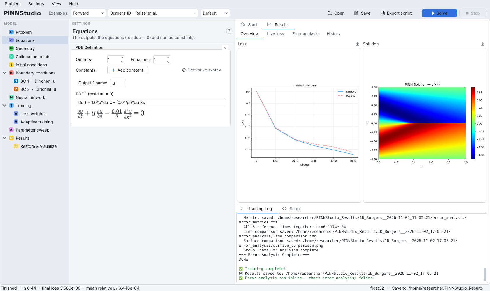
</p>

- **Model tree.** Problem, Equations, Inverse problem (for an inverse problem), Geometry, Collocation points, Initial and Boundary conditions (one node per condition), Neural network, Training with its Loss weights and Adaptive training, Parameter sweep, and Results with Restore & visualize. A node with a setting that would stop **Solve** is marked, and the toolbar says how many there are. Right-click a node for its actions (add, duplicate or delete a boundary condition, add a training phase, fold all sections), and the **?** next to a page's title opens its part of this page.
- **Settings.** Each page is a short form whose sections fold to their titles. Equations are typeset as you type them, and any name PINNStudio does not recognize is flagged.
- **Graphics.** *Start* (new problem, open, recent problems, every forward example; the inverse-only examples are in the toolbar's Examples list under *Inverse*), *Results*, and the domain — *Geometry* for any 2D/3D shape, or the *Sketch* when the domain is drawn.
- **Toolbar and status bar.** Examples (with Forward / Inverse and the *Default* / *Tuned* settings), Open, Save, Export script, **Solve** and **Stop** are always in the toolbar; the status bar shows the run's phase, progress, loss and the time left, and the save folder.

<table>
<tr>
<td width="50%" align="center">
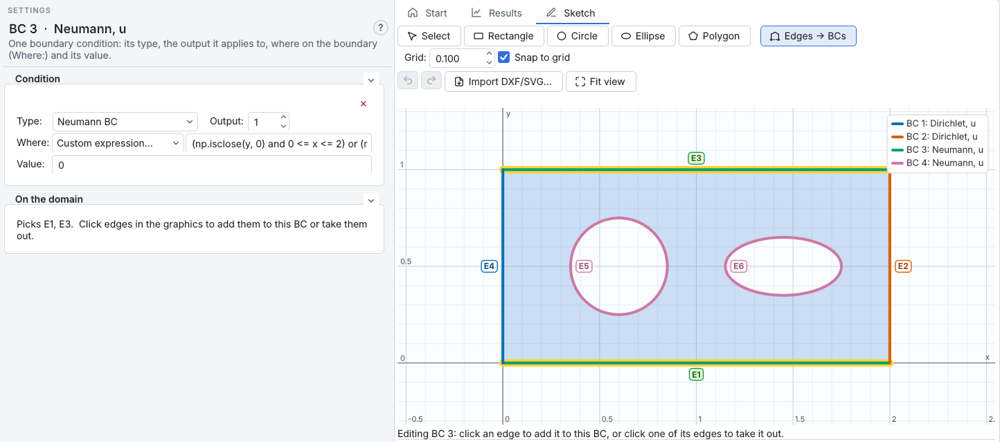
<sub><strong>Sketch</strong> — draw the domain, then click its edges to give them boundary conditions</sub>
</td>
<td width="50%" align="center">
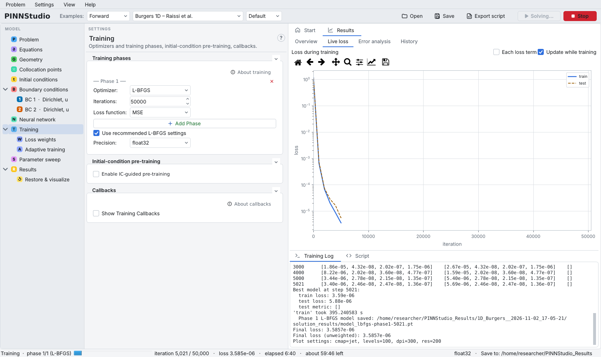
<sub><strong>Live loss</strong> — the loss while the model trains (or each loss term, with <em>Each loss term</em>)</sub>
</td>
</tr>
<tr>
<td width="50%" align="center">
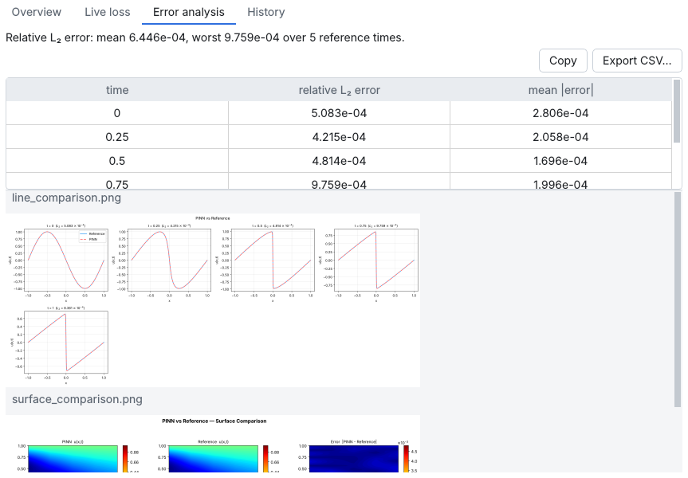
<sub><strong>Error analysis</strong> — the errors at each reference time, ready to copy or export</sub>
</td>
<td width="50%" align="center">
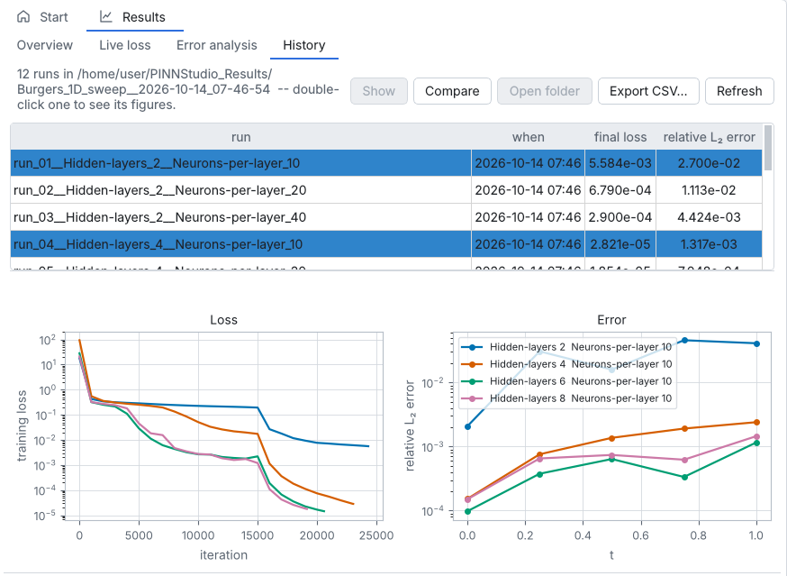
<sub><strong>History</strong> — every saved run, and several compared on one plot</sub>
</td>
</tr>
</table>

<details>
<summary><strong>Keyboard shortcuts</strong></summary>

| Shortcut | Action |
|---|---|
| Ctrl+Enter or F5 | Solve |
| Shift+F5 | Stop |
| Ctrl+S / Ctrl+Shift+S | Save / Save As |
| Ctrl+O | Open a saved problem |
| Ctrl+E | Export the DeepXDE script |
| Ctrl+Z / Ctrl+Y | Undo / redo in the Sketch |

</details>

Three themes are built in — **Studio Light** (the default), **Studio Dark** and **Solarized Dark** — with an accent colour and a UI scale, under *Settings → Display Settings*.

## Features

### Problem Setup

<details>
<summary><strong>ODE, 1D, 2D, and 3D problems</strong></summary>

<!-- source: pinnstudio/core/codegen.py::_ode_to_1d | ODEs ; pinnstudio/core/codegen.py::_integral_helper_code | integrals ; pinnstudio/core/codegen.py::_frac_helper_code | fractional equations ; pinnstudio/ui/main_window.py::MainWindow._on_dim_changed | dimension switch -->
**Source code:** [ODEs](https://github.com/AsfandyarKhan72/PINNStudio/blob/main/pinnstudio/core/codegen.py#L4473-L4531) (`codegen.py`) · [integrals](https://github.com/AsfandyarKhan72/PINNStudio/blob/main/pinnstudio/core/codegen.py#L4574-L4592) (`codegen.py`) · [fractional equations](https://github.com/AsfandyarKhan72/PINNStudio/blob/main/pinnstudio/core/codegen.py#L4641-L4667) (`codegen.py`) · [dimension switch](https://github.com/AsfandyarKhan72/PINNStudio/blob/main/pinnstudio/ui/main_window.py#L5905-L6006) (`main_window.py`)

Problems are defined over `t` (ODEs), `(x, t)`, `(x, y, t)` or `(x, y, z, t)`, or without the time axis for steady-state problems (*Stationary* on the Problem page) in `x`, `(x, y)` or `(x, y, z)`. Changing the dimension rebuilds the related controls (geometry, boundary-condition rows, plot options), so no setting from the previous dimension is carried over by mistake.

**ODEs** have time as the only variable: derivatives are written `du_t`, `du_tt` (one equation per output for a system, e.g. `dy1_t - y2|dy2_t + y1`), initial values are set in the Initial Conditions panel, and *Start*/*End* in a boundary-condition row gives a condition at either end of the time range. An ODE can also contain integrals of the solution, `integral(f)` from t₀ to t with f written in the integration variable `s`, `t` and the outputs at s — for integro-differential equations such as `du_t + u - integral(exp(s - t)*u)`.

**Fractional equations**: `frac(u)` is the fractional operator of order α applied to output u (DeepXDE's FPDE discretization — in 1D the sum of the left and right Riemann–Liouville derivatives, in 2D/3D the integral of the directional derivative over all directions). The fractional settings (α, resolution, mesh) appear under the equations as soon as `frac(...)` is used, and α can be an unknown to learn from data. See the ODE and fractional examples under [Examples](benchmarks/examples.md).

</details>

<details>
<summary><strong>Forward and inverse problems</strong></summary>

<!-- source: pinnstudio/core/codegen.py::_parse_inverse_variables | unknown parameters ; pinnstudio/core/codegen.py::_parse_inverse_obs_files | measured data ; pinnstudio/ui/main_window.py::MainWindow._build_inverse_panel | Inverse panel -->
**Source code:** [unknown parameters](https://github.com/AsfandyarKhan72/PINNStudio/blob/main/pinnstudio/core/codegen.py#L639-L693) (`codegen.py`) · [measured data](https://github.com/AsfandyarKhan72/PINNStudio/blob/main/pinnstudio/core/codegen.py#L746-L800) (`codegen.py`) · [Inverse panel](https://github.com/AsfandyarKhan72/PINNStudio/blob/main/pinnstudio/ui/main_window.py#L4202-L4400) (`main_window.py`)

**Forward**: every coefficient is known and PINNStudio solves for the field. **Inverse**: one or more coefficients — or a whole unknown field — are learned from measured data while the field is solved for at the same time. Any number of unknowns can be learned in one problem, each with its own initial guess and, when it is known, its true value for comparison. Measured data comes from one or more files, each with its own loss weight, and can be a single output or any expression of the outputs (e.g. $|h| = \sqrt{u^2 + v^2}$). Each measured point is also a training point by default, so the equation is checked there as well as the data (*Check the equation at the measured points too*). Unticked, the points are only in the data loss: training is faster with a lot of data, and in the [anchors study](benchmarks/anchors_study.py) the parameters came out about as accurate on most inverse examples. Keep it on with only a few measured points (Brinkman-Forchheimer has 5, and without it the parameters were 15–40 times off).

Fewer measured points can be used without changing the files (*Measured data → Use*): **All points**; **Grid: points per axis**, which keeps that many evenly spaced values along each space axis, the edges included (a 101 × 101 grid with 51 gives 51 × 51; each time in a file is reduced the same way); or **Random points**, that many picked with the run's random seed, so a run repeats. It applies to every measured-data file, and a line under it says what the files hold and what is kept (*101 × 101 grid, 10,201 points → 51 × 51 = 2,601 points*). A file that is not a grid (scattered points, or different grids at different times) gets random points in grid mode: the number per axis to the power of the axes, time counted as one (51 per axis for scattered (x, t) data keeps 51² points). Both the Solve script and the exported script do the reduction, so the exported script shows exactly which points were used. Allen-Cahn 3D's Inverse mode uses every second point of its 51³ grid (grid 26). A sweep over *Measured data: grid points per axis* or *random points* is a data-size study: how many points the parameters need (see [Parameter sweep](#parameter-sweep)).

Every PINNStudio template except the two Cahn-Hilliard 1D ones, and several DeepXDE examples, have an Inverse mode that loads with its measured-data file already set — pick the example from the **Inverse** list of Examples.

</details>

<details>
<summary><strong>Equation editor for single equations and coupled systems</strong></summary>

<!-- source: pinnstudio/ui/main_window.py::MainWindow._build_pde_inputs | equation inputs ; pinnstudio/ui/equation.py | live equation preview ; pinnstudio/core/constants.py | constants -->
**Source code:** [equation inputs](https://github.com/AsfandyarKhan72/PINNStudio/blob/main/pinnstudio/ui/main_window.py#L7863-L7972) (`main_window.py`) · [live equation preview](https://github.com/AsfandyarKhan72/PINNStudio/blob/main/pinnstudio/ui/equation.py) (`equation.py`) · [constants](https://github.com/AsfandyarKhan72/PINNStudio/blob/main/pinnstudio/core/constants.py) (`constants.py`)

Equations are typed as residuals, not chosen from presets. Derivatives use a plain `d<output>_<variables>` naming — `du_x`, `du_xx`, `du_t`, `du_xy`, up to mixed fourth-order terms such as `du_xxyy` — so anything from a diffusion equation to a coupled higher-order system can be written directly. Coupled systems work the same way: a second output `v` brings `dv_x`, `dv_t` and so on (the *Burgers 2D – Mathias et al.* and *Schrödinger 1D* examples are two-output systems).

The coordinates `x`, `y`, `z` and `t` can appear in an equation along with standard functions (`sin`, `exp`, `cosh`, ...), so source terms such as `-du_xx - pi**2*sin(pi*x)` are written as they read. The number of **equations** is set separately from the number of **outputs**: for example, three residuals for one output (DeepXDE's American put example), or one equation for two outputs when the second output is an unknown field to be learned.

**Constants** give names to numbers used across the problem — e.g. `Re = 20`, `nu = 1/Re` — and can be used in the equations, boundary and initial conditions, transforms and the exact-solution reference.

</details>

<details>
<summary><strong>Boundary and initial conditions</strong></summary>

<!-- source: pinnstudio/core/codegen.py::_clean_bc_row_code | boundary conditions in the script ; pinnstudio/ui/main_window.py::MainWindow._add_custom_bc_entry | boundary-condition rows -->
**Source code:** [boundary conditions in the script](https://github.com/AsfandyarKhan72/PINNStudio/blob/main/pinnstudio/core/codegen.py#L9004-L9185) (`codegen.py`) · [boundary-condition rows](https://github.com/AsfandyarKhan72/PINNStudio/blob/main/pinnstudio/ui/main_window.py#L8520-L8999) (`main_window.py`)

Boundary conditions are rows in a panel, each with its type, the output(s) it applies to, and **where** it applies:

- **Types:** Dirichlet, Neumann, Robin, Periodic, Point Set (values at given points), Point Set Operator (an expression of the outputs and their derivatives at given points), Operator (any expression, applied on the boundary or at the initial time), and Interface 2D (DeepXDE's `Interface2DBC`, pairing two matching boundary pieces).
- **Where:** *Whole boundary*, a side (*Left*, *Right*, *Bottom*, *Top*, and *Front*/*Back* in 3D), or *Custom expression…*, which opens a box for any true/false expression in `x`, `y`, `z`. Periodic conditions need no *Where*: *Periodic in: x* ties the left and right sides together. The side names and the domain limits (`x_min`, `x_max`, ...) follow your domain, so `left or right` or `x <= x_min` stay correct if the domain changes; a curved boundary piece uses an expression such as `np.isclose(x**2 + y**2, 0.25)`.
- Neumann and Robin values are the derivative along the outward normal, $du/dn$ ($+du/dx$ on a right side, $-du/dx$ on a left side).
- Operator conditions use the same `u`, `du_x`, `du_xx` notation as the equations. Applied at the initial time, they give a second initial condition such as $\partial u/\partial t = 0$ at $t = 0$ for a wave equation.
- Point Set rows take their points from a file, a typed list (`1`, `0.2, 0.5`, `0,0; 1,0.5`) or N random points, with values from the file or a formula; they can target several outputs at once and can be minibatched.

Initial conditions are given per output as an expression or loaded from a data file. Boundary and initial conditions can also be imposed exactly through an output transform (see *Input and output transforms* below).

</details>

<details>
<summary><strong>Geometry, the Sketch and boundary edges</strong></summary>

<!-- source: pinnstudio/core/codegen.py::_build_custom_geom_code | custom geometry ; pinnstudio/ui/sketch_canvas.py | Sketch ; pinnstudio/ui/sketch_edges.py | boundary edges ; pinnstudio/ui/sketch_import.py | DXF/SVG import -->
**Source code:** [custom geometry](https://github.com/AsfandyarKhan72/PINNStudio/blob/main/pinnstudio/core/codegen.py#L366-L413) (`codegen.py`) · [Sketch](https://github.com/AsfandyarKhan72/PINNStudio/blob/main/pinnstudio/ui/sketch_canvas.py) (`sketch_canvas.py`) · [boundary edges](https://github.com/AsfandyarKhan72/PINNStudio/blob/main/pinnstudio/ui/sketch_edges.py) (`sketch_edges.py`) · [DXF/SVG import](https://github.com/AsfandyarKhan72/PINNStudio/blob/main/pinnstudio/ui/sketch_import.py) (`sketch_import.py`)

1D problems use an interval; 2D problems a **Rectangle, Disk, Ellipse, Triangle** or any **Polygon** (given by its vertices); 3D problems a **Cuboid** or **Sphere**. Bounds accept expressions such as `pi/2`, and **Custom** geometry combines any number of shapes with **Union**, **Subtract** and **Intersect**.

A domain can also be **sketched** (*Geometry → Shape → Sketch*): rectangles, circles, ellipses and polygons drawn on a grid in 2D, boxes and spheres on x–y, x–z or y–z views in 3D, each added, cut out or intersected. Shapes can be typed exactly (`0, 0, 2, 1` for a rectangle, `0.6, 0.5, 0.25` for a circle), imported from a **DXF or SVG** drawing (outlines inside others become holes, arcs stay arcs), moved, deleted, and undone with Ctrl+Z / Ctrl+Y. A sketch is stored as ordinary Custom-geometry rows, so it is saved with the problem and exported like any other domain.

Every 2D and 3D domain is drawn next to the settings with its boundary split into numbered **edges** (faces in 3D) — the straight sides and arcs that actually bound it — each coloured by the boundary condition that uses it. Select a boundary condition in the model tree and click edges to add them to it or take them out: its *Where* is written for you (`np.isclose(x, 0) and 0 <= y <= 1`, `abs(np.hypot(x - 0.6, y - 0.5) - 0.25) < 3e-05`, ...) and works the same in the exported script. A *Where* you type yourself (or one that came with an example) is shown and edited the same way: clicking an edge it picks takes the edge out, and the *Where* is written again from the edges it still picks (unless it picks only part of an edge, which you then change on the BC's page). Named constants are understood too (the hole of Helmholtz 2D, `np.isclose(x**2 + y**2, R**2)`), and sides that an output transform fixes exactly (Helmholtz 2D Dirichlet, $x(1-x)y(1-y)N$) are drawn in black as *Exact: set by the output transform* rather than as having no condition.

For a 3D domain the *View* list also has **3D**: the whole domain as a shaded solid you can rotate and zoom, with *Iso*, *Top*, *Front* and *Side* buttons. Only the surfaces that bound the domain are drawn, so a cut-out shows as a hole; each face carries its label and the colour of its boundary condition, and the slice the flat views show is drawn as a translucent plane. *Show points* adds the training points, sampled by DeepXDE with the Collocation Points settings, to check that none fall inside a cut-out. Shapes are still drawn and faces picked in the flat views or the face list.

<table>
<tr>
<td width="50%" align="center">
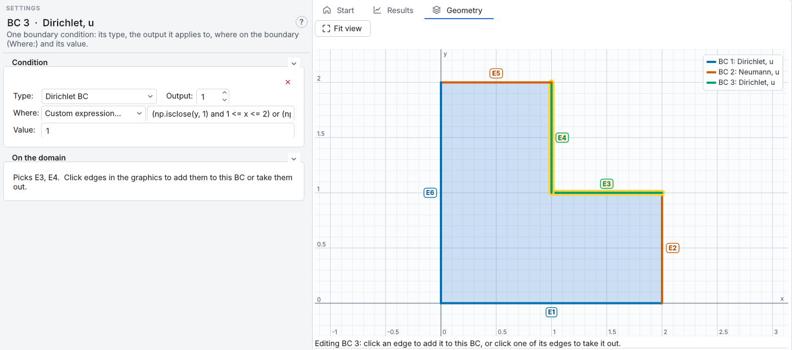
<sub><strong>Built-in shape</strong> — an L-shaped polygon, two re-entrant edges picked for BC 3</sub>
</td>
<td width="50%" align="center">
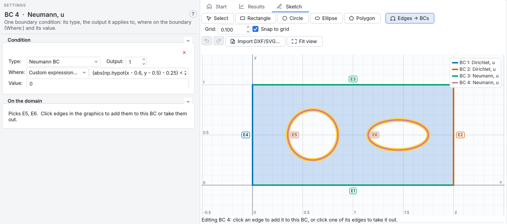
<sub><strong>2D Sketch</strong> — a plate with two holes, the holes' arcs as their own edges</sub>
</td>
</tr>
<tr>
<td width="50%" align="center">
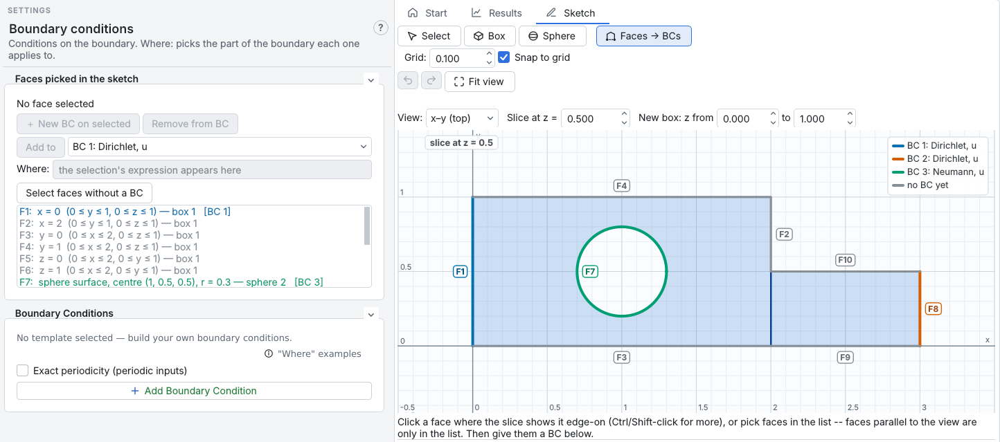
<sub><strong>3D Sketch</strong> — boxes and a spherical hole, sliced at z = 0.5, every face in the list</sub>
</td>
<td width="50%" align="center">
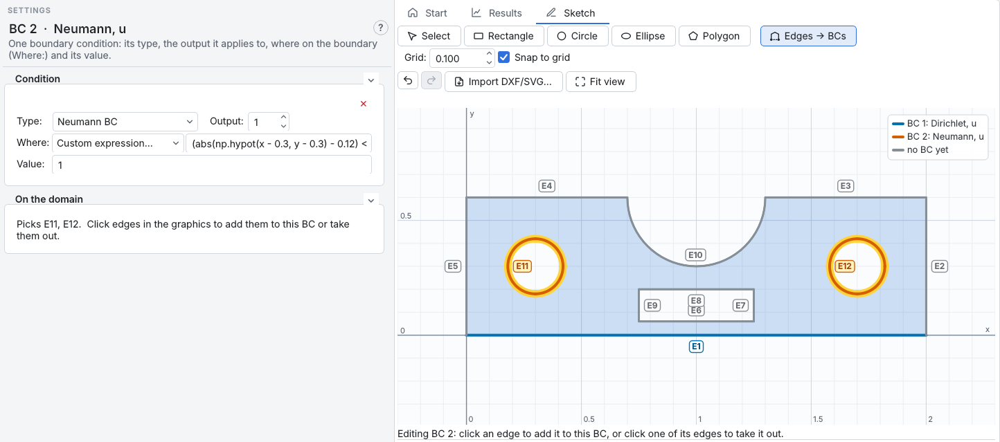
<sub><strong>Imported drawing</strong> — an SVG bracket: its notch, bolt holes and slot come in as edges</sub>
</td>
</tr>
<tr>
<td width="50%" align="center">
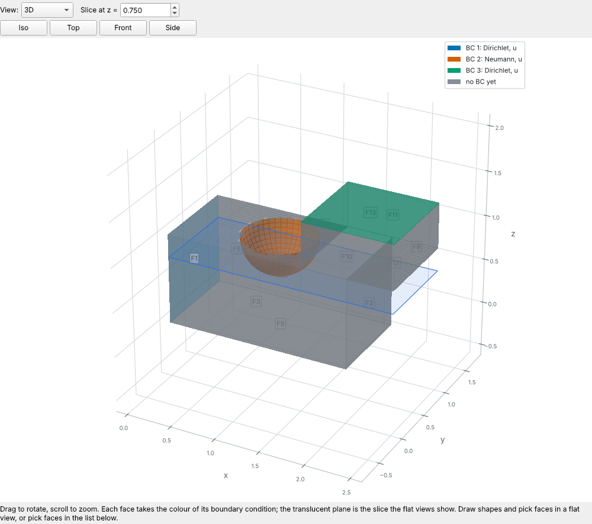
<sub><strong>3D view</strong> — the same kind of domain as a solid: the spherical cut-out, a raised block, faces coloured by their boundary conditions</sub>
</td>
<td width="50%" align="center">
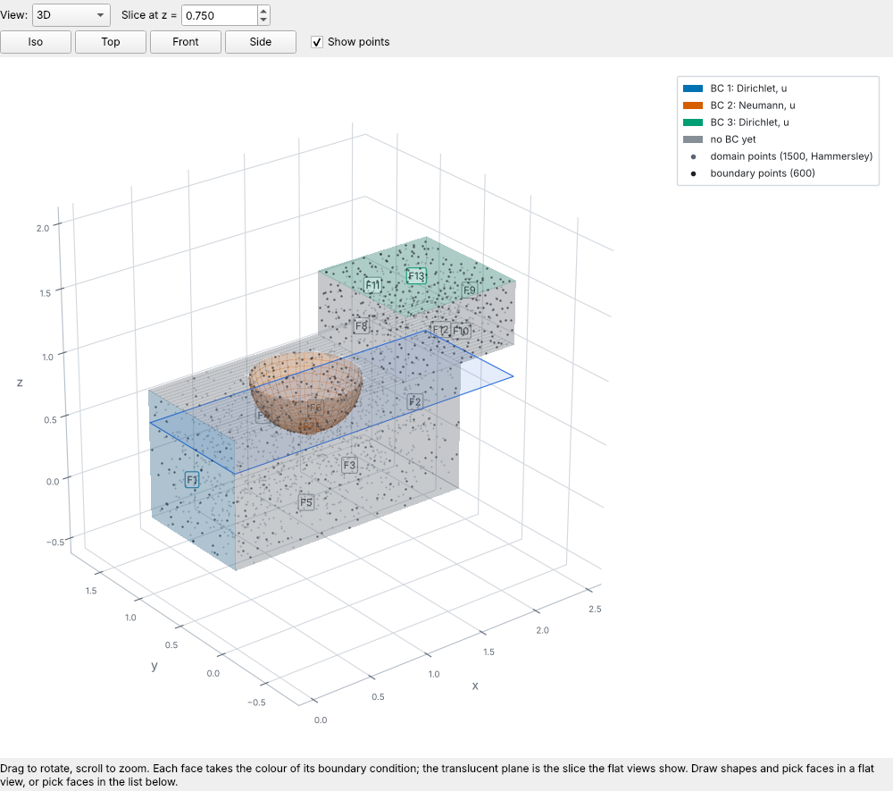
<sub><strong>3D view, Show points</strong> — DeepXDE's domain and boundary points; none land in the cut-out</sub>
</td>
</tr>
</table>

</details>

<details>
<summary><strong>Collocation points and domain preview</strong></summary>

<!-- source: pinnstudio/core/codegen.py::_anchor_points_code | extra training points ; pinnstudio/ui/main_window.py::MainWindow._preview_domain | domain preview ; pinnstudio/ui/view3d.py | 3D view -->
**Source code:** [extra training points](https://github.com/AsfandyarKhan72/PINNStudio/blob/main/pinnstudio/core/codegen.py#L10188-L10224) (`codegen.py`) · [domain preview](https://github.com/AsfandyarKhan72/PINNStudio/blob/main/pinnstudio/ui/main_window.py#L13011-L13300) (`main_window.py`) · [3D view](https://github.com/AsfandyarKhan72/PINNStudio/blob/main/pinnstudio/ui/view3d.py) (`view3d.py`)

The numbers of domain, boundary, initial and test points are set independently, along with the sampling distribution (Hammersley, uniform, Halton, LHS, Sobol or pseudo-random). For a 2D or 3D domain, *View domain & point distribution* (on the Collocation points page) shows the actual training points — domain, boundary and initial points, colour-coded — on the geometry, with a second panel showing their spread in time:

<table>
<tr>
<td width="33%" align="center">
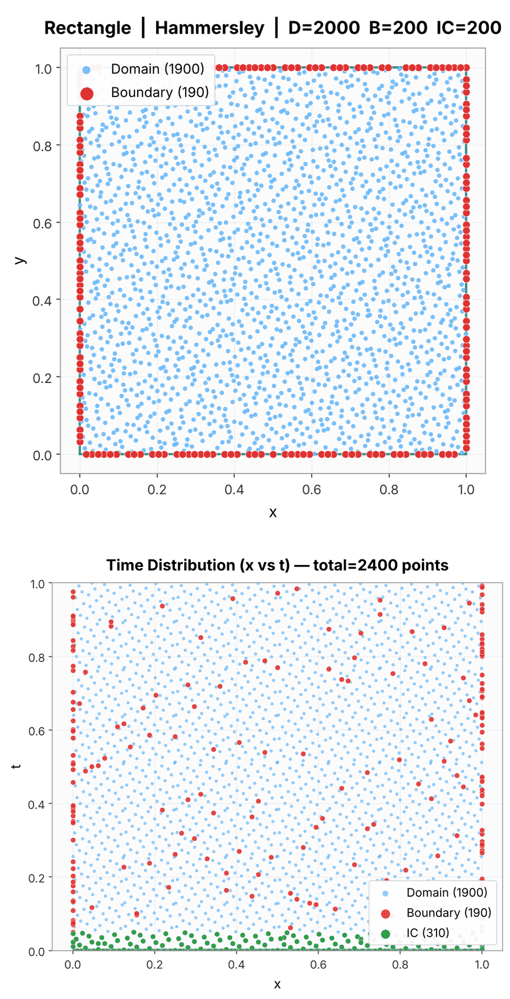
<sub>Rectangle — Hammersley sampling</sub>
</td>
<td width="33%" align="center">
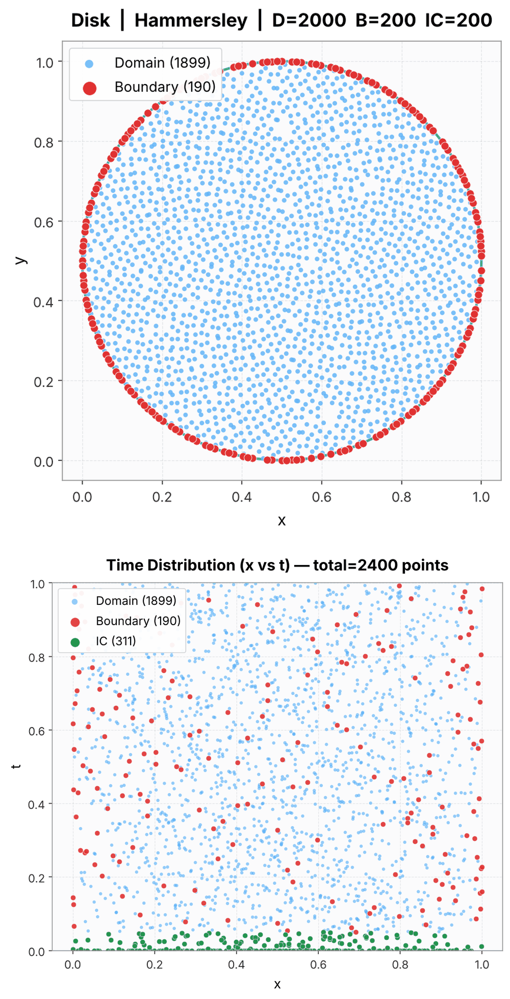
<sub>Disk</sub>
</td>
<td width="33%" align="center">
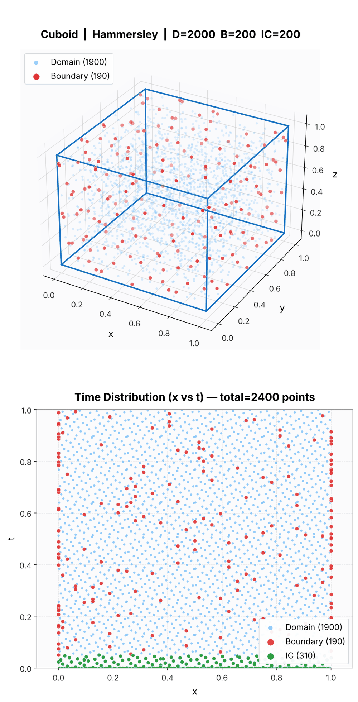
<sub>Cuboid (3D)</sub>
</td>
</tr>
</table>

**Extra training points (anchors)** can be added on top of the sampled ones, from a file or at random inside a box — for example to concentrate points near a front or a boundary layer.

</details>

### Training

<details>
<summary><strong>Network architecture</strong></summary>

<!-- source: pinnstudio/core/codegen.py::_net_construction_helper_code | networks (FNN, PFNN, MsFFN, STMsFFN) ; pinnstudio/ui/main_window.py::MainWindow._build_network_panel | Network panel -->
**Source code:** [networks (FNN, PFNN, MsFFN, STMsFFN)](https://github.com/AsfandyarKhan72/PINNStudio/blob/main/pinnstudio/core/codegen.py#L1176-L1225) (`codegen.py`) · [Network panel](https://github.com/AsfandyarKhan72/PINNStudio/blob/main/pinnstudio/ui/main_window.py#L2835-L3056) (`main_window.py`)

The number of hidden layers, neurons per layer, activation function (tanh, sin, Sigmoid, ReLU, SiLU/Swish, ELU, GELU, SELU) and weight initializer (Glorot or He, uniform or normal) are all set in the panel. A network whose layers differ in width (e.g. 100 then 50) is set in *Widths per layer* (a list of numbers; empty uses the boxes above). Four network types are available:

- **FNN** — a fully connected network shared by all outputs (the default).
- **PFNN** — a separate sub-network for each output, useful when outputs have very different scales or behavior.
- **MsFFN** and **STMsFFN** — multi-scale Fourier feature networks, which pass the inputs through random Fourier features at several scales (e.g. `1, 10`) so the network can capture slow and fast variations together.

</details>

<details>
<summary><strong>Input and output transforms</strong></summary>

<!-- source: pinnstudio/core/codegen.py::_net_transforms_code | input and output transforms -->
**Source code:** [input and output transforms](https://github.com/AsfandyarKhan72/PINNStudio/blob/main/pinnstudio/core/codegen.py#L4361-L4427) (`codegen.py`)

Inputs and outputs can be rescaled ($x \mapsto x \times \text{scale} + \text{shift}$), which helps when a coordinate or the solution is far from order one. Each transform can also be a **formula**: an input formula sets the network's input features (e.g. `x*sin(y); x*cos(y)` for polar coordinates), and an output formula rewrites each output — typically to satisfy boundary or initial conditions exactly, e.g. `x*(1 - x)*u` gives $u = 0$ at $x = 0$ and $x = 1$ without a boundary loss term.

</details>

<details>
<summary><strong>Training phases, learning-rate schedules and loss weights</strong></summary>

<!-- source: pinnstudio/core/codegen.py::_clean_phase_train_lines | training phases ; pinnstudio/core/codegen.py::_ic_pretrain_train_code | IC-guided pre-training ; pinnstudio/ui/main_window.py::MainWindow._add_scheduler_phase | phase rows -->
**Source code:** [training phases](https://github.com/AsfandyarKhan72/PINNStudio/blob/main/pinnstudio/core/codegen.py#L9432-L9466) (`codegen.py`) · [IC-guided pre-training](https://github.com/AsfandyarKhan72/PINNStudio/blob/main/pinnstudio/core/codegen.py#L11043-L11109) (`codegen.py`) · [phase rows](https://github.com/AsfandyarKhan72/PINNStudio/blob/main/pinnstudio/ui/main_window.py#L15870-L15971) (`main_window.py`)

Training is a sequence of **phases**, each with its own optimizer (Adam, AdamW, L-BFGS or NNCG, the Nyström-preconditioned conjugate gradient of [Rathore et al., 2024](https://proceedings.mlr.press/v235/rathore24a.html)), number of iterations, learning rate, loss function (MSE by default, or MAE) and loss weights — for example the common Adam-then-L-BFGS recipe, or several Adam phases with decreasing learning rates. Each phase's learning rate can decay by a step, cosine, exponential or inverse-time schedule. L-BFGS uses DeepXDE's default options unless you set your own, and the run's precision can be set to float64 when L-BFGS needs the extra precision to converge (float32 is faster).

Loss weights can be set per term (each equation, boundary condition, initial condition and measured-data file) or automatically from the first evaluation (**Scale by initial losses**, $`w_i = c / L_i(0)`$), so that every term starts at the same size.

**IC-guided pre-training** first fits the network to the initial condition alone, before the equations are switched on, which helps problems where training from a random start struggles to find the right solution.

</details>

<details id="hard-problems">
<summary><strong>When a PINN struggles: exact constraints and automatic weighting</strong></summary>

<!-- source: pinnstudio/core/codegen.py::_exact_constraints | exact periodicity and initial condition ; pinnstudio/core/codegen.py::_training_methods_defs | causal training, RBA and SA-PINN -->
**Source code:** [exact periodicity and initial condition](https://github.com/AsfandyarKhan72/PINNStudio/blob/main/pinnstudio/core/codegen.py#L4693-L4761) (`codegen.py`) · [causal training, RBA and SA-PINN](https://github.com/AsfandyarKhan72/PINNStudio/blob/main/pinnstudio/core/codegen.py#L804-L1011) (`codegen.py`)

A plain PINN fits the equation, the boundary conditions and the initial condition all as loss terms that compete with each other. On hard problems — sharp fronts, phase fields, long time ranges — it can settle on a wrong solution with a small loss. These settings help, in this order (each measured in the [training methods study](benchmarks/training_methods.md), about 180 runs on 14 problems):

1. **Scale the equations** so every residual is of order 1. If one equation's residual is naturally ~100× smaller than another's, it is barely enforced — this alone took the Cahn-Hilliard example from 40% to under 1% error. Divide that equation by its small coefficient, and scale the matching output (Network → *Output transform → Scale*).
2. **Make the initial condition exact** (Initial conditions → *Exact (built into the network)*, per output): the output becomes $\text{IC}(x) + \tau N$ with $\tau = (t - t_{min})/(t_{max} - t_{min})$, so the initial condition holds exactly at the first time and needs no loss term (a hard constraint, after [Lagaris et al., 1998](https://doi.org/10.1109/72.712178)). The initial condition should be a smooth formula, since a kink (from a `max` or an `abs`) has derivatives the network cannot represent: in the 2D Cahn-Hilliard example the two bubbles did not merge until the `max` in their initial condition was replaced by a smooth function. It is still worth comparing with the initial condition as a loss term. On 3D Allen-Cahn the loss term (weight 100) was 25× more accurate, because the profile changes quickly right after $t = 0$ and $\tau N$ has to represent that change.
3. **Make periodicity exact** (Boundary conditions → *Exact periodicity (periodic inputs)*): each periodic axis enters the network as $\cos(2\pi x/L)$, $\sin(2\pi x/L)$, so values and derivatives are equal at both ends ([Dong & Ni, 2021](https://doi.org/10.1016/j.jcp.2021.110242)).
4. **Add one automatic weighting method** (Loss weights → *Automatic weighting*). Each follows the paper cited with it:
   - *Per-point weights → RBA* (residual-based attention, [Anagnostopoulos et al., 2024](https://doi.org/10.1016/j.cma.2024.116805)): each training point's residual gets a weight that grows where the equation remains poorly satisfied, so training focuses on interfaces and fronts (*Decay γ* and *Step η* set how fast the weights follow the residual). It adds little cost and was the most reliable of the three.
   - *Per-point weights → SA-PINN* (self-adaptive weights, [McClenny & Braga-Neto, 2023](https://doi.org/10.1016/j.jcp.2022.111722)): the weights are trained by gradient ascent (with their own learning rate, and optionally kept at a mean of 1). With *During L-BFGS: Keep the weights* it was the best on Cahn-Hilliard (1D and 2D) and on 2D Allen-Cahn (Mattey & Ghosh). It should be used with an exact initial condition: it weights only the PDE points, so with the initial condition as a loss term (as in time-adaptive training) the PDE term can dominate it. On 2D Allen-Cahn (Wight & Zhao) this made every time window converge to $u = 0$.
   - *Causal training* ([Wang, Sankaran & Perdikaris, 2024](https://doi.org/10.1016/j.cma.2024.116813)): the time interval is split into chunks (*Time chunks*, 32 by default), and the residual of a later chunk is weighted in only once the earlier ones are fitted. *Raise ε step by step* moves ε from 0.01 to 100 as in the paper (the default); a *Fixed ε* is the alternative. With an MsFFN network (Network → *Network type*) it was the best on 1D Allen-Cahn and Klein-Gordon.

   *During L-BFGS*: *Keep the weights* gave better results on the hard problems, and *Plain loss* (the default) is the safer choice otherwise. Causal training and per-point weights should not be combined; together they did worse than either one alone.
5. **For long time ranges, or a very fast change right after the start, use time-adaptive training** (Adaptive training → *Time Adaptive Training*; short windows over the fast part: the 1D Cahn-Hilliard (Mattey & Ghosh) example uses 10 windows of 0.01, then 9 of 0.1, and reaches 0.5% error, where every whole-interval setup failed). Per-point weights and exact periodicity can be used with it; an exact initial condition cannot yet.

Together, steps 2–4 took the 1D Allen-Cahn solution without time-adaptive training from 10% to 0.13% at $t = 1$ (about 75× more accurate than a plain PINN), and the 2D Allen-Cahn problem of Mattey & Ghosh from 1.3% to 0.036% (36×, and 19× better than its time-adaptive template); the Cahn-Hilliard examples use them as well. On problems that a plain PINN already solves well (Burgers, Helmholtz, Kovasznay flow, Schrödinger) they add little or make the result worse, so results should always be compared with a plain run.

</details>

<details>
<summary><strong>Residual-based adaptive refinement (RAR)</strong></summary>

<!-- source: pinnstudio/core/codegen.py::_gs_rar_loop_code | RAR loop -->
**Source code:** [RAR loop](https://github.com/AsfandyarKhan72/PINNStudio/blob/main/pinnstudio/core/codegen.py#L1714-L2456) (`codegen.py`)

RAR trains in rounds. After each round it evaluates the equation residual at a large set of candidate points, adds the points where the residual is largest to the training set, and trains again. This concentrates points in the hardest parts of the domain, such as a shock or a thin interface. It works for steady and time-dependent problems in every dimension. For a system of equations, the ranking can use the combined residual or a single equation (*Points from*), and RAR can stop once the mean residual drops below a set value.

Every round saves a checkpoint and two figures to `solution_results/rar_rounds/round_NN/`: the solution at that round (compared with reference data when it is available) and the training points, showing the original points, those added in earlier rounds and those added in this round. Together they show that the added points are placed where the error is largest:

<table>
<tr>
<td width="50%" align="center">
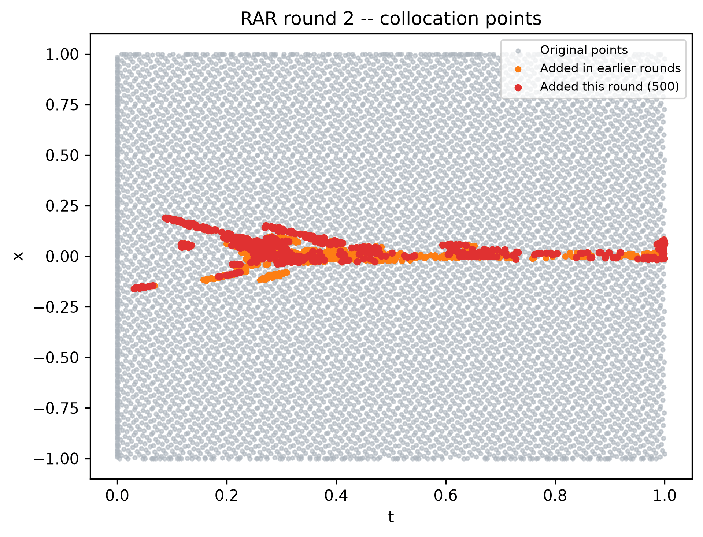
<sub>Burgers 1D, RAR round 2 — points added (red) vs. earlier and original points</sub>
</td>
<td width="50%" align="center">
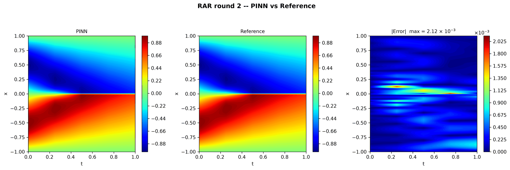
<sub>Burgers 1D, RAR round 2 — solution and error: the added points line up with the largest error</sub>
</td>
</tr>
</table>

<table>
<tr>
<td width="50%" align="center">
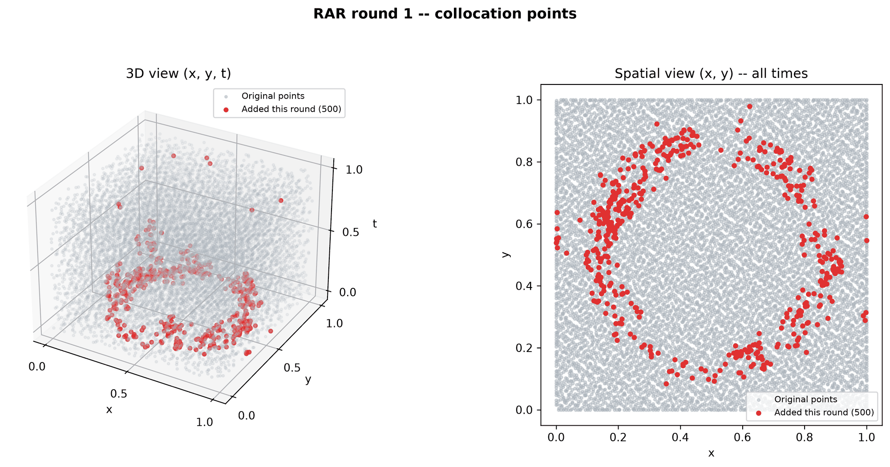
<sub>Allen-Cahn 2D (Wight & Zhao), RAR round 1 — points added vs. original points</sub>
</td>
<td width="50%" align="center">
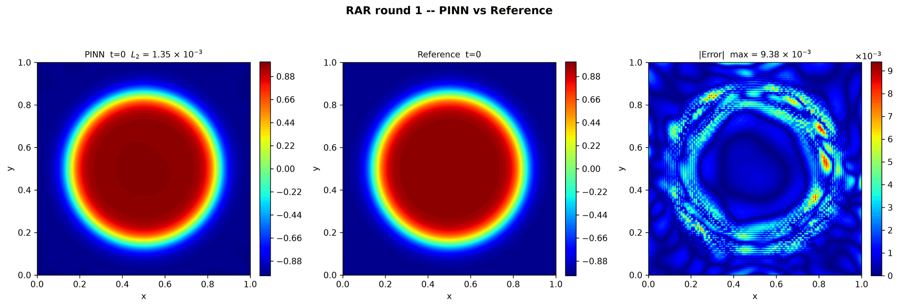
<sub>Allen-Cahn 2D (Wight & Zhao), RAR round 1 — solution and error: the added points follow the largest error</sub>
</td>
</tr>
</table>

</details>

<details>
<summary><strong>Time-adaptive training</strong></summary>

<!-- source: pinnstudio/core/codegen.py::_gs_time_adaptive_loop_code | time-adaptive loop ; pinnstudio/ui/main_window.py::MainWindow._add_ta_step_group | time-step groups -->
**Source code:** [time-adaptive loop](https://github.com/AsfandyarKhan72/PINNStudio/blob/main/pinnstudio/core/codegen.py#L2567-L4327) (`codegen.py`) · [time-step groups](https://github.com/AsfandyarKhan72/PINNStudio/blob/main/pinnstudio/ui/main_window.py#L7345-L7399) (`main_window.py`)

Splits the time range into steps and trains through them in order, each step taking its initial condition from the previous step's solution and, with *Enable transfer learning* (Adam or L-BFGS weights as the *Transfer optimizer*), starting from the previous step's network. This suits problems over a long time window or with fast dynamics that are hard to fit with a single network in one pass; Several templates use it in their *Default* (paper) or *Tuned* settings; the Training Log says which. It works in 1D, 2D and 3D, and each step is compared with any reference data that falls inside its time window.

The grid that passes the solution from one step to the next is set per axis (*IC grid resolution*), so its size grows with the dimension — PINNStudio picks a smaller default in 3D and warns when a chosen value would be very large.

Further options under *Adaptive training* change how the windows work together:

- **Growing time range** (needs transfer learning) — one network trained on $[t_0, t]$ with $t$ growing window by window, with the true initial condition at $t_0$ (Wight & Zhao's approach I).
- **Backward compatibility (bc-PINN)** (needs transfer learning) — after each window its solution is stored, and every later window is also trained to keep it (Mattey & Ghosh); *Weight*, *Times/window* and *Points* set the extra loss term.
- **IC-guided learning** (a fraction of the first Adam phase; 0 = off) — before each window's own training, the network first fits the window's starting state (Mattey & Ghosh).
- **Resampling in each window** (*Resampling rounds*, *Points per round*, *Adam iterations per round*) — after a window's training, the points with the largest residual are added and training continues.

How much these help on the phase-field problems, at the same training cost, is measured in the [training methods study](benchmarks/training_methods.md#the-controlled-comparison-paper-figure-7).

</details>

<details>
<summary><strong>Training callbacks and monitors</strong></summary>

<!-- source: pinnstudio/core/codegen.py::_build_train_cbs_code | callbacks ; pinnstudio/core/codegen.py::_training_monitor_runtime_code | training monitors -->
**Source code:** [callbacks](https://github.com/AsfandyarKhan72/PINNStudio/blob/main/pinnstudio/core/codegen.py#L1028-L1105) (`codegen.py`) · [training monitors](https://github.com/AsfandyarKhan72/PINNStudio/blob/main/pinnstudio/core/codegen.py#L1316-L1462) (`codegen.py`)

- **Point resampling** redraws the collocation points every N iterations.
- **Early stopping** ends training once the monitored loss stops improving.
- **Model checkpoints** save the model at regular intervals, or only when the loss improves.
- **Training timer** stops a run after a set wall-clock time.
- **Training monitors** track any expression of the outputs and their derivatives (`u`, `du_x`, a flux, ...) at chosen points during training, alongside the loss.

</details>

<details>
<summary><strong>Inverse parameters during training</strong></summary>

<!-- source: pinnstudio/core/codegen.py::_param_axis_helper_code | convergence plots ; pinnstudio/ui/main_window.py::MainWindow._build_restore_param_script | plots after training -->
**Source code:** [convergence plots](https://github.com/AsfandyarKhan72/PINNStudio/blob/main/pinnstudio/core/codegen.py#L9917-L10069) (`codegen.py`) · [plots after training](https://github.com/AsfandyarKhan72/PINNStudio/blob/main/pinnstudio/ui/main_window.py#L16954-L17115) (`main_window.py`)

In an inverse problem, each unknown is saved at regular intervals throughout training, including the final value where training stops, and its convergence can be shown as a plot or an animation — with the true value drawn as a reference line when it is known, both after training and later in Restore & visualize.

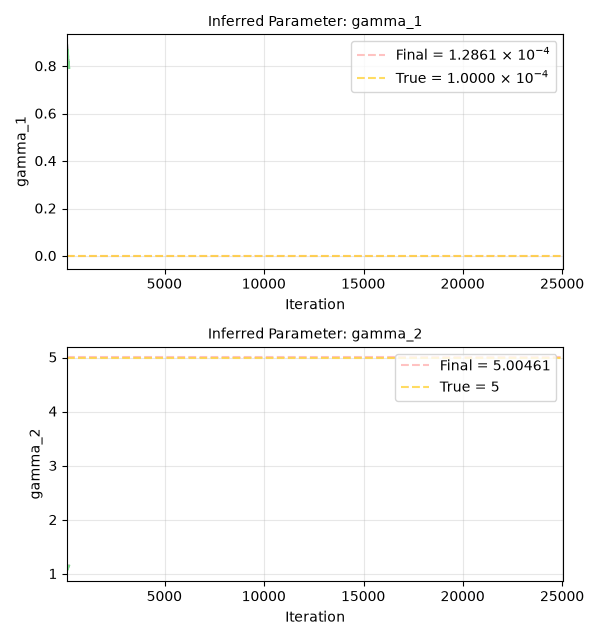

*Allen-Cahn 1D – Wight & Zhao in Inverse mode: both coefficients start from 1 and settle on their true values (γ₁ = 10⁻⁴, γ₂ = 5) during training.*

</details>

### Parameter Sweep

<details>
<summary><strong>Run many training configurations from one setup, varying any parameter</strong></summary>

<!-- source: pinnstudio/core/sweep_runner.py::run_sweep | sweep runner ; pinnstudio/core/sweep_registry.py::available_params | sweepable parameters ; pinnstudio/core/bayes_opt.py | Bayesian optimization -->
**Source code:** [sweep runner](https://github.com/AsfandyarKhan72/PINNStudio/blob/main/pinnstudio/core/sweep_runner.py#L514-L656) (`sweep_runner.py`) · [sweepable parameters](https://github.com/AsfandyarKhan72/PINNStudio/blob/main/pinnstudio/core/sweep_registry.py#L1316-L1343) (`sweep_registry.py`) · [Bayesian optimization](https://github.com/AsfandyarKhan72/PINNStudio/blob/main/pinnstudio/core/bayes_opt.py) (`bayes_opt.py`)

Instead of changing a value and pressing Solve again for each case, **Enable Parameter Sweep** (the *Parameter sweep* node of the model tree) runs a whole set of configurations of the problem you have set up, one after another, each as a full training run. **Run Sweep** and **Stop** drive it, the Training Log sums up every run as it finishes, and the status bar follows the run in progress. Afterwards, *Results → History* lists every run of the sweep, and any of them can be compared on one plot.


**Four ways to combine parameters:**
- **One at a time** — vary each parameter separately, the others held at their current values (3 values of one parameter → 3 runs).
- **All combinations** — every value of every parameter (2 parameters with 3 and 2 values → 6 runs).
- **Paired values** — the *i*-th values of all parameters run together (lists of equal length).
- **Bayesian search** — each run's settings are chosen by a Gaussian-process model of the results so far, to reach the lowest final loss, the lowest unweighted final loss (each term divided by its loss weight, for comparing runs with different weights) or the lowest $L_2$ error in as few runs as possible. Each parameter's range (*Linear* or *Log*, from *Min* to *Max*) or list of choices is its search space; **Runs** sets the budget and **Random first** the number of runs before the model takes over (the baseline, when it runs, counts as one of them; the others have random settings) (see the Helmholtz hyperparameter-search example under [Examples](benchmarks/examples.md)).

Each parameter's **Values** are a *List*, or a *Linear* or *Log* range; text settings (activation, point distribution, ...) take a list of choices. **Almost any setting can be swept** — the *Parameter* list shows everything available for the current problem, and updates itself as the problem changes:

- **Network** — hidden layers, neurons per layer, activation, initializer, weight decay.
- **Collocation points** — domain, boundary, initial and test points, sampling distribution.
- **Training phases** — each phase's iterations, learning rate and optimizer.
- **Loss weights** — every equation, boundary and initial-condition weight.
- **Inverse** — each unknown's initial guess, each measured-data file's weight, and the amount of measured data (grid points per axis, or random points). For an inverse problem the summary also lists each run's inferred parameters and, when the true value is known, their error in percent, plotted against the swept value above the solution error.
- **RAR** and **time-adaptive training** — rounds, candidate and added points, iterations; step counts, IC grid resolution.
- **Input and output transforms** — each scale value.
- **Training methods** — per-point weights (none, RBA, SA-PINN), causal training, the network architecture (FNN, PFNN, MsFFN, STMsFFN, as the network allows), exact periodicity, the exact initial condition, time-adaptive training on or off, an L-BFGS phase at the end, and for inverse problems the measured data at every reference time; with these the [training methods](benchmarks/training_methods.md) and [tuning](benchmarks/tuning_study.md) studies can be run from the window.
- **Random seed** — to repeat a setup with other seeds.

*Also run the current settings (baseline)* adds one run with the settings unchanged, as a reference point; it is on by default for *One at a time* with two or more parameters and for Bayesian search.

**Results.** The sweep saves to one folder (e.g. `Poisson_1D-Dirichlet_sweep__2026-10-13_11-39-17`) with a subfolder per run named after what it set (`run_01__Phase-1-Iterations_1000`, …), each with its model, plots and Error Analysis results. The folder also holds `sweep_summary.csv` (the swept values, final loss and error metrics of every run) and **`sweep_error_vs_parameter.png`**, a plot of the error ($L_2$, plus MSE and maximum error when selected; for a time-dependent problem, the mean over the reference times) and the final loss against the swept values.

**Example — network size for Burgers 1D.** Load *Burgers 1D – Raissi et al.*, choose *All combinations*, and sweep **Network: Hidden layers** over 2, 4, 6, 8 and **Network: Neurons per layer** over 10, 20, 40 — the same study as Table 1 of Raissi et al. (2019). The 12 runs (everything else as the template sets it: Adam 15,000 + L-BFGS 10,000 iterations, 8,000 collocation points) took about 17 minutes on an RTX 4090:

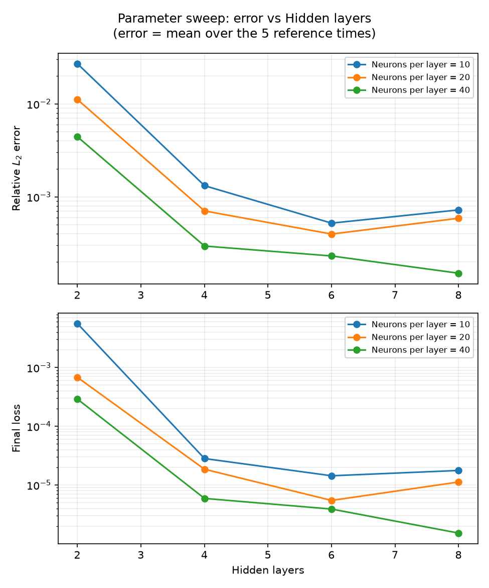

Relative $L_2$ error (mean over the five reference times) from `sweep_summary.csv`:

| Hidden layers | 10 neurons | 20 neurons | 40 neurons |
|---|---|---|---|
| 2 | 2.7 × 10⁻² | 1.1 × 10⁻² | 4.4 × 10⁻³ |
| 4 | 1.3 × 10⁻³ | 7.0 × 10⁻⁴ | 3.0 × 10⁻⁴ |
| 6 | 5.2 × 10⁻⁴ | 4.0 × 10⁻⁴ | 2.3 × 10⁻⁴ |
| 8 | 7.2 × 10⁻⁴ | 5.9 × 10⁻⁴ | 1.5 × 10⁻⁴ |

Two hidden layers are too few for the shock at $x = 0$; at four layers the error is 15–21× lower, and 40 neurons per layer gives the lowest error at every depth, down to 1.5 × 10⁻⁴ at eight layers. With 10 or 20 neurons, eight layers is slightly worse than six. Comparing the 40-neuron runs in *History* (above) shows where the difference comes from: two layers stall during Adam and never reach the others' loss, while four to eight layers follow nearly the same curve and differ mostly after L-BFGS. (Raissi et al. trained with L-BFGS only and 10,000 collocation points, so their numbers differ; the trend is the same.)

</details>

### Analysis & Output

<details>
<summary><strong>Live training log and loss curves</strong></summary>

<!-- source: pinnstudio/ui/results.py::RunProgress | progress ; pinnstudio/ui/results.py::LiveLossPlot | live loss ; pinnstudio/core/codegen.py::_loss_plot_runtime_code | saved loss figure -->
**Source code:** [progress](https://github.com/AsfandyarKhan72/PINNStudio/blob/main/pinnstudio/ui/results.py#L87-L224) (`results.py`) · [live loss](https://github.com/AsfandyarKhan72/PINNStudio/blob/main/pinnstudio/ui/results.py#L237-L367) (`results.py`) · [saved loss figure](https://github.com/AsfandyarKhan72/PINNStudio/blob/main/pinnstudio/core/codegen.py#L1228-L1313) (`codegen.py`)

Training runs in the background and its output streams into the Training Log as it happens; **Stop** ends the run immediately. While it trains, *Results → Live loss* plots the training and test loss — or each loss term, named (PDE, BC 1, IC, ...) — with the training phases marked, and the status bar shows the phase, the iteration, the current loss and the time left. With time-adaptive training each time step starts its own plot. Untick *Update while training* above the plot to have it drawn once, when the run ends. The saved loss figure can show the total losses, each term, or both, on a log or linear axis (*Plot settings → Loss* on the Results page).

</details>

<details>
<summary><strong>Run history and comparing runs</strong></summary>

<!-- source: pinnstudio/ui/results.py::RunHistory | run history ; pinnstudio/ui/results.py::RunCompare | comparing runs -->
**Source code:** [run history](https://github.com/AsfandyarKhan72/PINNStudio/blob/main/pinnstudio/ui/results.py#L750-L888) (`results.py`) · [comparing runs](https://github.com/AsfandyarKhan72/PINNStudio/blob/main/pinnstudio/ui/results.py#L647-L747) (`results.py`)

*Results → History* lists every run saved in the Save-to folder (a sweep's runs included) with when it ran, its final loss and its relative $L_2$ error. Double-click a run to bring its figures and error analysis back; select several and press **Compare** to see their loss curves and their error over time on one plot — for example the network sizes of a sweep.

</details>

<details>
<summary><strong>Copying and saving figures and tables</strong></summary>

<!-- source: pinnstudio/ui/export_tools.py | copy and save -->
**Source code:** [copy and save](https://github.com/AsfandyarKhan72/PINNStudio/blob/main/pinnstudio/ui/export_tools.py) (`export_tools.py`)

Right-click any result figure to copy it, save it as PNG or JPEG, open it in a zoomable viewer, or show its folder. The live loss and the run comparison can be copied or saved as PNG, PDF or SVG. The error-analysis and history tables copy as tab-separated text that pastes straight into a spreadsheet, or export to CSV, at full precision.

</details>

<details>
<summary><strong>Error analysis against reference data</strong></summary>

<!-- source: pinnstudio/core/codegen.py::_gs_ea_setup_code | error analysis ; pinnstudio/core/codegen.py::_formula_reference_code | exact-solution reference ; pinnstudio/ui/main_window.py::MainWindow._show_ea_dialog | Error Analysis dialog -->
**Source code:** [error analysis](https://github.com/AsfandyarKhan72/PINNStudio/blob/main/pinnstudio/core/codegen.py#L2459-L2546) (`codegen.py`) · [exact-solution reference](https://github.com/AsfandyarKhan72/PINNStudio/blob/main/pinnstudio/core/codegen.py#L10122-L10162) (`codegen.py`) · [Error Analysis dialog](https://github.com/AsfandyarKhan72/PINNStudio/blob/main/pinnstudio/ui/main_window.py#L15179-L15579) (`main_window.py`)

A run can be compared with reference solution files at one or more times, or — when the problem has an exact solution — with a formula typed in (one per output, in `x`, `y`, `z`, `t`). For predicted values $u_{\text{pred}}$ and reference values $u_{\text{true}}$ at $N$ points, PINNStudio reports

$$\Large L_2 \text{ relative error} = \frac{\lVert u_{\text{pred}} - u_{\text{true}} \rVert_2}{\lVert u_{\text{true}} \rVert_2}, \qquad \text{MSE} = \frac{1}{N}\sum_{i=1}^{N}\left(u_{\text{pred},i} - u_{\text{true},i}\right)^2$$

$$\Large \text{Max error} = \max_i \left| u_{\text{pred},i} - u_{\text{true},i} \right|, \qquad \text{Mean absolute error} = \frac{1}{N}\sum_{i=1}^{N}\left| u_{\text{pred},i} - u_{\text{true},i} \right|$$

with line and surface comparisons of the prediction, the reference and the error. The relative $L_2$ error is reported by default; MSE and maximum error can be added, and the mean absolute error is always included. A reference can also be compared against a derivative or any expression of the outputs (e.g. `du_x`), not only a raw output. All but two of the examples come with an exact solution or reference data, so the comparison works as soon as an example is loaded.

</details>

<details>
<summary><strong>Plots and animations</strong></summary>

<!-- source: pinnstudio/core/codegen.py::generate_clean_script._result_plot_parts | result plots ; pinnstudio/ui/figure_style.py::FigureStyleDialog | figure style -->
**Source code:** [result plots](https://github.com/AsfandyarKhan72/PINNStudio/blob/main/pinnstudio/core/codegen.py#L12400-L12839) (`codegen.py`) · [figure style](https://github.com/AsfandyarKhan72/PINNStudio/blob/main/pinnstudio/ui/figure_style.py#L113-L688) (`figure_style.py`)

Results can be shown as surface or line plots, or as animations of either over time; the list offers only what the problem can have (one curve for an ODE or a steady 1D problem, no surface animation in 1D), and an inverse problem adds the parameter convergence plot and its animation, selected by default. How every figure looks is set in one place, **Plot settings** on the Results page (or *Settings → Plot Settings*): the colour map, contour levels, resolution, snapshots, figure size, font sizes and axis orientation, the line widths, the PINN and reference line colours and time steps, the |Error| panels' colour map, the panels per row in Error Analysis, the animation resolution, the legend font size, the grid of the 3D surfaces, grid lines on the line-type figures (on by default), whether the reference in a line comparison is a line or dots, the loss plot, and for an inverse problem the parameter convergence plot and animation (drawn as a line, a line with markers or markers only, with the marker shape and size; line colour and width; a dot on the current value in the animation; log axis; and the true-value and final-value lines). Solve, the exported script and Restore & visualize all use it, and it is saved with the problem (the exported script draws the line, surface and error-analysis figures; the 3D slice and 3D view comparisons, with their *3D grid resolution* and *iso level*, are drawn by Solve and Restore & visualize only). Besides the raw outputs, **Custom...** plots any expression of the outputs and their derivatives (`sqrt(u**2 + v**2)`, `du_x`, ...), during training, in Error Analysis and in Restore & visualize. For problems with several outputs, *Outputs to plot → All outputs* (the default) saves a figure of each output; pick one output to save only its figure. Numbers written in figures follow one standard, set under *Plot settings → General → Numbers*: the significant digits (4 by default; inferred parameter values get two more), when to use scientific notation (*Automatic*: below 0.01 or from 100,000 up, with errors always written with a power of ten; *Always*; *Never*) and how it is written (1.23 × 10⁻⁴ or 1.23e-04). It applies to times in titles, errors, parameter values and the axis and colorbar tick labels, whose decimals matplotlib picks from the tick spacing. Files and the log keep full precision. In 2D and 3D a line plot follows $x$ at one $y$ (and $z$), set under *Plot settings → Line*: the middle of the domain, or a value of your own. The Helmholtz 2D examples set their own (their solution is exactly zero on the middle line). Where the line crosses a hole, the curve stops and starts again on the other side.

</details>

<details>
<summary><strong>Data export and standalone scripts</strong></summary>

<!-- source: pinnstudio/core/codegen.py::generate_clean_script | standalone script ; pinnstudio/ui/main_window.py::MainWindow._on_export_settings | data export -->
**Source code:** [standalone script](https://github.com/AsfandyarKhan72/PINNStudio/blob/main/pinnstudio/core/codegen.py#L11234-L13317) (`codegen.py`) · [data export](https://github.com/AsfandyarKhan72/PINNStudio/blob/main/pinnstudio/ui/main_window.py#L13928-L13992) (`main_window.py`)

*Export Solution* on the Results page (off until enabled there) saves the solution of a forward problem as text files on a grid of your choice (one file per time), for your own analysis. Every problem can also be exported as a standalone DeepXDE/PyTorch script (*Export script* in the toolbar, or Ctrl+E) — to read, run on a cluster, share with a collaborator, or use as a starting point for your own code. The **Script** tab next to the Training Log shows that script for the current settings and updates as you change them.

The exported script is not a simplified copy: it trains the same model as **Solve**. We check this for every example by writing both scripts from the same settings, running them with the same seed and comparing the loss history line by line (`tools/check_export_equivalence.py`; results in [benchmarks/performance.md](benchmarks/performance.md#export-check-the-exported-script-trains-the-same-model)).

</details>

<details>
<summary><strong>Saving problems, reproducibility and hardware</strong></summary>

<!-- source: pinnstudio/core/config.py::PINNConfig | problem settings ; pinnstudio/ui/main_window.py::MainWindow._save_problem | save ; pinnstudio/ui/main_window.py::MainWindow._open_problem | open ; pinnstudio/ui/main_window.py::MainWindow._on_gpu_settings | GPU settings -->
**Source code:** [problem settings](https://github.com/AsfandyarKhan72/PINNStudio/blob/main/pinnstudio/core/config.py#L12-L1478) (`config.py`) · [save](https://github.com/AsfandyarKhan72/PINNStudio/blob/main/pinnstudio/ui/main_window.py#L9948-L10006) (`main_window.py`) · [open](https://github.com/AsfandyarKhan72/PINNStudio/blob/main/pinnstudio/ui/main_window.py#L10086-L10169) (`main_window.py`) · [GPU settings](https://github.com/AsfandyarKhan72/PINNStudio/blob/main/pinnstudio/ui/main_window.py#L12425-L12516) (`main_window.py`)

A whole problem setup can be saved and reopened later (**Save** and **Open** in the toolbar, Ctrl+S and Ctrl+O). Once a problem has a file, Save writes back to it. The examples themselves are never changed: saving an example you have edited asks for a name (suggesting *“<example> (copy)”*), choosing the example again gives its own settings, and the copy remembers which example it came from, so switching it between Forward and Inverse does what the example does. A problem saved before it was complete (Inverse with no measured-data file yet, say) opens again, with what is missing listed in the log. *Problem → Open Recent* and the Start tab list the last eight problems, the title bar marks unsaved changes, and PINNStudio asks before they would be lost. Runs use a fixed random seed by default, so a run can be repeated exactly, and each run saves its settings next to its results. The GPU to train on (or the CPU, which can be faster for a small 1D problem; see [Speed](#speed-pinnstudio-and-a-plain-script)), its memory share, the float precision, the random seed and the L-BFGS options are set under *Settings*.

**CPU threads** (*Settings → GPU / Hardware → CPU threads*): *Automatic* uses half the logical processors (about one per performance core), at most 8, which was the fastest setting in our measurements; more threads can make CPU training much slower on processors with efficiency cores ([benchmarks/performance.md](benchmarks/performance.md#how-many-cpu-threads)).

</details>

### Restore & visualize

<details>
<summary><strong>Reload a trained model without retraining</strong></summary>

<!-- source: pinnstudio/ui/main_window.py::MainWindow._on_restore | Restore & visualize ; pinnstudio/ui/main_window.py::MainWindow._build_restore_script | restore script -->
**Source code:** [Restore & visualize](https://github.com/AsfandyarKhan72/PINNStudio/blob/main/pinnstudio/ui/main_window.py#L16398-L16858) (`main_window.py`) · [restore script](https://github.com/AsfandyarKhan72/PINNStudio/blob/main/pinnstudio/ui/main_window.py#L17117-L17505) (`main_window.py`)

Point Restore & visualize (*Results → Restore & visualize* in the model tree) at a saved model, and PINNStudio finds its `model_config.json` next to it, says what the model is (dimension, forward or inverse, outputs, parameters), rebuilds the trained network and produces any of the plots or animations above — including derivative expressions you did not plot during training, Error Analysis against the original reference data, and, for an inverse run, the convergence of the unknowns, whose files it finds in the run folder — without training again. Only the network's weights are loaded, so it does not matter which optimizer trained the model.

</details>

## Solving Your Own Problem

The examples cover 64 specific problems, but PINNStudio is not limited to them, and every setting in an example can be changed. Below is a complete walkthrough for a PDE that is **not** one of the examples, to show the general path from "I have an equation" to "I have a trained PINN." (To reproduce a documented result from one of the configured examples instead, see the *Reproducibility test case* under [Burgers 1D – Raissi et al.](benchmarks/examples.md#1d-burgers).)

We use the **Fisher-KPP equation**, a classic reaction-diffusion model of a population (or concentration front) that diffuses and grows logistically toward a carrying capacity of 1:

$$\Large \frac{\partial u}{\partial t} = D\frac{\partial^2 u}{\partial x^2} + r\ u(1-u), \qquad x \in [0, 1],\ t \in [0, 1]$$

with $D = 0.01$, $r = 1$, a localized initial bump, and no-flux (Neumann) boundaries — none of the examples above has a logistic nonlinearity like this one.

Start from a clean problem: on the Start tab, click **1D problem** (or *Problem → New → 1D problem*). Each step below is one node of the model tree.

1. **Problem.** Leave the dimension on **1D** and the problem *Time Dependent* and *Forward*.
2. **Equations.** Enter the residual (moving everything to one side) — it is typeset under the box as you type, so you can check it reads as intended:
   ```
   du_t - 0.01*du_xx - 1.0*u*(1 - u)
   ```
   This is the `d<output>_<vars>` convention described under [Equation editor for single equations and coupled systems](#problem-setup) — `du_t` is $\partial u/\partial t$, `du_xx` is $\partial^2 u/\partial x^2$, and the coefficients $D=0.01$ and $r=1$ are just written inline.
3. **Geometry.** Set the interval to `0` to `1` for x and the time interval to `0` to `1`.
4. **Initial conditions.** A localized bump; up to $t = 1$ diffusion spreads it and lowers its peak to about 0.76 while the logistic term lifts the tails:
   ```
   exp(-50*(x-0.5)**2)
   ```
5. **Boundary conditions.** Right-click *Boundary conditions* → **Add boundary condition** (or use the button on its page): **Neumann**, value `0` (no flux through either edge), and in **Where** pick *Left and right sides* from the list. Two rows, one on the left side and one on the right, would do the same.
6. **Neural network & Training.** Keep the defaults: three hidden layers of 64 neurons (tanh), 2,000 collocation points, 10,000 Adam iterations then 10,000 L-BFGS iterations, and the initial condition weighted 100. They are enough for this problem (step 8); for a harder one, more layers or points, or the methods under [When a PINN struggles](#hard-problems), are the next things to try.
7. **Solve.** Click **Solve** and watch the loss fall in *Results → Live loss*; the loss and solution figures appear under *Overview* once training finishes. *Save* (Ctrl+S) keeps the setup for later. Time is on the horizontal axis of the 1D surface plots by default; untick *Time on the x-axis* (*Plot settings → Surface → 1D surface*) to put x there instead — see [Plots and animations](#analysis--output).
8. **Error Analysis.** A new problem has no reference data, so you add your own. For this walkthrough PINNStudio ships one: a fine finite-difference solution at $t$ = 0, 0.25, 0.5, 0.75 and 1 in [`reference_data/1D/fisher_kpp/`](reference_data/1D/fisher_kpp) (three columns x, t, u; written by [`tools/make_exact_reference_data.py`](tools/make_exact_reference_data.py), accurate to about $10^{-7}$). On the *Results* page press **Error Analysis**, keep *Reference files*, **Browse** to `t_0.txt`, add the other four with **➕ Add another file** (the time is read from each file), and press **Run Error Analysis**. With the defaults above, the relative $L_2$ error is $1.3 \times 10^{-3}$ at $t = 1$ and $8.8 \times 10^{-4}$ over all five times (one run, seed 2026; about 6 minutes on 8 CPU threads). For your own problem, use files from your own solver in the same format, or an exact formula if there is one.

<table>
<tr>
<td width="33%" align="center">
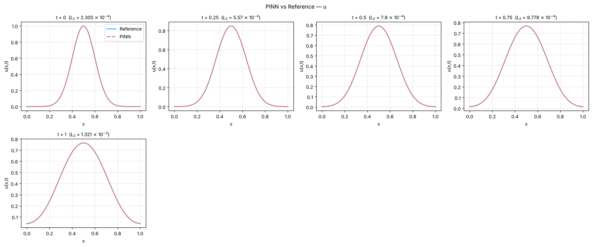
<sub>Error Analysis: PINN against the reference</sub>
</td>
<td width="33%" align="center">
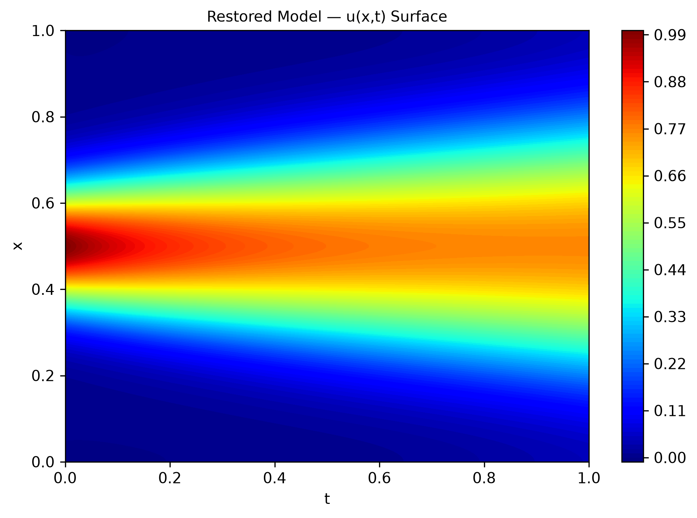
<sub>Surface</sub>
</td>
<td width="33%" align="center">
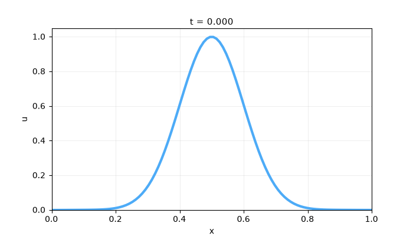
<sub>Animation</sub>
</td>
</tr>
</table>

From here, the same eight steps apply to any PDE that can be written with the derivative syntax under [Equation editor for single equations and coupled systems](#problem-setup) — swap in your own residual, domain, and conditions.

## How It Works

PINNStudio is built on [DeepXDE](https://github.com/lululxvi/deepxde) and PyTorch. Rather than wrapping them at runtime, it **generates code**. Every setting you choose maps to a field on a `PINNConfig` dataclass ([`pinnstudio/core/config.py`](pinnstudio/core/config.py)); clicking **Solve** passes that config to [`codegen.py`](pinnstudio/core/codegen.py), which writes out a complete, standalone DeepXDE/PyTorch script, and [`runner.py`](pinnstudio/core/runner.py) executes it as a subprocess, streaming stdout back into the Training Log panel in real time.

Because the output of every run is an ordinary Python script, you can take it and run it outside PINNStudio, hand it to a cluster job, or use it as a starting point for a hand-written DeepXDE project.

### Speed: PINNStudio and a plain script

Training in the PINNStudio window takes the same time as running the exported script from a terminal; the GPU is 3 to 18.5 times faster than the CPU once a problem has a few thousand points; and on the CPU, 8 threads are fastest. The full study, with every run and the settings used, is in [benchmarks/performance.md](benchmarks/performance.md).

<details>
<summary><strong>Timing study: the window, GPU against CPU, and CPU threads</strong></summary>

Solve writes a DeepXDE script and runs it in a Python process of its own; the window only reads what the script prints. Measured on one PC (Intel Core i9-13900KF, NVIDIA RTX 4090; Python 3.11, PyTorch 2.6 with CUDA 12.4, DeepXDE 1.15) with [`benchmarks/perf_study.py`](benchmarks/perf_study.py).

**The window adds no measurable time.** Five problems, each trained three ways from the same settings, median training time of three seeds:

| Problem | Exported script | Solve's script, no window | PINNStudio window |
|---|---|---|---|
| Lorenz ODE, inverse | 71.5 s | 76.7 s | 72.8 s |
| Wave 1D, multi-scale Fourier features | 75.5 s | 74.7 s | 75.0 s |
| Allen-Cahn 2D (Mattey & Ghosh) | 266 s | 266 s | 259 s |
| Navier-Stokes 2D (Kovasznay) | 204 s | 207 s | 204 s |
| Allen-Cahn 3D (Wight & Zhao) | 1,563 s | 1,615 s | 1,554 s |

The three differ by at most 5%, in no consistent direction, as two runs of the same script do. Starting Python and importing PyTorch and DeepXDE adds about 4 s to every run, either way.

**GPU against CPU.** Seconds per 1,000 Adam steps, same problems, CPU with 8 threads:

| Problem | CPU | GPU (RTX 4090) | GPU speed-up |
|---|---|---|---|
| Lorenz ODE, inverse | 1.79 | 2.96 | CPU 1.7× faster |
| Wave 1D | 2.43 | 0.81 | 3.0× |
| Navier-Stokes 2D (Kovasznay) | 22.5 | 5.46 | 4.1× |
| Allen-Cahn 2D | 73.4 | 7.14 | 10.3× |
| Allen-Cahn 3D | 526 | 28.5 | 18.5× |

A very small problem (an ODE with a few hundred points) is faster on the CPU, because starting work on the GPU costs more than it saves: *Settings → GPU / Hardware → Train on: CPU*.

**Fewer CPU threads are faster.** Adam steps per second on the CPU of the same PC (8 performance and 16 efficiency cores, 32 threads), median of three runs:

| CPU threads | Heat 1D (2k points) | Poisson 2D (20k points) | Heat 2D (30k points) |
|---|---|---|---|
| 1 | 123 | 2.0 | 3.1 |
| 4 | 311 | 5.3 | 7.5 |
| **8 (Automatic)** | **330** | **7.2** | **10.0** |
| 16 | 174 | 6.7 | 9.2 |
| 24 (PyTorch's default) | 216 | 7.0 | 9.7 |
| 32 (every thread) | 2.0 | 0.6 | 0.5 |

On a processor with efficiency cores the slow cores hold every step back, and using every thread is 12 to 165 times slower. PINNStudio's scripts therefore train on the CPU with half the logical processors (about one per performance core), at most 8: *Settings → GPU / Hardware → CPU threads: Automatic*, or a number of your own; setting `OMP_NUM_THREADS` overrides *Automatic* (a number set there still wins).

**On a Mac, PINNStudio trains on the CPU.** Apple's GPU (MPS) was tried on an M1 MacBook Air with `benchmarks/mac_gpu_check.py`: it was half the speed of the CPU on Heat 1D (73 against 136 Adam iterations a second, and L-BFGS 7 times slower) and about the same on Poisson 2D and Heat 2D with 20,000 and 30,000 points (3 to 4 iterations a second either way), with the same accuracy. It also has no float64. A Mac with more GPU cores (an M-series Pro or Max) may do better on large problems; `mac_gpu_check.py` measures it. For comparison, an RTX 4090 ran the same 2D problems at 139 to 162 iterations a second (`benchmarks/gpu_check.py`, which also checks an NVIDIA GPU's setup on Windows or Linux).

**On Windows** (measured on a laptop with a Core i9-8950HK and an RTX 2080 Max-Q; details in [`benchmarks/platform/windows_speed.md`](benchmarks/platform/windows_speed.md)), PINNStudio trains as fast as the plain script too, and the same rules hold: the installer's PyTorch build and the automatic CPU threads were the fastest choices there. Two things differ from Linux:

- **Starting a run takes longer**, about 7 to 9 s against 4 s, most of it importing PyTorch and DeepXDE. Windows Defender scans every file Python loads, which adds 1.5 to 2 s; if you are comfortable with it, an exclusion for PINNStudio's own folder removes that (PowerShell as administrator: `Add-MpPreference -ExclusionPath "$env:APPDATA\uv\tools\pinnstudio"`). It is optional, and PINNStudio works the same without it.
- **On a laptop, plug in and use the "Best performance" power mode** (Settings → System → Power). A small network on the GPU is limited by how fast the CPU hands it work, so a CPU that slows down on battery or when hot slows the GPU too. On that laptop the GPU only paid off above about 1,000 points, and the 1D examples trained 1.5 to 3 times faster with *Train on: CPU*; PINNStudio prints a tip in the Training Log when a small 1D problem trains on the GPU.

</details>

## Repository Structure

```text
PINNStudio/
├── pinnstudio/
│   ├── main.py            # Entry point
│   ├── __main__.py        # python -m pinnstudio (what the desktop shortcut runs)
│   ├── shortcut.py        # pinnstudio --create-shortcut / --remove-shortcut
│   ├── errors.py          # Error reports when started without a console
│   ├── resources/         # App icons and the Tuned settings of every example
│   ├── ui/
│   │   ├── main_window.py   # PyQt6 interface — every page, dialog, and control
│   │   ├── workspace.py     # Model tree + settings pages (the three-panel layout)
│   │   ├── theme.py         # Studio Light, Studio Dark and Solarized Dark, built from colour tokens
│   │   ├── icons.py         # Line icons and the app icon
│   │   ├── start_page.py    # Start tab: new problem, recent files, example gallery
│   │   ├── results.py       # Live loss, status, error analysis, run history and comparison
│   │   ├── sci_spinbox.py   # Number fields that accept scientific notation
│   │   ├── figure_style.py  # Plot settings (how every saved figure looks)
│   │   ├── export_tools.py  # Copy / save figures and tables
│   │   ├── equation.py      # Equations typeset as you type, unknown-name check
│   │   ├── sketch_canvas.py # Sketch and Geometry tabs (2D and 3D)
│   │   ├── sketch_edges.py  # A sketch's boundary edges and their Where: expressions
│   │   ├── sketch3d.py      # 3D sketch: views, sections, faces
│   │   ├── view3d.py        # The rotatable 3D view of a domain
│   │   └── sketch_import.py # DXF / SVG import
│   └── core/
│       ├── config.py          # PINNConfig — the full problem definition
│       ├── codegen.py         # PINNConfig -> standalone DeepXDE/PyTorch script
│       ├── constants.py       # Named constants in expressions
│       ├── line_slice.py      # Where 2D/3D line plots cut the domain
│       ├── ea_view3d.py       # Error Analysis 3D view (surface and cut-away error)
│       ├── obs_reduce.py      # Summary of a measured-data file and its reduction (inverse problems)
│       ├── example_catalog.py # The Examples list: order, names, categories
│       ├── pinnstudio_examples.py # PINNStudio's own templates
│       ├── deepxde_examples.py    # DeepXDE's documented examples
│       ├── example_settings.py    # Examples -> Settings: Default / Tuned
│       ├── paper_settings.py      # The papers' methods (Default for paper templates)
│       ├── portable_paths.py  # Reference-data paths saved as @REF/...
│       ├── pyexe.py           # The Python that runs the generated scripts
│       ├── torch_index.py     # Which PyTorch CUDA build fits the NVIDIA driver
│       ├── update_info.py     # The "newer version available" notice
│       ├── bayes_opt.py       # Bayesian hyperparameter search
│       ├── runner.py          # Runs the generated script, streams output to the Training Log
│       ├── sweep_registry.py  # Parameter Sweep's list of sweepable parameters
│       └── sweep_runner.py    # Builds and runs each sweep configuration in turn
├── assets/
│   ├── Images/              # README figures of every example
│   └── screenshots/         # README screenshots
├── reference_data/          # Bundled ground truth for the built-in templates
│   ├── 1D/
│   ├── 2D/
│   ├── 3D/
│   └── deepxde/             # Reference/measurement data for the DeepXDE examples
├── benchmarks/              # Benchmarks of every example, tuning, training methods, performance and export checks
├── docs/                    # Project web page
├── tests/                   # Test suite (pytest)
├── tools/                   # Reference-data generators, example runners and checks, the paper's figures and pages
├── requirements.txt
├── setup.py, pyproject.toml, MANIFEST.in
├── get-pinnstudio.sh       # One-command install with uv (macOS/Linux)
├── get-pinnstudio.ps1      # One-command install with uv (Windows)
├── install.sh              # Source install into ./venv (macOS/Linux)
├── install.bat             # Source install into ./venv (Windows)
├── select_torch_index.py  # Picks the PyTorch build for the installers
├── CHANGELOG.md, CITATION.cff, CONTRIBUTING.md
├── GUIDE.md               # This page
├── LICENSE                 # GNU GPL version 3
├── THIRD_PARTY_LICENSES.md, LICENSES/   # Third-party software and the notices of included material
└── README.md
```

## References

The software PINNStudio builds on:

- Lu, L., Meng, X., Mao, Z., & Karniadakis, G. E. (2021). DeepXDE: A deep learning library for solving differential equations. *SIAM Review*, 63(1), 208–228. https://doi.org/10.1137/19M1274067

The papers behind the examples (the equations, conditions and reference results; each example names its source):

- Raissi, M., Perdikaris, P., & Karniadakis, G. E. (2019). Physics-informed neural networks: A deep learning framework for solving forward and inverse problems involving nonlinear partial differential equations. *Journal of Computational Physics*, 378, 686–707. https://doi.org/10.1016/j.jcp.2018.10.045
- Mattey, R., & Ghosh, S. (2022). A novel sequential method to train physics informed neural networks for Allen-Cahn and Cahn-Hilliard equations. *Computer Methods in Applied Mechanics and Engineering*, 390, 114474. https://doi.org/10.1016/j.cma.2021.114474
- Wight, C. L., & Zhao, J. (2021). Solving Allen-Cahn and Cahn-Hilliard equations using the adaptive physics informed neural networks. *Communications in Computational Physics*, 29(3), 930–954. https://doi.org/10.4208/cicp.OA-2020-0086
- Mathias, M. S., de Almeida, W. P., de Barros, M. R., Coelho, J. F., et al. (2022). Augmenting a Physics-Informed Neural Network for the 2D Burgers Equation by Addition of Solution Data Points. In *Intelligent Systems (BRACIS 2022)*, Lecture Notes in Computer Science 13654, Springer. https://doi.org/10.1007/978-3-031-21689-3_28 ([arXiv:2301.07824](https://arxiv.org/abs/2301.07824))
- Jin, X., Cai, S., Li, H., & Karniadakis, G. E. (2021). NSFnets (Navier-Stokes flow nets): Physics-informed neural networks for the incompressible Navier-Stokes equations. *Journal of Computational Physics*, 426, 109951. https://doi.org/10.1016/j.jcp.2020.109951
- Haghighat, E., Raissi, M., Moure, A., Gomez, H., & Juanes, R. (2021). A physics-informed deep learning framework for inversion and surrogate modeling in solid mechanics. *Computer Methods in Applied Mechanics and Engineering*, 379, 113741. https://doi.org/10.1016/j.cma.2021.113741
- Pang, G., Lu, L., & Karniadakis, G. E. (2019). fPINNs: Fractional physics-informed neural networks. *SIAM Journal on Scientific Computing*, 41(4), A2603–A2626. https://doi.org/10.1137/18M1229845
- Yu, J., Lu, L., Meng, X., & Karniadakis, G. E. (2022). Gradient-enhanced physics-informed neural networks for forward and inverse PDE problems. *Computer Methods in Applied Mechanics and Engineering*, 393, 114823. https://doi.org/10.1016/j.cma.2022.114823
- Wu, C., Zhu, M., Tan, Q., Kartha, Y., & Lu, L. (2023). A comprehensive study of non-adaptive and residual-based adaptive sampling for physics-informed neural networks. *Computer Methods in Applied Mechanics and Engineering*, 403, 115671. https://doi.org/10.1016/j.cma.2022.115671
- Escapil-Inchauspé, P., & Ruz, G. A. (2023). Hyper-parameter tuning of physics-informed neural networks: Application to Helmholtz problems. *Neurocomputing*, 561. https://arxiv.org/abs/2205.06704

Training methods ([When a PINN struggles](#hard-problems), [training methods study](benchmarks/training_methods.md)):

- Anagnostopoulos, S. J., Toscano, J. D., Stergiopulos, N., & Karniadakis, G. E. (2024). Residual-based attention in physics-informed neural networks. *Computer Methods in Applied Mechanics and Engineering*, 421, 116805. https://doi.org/10.1016/j.cma.2024.116805 ([arXiv:2307.00379](https://arxiv.org/abs/2307.00379)) — *Per-point weights → RBA*
- McClenny, L. D., & Braga-Neto, U. M. (2023). Self-adaptive physics-informed neural networks. *Journal of Computational Physics*, 474, 111722. https://doi.org/10.1016/j.jcp.2022.111722 ([arXiv:2009.04544](https://arxiv.org/abs/2009.04544)) — *Per-point weights → SA-PINN*
- Wang, S., Sankaran, S., & Perdikaris, P. (2024). Respecting causality for training physics-informed neural networks. *Computer Methods in Applied Mechanics and Engineering*, 421, 116813. https://doi.org/10.1016/j.cma.2024.116813 ([arXiv:2203.07404](https://arxiv.org/abs/2203.07404)) — *Causal training*
- Lagaris, I. E., Likas, A., & Fotiadis, D. I. (1998). Artificial neural networks for solving ordinary and partial differential equations. *IEEE Transactions on Neural Networks*, 9(5), 987–1000. https://doi.org/10.1109/72.712178 ([arXiv:physics/9705023](https://arxiv.org/abs/physics/9705023)) — *Exact (hard) initial condition*
- Dong, S., & Ni, N. (2021). A method for representing periodic functions and enforcing exactly periodic boundary conditions with deep neural networks. *Journal of Computational Physics*, 435, 110242. https://doi.org/10.1016/j.jcp.2021.110242 ([arXiv:2007.07442](https://arxiv.org/abs/2007.07442)) — *Exact periodicity*
- Rathore, P., Lei, W., Frangella, Z., Lu, L., & Udell, M. (2024). Challenges in training PINNs: A loss landscape perspective. *Proceedings of the 41st International Conference on Machine Learning (ICML)*, PMLR 235. https://proceedings.mlr.press/v235/rathore24a.html
- Wang, S., Wang, H., & Perdikaris, P. (2021). On the eigenvector bias of Fourier feature networks: From regression to solving multi-scale PDEs with physics-informed neural networks. *Computer Methods in Applied Mechanics and Engineering*, 384, 113938. https://doi.org/10.1016/j.cma.2021.113938 — *Network type MsFFN / STMsFFN*
