# PINNStudio

*A no-code scientific computing environment for solving forward and inverse problems with physics-informed neural networks — from setting up the equations to training, error analysis, and visualization.*

<p align="center">
  <a href="https://pypi.org/project/pinnstudio/"></a>
  <a href="https://pepy.tech/project/pinnstudio"></a>
  <a href="https://pypi.org/project/pinnstudio/"></a>
  <a href="LICENSE"></a>
  <a href="https://github.com/AsfandyarKhan72/PINNStudio/stargazers"></a>
  <a href="https://github.com/AsfandyarKhan72/PINNStudio/commits/main"></a>
</p>

<p align="center">
  <em>Three of the 63 built-in examples — Schrödinger in 1D, Allen-Cahn in 2D and heat in 3D — trained and animated in PINNStudio. Click one to see its setup and results.</em>
</p>

<table>
<tr>
<td width="33%" align="center">
<a href="#dx-schr-dinger-equation">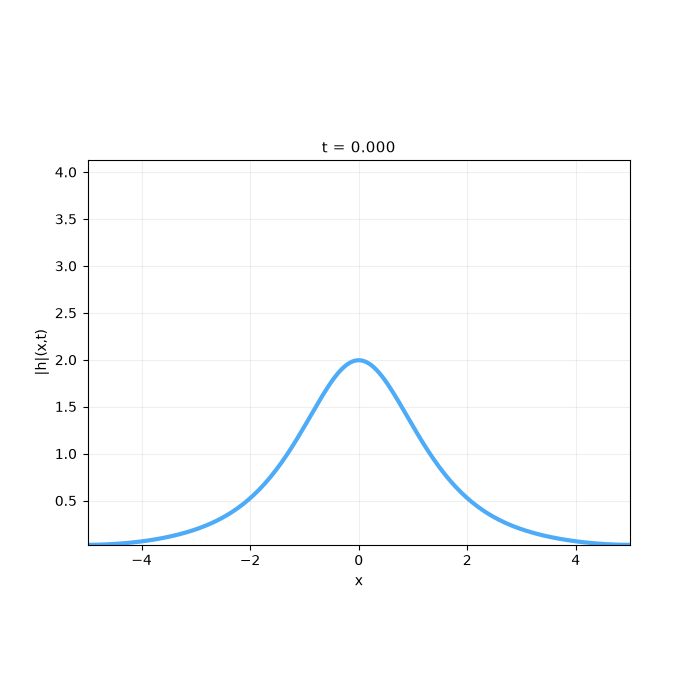</a>
<sub><strong>1D</strong> — <code>(x, t)</code> — <a href="#dx-schr-dinger-equation">Schrödinger</a></sub>
</td>
<td width="33%" align="center">
<a href="#2d-allen-cahn-wight--zhao">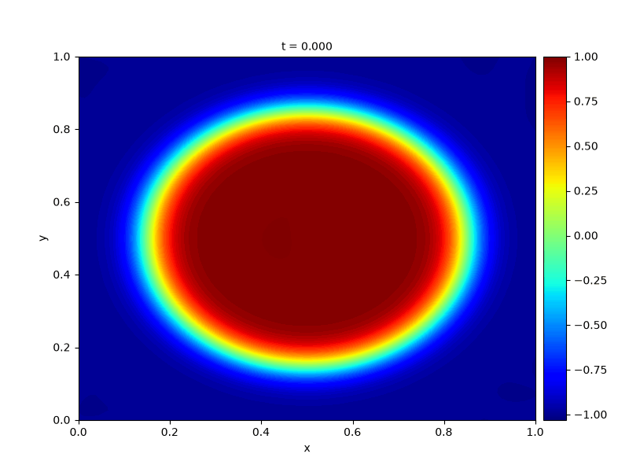</a>
<sub><strong>2D</strong> — <code>(x, y, t)</code> — <a href="#2d-allen-cahn-wight--zhao">Allen-Cahn (Wight & Zhao)</a></sub>
</td>
<td width="33%" align="center">
<a href="#3d-heat">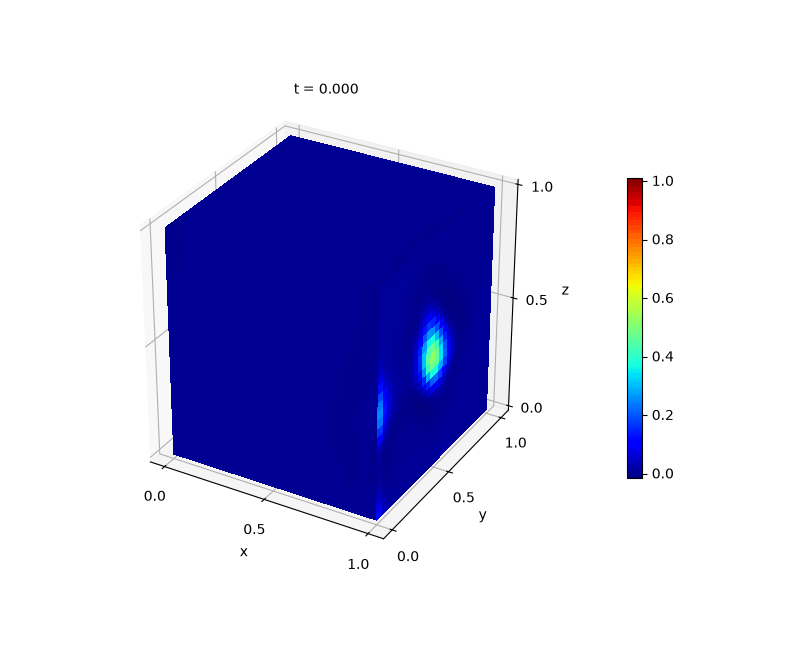</a>
<sub><strong>3D</strong> — <code>(x, y, z, t)</code> — <a href="#3d-heat">Heat</a></sub>
</td>
</tr>
</table>

<p align="center">
  <strong><a href="https://asfandyarkhan72.github.io/PINNStudio/">Website</a></strong> &nbsp;·&nbsp;
  <strong><a href="#installation">Install</a></strong> &nbsp;·&nbsp;
  <strong><a href="#quick-start">Quick Start</a></strong> &nbsp;·&nbsp;
  <strong><a href="#examples">Examples</a></strong> &nbsp;·&nbsp;
  <strong><a href="#solving-your-own-problem">Your Own Problem</a></strong> &nbsp;·&nbsp;
  <strong><a href="https://github.com/AsfandyarKhan72/PINNStudio/discussions">Discussions</a></strong> &nbsp;·&nbsp;
  <strong><a href="#citation">Citation</a></strong>
</p>

<details>
<summary><strong>Table of contents</strong></summary>

- [Overview](#overview)
- [Demo Video](#demo-video)
- [Installation](#installation)
- [Quick Start](#quick-start)
- [The Interface](#the-interface)
- [Examples](#examples)
- [Features](#features)
- [Solving Your Own Problem](#solving-your-own-problem)
- [How It Works](#how-it-works)
- [Repository Structure](#repository-structure)
- [Citation](#citation)
- [References](#references)
- [Acknowledgment](#acknowledgment)
- [Contributing](#contributing)
- [Contact](#contact)
- [License](#license)

</details>

---

## Overview

**PINNStudio** is a scientific computing environment for solving differential equations with physics-informed neural networks (PINNs) and related scientific machine learning methods, without writing any code. You describe the problem — the equations, the domain, the boundary and initial conditions, the network and how it should be trained — and PINNStudio trains the model, tracks it while it runs, and gives back the solution, its error against reference data, plots and animations, and the trained model ready to reload.

Setting up a PINN by hand means writing a new script for every problem: the residual of the equations through automatic differentiation, the sampling of collocation points, the weighting of the loss terms, the optimizer schedule, and then the plotting and error analysis afterwards. Each of these is easy to get subtly wrong. PINNStudio puts all of it into one place, so researchers and students in science and engineering — including those new to scientific computing or machine learning — can spend their time on the physics of their problem rather than on the code around it.

**What it can solve**

- **Forward and inverse problems:** solve a known equation, or learn unknown coefficients or whole unknown fields from measured data.
- **ODEs and PDEs in 1D, 2D and 3D**, steady or time-dependent, including coupled multi-output systems, integro-differential and fractional equations, typed in a readable form such as `du_t + u*du_x - 0.01/pi*du_xx`.
- **Many kinds of domains** — intervals, rectangles, disks, polygons, cuboids, spheres, and custom shapes combined from them (e.g. a domain with a hole) — with Dirichlet, Neumann, Robin, periodic and point-data conditions, or conditions imposed exactly through the network output.

**How it trains**

- **Multi-phase training** (e.g. Adam followed by L-BFGS) with learning-rate schedules and loss weights per phase.
- **Adaptive methods:** residual-based adaptive refinement (RAR), which adds points where the error is largest; time-adaptive training, which marches through time in steps, each starting from the previous one (transfer learning); initial-condition-guided pre-training. The Loss weights page adds automatic weighting (per-point residual weights, RBA or SA-PINN, which concentrate training where the equation is worst satisfied, and causal training) and exact constraints (an initial condition built into the network, and exact periodicity), each set with one tick box. Which of these help, and on which problems, is measured in the [training methods study](benchmarks/training_methods.md).
- **Point resampling, early stopping, checkpointing and time budgets**, and live monitors of any output or derivative during training.
- **Parameter sweeps** over almost any setting — one at a time, all combinations, paired values, or Bayesian search — with a summary of how the error changes with each parameter.

**What you get back**

- A live training log and loss plot, and error analysis against reference data or an exact formula (relative $L_2$, MSE, maximum error).
- A history of every saved run, with any of them compared on one plot, and figures and tables that copy straight into a paper or a spreadsheet.
- Line, surface and animated solution plots, solution data export, and a saved model that can be reloaded and visualized again without retraining.
- A standalone Python script for every problem, so the work can be inspected, shared and reproduced outside PINNStudio. Solving in the window is as fast as running that script yourself ([timing study](#speed-pinnstudio-and-a-plain-script)).

**Ready-to-run examples.** PINNStudio comes with 63 worked examples, from simple ODEs to the Navier–Stokes equations in 3D, including published PINN benchmarks (Raissi et al., Wight & Zhao, Mattey & Ghosh, and others) and DeepXDE's examples. Each one loads in one click, and 61 of them come with an exact solution or reference data to compare against — see [Examples](#examples).

PINNStudio is under active development, and we are extending it with newer scientific machine learning and PINN methods, aimed at solving harder problems more accurately and faster.

## Demo Video

[](https://youtu.be/5ILxuutvEZw)

*Click to watch the full walkthrough on YouTube: loading an example, setting up your own PDE, sketching a domain and its boundary conditions, training with live loss, error analysis, run history and parameter sweeps.*

## Installation

**One command** installs PINNStudio with its own Python and the PyTorch build that matches your computer's GPU, and adds PINNStudio to the Start menu and desktop (Windows), Applications (macOS) or the app menu (Linux). Python and git do not need to be installed.

**macOS / Linux** (in a terminal):
```bash
curl -LsSf https://raw.githubusercontent.com/AsfandyarKhan72/PINNStudio/main/get-pinnstudio.sh | sh
```

**Windows** (in PowerShell):
```powershell
powershell -ExecutionPolicy ByPass -c "irm https://raw.githubusercontent.com/AsfandyarKhan72/PINNStudio/main/get-pinnstudio.ps1 | iex"
```

The install takes a few minutes, and at the end it says which version was installed and whether training will run on the GPU. Then continue with the [Quick Start](#quick-start). Running the same command again updates PINNStudio.

**Installed PINNStudio with `pip` before?** Run `pip uninstall pinnstudio` first, in the Python or conda environment you installed it in, or typing `pinnstudio` may still start the old copy. The icon the installer adds always opens the new one.

<details>
<summary><strong>Systems PINNStudio is tested on</strong></summary>

Every change is tested on GitHub Actions ([platform tests](.github/workflows/platform-tests.yml), [platform matrix](.github/workflows/platform-matrix.yml)): the test suite, and a check that drives the window end to end: it trains a model, shows the results and error analysis, and restores the model.

| | Tested on |
|---|---|
| **Linux** | Ubuntu 22.04 and 24.04 (x64), Ubuntu 24.04 (ARM) |
| **Windows** | Windows Server 2022 and 2025 (x64), Windows 11 on ARM |
| **macOS** | macOS 14 and 15 (Apple silicon), macOS 15 (Intel) |
| **Python** | 3.9 to 3.14 |
| **One-command installer** | Ubuntu 22.04 and 24.04, Windows Server 2022, Windows 11 on ARM, macOS 15 (Intel) |

Training on an NVIDIA GPU is tested on Linux (RTX 4090, CUDA 12.4); the test machines above train on the CPU.

</details>

<details>
<summary><strong>Updating, uninstalling, and what gets installed</strong></summary>

**Update to the latest version** by running the install command again. It replaces the old version and keeps your settings and results.

macOS / Linux (in a terminal):
```bash
curl -LsSf https://raw.githubusercontent.com/AsfandyarKhan72/PINNStudio/main/get-pinnstudio.sh | sh
```

Windows (in PowerShell):
```powershell
powershell -ExecutionPolicy ByPass -c "irm https://raw.githubusercontent.com/AsfandyarKhan72/PINNStudio/main/get-pinnstudio.ps1 | iex"
```

**Uninstall** with these two commands (the first removes the icon, the second removes PINNStudio and its Python). They are the same on every system; on Windows, type them in PowerShell:
```bash
pinnstudio --remove-shortcut
uv tool uninstall pinnstudio
```
Your results in `PINNStudio_Results` are not deleted.

**Icon for a pip or source installation:** `pinnstudio --create-shortcut` adds the icon, and `pinnstudio --remove-shortcut` removes it.

The installer uses [uv](https://docs.astral.sh/uv/) (and installs it first if needed). PINNStudio gets its own environment with Python 3.12, so nothing is installed system-wide; `uv tool dir` shows where it is. The environment contains [DeepXDE](https://github.com/lululxvi/deepxde) (PyTorch backend), PyTorch, PyQt6, NumPy (below 2.5, since DeepXDE 1.15's Polygon/Triangle geometry fails on NumPy 2.5+), Matplotlib and Pandas. The PyTorch build is chosen from the NVIDIA driver (`--torch-backend auto`), or CPU-only without an NVIDIA GPU. A GPU is optional but recommended for larger 2D/3D problems and inverse runs.

**Intel Macs and Windows on ARM.** PyTorch's last release for Intel Macs is 2.2, which needs Python 3.12 or older and NumPy below 2; the installer and pip pick these by themselves. PyTorch has no build for Windows on ARM (Snapdragon PCs), so there the installer uses the x64 Python, which Windows runs under emulation; with pip, install the x64 Python from python.org first.

</details>

<details>
<summary><strong>Other ways to install: pip, or from source</strong></summary>

**With pip**, into a Python environment you already have:

```bash
pip install pinnstudio
pinnstudio
```

<details>
<summary><strong>Command not found after <code>pip install</code>?</strong></summary>

- **<code>pip: command not found</code>?** Use <code>pip3</code> instead; many systems (macOS especially) only ship <code>pip3</code>, not a plain <code>pip</code>.
- **<code>pinnstudio: command not found</code> even though the install said it succeeded?** pip installed it into a per-user folder that is not on your shell's PATH yet. The install output names the folder in a line like <code>WARNING: The script pinnstudio is installed in '.../bin' which is not on PATH.</code> Add that folder to your PATH:

```bash
echo 'export PATH="<folder from the warning above>:$PATH"' >> ~/.zshrc
source ~/.zshrc
```

(Use <code>~/.bashrc</code> instead of <code>~/.zshrc</code> if your shell is bash.) Then <code>pinnstudio</code> should launch directly. This never comes up with the one-command installer or <code>install.sh</code>/<code>install.bat</code>, since those use a virtual environment where the command is always found automatically.

- **The GPU fix command PINNStudio suggests fails with a <code>flit_core</code> or "Could not find a version that satisfies" error?** Your pip is too old to resolve PyTorch's package index correctly. Upgrade it first, then run the commands PINNStudio printed again (they name the CUDA build that fits your driver, e.g. <code>cu126</code>):

```bash
python -m pip install --upgrade pip
pip uninstall -y torch
pip install torch --index-url https://download.pytorch.org/whl/cu126
```

</details>

**From source**, for development:

The install script creates its own environment and checks that the installed PyTorch can use your GPU, installing a compatible build if the default one cannot (for example with an older driver). Plain `pip install` does not do this.

<details>
<summary><strong>Before you start: open a terminal and check git and Python 3.9+</strong></summary>

- **Windows:** click the Start menu, type `PowerShell`, and open **Windows PowerShell**.
- **macOS:** press `Cmd + Space` to open Spotlight, type `Terminal`, and press Enter (or find it under Applications → Utilities → Terminal).
- **Linux:** open your terminal application (commonly `Ctrl + Alt + T`, or search "Terminal" in your application menu).

Then check git and Python by pasting these one at a time:

```bash
git --version
python3 --version
```

(On Windows, use `python --version` instead of `python3 --version`.)

If either command is not recognized:

- **git missing?** Install it from [git-scm.com/downloads](https://git-scm.com/downloads). Default options are fine. On macOS, running `git --version` for the first time may itself prompt you to install Apple's Command Line Tools — accept and let it finish, then try again.
- **Python missing, or older than 3.9?** Install it from [python.org/downloads](https://www.python.org/downloads/). **On Windows, check "Add python.exe to PATH"** on the installer's first screen. This step is often missed.

After installing either one, close your terminal window completely and open a new one before continuing, so the change takes effect.

</details>

```bash
git clone https://github.com/AsfandyarKhan72/PINNStudio.git
cd PINNStudio
```

**macOS / Linux:**
```bash
bash install.sh
./venv/bin/pinnstudio
```

**Windows:**
```
install.bat
.\venv\Scripts\pinnstudio.exe
```

Everything is installed into a virtual environment inside the `PINNStudio` folder — nothing system-wide, and deleting the folder removes it completely. The install needs an internet connection and takes a few minutes.

<details>
<summary><strong>Running PINNStudio again (source install)</strong></summary>

You only need to install once. After that, launch PINNStudio again anytime with:

**macOS / Linux**, from inside the `PINNStudio` folder:
```bash
./venv/bin/pinnstudio
```

**Windows**, from inside the `PINNStudio` folder:
```
.\venv\Scripts\pinnstudio.exe
```

There is no need to reinstall or recreate the virtual environment.

</details>

</details>

**Something not working?** Open an issue on GitHub with the exact command you ran and the full error message — see [Contributing](#contributing).

## Quick Start

Your first result takes about a minute:

1. Open PINNStudio from its icon  in the Start menu, Applications or the app menu, or run `pinnstudio` in a terminal (`./venv/bin/pinnstudio` for a source install). It opens on the **Start** tab.
2. Under **Examples** on the Start tab, click **Heat 1D – Dirichlet** (or pick it from the **Examples** list in the toolbar). Every setting — equation, domain, conditions, network, training — fills in, and the model tree on the left shows each part of the problem. The toolbar's **Settings** list chooses how an example loads: *Default* (the source's own settings: DeepXDE's, or the paper's method) or *Tuned* (PINNStudio's most accurate settings from the [benchmarks](benchmarks/README.md)).
3. Press **Solve** (or Ctrl+Enter). The loss is plotted as it trains (*Results → Live loss*), and the status bar shows the phase, the progress and the time left.
4. When the run finishes, the loss curve and the solution appear under *Results → Overview*, and *Results → Error analysis* lists the relative $L_2$ error against the exact solution at each reference time, with the comparison plots.

From there:
- Switch the toolbar's **Examples** list to **Inverse** and pick the same example to learn the unknown diffusivity from measured data instead.
- Browse the other examples below.
- Follow [Solving Your Own Problem](#solving-your-own-problem) to set up an equation of your own.
- To reproduce the PINNStudio paper's test case (Section 6) step by step — load, train, compare with the reference, restore and export — open [Burgers 1D – Raissi et al.](#1d-burgers) and see *Reproducibility test case*.

## The Interface

PINNStudio's window follows the layout of finite-element tools such as COMSOL: a **model tree** on the left, the **settings** of the selected part of the problem in the middle, and **graphics** on the right, with the **Training Log** and the generated **Script** below them. Every panel can be resized, and the layout is remembered (*View → Reset Layout* restores it).

<p align="center">
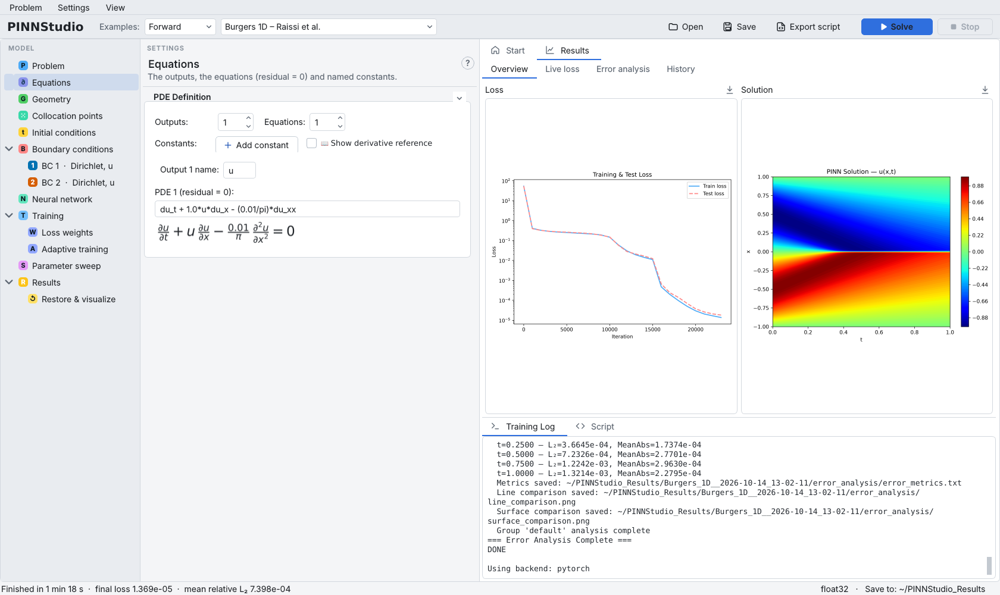
</p>

- **Model tree.** Problem, Equations, Inverse problem (for an inverse problem), Geometry, Collocation points, Initial and Boundary conditions (one node per condition), Neural network, Training with its Loss weights and Adaptive training, Parameter sweep, and Results with Restore & visualize. A node with a setting that would stop **Solve** is marked, and the toolbar says how many there are. Right-click a node for its actions (add, duplicate or delete a boundary condition, add a training phase, fold all sections), and the **?** next to a page's title opens its part of this README.
- **Settings.** Each page is a short form whose sections fold to their titles. Equations are typeset as you type them, and any name PINNStudio does not recognize is flagged.
- **Graphics.** *Start* (new problem, open, recent problems, every example), *Results*, and the domain — *Geometry* for any 2D/3D shape, or the *Sketch* when the domain is drawn.
- **Toolbar and status bar.** Examples (with Forward / Inverse and the *Default* / *Tuned* settings), Open, Save, Export script, **Solve** and **Stop** are always in the toolbar; the status bar shows the run's phase, progress, loss and the time left, and the save folder.

<table>
<tr>
<td width="50%" align="center">
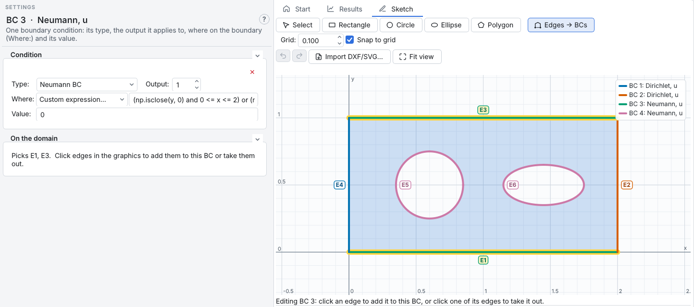
<sub><strong>Sketch</strong> — draw the domain, then click its edges to give them boundary conditions</sub>
</td>
<td width="50%" align="center">
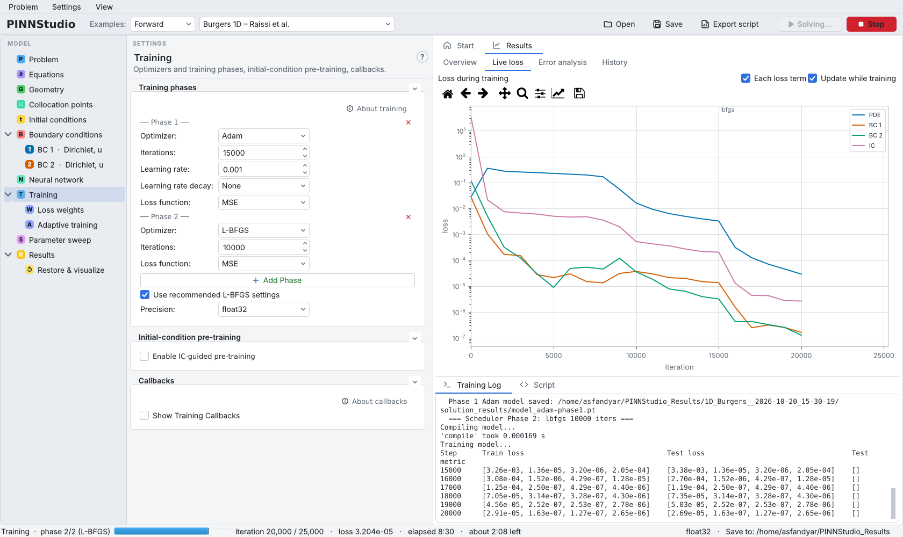
<sub><strong>Live loss</strong> — each loss term while the model trains</sub>
</td>
</tr>
<tr>
<td width="50%" align="center">
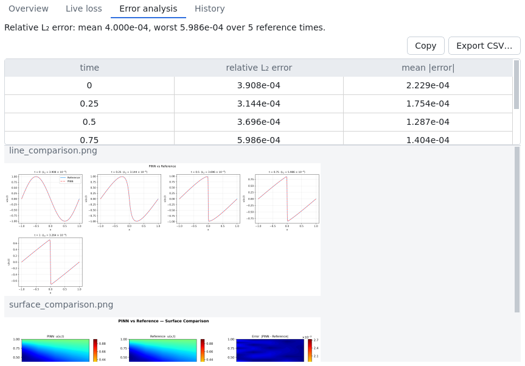
<sub><strong>Error analysis</strong> — the errors at each reference time, ready to copy or export</sub>
</td>
<td width="50%" align="center">
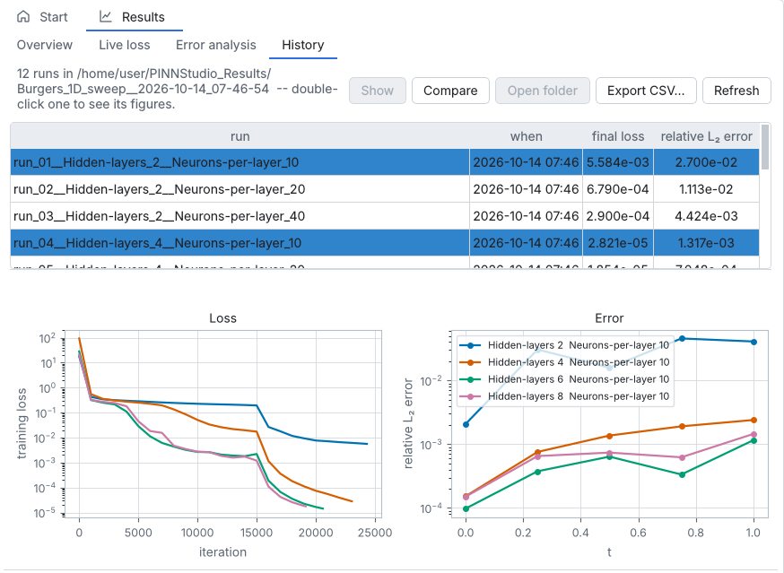
<sub><strong>History</strong> — every saved run, and several compared on one plot</sub>
</td>
</tr>
</table>

<details>
<summary><strong>Keyboard shortcuts</strong></summary>

| Shortcut | Action |
|---|---|
| Ctrl+Enter or F5 | Solve |
| Shift+F5 | Stop |
| Ctrl+S / Ctrl+Shift+S | Save / Save As |
| Ctrl+O | Open a saved problem |
| Ctrl+E | Export the DeepXDE script |
| Ctrl+Z / Ctrl+Y | Undo / redo in the Sketch |

</details>

Three themes are built in — **Studio Light** (the default), **Studio Dark** and **Solarized Dark** — with an accent colour and a UI scale, under *Settings → Display Settings*.

## Examples

PINNStudio comes with 63 ready-to-run examples, all listed in the table below and loaded from the **Examples** list in the toolbar or the gallery on the Start tab. The list's category is **Forward** (every example that solves for the field, which is all of them except the 10 inverse-only DeepXDE examples) or **Inverse** (examples that learn unknown parameters or fields from data), and each list is ordered like the table, under ODE / 1D / 2D / 3D headings. Every name follows one style, *Equation Dimension – detail*. The table's **Source** column says where each example comes from:

- **PINNStudio templates** (14): our own problems; most reproduce a published PINN result, and the Source column names and links that paper (the heat and the disk/sphere Poisson templates are our own and show "—"). Each one works in **Forward** mode, and all but the two Cahn-Hilliard 1D templates in **Inverse** mode too (picked from the Inverse list, it loads in Inverse mode with its measured-data file); all of them ship with reference data in [`reference_data/`](reference_data), so Error Analysis is ready as soon as you load one.
- **DeepXDE examples** (39 forward, 10 inverse; DeepXDE's Allen-Cahn 1D is left out, as the Allen-Cahn 1D – Wight & Zhao template covers it): the **DeepXDE** link in the Source column opens each one's script in DeepXDE's repository. These are the PINN examples from DeepXDE's documentation ([forward](https://deepxde.readthedocs.io/en/latest/demos/pinn_forward.html), [inverse](https://deepxde.readthedocs.io/en/latest/demos/pinn_inverse.html)), set up with each script's own equation, geometry, boundary/initial conditions, network, optimizers, iteration counts and loss weights, so pressing **Solve** trains what the DeepXDE script trains. Anything that differs from the script is printed in the Training Log when the example loads, and noted in its entry below. Their results are what DeepXDE's own settings give, so some show a noticeable error: Brinkman-Forchheimer finds $\nu_e$ only to within about 50% from its five measurements (as DeepXDE's script does), and the unknown-field examples learn the field to a few percent (13% for the forcing field trained in batches). They are kept as in DeepXDE so the two can be compared; more training, more points or the methods under *Tips* below usually improve them, as for PINNStudio's own templates.
- **Settings: Default or Tuned** (next to the Examples list): *Default* is DeepXDE's own settings for a DeepXDE example, and for a template taken from a paper the paper's own way of solving it; *Tuned* is PINNStudio's best for the example, from the [benchmarks](benchmarks/README.md). The Training Log says what Tuned changes.

Loading an example fills in every setting, and you can change any of them before pressing **Solve**; if you do, the Training Log lists what you changed. Your save folder, GPU, random-seed and plot-style settings are kept when you load one.

**Error Analysis reference:** where the problem has an exact solution, Error Analysis compares against it directly (*Exact solution*). Otherwise it uses reference files computed independently of the PINN (*Generated data*): PINNStudio's own reference solutions in [`reference_data/`](reference_data), or data computed by [`tools/make_deepxde_reference_data.py`](tools/make_deepxde_reference_data.py) (no data is copied from DeepXDE's repository). Examples marked "—" have no bundled reference; you can add your own files in the Error Analysis dialog.

Every result shown below comes from one training run with the example's settings on an RTX 4090. Errors are relative $L_2$ errors from Error Analysis, and they vary a little from run to run. Many DeepXDE examples are set up to show how the library works, so they train briefly or on a small network; the [tuning study](benchmarks/tuning_study.md) reruns the 21 with the largest errors with more iterations, a larger network, more points or an added L-BFGS phase. Most errors drop several times, some more than 100 times, and each tuned setup is there as a problem file to open in PINNStudio.

The table is ordered by dimension (ODE, 1D, 2D, 3D), then steady before time-dependent and forward before inverse; examples of the same problem sit next to each other, with Allen-Cahn and then Cahn-Hilliard first in each group.

| # | Example | Dimension | Regime | Problem | Geometry | Error Analysis reference | Source | L₂, Default | L₂, Tuned |
|---|---|---|---|---|---|---|---|---|---|
|  | **ODE (t only)** |  |  |  |  |  |  |  |  |
| 1 | [Integro-differential ODE](#dx-integro-differential-equation) | ODE | Time-dependent | Forward | — (t only) | Exact solution | [DeepXDE](https://github.com/lululxvi/deepxde/blob/master/examples/pinn_forward/ide.py) | 1.5 × 10<sup>-4</sup> | **1.5 × 10<sup>-4</sup>** |
| 2 | [Integro-differential ODE – Volterra kernel](#dx-volterra-integro-differential-equation) | ODE | Time-dependent | Forward | — (t only) | Exact solution | [DeepXDE](https://github.com/lululxvi/deepxde/blob/master/examples/pinn_forward/Volterra_IDE.py) | 2.5 × 10<sup>-3</sup> | **2.5 × 10<sup>-3</sup>** |
| 3 | [Linear ODE system](#dx-ode-system) | ODE | Time-dependent | Forward | — (t only) | Exact solution | [DeepXDE](https://github.com/lululxvi/deepxde/blob/master/examples/pinn_forward/ode_system.py) | 3.6 × 10<sup>-3</sup> | **3.6 × 10<sup>-3</sup>** |
| 4 | [Lotka-Volterra ODE](#dx-lotka-volterra-equation) | ODE | Time-dependent | Forward | — (t only) | Generated data | [DeepXDE](https://github.com/lululxvi/deepxde/blob/master/examples/pinn_forward/Lotka_Volterra.py) | 2.1 × 10<sup>-3</sup> | **2.1 × 10<sup>-3</sup>** |
| 5 | [Second-order ODE](#dx-second-order-ode) | ODE | Time-dependent | Forward | — (t only) | Exact solution | [DeepXDE](https://github.com/lululxvi/deepxde/blob/master/examples/pinn_forward/ode_2nd.py) | 6.9 × 10<sup>-4</sup> | **6.9 × 10<sup>-4</sup>** |
| 6 | [Lorenz ODE – unknown C₁, C₂, C₃](#dx-inverse-lorenz-system) | ODE | Time-dependent | Inverse | — (t only) | Generated data | [DeepXDE](https://github.com/lululxvi/deepxde/blob/master/examples/pinn_inverse/Lorenz_inverse.py) | – | **0.0013%** (parameters) |
| 7 | [Lorenz ODE – unknown C₁, C₂, C₃, exogenous input](#dx-inverse-lorenz-system-with-exogenous-input) | ODE | Time-dependent | Inverse | — (t only) | Generated data | [DeepXDE](https://github.com/lululxvi/deepxde/blob/master/examples/pinn_inverse/Lorenz_inverse_forced.py) | – | **0.26%** (parameters) |
|  | **1D** |  |  |  |  |  |  |  |  |
| 8 | [Euler beam 1D](#dx-euler-beam) | 1D | Steady | Forward | Interval | Exact solution | [DeepXDE](https://github.com/lululxvi/deepxde/blob/master/examples/pinn_forward/Euler_beam.py) | 3.5 × 10<sup>-3</sup> | **2.4 × 10<sup>-4</sup>** |
| 9 | [Fractional Poisson 1D](#dx-fractional-poisson-equation-1d) | 1D | Steady | Forward | Interval | Exact solution | [DeepXDE](https://github.com/lululxvi/deepxde/blob/master/examples/pinn_forward/fractional_Poisson_1d.py) | 2.3 × 10<sup>-2</sup> | **1.5 × 10<sup>-2</sup>** |
| 10 | [Poisson 1D – Dirichlet](#dx-poisson-1d-dirichlet) | 1D | Steady | Forward | Interval | Exact solution | [DeepXDE](https://github.com/lululxvi/deepxde/blob/master/examples/pinn_forward/Poisson_Dirichlet_1d.py) | 3.7 × 10<sup>-4</sup> | **3.7 × 10<sup>-4</sup>** |
| 11 | [Poisson 1D – Dirichlet/Neumann](#dx-poisson-1d-dirichlet-neumann) | 1D | Steady | Forward | Interval | Exact solution | [DeepXDE](https://github.com/lululxvi/deepxde/blob/master/examples/pinn_forward/Poisson_Neumann_1d.py) | 2.3 × 10<sup>-4</sup> | **2.3 × 10<sup>-4</sup>** |
| 12 | [Poisson 1D – Dirichlet/Periodic](#dx-poisson-1d-dirichlet-periodic) | 1D | Steady | Forward | Interval | Exact solution | [DeepXDE](https://github.com/lululxvi/deepxde/blob/master/examples/pinn_forward/Poisson_periodic_1d.py) | 9.6 × 10<sup>-3</sup> | **6.4 × 10<sup>-6</sup>** |
| 13 | [Poisson 1D – Dirichlet/point-set operator](#dx-poisson-1d-dirichlet-pointsetoperator) | 1D | Steady | Forward | Interval | Exact solution | [DeepXDE](https://github.com/lululxvi/deepxde/blob/master/examples/pinn_forward/Poisson_PointSetOperator_1d.py) | 2.6 × 10<sup>-5</sup> | **2.6 × 10<sup>-5</sup>** |
| 14 | [Poisson 1D – Dirichlet/Robin](#dx-poisson-1d-dirichlet-robin) | 1D | Steady | Forward | Interval | Exact solution | [DeepXDE](https://github.com/lululxvi/deepxde/blob/master/examples/pinn_forward/Poisson_Robin_1d.py) | 2.4 × 10<sup>-4</sup> | **2.4 × 10<sup>-4</sup>** |
| 15 | [Poisson 1D – hard BCs](#dx-poisson-1d-hard-boundary-conditions) | 1D | Steady | Forward | Interval | Exact solution | [DeepXDE](https://github.com/lululxvi/deepxde/blob/master/examples/pinn_forward/Poisson_Dirichlet_1d_exactBC.py) | 2.2 × 10<sup>-6</sup> | **2.2 × 10<sup>-6</sup>** |
| 16 | [Poisson 1D – multi-scale Fourier features](#dx-poisson-1d-multi-scale-fourier-features) | 1D | Steady | Forward | Interval | Exact solution | [DeepXDE](https://github.com/lululxvi/deepxde/blob/master/examples/pinn_forward/Poisson_multiscale_1d.py) | 3.9 × 10<sup>-3</sup> | **3.9 × 10<sup>-3</sup>** |
| 17 | [Brinkman-Forchheimer 1D – unknown ν_e, K](#dx-inverse-brinkman-forchheimer-model) | 1D | Steady | Inverse | Interval | Exact solution | [DeepXDE](https://github.com/lululxvi/deepxde/blob/master/examples/pinn_inverse/brinkman_forchheimer.py) | – | **15%** (parameters) |
| 18 | [Diffusion-reaction 1D – unknown rate field](#dx-inverse-diffusion-reaction-with-space-dependent-rate) | 1D | Steady | Inverse | Interval | Exact solution | [DeepXDE](https://github.com/lululxvi/deepxde/blob/master/examples/pinn_inverse/diffusion_reaction_rate.py) | – | – |
| 19 | [Fractional Poisson 1D – unknown order α](#dx-inverse-fractional-poisson-equation-1d) | 1D | Steady | Inverse | Interval | Exact solution | [DeepXDE](https://github.com/lululxvi/deepxde/blob/master/examples/pinn_inverse/fractional_Poisson_1d_inverse.py) | – | **0.45%** (parameters) |
| 20 | [Poisson 1D – unknown forcing field](#dx-inverse-poisson-with-unknown-forcing-field) | 1D | Steady | Inverse | Interval | Exact solution | [DeepXDE](https://github.com/lululxvi/deepxde/blob/master/examples/pinn_inverse/elliptic_inverse_field.py) | – | – |
| 21 | [Poisson 1D – unknown forcing field (batches)](#dx-inverse-poisson-with-unknown-forcing-field-batches) | 1D | Steady | Inverse | Interval | Exact solution | [DeepXDE](https://github.com/lululxvi/deepxde/blob/master/examples/pinn_inverse/elliptic_inverse_field_batch.py) | – | – |
| 22 | [Allen-Cahn 1D – Wight & Zhao](#1d-allen-cahn) | 1D | Time-dependent | Forward / Inverse | Interval | Generated data | [Wight & Zhao (2021)](https://doi.org/10.4208/cicp.OA-2020-0086) | 4.6 × 10<sup>-2</sup> | **6.3 × 10<sup>-4</sup>** |
| 23 | [Cahn-Hilliard 1D – Wight & Zhao](#1d-cahn-hilliard) | 1D | Time-dependent | Forward | Interval | Generated data | [Wight & Zhao (2021)](https://doi.org/10.4208/cicp.OA-2020-0086) | 8.6 × 10<sup>-3</sup> | **6.0 × 10<sup>-4</sup>** |
| 24 | [Cahn-Hilliard 1D – Mattey & Ghosh](#1d-cahn-hilliard-mattey--ghosh) | 1D | Time-dependent | Forward | Interval | Generated data | [Mattey & Ghosh (2022)](https://doi.org/10.1016/j.cma.2021.114474) | 5.7 × 10<sup>-3</sup> | **5.7 × 10<sup>-3</sup>** |
| 25 | [Black-Scholes 1D – American put](#dx-american-put-option) | 1D | Time-dependent | Forward | Interval | — | [DeepXDE](https://github.com/lululxvi/deepxde/blob/master/examples/pinn_forward/american_put.py) | – | – |
| 26 | [Black-Scholes 1D – European call](#dx-black-scholes-equation-call-option) | 1D | Time-dependent | Forward | Interval | Exact solution | [DeepXDE](https://github.com/lululxvi/deepxde/blob/master/examples/pinn_forward/black_scholes_call.py) | 4.3 × 10<sup>-4</sup> | **4.3 × 10<sup>-4</sup>** |
| 27 | [Burgers 1D – Raissi et al.](#1d-burgers) | 1D | Time-dependent | Forward / Inverse | Interval | Generated data | [Raissi et al. (2019)](https://doi.org/10.1016/j.jcp.2018.10.045) | 3.3 × 10<sup>-4</sup> | **3.3 × 10<sup>-4</sup>** |
| 28 | [Burgers 1D – RAR](#dx-burgers-equation-with-rar) | 1D | Time-dependent | Forward | Interval | Generated data | [DeepXDE](https://github.com/lululxvi/deepxde/blob/master/examples/pinn_forward/Burgers_RAR.py) | 8.4 × 10<sup>-4</sup> | **8.4 × 10<sup>-4</sup>** |
| 29 | [Diffusion 1D](#dx-diffusion-equation) | 1D | Time-dependent | Forward | Interval | Exact solution | [DeepXDE](https://github.com/lululxvi/deepxde/blob/master/examples/pinn_forward/diffusion_1d.py) | 2.3 × 10<sup>-2</sup> | **1.5 × 10<sup>-3</sup>** |
| 30 | [Diffusion 1D – hard IC and BCs](#dx-diffusion-equation-with-hard-ic-and-bc) | 1D | Time-dependent | Forward | Interval | Exact solution | [DeepXDE](https://github.com/lululxvi/deepxde/blob/master/examples/pinn_forward/diffusion_1d_exactBC.py) | 2.8 × 10<sup>-3</sup> | **2.8 × 10<sup>-3</sup>** |
| 31 | [Diffusion 1D – resampling](#dx-diffusion-equation-with-resampling) | 1D | Time-dependent | Forward | Interval | Exact solution | [DeepXDE](https://github.com/lululxvi/deepxde/blob/master/examples/pinn_forward/diffusion_1d_resample.py) | 5.4 × 10<sup>-2</sup> | **5.8 × 10<sup>-3</sup>** |
| 32 | [Diffusion-reaction 1D](#dx-diffusion-reaction-equation) | 1D | Time-dependent | Forward | Interval | Exact solution | [DeepXDE](https://github.com/lululxvi/deepxde/blob/master/examples/pinn_forward/diffusion_reaction.py) | 8.8 × 10<sup>-2</sup> | **8.5 × 10<sup>-5</sup>** |
| 33 | [Fractional diffusion 1D](#dx-fractional-diffusion-equation) | 1D | Time-dependent | Forward | Interval | Exact solution | [DeepXDE](https://github.com/lululxvi/deepxde/blob/master/examples/pinn_forward/fractional_diffusion_1d.py) | 3.3 × 10<sup>-3</sup> | **3.3 × 10<sup>-3</sup>** |
| 34 | [Heat 1D – Dirichlet](#dx-heat-equation) | 1D | Time-dependent | Forward / Inverse | Interval | Exact solution | [DeepXDE](https://github.com/lululxvi/deepxde/blob/master/examples/pinn_forward/heat.py) | 5.0 × 10<sup>-2</sup> | **1.3 × 10<sup>-2</sup>** |
| 35 | [Heat 1D – resampling](#dx-heat-equation-with-resampling) | 1D | Time-dependent | Forward | Interval | Exact solution | [DeepXDE](https://github.com/lululxvi/deepxde/blob/master/examples/pinn_forward/heat_resample.py) | 1.4 × 10<sup>-2</sup> | **3.1 × 10<sup>-3</sup>** |
| 36 | [Klein-Gordon 1D](#dx-klein-gordon-equation) | 1D | Time-dependent | Forward | Interval | Exact solution | [DeepXDE](https://github.com/lululxvi/deepxde/blob/master/examples/pinn_forward/Klein_Gordon.py) | 6.9 × 10<sup>-2</sup> | **2.3 × 10<sup>-3</sup>** |
| 37 | [Schrödinger 1D](#dx-schr-dinger-equation) | 1D | Time-dependent | Forward / Inverse | Interval | Generated data | [DeepXDE](https://github.com/lululxvi/deepxde/blob/master/examples/pinn_forward/Schrodinger.ipynb) | 1.8 × 10<sup>-3</sup> | **1.8 × 10<sup>-3</sup>** |
| 38 | [Wave 1D – space-time multi-scale Fourier features](#dx-wave-propagation-space-time-multi-scale-fourier-features) | 1D | Time-dependent | Forward | Interval | Exact solution | [DeepXDE](https://github.com/lululxvi/deepxde/blob/master/examples/pinn_forward/wave_1d.py) | 3.0 × 10<sup>-1</sup> | **1.5 × 10<sup>-3</sup>** |
| 39 | [Diffusion 1D – unknown coefficient](#dx-inverse-diffusion-equation) | 1D | Time-dependent | Inverse | Interval | Exact solution | [DeepXDE](https://github.com/lululxvi/deepxde/blob/master/examples/pinn_inverse/diffusion_1d_inverse.py) | – | **0.004%** (parameters) |
| 40 | [Diffusion-reaction 1D – unknown k_f, D](#dx-inverse-diffusion-reaction-system) | 1D | Time-dependent | Inverse | Interval | — | [DeepXDE](https://github.com/lululxvi/deepxde/blob/master/examples/pinn_inverse/reaction_inverse.py) | – | **0.82%** (parameters) |
|  | **2D** |  |  |  |  |  |  |  |  |
| 41 | [Fractional Poisson 2D – disk](#dx-fractional-poisson-equation-2d) | 2D | Steady | Forward | Disk | Exact solution | [DeepXDE](https://github.com/lululxvi/deepxde/blob/master/examples/pinn_forward/fractional_Poisson_2d.py) | 9.2 × 10<sup>-4</sup> | **9.2 × 10<sup>-4</sup>** |
| 42 | [Helmholtz 2D – Dirichlet](#dx-helmholtz-2d-dirichlet) | 2D | Steady | Forward | Rectangle | Exact solution | [DeepXDE](https://github.com/lululxvi/deepxde/blob/master/examples/pinn_forward/Helmholtz_Dirichlet_2d.py) | 1.9 × 10<sup>-3</sup> | **1.9 × 10<sup>-3</sup>** |
| 43 | [Helmholtz 2D – hyperparameter search](#dx-helmholtz-2d-hyperparameter-optimization) | 2D | Steady | Forward | Rectangle | Exact solution | [DeepXDE](https://github.com/lululxvi/deepxde/blob/master/examples/pinn_forward/Helmholtz_Dirichlet_2d_HPO.py) | 1.3 × 10<sup>-3</sup> | **1.3 × 10<sup>-3</sup>** |
| 44 | [Helmholtz 2D – sound-hard scattering](#dx-helmholtz-sound-hard-scattering-absorbing-bc) | 2D | Steady | Forward | Rectangle − Disk | Generated data | [DeepXDE](https://github.com/lululxvi/deepxde/blob/master/examples/pinn_forward/Helmholtz_Sound_hard_ABC_2d.py) | 8.0 × 10<sup>-2</sup> | **8.0 × 10<sup>-2</sup>** |
| 45 | [Helmholtz 2D – square with hole](#dx-helmholtz-2d-with-a-hole) | 2D | Steady | Forward | Rectangle − Disk | Exact solution | [DeepXDE](https://github.com/lululxvi/deepxde/blob/master/examples/pinn_forward/Helmholtz_Neumann_2d_hole.py) | 1.1 × 10<sup>-2</sup> | **7.0 × 10<sup>-4</sup>** |
| 46 | [Laplace 2D – disk](#dx-laplace-equation-on-a-disk) | 2D | Steady | Forward | Rectangle in (r, θ) | Exact solution | [DeepXDE](https://github.com/lululxvi/deepxde/blob/master/examples/pinn_forward/Laplace_disk.py) | 1.1 × 10<sup>-3</sup> | **1.1 × 10<sup>-3</sup>** |
| 47 | [Linear elasticity 2D – plate](#dx-linear-elastostatic-plate) | 2D | Steady | Forward | Rectangle | Exact solution | [DeepXDE](https://github.com/lululxvi/deepxde/blob/master/examples/pinn_forward/elasticity_plate.py) | 6.7 × 10<sup>-2</sup> | **1.3 × 10<sup>-4</sup>** |
| 48 | [Linear elasticity 2D – plate, soft BCs](#dx-linear-elastostatic-plate-soft-bcs) | 2D | Steady | Forward | Rectangle | Exact solution | [DeepXDE](https://github.com/lululxvi/deepxde/blob/master/examples/pinn_forward/elasticity_plate.py) | 4.9 × 10<sup>-4</sup> | **4.9 × 10<sup>-4</sup>** |
| 49 | [Navier-Stokes 2D – Kovasznay flow](#dx-kovasznay-flow) | 2D | Steady | Forward | Rectangle | Exact solution | [DeepXDE](https://github.com/lululxvi/deepxde/blob/master/examples/pinn_forward/Kovasznay_flow.py) | 2.1 × 10<sup>-4</sup> | **2.1 × 10<sup>-4</sup>** |
| 50 | [Poisson 2D – disk](#2d-poisson-disk) | 2D | Steady | Forward / Inverse | Disk | Generated data | — | 2.8 × 10<sup>-4</sup> | **2.8 × 10<sup>-4</sup>** |
| 51 | [Poisson 2D – L-shape](#dx-poisson-over-an-l-shaped-domain) | 2D | Steady | Forward / Inverse | Polygon (L-shape) | Generated data | [DeepXDE](https://github.com/lululxvi/deepxde/blob/master/examples/pinn_forward/Poisson_Lshape.py) | 3.5 × 10<sup>-2</sup> | **1.2 × 10<sup>-2</sup>** |
| 52 | [Fractional Poisson 2D – unknown order α](#dx-inverse-fractional-poisson-equation-2d) | 2D | Steady | Inverse | Disk | Exact solution | [DeepXDE](https://github.com/lululxvi/deepxde/blob/master/examples/pinn_inverse/fractional_Poisson_2d_inverse.py) | – | **0.21%** (parameters) |
| 53 | [Allen-Cahn 2D – Wight & Zhao](#2d-allen-cahn-wight--zhao) | 2D | Time-dependent | Forward / Inverse | Rectangle | Generated data | [Wight & Zhao (2021)](https://doi.org/10.4208/cicp.OA-2020-0086) | 2.8 × 10<sup>-3</sup> | **1.6 × 10<sup>-3</sup>** |
| 54 | [Allen-Cahn 2D – Mattey & Ghosh](#2d-allen-cahn-mattey--ghosh) | 2D | Time-dependent | Forward / Inverse | Rectangle | Generated data | [Mattey & Ghosh (2022)](https://doi.org/10.1016/j.cma.2021.114474) | 2.5 × 10<sup>-3</sup> | **3.6 × 10<sup>-4</sup>** |
| 55 | [Cahn-Hilliard 2D – Wight & Zhao](#2d-cahn-hilliard-wight--zhao) | 2D | Time-dependent | Forward / Inverse | Rectangle | Generated data | [Wight & Zhao (2021)](https://doi.org/10.4208/cicp.OA-2020-0086) | 2.4 × 10<sup>-1</sup> | **1.1 × 10<sup>-2</sup>** |
| 56 | [Cahn-Hilliard 2D – Mattey & Ghosh](#2d-cahn-hilliard-mattey--ghosh) | 2D | Time-dependent | Forward / Inverse | Rectangle | Generated data | [Mattey & Ghosh (2022)](https://doi.org/10.1016/j.cma.2021.114474) | 2.0 × 10<sup>-2</sup> | **1.1 × 10<sup>-3</sup>** |
| 57 | [Burgers 2D – Mathias et al.](#2d-burgers-mathias) | 2D | Time-dependent | Forward / Inverse | Rectangle | Generated data | [Mathias et al. (2022)](https://arxiv.org/abs/2301.07824) | 1.7 × 10<sup>-1</sup> | **8.4 × 10<sup>-3</sup>** |
| 58 | [Heat 2D](#2d-heat) | 2D | Time-dependent | Forward / Inverse | Rectangle | Generated data | — | 3.9 × 10<sup>-3</sup> | **3.9 × 10<sup>-3</sup>** |
|  | **3D** |  |  |  |  |  |  |  |  |
| 59 | [Fractional Poisson 3D – sphere](#dx-fractional-poisson-equation-3d) | 3D | Steady | Forward | Sphere | Exact solution | [DeepXDE](https://github.com/lululxvi/deepxde/blob/master/examples/pinn_forward/fractional_Poisson_3d.py) | 7.2 × 10<sup>-3</sup> | **7.2 × 10<sup>-3</sup>** |
| 60 | [Poisson 3D – sphere](#3d-poisson-sphere) | 3D | Steady | Forward / Inverse | Sphere | Generated data | — | 1.5 × 10<sup>-3</sup> | **1.5 × 10<sup>-3</sup>** |
| 61 | [Allen-Cahn 3D – Wight & Zhao](#3d-allen-cahn-wight--zhao) | 3D | Time-dependent | Forward / Inverse | Cuboid | Generated data | [Wight & Zhao (2021)](https://doi.org/10.4208/cicp.OA-2020-0086) | 4.6 × 10<sup>-4</sup> | **1.9 × 10<sup>-4</sup>** |
| 62 | [Heat 3D](#3d-heat) | 3D | Time-dependent | Forward / Inverse | Cuboid | Generated data | — | 2.6 × 10<sup>-3</sup> | **2.6 × 10<sup>-3</sup>** |
| 63 | [Navier-Stokes 3D – Beltrami flow](#dx-beltrami-flow) | 3D | Time-dependent | Forward | Cuboid | Exact solution | [DeepXDE](https://github.com/lululxvi/deepxde/blob/master/examples/pinn_forward/Beltrami_flow.py) | 1.4 × 10<sup>-3</sup> | **1.4 × 10<sup>-3</sup>** |

<!-- examples-summary:start (generated) -->

**L₂ columns:** the relative L₂ error of the main output at the last reference time with the *Default* and the *Tuned* settings (PINNStudio's best), on one RTX 4090; for an inverse-only example the worst error of the learned parameters. **All 63 examples.** 52 forward problems: median relative L₂ error 1.3 × 10<sup>-3</sup> with the tuned settings, 47 below 10⁻² and 23 below 10⁻³. Of the 48 with an outside starting point (DeepXDE's example or the paper's method), tuning lowered the error by more than 25% in 21, by a median factor of 14.8 in those (median over all 48: 1.0). 32 inverse problems with scalar parameters: median worst parameter error 0.09%, 29 below 1%. Details, every setting tried and the errors the papers report: [benchmarks](benchmarks/README.md).

<details>
<summary>📈 <em>Every example in one figure: Default and PINNStudio best</em></summary>


*Circles: forward problems (relative L₂ at the last reference time); diamonds: inverse problems (error of each learned parameter). Open: the Default settings (DeepXDE's, or the paper's method run in PINNStudio); filled: PINNStudio's best; a ring: the two are the same. ⭐: the error the paper reports, for the templates taken from a paper.*

</details>

<!-- examples-summary:end -->

The "unknown field" inverse examples learn the field as an extra network output from measurements given as a Point Set boundary condition, so they run in Forward mode, as in DeepXDE. (To train all the DeepXDE examples from the command line, see [CONTRIBUTING.md](CONTRIBUTING.md#checking-the-examples).)


<!-- examples:start (generated by tools/make_benchmarks_readme.py) -->

### ODE examples

*Click an example to expand it.*

<details id="dx-integro-differential-equation">
<summary><strong>Integro-differential ODE</strong></summary>

DeepXDE example: [`ide.py`](https://github.com/lululxvi/deepxde/blob/master/examples/pinn_forward/ide.py) ([documentation](https://deepxde.readthedocs.io/en/latest/demos/pinn_forward/ide.html))

$$\Large \frac{du}{dt} + \int_0^t u(s)\ ds = 2\pi\cos(2\pi t) + \frac{\sin^2(\pi t)}{\pi}, \qquad t \in [0, 1]$$

- **Problem dimension:** ODE (t) — `du_t + integral(u) - (2*pi*cos(2*pi*t) + sin(pi*t)**2/pi)`
- **Initial condition:** $u(0) = 0$
- **Integral:** 16-point Gauss-Legendre quadrature of the network (*∫ points* 16, DeepXDE's `quad_deg`)
- **Exact solution:** $u = \sin(2\pi t)$
- **In PINNStudio:** Examples → **Forward** → **Integro-differential ODE**

**Results (RTX 4090).** *Default* is DeepXDE's settings; *PINNStudio best* is the *Tuned* setting.

| | Default | PINNStudio best | Training time of the best (s) |
|---|---|---|---|
| Forward: relative L₂ at the last reference time | 1.5 × 10<sup>-4</sup> | **1.5 × 10<sup>-4</sup>** | 23 |

<details>
<summary>⚙️ <em>Settings</em></summary>

**Default (*Settings: Default*) — also PINNStudio best**

*Forward problem — also PINNStudio best* (no change in the tuning study did better)

*Found in:* [tuning study, forward runs](benchmarks/tuning_study.md#tune-integro-differential-ode)

- **Network:** FNN 3 × 20 (2 inputs, 1 output), tanh, Glorot uniform
- **Points:** 16 domain, 2 boundary
- **Training:** Adam 10,000

*Load it:* toolbar → Examples: **Forward** → **Integro-differential ODE** → **Default**, then Solve.

</details>

<details>
<summary>📊 <em>Results — PINNStudio best</em></summary>

*Forward problem — DeepXDE's settings:*

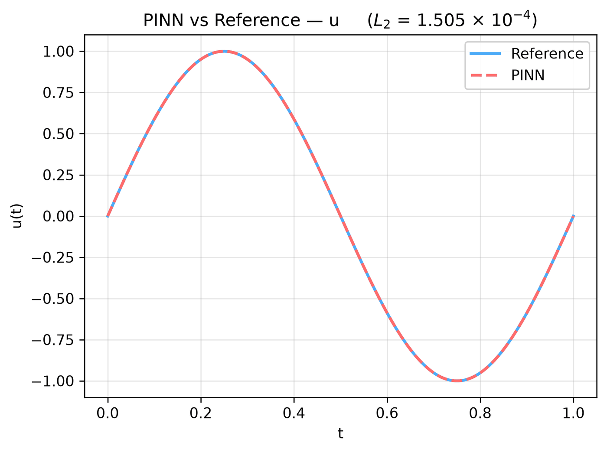

</details>

[Full benchmark: every setting tried, the errors the papers report, all figures →](benchmarks/README.md#bench-integro-differential-ode)

</details>

<details id="dx-volterra-integro-differential-equation">
<summary><strong>Integro-differential ODE – Volterra kernel</strong></summary>

DeepXDE example: [`Volterra_IDE.py`](https://github.com/lululxvi/deepxde/blob/master/examples/pinn_forward/Volterra_IDE.py)

$$\Large \frac{du}{dt} + u(t) = \int_0^t e^{s - t}\ u(s)\ ds, \qquad t \in [0, 5]$$

- **Problem dimension:** ODE (t) — `du_t + u - integral(exp(s - t)*u)`, the kernel and $u$ written in the integration variable `s`
- **Initial condition:** $u(0) = 1$
- **Integral:** 20-point Gauss-Legendre quadrature; 10 uniformly spaced collocation points; L-BFGS only, as in DeepXDE's script
- **Exact solution:** $u = e^{-t}\cosh t$
- **In PINNStudio:** Examples → **Forward** → **Integro-differential ODE – Volterra kernel**

*Source paper:* [Lu, Meng, Mao & Karniadakis (2021), SIAM Rev. 63 (DeepXDE)](https://arxiv.org/abs/1907.04502) — DeepXDE's example follows the equation and conditions studied there, with its own numerical settings.

**Results (RTX 4090).** *Default* is DeepXDE's settings; *PINNStudio best* is the *Tuned* setting.

| | Default | PINNStudio best | Training time of the best (s) |
|---|---|---|---|
| Forward: relative L₂ at the last reference time | 2.5 × 10<sup>-3</sup> | **2.5 × 10<sup>-3</sup>** | 5 |

<details>
<summary>⚙️ <em>Settings</em></summary>

**Default (*Settings: Default*) — also PINNStudio best**

*Forward problem — also PINNStudio best* (no change in the tuning study did better)

*Found in:* [tuning study, forward runs](benchmarks/tuning_study.md#tune-integro-differential-ode-volterra-kernel)

- **Network:** FNN 3 × 20 (2 inputs, 1 output), tanh, Glorot uniform
- **Points:** 10 domain, 2 boundary
- **Training:** L-BFGS 15,000

*Load it:* toolbar → Examples: **Forward** → **Integro-differential ODE – Volterra kernel** → **Default**, then Solve.

</details>

<details>
<summary>📊 <em>Results — PINNStudio best</em></summary>

*Forward problem — DeepXDE's settings:*

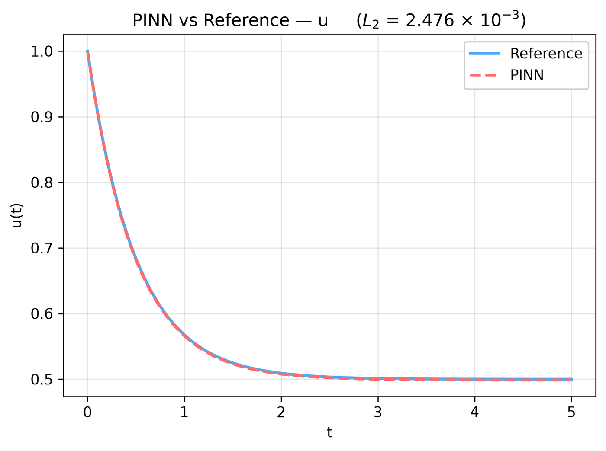

</details>

[Full benchmark: every setting tried, the errors the papers report, all figures →](benchmarks/README.md#bench-integro-differential-ode-volterra-kernel)

</details>

<details id="dx-ode-system">
<summary><strong>Linear ODE system</strong></summary>

DeepXDE example: [`ode_system.py`](https://github.com/lululxvi/deepxde/blob/master/examples/pinn_forward/ode_system.py) ([documentation](https://deepxde.readthedocs.io/en/latest/demos/pinn_forward/ode.system.html))

$$\Large \frac{dy_1}{dt} = y_2, \qquad \frac{dy_2}{dt} = -y_1, \qquad t \in [0, 10]$$

- **Problem dimension:** ODE (t) — derivatives written `dy1_t`, `dy2_t`
- **Initial conditions:** $y_1(0) = 0$, $y_2(0) = 1$
- **Exact solution:** $y_1 = \sin t$, $y_2 = \cos t$
- **In PINNStudio:** Examples → **Forward** → **Linear ODE system**

**Results (RTX 4090).** *Default* is DeepXDE's settings; *PINNStudio best* is the *Tuned* setting.

| | Default | PINNStudio best | Training time of the best (s) |
|---|---|---|---|
| Forward: relative L₂ at the last reference time | 3.6 × 10<sup>-3</sup> | **3.6 × 10<sup>-3</sup>** | 42 |
| Inverse: parameters found (true) | – | **ω = 0.999912 (1)** (worst error 0.0088%) | 135 |

<details>
<summary>⚙️ <em>Settings</em></summary>

**PINNStudio best (*Settings: Tuned*)**

*Inverse problem — PINNStudio's own inverse setup, tuned*

- **Network:** FNN 4 × 100 (2 inputs, 2 outputs), tanh, Glorot uniform
- **Points:** 105 domain, 6 boundary
- **Training:** Adam 60,000 → L-BFGS 45,000
- **Unknowns:** w (initial guess 2.0, true 1.0)
- **Measured data:** y1_obs.txt for y1 (weight 100); y2_obs.txt for y2 (weight 100)

*Load it:* toolbar → Examples: **Inverse** → **Linear ODE system** → **Tuned**, then Solve.

*Found in:* [tuning study, inverse runs](benchmarks/tuning_study.md#tune-linear-ode-system-inverse-mode)

*Forward problem:* PINNStudio best is the Default settings above (no separate Tuned settings).

**Default (*Settings: Default*)** — what loads first; in short:

*Forward problem:* Network FNN 3 × 50 (2 inputs, 2 outputs), tanh, Glorot uniform; Points 35 domain, 2 boundary; Training Adam 20,000

The full Default settings, and where they come from: [benchmark](benchmarks/README.md#bench-linear-ode-system).

</details>

<details>
<summary>📊 <em>Results — PINNStudio best</em></summary>

*Forward problem — DeepXDE's settings:*

<sub>y1 — PINN against the reference along a line, at the reference times</sub>

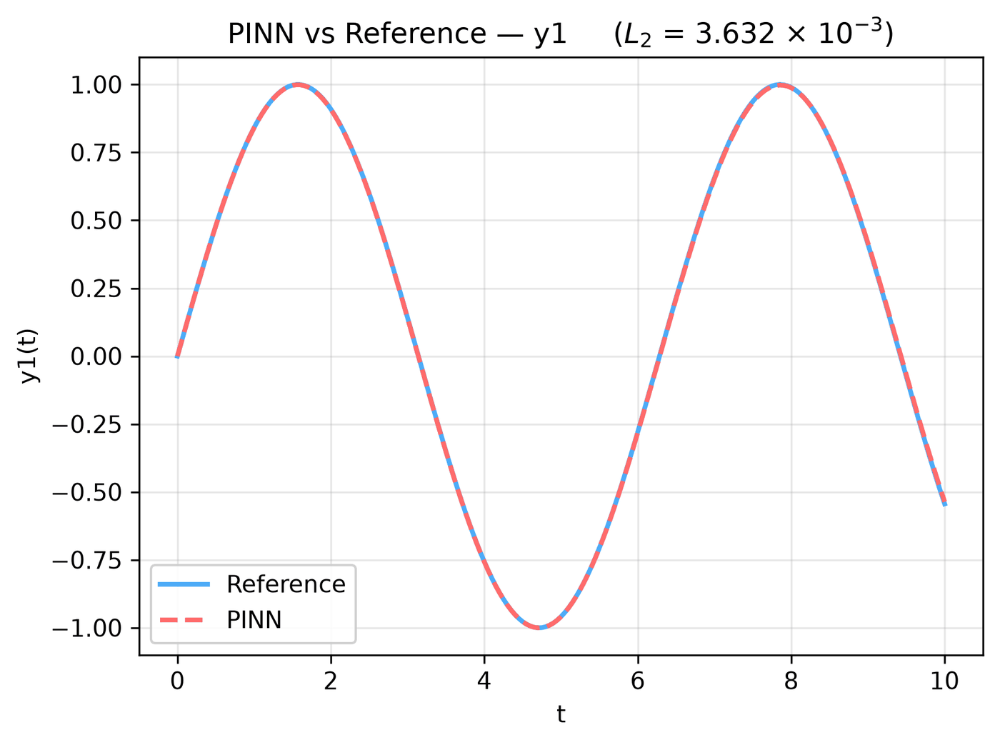

<sub>y2 — PINN against the reference along a line, at the reference times</sub>

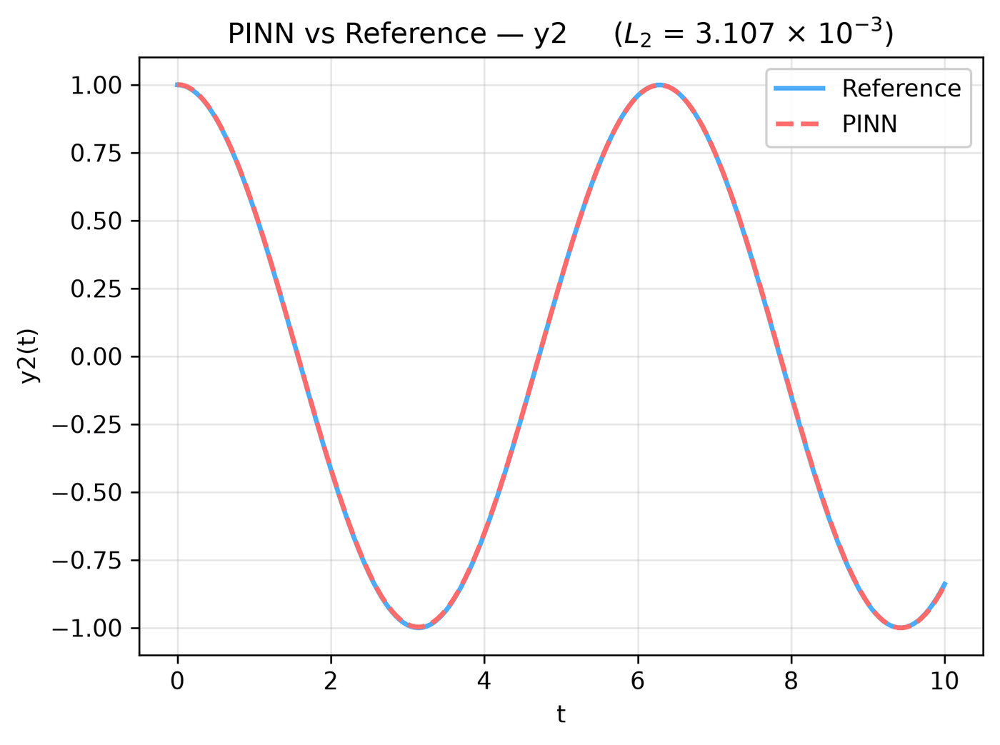

*Inverse problem — all of the changes together:*

<sub>y1 — PINN against the reference along a line, at the reference times</sub>


<sub>y2 — PINN against the reference along a line, at the reference times</sub>


<sub>the learned parameters during training</sub>


</details>

[Full benchmark: every setting tried, the errors the papers report, all figures →](benchmarks/README.md#bench-linear-ode-system)

</details>

<details id="dx-lotka-volterra-equation">
<summary><strong>Lotka-Volterra ODE</strong></summary>

DeepXDE example: [`Lotka_Volterra.py`](https://github.com/lululxvi/deepxde/blob/master/examples/pinn_forward/Lotka_Volterra.py) ([documentation](https://deepxde.readthedocs.io/en/latest/demos/pinn_forward/Lotka.Volterra.html))

$$\Large \frac{dr}{dt} = \frac{R}{U}\left(2Ur - 0.04U^2 rp\right), \qquad \frac{dp}{dt} = \frac{R}{U}\left(0.02U^2 rp - 1.06Up\right), \qquad t \in [0, 1]$$

- **Problem dimension:** ODE (t); populations scaled by $U = 200$ and time by $R = 20$ (constants `ub`, `rb`)
- **Initial conditions:** $r(0) = 100/U$, $p(0) = 15/U$, imposed exactly by the output transform $\hat r = r\tanh t + 100/U$, $\hat p = p\tanh t + 15/U$
- **Reference:** SciPy `solve_ivp` solution of the same system
- **Constants:** `ub = 200`, `rb = 20`
- **In PINNStudio:** Examples → **Forward** → **Lotka-Volterra ODE**

**Results (RTX 4090).** *Default* is DeepXDE's settings; *PINNStudio best* is the *Tuned* setting.

| | Default | PINNStudio best | Training time of the best (s) |
|---|---|---|---|
| Forward: relative L₂ at the last reference time | 2.1 × 10<sup>-3</sup> | **2.1 × 10<sup>-3</sup>** | 219 |
| Inverse: parameters found (true) | – | **a = 2.00001 (2); d = 1.06 (1.06)** (worst error 0.0005%) | 230 |

<details>
<summary>⚙️ <em>Settings</em></summary>

**PINNStudio best (*Settings: Tuned*)**

*Inverse problem — PINNStudio's own inverse setup*

- **Network:** FNN 6 × 64 (2 inputs, 2 outputs), tanh, Glorot normal
- **Points:** 3,000 domain, 2 boundary
- **Training:** Adam 50,000 → L-BFGS 15,000
- **Methods:** initial and boundary conditions built into the output (output transform formula)
- **Unknowns:** a (initial guess 1.0, true 2.0), d (initial guess 2.0, true 1.06)
- **Measured data:** r.txt for r (weight 100); p.txt for p (weight 100)

*Load it:* toolbar → Examples: **Inverse** → **Lotka-Volterra ODE** → **Tuned**, then Solve.

*Found in:* [tuning study, inverse runs](benchmarks/tuning_study.md#tune-lotka-volterra-ode-inverse-mode)

*Forward problem:* PINNStudio best is the Default settings above (no separate Tuned settings).

**Default (*Settings: Default*)** — what loads first; in short:

*Forward problem:* Network FNN 6 × 64 (2 inputs, 2 outputs), tanh, Glorot normal; Points 3,000 domain, 2 boundary; Training Adam 50,000 → L-BFGS 15,000

The full Default settings, and where they come from: [benchmark](benchmarks/README.md#bench-lotka-volterra-ode).

</details>

<details>
<summary>📊 <em>Results — PINNStudio best</em></summary>

*Forward problem — DeepXDE's settings:*

<sub>r — PINN against the reference along a line, at the reference times</sub>

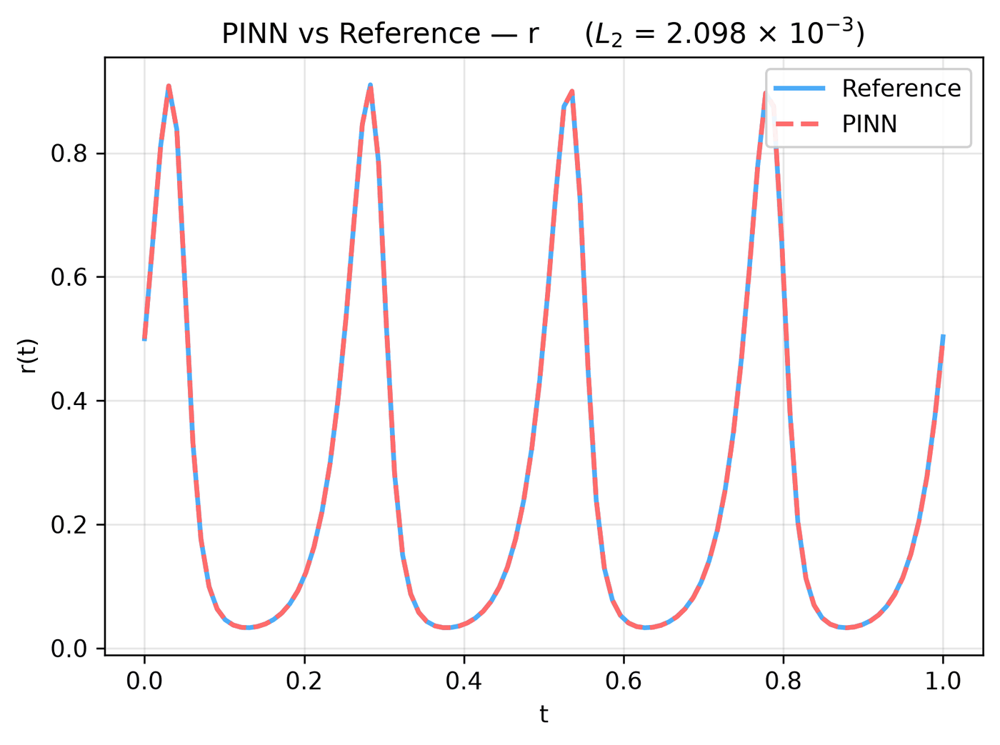

<sub>p — PINN against the reference along a line, at the reference times</sub>

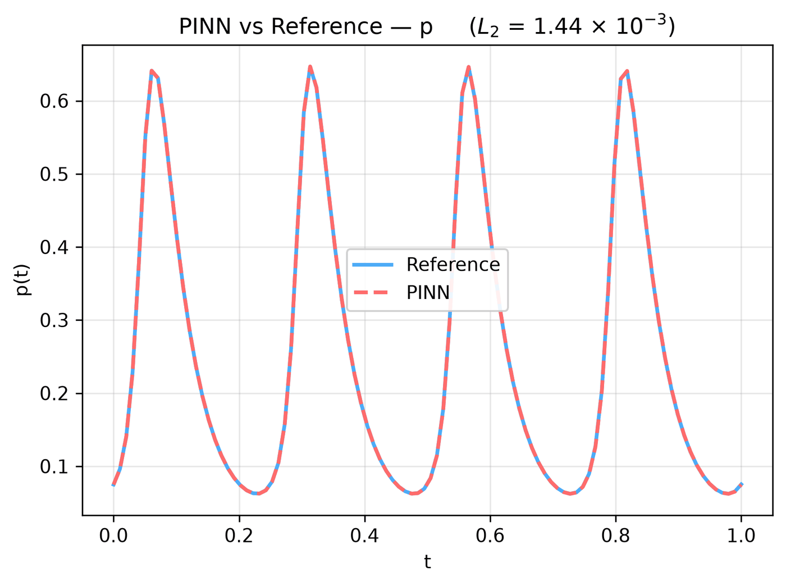

*Inverse problem — the example's own settings (no change did better):*

<sub>r — PINN against the reference along a line, at the reference times</sub>

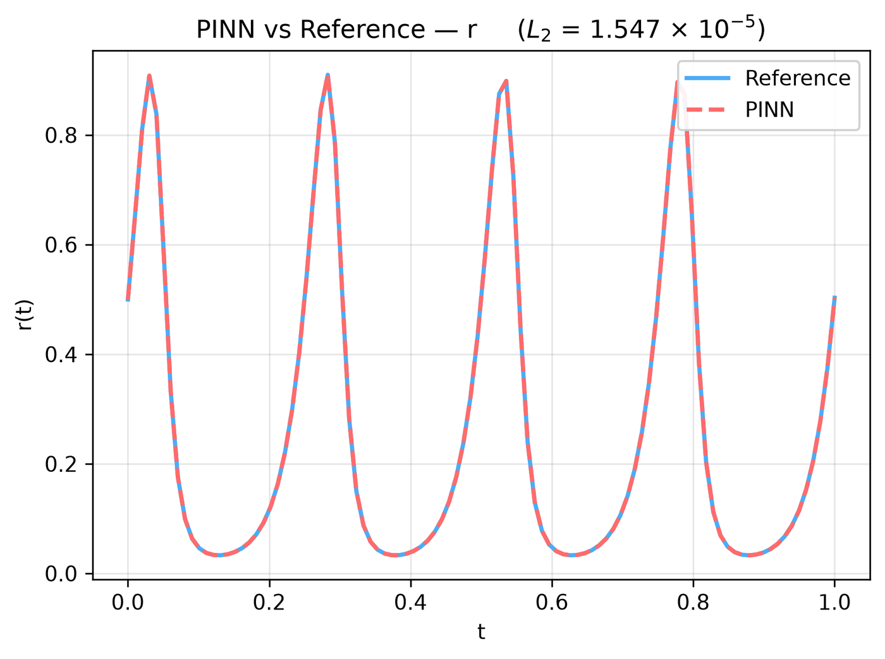

<sub>p — PINN against the reference along a line, at the reference times</sub>

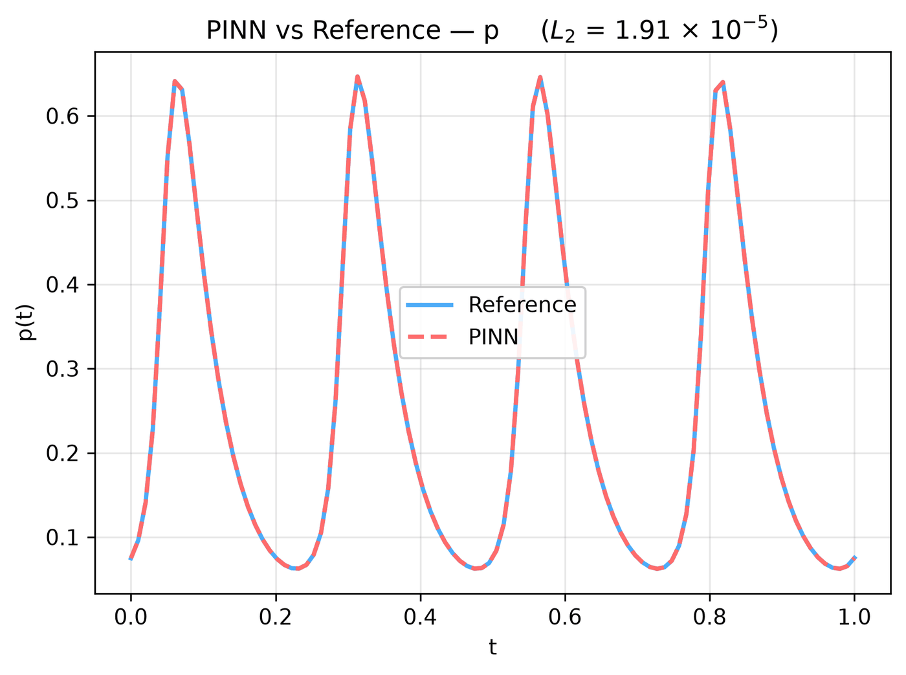

<sub>the learned parameters during training</sub>

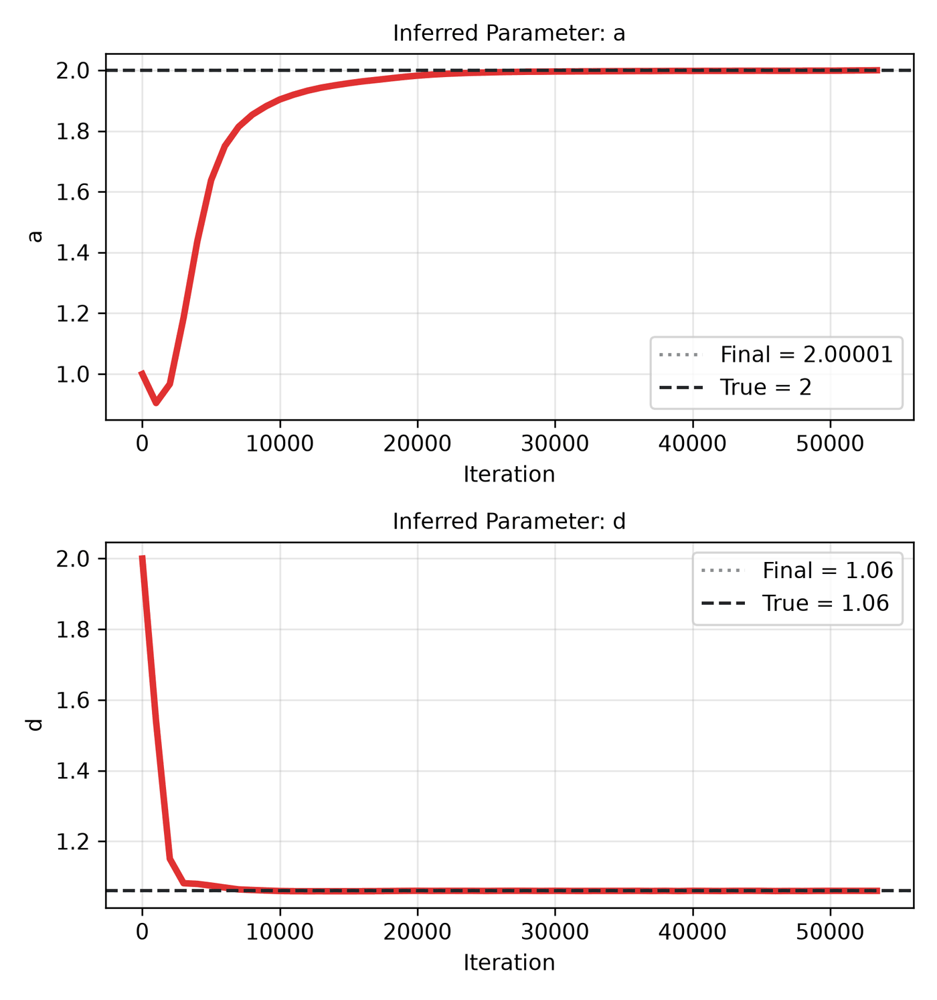

</details>

[Full benchmark: every setting tried, the errors the papers report, all figures →](benchmarks/README.md#bench-lotka-volterra-ode)

</details>

<details id="dx-second-order-ode">
<summary><strong>Second-order ODE</strong></summary>

DeepXDE example: [`ode_2nd.py`](https://github.com/lululxvi/deepxde/blob/master/examples/pinn_forward/ode_2nd.py) ([documentation](https://deepxde.readthedocs.io/en/latest/demos/pinn_forward/ode.2nd.html))

$$\Large \frac{d^2u}{dt^2} - 10\frac{du}{dt} + 9u = 5t, \qquad t \in [0, 0.25]$$

- **Problem dimension:** ODE (t) — `du_tt - 10*du_t + 9*u - 5*t`
- **Initial conditions:** $u(0) = -1$ (initial condition); $u'(0) = 2$ as an Operator BC `du_t - 2` applied at the initial time
- **Exact solution:** $u = \frac{50}{81} + \frac{5}{9}t - 2e^{t} + \frac{31}{81}e^{9t}$
- **In PINNStudio:** Examples → **Forward** → **Second-order ODE**

**Results (RTX 4090).** *Default* is DeepXDE's settings; *PINNStudio best* is the *Tuned* setting.

| | Default | PINNStudio best | Training time of the best (s) |
|---|---|---|---|
| Forward: relative L₂ at the last reference time | 6.9 × 10<sup>-4</sup> | **6.9 × 10<sup>-4</sup>** | 28 |
| Inverse: parameters found (true) | – | **a = 10.0003 (10); b = 8.99262 (9)** (worst error 0.082%) | 30 |

<details>
<summary>⚙️ <em>Settings</em></summary>

**PINNStudio best (*Settings: Tuned*)**

*Inverse problem — PINNStudio's own inverse setup, tuned*

- **Network:** FNN 4 × 100 (2 inputs, 1 output), tanh, Glorot uniform
- **Points:** 16 domain, 2 boundary
- **Training:** Adam 10,000 → L-BFGS 15,000
- **Unknowns:** a (initial guess 5.0, true 10.0), b (initial guess 4.5, true 9.0)
- **Measured data:** u_obs.txt for u (weight 100)

*Load it:* toolbar → Examples: **Inverse** → **Second-order ODE** → **Tuned**, then Solve.

*Found in:* [tuning study, inverse runs](benchmarks/tuning_study.md#tune-second-order-ode-inverse-mode)

*Forward problem:* PINNStudio best is the Default settings above (no separate Tuned settings).

**Default (*Settings: Default*)** — what loads first; in short:

*Forward problem:* Network FNN 3 × 50 (2 inputs, 1 output), tanh, Glorot uniform; Points 16 domain, 2 boundary; Training Adam 10,000

The full Default settings, and where they come from: [benchmark](benchmarks/README.md#bench-second-order-ode).

</details>

<details>
<summary>📊 <em>Results — PINNStudio best</em></summary>

*Forward problem — DeepXDE's settings:*

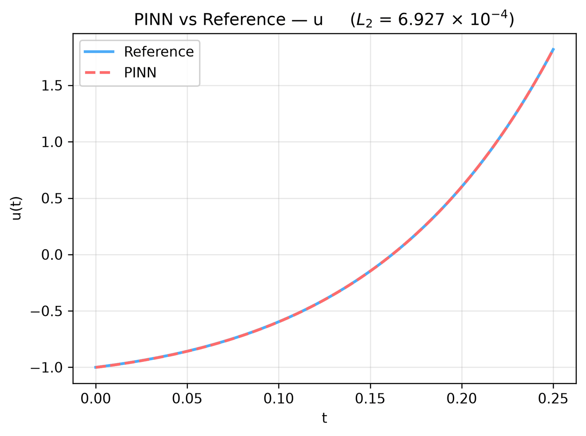

*Inverse problem — Larger network (2× width, one more layer):*

<sub>PINN against the reference along a line, at the reference times</sub>

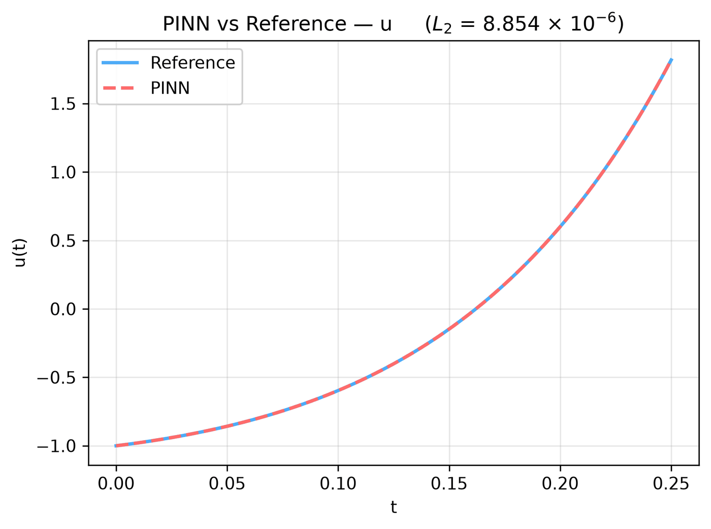

<sub>the learned parameters during training</sub>


</details>

[Full benchmark: every setting tried, the errors the papers report, all figures →](benchmarks/README.md#bench-second-order-ode)

</details>

<details id="dx-inverse-lorenz-system">
<summary><strong>Lorenz ODE – unknown C₁, C₂, C₃</strong></summary>

DeepXDE example: [`Lorenz_inverse.py`](https://github.com/lululxvi/deepxde/blob/master/examples/pinn_inverse/Lorenz_inverse.py) ([documentation](https://deepxde.readthedocs.io/en/latest/demos/pinn_inverse/Lorenz.inverse.html))

$$\Large \frac{dy_1}{dt} = C_1(y_2 - y_1), \qquad \frac{dy_2}{dt} = y_1(C_2 - y_3) - y_2, \qquad \frac{dy_3}{dt} = y_1y_2 - C_3y_3, \qquad t \in [0, 3]$$

- **Problem dimension:** ODE (t); initial conditions $y(0) = (-8, 7, 27)$
- **Unknowns:** $C_1, C_2, C_3$ (true $10, 15, 8/3$), all starting from 1
- **Data:** $y_1, y_2, y_3$ measured at 50 times (also used as anchor points), from SciPy's `solve_ivp`
- **In PINNStudio:** Examples → **Inverse** → **Lorenz ODE – unknown C₁, C₂, C₃**

*Source paper:* [Lu, Meng, Mao & Karniadakis (2021), SIAM Rev. 63 (DeepXDE)](https://arxiv.org/abs/1907.04502) — DeepXDE's example follows the equation and conditions studied there, with its own numerical settings.

**Results (RTX 4090).** *Default* is DeepXDE's settings; *PINNStudio best* is the *Tuned* setting.

| | Default | PINNStudio best | Training time of the best (s) |
|---|---|---|---|
| Inverse: parameters found (true) | – | **C₁ = 10 (10); C₂ = 14.9998 (15); C₃ = 2.66664 (2.66667)** (worst error 0.0013%) | 86 |

<details>
<summary>⚙️ <em>Settings</em></summary>

**Default (*Settings: Default*) — also PINNStudio best**

*Inverse problem — also PINNStudio best* (no change in the tuning study did better)

*Found in:* [tuning study, forward runs](benchmarks/tuning_study.md#tune-lorenz-ode-unknown-c-c-c)

- **Network:** FNN 3 × 40 (2 inputs, 3 outputs), tanh, Glorot uniform
- **Points:** 400 domain, 2 boundary
- **Training:** Adam 20,000 → L-BFGS 15,000
- **Unknowns:** C1 (initial guess 1.0, true 10.0), C2 (initial guess 1.0, true 15.0), C3 (initial guess 1.0, true 2.66667)
- **Measured data:** y1_obs.txt for y1 (weight 1); y2_obs.txt for y2 (weight 1); y3_obs.txt for y3 (weight 1)

*Load it:* toolbar → Examples: **Inverse** → **Lorenz ODE – unknown C₁, C₂, C₃** → **Default**, then Solve.

</details>

<details>
<summary>📊 <em>Results — PINNStudio best</em></summary>

*Inverse problem — the example's own settings (not in the tuning sweep):*

<sub>y1 — PINN against the reference along a line, at the reference times</sub>

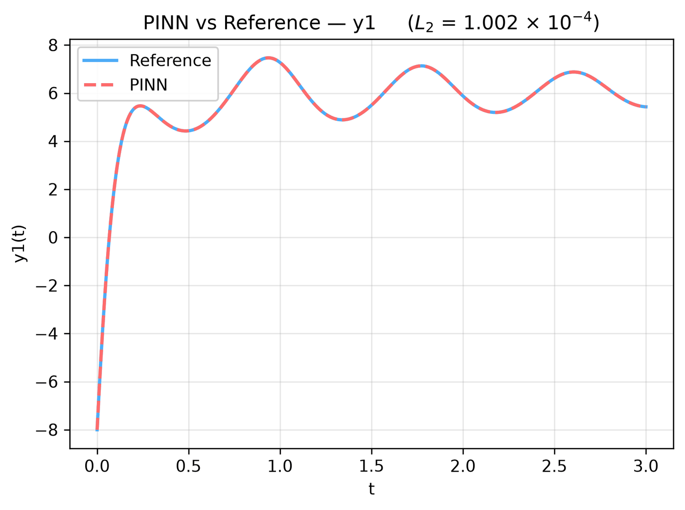

<sub>y2 — PINN against the reference along a line, at the reference times</sub>

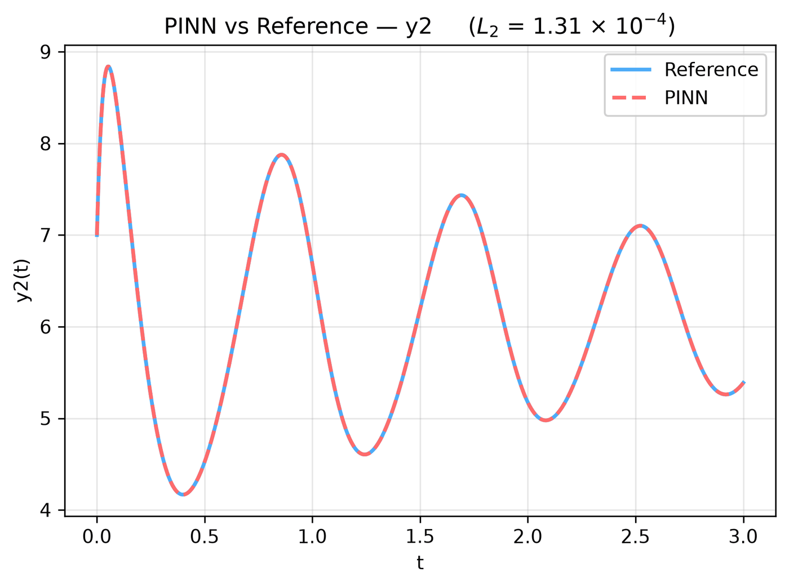

<sub>y3 — PINN against the reference along a line, at the reference times</sub>

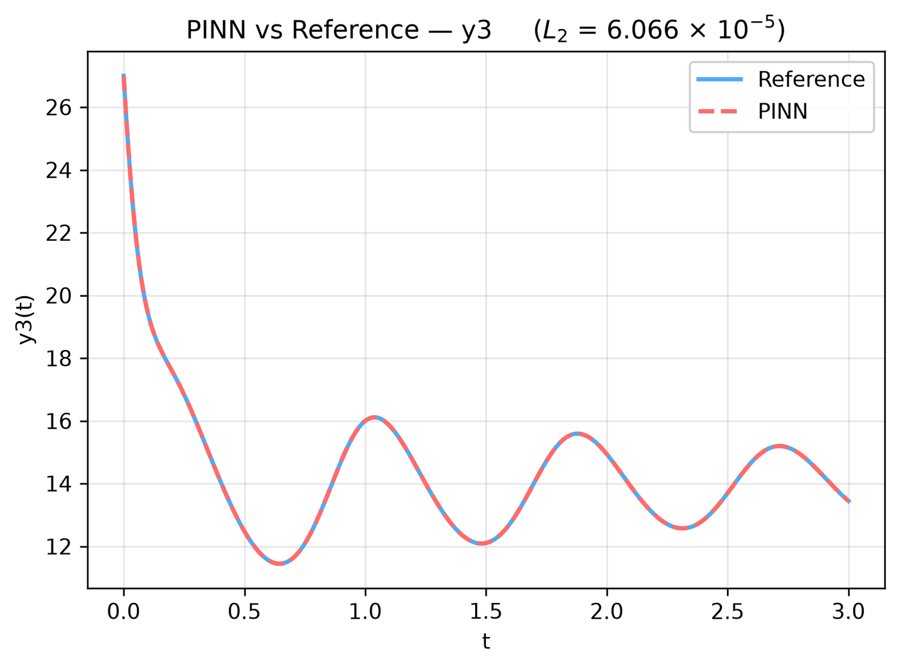

<sub>the learned parameters during training</sub>

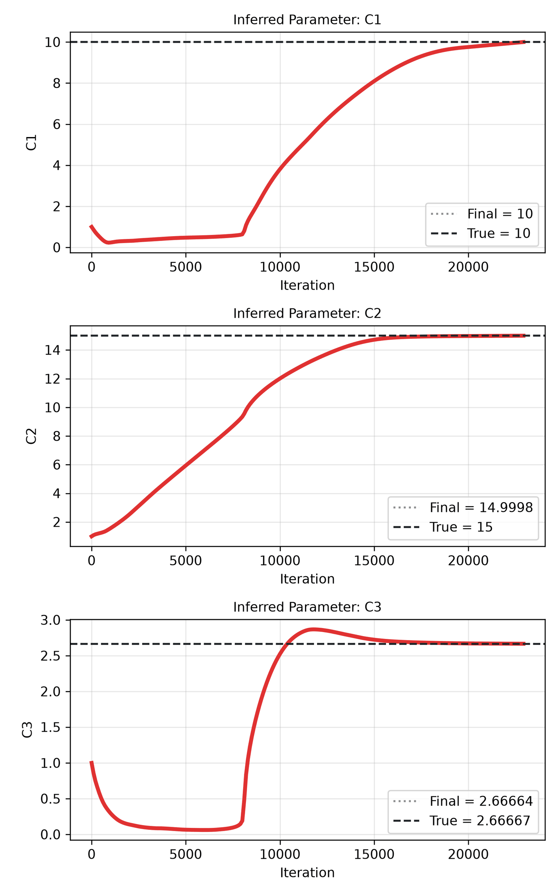

</details>

[Full benchmark: every setting tried, the errors the papers report, all figures →](benchmarks/README.md#bench-lorenz-ode-unknown-c-c-c)

</details>

<details id="dx-inverse-lorenz-system-with-exogenous-input">
<summary><strong>Lorenz ODE – unknown C₁, C₂, C₃, exogenous input</strong></summary>

DeepXDE example: [`Lorenz_inverse_forced.py`](https://github.com/lululxvi/deepxde/blob/master/examples/pinn_inverse/Lorenz_inverse_forced.py) ([documentation](https://deepxde.readthedocs.io/en/latest/demos/pinn_inverse/Lorenz.inverse.forced.html))

$$\Large \frac{dy_1}{dt} = C_1(y_2 - y_1), \qquad \frac{dy_2}{dt} = y_1(C_2 - y_3) - y_2, \qquad \frac{dy_3}{dt} = y_1y_2 - C_3y_3 + 10\sin(2\pi t)$$

- **Problem dimension:** ODE (t), $t \in [0, 3]$; initial conditions $y(0) = (-8, 7, 27)$
- **Unknowns:** $C_1, C_2, C_3$ (true $10, 15, 8/3$), all starting from 1
- **Data:** $y_1, y_2, y_3$ measured at 200 times, from SciPy's `solve_ivp`
- **In PINNStudio:** Examples → **Inverse** → **Lorenz ODE – unknown C₁, C₂, C₃, exogenous input**

**Results (RTX 4090).** *Default* is DeepXDE's settings; *PINNStudio best* is the *Tuned* setting.

| | Default | PINNStudio best | Training time of the best (s) |
|---|---|---|---|
| Inverse: parameters found (true) | – | **C₁ = 9.97389 (10); C₂ = 14.9961 (15); C₃ = 2.66686 (2.66667)** (worst error 0.26%) | 196 |

<details>
<summary>⚙️ <em>Settings</em></summary>

**Default (*Settings: Default*) — also PINNStudio best**

*Inverse problem — also PINNStudio best* (no change in the tuning study did better)

*Found in:* [tuning study, forward runs](benchmarks/tuning_study.md#tune-lorenz-ode-unknown-c-c-c-exogenous-input)

- **Network:** FNN 3 × 40 (2 inputs, 3 outputs), tanh, Glorot uniform
- **Points:** 400 domain, 2 boundary
- **Training:** Adam 60,000
- **Unknowns:** C1 (initial guess 1.0, true 10.0), C2 (initial guess 1.0, true 15.0), C3 (initial guess 1.0, true 2.66667)
- **Measured data:** y1_obs.txt for y1 (weight 1); y2_obs.txt for y2 (weight 1); y3_obs.txt for y3 (weight 1)

*Load it:* toolbar → Examples: **Inverse** → **Lorenz ODE – unknown C₁, C₂, C₃, exogenous input** → **Default**, then Solve.

</details>

<details>
<summary>📊 <em>Results — PINNStudio best</em></summary>

*Inverse problem — the example's own settings (not in the tuning sweep):*

<sub>y1 — PINN against the reference along a line, at the reference times</sub>

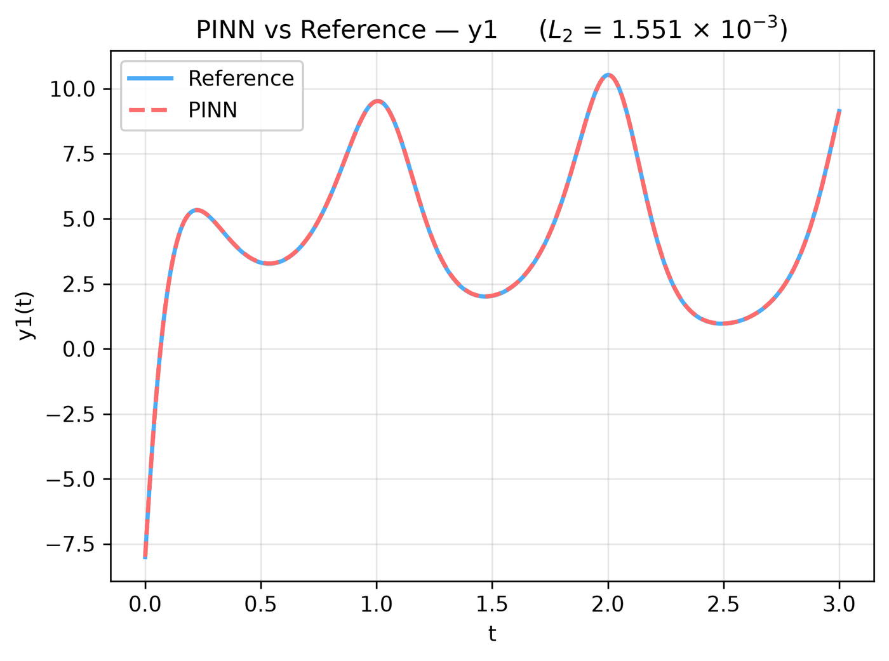

<sub>y2 — PINN against the reference along a line, at the reference times</sub>

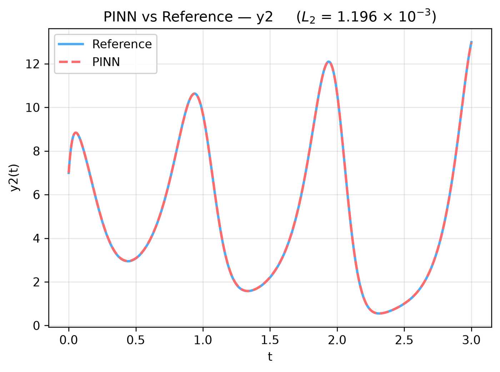

<sub>y3 — PINN against the reference along a line, at the reference times</sub>

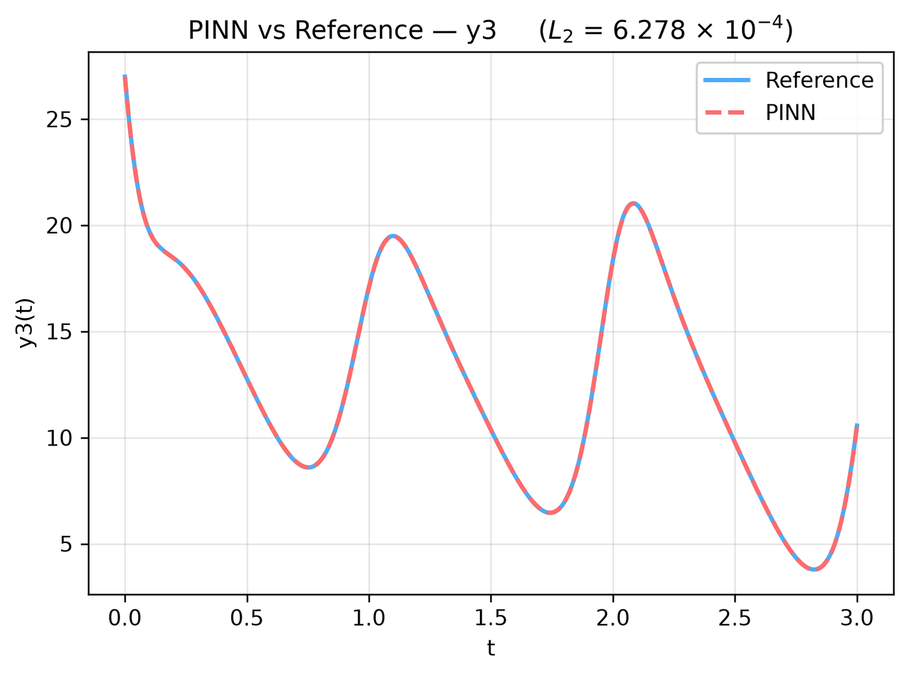

<sub>the learned parameters during training</sub>

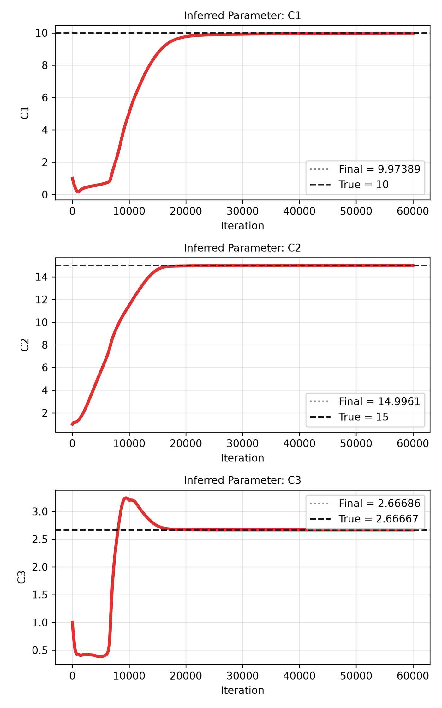

</details>

[Full benchmark: every setting tried, the errors the papers report, all figures →](benchmarks/README.md#bench-lorenz-ode-unknown-c-c-c-exogenous-input)

</details>

### 1D examples

*Click an example to expand it.*

<details id="dx-euler-beam">
<summary><strong>Euler beam 1D</strong></summary>

DeepXDE example: [`Euler_beam.py`](https://github.com/lululxvi/deepxde/blob/master/examples/pinn_forward/Euler_beam.py) ([documentation](https://deepxde.readthedocs.io/en/latest/demos/pinn_forward/eulerbeam.html))

$$\Large \frac{d^4u}{dx^4} = -1, \qquad x \in [0, 1]$$

- **Boundary conditions:** $u(0) = 0$, $u'(0) = 0$ (clamped); $u''(1) = 0$, $u'''(1) = 0$ (free) — the last two as Operator BCs
- **Exact solution:** $u = -\frac{x^4}{24} + \frac{x^3}{6} - \frac{x^2}{4}$
- **In PINNStudio:** Examples → **Forward** → **Euler beam 1D**

**Results (RTX 4090).** *Default* is DeepXDE's settings; *PINNStudio best* is the *Tuned* setting.

| | Default | PINNStudio best | Training time of the best (s) |
|---|---|---|---|
| Forward: relative L₂ at the last reference time | 3.5 × 10<sup>-3</sup> | **2.4 × 10<sup>-4</sup>** | 59 |
| Inverse: parameters found (true) | – | **EI = 1.00075 (1)** (worst error 0.075%) | 231 |

<details>
<summary>⚙️ <em>Settings</em></summary>

**PINNStudio best (*Settings: Tuned*)**

*Forward problem*

- **Network:** FNN 3 × 20 (1 input, 1 output), tanh, Glorot uniform
- **Points:** 10 domain, 2 boundary
- **Training:** Adam 10,000 → L-BFGS 15,000

*Load it:* toolbar → Examples: **Forward** → **Euler beam 1D** → **Tuned**, then Solve.

*Found in:* [tuning study, forward runs](benchmarks/tuning_study.md#tune-euler-beam-1d)

*Inverse problem — PINNStudio's own inverse setup, tuned*

- **Network:** FNN 4 × 40 (1 input, 1 output), tanh, Glorot uniform
- **Points:** 30 domain, 6 boundary
- **Training:** Adam 30,000 → L-BFGS 45,000
- **Unknowns:** EI (initial guess 2.0, true 1.0)
- **Measured data:** u_obs.txt for u (weight 100)

*Load it:* toolbar → Examples: **Inverse** → **Euler beam 1D** → **Tuned**, then Solve.

*Found in:* [tuning study, inverse runs](benchmarks/tuning_study.md#tune-euler-beam-1d-inverse-mode)

**Default (*Settings: Default*)** — what loads first; in short:

*Forward problem:* Network FNN 3 × 20 (1 input, 1 output), tanh, Glorot uniform; Points 10 domain, 2 boundary; Training Adam 10,000

The full Default settings, and where they come from: [benchmark](benchmarks/README.md#bench-euler-beam-1d).

</details>

<details>
<summary>📊 <em>Results — PINNStudio best</em></summary>

*Forward problem — L-BFGS phase added:*

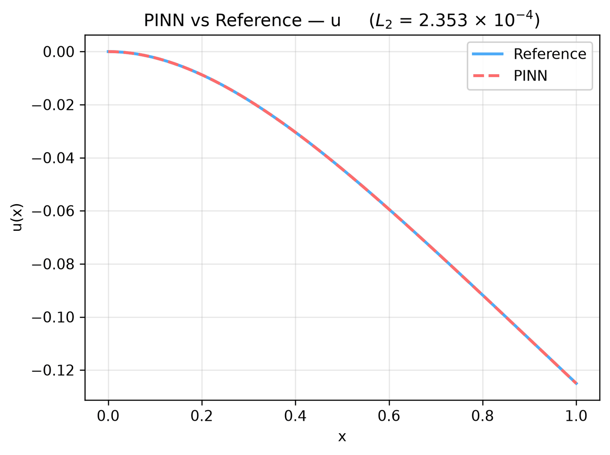

*Inverse problem — all of the changes together:*

<sub>PINN against the reference along a line, at the reference times</sub>


<sub>the learned parameters during training</sub>

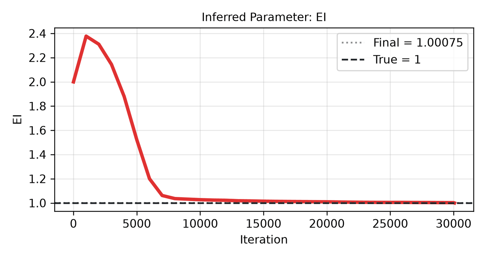

</details>

[Full benchmark: every setting tried, the errors the papers report, all figures →](benchmarks/README.md#bench-euler-beam-1d)

</details>

<details id="dx-fractional-poisson-equation-1d">
<summary><strong>Fractional Poisson 1D</strong></summary>

DeepXDE example: [`fractional_Poisson_1d.py`](https://github.com/lululxvi/deepxde/blob/master/examples/pinn_forward/fractional_Poisson_1d.py)

$$\Large D_{0+}^{\alpha}u + D_{1-}^{\alpha}u = f(x), \qquad x \in [0, 1],\ \alpha = 1.5$$

- **Equation in the panel:** `frac(u) - (...)`, with $f$ written out with `gamma(...)` as in DeepXDE's script; constant `alpha`
- **Boundary conditions:** $u(0) = u(1) = 0$, imposed exactly by the output transform $\hat u = x(1-x)N$
- **Exact solution:** $u = x^3(1-x)^3$
- **Constants:** `alpha = 1.5`
- **In PINNStudio:** Examples → **Forward** → **Fractional Poisson 1D**

*Source paper:* [Pang, Lu & Karniadakis (2019), SIAM J. Sci. Comput. 41 (fPINNs)](https://arxiv.org/abs/1811.08967) — DeepXDE's example follows the equation and conditions studied there, with its own numerical settings.

**Results (RTX 4090).** *Default* is DeepXDE's settings; *PINNStudio best* is the *Tuned* setting.

| | Default | PINNStudio best | Training time of the best (s) |
|---|---|---|---|
| Forward: relative L₂ at the last reference time | 2.3 × 10<sup>-2</sup> | **1.5 × 10<sup>-2</sup>** | 21 |

<details>
<summary>⚙️ <em>Settings</em></summary>

**PINNStudio best (*Settings: Tuned*)**

*Forward problem*

- **Network:** FNN 5 × 40 (1 input, 1 output), tanh, Glorot normal
- **Points:** 101 domain, 2 boundary
- **Training:** Adam 10,000
- **Methods:** initial and boundary conditions built into the output (output transform formula)

*Load it:* toolbar → Examples: **Forward** → **Fractional Poisson 1D** → **Tuned**, then Solve.

*Found in:* [tuning study, forward runs](benchmarks/tuning_study.md#tune-fractional-poisson-1d)

**Default (*Settings: Default*)** — what loads first; in short:

*Forward problem:* Network FNN 4 × 20 (1 input, 1 output), tanh, Glorot normal; Points 101 domain, 2 boundary; Training Adam 10,000

The full Default settings, and where they come from: [benchmark](benchmarks/README.md#bench-fractional-poisson-1d).

</details>

<details>
<summary>📊 <em>Results — PINNStudio best</em></summary>

*Forward problem — Larger network (2× width, one more layer):*

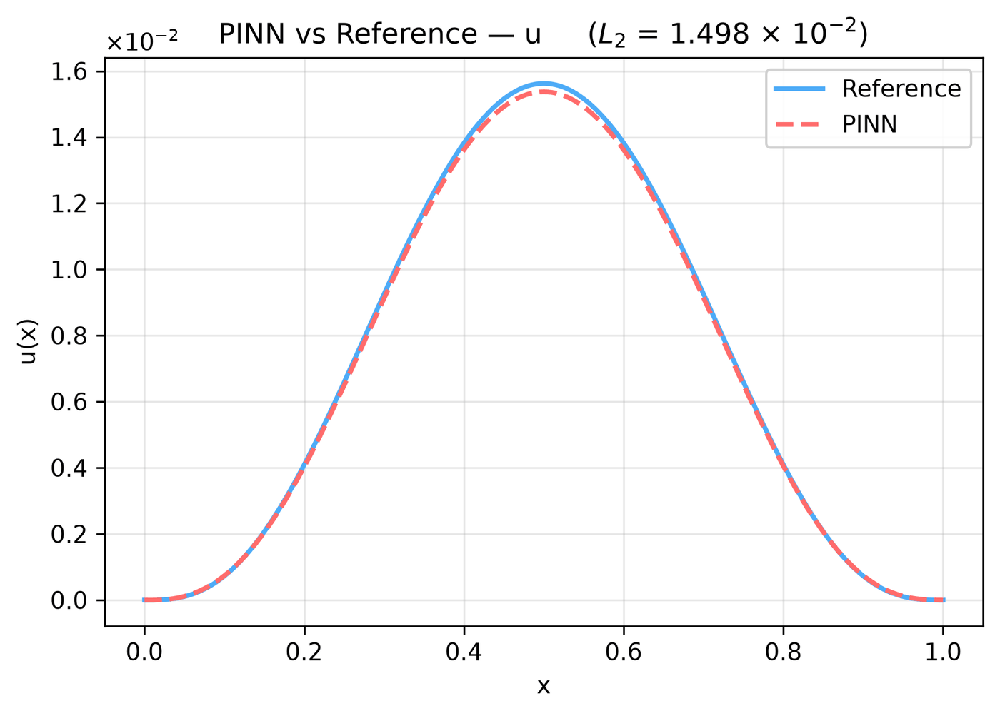

</details>

[Full benchmark: every setting tried, the errors the papers report, all figures →](benchmarks/README.md#bench-fractional-poisson-1d)

</details>

<details id="dx-poisson-1d-dirichlet">
<summary><strong>Poisson 1D – Dirichlet</strong></summary>

DeepXDE example: [`Poisson_Dirichlet_1d.py`](https://github.com/lululxvi/deepxde/blob/master/examples/pinn_forward/Poisson_Dirichlet_1d.py) ([documentation](https://deepxde.readthedocs.io/en/latest/demos/pinn_forward/poisson.1d.dirichlet.html))

$$\Large -\frac{d^2u}{dx^2} = \pi^2\sin(\pi x), \qquad x \in [-1, 1]$$

- **Boundary conditions:** Dirichlet, $u(\pm 1) = 0$ — in the panel: Where *Whole boundary*, Value `0`
- **Exact solution:** $u = \sin(\pi x)$
- **In PINNStudio:** Examples → **Forward** → **Poisson 1D – Dirichlet**

**Results (RTX 4090).** *Default* is DeepXDE's settings; *PINNStudio best* is the *Tuned* setting.

| | Default | PINNStudio best | Training time of the best (s) |
|---|---|---|---|
| Forward: relative L₂ at the last reference time | 3.7 × 10<sup>-4</sup> | **3.7 × 10<sup>-4</sup>** | 23 |

<details>
<summary>⚙️ <em>Settings</em></summary>

**Default (*Settings: Default*) — also PINNStudio best**

*Forward problem — also PINNStudio best* (no change in the tuning study did better)

*Found in:* [tuning study, forward runs](benchmarks/tuning_study.md#tune-poisson-1d-dirichlet)

- **Network:** FNN 3 × 50 (1 input, 1 output), tanh, Glorot uniform
- **Points:** 16 domain, 2 boundary
- **Training:** Adam 10,000

*Load it:* toolbar → Examples: **Forward** → **Poisson 1D – Dirichlet** → **Default**, then Solve.

</details>

<details>
<summary>📊 <em>Results — PINNStudio best</em></summary>

*Forward problem — DeepXDE's settings:*


</details>

[Full benchmark: every setting tried, the errors the papers report, all figures →](benchmarks/README.md#bench-poisson-1d-dirichlet)

</details>

<details id="dx-poisson-1d-dirichlet-neumann">
<summary><strong>Poisson 1D – Dirichlet/Neumann</strong></summary>

DeepXDE example: [`Poisson_Neumann_1d.py`](https://github.com/lululxvi/deepxde/blob/master/examples/pinn_forward/Poisson_Neumann_1d.py) ([documentation](https://deepxde.readthedocs.io/en/latest/demos/pinn_forward/poisson.1d.neumanndirichlet.html))

$$\Large \frac{d^2u}{dx^2} = 2, \qquad x \in [-1, 1]$$

- **Boundary conditions:** Dirichlet $u(-1) = 0$ (Where `left`, Value `0`); Neumann $u'(1) = 4$ (Where `right`, Value `4` — at the right end the outward normal derivative is $du/dx$)
- **Exact solution:** $u = (x + 1)^2$
- **In PINNStudio:** Examples → **Forward** → **Poisson 1D – Dirichlet/Neumann**

**Results (RTX 4090).** *Default* is DeepXDE's settings; *PINNStudio best* is the *Tuned* setting.

| | Default | PINNStudio best | Training time of the best (s) |
|---|---|---|---|
| Forward: relative L₂ at the last reference time | 2.3 × 10<sup>-4</sup> | **2.3 × 10<sup>-4</sup>** | 27 |

<details>
<summary>⚙️ <em>Settings</em></summary>

**Default (*Settings: Default*) — also PINNStudio best**

*Forward problem — also PINNStudio best* (no change in the tuning study did better)

*Found in:* [tuning study, forward runs](benchmarks/tuning_study.md#tune-poisson-1d-dirichlet-neumann)

- **Network:** FNN 3 × 50 (1 input, 1 output), tanh, Glorot uniform
- **Points:** 16 domain, 2 boundary
- **Training:** Adam 10,000

*Load it:* toolbar → Examples: **Forward** → **Poisson 1D – Dirichlet/Neumann** → **Default**, then Solve.

</details>

<details>
<summary>📊 <em>Results — PINNStudio best</em></summary>

*Forward problem — DeepXDE's settings:*


</details>

[Full benchmark: every setting tried, the errors the papers report, all figures →](benchmarks/README.md#bench-poisson-1d-dirichlet-neumann)

</details>

<details id="dx-poisson-1d-dirichlet-periodic">
<summary><strong>Poisson 1D – Dirichlet/Periodic</strong></summary>

DeepXDE example: [`Poisson_periodic_1d.py`](https://github.com/lululxvi/deepxde/blob/master/examples/pinn_forward/Poisson_periodic_1d.py) ([documentation](https://deepxde.readthedocs.io/en/latest/demos/pinn_forward/poisson.1d.dirichletperiodic.html))

$$\Large -\frac{d^2u}{dx^2} = \pi^2\sin(\pi x), \qquad x \in [-1, 1]$$

- **Boundary conditions:** Dirichlet $u(-1) = 0$ (Where `left`); periodic $u(-1) = u(1)$ (Where `right`)
- **Exact solution:** $u = \sin(\pi x)$
- **In PINNStudio:** Examples → **Forward** → **Poisson 1D – Dirichlet/Periodic**

**Results (RTX 4090).** *Default* is DeepXDE's settings; *PINNStudio best* is the *Tuned* setting.

| | Default | PINNStudio best | Training time of the best (s) |
|---|---|---|---|
| Forward: relative L₂ at the last reference time | 9.6 × 10<sup>-3</sup> | **6.4 × 10<sup>-6</sup>** | 67 |

<details>
<summary>⚙️ <em>Settings</em></summary>

**PINNStudio best (*Settings: Tuned*)**

*Forward problem*

- **Network:** FNN 4 × 100 (1 input, 1 output), tanh, Glorot uniform
- **Points:** 48 domain, 6 boundary
- **Training:** Adam 30,000 → L-BFGS 15,000

*Load it:* toolbar → Examples: **Forward** → **Poisson 1D – Dirichlet/Periodic** → **Tuned**, then Solve.

*Found in:* [tuning study, forward runs](benchmarks/tuning_study.md#tune-poisson-1d-dirichlet-periodic)

**Default (*Settings: Default*)** — what loads first; in short:

*Forward problem:* Network FNN 3 × 50 (1 input, 1 output), tanh, Glorot uniform; Points 16 domain, 2 boundary; Training Adam 10,000

The full Default settings, and where they come from: [benchmark](benchmarks/README.md#bench-poisson-1d-dirichlet-periodic).

</details>

<details>
<summary>📊 <em>Results — PINNStudio best</em></summary>

*Forward problem — all of the changes together:*


</details>

[Full benchmark: every setting tried, the errors the papers report, all figures →](benchmarks/README.md#bench-poisson-1d-dirichlet-periodic)

</details>

<details id="dx-poisson-1d-dirichlet-pointsetoperator">
<summary><strong>Poisson 1D – Dirichlet/point-set operator</strong></summary>

DeepXDE example: [`Poisson_PointSetOperator_1d.py`](https://github.com/lululxvi/deepxde/blob/master/examples/pinn_forward/Poisson_PointSetOperator_1d.py) ([documentation](https://deepxde.readthedocs.io/en/latest/demos/pinn_forward/poisson.1d.pointsetoperator.html))

$$\Large \frac{d^2u}{dx^2} = 2, \qquad x \in [-1, 1]$$

- **Boundary conditions:** Dirichlet $u(-1) = 0$ (Where `left`); point-set operator condition $u'(1) = 4$ — a Point Set Operator row with the point typed in (Points `1`, Function `du_x`, Target value `4`; no file)
- **Exact solution:** $u = (x + 1)^2$
- **In PINNStudio:** Examples → **Forward** → **Poisson 1D – Dirichlet/point-set operator**

**Results (RTX 4090).** *Default* is DeepXDE's settings; *PINNStudio best* is the *Tuned* setting.

| | Default | PINNStudio best | Training time of the best (s) |
|---|---|---|---|
| Forward: relative L₂ at the last reference time | 2.6 × 10<sup>-5</sup> | **2.6 × 10<sup>-5</sup>** | 44 |

<details>
<summary>⚙️ <em>Settings</em></summary>

**Default (*Settings: Default*) — also PINNStudio best**

*Forward problem — also PINNStudio best* (no change in the tuning study did better)

*Found in:* [tuning study, forward runs](benchmarks/tuning_study.md#tune-poisson-1d-dirichlet-point-set-operator)

- **Network:** FNN 3 × 50 (1 input, 1 output), tanh, Glorot uniform
- **Points:** 16 domain, 2 boundary
- **Training:** Adam 20,000

*Load it:* toolbar → Examples: **Forward** → **Poisson 1D – Dirichlet/point-set operator** → **Default**, then Solve.

</details>

<details>
<summary>📊 <em>Results — PINNStudio best</em></summary>

*Forward problem — DeepXDE's settings:*

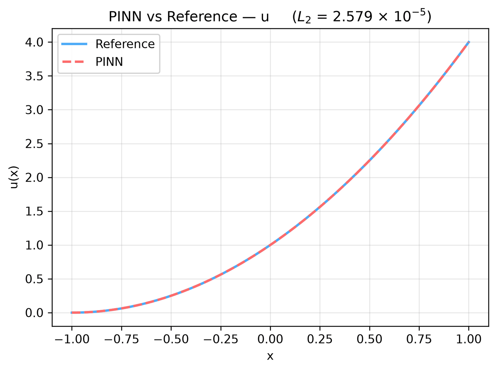

</details>

[Full benchmark: every setting tried, the errors the papers report, all figures →](benchmarks/README.md#bench-poisson-1d-dirichlet-point-set-operator)

</details>

<details id="dx-poisson-1d-dirichlet-robin">
<summary><strong>Poisson 1D – Dirichlet/Robin</strong></summary>

DeepXDE example: [`Poisson_Robin_1d.py`](https://github.com/lululxvi/deepxde/blob/master/examples/pinn_forward/Poisson_Robin_1d.py) ([documentation](https://deepxde.readthedocs.io/en/latest/demos/pinn_forward/poisson.1d.dirichletrobin.html))

$$\Large \frac{d^2u}{dx^2} = 2, \qquad x \in [-1, 1]$$

- **Boundary conditions:** Dirichlet $u(-1) = 0$ (Where `left`); Robin $u'(1) = u(1)$ (Where `right`, Value `u`)
- **Exact solution:** $u = (x + 1)^2$
- **In PINNStudio:** Examples → **Forward** → **Poisson 1D – Dirichlet/Robin**

**Results (RTX 4090).** *Default* is DeepXDE's settings; *PINNStudio best* is the *Tuned* setting.

| | Default | PINNStudio best | Training time of the best (s) |
|---|---|---|---|
| Forward: relative L₂ at the last reference time | 2.4 × 10<sup>-4</sup> | **2.4 × 10<sup>-4</sup>** | 27 |

<details>
<summary>⚙️ <em>Settings</em></summary>

**Default (*Settings: Default*) — also PINNStudio best**

*Forward problem — also PINNStudio best* (no change in the tuning study did better)

*Found in:* [tuning study, forward runs](benchmarks/tuning_study.md#tune-poisson-1d-dirichlet-robin)

- **Network:** FNN 3 × 50 (1 input, 1 output), tanh, Glorot uniform
- **Points:** 16 domain, 2 boundary
- **Training:** Adam 10,000

*Load it:* toolbar → Examples: **Forward** → **Poisson 1D – Dirichlet/Robin** → **Default**, then Solve.

</details>

<details>
<summary>📊 <em>Results — PINNStudio best</em></summary>

*Forward problem — DeepXDE's settings:*


</details>

[Full benchmark: every setting tried, the errors the papers report, all figures →](benchmarks/README.md#bench-poisson-1d-dirichlet-robin)

</details>

<details id="dx-poisson-1d-hard-boundary-conditions">
<summary><strong>Poisson 1D – hard BCs</strong></summary>

DeepXDE example: [`Poisson_Dirichlet_1d_exactBC.py`](https://github.com/lululxvi/deepxde/blob/master/examples/pinn_forward/Poisson_Dirichlet_1d_exactBC.py)

$$\Large -\frac{d^2u}{dx^2} = \sum_{k=1}^{4} k\sin(kx) + 8\sin(8x), \qquad x \in [0, \pi]$$

- **Boundary conditions:** $u(0) = 0$, $u(\pi) = \pi$, imposed exactly by the output transform $\hat u = x(\pi - x)\ N(x) + x$
- **Exact solution:** $u = x + \sum_{k=1}^{4}\frac{\sin(kx)}{k} + \frac{\sin(8x)}{8}$
- **In PINNStudio:** Examples → **Forward** → **Poisson 1D – hard BCs**

*Source paper:* [Yu, Lu, Meng & Karniadakis (2022), CMAME 393 (gPINNs)](https://arxiv.org/abs/2111.02801) — DeepXDE's example follows the equation and conditions studied there, with its own numerical settings.

**Results (RTX 4090).** *Default* is DeepXDE's settings; *PINNStudio best* is the *Tuned* setting.

| | Default | PINNStudio best | Training time of the best (s) |
|---|---|---|---|
| Forward: relative L₂ at the last reference time | 2.2 × 10<sup>-6</sup> | **2.2 × 10<sup>-6</sup>** | 76 |

<details>
<summary>⚙️ <em>Settings</em></summary>

**Default (*Settings: Default*) — also PINNStudio best**

*Forward problem — also PINNStudio best* (no change in the tuning study did better)

*Found in:* [tuning study, forward runs](benchmarks/tuning_study.md#tune-poisson-1d-hard-bcs)

- **Network:** FNN 3 × 50 (1 input, 1 output), tanh, Glorot uniform
- **Points:** 64 domain
- **Training:** Adam 30,000 (lr 0.0001)
- **Methods:** initial and boundary conditions built into the output (output transform formula)

*Load it:* toolbar → Examples: **Forward** → **Poisson 1D – hard BCs** → **Default**, then Solve.

</details>

<details>
<summary>📊 <em>Results — PINNStudio best</em></summary>

*Forward problem — DeepXDE's settings:*

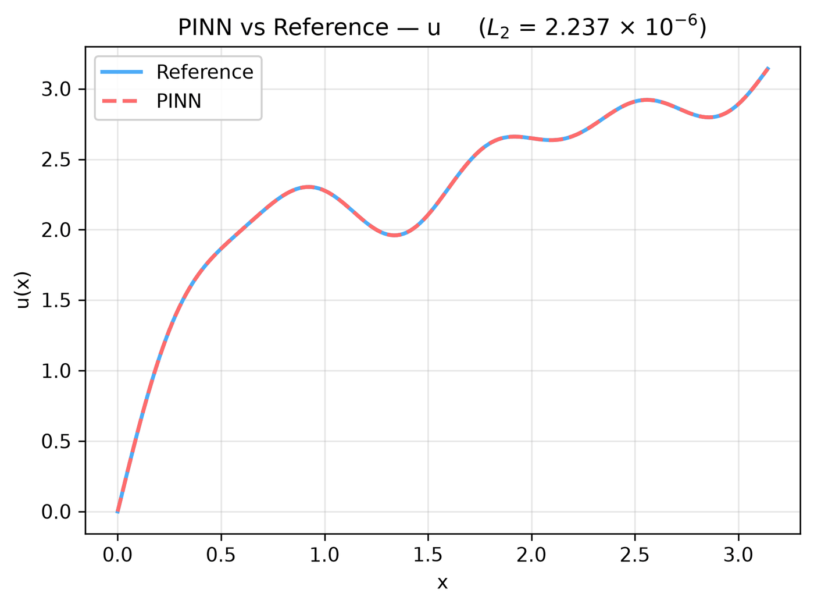

</details>

[Full benchmark: every setting tried, the errors the papers report, all figures →](benchmarks/README.md#bench-poisson-1d-hard-bcs)

</details>

<details id="dx-poisson-1d-multi-scale-fourier-features">
<summary><strong>Poisson 1D – multi-scale Fourier features</strong></summary>

DeepXDE example: [`Poisson_multiscale_1d.py`](https://github.com/lululxvi/deepxde/blob/master/examples/pinn_forward/Poisson_multiscale_1d.py)

$$\Large \frac{d^2u}{dx^2} = -(\pi A)^2\sin(\pi A x) - 0.1(\pi B)^2\sin(\pi B x), \qquad x \in [0, 1],\ A = 2,\ B = 50$$

- **Boundary conditions:** $u(0) = u(1) = 0$
- **Exact solution:** $u = \sin(2\pi x) + 0.1\sin(50\pi x)$ — a slow wave plus a fast, small one
- **Constants:** `A = 2`, `B = 50`
- **In PINNStudio:** Examples → **Forward** → **Poisson 1D – multi-scale Fourier features**

A plain network of the same size learns the slow wave and largely misses the fast one; the Fourier features at scale 10 allow the PINN to represent the sin(50πx) component.

*Source paper:* [Wang, Wang & Perdikaris (2021), CMAME 384](https://arxiv.org/abs/2012.10047) — DeepXDE's example follows the equation and conditions studied there, with its own numerical settings.

**Results (RTX 4090).** *Default* is DeepXDE's settings; *PINNStudio best* is the *Tuned* setting.

| | Default | PINNStudio best | Training time of the best (s) |
|---|---|---|---|
| Forward: relative L₂ at the last reference time | 3.9 × 10<sup>-3</sup> | **3.9 × 10<sup>-3</sup>** | 70 |

<details>
<summary>⚙️ <em>Settings</em></summary>

**Default (*Settings: Default*) — also PINNStudio best**

*Forward problem — also PINNStudio best* (no change in the tuning study did better)

*Found in:* [tuning study, forward runs](benchmarks/tuning_study.md#tune-poisson-1d-multi-scale-fourier-features)

- **Network:** multi-scale Fourier features (MsFFN) 3 × 100 (1 input, 1 output), tanh, Glorot uniform, scales 1, 10
- **Points:** 1,280 domain, 2 boundary
- **Training:** Adam 20,000

*Load it:* toolbar → Examples: **Forward** → **Poisson 1D – multi-scale Fourier features** → **Default**, then Solve.

</details>

<details>
<summary>📊 <em>Results — PINNStudio best</em></summary>

*Forward problem — DeepXDE's settings:*

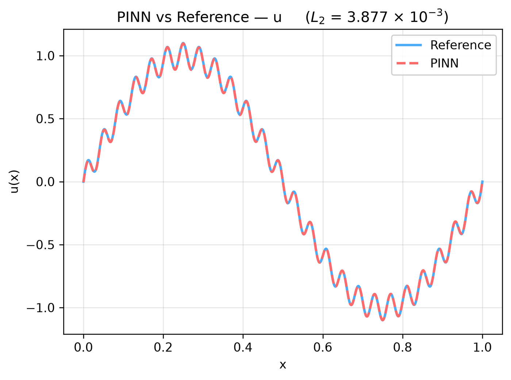

</details>

[Full benchmark: every setting tried, the errors the papers report, all figures →](benchmarks/README.md#bench-poisson-1d-multi-scale-fourier-features)

</details>

<details id="dx-inverse-brinkman-forchheimer-model">
<summary><strong>Brinkman-Forchheimer 1D – unknown ν_e, K</strong></summary>

DeepXDE example: [`brinkman_forchheimer.py`](https://github.com/lululxvi/deepxde/blob/master/examples/pinn_inverse/brinkman_forchheimer.py)

$$\Large -\frac{\nu_e}{\epsilon}\frac{d^2u}{dx^2} + \frac{\nu u}{K} = g, \qquad x \in [0, 1],\ \epsilon = 0.4,\ \nu = 10^{-3},\ g = 1$$

- **Unknowns:** effective viscosity $\nu_e$ and permeability $K$ (both $10^{-3}$, initial guesses 0.1)
- **Data:** 5 measurements of $u$; $u = 0$ at both walls through the output transform $\hat u = x(1-x)N$
- **Exact solution:** $u = 1 - \cosh(20(x - 0.5))/\cosh(10)$
- **Constants:** `g = 1`, `v = 1e-3`, `e = 0.4`
- **In PINNStudio:** Examples → **Inverse** → **Brinkman-Forchheimer 1D – unknown ν_e, K**

*Source paper:* [Yu, Lu, Meng & Karniadakis (2022), CMAME 393 (gPINNs)](https://arxiv.org/abs/2111.02801) — DeepXDE's example follows the equation and conditions studied there, with its own numerical settings.

**Results (RTX 4090).** *Default* is DeepXDE's settings; *PINNStudio best* is the *Tuned* setting.

| | Default | PINNStudio best | Training time of the best (s) |
|---|---|---|---|
| Inverse: parameters found (true) | – | **νₑ = 0.00115135 (0.001); K = 0.00103409 (0.001)** (worst error 15%) | 234 |

<details>
<summary>⚙️ <em>Settings</em></summary>

**Default (*Settings: Default*) — also PINNStudio best**

*Inverse problem — also PINNStudio best* (no change in the tuning study did better)

*Found in:* [tuning study, forward runs](benchmarks/tuning_study.md#tune-brinkman-forchheimer-1d-unknown-e-k)

- **Network:** FNN 3 × 20 (1 input, 1 output), tanh, Glorot uniform
- **Points:** 100 domain
- **Training:** Adam 30,000
- **Methods:** initial and boundary conditions built into the output (output transform formula)
- **Unknowns:** v_e (initial guess 0.1, true 0.001), K (initial guess 0.1, true 0.001)
- **Measured data:** u_obs.txt for u (weight 1)

*Load it:* toolbar → Examples: **Inverse** → **Brinkman-Forchheimer 1D – unknown ν_e, K** → **Default**, then Solve.

</details>

<details>
<summary>📊 <em>Results — PINNStudio best</em></summary>

*Inverse problem — 3× iterations:*

<sub>PINN against the reference along a line, at the reference times</sub>

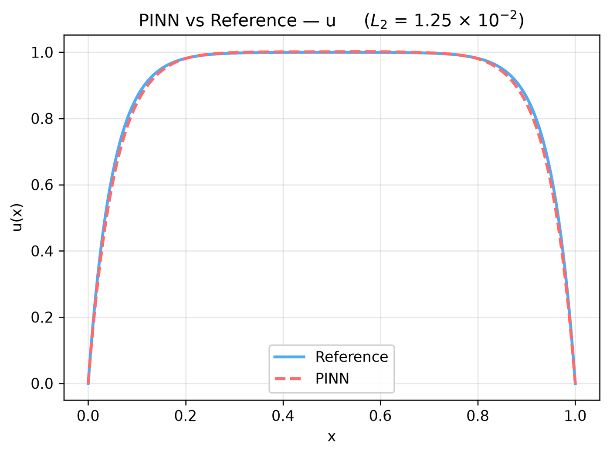

<sub>the learned parameters during training</sub>

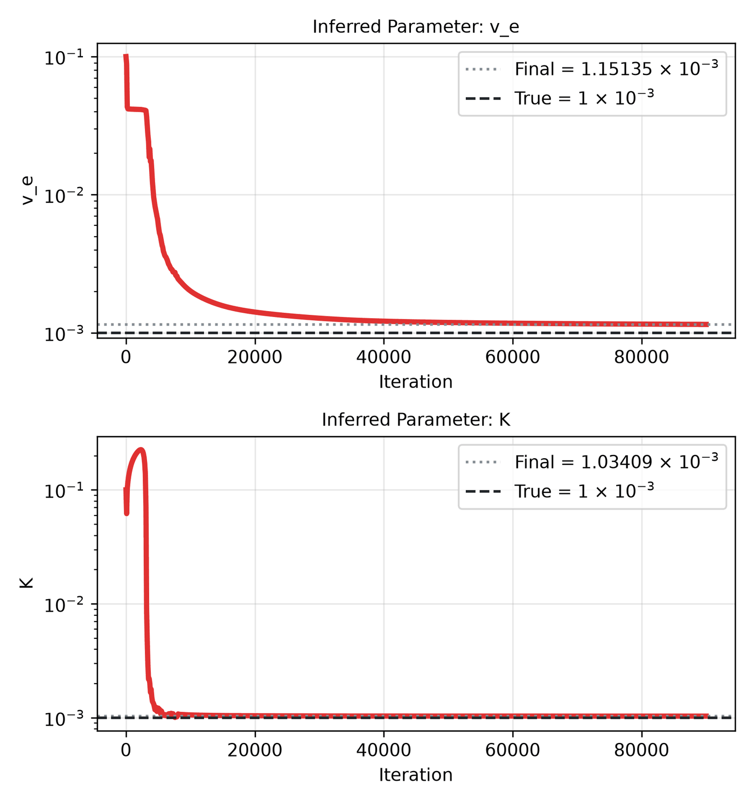

</details>

[Full benchmark: every setting tried, the errors the papers report, all figures →](benchmarks/README.md#bench-brinkman-forchheimer-1d-unknown-e-k)

</details>

<details id="dx-inverse-diffusion-reaction-with-space-dependent-rate">
<summary><strong>Diffusion-reaction 1D – unknown rate field</strong></summary>

DeepXDE example: [`diffusion_reaction_rate.py`](https://github.com/lululxvi/deepxde/blob/master/examples/pinn_inverse/diffusion_reaction_rate.py)

$$\Large \lambda\frac{d^2u}{dx^2} - k(x)\ u = \sin(2\pi x), \qquad \lambda = 0.01,\ x \in [0, 1]$$

- **Unknown:** the reaction rate $k(x)$ (true $0.1 + e^{-0.5(x - 0.5)^2/0.15^2}$), learned as a second network output
- **Data:** 100 measurements of $u$ (computed with SciPy's `solve_bvp`, as DeepXDE does), $u = 0$ at both ends
- **Constants:** `l = 0.01`
- **In PINNStudio:** Examples → **Inverse** → **Diffusion-reaction 1D – unknown rate field**

*Source paper:* [Yu, Lu, Meng & Karniadakis (2022), CMAME 393 (gPINNs)](https://arxiv.org/abs/2111.02801) — DeepXDE's example follows the equation and conditions studied there, with its own numerical settings.

**Results (RTX 4090).** *Default* is DeepXDE's settings; *PINNStudio best* is the *Tuned* setting.

| | Default | PINNStudio best | Training time of the best (s) |
|---|---|---|---|
| Inverse: learned field | – | **see the benchmark** | 61 |

<details>
<summary>⚙️ <em>Settings</em></summary>

**Default (*Settings: Default*) — also PINNStudio best**

*Inverse problem — also PINNStudio best* (no change in the tuning study did better)

*Found in:* [tuning study, forward runs](benchmarks/tuning_study.md#tune-diffusion-reaction-1d-unknown-rate-field)

- **Network:** PFNN 2 × 20 (1 input, 2 outputs), tanh, Glorot uniform
- **Points:** 50 domain, 8 boundary
- **Training:** Adam 20,000

*Load it:* toolbar → Examples: **Inverse** → **Diffusion-reaction 1D – unknown rate field** → **Default**, then Solve.

</details>

<details>
<summary>📊 <em>Results — PINNStudio best</em></summary>

*Inverse problem — Larger network (2× width, one more layer):*

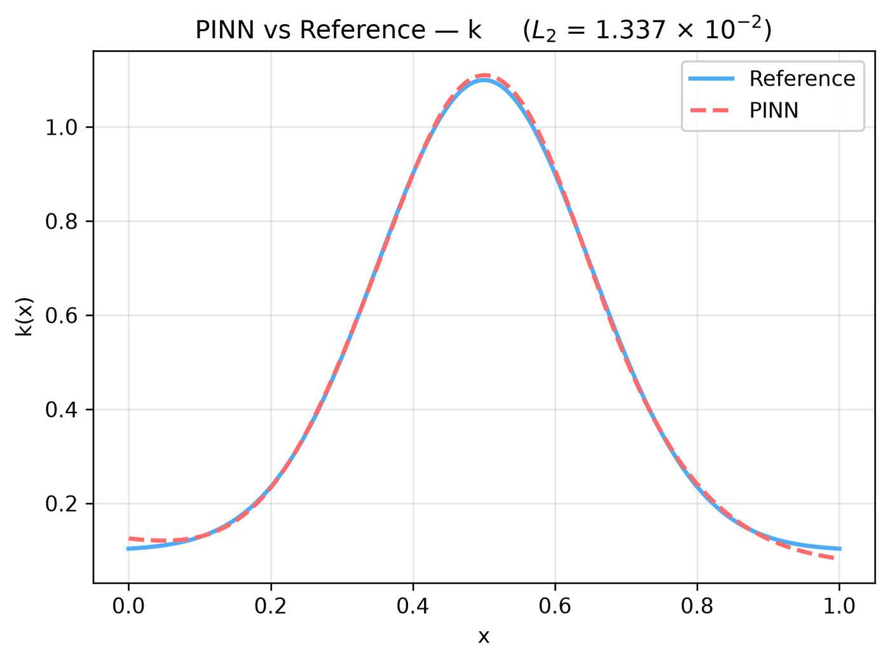

</details>

[Full benchmark: every setting tried, the errors the papers report, all figures →](benchmarks/README.md#bench-diffusion-reaction-1d-unknown-rate-field)

</details>

<details id="dx-inverse-fractional-poisson-equation-1d">
<summary><strong>Fractional Poisson 1D – unknown order α</strong></summary>

DeepXDE example: [`fractional_Poisson_1d_inverse.py`](https://github.com/lululxvi/deepxde/blob/master/examples/pinn_inverse/fractional_Poisson_1d_inverse.py)

$$\Large \frac{D_{-1+}^{\alpha}u + D_{1-}^{\alpha}u}{2\cos(\alpha\pi/2)} = \Gamma(\alpha_0 + 2)\ x, \qquad x \in [-1, 1]$$

- **Unknown:** the order $\alpha$ (true $\alpha_0 = 1.8$, start 1.5) — an inverse variable named `alpha`, also the fractional α
- **Data:** 20 measurements of $u = x(1 - x^2)^{\alpha_0/2}$, loss weight 100
- **Constants:** `a0 = 1.8`
- **In PINNStudio:** Examples → **Inverse** → **Fractional Poisson 1D – unknown order α**

**Results (RTX 4090).** *Default* is DeepXDE's settings; *PINNStudio best* is the *Tuned* setting.

| | Default | PINNStudio best | Training time of the best (s) |
|---|---|---|---|
| Inverse: parameters found (true) | – | **α = 1.79183 (1.8)** (worst error 0.45%) | 255 |

<details>
<summary>⚙️ <em>Settings</em></summary>

**Default (*Settings: Default*) — also PINNStudio best**

*Inverse problem — also PINNStudio best* (no change in the tuning study did better)

*Found in:* [tuning study, forward runs](benchmarks/tuning_study.md#tune-fractional-poisson-1d-unknown-order)

- **Network:** FNN 4 × 20 (1 input, 1 output), tanh, Glorot normal
- **Points:** 20 domain
- **Training:** Adam 10,000
- **Methods:** initial and boundary conditions built into the output (output transform formula)
- **Unknowns:** alpha (initial guess 1.5, true 1.8)
- **Measured data:** u_obs.txt for u (weight 100)

*Load it:* toolbar → Examples: **Inverse** → **Fractional Poisson 1D – unknown order α** → **Default**, then Solve.

</details>

<details>
<summary>📊 <em>Results — PINNStudio best</em></summary>

*Inverse problem — the example's own settings (not in the tuning sweep):*

<sub>PINN against the reference along a line, at the reference times</sub>

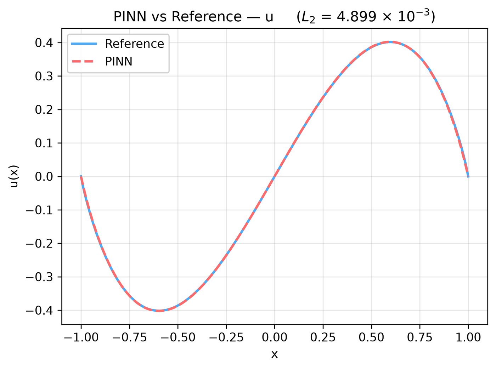

<sub>the learned parameters during training</sub>

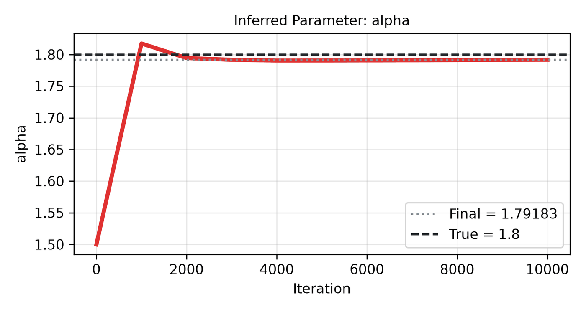

</details>

[Full benchmark: every setting tried, the errors the papers report, all figures →](benchmarks/README.md#bench-fractional-poisson-1d-unknown-order)

</details>

<details id="dx-inverse-poisson-with-unknown-forcing-field">
<summary><strong>Poisson 1D – unknown forcing field</strong></summary>

DeepXDE example: [`elliptic_inverse_field.py`](https://github.com/lululxvi/deepxde/blob/master/examples/pinn_inverse/elliptic_inverse_field.py) ([documentation](https://deepxde.readthedocs.io/en/latest/demos/pinn_inverse/elliptic.inverse.field.html))

$$\Large -\frac{d^2u}{dx^2} + q(x) = 0, \qquad x \in [-1, 1]$$

- **Unknown:** the field $q(x)$ (true $`-\pi^2\sin(\pi x)`$), learned as a second network output
- **Data:** 100 measurements of $u$, given as a Point Set BC (and as anchor points); $u = \sin(\pi x)$ on the boundary
- **In PINNStudio:** Examples → **Inverse** → **Poisson 1D – unknown forcing field**

**Results (RTX 4090).** *Default* is DeepXDE's settings; *PINNStudio best* is the *Tuned* setting.

| | Default | PINNStudio best | Training time of the best (s) |
|---|---|---|---|
| Inverse: learned field | – | **see the benchmark** | 221 |

<details>
<summary>⚙️ <em>Settings</em></summary>

**Default (*Settings: Default*) — also PINNStudio best**

*Inverse problem — also PINNStudio best* (no change in the tuning study did better)

*Found in:* [tuning study, forward runs](benchmarks/tuning_study.md#tune-poisson-1d-unknown-forcing-field)

- **Network:** PFNN 3 × 20 (1 input, 2 outputs), tanh, Glorot uniform
- **Points:** 200 domain, 2 boundary
- **Training:** Adam 20,000 (lr 0.0001)

*Load it:* toolbar → Examples: **Inverse** → **Poisson 1D – unknown forcing field** → **Default**, then Solve.

</details>

<details>
<summary>📊 <em>Results — PINNStudio best</em></summary>

*Inverse problem — all of the changes together:*

<sub>u — PINN against the reference along a line, at the reference times</sub>

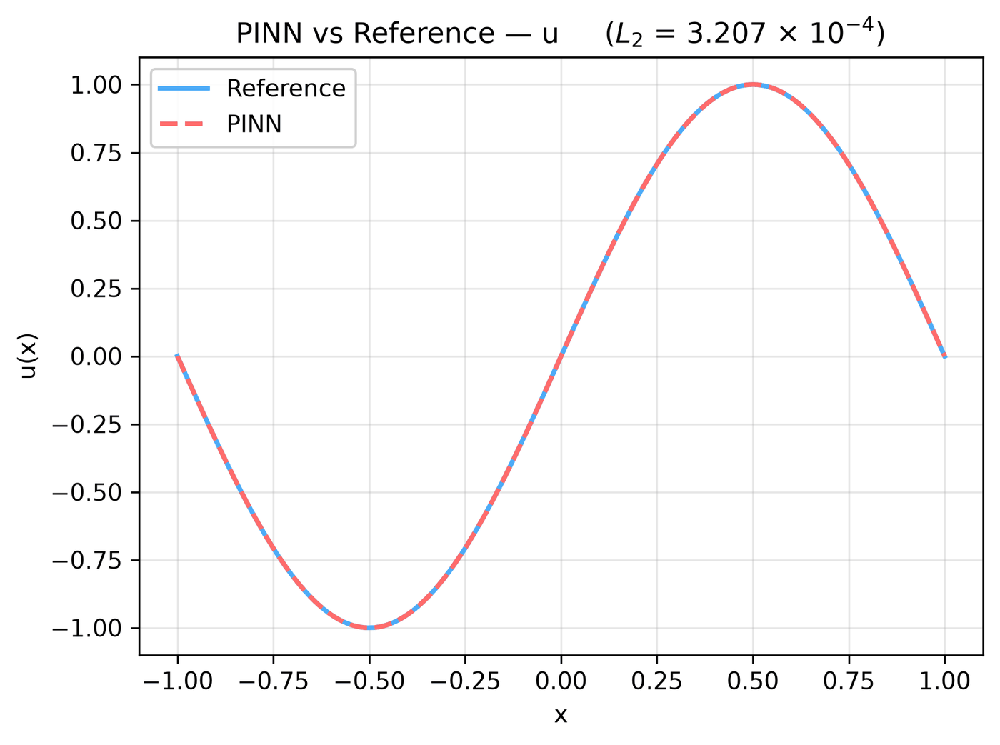

<sub>q — PINN against the reference along a line, at the reference times</sub>


</details>

[Full benchmark: every setting tried, the errors the papers report, all figures →](benchmarks/README.md#bench-poisson-1d-unknown-forcing-field)

</details>

<details id="dx-inverse-poisson-with-unknown-forcing-field-batches">
<summary><strong>Poisson 1D – unknown forcing field (batches)</strong></summary>

DeepXDE example: [`elliptic_inverse_field_batch.py`](https://github.com/lululxvi/deepxde/blob/master/examples/pinn_inverse/elliptic_inverse_field_batch.py)

$$\Large -\frac{d^2u}{dx^2} + q(x) = 0, \qquad x \in [-1, 1]$$

- **Unknown:** the field $q(x)$ (true $`-\pi^2\sin(\pi x)`$)
- **Data:** 10,000 measurements of $u$, used 100 at a time (Point Set BC with batch size 100, redrawn every iteration)
- **In PINNStudio:** Examples → **Inverse** → **Poisson 1D – unknown forcing field (batches)**

**Results (RTX 4090).** *Default* is DeepXDE's settings; *PINNStudio best* is the *Tuned* setting.

| | Default | PINNStudio best | Training time of the best (s) |
|---|---|---|---|
| Inverse: learned field | – | **see the benchmark** | 215 |

<details>
<summary>⚙️ <em>Settings</em></summary>

**Default (*Settings: Default*) — also PINNStudio best**

*Inverse problem — also PINNStudio best* (no change in the tuning study did better)

*Found in:* [tuning study, forward runs](benchmarks/tuning_study.md#tune-poisson-1d-unknown-forcing-field-batches)

- **Network:** PFNN 3 × 20 (1 input, 2 outputs), tanh, Glorot uniform
- **Points:** 200 domain, 2 boundary
- **Training:** Adam 20,000 (lr 0.0001)

*Load it:* toolbar → Examples: **Inverse** → **Poisson 1D – unknown forcing field (batches)** → **Default**, then Solve.

</details>

<details>
<summary>📊 <em>Results — PINNStudio best</em></summary>

*Inverse problem — all of the changes together:*

<sub>u — PINN against the reference along a line, at the reference times</sub>


<sub>q — PINN against the reference along a line, at the reference times</sub>


</details>

[Full benchmark: every setting tried, the errors the papers report, all figures →](benchmarks/README.md#bench-poisson-1d-unknown-forcing-field-batches)

</details>

<details id="1d-allen-cahn">
<summary><strong>Allen-Cahn 1D – Wight & Zhao</strong></summary>

Benchmark problem after [Wight & Zhao (2021)](https://doi.org/10.4208/cicp.OA-2020-0086).

$$\Large \frac{\partial u}{\partial t} = \gamma_1\frac{\partial^2 u}{\partial x^2} - \gamma_2 u^3 + \gamma_2 u, \qquad x \in [-1, 1],\ t \in [0, 1]$$

where $\gamma_1 = 0.0001$ and $\gamma_2 = 5$.

- **Initial condition:** $u(x, 0) = x^2\cos(\pi x)$
- **Boundary conditions:** Periodic
- **Geometry:** Interval
- **In PINNStudio:** Examples → **Forward** (or **Inverse**) → **Allen-Cahn 1D – Wight & Zhao**. *Settings: Default* solves it with Wight & Zhao's own method; *Tuned* loads PINNStudio's best (the whole time interval with exact conditions).

*Inverse mode* — same template, switched to **Inverse**, jointly recovering both $\gamma_1$ (diffusion) and $\gamma_2$ (reaction) as unknown parameters.

**Results (RTX 4090).** *Default* is the paper's method; *PINNStudio best* is the *Tuned* setting.

| | Default | PINNStudio best | Training time of the best (s) |
|---|---|---|---|
| Forward: relative L₂ at the last reference time | 4.6 × 10<sup>-2</sup> | **6.3 × 10<sup>-4</sup>** | 359 |
| Inverse: parameters found (true) | – | **γ₁ = 9.95326e-05 (0.0001); γ₂ = 4.99994 (5)** (worst error 0.47%) | 302 |

<details>
<summary>⚙️ <em>Settings</em></summary>

**PINNStudio best (*Settings: Tuned*)**

*Forward problem*

- **Network:** multi-scale Fourier features (MsFFN) 5 × 256 (2 inputs, 1 output), tanh, Glorot uniform, scales 1, 5
- **Points:** 10,000 domain, 512 initial, 200 boundary
- **Training:** Adam 20,000 → L-BFGS 10,000
- **Methods:** exact initial condition (built into the network) for u; exact periodicity (periodic input features); causal training

*Load it:* toolbar → Examples: **Forward** → **Allen-Cahn 1D – Wight & Zhao** → **Tuned**, then Solve.

*Found in:* [tuning study, forward runs](benchmarks/tuning_study.md#tune-allen-cahn-1d-wight-zhao-pinnstudio-template) · [training methods study: 1D Allen-Cahn (Wight & Zhao)](benchmarks/training_methods.md#1d-allen-cahn-wight--zhao)

*Inverse problem — PINNStudio's own inverse setup, tuned*

- **Network:** multi-scale Fourier features (MsFFN) 4 × 128 (2 inputs, 1 output), tanh, Glorot uniform, scales 1, 5
- **Points:** 10,000 domain, 512 initial, 200 boundary
- **Training:** Adam 20,000 → L-BFGS 10,000
- **Loss weights:** equations 1; boundary 1; measured data 100
- **Methods:** exact initial condition (built into the network) for u; exact periodicity (periodic input features); causal training
- **Unknowns:** gamma_1 (initial guess 1.0, true 0.0001), gamma_2 (initial guess 1.0, true 5.0)
- **Measured data:** t_0.25.txt for u (weight 100); t_0.50.txt for u (weight 100); t_0.75.txt for u (weight 100); t_1.0.txt for u (weight 100)

*Load it:* toolbar → Examples: **Inverse** → **Allen-Cahn 1D – Wight & Zhao** → **Tuned**, then Solve.

*Found in:* [tuning study, inverse runs](benchmarks/tuning_study.md#tune-allen-cahn-1d-wight-zhao-pinnstudio-template-inverse-mode)

**Default (*Settings: Default*)** — what loads first; in short:

*Forward problem:* Network FNN 4 × 128 (2 inputs, 1 output), tanh, Glorot uniform; Points 2,000 domain, 200 initial, 200 boundary; Training Adam 20,000 → L-BFGS 10,000

The full Default settings, and where they come from: [benchmark](benchmarks/README.md#bench-allen-cahn-1d-wight-zhao).

</details>

<details>
<summary>📊 <em>Results — PINNStudio best</em></summary>

*Forward problem — Larger network (2× width, one more layer):*

<sub>PINN, reference and error over space and time</sub>

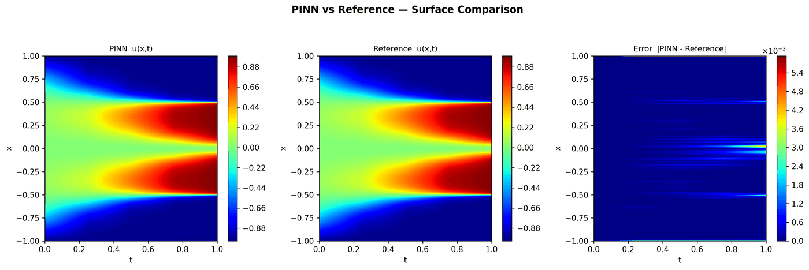

<sub>PINN against the reference along a line, at the reference times</sub>


*Inverse problem — Measured data at every reference time:*

<sub>PINN, reference and error over space and time</sub>

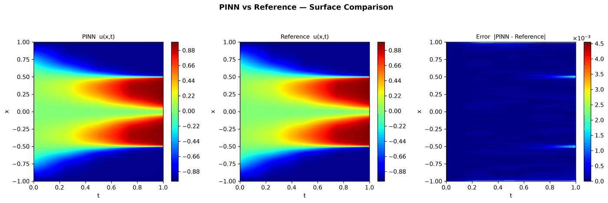

<sub>PINN against the reference along a line, at the reference times</sub>

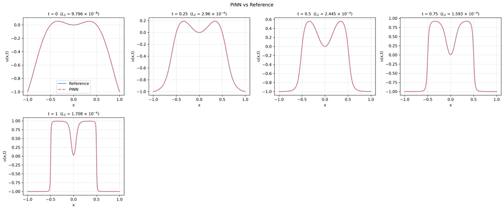

<sub>the learned parameters during training</sub>

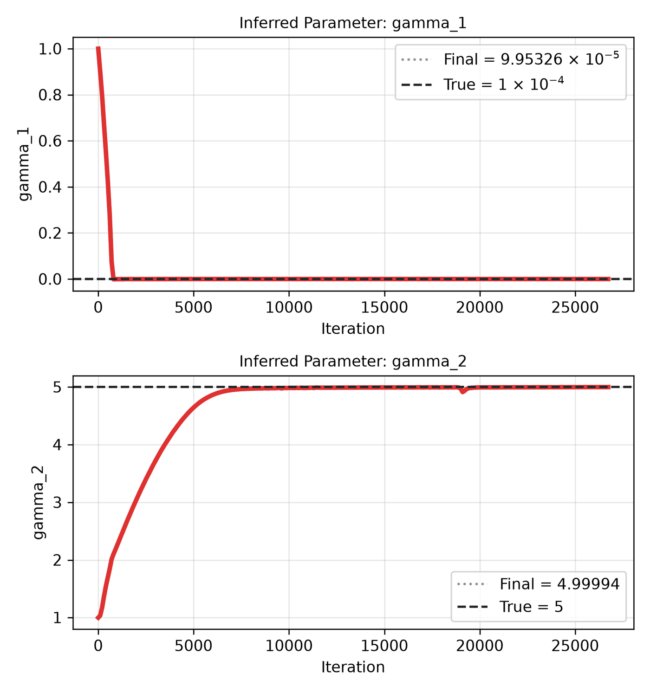

</details>

[Full benchmark: every setting tried, the errors the papers report, all figures →](benchmarks/README.md#bench-allen-cahn-1d-wight-zhao)

</details>

<details id="1d-cahn-hilliard">
<summary><strong>Cahn-Hilliard 1D – Wight & Zhao</strong></summary>

Benchmark problem after [Wight & Zhao (2021)](https://doi.org/10.4208/cicp.OA-2020-0086), section 3.2.

$$\Large \frac{\partial u}{\partial t} = \frac{\partial^2 \mu}{\partial x^2}, \qquad \mu = \gamma_2 (u^3 - u) - \gamma_1 \frac{\partial^2 u}{\partial x^2}, \qquad x \in [-1, 1],\ t \in [0, 1]$$

where $\gamma_1 = 10^{-6}$ and $\gamma_2 = 0.01$. The fourth-order equation is solved in mixed form: the chemical potential $\mu$ is a second output, so no residual needs a fourth derivative.

- **Initial condition:** $u(x, 0) = -\cos(2\pi x)$; $\mu$ has none, since its equation has no time derivative and determines $\mu$ at each time
- **Boundary conditions:** Periodic in value and slope, for $u$ and $\mu$
- **Geometry:** Interval
- **In PINNStudio:** Examples → **Forward** → **Cahn-Hilliard 1D – Wight & Zhao**

**Results (RTX 4090).** *Default* is the paper's method; *PINNStudio best* is the *Tuned* setting.

| | Default | PINNStudio best | Training time of the best (s) |
|---|---|---|---|
| Forward: relative L₂ at the last reference time | 8.6 × 10<sup>-3</sup> | **6.0 × 10<sup>-4</sup>** | 380 |

<details>
<summary>⚙️ <em>Settings</em></summary>

**PINNStudio best (*Settings: Tuned*)**

*Forward problem — the template's own settings*

- **Network:** FNN 4 × 128 (2 inputs, 2 outputs), tanh, Glorot uniform
- **Points:** 10,000 domain, 512 initial, 200 boundary
- **Training:** Adam 20,000 → L-BFGS 20,000
- **Methods:** exact initial condition (built into the network) for u; exact periodicity (periodic input features); SA-PINN per-point weights

*Load it:* toolbar → Examples: **Forward** → **Cahn-Hilliard 1D – Wight & Zhao** → **Tuned**, then Solve.

*Found in:* [tuning study, forward runs](benchmarks/tuning_study.md#tune-cahn-hilliard-1d-wight-zhao-pinnstudio-template) · [training methods study: 1D Cahn-Hilliard (Wight & Zhao)](benchmarks/training_methods.md#1d-cahn-hilliard-wight--zhao)

**Default (*Settings: Default*)** — what loads first; in short:

*Forward problem:* Network FNN 4 × 128 (2 inputs, 2 outputs), tanh, Glorot uniform; Points 10,000 domain, 512 initial, 200 boundary; Training Adam 5,000 → L-BFGS 5,000

The full Default settings, and where they come from: [benchmark](benchmarks/README.md#bench-cahn-hilliard-1d-wight-zhao).

</details>

<details>
<summary>📊 <em>Results — PINNStudio best</em></summary>

*Forward problem — the example's own settings (no change did better):*

<sub>u — PINN, reference and error over space and time</sub>

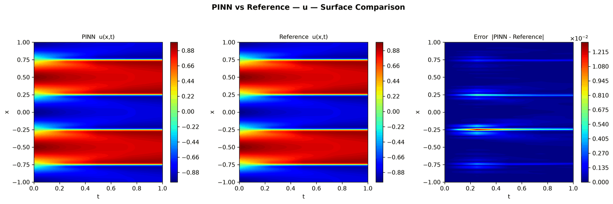

<sub>μ — PINN, reference and error over space and time</sub>

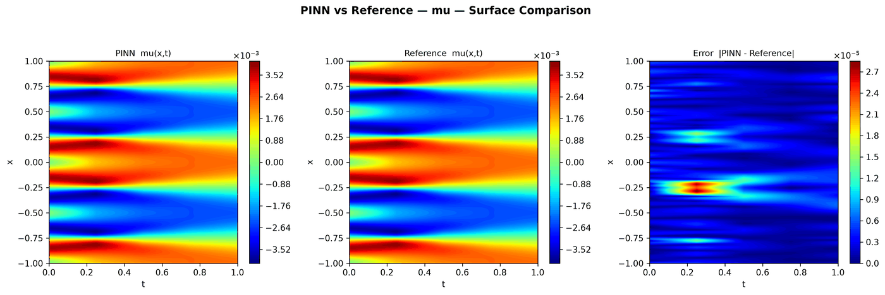

<sub>u — PINN against the reference along a line, at the reference times</sub>

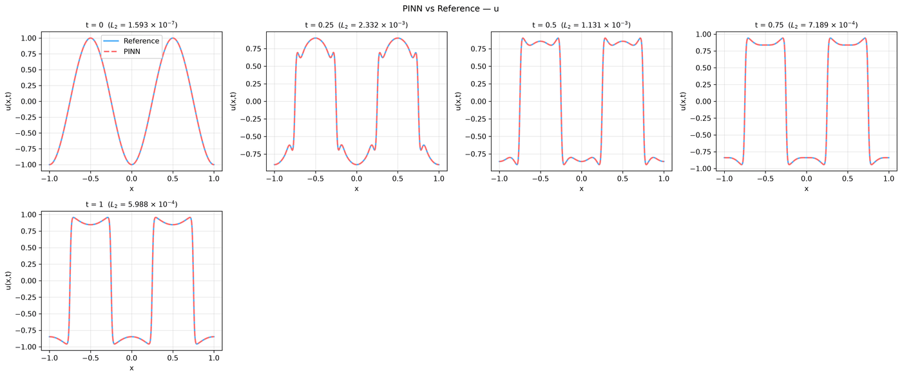

<sub>μ — PINN against the reference along a line, at the reference times</sub>

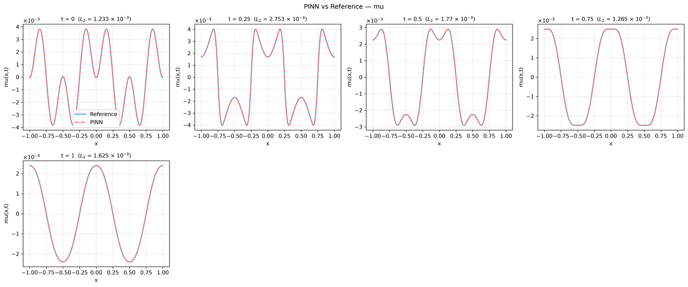

</details>

[Full benchmark: every setting tried, the errors the papers report, all figures →](benchmarks/README.md#bench-cahn-hilliard-1d-wight-zhao)

</details>

<details id="1d-cahn-hilliard-mattey--ghosh">
<summary><strong>Cahn-Hilliard 1D – Mattey & Ghosh</strong></summary>

Benchmark problem after [Mattey & Ghosh (2022)](https://doi.org/10.1016/j.cma.2021.114474), section 5.2 (eq. 25):

$$\Large \frac{\partial h}{\partial t} = \frac{\partial^2 \mu}{\partial x^2}, \qquad \mu = \kappa (h^3 - h) - \alpha\kappa \frac{\partial^2 h}{\partial x^2}, \qquad x \in [-1, 1],\ t \in [0, 1]$$

where $\alpha = 0.02$ and $\kappa = 1$. As in the paper (its phase-space form, eq. 19) and the Wight & Zhao example, $\mu$ is a second output, so no residual needs a fourth derivative. The same paper's 1D Allen-Cahn problem is the [Allen-Cahn 1D – Wight & Zhao](#1d-allen-cahn) example, and its 2D Allen-Cahn IBVP-1 is [Allen-Cahn 2D – Mattey & Ghosh](#2d-allen-cahn-mattey--ghosh).

- **Initial condition:** $h(x, 0) = \cos(\pi x) - \exp(-4(\pi x)^2)$; $\mu$ has none
- **Boundary conditions:** Periodic in value and slope, for $h$ and $\mu$
- **Geometry:** Interval
- **In PINNStudio:** Examples → **Forward** → **Cahn-Hilliard 1D – Mattey & Ghosh**

**Results (RTX 4090).** *Default* is the paper's method; *PINNStudio best* is the *Tuned* setting.

| | Default | PINNStudio best | Training time of the best (s) |
|---|---|---|---|
| Forward: relative L₂ at the last reference time | 5.7 × 10<sup>-3</sup> | **5.7 × 10<sup>-3</sup>** | 2864 |

<details>
<summary>⚙️ <em>Settings</em></summary>

**PINNStudio best (*Settings: Tuned*)**

*Forward problem*

- **Network:** FNN 6 × 128 (2 inputs, 2 outputs), tanh, Glorot uniform
- **Points:** 10,000 domain, 128 initial, 20 boundary
- **Training:** Adam 10,000 → L-BFGS 50,000
- **Loss weights:** equations 1; boundary 1; initial 64
- **Methods:** time-adaptive training: 10 time windows, a network per window, each starting from the previous one, backward-compatibility term (weight 64), initial-condition guided learning (0.1 of Adam)

*Load it:* toolbar → Examples: **Forward** → **Cahn-Hilliard 1D – Mattey & Ghosh** → **Tuned**, then Solve.

**Default (*Settings: Default*)** — what loads first; in short:

*Forward problem:* Network FNN 6 × 128 (2 inputs, 2 outputs), tanh, Glorot uniform; Points 10,000 domain, 128 initial, 20 boundary; Training Adam 10,000 → L-BFGS 50,000

The full Default settings, and where they come from: [benchmark](benchmarks/README.md#bench-cahn-hilliard-1d-mattey-ghosh).

</details>

<details>
<summary>📊 <em>Results — PINNStudio best</em></summary>

*Forward problem — Mattey & Ghosh's bc-PINN, run in PINNStudio:*

<sub>h — PINN, reference and error over space and time</sub>

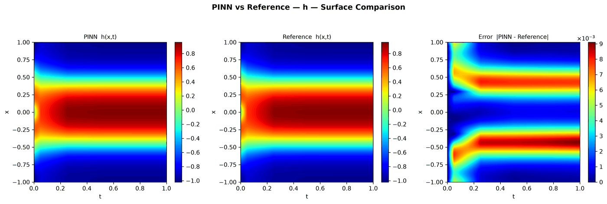

<sub>μ — PINN, reference and error over space and time</sub>

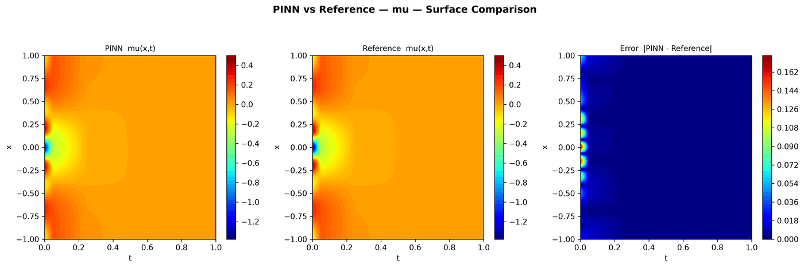

<sub>h — PINN against the reference along a line, at the reference times</sub>

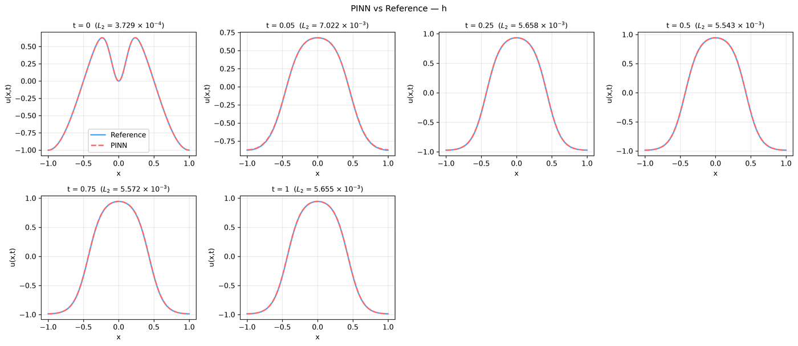

<sub>μ — PINN against the reference along a line, at the reference times</sub>


</details>

[Full benchmark: every setting tried, the errors the papers report, all figures →](benchmarks/README.md#bench-cahn-hilliard-1d-mattey-ghosh)

</details>

<details id="dx-american-put-option">
<summary><strong>Black-Scholes 1D – American put</strong></summary>

DeepXDE example: [`american_put.py`](https://github.com/lululxvi/deepxde/blob/master/examples/pinn_forward/american_put.py)

$$\Large \min\left(-\mathcal{L}V,\ V - \max(K - S, 0)\right) = 0, \qquad \mathcal{L}V = -\frac{\partial V}{\partial \tau} + \frac{\sigma^2}{2}S^2\frac{\partial^2 V}{\partial S^2} + rS\frac{\partial V}{\partial S} - rV$$

- **Domain:** $S \in [0, 4]$, $\tau \in [0, 1]$; strike $K = 1$, $r = 0.05$, $\sigma = 0.2$
- **Equations:** three residuals for one output (DeepXDE's Fischer-Burmeister form of the complementarity problem)
- **Reference:** none bundled (DeepXDE compares against a binomial-tree price) — add your own in Error Analysis
- **Constants:** `r = 0.05`, `sigma = 0.2`, `K = 1`
- **In PINNStudio:** Examples → **Forward** → **Black-Scholes 1D – American put**

<details>
<summary>⚙️ <em>Settings</em></summary>

**Default (*Settings: Default*) — also PINNStudio best**

*Forward problem — also PINNStudio best* (already accurate, so it was not tuned)

- **Network:** FNN 4 × 128 (2 inputs, 1 output), tanh, Glorot normal
- **Points:** 6,000 domain, 1,500 initial, 1,500 boundary
- **Training:** Adam 12,000 → L-BFGS 15,000

*Load it:* toolbar → Examples: **Forward** → **Black-Scholes 1D – American put** → **Default**, then Solve.

</details>

[Full benchmark: every setting tried, the errors the papers report, all figures →](benchmarks/README.md#bench-black-scholes-1d-american-put)

</details>

<details id="dx-black-scholes-equation-call-option">
<summary><strong>Black-Scholes 1D – European call</strong></summary>

DeepXDE example: [`black_scholes_call.py`](https://github.com/lululxvi/deepxde/blob/master/examples/pinn_forward/black_scholes_call.py) ([documentation](https://deepxde.readthedocs.io/en/latest/demos/pinn_forward/black_scholes.html))

$$\Large \frac{\partial V}{\partial \tau} = \frac{\sigma^2}{2}S^2\frac{\partial^2 V}{\partial S^2} + rS\frac{\partial V}{\partial S} - rV, \qquad S \in [0, 150],\ \tau \in [0, 1]$$

- **Parameters:** strike $K = 50$, rate $r = 0.05$, volatility $\sigma = 0.2$; $x$ is the stock price $S$ and $t$ the time to maturity $\tau$
- **Initial condition:** payoff $V(S, 0) = \max(S - K, 0)$; **boundary conditions:** $V(0, \tau) = 0$, $V(150, \tau) = 150 - Ke^{-r\tau}$
- **Exact solution:** the Black-Scholes formula (uses `norm_cdf` in the reference formula)
- **Constants:** `K = 50`, `r = 0.05`, `sigma = 0.2`
- **In PINNStudio:** Examples → **Forward** → **Black-Scholes 1D – European call**

**Results (RTX 4090).** *Default* is DeepXDE's settings; *PINNStudio best* is the *Tuned* setting.

| | Default | PINNStudio best | Training time of the best (s) |
|---|---|---|---|
| Forward: relative L₂ at the last reference time | 4.3 × 10<sup>-4</sup> | **4.3 × 10<sup>-4</sup>** | 60 |

<details>
<summary>⚙️ <em>Settings</em></summary>

**Default (*Settings: Default*) — also PINNStudio best**

*Forward problem — also PINNStudio best* (no change in the tuning study did better)

*Found in:* [tuning study, forward runs](benchmarks/tuning_study.md#tune-black-scholes-1d-european-call)

- **Network:** FNN 4 × 28 (2 inputs, 1 output), tanh, Glorot normal
- **Points:** 2,047 domain, 127 initial, 63 boundary
- **Training:** Adam 20,000 → L-BFGS 15,000

*Load it:* toolbar → Examples: **Forward** → **Black-Scholes 1D – European call** → **Default**, then Solve.

</details>

<details>
<summary>📊 <em>Results — PINNStudio best</em></summary>

*Forward problem — DeepXDE's settings:*

<sub>PINN, reference and error over space and time</sub>


<sub>PINN against the reference along a line, at the reference times</sub>


</details>

[Full benchmark: every setting tried, the errors the papers report, all figures →](benchmarks/README.md#bench-black-scholes-1d-european-call)

</details>

<details id="1d-burgers">
<summary><strong>Burgers 1D – Raissi et al.</strong></summary>

Exact equation, initial and boundary conditions as in [Raissi, Perdikaris & Karniadakis (2019)](https://doi.org/10.1016/j.jcp.2018.10.045).

$$\Large \frac{\partial u}{\partial t} + u\frac{\partial u}{\partial x} = \frac{0.01}{\pi}\frac{\partial^2 u}{\partial x^2}, \qquad x \in [-1, 1],\ t \in [0, 1]$$

- **Initial condition:** $u(x, 0) = -\sin(\pi x)$
- **Boundary conditions:** Dirichlet, $u = 0$ at both ends
- **Geometry:** Interval
- **In PINNStudio:** Examples → **Forward** (or **Inverse**) → **Burgers 1D – Raissi et al.**

A shock forms near $x = 0$ as $t \to 1$; this template uses a larger fixed collocation count to resolve it rather than adaptive refinement.

*Inverse mode* — same template, switched to **Inverse**, jointly recovering both coefficients of the data-driven-discovery form of this equation in [Raissi, Perdikaris & Karniadakis (2019)](https://doi.org/10.1016/j.jcp.2018.10.045), Appendix B, eq. B.1.

$$\Large \frac{\partial u}{\partial t} + \lambda_1 u\frac{\partial u}{\partial x} - \lambda_2\frac{\partial^2 u}{\partial x^2} = 0$$

with true values $\lambda_1 = 1.0$ and $\lambda_2 = 0.01/\pi$ (the template writes the viscous term as $\frac{\lambda_2}{\pi}\frac{\partial^2 u}{\partial x^2}$, so the value it learns is 0.01). $\lambda_1$'s initial guess starts at $0.1$ rather than $1.0$, since $1.0$ is already its true value.

**Results (RTX 4090).** *Default* is the paper's method; *PINNStudio best* is the *Tuned* setting.

| | Default | PINNStudio best | Training time of the best (s) |
|---|---|---|---|
| Forward: relative L₂ at the last reference time | 3.3 × 10<sup>-4</sup> | **3.3 × 10<sup>-4</sup>** | 40 |
| Inverse: parameters found (true) | – | **λ₁ = 0.999937 (1); λ₂ = 0.0100099 (0.01)** (worst error 0.099%) | 101 |

<details>
<summary>⚙️ <em>Settings</em></summary>

**PINNStudio best (*Settings: Tuned*)**

*Forward problem*

- **Network:** FNN 8 × 20 (2 inputs, 1 output), tanh, Glorot uniform
- **Points:** 10,000 domain, 50 initial, 50 boundary
- **Training:** L-BFGS 50,000

*Load it:* toolbar → Examples: **Forward** → **Burgers 1D – Raissi et al.** → **Tuned**, then Solve.

*Inverse problem — PINNStudio's own inverse setup, tuned*

- **Network:** FNN 4 × 40 (2 inputs, 1 output), tanh, Glorot uniform
- **Points:** 8,000 domain, 200 initial, 200 boundary
- **Training:** Adam 15,000 → L-BFGS 30,000
- **Loss weights:** equations 1; boundary 1; initial 100; measured data 100
- **Unknowns:** lambda_1 (initial guess 0.1, true 1.0), lambda_2 (initial guess 1.0, true 0.01)
- **Measured data:** t_1.0.txt for u (weight 1000)

*Load it:* toolbar → Examples: **Inverse** → **Burgers 1D – Raissi et al.** → **Tuned**, then Solve.

*Found in:* [tuning study, inverse runs](benchmarks/tuning_study.md#tune-burgers-1d-raissi-et-al-pinnstudio-template-inverse-mode)

**Default (*Settings: Default*)** — what loads first; in short:

*Forward problem:* Network FNN 8 × 20 (2 inputs, 1 output), tanh, Glorot uniform; Points 10,000 domain, 50 initial, 50 boundary; Training L-BFGS 50,000

The full Default settings, and where they come from: [benchmark](benchmarks/README.md#bench-burgers-1d-raissi-et-al).

</details>

<details>
<summary>📊 <em>Results — PINNStudio best</em></summary>

*Forward problem — Raissi et al.'s settings, run in PINNStudio:*

<sub>PINN, reference and error over space and time</sub>


<sub>PINN against the reference along a line, at the reference times</sub>


*Inverse problem — 10× data weight, 3× L-BFGS and the larger network:*

<sub>PINN, reference and error over space and time</sub>


<sub>PINN against the reference along a line, at the reference times</sub>


<sub>the learned parameters during training</sub>


</details>

<a id="reproducibility-test-case"></a>
**Reproducibility test case (PINNStudio paper, Section 6)**

This forward example is the test case the paper uses to show that a result can be reproduced from the GUI and outside it. Equations, settings and figures are above; the steps are:

1. **Load it.** Toolbar → Examples: **Forward** → **Burgers 1D – Raissi et al.**, with *Settings:* **Tuned**. For this example the Tuned settings are the paper's own (Default and Tuned are the same; see ⚙️ *Settings* above).
2. **Run it.** Press **Solve**. *Results → Live loss* shows the loss while it trains, and the Training Log and *Results → Overview* show the final loss and the solution. On an RTX 4090 it trains in about 40 s.
3. **Compare with the reference.** Error Analysis runs at the end of training against the reference files at five times, t = 0, 0.25, 0.5, 0.75 and 1 ([`reference_data/1D/burgers/`](reference_data/1D/burgers), the exact solution computed by [`tools/make_exact_reference_data.py`](tools/make_exact_reference_data.py)). *Results → Error analysis* lists the relative L₂ error at each time with the comparison plots; the Training Log also gives the error over all five times together (`error_spacetime.txt` in the run folder). The documented forward results are a relative L₂ error of 3.3 × 10⁻⁴ at t = 1 and 4.0 × 10⁻⁴ over all reference times ([benchmark](benchmarks/README.md#bench-burgers-1d-raissi-et-al)).
4. **Restore the trained model.** Point *Results → Restore & visualize* at the saved model in the run folder (under the Save-to folder shown in the status bar). It rebuilds the network from the saved weights and `model_config.json` and redraws the plots and the Error Analysis without training again ([Restore & visualize](#restore--visualize)).
5. **Run it outside PINNStudio.** *Export script* (toolbar, or Ctrl+E) writes a standalone DeepXDE/PyTorch script; run it with `python <script>.py` in the same Python environment. It trains the same model as **Solve** (the [export check](benchmarks/performance.md#export-check-the-exported-script-trains-the-same-model)) and writes the loss, the solution and the Error Analysis at the same five times (`error_metrics.txt`). The script points at the reference files of the installation it was exported from (`ea_files`); on another computer, change those paths to that computer's `reference_data/1D/burgers/`.

The documented runs used the random seed 2026, PINNStudio's default (*Settings → GPU / Hardware → Seed*; loading an example keeps your own seed). Even with the same seed, small differences between runs are normal: GPU arithmetic is not always done in the same order, and a different GPU, CPU, number of CPU threads or PyTorch/DeepXDE version changes the last digits of the loss, so the errors of an independent run can differ slightly from the values above.

[Full benchmark: every setting tried, the errors the papers report, all figures →](benchmarks/README.md#bench-burgers-1d-raissi-et-al)

</details>

<details id="dx-burgers-equation-with-rar">
<summary><strong>Burgers 1D – RAR</strong></summary>

DeepXDE example: [`Burgers_RAR.py`](https://github.com/lululxvi/deepxde/blob/master/examples/pinn_forward/Burgers_RAR.py) ([documentation](https://deepxde.readthedocs.io/en/latest/demos/pinn_forward/burgers.rar.html))

$$\Large \frac{\partial u}{\partial t} + u\frac{\partial u}{\partial x} = \frac{0.01}{\pi}\frac{\partial^2 u}{\partial x^2}, \qquad x \in [-1, 1],\ t \in [0, 1]$$

- **Initial / boundary conditions:** $u(x, 0) = -\sin(\pi x)$, $u(\pm 1, t) = 0$
- **In PINNStudio:** Examples → **Forward** → **Burgers 1D – RAR**

*Source paper:* [Lu, Meng, Mao & Karniadakis (2021), SIAM Rev. 63 (DeepXDE)](https://arxiv.org/abs/1907.04502) — DeepXDE's example follows the equation and conditions studied there, with its own numerical settings.

**Results (RTX 4090).** *Default* is DeepXDE's settings; *PINNStudio best* is the *Tuned* setting.

| | Default | PINNStudio best | Training time of the best (s) |
|---|---|---|---|
| Forward: relative L₂ at the last reference time | 8.4 × 10<sup>-4</sup> | **8.4 × 10<sup>-4</sup>** | 170 |

<details>
<summary>⚙️ <em>Settings</em></summary>

**Default (*Settings: Default*) — also PINNStudio best**

*Forward problem — also PINNStudio best* (no change in the tuning study did better)

*Found in:* [tuning study, forward runs](benchmarks/tuning_study.md#tune-burgers-1d-rar) · [training methods study: 1D Burgers](benchmarks/training_methods.md#1d-burgers)

- **Network:** FNN 3 × 20 (2 inputs, 1 output), tanh, Glorot normal
- **Points:** 2,500 domain, 160 initial, 100 boundary
- **Training:** Adam 10,000 → L-BFGS 15,000
- **Methods:** residual-based adaptive refinement (3 rounds of 100 points)

*Load it:* toolbar → Examples: **Forward** → **Burgers 1D – RAR** → **Default**, then Solve.

</details>

<details>
<summary>📊 <em>Results — PINNStudio best</em></summary>

*Forward problem — DeepXDE's settings:*

<sub>PINN, reference and error over space and time</sub>


<sub>PINN against the reference along a line, at the reference times</sub>


</details>

[Full benchmark: every setting tried, the errors the papers report, all figures →](benchmarks/README.md#bench-burgers-1d-rar)

</details>

<details id="dx-diffusion-equation">
<summary><strong>Diffusion 1D</strong></summary>

DeepXDE example: [`diffusion_1d.py`](https://github.com/lululxvi/deepxde/blob/master/examples/pinn_forward/diffusion_1d.py) ([documentation](https://deepxde.readthedocs.io/en/latest/demos/pinn_forward/diffusion.1d.html))

$$\Large \frac{\partial u}{\partial t} = \frac{\partial^2 u}{\partial x^2} - e^{-t}\left(\sin(\pi x) - \pi^2\sin(\pi x)\right), \qquad x \in [-1, 1],\ t \in [0, 1]$$

- **Initial condition:** $u(x, 0) = \sin(\pi x)$; **boundary condition:** $u = e^{-t}\sin(\pi x)$
- **Exact solution:** $u = e^{-t}\sin(\pi x)$
- **In PINNStudio:** Examples → **Forward** → **Diffusion 1D**

*Source paper:* [Wu, Zhu, Tan, Kartha & Lu (2023), CMAME 403](https://arxiv.org/abs/2207.10289) — DeepXDE's example follows the equation and conditions studied there, with its own numerical settings.

**Results (RTX 4090).** *Default* is DeepXDE's settings; *PINNStudio best* is the *Tuned* setting.

| | Default | PINNStudio best | Training time of the best (s) |
|---|---|---|---|
| Forward: relative L₂ at the last reference time | 2.3 × 10<sup>-2</sup> | **1.5 × 10<sup>-3</sup>** | 76 |

<details>
<summary>⚙️ <em>Settings</em></summary>

**PINNStudio best (*Settings: Tuned*)**

*Forward problem*

- **Network:** FNN 4 × 64 (2 inputs, 1 output), tanh, Glorot uniform
- **Points:** 120 domain, 30 initial, 60 boundary
- **Training:** Adam 30,000 → L-BFGS 15,000

*Load it:* toolbar → Examples: **Forward** → **Diffusion 1D** → **Tuned**, then Solve.

*Found in:* [tuning study, forward runs](benchmarks/tuning_study.md#tune-diffusion-1d)

**Default (*Settings: Default*)** — what loads first; in short:

*Forward problem:* Network FNN 3 × 32 (2 inputs, 1 output), tanh, Glorot uniform; Points 40 domain, 10 initial, 20 boundary; Training Adam 10,000

The full Default settings, and where they come from: [benchmark](benchmarks/README.md#bench-diffusion-1d).

</details>

<details>
<summary>📊 <em>Results — PINNStudio best</em></summary>

*Forward problem — all of the changes together:*

<sub>PINN, reference and error over space and time</sub>


<sub>PINN against the reference along a line, at the reference times</sub>


</details>

[Full benchmark: every setting tried, the errors the papers report, all figures →](benchmarks/README.md#bench-diffusion-1d)

</details>

<details id="dx-diffusion-equation-with-hard-ic-and-bc">
<summary><strong>Diffusion 1D – hard IC and BCs</strong></summary>

DeepXDE example: [`diffusion_1d_exactBC.py`](https://github.com/lululxvi/deepxde/blob/master/examples/pinn_forward/diffusion_1d_exactBC.py) ([documentation](https://deepxde.readthedocs.io/en/latest/demos/pinn_forward/diffusion.1d.exactBC.html))

$$\Large \frac{\partial u}{\partial t} = \frac{\partial^2 u}{\partial x^2} - e^{-t}\left(\sin(\pi x) - \pi^2\sin(\pi x)\right), \qquad x \in [-1, 1],\ t \in [0, 1]$$

- **Initial and boundary conditions:** imposed exactly by $\hat u = t(1 - x^2)N + \sin(\pi x)$ — no IC/BC loss terms
- **Exact solution:** $u = e^{-t}\sin(\pi x)$
- **In PINNStudio:** Examples → **Forward** → **Diffusion 1D – hard IC and BCs**

*Source paper:* [Wu, Zhu, Tan, Kartha & Lu (2023), CMAME 403](https://arxiv.org/abs/2207.10289) — DeepXDE's example follows the equation and conditions studied there, with its own numerical settings.

**Results (RTX 4090).** *Default* is DeepXDE's settings; *PINNStudio best* is the *Tuned* setting.

| | Default | PINNStudio best | Training time of the best (s) |
|---|---|---|---|
| Forward: relative L₂ at the last reference time | 2.8 × 10<sup>-3</sup> | **2.8 × 10<sup>-3</sup>** | 40 |

<details>
<summary>⚙️ <em>Settings</em></summary>

**Default (*Settings: Default*) — also PINNStudio best**

*Forward problem — also PINNStudio best* (no change in the tuning study did better)

*Found in:* [tuning study, forward runs](benchmarks/tuning_study.md#tune-diffusion-1d-hard-ic-and-bcs)

- **Network:** FNN 3 × 32 (2 inputs, 1 output), tanh, Glorot uniform
- **Points:** 40 domain
- **Training:** Adam 10,000
- **Methods:** initial and boundary conditions built into the output (output transform formula)

*Load it:* toolbar → Examples: **Forward** → **Diffusion 1D – hard IC and BCs** → **Default**, then Solve.

</details>

<details>
<summary>📊 <em>Results — PINNStudio best</em></summary>

*Forward problem — DeepXDE's settings:*

<sub>PINN, reference and error over space and time</sub>


<sub>PINN against the reference along a line, at the reference times</sub>


</details>

[Full benchmark: every setting tried, the errors the papers report, all figures →](benchmarks/README.md#bench-diffusion-1d-hard-ic-and-bcs)

</details>

<details id="dx-diffusion-equation-with-resampling">
<summary><strong>Diffusion 1D – resampling</strong></summary>

DeepXDE example: [`diffusion_1d_resample.py`](https://github.com/lululxvi/deepxde/blob/master/examples/pinn_forward/diffusion_1d_resample.py) ([documentation](https://deepxde.readthedocs.io/en/latest/demos/pinn_forward/diffusion.1d.resample.html))

$$\Large \frac{\partial u}{\partial t} = \frac{\partial^2 u}{\partial x^2} - e^{-t}\left(\sin(\pi x) - \pi^2\sin(\pi x)\right), \qquad x \in [-1, 1],\ t \in [0, 1]$$

- **Initial / boundary conditions:** $u(x, 0) = \sin(\pi x)$, $u = e^{-t}\sin(\pi x)$ on the boundary
- **Exact solution:** $u = e^{-t}\sin(\pi x)$
- **In PINNStudio:** Examples → **Forward** → **Diffusion 1D – resampling**

**Results (RTX 4090).** *Default* is DeepXDE's settings; *PINNStudio best* is the *Tuned* setting.

| | Default | PINNStudio best | Training time of the best (s) |
|---|---|---|---|
| Forward: relative L₂ at the last reference time | 5.4 × 10<sup>-2</sup> | **5.8 × 10<sup>-3</sup>** | 12 |

<details>
<summary>⚙️ <em>Settings</em></summary>

**PINNStudio best (*Settings: Tuned*)**

*Forward problem*

- **Network:** FNN 3 × 32 (2 inputs, 1 output), tanh, Glorot uniform
- **Points:** 40 domain, 10 initial, 20 boundary
- **Training:** Adam 2,000 → L-BFGS 15,000

*Load it:* toolbar → Examples: **Forward** → **Diffusion 1D – resampling** → **Tuned**, then Solve.

*Found in:* [tuning study, forward runs](benchmarks/tuning_study.md#tune-diffusion-1d-resampling)

**Default (*Settings: Default*)** — what loads first; in short:

*Forward problem:* Network FNN 3 × 32 (2 inputs, 1 output), tanh, Glorot uniform; Points 40 domain, 10 initial, 20 boundary; Training Adam 2,000

The full Default settings, and where they come from: [benchmark](benchmarks/README.md#bench-diffusion-1d-resampling).

</details>

<details>
<summary>📊 <em>Results — PINNStudio best</em></summary>

*Forward problem — L-BFGS phase added:*

<sub>PINN, reference and error over space and time</sub>


<sub>PINN against the reference along a line, at the reference times</sub>


</details>

[Full benchmark: every setting tried, the errors the papers report, all figures →](benchmarks/README.md#bench-diffusion-1d-resampling)

</details>

<details id="dx-diffusion-reaction-equation">
<summary><strong>Diffusion-reaction 1D</strong></summary>

DeepXDE example: [`diffusion_reaction.py`](https://github.com/lululxvi/deepxde/blob/master/examples/pinn_forward/diffusion_reaction.py) ([documentation](https://deepxde.readthedocs.io/en/latest/demos/pinn_forward/diffusion.reaction.html))

$$\Large \frac{\partial u}{\partial t} = \frac{\partial^2 u}{\partial x^2} + e^{-t}\left(\tfrac{3}{2}\sin 2x + \tfrac{8}{3}\sin 3x + \tfrac{15}{4}\sin 4x + \tfrac{63}{8}\sin 8x\right), \qquad x \in [-\pi, \pi],\ t \in [0, 1]$$

- **Initial and boundary conditions:** imposed exactly by $\hat u = t(\pi^2 - x^2)N + \sum_k \frac{\sin(kx)}{k}$
- **Exact solution:** $u = e^{-t}\left(\sin x + \tfrac{\sin 2x}{2} + \tfrac{\sin 3x}{3} + \tfrac{\sin 4x}{4} + \tfrac{\sin 8x}{8}\right)$
- **In PINNStudio:** Examples → **Forward** → **Diffusion-reaction 1D**

*Source paper:* [Yu, Lu, Meng & Karniadakis (2022), CMAME 393 (gPINNs)](https://arxiv.org/abs/2111.02801) — DeepXDE's example follows the equation and conditions studied there, with its own numerical settings.

**Results (RTX 4090).** *Default* is DeepXDE's settings; *PINNStudio best* is the *Tuned* setting.

| | Default | PINNStudio best | Training time of the best (s) |
|---|---|---|---|
| Forward: relative L₂ at the last reference time | 8.8 × 10<sup>-2</sup> | **8.5 × 10<sup>-5</sup>** | 290 |
| Inverse: parameters found (true) | – | **D = 0.999773 (1)** (worst error 0.023%) | 334 |

<details>
<summary>⚙️ <em>Settings</em></summary>

**PINNStudio best (*Settings: Tuned*)**

*Forward problem*

- **Network:** FNN 7 × 60 (2 inputs, 1 output), tanh, Glorot uniform
- **Points:** 960 domain
- **Training:** Adam 60,000 → L-BFGS 15,000
- **Methods:** initial and boundary conditions built into the output (output transform formula)

*Load it:* toolbar → Examples: **Forward** → **Diffusion-reaction 1D** → **Tuned**, then Solve.

*Found in:* [tuning study, forward runs](benchmarks/tuning_study.md#tune-diffusion-reaction-1d) · [training methods study: Diffusion-reaction 1D](benchmarks/training_methods.md#diffusion-reaction-1d)

*Inverse problem — PINNStudio's own inverse setup, tuned*

- **Network:** FNN 7 × 60 (2 inputs, 1 output), tanh, Glorot uniform
- **Points:** 960 domain
- **Training:** Adam 60,000 → L-BFGS 45,000
- **Methods:** initial and boundary conditions built into the output (output transform formula)
- **Unknowns:** D (initial guess 2.0, true 1.0)
- **Measured data:** t_0.25.txt for u (weight 100); t_0.5.txt for u (weight 100); t_0.75.txt for u (weight 100); t_1.txt for u (weight 100)

*Load it:* toolbar → Examples: **Inverse** → **Diffusion-reaction 1D** → **Tuned**, then Solve.

*Found in:* [tuning study, inverse runs](benchmarks/tuning_study.md#tune-diffusion-reaction-1d-inverse-mode)

**Default (*Settings: Default*)** — what loads first; in short:

*Forward problem:* Network FNN 6 × 30 (2 inputs, 1 output), tanh, Glorot uniform; Points 320 domain; Training Adam 20,000

The full Default settings, and where they come from: [benchmark](benchmarks/README.md#bench-diffusion-reaction-1d).

</details>

<details>
<summary>📊 <em>Results — PINNStudio best</em></summary>

*Forward problem — all of the changes together:*

<sub>PINN, reference and error over space and time</sub>


<sub>PINN against the reference along a line, at the reference times</sub>


*Inverse problem — all of the changes together:*

<sub>PINN, reference and error over space and time</sub>


<sub>PINN against the reference along a line, at the reference times</sub>


<sub>the learned parameters during training</sub>


</details>

[Full benchmark: every setting tried, the errors the papers report, all figures →](benchmarks/README.md#bench-diffusion-reaction-1d)

</details>

<details id="dx-fractional-diffusion-equation">
<summary><strong>Fractional diffusion 1D</strong></summary>

DeepXDE example: [`fractional_diffusion_1d.py`](https://github.com/lululxvi/deepxde/blob/master/examples/pinn_forward/fractional_diffusion_1d.py)

$$\Large \frac{\partial u}{\partial t} = D_{0+}^{\alpha}u + D_{1-}^{\alpha}u - e^{-t}\left(x^3(1-x)^3 + f_\alpha(x)\right), \qquad x \in [0, 1],\ t \in [0, 1],\ \alpha = 1.8$$

- **Equation in the panel:** `du_t - frac(u) + exp(-t)*(x**3*(1 - x)**3 + ...)` (DeepXDE's TimeFPDE)
- **Boundary and initial conditions:** $u(0, t) = u(1, t) = 0$, $u(x, 0) = x^3(1-x)^3$, both exact through $\hat u = x(1-x)\ t\ N + x^3(1-x)^3$
- **Exact solution:** $u = e^{-t}x^3(1-x)^3$
- **Constants:** `alpha = 1.8`
- **In PINNStudio:** Examples → **Forward** → **Fractional diffusion 1D**

**Results (RTX 4090).** *Default* is DeepXDE's settings; *PINNStudio best* is the *Tuned* setting.

| | Default | PINNStudio best | Training time of the best (s) |
|---|---|---|---|
| Forward: relative L₂ at the last reference time | 3.3 × 10<sup>-3</sup> | **3.3 × 10<sup>-3</sup>** | 39 |

<details>
<summary>⚙️ <em>Settings</em></summary>

**Default (*Settings: Default*) — also PINNStudio best**

*Forward problem — also PINNStudio best* (no change in the tuning study did better)

*Found in:* [tuning study, forward runs](benchmarks/tuning_study.md#tune-fractional-diffusion-1d)

- **Network:** FNN 4 × 20 (2 inputs, 1 output), tanh, Glorot normal
- **Points:** 400 domain, 2 initial, 2 boundary
- **Training:** Adam 10,000
- **Methods:** initial and boundary conditions built into the output (output transform formula)

*Load it:* toolbar → Examples: **Forward** → **Fractional diffusion 1D** → **Default**, then Solve.

</details>

<details>
<summary>📊 <em>Results — PINNStudio best</em></summary>

*Forward problem — DeepXDE's settings:*

<sub>PINN, reference and error over space and time</sub>


<sub>PINN against the reference along a line, at the reference times</sub>


</details>

[Full benchmark: every setting tried, the errors the papers report, all figures →](benchmarks/README.md#bench-fractional-diffusion-1d)

</details>

<details id="dx-heat-equation">
<summary><strong>Heat 1D – Dirichlet</strong></summary>

DeepXDE example: [`heat.py`](https://github.com/lululxvi/deepxde/blob/master/examples/pinn_forward/heat.py) ([documentation](https://deepxde.readthedocs.io/en/latest/demos/pinn_forward/heat.html))

$$\Large \frac{\partial u}{\partial t} = 0.4\frac{\partial^2 u}{\partial x^2}, \qquad x \in [0, 1],\ t \in [0, 1]$$

- **Initial condition:** $u(x, 0) = \sin(\pi x)$; **boundary conditions:** $u(0, t) = u(1, t) = 0$
- **Exact solution:** $u = e^{-0.4\pi^2 t}\sin(\pi x)$
- **Constants:** `a = 0.4`, `L = 1`, `n = 1`
- **In PINNStudio:** Examples → **Forward** (or **Inverse**) → **Heat 1D – Dirichlet**

The solution decays to about 2% of its initial size by $t = 1$, so the relative error grows over time even though the absolute error stays small.

*Inverse mode* — pick the example from the **Inverse** list: the diffusivity $a$ is unknown (initial guess 1, true value 0.4) and is learned together with $u$ from $u$ measured at $t = 1$ (the exact solution, [`reference_data/1D/heat/t_1.0.txt`](reference_data/1D/heat/t_1.0.txt)).

$$\Large \frac{\partial u}{\partial t} = a\ \frac{\partial^2 u}{\partial x^2}$$

**Results (RTX 4090).** *Default* is DeepXDE's settings; *PINNStudio best* is the *Tuned* setting.

| | Default | PINNStudio best | Training time of the best (s) |
|---|---|---|---|
| Forward: relative L₂ at the last reference time | 5.0 × 10<sup>-2</sup> | **1.3 × 10<sup>-2</sup>** | 128 |
| Inverse: parameters found (true) | – | **a = 0.400406 (0.4)** (worst error 0.1%) | 146 |

<details>
<summary>⚙️ <em>Settings</em></summary>

**PINNStudio best (*Settings: Tuned*)**

*Forward problem*

- **Network:** FNN 4 × 40 (2 inputs, 1 output), tanh, Glorot normal
- **Points:** 7,620 domain, 480 initial, 240 boundary
- **Training:** Adam 60,000 → L-BFGS 45,000

*Load it:* toolbar → Examples: **Forward** → **Heat 1D – Dirichlet** → **Tuned**, then Solve.

*Found in:* [tuning study, forward runs](benchmarks/tuning_study.md#tune-heat-1d-dirichlet)

*Inverse problem — PINNStudio's own inverse setup, tuned*

- **Network:** FNN 4 × 40 (2 inputs, 1 output), tanh, Glorot normal
- **Points:** 7,620 domain, 480 initial, 240 boundary
- **Training:** Adam 60,000 → L-BFGS 45,000
- **Unknowns:** a (initial guess 1.0, true 0.4)
- **Measured data:** t_1.0.txt for u (weight 100)

*Load it:* toolbar → Examples: **Inverse** → **Heat 1D – Dirichlet** → **Tuned**, then Solve.

*Found in:* [tuning study, inverse runs](benchmarks/tuning_study.md#tune-heat-1d-dirichlet-inverse-mode)

**Default (*Settings: Default*)** — what loads first; in short:

*Forward problem:* Network FNN 3 × 20 (2 inputs, 1 output), tanh, Glorot normal; Points 2,540 domain, 160 initial, 80 boundary; Training Adam 20,000 → L-BFGS 15,000

The full Default settings, and where they come from: [benchmark](benchmarks/README.md#bench-heat-1d-dirichlet).

</details>

<details>
<summary>📊 <em>Results — PINNStudio best</em></summary>

*Forward problem — all of the changes together:*

<sub>PINN, reference and error over space and time</sub>


<sub>PINN against the reference along a line, at the reference times</sub>


*Inverse problem — all of the changes together:*

<sub>PINN, reference and error over space and time</sub>


<sub>PINN against the reference along a line, at the reference times</sub>


<sub>the learned parameters during training</sub>


</details>

[Full benchmark: every setting tried, the errors the papers report, all figures →](benchmarks/README.md#bench-heat-1d-dirichlet)

</details>

<details id="dx-heat-equation-with-resampling">
<summary><strong>Heat 1D – resampling</strong></summary>

DeepXDE example: [`heat_resample.py`](https://github.com/lululxvi/deepxde/blob/master/examples/pinn_forward/heat_resample.py) ([documentation](https://deepxde.readthedocs.io/en/latest/demos/pinn_forward/heat.resample.html))

$$\Large \frac{\partial u}{\partial t} = 0.4\frac{\partial^2 u}{\partial x^2}, \qquad x \in [0, 1],\ t \in [0, 1]$$

- **Initial / boundary conditions:** $u(x, 0) = \sin(\pi x)$, $u(0, t) = u(1, t) = 0$
- **Exact solution:** $u = e^{-0.4\pi^2 t}\sin(\pi x)$
- **Constants:** `a = 0.4`, `L = 1`, `n = 1`
- **In PINNStudio:** Examples → **Forward** → **Heat 1D – resampling**

**Results (RTX 4090).** *Default* is DeepXDE's settings; *PINNStudio best* is the *Tuned* setting.

| | Default | PINNStudio best | Training time of the best (s) |
|---|---|---|---|
| Forward: relative L₂ at the last reference time | 1.4 × 10<sup>-2</sup> | **3.1 × 10<sup>-3</sup>** | 558 |

<details>
<summary>⚙️ <em>Settings</em></summary>

**PINNStudio best (*Settings: Tuned*)**

*Forward problem*

- **Network:** FNN 4 × 40 (2 inputs, 1 output), tanh, Glorot normal
- **Points:** 2,540 domain, 160 initial, 80 boundary
- **Training:** Adam 200,000 → L-BFGS 15,000

*Load it:* toolbar → Examples: **Forward** → **Heat 1D – resampling** → **Tuned**, then Solve.

*Found in:* [tuning study, forward runs](benchmarks/tuning_study.md#tune-heat-1d-resampling)

**Default (*Settings: Default*)** — what loads first; in short:

*Forward problem:* Network FNN 3 × 20 (2 inputs, 1 output), tanh, Glorot normal; Points 2,540 domain, 160 initial, 80 boundary; Training Adam 200,000 → L-BFGS 15,000

The full Default settings, and where they come from: [benchmark](benchmarks/README.md#bench-heat-1d-resampling).

</details>

<details>
<summary>📊 <em>Results — PINNStudio best</em></summary>

*Forward problem — Larger network (2× width, one more layer):*

<sub>PINN, reference and error over space and time</sub>


<sub>PINN against the reference along a line, at the reference times</sub>


</details>

[Full benchmark: every setting tried, the errors the papers report, all figures →](benchmarks/README.md#bench-heat-1d-resampling)

</details>

<details id="dx-klein-gordon-equation">
<summary><strong>Klein-Gordon 1D</strong></summary>

DeepXDE example: [`Klein_Gordon.py`](https://github.com/lululxvi/deepxde/blob/master/examples/pinn_forward/Klein_Gordon.py) ([documentation](https://deepxde.readthedocs.io/en/latest/demos/pinn_forward/klein.gordon.html))

$$\Large \frac{\partial^2 u}{\partial t^2} - \frac{\partial^2 u}{\partial x^2} + u^2 = -x\cos t + x^2\cos^2 t, \qquad x \in [-1, 1],\ t \in [0, 10]$$

- **Initial conditions:** $u(x, 0) = x$ and $\partial u/\partial t\ (x, 0) = 0$ (the second as an Operator BC applied at the initial time)
- **Boundary condition:** $u = x\cos t$
- **Exact solution:** $u = x\cos t$
- **Constants:** `alpha = -1`, `beta = 0`, `gamma = 1`, `k = 2`
- **In PINNStudio:** Examples → **Forward** → **Klein-Gordon 1D**

**Results (RTX 4090).** *Default* is DeepXDE's settings; *PINNStudio best* is the *Tuned* setting.

| | Default | PINNStudio best | Training time of the best (s) |
|---|---|---|---|
| Forward: relative L₂ at the last reference time | 6.9 × 10<sup>-2</sup> | **2.3 × 10<sup>-3</sup>** | 151 |
| Inverse: parameters found (true) | – | **γ = 1.00912 (1)** (worst error 0.91%) | 1361 |

<details>
<summary>⚙️ <em>Settings</em></summary>

**PINNStudio best (*Settings: Tuned*)**

*Forward problem*

- **Network:** FNN 3 × 80 (2 inputs, 1 output), tanh, Glorot uniform
- **Points:** 30,000 domain, 1,500 initial, 1,500 boundary
- **Training:** Adam 20,000 → L-BFGS 15,000

*Load it:* toolbar → Examples: **Forward** → **Klein-Gordon 1D** → **Tuned**, then Solve.

*Found in:* [tuning study, forward runs](benchmarks/tuning_study.md#tune-klein-gordon-1d) · [training methods study: Klein-Gordon](benchmarks/training_methods.md#klein-gordon)

*Inverse problem — PINNStudio's own inverse setup, tuned*

- **Network:** FNN 3 × 80 (2 inputs, 1 output), tanh, Glorot uniform
- **Points:** 90,000 domain, 4,500 initial, 4,500 boundary
- **Training:** Adam 60,000 → L-BFGS 45,000
- **Unknowns:** gamma (initial guess 0.5, true 1.0)
- **Measured data:** t_1.txt for u (weight 100); t_2.txt for u (weight 100); t_3.txt for u (weight 100); t_4.txt for u (weight 100); t_5.txt for u (weight 100); t_6.txt for u (weight 100); t_7.txt for u (weight 100); t_8.txt for u (weight 100); t_9.txt for u (weight 100); t_10.txt for u (weight 100)

*Load it:* toolbar → Examples: **Inverse** → **Klein-Gordon 1D** → **Tuned**, then Solve.

*Found in:* [tuning study, inverse runs](benchmarks/tuning_study.md#tune-klein-gordon-1d-inverse-mode)

**Default (*Settings: Default*)** — what loads first; in short:

*Forward problem:* Network FNN 2 × 40 (2 inputs, 1 output), tanh, Glorot uniform; Points 30,000 domain, 1,500 initial, 1,500 boundary; Training Adam 20,000 → L-BFGS 15,000

The full Default settings, and where they come from: [benchmark](benchmarks/README.md#bench-klein-gordon-1d).

</details>

<details>
<summary>📊 <em>Results — PINNStudio best</em></summary>

*Forward problem — Larger network (2× width, one more layer):*

<sub>PINN, reference and error over space and time</sub>


<sub>PINN against the reference along a line, at the reference times</sub>


*Inverse problem — all of the changes together:*

<sub>PINN, reference and error over space and time</sub>


<sub>PINN against the reference along a line, at the reference times</sub>


<sub>the learned parameters during training</sub>


</details>

[Full benchmark: every setting tried, the errors the papers report, all figures →](benchmarks/README.md#bench-klein-gordon-1d)

</details>

<details id="dx-schr-dinger-equation">
<summary><strong>Schrödinger 1D</strong></summary>

DeepXDE example: [`Schrodinger.ipynb`](https://github.com/lululxvi/deepxde/blob/master/examples/pinn_forward/Schrodinger.ipynb)

$$\Large i\frac{\partial h}{\partial t} + \frac{1}{2}\frac{\partial^2 h}{\partial x^2} + |h|^2 h = 0, \qquad x \in [-5, 5],\ t \in [0, \pi/2]$$

$$\Large \frac{\partial u}{\partial t} + 0.5\frac{\partial^2 v}{\partial x^2} + (u^2 + v^2)\ v = 0$$

$$\Large \frac{\partial v}{\partial t} - 0.5\frac{\partial^2 u}{\partial x^2} - (u^2 + v^2)\ u = 0$$

- **Initial condition:** $h(x, 0) = 2\ \mathrm{sech}(x)$; **boundary conditions:** periodic in $u$, $v$ and their $x$-derivatives
- **In PINNStudio:** Examples → **Forward** (or **Inverse**) → **Schrödinger 1D**

*Inverse mode* — pick the example from the **Inverse** list: the coefficient $c$ of the second-derivative terms (0.5 in Forward mode; initial guess 1) is unknown and is learned from $|h| = \sqrt{u^2 + v^2}$ measured at $t = 0.75$, with the same training as the forward problem.

$$\Large \frac{\partial u}{\partial t} + c\frac{\partial^2 v}{\partial x^2} + (u^2 + v^2) v = 0, \qquad \frac{\partial v}{\partial t} - c\frac{\partial^2 u}{\partial x^2} - (u^2 + v^2) u = 0$$

*Source paper:* [Raissi, Perdikaris & Karniadakis (2019), J. Comput. Phys. 378](https://doi.org/10.1016/j.jcp.2018.10.045) — DeepXDE's example follows the equation and conditions studied there, with its own numerical settings.

**Results (RTX 4090).** *Default* is DeepXDE's settings; *PINNStudio best* is the *Tuned* setting.

| | Default | PINNStudio best | Training time of the best (s) |
|---|---|---|---|
| Forward: relative L₂ at the last reference time | 1.8 × 10<sup>-3</sup> | **1.8 × 10<sup>-3</sup>** | 108 |
| Inverse: parameters found (true) | – | **c = 0.500036 (0.5)** (worst error 0.0072%) | 337 |

<details>
<summary>⚙️ <em>Settings</em></summary>

**PINNStudio best (*Settings: Tuned*)**

*Inverse problem — PINNStudio's own inverse setup, tuned*

- **Network:** FNN 5 × 200 (2 inputs, 2 outputs), tanh, Glorot normal
- **Points:** 10,000 domain, 200 initial, 20 boundary
- **Training:** Adam 10,000 → L-BFGS 10,000
- **Unknowns:** c (initial guess 1.0, true 0.5)
- **Measured data:** t_0.75.txt for output (weight 100)

*Load it:* toolbar → Examples: **Inverse** → **Schrödinger 1D** → **Tuned**, then Solve.

*Found in:* [tuning study, inverse runs](benchmarks/tuning_study.md#tune-schr-dinger-1d-inverse-mode)

*Forward problem:* PINNStudio best is the Default settings above (no separate Tuned settings).

**Default (*Settings: Default*)** — what loads first; in short:

*Forward problem:* Network FNN 4 × 100 (2 inputs, 2 outputs), tanh, Glorot normal; Points 10,000 domain, 200 initial, 20 boundary; Training Adam 10,000 → L-BFGS 10,000

The full Default settings, and where they come from: [benchmark](benchmarks/README.md#bench-schr-dinger-1d).

</details>

<details>
<summary>📊 <em>Results — PINNStudio best</em></summary>

*Forward problem — DeepXDE's settings:*

<sub>PINN, reference and error over space and time</sub>


<sub>PINN against the reference along a line, at the reference times</sub>


*Inverse problem — Larger network (2× width, one more layer):*

<sub>PINN, reference and error over space and time</sub>


<sub>PINN against the reference along a line, at the reference times</sub>


<sub>the learned parameters during training</sub>


</details>

[Full benchmark: every setting tried, the errors the papers report, all figures →](benchmarks/README.md#bench-schr-dinger-1d)

</details>

<details id="dx-wave-propagation-space-time-multi-scale-fourier-features">
<summary><strong>Wave 1D – space-time multi-scale Fourier features</strong></summary>

DeepXDE example: [`wave_1d.py`](https://github.com/lululxvi/deepxde/blob/master/examples/pinn_forward/wave_1d.py)

$$\Large \frac{\partial^2 u}{\partial t^2} = C^2\frac{\partial^2 u}{\partial x^2}, \qquad x \in [0, 1],\ t \in [0, 1],\ C = 10$$

- **Boundary conditions:** $u(0, t) = u(1, t) = 0$
- **Initial conditions:** $u(x, 0) = \sin(\pi x) + \sin(A\pi x)$ ($A = 2$); $\partial u/\partial t(x, 0) = 0$ as an Operator BC `du_t` applied at the initial time
- **Exact solution:** $u = \sin(\pi x)\cos(C\pi t) + \sin(A\pi x)\cos(AC\pi t)$ — ten and twenty oscillations in time
- **Constants:** `A = 2`, `C = 10`
- **In PINNStudio:** Examples → **Forward** → **Wave 1D – space-time multi-scale Fourier features**

Collocation points are redrawn every iteration from a pseudo-random distribution. DeepXDE's script keeps the default Hammersley distribution, which is deterministic, so its resampler redraws the same 360 points: run that way, the network fits them (training loss 4 × 10⁻⁵) but not the wave in between (test loss near 1, $L_2$ ≈ 1 for t > 0). With 10,000 iterations the problem remains difficult: the error grows with t, and longer training reduces it.

*Source paper:* [Wang, Wang & Perdikaris (2021), CMAME 384, Sec. 4.3](https://arxiv.org/abs/2012.10047) — DeepXDE's example follows the equation and conditions studied there, with its own numerical settings.

**Results (RTX 4090).** *Default* is DeepXDE's settings; *PINNStudio best* is the *Tuned* setting.

| | Default | PINNStudio best | Training time of the best (s) |
|---|---|---|---|
| Forward: relative L₂ at the last reference time | 3.0 × 10<sup>-1</sup> | **1.5 × 10<sup>-3</sup>** | 645 |
| Inverse: parameters found (true) | – | **C = 10 (10)** (worst error 0%) | 4354 |

<details>
<summary>⚙️ <em>Settings</em></summary>

**PINNStudio best (*Settings: Tuned*)**

*Forward problem*

- **Network:** STMsFFN 4 × 200 (2 inputs, 1 output), tanh, Glorot uniform
- **Points:** 1,080 domain, 1,080 initial, 1,080 boundary
- **Training:** Adam 30,000 → L-BFGS 15,000

*Load it:* toolbar → Examples: **Forward** → **Wave 1D – space-time multi-scale Fourier features** → **Tuned**, then Solve.

*Found in:* [tuning study, forward runs](benchmarks/tuning_study.md#tune-wave-1d-space-time-multi-scale-fourier-features)

*Inverse problem — PINNStudio's own inverse setup, tuned*

- **Network:** STMsFFN 4 × 200 (2 inputs, 1 output), tanh, Glorot uniform
- **Points:** 15,000 domain, 1,080 initial, 1,080 boundary
- **Training:** Adam 30,000 → L-BFGS 45,000
- **Unknowns:** C (initial guess 5.0, true 10.0)
- **Measured data:** u_obs.txt for u (weight 100)

*Load it:* toolbar → Examples: **Inverse** → **Wave 1D – space-time multi-scale Fourier features** → **Tuned**, then Solve.

*Found in:* [tuning study, inverse runs](benchmarks/tuning_study.md#tune-wave-1d-space-time-multi-scale-fourier-features-inverse-mode)

**Default (*Settings: Default*)** — what loads first; in short:

*Forward problem:* Network STMsFFN 3 × 100 (2 inputs, 1 output), tanh, Glorot uniform; Points 360 domain, 360 initial, 360 boundary; Training Adam 10,000

The full Default settings, and where they come from: [benchmark](benchmarks/README.md#bench-wave-1d-space-time-multi-scale-fourier-features).

</details>

<details>
<summary>📊 <em>Results — PINNStudio best</em></summary>

*Forward problem — all of the changes together:*

<sub>PINN, reference and error over space and time</sub>


<sub>PINN against the reference along a line, at the reference times</sub>


*Inverse problem — all of the changes together:*

<sub>PINN, reference and error over space and time</sub>


<sub>PINN against the reference along a line, at the reference times</sub>


<sub>the learned parameters during training</sub>


</details>

[Full benchmark: every setting tried, the errors the papers report, all figures →](benchmarks/README.md#bench-wave-1d-space-time-multi-scale-fourier-features)

</details>

<details id="dx-inverse-diffusion-equation">
<summary><strong>Diffusion 1D – unknown coefficient</strong></summary>

DeepXDE example: [`diffusion_1d_inverse.py`](https://github.com/lululxvi/deepxde/blob/master/examples/pinn_inverse/diffusion_1d_inverse.py) ([documentation](https://deepxde.readthedocs.io/en/latest/demos/pinn_inverse/diffusion.1d.inverse.html))

$$\Large \frac{\partial u}{\partial t} = C\frac{\partial^2 u}{\partial x^2} - e^{-t}\left(\sin(\pi x) - \pi^2\sin(\pi x)\right), \qquad x \in [-1, 1],\ t \in [0, 1]$$

- **Unknown:** $C$ (true value 1, initial guess 2)
- **Data:** 10 measurements of $u$ at $t = 1$, plus the initial and boundary conditions
- **Exact solution:** $u = e^{-t}\sin(\pi x)$
- **In PINNStudio:** Examples → **Inverse** → **Diffusion 1D – unknown coefficient**

**Results (RTX 4090).** *Default* is DeepXDE's settings; *PINNStudio best* is the *Tuned* setting.

| | Default | PINNStudio best | Training time of the best (s) |
|---|---|---|---|
| Inverse: parameters found (true) | – | **C = 1.00004 (1)** (worst error 0.004%) | 311 |

<details>
<summary>⚙️ <em>Settings</em></summary>

**Default (*Settings: Default*) — also PINNStudio best**

*Inverse problem — also PINNStudio best* (no change in the tuning study did better)

*Found in:* [tuning study, forward runs](benchmarks/tuning_study.md#tune-diffusion-1d-unknown-coefficient)

- **Network:** FNN 3 × 32 (2 inputs, 1 output), tanh, Glorot uniform
- **Points:** 40 domain, 10 initial, 20 boundary
- **Training:** Adam 50,000
- **Unknowns:** C (initial guess 2.0, true 1.0)
- **Measured data:** u_obs_t1.txt for u (weight 1)

*Load it:* toolbar → Examples: **Inverse** → **Diffusion 1D – unknown coefficient** → **Default**, then Solve.

</details>

<details>
<summary>📊 <em>Results — PINNStudio best</em></summary>

*Inverse problem — 3× iterations:*

<sub>PINN, reference and error over space and time</sub>


<sub>PINN against the reference along a line, at the reference times</sub>


<sub>the learned parameters during training</sub>


</details>

[Full benchmark: every setting tried, the errors the papers report, all figures →](benchmarks/README.md#bench-diffusion-1d-unknown-coefficient)

</details>

<details id="dx-inverse-diffusion-reaction-system">
<summary><strong>Diffusion-reaction 1D – unknown k_f, D</strong></summary>

DeepXDE example: [`reaction_inverse.py`](https://github.com/lululxvi/deepxde/blob/master/examples/pinn_inverse/reaction_inverse.py) ([documentation](https://deepxde.readthedocs.io/en/latest/demos/pinn_inverse/reaction.inverse.html))

$$\Large \frac{\partial C_A}{\partial t} = D\frac{\partial^2 C_A}{\partial x^2} - k_f C_A C_B^2, \qquad \frac{\partial C_B}{\partial t} = D\frac{\partial^2 C_B}{\partial x^2} - 2k_f C_A C_B^2$$

- **Domain:** $x \in [0, 1]$, $t \in [0, 10]$; $C_A = C_B = e^{-20x}$ at $t = 0$, $C_A = C_B = 1 - x$ on the boundary
- **Unknowns:** $k_f$ (true 0.1) and $D$ (true $2\times 10^{-3}$, written as $10^{-3}D$ with $D = 2$)
- **Data:** $C_A$ and $C_B$ on a space-time grid, computed by `tools/make_deepxde_reference_data.py`
- **In PINNStudio:** Examples → **Inverse** → **Diffusion-reaction 1D – unknown k_f, D**

*Source paper:* [Lu, Meng, Mao & Karniadakis (2021), SIAM Rev. 63 (DeepXDE)](https://arxiv.org/abs/1907.04502) — DeepXDE's example follows the equation and conditions studied there, with its own numerical settings.

**Results (RTX 4090).** *Default* is DeepXDE's settings; *PINNStudio best* is the *Tuned* setting.

| | Default | PINNStudio best | Training time of the best (s) |
|---|---|---|---|
| Inverse: parameters found (true) | – | **kf = 0.0991842 (0.1); D = 1.9933 (2)** (worst error 0.82%) | 747 |

<details>
<summary>⚙️ <em>Settings</em></summary>

**Default (*Settings: Default*) — also PINNStudio best**

*Inverse problem — also PINNStudio best* (no change in the tuning study did better)

*Found in:* [tuning study, forward runs](benchmarks/tuning_study.md#tune-diffusion-reaction-1d-unknown-k-f-d)

- **Network:** FNN 3 × 20 (2 inputs, 2 outputs), tanh, Glorot uniform
- **Points:** 2,000 domain, 100 initial, 100 boundary
- **Training:** Adam 80,000
- **Unknowns:** kf (initial guess 0.05, true 0.1), D (initial guess 1.0, true 2.0)
- **Measured data:** ca_obs.txt for ca (weight 1); cb_obs.txt for cb (weight 1)

*Load it:* toolbar → Examples: **Inverse** → **Diffusion-reaction 1D – unknown k_f, D** → **Default**, then Solve.

</details>

<details>
<summary>📊 <em>Results — PINNStudio best</em></summary>

*Inverse problem — the example's own settings (not in the tuning sweep):*


</details>

[Full benchmark: every setting tried, the errors the papers report, all figures →](benchmarks/README.md#bench-diffusion-reaction-1d-unknown-k-f-d)

</details>

### 2D examples

*Click an example to expand it.*

<details id="dx-fractional-poisson-equation-2d">
<summary><strong>Fractional Poisson 2D – disk</strong></summary>

DeepXDE example: [`fractional_Poisson_2d.py`](https://github.com/lululxvi/deepxde/blob/master/examples/pinn_forward/fractional_Poisson_2d.py)

$$\Large -(-\Delta)^{\alpha/2}u = 2^{\alpha}\Gamma(2 + \tfrac{\alpha}{2})\Gamma(1 + \tfrac{\alpha}{2})\left(1 - (1 + \tfrac{\alpha}{2})|x|^2\right), \qquad |x| < 1,\ \alpha = 1.8$$

- **Equation in the panel:** `frac(u)*gamma((1 - alpha)/2)*gamma((2 + alpha)/2)/(2*pi**1.5) - ...` — `frac(u)` times $C(\alpha, 2)$ is $-(-\Delta)^{\alpha/2}u$
- **Geometry:** unit disk; $u = 0$ on the circle through $\hat u = (1 - x^2 - y^2)N$
- **Exact solution:** $u = (1 - |x|^2)^{1 + \alpha/2}$
- **Constants:** `alpha = 1.8`
- **In PINNStudio:** Examples → **Forward** → **Fractional Poisson 2D – disk**

**Results (RTX 4090).** *Default* is DeepXDE's settings; *PINNStudio best* is the *Tuned* setting.

| | Default | PINNStudio best | Training time of the best (s) |
|---|---|---|---|
| Forward: relative L₂ at the last reference time | 9.2 × 10<sup>-4</sup> | **9.2 × 10<sup>-4</sup>** | 184 |

<details>
<summary>⚙️ <em>Settings</em></summary>

**Default (*Settings: Default*) — also PINNStudio best**

*Forward problem — also PINNStudio best* (no change in the tuning study did better)

*Found in:* [tuning study, forward runs](benchmarks/tuning_study.md#tune-fractional-poisson-2d-disk)

- **Network:** FNN 4 × 20 (2 inputs, 1 output), tanh, Glorot normal
- **Points:** 100 domain
- **Training:** Adam 20,000
- **Methods:** initial and boundary conditions built into the output (output transform formula)

*Load it:* toolbar → Examples: **Forward** → **Fractional Poisson 2D – disk** → **Default**, then Solve.

</details>

<details>
<summary>📊 <em>Results — PINNStudio best</em></summary>

*Forward problem — DeepXDE's settings:*


</details>

[Full benchmark: every setting tried, the errors the papers report, all figures →](benchmarks/README.md#bench-fractional-poisson-2d-disk)

</details>

<details id="dx-helmholtz-2d-dirichlet">
<summary><strong>Helmholtz 2D – Dirichlet</strong></summary>

DeepXDE example: [`Helmholtz_Dirichlet_2d.py`](https://github.com/lululxvi/deepxde/blob/master/examples/pinn_forward/Helmholtz_Dirichlet_2d.py) ([documentation](https://deepxde.readthedocs.io/en/latest/demos/pinn_forward/helmholtz.2d.dirichlet.html))

$$\Large -\nabla^2 u - k_0^2 u = k_0^2\sin(k_0 x)\sin(k_0 y), \qquad k_0 = 4\pi,\ (x, y) \in [0, 1]^2$$

- **Boundary conditions:** $u = 0$ on the boundary, imposed exactly by $\hat u = x(1-x)y(1-y)N$
- **Exact solution:** $u = \sin(k_0 x)\sin(k_0 y)$
- **Constants:** `n = 2`, `k0 = 2*pi*n`
- **In PINNStudio:** Examples → **Forward** → **Helmholtz 2D – Dirichlet**

*Source paper:* [Escapil-Inchauspé & Ruz (2023), Neurocomputing 561](https://arxiv.org/abs/2205.06704) — DeepXDE's example follows the equation and conditions studied there, with its own numerical settings.

**Results (RTX 4090).** *Default* is DeepXDE's settings; *PINNStudio best* is the *Tuned* setting.

| | Default | PINNStudio best | Training time of the best (s) |
|---|---|---|---|
| Forward: relative L₂ at the last reference time | 1.9 × 10<sup>-3</sup> | **1.9 × 10<sup>-3</sup>** | 26 |
| Inverse: parameters found (true) | – | **k₀ = 12.5664 (12.5664)** (worst error 0.00023%) | 58 |

<details>
<summary>⚙️ <em>Settings</em></summary>

**PINNStudio best (*Settings: Tuned*)**

*Inverse problem — PINNStudio's own inverse setup, tuned*

- **Network:** FNN 4 × 300 (2 inputs, 1 output), sin, Glorot uniform
- **Points:** 400 domain, 80 boundary
- **Training:** Adam 5,000 → L-BFGS 45,000
- **Methods:** initial and boundary conditions built into the output (output transform formula)
- **Unknowns:** k0 (initial guess 10.0, true 12.566370614359172)
- **Measured data:** u_obs.txt for u (weight 1000)

*Load it:* toolbar → Examples: **Inverse** → **Helmholtz 2D – Dirichlet** → **Tuned**, then Solve.

*Found in:* [tuning study, inverse runs](benchmarks/tuning_study.md#tune-helmholtz-2d-dirichlet-inverse-mode)

*Forward problem:* PINNStudio best is the Default settings above (no separate Tuned settings).

**Default (*Settings: Default*)** — what loads first; in short:

*Forward problem:* Network FNN 3 × 150 (2 inputs, 1 output), sin, Glorot uniform; Points 400 domain, 80 boundary; Training Adam 5,000

The full Default settings, and where they come from: [benchmark](benchmarks/README.md#bench-helmholtz-2d-dirichlet).

</details>

<details>
<summary>📊 <em>Results — PINNStudio best</em></summary>

*Forward problem — DeepXDE's settings:*


*Inverse problem — 10× data weight, 3× L-BFGS and the larger network:*

<sub>PINN, reference and error over space and time</sub>


<sub>the learned parameters during training</sub>


</details>

[Full benchmark: every setting tried, the errors the papers report, all figures →](benchmarks/README.md#bench-helmholtz-2d-dirichlet)

</details>

<details id="dx-helmholtz-2d-hyperparameter-optimization">
<summary><strong>Helmholtz 2D – hyperparameter search</strong></summary>

DeepXDE example: [`Helmholtz_Dirichlet_2d_HPO.py`](https://github.com/lululxvi/deepxde/blob/master/examples/pinn_forward/Helmholtz_Dirichlet_2d_HPO.py)

$$\Large -\nabla^2 u - k_0^2 u = k_0^2\sin(k_0 x)\sin(k_0 y), \qquad k_0 = 4\pi,\ (x, y) \in [0, 1]^2$$

- **Parameter Sweep, mode Bayesian search:** learning rate $10^{-4}$ to $5\times10^{-2}$ (log), hidden layers 1–10, neurons per layer 5–500, activation sin / sigmoid / tanh
- **Constants:** `n = 2`, `k0 = 2*pi*n`
- **In PINNStudio:** Examples → **Forward** → **Helmholtz 2D – hyperparameter search**

*Source paper:* [Escapil-Inchauspé & Ruz (2023), Neurocomputing 561](https://arxiv.org/abs/2205.06704) — DeepXDE's example follows the equation and conditions studied there, with its own numerical settings.

**Results (RTX 4090).** *Default* is DeepXDE's settings; *PINNStudio best* is the *Tuned* setting.

| | Default | PINNStudio best | Training time of the best (s) |
|---|---|---|---|
| Forward: relative L₂ at the last reference time | 1.3 × 10<sup>-3</sup> | **1.3 × 10<sup>-3</sup>** | – |

<details>
<summary>⚙️ <em>Settings</em></summary>

**Default (*Settings: Default*) — also PINNStudio best**

*Forward problem — also PINNStudio best* (already accurate, so it was not tuned)

- **Network:** FNN 4 × 50 (2 inputs, 1 output), sin, Glorot uniform
- **Points:** 400 domain, 80 boundary
- **Training:** Adam 10,000
- **Methods:** initial and boundary conditions built into the output (output transform formula)

*Load it:* toolbar → Examples: **Forward** → **Helmholtz 2D – hyperparameter search** → **Default**, then Solve.

</details>

<details>
<summary>📊 <em>Results — PINNStudio best</em></summary>

*Forward problem — DeepXDE's settings (README):*


</details>

[Full benchmark: every setting tried, the errors the papers report, all figures →](benchmarks/README.md#bench-helmholtz-2d-hyperparameter-search)

</details>

<details id="dx-helmholtz-sound-hard-scattering-absorbing-bc">
<summary><strong>Helmholtz 2D – sound-hard scattering</strong></summary>

DeepXDE example: [`Helmholtz_Sound_hard_ABC_2d.py`](https://github.com/lululxvi/deepxde/blob/master/examples/pinn_forward/Helmholtz_Sound_hard_ABC_2d.py)

$$\Large -\nabla^2 u - k_0^2 u = 0, \qquad u = u_{re} + i\ u_{im},\ k_0 = 2$$

- **Geometry:** Custom — the square $[-\pi, \pi]^2$ minus a disk of radius $R = \pi/4$
- **Reference:** the Bessel/Hankel series solution of DeepXDE's script
- **Constants:** `k0 = 2`, `R = pi/4`
- **In PINNStudio:** Examples → **Forward** → **Helmholtz 2D – sound-hard scattering**

**Results (RTX 4090).** *Default* is DeepXDE's settings; *PINNStudio best* is the *Tuned* setting.

| | Default | PINNStudio best | Training time of the best (s) |
|---|---|---|---|
| Forward: relative L₂ at the last reference time | 8.0 × 10<sup>-2</sup> | **8.0 × 10<sup>-2</sup>** | 61 |

<details>
<summary>⚙️ <em>Settings</em></summary>

**Default (*Settings: Default*) — also PINNStudio best**

*Forward problem — also PINNStudio best* (no change in the tuning study did better)

*Found in:* [tuning study, forward runs](benchmarks/tuning_study.md#tune-helmholtz-2d-sound-hard-scattering)

- **Network:** FNN 3 × 350 (2 inputs, 2 outputs), tanh, Glorot uniform
- **Points:** 1,600 domain, 320 boundary
- **Training:** Adam 10,000

*Load it:* toolbar → Examples: **Forward** → **Helmholtz 2D – sound-hard scattering** → **Default**, then Solve.

</details>

<details>
<summary>📊 <em>Results — PINNStudio best</em></summary>

*Forward problem — DeepXDE's settings:*

<sub>im — PINN, reference and error over space and time</sub>


<sub>re — PINN, reference and error over space and time</sub>


</details>

[Full benchmark: every setting tried, the errors the papers report, all figures →](benchmarks/README.md#bench-helmholtz-2d-sound-hard-scattering)

</details>

<details id="dx-helmholtz-2d-with-a-hole">
<summary><strong>Helmholtz 2D – square with hole</strong></summary>

DeepXDE example: [`Helmholtz_Neumann_2d_hole.py`](https://github.com/lululxvi/deepxde/blob/master/examples/pinn_forward/Helmholtz_Neumann_2d_hole.py) ([documentation](https://deepxde.readthedocs.io/en/latest/demos/pinn_forward/helmholtz.2d.neumann.hole.html))

$$\Large -\nabla^2 u - k_0^2 u = k_0^2\sin(k_0 x)\sin(k_0 y), \qquad k_0 = 2\pi$$

- **Geometry:** Custom — the square $[-0.5, 0.5]^2$ minus a disk of radius 0.25
- **Boundary conditions:** Dirichlet (exact solution) on the outer square; Neumann (exact normal derivative) on the hole
- **Exact solution:** $u = \sin(k_0 x)\sin(k_0 y)$
- **Constants:** `n = 1`, `k0 = 2*pi*n`, `R = 1/4`
- **In PINNStudio:** Examples → **Forward** → **Helmholtz 2D – square with hole**

**Results (RTX 4090).** *Default* is DeepXDE's settings; *PINNStudio best* is the *Tuned* setting.

| | Default | PINNStudio best | Training time of the best (s) |
|---|---|---|---|
| Forward: relative L₂ at the last reference time | 1.1 × 10<sup>-2</sup> | **7.0 × 10<sup>-4</sup>** | 24 |

<details>
<summary>⚙️ <em>Settings</em></summary>

**PINNStudio best (*Settings: Tuned*)**

*Forward problem*

- **Network:** FNN 3 × 350 (2 inputs, 1 output), sin, Glorot uniform
- **Points:** 225 domain, 240 boundary
- **Training:** Adam 5,000 → L-BFGS 15,000

*Load it:* toolbar → Examples: **Forward** → **Helmholtz 2D – square with hole** → **Tuned**, then Solve.

*Found in:* [tuning study, forward runs](benchmarks/tuning_study.md#tune-helmholtz-2d-square-with-hole)

**Default (*Settings: Default*)** — what loads first; in short:

*Forward problem:* Network FNN 3 × 350 (2 inputs, 1 output), sin, Glorot uniform; Points 225 domain, 240 boundary; Training Adam 5,000

The full Default settings, and where they come from: [benchmark](benchmarks/README.md#bench-helmholtz-2d-square-with-hole).

</details>

<details>
<summary>📊 <em>Results — PINNStudio best</em></summary>

*Forward problem — L-BFGS phase added:*


</details>

[Full benchmark: every setting tried, the errors the papers report, all figures →](benchmarks/README.md#bench-helmholtz-2d-square-with-hole)

</details>

<details id="dx-laplace-equation-on-a-disk">
<summary><strong>Laplace 2D – disk</strong></summary>

DeepXDE example: [`Laplace_disk.py`](https://github.com/lululxvi/deepxde/blob/master/examples/pinn_forward/Laplace_disk.py) ([documentation](https://deepxde.readthedocs.io/en/latest/demos/pinn_forward/laplace.disk.html))

$$\Large r\frac{\partial u}{\partial r} + r^2\frac{\partial^2 u}{\partial r^2} + \frac{\partial^2 u}{\partial \theta^2} = 0, \qquad r \in [0, 1],\ \theta \in [0, 2\pi]$$

- **Boundary condition:** $u(1, \theta) = \cos\theta$
- **Exact solution:** $u = r\cos\theta$
- **In PINNStudio:** $x$ plays $r$ and $y$ plays $\theta$, so the plots show the $(r, \theta)$ rectangle
- **In PINNStudio:** Examples → **Forward** → **Laplace 2D – disk**

**Results (RTX 4090).** *Default* is DeepXDE's settings; *PINNStudio best* is the *Tuned* setting.

| | Default | PINNStudio best | Training time of the best (s) |
|---|---|---|---|
| Forward: relative L₂ at the last reference time | 1.1 × 10<sup>-3</sup> | **1.1 × 10<sup>-3</sup>** | 72 |

<details>
<summary>⚙️ <em>Settings</em></summary>

**Default (*Settings: Default*) — also PINNStudio best**

*Forward problem — also PINNStudio best* (no change in the tuning study did better)

*Found in:* [tuning study, forward runs](benchmarks/tuning_study.md#tune-laplace-2d-disk)

- **Network:** FNN 3 × 20 (2 inputs, 1 output), tanh, Glorot normal
- **Points:** 2,540 domain, 80 boundary
- **Training:** Adam 15,000

*Load it:* toolbar → Examples: **Forward** → **Laplace 2D – disk** → **Default**, then Solve.

</details>

<details>
<summary>📊 <em>Results — PINNStudio best</em></summary>

*Forward problem — DeepXDE's settings:*


</details>

[Full benchmark: every setting tried, the errors the papers report, all figures →](benchmarks/README.md#bench-laplace-2d-disk)

</details>

<details id="dx-linear-elastostatic-plate">
<summary><strong>Linear elasticity 2D – plate</strong></summary>

DeepXDE example: [`elasticity_plate.py`](https://github.com/lululxvi/deepxde/blob/master/examples/pinn_forward/elasticity_plate.py) ([documentation](https://deepxde.readthedocs.io/en/latest/demos/pinn_forward/elasticity.plate.html))

$$\Large \frac{\partial \sigma_{xx}}{\partial x} + \frac{\partial \sigma_{xy}}{\partial y} = f_x, \qquad \frac{\partial \sigma_{xy}}{\partial x} + \frac{\partial \sigma_{yy}}{\partial y} = f_y$$

$$\Large \sigma_{xx} = (\lambda + 2\mu)\varepsilon_{xx} + \lambda\varepsilon_{yy}, \quad \sigma_{yy} = (\lambda + 2\mu)\varepsilon_{yy} + \lambda\varepsilon_{xx}, \quad \sigma_{xy} = 2\mu\varepsilon_{xy}$$

- **Domain:** $[0, 1]^2$; $\lambda = 1$, $\mu = 0.5$, $Q = 4$ (constants `lmbd`, `mu`, `Q`); body forces $f_x$, $f_y$ as in DeepXDE's script
- **Boundary conditions:** imposed exactly by an output transform, e.g. $\hat u_x = y(1-y)N_1$, $\hat\sigma_{yy} = (1-y)N_4 + (\lambda+2\mu)Q\sin(\pi x)$
- **Exact solution:** $u_x = \cos(2\pi x)\sin(\pi y)$, $u_y = \sin(\pi x)\ Qy^4/4$
- **Constants:** `lmbd = 1`, `mu = 0.5`, `Q = 4`
- **In PINNStudio:** Examples → **Forward** → **Linear elasticity 2D – plate**

*Source paper:* [Haghighat, Raissi, Moure, Gomez & Juanes (2021), CMAME 379](https://arxiv.org/abs/2003.02751) — DeepXDE's example follows the equation and conditions studied there, with its own numerical settings.

**Results (RTX 4090).** *Default* is DeepXDE's settings; *PINNStudio best* is the *Tuned* setting.

| | Default | PINNStudio best | Training time of the best (s) |
|---|---|---|---|
| Forward: relative L₂ at the last reference time | 6.7 × 10<sup>-2</sup> | **1.3 × 10<sup>-4</sup>** | 1147 |
| Inverse: parameters found (true) | – | **λ = 0.999744 (1); μ = 0.500088 (0.5)** (worst error 0.026%) | 546 |

<details>
<summary>⚙️ <em>Settings</em></summary>

**PINNStudio best (*Settings: Tuned*)**

*Forward problem*

- **Network:** PFNN 5 × 80 (2 inputs, 5 outputs), tanh, Glorot uniform
- **Points:** 1,500 domain, 1,500 boundary
- **Training:** Adam 60,000 → L-BFGS 60,000
- **Methods:** initial and boundary conditions built into the output (output transform formula)

*Load it:* toolbar → Examples: **Forward** → **Linear elasticity 2D – plate** → **Tuned**, then Solve.

*Found in:* [tuning study, forward runs](benchmarks/tuning_study.md#tune-linear-elasticity-2d-plate)

*Inverse problem — PINNStudio's own inverse setup*

- **Network:** PFNN 4 × 40 (2 inputs, 5 outputs), tanh, Glorot uniform
- **Points:** 500 domain, 500 boundary
- **Training:** Adam 20,000 → L-BFGS 20,000
- **Methods:** initial and boundary conditions built into the output (output transform formula)
- **Unknowns:** lmbd (initial guess 2.0, true 1.0), mu (initial guess 1.0, true 0.5)
- **Measured data:** ux_obs.txt for ux (weight 100); uy_obs.txt for uy (weight 100)

*Load it:* toolbar → Examples: **Inverse** → **Linear elasticity 2D – plate** → **Tuned**, then Solve.

*Found in:* [tuning study, inverse runs](benchmarks/tuning_study.md#tune-linear-elasticity-2d-plate-inverse-mode)

**Default (*Settings: Default*)** — what loads first; in short:

*Forward problem:* Network PFNN 4 × 40 (2 inputs, 5 outputs), tanh, Glorot uniform; Points 500 domain, 500 boundary; Training Adam 20,000 → L-BFGS 20,000

The full Default settings, and where they come from: [benchmark](benchmarks/README.md#bench-linear-elasticity-2d-plate).

</details>

<details>
<summary>📊 <em>Results — PINNStudio best</em></summary>

*Forward problem — all of the changes together:*

<sub>σₓₓ — PINN, reference and error over space and time</sub>


<sub>σₓᵧ — PINN, reference and error over space and time</sub>


<sub>σᵧᵧ — PINN, reference and error over space and time</sub>


<sub>uₓ — PINN, reference and error over space and time</sub>


<sub>uᵧ — PINN, reference and error over space and time</sub>


*Inverse problem — the example's own settings (no change did better):*

<sub>σₓₓ — PINN, reference and error over space and time</sub>


<sub>σₓᵧ — PINN, reference and error over space and time</sub>


<sub>σᵧᵧ — PINN, reference and error over space and time</sub>


<sub>uₓ — PINN, reference and error over space and time</sub>


<sub>uᵧ — PINN, reference and error over space and time</sub>


<sub>the learned parameters during training</sub>


</details>

[Full benchmark: every setting tried, the errors the papers report, all figures →](benchmarks/README.md#bench-linear-elasticity-2d-plate)

</details>

<details id="dx-linear-elastostatic-plate-soft-bcs">
<summary><strong>Linear elasticity 2D – plate, soft BCs</strong></summary>

DeepXDE example: [`elasticity_plate.py`](https://github.com/lululxvi/deepxde/blob/master/examples/pinn_forward/elasticity_plate.py)

$$\Large \frac{\partial \sigma_{xx}}{\partial x} + \frac{\partial \sigma_{xy}}{\partial y} = f_x, \qquad \frac{\partial \sigma_{xy}}{\partial x} + \frac{\partial \sigma_{yy}}{\partial y} = f_y$$

- **Boundary conditions as rows** (DeepXDE's `BC_type = \"soft\"`): $u_x = 0$ at top and bottom; $u_y = 0$ at left, bottom and right; $\sigma_{xx} = 0$ at left and right; $\sigma_{yy} = (\lambda + 2\mu)Q\sin(\pi x)$ at the top
- **Constants:** `lmbd = 1`, `mu = 0.5`, `Q = 4`
- **In PINNStudio:** Examples → **Forward** → **Linear elasticity 2D – plate, soft BCs**

*Source paper:* [Haghighat, Raissi, Moure, Gomez & Juanes (2021), CMAME 379](https://arxiv.org/abs/2003.02751) — DeepXDE's example follows the equation and conditions studied there, with its own numerical settings.

**Results (RTX 4090).** *Default* is DeepXDE's settings; *PINNStudio best* is the *Tuned* setting.

| | Default | PINNStudio best | Training time of the best (s) |
|---|---|---|---|
| Forward: relative L₂ at the last reference time | 4.9 × 10<sup>-4</sup> | **4.9 × 10<sup>-4</sup>** | 654 |

<details>
<summary>⚙️ <em>Settings</em></summary>

**Default (*Settings: Default*) — also PINNStudio best**

*Forward problem — also PINNStudio best* (no change in the tuning study did better)

*Found in:* [tuning study, forward runs](benchmarks/tuning_study.md#tune-linear-elasticity-2d-plate-soft-bcs)

- **Network:** PFNN 4 × 40 (2 inputs, 5 outputs), tanh, Glorot uniform
- **Points:** 500 domain, 500 boundary
- **Training:** Adam 20,000 → L-BFGS 20,000

*Load it:* toolbar → Examples: **Forward** → **Linear elasticity 2D – plate, soft BCs** → **Default**, then Solve.

</details>

<details>
<summary>📊 <em>Results — PINNStudio best</em></summary>

*Forward problem — DeepXDE's settings:*

<sub>σₓₓ — PINN, reference and error over space and time</sub>


<sub>σₓᵧ — PINN, reference and error over space and time</sub>


<sub>σᵧᵧ — PINN, reference and error over space and time</sub>


<sub>uₓ — PINN, reference and error over space and time</sub>


<sub>uᵧ — PINN, reference and error over space and time</sub>


</details>

[Full benchmark: every setting tried, the errors the papers report, all figures →](benchmarks/README.md#bench-linear-elasticity-2d-plate-soft-bcs)

</details>

<details id="dx-kovasznay-flow">
<summary><strong>Navier-Stokes 2D – Kovasznay flow</strong></summary>

DeepXDE example: [`Kovasznay_flow.py`](https://github.com/lululxvi/deepxde/blob/master/examples/pinn_forward/Kovasznay_flow.py) ([documentation](https://deepxde.readthedocs.io/en/latest/demos/pinn_forward/Kovasznay.flow.html))

$$\Large (\mathbf u\cdot\nabla)\mathbf u + \nabla p = \frac{1}{Re}\nabla^2\mathbf u, \qquad \nabla\cdot\mathbf u = 0, \qquad Re = 20$$

- **Domain:** $[-0.5, 1] \times [-0.5, 1.5]$; outputs $u, v, p$
- **Boundary conditions:** Dirichlet for $u$ and $v$ on the whole boundary, and for $p$ on the outlet $x = 1$
- **Exact solution:** $u = 1 - e^{\lambda x}\cos(2\pi y)$, $v = \frac{\lambda}{2\pi}e^{\lambda x}\sin(2\pi y)$, $p = \frac{1}{2}(1 - e^{2\lambda x})$, $\lambda = \frac{Re}{2} - \sqrt{\frac{Re^2}{4} + 4\pi^2}$
- **Constants:** `Re = 20`, `nu = 1/Re`, `l = 1/(2*nu) - sqrt(1/(4*nu**2) + 4*pi**2)`
- **In PINNStudio:** Examples → **Forward** → **Navier-Stokes 2D – Kovasznay flow**

*Source paper:* [Jin, Cai, Li & Karniadakis (2021), J. Comput. Phys. 426, 109951 (NSFnets)](https://doi.org/10.1016/j.jcp.2020.109951) — studies a related problem.

**Results (RTX 4090).** *Default* is DeepXDE's settings; *PINNStudio best* is the *Tuned* setting.

| | Default | PINNStudio best | Training time of the best (s) |
|---|---|---|---|
| Forward: relative L₂ at the last reference time | 2.1 × 10<sup>-4</sup> | **2.1 × 10<sup>-4</sup>** | 210 |
| Inverse: parameters found (true) | – | **Re = 19.9978 (20)** (worst error 0.011%) | 252 |

<details>
<summary>⚙️ <em>Settings</em></summary>

**PINNStudio best (*Settings: Tuned*)**

*Inverse problem — PINNStudio's own inverse setup, tuned*

- **Network:** FNN 5 × 100 (2 inputs, 3 outputs), tanh, Glorot normal
- **Points:** 2,601 domain, 400 boundary
- **Training:** Adam 30,000 → L-BFGS 15,000
- **Unknowns:** Re (initial guess 10.0, true 20.0)
- **Measured data:** u_obs.txt for u (weight 100); v_obs.txt for v (weight 100)

*Load it:* toolbar → Examples: **Inverse** → **Navier-Stokes 2D – Kovasznay flow** → **Tuned**, then Solve.

*Found in:* [tuning study, inverse runs](benchmarks/tuning_study.md#tune-navier-stokes-2d-kovasznay-flow-inverse-mode)

*Forward problem:* PINNStudio best is the Default settings above (no separate Tuned settings).

**Default (*Settings: Default*)** — what loads first; in short:

*Forward problem:* Network FNN 4 × 50 (2 inputs, 3 outputs), tanh, Glorot normal; Points 2,601 domain, 400 boundary; Training Adam 30,000 → L-BFGS 15,000

The full Default settings, and where they come from: [benchmark](benchmarks/README.md#bench-navier-stokes-2d-kovasznay-flow).

</details>

<details>
<summary>📊 <em>Results — PINNStudio best</em></summary>

*Forward problem — DeepXDE's settings:*

<sub>u — PINN, reference and error over space and time</sub>


<sub>p — PINN, reference and error over space and time</sub>


<sub>v — PINN, reference and error over space and time</sub>


*Inverse problem — Larger network (2× width, one more layer):*

<sub>u — PINN, reference and error over space and time</sub>


<sub>p — PINN, reference and error over space and time</sub>


<sub>v — PINN, reference and error over space and time</sub>


<sub>the learned parameters during training</sub>


</details>

[Full benchmark: every setting tried, the errors the papers report, all figures →](benchmarks/README.md#bench-navier-stokes-2d-kovasznay-flow)

</details>

<details id="2d-poisson-disk">
<summary><strong>Poisson 2D – disk</strong></summary>

The Poisson equation on the unit disk, steady-state (no time axis).

$$\Large -\frac{\partial^2 u}{\partial x^2} - \frac{\partial^2 u}{\partial y^2} = 1, \qquad x^2 + y^2 \le 1$$

- **Boundary conditions:** Dirichlet, $u = 0$ on the boundary circle
- **Geometry:** Disk, center $(0,0)$, radius $1$
- **In PINNStudio:** Examples → **Forward** (or **Inverse**) → **Poisson 2D – disk**

A companion to the L-shape example, on a smooth (curved, non-singular) boundary instead.

**Results (RTX 4090).** *Default* is the template's settings; *PINNStudio best* is the *Tuned* setting.

| | Default | PINNStudio best | Training time of the best (s) |
|---|---|---|---|
| Forward: relative L₂ at the last reference time | 2.8 × 10<sup>-4</sup> | **2.8 × 10<sup>-4</sup>** | 156 |
| Inverse: parameters found (true) | – | **f = 1.00002 (1)** (worst error 0.002%) | 157 |

<details>
<summary>⚙️ <em>Settings</em></summary>

**Default (*Settings: Default*) — also PINNStudio best**

*Forward problem — also PINNStudio best* (no change in the tuning study did better)

*Found in:* [tuning study, forward runs](benchmarks/tuning_study.md#tune-poisson-2d-disk-pinnstudio-template)

- **Network:** FNN 4 × 50 (2 inputs, 1 output), tanh, Glorot uniform
- **Points:** 1,200 domain, 120 boundary
- **Training:** Adam 50,000 → L-BFGS 50,000

*Load it:* toolbar → Examples: **Forward** → **Poisson 2D – disk** → **Default**, then Solve.

*Inverse problem — also PINNStudio best* (no change in the tuning study did better)

*Found in:* [tuning study, inverse runs](benchmarks/tuning_study.md#tune-poisson-2d-disk-pinnstudio-template-inverse-mode)

- **Network:** FNN 4 × 50 (2 inputs, 1 output), tanh, Glorot uniform
- **Points:** 1,200 domain, 120 boundary
- **Training:** Adam 50,000 → L-BFGS 50,000
- **Loss weights:** equations 1; boundary 1; initial 100
- **Unknowns:** source_term (initial guess 0.1, true 1.0)
- **Measured data:** u_obs.txt for u (weight 100)

*Load it:* toolbar → Examples: **Inverse** → **Poisson 2D – disk** → **Default**, then Solve.

</details>

<details>
<summary>📊 <em>Results — PINNStudio best</em></summary>

*Forward problem — The template's starting settings:*


*Inverse problem — the example's own settings (no change did better):*

<sub>PINN, reference and error over space and time</sub>


<sub>the learned parameters during training</sub>


</details>

[Full benchmark: every setting tried, the errors the papers report, all figures →](benchmarks/README.md#bench-poisson-2d-disk)

</details>

<details id="dx-poisson-over-an-l-shaped-domain">
<summary><strong>Poisson 2D – L-shape</strong></summary>

DeepXDE example: [`Poisson_Lshape.py`](https://github.com/lululxvi/deepxde/blob/master/examples/pinn_forward/Poisson_Lshape.py) ([documentation](https://deepxde.readthedocs.io/en/latest/demos/pinn_forward/poisson.Lshape.html))

$$\Large -\nabla^2 u = f, \qquad \Omega = [-1, 1]^2 \setminus [0, 1]\times[-1, 0]$$

- **Boundary conditions:** Dirichlet, $u = 0$ on the whole boundary
- **Geometry:** Polygon (L-shape)
- **In PINNStudio:** Examples → **Forward** (or **Inverse**) → **Poisson 2D – L-shape**

*Inverse mode* — the source term $f$ learned from $u$ measured at 300 points (initial guess 0.1, true 1).

*Source paper:* [Lu, Meng, Mao & Karniadakis (2021), SIAM Rev. 63 (DeepXDE)](https://arxiv.org/abs/1907.04502) — DeepXDE's example follows the equation and conditions studied there, with its own numerical settings.

**Results (RTX 4090).** *Default* is DeepXDE's settings; *PINNStudio best* is the *Tuned* setting.

| | Default | PINNStudio best | Training time of the best (s) |
|---|---|---|---|
| Forward: relative L₂ at the last reference time | 3.5 × 10<sup>-2</sup> | **1.2 × 10<sup>-2</sup>** | 500 |

<details>
<summary>⚙️ <em>Settings</em></summary>

**PINNStudio best (*Settings: Tuned*)**

*Forward problem*

- **Network:** FNN 5 × 100 (2 inputs, 1 output), tanh, Glorot uniform
- **Points:** 3,600 domain, 360 boundary
- **Training:** Adam 150,000 → L-BFGS 45,000

*Load it:* toolbar → Examples: **Forward** → **Poisson 2D – L-shape** → **Tuned**, then Solve.

*Found in:* [tuning study, forward runs](benchmarks/tuning_study.md#tune-poisson-2d-l-shape)

**Default (*Settings: Default*)** — what loads first; in short:

*Forward problem:* Network FNN 4 × 50 (2 inputs, 1 output), tanh, Glorot uniform; Points 1,200 domain, 120 boundary; Training Adam 50,000 → L-BFGS 15,000

The full Default settings, and where they come from: [benchmark](benchmarks/README.md#bench-poisson-2d-l-shape).

</details>

<details>
<summary>📊 <em>Results — PINNStudio best</em></summary>

*Forward problem — all of the changes together:*


</details>

[Full benchmark: every setting tried, the errors the papers report, all figures →](benchmarks/README.md#bench-poisson-2d-l-shape)

</details>

<details id="dx-inverse-fractional-poisson-equation-2d">
<summary><strong>Fractional Poisson 2D – unknown order α</strong></summary>

DeepXDE example: [`fractional_Poisson_2d_inverse.py`](https://github.com/lululxvi/deepxde/blob/master/examples/pinn_inverse/fractional_Poisson_2d_inverse.py)

$$\Large -(-\Delta)^{\alpha/2}u = 2^{\alpha_0}\Gamma(2 + \tfrac{\alpha_0}{2})\Gamma(1 + \tfrac{\alpha_0}{2})\left(1 - (1 + \tfrac{\alpha_0}{2})|x|^2\right), \qquad |x| < 1$$

- **Unknown:** the order $\alpha$ (true 1.8, start 1.5); $C(\alpha, 2)$ written with `lgamma` so it stays differentiable in α
- **Data:** 30 random measurements of $u = (1 - |x|^2)^{1 + \alpha_0/2}$, loss weight 100
- **Constants:** `a0 = 1.8`
- **In PINNStudio:** Examples → **Inverse** → **Fractional Poisson 2D – unknown order α**

**Results (RTX 4090).** *Default* is DeepXDE's settings; *PINNStudio best* is the *Tuned* setting.

| | Default | PINNStudio best | Training time of the best (s) |
|---|---|---|---|
| Inverse: parameters found (true) | – | **α = 1.80386 (1.8)** (worst error 0.21%) | 1395 |

<details>
<summary>⚙️ <em>Settings</em></summary>

**Default (*Settings: Default*) — also PINNStudio best**

*Inverse problem — also PINNStudio best* (no change in the tuning study did better)

*Found in:* [tuning study, forward runs](benchmarks/tuning_study.md#tune-fractional-poisson-2d-unknown-order)

- **Network:** FNN 4 × 20 (2 inputs, 1 output), tanh, Glorot normal
- **Points:** 64 domain
- **Training:** Adam 10,000
- **Methods:** initial and boundary conditions built into the output (output transform formula)
- **Unknowns:** alpha (initial guess 1.5, true 1.8)
- **Measured data:** u_obs.txt for u (weight 100)

*Load it:* toolbar → Examples: **Inverse** → **Fractional Poisson 2D – unknown order α** → **Default**, then Solve.

</details>

<details>
<summary>📊 <em>Results — PINNStudio best</em></summary>

*Inverse problem — the example's own settings (not in the tuning sweep):*

<sub>PINN, reference and error over space and time</sub>


<sub>the learned parameters during training</sub>


</details>

[Full benchmark: every setting tried, the errors the papers report, all figures →](benchmarks/README.md#bench-fractional-poisson-2d-unknown-order)

</details>

<details id="2d-allen-cahn-wight--zhao">
<summary><strong>Allen-Cahn 2D – Wight & Zhao</strong></summary>

Benchmark problem after [Wight & Zhao (2021)](https://doi.org/10.4208/cicp.OA-2020-0086). This is the paper's own shrinking-circle-interface benchmark, posed there for a field $\phi$ with rate constant $\lambda$ and interface-width parameter $\varepsilon$ (eq. 3.11):

$$\Large \frac{\partial \phi}{\partial t} = \lambda\left(\varepsilon^2\left(\frac{\partial^2 \phi}{\partial x^2} + \frac{\partial^2 \phi}{\partial y^2}\right) - \phi^3 + \phi\right), \qquad (x, y) \in [0, 1]^2,\ t \in [0, 10]$$

where $\lambda = 10$ and $\varepsilon = 0.025$, matching the paper's own values ($\lambda\varepsilon^2 = 0.00625$ is the effective diffusion coefficient).

- **Initial condition:** a smooth circular interface, $\phi(x, y, 0) = \tanh\left(\dfrac{0.35 - \sqrt{(x-0.5)^2 + (y-0.5)^2}}{2\varepsilon}\right)$ (paper's eq. 3.12) (written with $+10^{-6}$ under the square root, which keeps its derivatives finite at the centre, as in the 3D example)
- **Boundary conditions:** Periodic
- **Geometry:** Rectangle
- **In PINNStudio:** Examples → **Forward** (or **Inverse**) → **Allen-Cahn 2D – Wight & Zhao**

*Inverse mode* — same template, switched to **Inverse**, jointly recovering the two coefficients as they are written in the PDE box: the reaction-term coefficient $\lambda$ and the lumped diffusion-term coefficient $\lambda\varepsilon^2$ (not $\varepsilon$ on its own).

$$\Large \frac{\partial \phi}{\partial t} = (\lambda\varepsilon^2)\left(\frac{\partial^2 \phi}{\partial x^2} + \frac{\partial^2 \phi}{\partial y^2}\right) - \lambda(\phi^3 - \phi)$$

with true values $\lambda = 10$ and $\lambda\varepsilon^2 = 0.00625$.

**Results (RTX 4090).** *Default* is the paper's method; *PINNStudio best* is the *Tuned* setting.

| | Default | PINNStudio best | Training time of the best (s) |
|---|---|---|---|
| Forward: relative L₂ at the last reference time | 2.8 × 10<sup>-3</sup> | **1.6 × 10<sup>-3</sup>** | 1596 |
| Inverse: parameters found (true) | – | **λ = 9.82765 (10); λε² = 0.00615365 (0.00625)** (worst error 1.7%) | 1859 |

<details>
<summary>⚙️ <em>Settings</em></summary>

**PINNStudio best (*Settings: Tuned*)**

*Forward problem*

- **Network:** FNN 4 × 128 (3 inputs, 1 output), tanh, Glorot uniform
- **Points:** 10,000 domain, 512 initial, 400 boundary
- **Training:** Adam 20,000 → L-BFGS 10,000
- **Loss weights:** equations 1; boundary 1; initial 100
- **Methods:** exact periodicity (periodic input features); RBA per-point weights; time-adaptive training: 10 time windows, a network per window, each starting from the previous one

*Load it:* toolbar → Examples: **Forward** → **Allen-Cahn 2D – Wight & Zhao** → **Tuned**, then Solve.

*Found in:* [tuning study, forward runs](benchmarks/tuning_study.md#tune-allen-cahn-2d-wight-zhao-pinnstudio-template-best-setup) · [training methods study: 2D Allen-Cahn (Wight & Zhao)](benchmarks/training_methods.md#2d-allen-cahn-wight--zhao)

*Inverse problem — PINNStudio's own inverse setup, tuned*

- **Network:** FNN 5 × 256 (3 inputs, 1 output), tanh, Glorot uniform
- **Points:** 10,000 domain, 512 initial, 400 boundary
- **Training:** Adam 20,000 → L-BFGS 30,000
- **Loss weights:** equations 1; boundary 1; initial 100; measured data 100
- **Unknowns:** lambda_ (initial guess 1.0, true 10.0), diff_coeff (initial guess 1.0, true 0.00625)
- **Measured data:** t_2.5.txt for phi (weight 1000)

*Load it:* toolbar → Examples: **Inverse** → **Allen-Cahn 2D – Wight & Zhao** → **Tuned**, then Solve.

*Found in:* [tuning study, inverse runs](benchmarks/tuning_study.md#tune-allen-cahn-2d-wight-zhao-pinnstudio-template-inverse-mode)

**Default (*Settings: Default*)** — what loads first; in short:

*Forward problem:* Network FNN 6 × 128 (3 inputs, 1 output), tanh, Glorot uniform; Points 10,000 domain, 512 initial, 400 boundary; Training Adam 10,000 → L-BFGS 10,000

The full Default settings, and where they come from: [benchmark](benchmarks/README.md#bench-allen-cahn-2d-wight-zhao).

</details>

<details>
<summary>📊 <em>Results — PINNStudio best</em></summary>

*Forward problem — the best setup as it is:*


*Inverse problem — 10× data weight, 3× L-BFGS and the larger network:*

<sub>PINN, reference and error over space and time</sub>


<sub>the learned parameters during training</sub>


</details>

[Full benchmark: every setting tried, the errors the papers report, all figures →](benchmarks/README.md#bench-allen-cahn-2d-wight-zhao)

</details>

<details id="2d-allen-cahn-mattey--ghosh">
<summary><strong>Allen-Cahn 2D – Mattey & Ghosh</strong></summary>

Benchmark problem after [Mattey & Ghosh (2022)](https://doi.org/10.1016/j.cma.2021.114474).

$$\Large \frac{\partial h}{\partial t} = c_1^2\left(\frac{\partial^2 h}{\partial x^2} + \frac{\partial^2 h}{\partial y^2}\right) - c_2(h^3 - h), \qquad (x, y) \in [0, 1]^2,\ t \in (0, 1]$$

where $c_1^2 = 0.0001$ and $c_2 = 1$.

- **Initial condition:** $h(x, y, 0) = \sin(4\pi x)\cos(4\pi y)$
- **Boundary conditions:** Periodic
- **Geometry:** Rectangle
- **In PINNStudio:** Examples → **Forward** (or **Inverse**) → **Allen-Cahn 2D – Mattey & Ghosh**

*Inverse mode* — same template, switched to **Inverse**, jointly recovering both $c_1^2$ (interfacial-thickness-squared) and $c_2$ (reaction) as unknown parameters; $c_2$'s initial guess starts at $0.1$ rather than $1.0$, since $1.0$ is already its true value. The template measures $h$ at every reference time after $t = 0$ ($t$ = 0.25, 0.5, 0.75 and 1, four data files, each with weight 100) and trains with Adam 20,000 → L-BFGS 20,000 (Forward keeps L-BFGS 10,000).

**Results (RTX 4090).** *Default* is the paper's method; *PINNStudio best* is the *Tuned* setting.

| | Default | PINNStudio best | Training time of the best (s) |
|---|---|---|---|
| Forward: relative L₂ at the last reference time | 2.5 × 10<sup>-3</sup> | **3.6 × 10<sup>-4</sup>** | 266 |
| Inverse: parameters found (true) | – | **c₁² = 0.000102452 (0.0001); c₂ = 1.00025 (1)** (worst error 2.5%) | 1789 |

<details>
<summary>⚙️ <em>Settings</em></summary>

**PINNStudio best (*Settings: Tuned*)**

*Forward problem*

- **Network:** FNN 4 × 128 (3 inputs, 1 output), tanh, Glorot uniform
- **Points:** 10,000 domain, 512 initial, 400 boundary
- **Training:** Adam 20,000 → L-BFGS 10,000
- **Methods:** exact initial condition (built into the network) for h; exact periodicity (periodic input features); SA-PINN per-point weights

*Load it:* toolbar → Examples: **Forward** → **Allen-Cahn 2D – Mattey & Ghosh** → **Tuned**, then Solve.

*Found in:* [tuning study, forward runs](benchmarks/tuning_study.md#tune-allen-cahn-2d-mattey-ghosh-pinnstudio-template-best-setup) · [training methods study: 2D Allen-Cahn (Mattey & Ghosh)](benchmarks/training_methods.md#2d-allen-cahn-mattey--ghosh)

*Inverse problem — PINNStudio's own inverse setup, tuned*

- **Network:** FNN 4 × 128 (3 inputs, 1 output), tanh, Glorot uniform
- **Points:** 10,000 domain, 512 initial, 400 boundary
- **Training:** Adam 20,000 → L-BFGS 20,000
- **Loss weights:** equations 1; boundary 1; initial 100; measured data 100
- **Unknowns:** c1_sq (initial guess 1.0, true 0.0001), c2 (initial guess 0.1, true 1.0)
- **Measured data:** t_0.25.txt for h (weight 1000); t_0.5.txt for h (weight 1000); t_0.75.txt for h (weight 1000); t_1.0.txt for h (weight 1000)

*Load it:* toolbar → Examples: **Inverse** → **Allen-Cahn 2D – Mattey & Ghosh** → **Tuned**, then Solve.

*Found in:* [tuning study, inverse runs](benchmarks/tuning_study.md#tune-allen-cahn-2d-mattey-ghosh-pinnstudio-template-inverse-mode)

**Default (*Settings: Default*)** — what loads first; in short:

*Forward problem:* Network FNN 6 × 128 (3 inputs, 1 output), tanh, Glorot uniform; Points 20,000 domain, 4,096 initial, 640 boundary; Training Adam 12,000 → L-BFGS 10,000

The full Default settings, and where they come from: [benchmark](benchmarks/README.md#bench-allen-cahn-2d-mattey-ghosh).

</details>

<details>
<summary>📊 <em>Results — PINNStudio best</em></summary>

*Forward problem — the best setup as it is:*


*Inverse problem — 10× weight on the measured data:*

<sub>PINN, reference and error over space and time</sub>


<sub>the learned parameters during training</sub>


</details>

[Full benchmark: every setting tried, the errors the papers report, all figures →](benchmarks/README.md#bench-allen-cahn-2d-mattey-ghosh)

</details>

<details id="2d-cahn-hilliard-wight--zhao">
<summary><strong>Cahn-Hilliard 2D – Wight & Zhao</strong></summary>

Benchmark problem after [Wight & Zhao (2021)](https://doi.org/10.4208/cicp.OA-2020-0086), section 3.3 (eqs. 3.20–3.21): two bubbles that touch and merge into one, written for a field $\phi$,

$$\Large \frac{\partial \phi}{\partial t} = \lambda\left(\frac{\partial^2 \mu}{\partial x^2} + \frac{\partial^2 \mu}{\partial y^2}\right), \qquad \mu = \phi^3 - \phi - \varepsilon^2\left(\frac{\partial^2 \phi}{\partial x^2} + \frac{\partial^2 \phi}{\partial y^2}\right), \qquad (x, y) \in [-1, 1]^2,\ t \in [0, 1]$$

where $\lambda = 1$ and $\varepsilon = 0.05$. As in the 1D example, the chemical potential $\mu$ is a second output (the paper's network is also $`(\phi, \mu)`$), so no residual needs a fourth derivative.

- **Initial condition:** the paper's two bubbles of radius $r = 0.4$ centred at $(\pm 0.28, 0)$, $\phi = \max\left(\tanh\frac{r - R_1}{2\varepsilon}, \tanh\frac{r - R_2}{2\varepsilon}\right) = \tanh\frac{r - \min(R_1, R_2)}{2\varepsilon}$, with the minimum written smoothly, $\min(R_1, R_2) \approx \tfrac12\left(R_1 + R_2 - \sqrt{(R_1 - R_2)^2 + 0.0004}\right)$. The plain minimum has a corner where the bubbles touch, and the curvature at that corner drives the merging. A network built on the exact initial condition cannot capture curvature at a corner, and with it every setup learned an almost frozen solution (16% / 30% error at $t = 0.25$ / 1, about what leaving $\phi$ unchanged gives). The smoothing changes $\phi$ by 0.5% (relative $L_2$), only along the line where the bubbles meet; the reference data uses the same formula. $\mu$ has no initial condition.
- **Boundary conditions:** Periodic, for $\phi$ and $\mu$
- **Geometry:** Rectangle
- **In PINNStudio:** Examples → **Forward** (or **Inverse**) → **Cahn-Hilliard 2D – Wight & Zhao**

*Inverse mode* — same template, switched to **Inverse**, recovering $\varepsilon^2$ (initial guess 1, true value 0.0025) from $\phi$ measured at $t = 1$.

**Results (RTX 4090).** *Default* is the paper's method; *PINNStudio best* is the *Tuned* setting.

| | Default | PINNStudio best | Training time of the best (s) |
|---|---|---|---|
| Forward: relative L₂ at the last reference time | 2.4 × 10<sup>-1</sup> | **1.1 × 10<sup>-2</sup>** | 822 |
| Inverse: parameters found (true) | – | **ε² = 0.00251042 (0.0025)** (worst error 0.42%) | 3736 |

<details>
<summary>⚙️ <em>Settings</em></summary>

**PINNStudio best (*Settings: Tuned*)**

*Forward problem — the template's own settings*

- **Network:** FNN 4 × 128 (3 inputs, 2 outputs), tanh, Glorot uniform
- **Points:** 20,000 domain, 1,024 initial, 800 boundary
- **Training:** Adam 20,000 → L-BFGS 20,000
- **Loss weights:** equations 1; boundary 1; initial 100
- **Methods:** exact periodicity (periodic input features)

*Load it:* toolbar → Examples: **Forward** → **Cahn-Hilliard 2D – Wight & Zhao** → **Tuned**, then Solve.

*Found in:* [tuning study, forward runs](benchmarks/tuning_study.md#tune-cahn-hilliard-2d-wight-zhao-pinnstudio-template) · [training methods study: 2D Cahn-Hilliard (Wight & Zhao)](benchmarks/training_methods.md#2d-cahn-hilliard-wight--zhao)

*Inverse problem — PINNStudio's own inverse setup*

- **Network:** FNN 4 × 128 (3 inputs, 2 outputs), tanh, Glorot uniform
- **Points:** 20,000 domain, 1,024 initial, 800 boundary
- **Training:** Adam 20,000 → L-BFGS 20,000
- **Loss weights:** equations 1; boundary 1; initial 100; measured data 100
- **Methods:** exact periodicity (periodic input features)
- **Unknowns:** eps_sq (initial guess 1.0, true 0.0025)
- **Measured data:** t_1_phi.txt for phi (weight 100)

*Load it:* toolbar → Examples: **Inverse** → **Cahn-Hilliard 2D – Wight & Zhao** → **Tuned**, then Solve.

*Found in:* [tuning study, inverse runs](benchmarks/tuning_study.md#tune-cahn-hilliard-2d-wight-zhao-pinnstudio-template-inverse-mode)

**Default (*Settings: Default*)** — what loads first; in short:

*Forward problem:* Network FNN 6 × 128 (3 inputs, 2 outputs), tanh, Glorot uniform; Points 20,000 domain, 1,024 initial, 800 boundary; Training Adam 10,000 → L-BFGS 10,000

The full Default settings, and where they come from: [benchmark](benchmarks/README.md#bench-cahn-hilliard-2d-wight-zhao).

</details>

<details>
<summary>📊 <em>Results — PINNStudio best</em></summary>

*Forward problem — the example's own settings (no change did better):*

<sub>u — PINN, reference and error over space and time</sub>


<sub>μ — PINN, reference and error over space and time</sub>


*Inverse problem — the example's own settings (no change did better):*

<sub>u — PINN, reference and error over space and time</sub>


<sub>μ — PINN, reference and error over space and time</sub>


<sub>the learned parameters during training</sub>


</details>

[Full benchmark: every setting tried, the errors the papers report, all figures →](benchmarks/README.md#bench-cahn-hilliard-2d-wight-zhao)

</details>

<details id="2d-cahn-hilliard-mattey--ghosh">
<summary><strong>Cahn-Hilliard 2D – Mattey & Ghosh</strong></summary>

Benchmark problem after [Mattey & Ghosh (2022)](https://doi.org/10.1016/j.cma.2021.114474), section 6.2, IBVP-2: a pattern of stripes that sharpens into the two phases,

$$\Large \frac{\partial h}{\partial t'} = 0.005\left(\frac{\partial^2 \mu}{\partial x^2} + \frac{\partial^2 \mu}{\partial y^2}\right), \qquad \mu = h^3 - h - \alpha\left(\frac{\partial^2 h}{\partial x^2} + \frac{\partial^2 h}{\partial y^2}\right), \qquad (x, y) \in [0, 1]^2,\ t' \in [0, 1]$$

- **Initial condition:** $h(x, y, 0) = 0.4\cos(4\pi x)\cos(4\pi(x + y))$; $\mu$ has none
- **Boundary conditions:** Periodic, for $h$ and $\mu$
- **Geometry:** Rectangle
- **In PINNStudio:** Examples → **Forward** (or **Inverse**) → **Cahn-Hilliard 2D – Mattey & Ghosh**

*Inverse mode* — same template, switched to **Inverse**, recovering $\alpha$ and $\kappa$ (initial guesses 1 and 0.1, true values 0.0002 and 1) from $h$ measured at $t' = 1$.

**Results (RTX 4090).** *Default* is the paper's method; *PINNStudio best* is the *Tuned* setting.

| | Default | PINNStudio best | Training time of the best (s) |
|---|---|---|---|
| Forward: relative L₂ at the last reference time | 2.0 × 10<sup>-2</sup> | **1.1 × 10<sup>-3</sup>** | 1964 |
| Inverse: parameters found (true) | – | **α = 0.000201912 (0.0002); κ = 0.995857 (1)** (worst error 0.96%) | 5306 |

<details>
<summary>⚙️ <em>Settings</em></summary>

**PINNStudio best (*Settings: Tuned*)**

*Forward problem*

- **Network:** FNN 4 × 128 (3 inputs, 2 outputs), tanh, Glorot uniform
- **Points:** 20,000 domain, 1,024 initial, 800 boundary
- **Training:** Adam 60,000 → L-BFGS 60,000
- **Methods:** exact initial condition (built into the network) for h; exact periodicity (periodic input features); SA-PINN per-point weights

*Load it:* toolbar → Examples: **Forward** → **Cahn-Hilliard 2D – Mattey & Ghosh** → **Tuned**, then Solve.

*Found in:* [tuning study, forward runs](benchmarks/tuning_study.md#tune-cahn-hilliard-2d-mattey-ghosh-pinnstudio-template) · [training methods study: 2D Cahn-Hilliard (Mattey & Ghosh)](benchmarks/training_methods.md#2d-cahn-hilliard-mattey--ghosh)

*Inverse problem — PINNStudio's own inverse setup, tuned*

- **Network:** FNN 4 × 128 (3 inputs, 2 outputs), tanh, Glorot uniform
- **Points:** 20,000 domain, 1,024 initial, 800 boundary
- **Training:** Adam 20,000 → L-BFGS 20,000
- **Loss weights:** equations 1; boundary 1; measured data 100
- **Methods:** exact initial condition (built into the network) for h; exact periodicity (periodic input features); SA-PINN per-point weights
- **Unknowns:** alpha (initial guess 1.0, true 0.0002), kappa (initial guess 0.1, true 1.0)
- **Measured data:** t_0.2_h.txt for h (weight 100); t_0.4_h.txt for h (weight 100); t_0.6_h.txt for h (weight 100); t_0.8_h.txt for h (weight 100); t_1_h.txt for h (weight 100)

*Load it:* toolbar → Examples: **Inverse** → **Cahn-Hilliard 2D – Mattey & Ghosh** → **Tuned**, then Solve.

*Found in:* [tuning study, inverse runs](benchmarks/tuning_study.md#tune-cahn-hilliard-2d-mattey-ghosh-pinnstudio-template-inverse-mode)

**Default (*Settings: Default*)** — what loads first; in short:

*Forward problem:* Network FNN 5 × 128 (3 inputs, 2 outputs), tanh, Glorot uniform; Points 50,000 domain, 4,096 initial, 1,600 boundary; Training Adam 40,000 → L-BFGS 75,000

The full Default settings, and where they come from: [benchmark](benchmarks/README.md#bench-cahn-hilliard-2d-mattey-ghosh).

</details>

<details>
<summary>📊 <em>Results — PINNStudio best</em></summary>

*Forward problem — 3× iterations:*

<sub>h — PINN, reference and error over space and time</sub>


<sub>μ — PINN, reference and error over space and time</sub>


*Inverse problem — Measured data at every reference time:*

<sub>h — PINN, reference and error over space and time</sub>


<sub>μ — PINN, reference and error over space and time</sub>


<sub>the learned parameters during training</sub>


</details>

[Full benchmark: every setting tried, the errors the papers report, all figures →](benchmarks/README.md#bench-cahn-hilliard-2d-mattey-ghosh)

</details>

<details id="2d-burgers-mathias">
<summary><strong>Burgers 2D – Mathias et al.</strong></summary>

Physics after [Mathias et al. (2022)](https://arxiv.org/abs/2301.07824). A coupled, two-output system for the velocity components $U$, $V$, with kinematic viscosity $\nu = \dfrac{0.01}{\pi}$:

$$\Large \frac{\partial U}{\partial t} + U\frac{\partial U}{\partial x} + V\frac{\partial U}{\partial y} = \nu\left(\frac{\partial^2 U}{\partial x^2} + \frac{\partial^2 U}{\partial y^2}\right)$$

$$\Large \frac{\partial V}{\partial t} + U\frac{\partial V}{\partial x} + V\frac{\partial V}{\partial y} = \nu\left(\frac{\partial^2 V}{\partial x^2} + \frac{\partial^2 V}{\partial y^2}\right)$$

$(x, y) \in [0, 1]^2$, $t \in [0, 1]$

- **Initial condition:** $U(x,y,0) = \sin(2\pi x)\sin(2\pi y)$, $\ V(x,y,0) = \sin(\pi x)\sin(\pi y)$
- **Boundary conditions:** Dirichlet, $U = V = 0$ on all four edges
- **Geometry:** Rectangle
- **In PINNStudio:** Examples → **Forward** (or **Inverse**) → **Burgers 2D – Mathias et al.**

This template uses the paper's PDE, domain, and initial/boundary conditions with PINNStudio's standard soft-constrained loss and a plain MLP network. The paper's sparse-data augmentation and hard-constrained output layer are not included.

PINN solution animated over time, for each of the two coupled outputs:

<table>
<tr>
<td width="50%" align="center">
<sub><strong>U</strong></sub>
</td>
<td width="50%" align="center">
<sub><strong>V</strong></sub>
</td>
</tr>
</table>

Error Analysis — PINN vs Ground Truth, for each output:

<table>
<tr>
<td width="50%" align="center">
<sub><strong>U</strong></sub>
</td>
<td width="50%" align="center">
<sub><strong>V</strong></sub>
</td>
</tr>
</table>

*Inverse mode* — same template, switched to **Inverse**, recovering the shared viscosity $\nu$ (true value $0.01/\pi \approx 3.18 \times 10^{-3}$, initial guess 1) from $U$ and $V$ measured at $t = 1$, each against its own output. $\nu$ converges to 3.44 × 10⁻³, and the $L_2$ error at $t = 1$ is 3.7 × 10⁻³ for $U$ and 3.1 × 10⁻³ for $V$.

**Results (RTX 4090).** *Default* is the paper's method; *PINNStudio best* is the *Tuned* setting.

| | Default | PINNStudio best | Training time of the best (s) |
|---|---|---|---|
| Forward: relative L₂ at the last reference time | 1.7 × 10<sup>-1</sup> | **8.4 × 10<sup>-3</sup>** | 3684 |
| Inverse: parameters found (true) | – | **ν = 0.00320066 (0.0031831)** (worst error 0.55%) | 6962 |

<details>
<summary>⚙️ <em>Settings</em></summary>

**PINNStudio best (*Settings: Tuned*)**

*Forward problem*

- **Network:** FNN 4 × 128 (3 inputs, 2 outputs), tanh, Glorot uniform
- **Points:** 8,000 domain, 2,000 initial, 2,000 boundary
- **Training:** Adam 45,000 → L-BFGS 30,000
- **Loss weights:** equations 1; boundary 1; initial 100
- **Methods:** time-adaptive training: 4 time windows, a network per window, each starting from the previous one

*Load it:* toolbar → Examples: **Forward** → **Burgers 2D – Mathias et al.** → **Tuned**, then Solve.

*Found in:* [tuning study, forward runs](benchmarks/tuning_study.md#tune-burgers-2d-mathias-et-al-pinnstudio-template)

*Inverse problem — PINNStudio's own inverse setup, tuned*

- **Network:** FNN 5 × 256 (3 inputs, 2 outputs), tanh, Glorot uniform
- **Points:** 8,000 domain, 2,000 initial, 2,000 boundary
- **Training:** Adam 15,000 → L-BFGS 30,000
- **Loss weights:** equations 1; boundary 1; initial 100; measured data 100
- **Unknowns:** nu (initial guess 1.0, true 0.00318309886184)
- **Measured data:** t_1.0_u.txt for u (weight 1000); t_1.0_v.txt for v (weight 1000)

*Load it:* toolbar → Examples: **Inverse** → **Burgers 2D – Mathias et al.** → **Tuned**, then Solve.

*Found in:* [tuning study, inverse runs](benchmarks/tuning_study.md#tune-burgers-2d-mathias-et-al-pinnstudio-template-inverse-mode)

**Default (*Settings: Default*)** — what loads first; in short:

*Forward problem:* Network FNN 4 × 20 (3 inputs, 2 outputs), tanh, Glorot uniform; Points 10,000 domain; Training Adam 99,999 (lr 0.01), MAE loss

The full Default settings, and where they come from: [benchmark](benchmarks/README.md#bench-burgers-2d-mathias-et-al).

</details>

<details>
<summary>📊 <em>Results — PINNStudio best</em></summary>

*Forward problem — 3× iterations:*

<sub>u — PINN, reference and error over space and time</sub>


<sub>v — PINN, reference and error over space and time</sub>


*Inverse problem — 10× data weight, 3× L-BFGS and the larger network:*

<sub>u — PINN, reference and error over space and time</sub>


<sub>v — PINN, reference and error over space and time</sub>


<sub>the learned parameters during training</sub>


</details>

[Full benchmark: every setting tried, the errors the papers report, all figures →](benchmarks/README.md#bench-burgers-2d-mathias-et-al)

</details>

<details id="2d-heat">
<summary><strong>Heat 2D</strong></summary>

$$\Large \frac{\partial u}{\partial t} = 0.4\left(\frac{\partial^2 u}{\partial x^2} + \frac{\partial^2 u}{\partial y^2}\right), \qquad (x, y) \in [0, 1]^2,\ t \in [0, 1]$$

- **Initial condition:** $u(x, y, 0) = 0$
- **Boundary conditions:** Dirichlet $u = 1$ on the $x = 1$ edge; Neumann (insulated) on the other three
- **Geometry:** Rectangle
- **In PINNStudio:** Examples → **Forward** (or **Inverse**) → **Heat 2D**

*Inverse mode* — same template, switched to **Inverse**, recovering the diffusivity coefficient (fixed at $0.4$ in Forward mode) as an unknown parameter.

**Results (RTX 4090).** *Default* is the template's settings; *PINNStudio best* is the *Tuned* setting.

| | Default | PINNStudio best | Training time of the best (s) |
|---|---|---|---|
| Forward: relative L₂ at the last reference time | 3.9 × 10<sup>-3</sup> | **3.9 × 10<sup>-3</sup>** | 98 |
| Inverse: parameters found (true) | – | **α = 0.399893 (0.4)** (worst error 0.027%) | 169 |

<details>
<summary>⚙️ <em>Settings</em></summary>

**Default (*Settings: Default*) — also PINNStudio best**

*Forward problem — also PINNStudio best* (no change in the tuning study did better)

*Found in:* [tuning study, forward runs](benchmarks/tuning_study.md#tune-heat-2d-pinnstudio-template)

- **Network:** FNN 4 × 64 (3 inputs, 1 output), tanh, Glorot uniform
- **Points:** 10,000 domain, 400 initial, 400 boundary
- **Training:** Adam 20,000 → L-BFGS 10,000
- **Loss weights:** equations 1; boundary 1, 100, 1, 1; initial 100

*Load it:* toolbar → Examples: **Forward** → **Heat 2D** → **Default**, then Solve.

*Inverse problem — also PINNStudio best* (no change in the tuning study did better)

*Found in:* [tuning study, inverse runs](benchmarks/tuning_study.md#tune-heat-2d-pinnstudio-template-inverse-mode)

- **Network:** FNN 4 × 64 (3 inputs, 1 output), tanh, Glorot uniform
- **Points:** 10,000 domain, 400 initial, 400 boundary
- **Training:** Adam 20,000 → L-BFGS 10,000
- **Loss weights:** equations 1; boundary 1, 100, 1, 1; initial 100; measured data 100
- **Unknowns:** alpha (initial guess 1.0, true 0.4)
- **Measured data:** t_1.0.txt for u (weight 100)

*Load it:* toolbar → Examples: **Inverse** → **Heat 2D** → **Default**, then Solve.

</details>

<details>
<summary>📊 <em>Results — PINNStudio best</em></summary>

*Forward problem — The template's starting settings:*


*Inverse problem — the example's own settings (no change did better):*

<sub>PINN, reference and error over space and time</sub>


<sub>the learned parameters during training</sub>


</details>

[Full benchmark: every setting tried, the errors the papers report, all figures →](benchmarks/README.md#bench-heat-2d)

</details>

### 3D examples

*Click an example to expand it.*

<details id="dx-fractional-poisson-equation-3d">
<summary><strong>Fractional Poisson 3D – sphere</strong></summary>

DeepXDE example: [`fractional_Poisson_3d.py`](https://github.com/lululxvi/deepxde/blob/master/examples/pinn_forward/fractional_Poisson_3d.py)

$$\Large -(-\Delta)^{\alpha/2}u = \frac{2^{\alpha}\Gamma(2 + \frac{\alpha}{2})\Gamma(\frac{3 + \alpha}{2})}{\Gamma(\frac{3}{2})}\left(1 - (1 + \tfrac{\alpha}{3})|x|^2\right), \qquad |x| < 1,\ \alpha = 1.8$$

- **Geometry:** unit sphere; $u = 0$ on the sphere through $\hat u = (1 - |x|^2)N$
- **Exact solution:** $u = (1 - |x|^2)^{1 + \alpha/2}$
- **Constants:** `alpha = 1.8`
- **In PINNStudio:** Examples → **Forward** → **Fractional Poisson 3D – sphere**

**Results (RTX 4090).** *Default* is DeepXDE's settings; *PINNStudio best* is the *Tuned* setting.

| | Default | PINNStudio best | Training time of the best (s) |
|---|---|---|---|
| Forward: relative L₂ at the last reference time | 7.2 × 10<sup>-3</sup> | **7.2 × 10<sup>-3</sup>** | 1343 |

<details>
<summary>⚙️ <em>Settings</em></summary>

**Default (*Settings: Default*) — also PINNStudio best**

*Forward problem — also PINNStudio best* (no change in the tuning study did better)

*Found in:* [tuning study, forward runs](benchmarks/tuning_study.md#tune-fractional-poisson-3d-sphere)

- **Network:** FNN 4 × 20 (3 inputs, 1 output), tanh, Glorot normal
- **Points:** 256 domain
- **Training:** Adam 10,000
- **Methods:** initial and boundary conditions built into the output (output transform formula)

*Load it:* toolbar → Examples: **Forward** → **Fractional Poisson 3D – sphere** → **Default**, then Solve.

</details>

<details>
<summary>📊 <em>Results — PINNStudio best</em></summary>

*Forward problem — DeepXDE's settings:*


</details>

[Full benchmark: every setting tried, the errors the papers report, all figures →](benchmarks/README.md#bench-fractional-poisson-3d-sphere)

</details>

<details id="3d-poisson-sphere">
<summary><strong>Poisson 3D – sphere</strong></summary>

The Poisson equation on the unit ball, steady-state (no time axis) — the 3D companion to the Poisson 2D – disk template.

$$\Large -\frac{\partial^2 u}{\partial x^2} - \frac{\partial^2 u}{\partial y^2} - \frac{\partial^2 u}{\partial z^2} = 1, \qquad x^2 + y^2 + z^2 \le 1$$

- **Boundary conditions:** Dirichlet, $u = 0$ on the boundary sphere
- **Geometry:** Sphere, center $(0,0,0)$, radius $1$
- **In PINNStudio:** Examples → **Forward** (or **Inverse**) → **Poisson 3D – sphere**

*Inverse mode* — same template, switched to **Inverse**, recovering the source term (fixed at $1$ in Forward mode) as an unknown parameter from 300 measured points

**Results (RTX 4090).** *Default* is the template's settings; *PINNStudio best* is the *Tuned* setting.

| | Default | PINNStudio best | Training time of the best (s) |
|---|---|---|---|
| Forward: relative L₂ at the last reference time | 1.5 × 10<sup>-3</sup> | **1.5 × 10<sup>-3</sup>** | 76 |
| Inverse: parameters found (true) | – | **f = 1.00005 (1)** (worst error 0.005%) | 83 |

<details>
<summary>⚙️ <em>Settings</em></summary>

**Default (*Settings: Default*) — also PINNStudio best**

*Forward problem — also PINNStudio best* (no change in the tuning study did better)

*Found in:* [tuning study, forward runs](benchmarks/tuning_study.md#tune-poisson-3d-sphere-pinnstudio-template)

- **Network:** FNN 4 × 50 (3 inputs, 1 output), tanh, Glorot uniform
- **Points:** 2,000 domain, 300 boundary
- **Training:** Adam 20,000 → L-BFGS 20,000

*Load it:* toolbar → Examples: **Forward** → **Poisson 3D – sphere** → **Default**, then Solve.

*Inverse problem — also PINNStudio best* (no change in the tuning study did better)

*Found in:* [tuning study, inverse runs](benchmarks/tuning_study.md#tune-poisson-3d-sphere-pinnstudio-template-inverse-mode)

- **Network:** FNN 4 × 50 (3 inputs, 1 output), tanh, Glorot uniform
- **Points:** 2,000 domain, 300 boundary
- **Training:** Adam 20,000 → L-BFGS 20,000
- **Loss weights:** equations 1; boundary 1; initial 100
- **Unknowns:** source_term (initial guess 0.1, true 1.0)
- **Measured data:** u_obs.txt for u (weight 100)

*Load it:* toolbar → Examples: **Inverse** → **Poisson 3D – sphere** → **Default**, then Solve.

</details>

<details>
<summary>📊 <em>Results — PINNStudio best</em></summary>

*Forward problem — The template's starting settings:*


*Inverse problem — the example's own settings (no change did better):*

<sub>PINN, reference and error over space and time</sub>


<sub>the learned parameters during training</sub>


</details>

[Full benchmark: every setting tried, the errors the papers report, all figures →](benchmarks/README.md#bench-poisson-3d-sphere)

</details>

<details id="3d-allen-cahn-wight--zhao">
<summary><strong>Allen-Cahn 3D – Wight & Zhao</strong></summary>

Benchmark problem after [Wight & Zhao (2021)](https://doi.org/10.4208/cicp.OA-2020-0086), section 3.2 (eq. 3.13): a spherical drop inside the periodic cube $[0, 1]^3$ that shrinks under its own curvature,

$$\Large \frac{\partial \phi}{\partial t} = \lambda\left(\varepsilon^2\left(\frac{\partial^2 \phi}{\partial x^2} + \frac{\partial^2 \phi}{\partial y^2} + \frac{\partial^2 \phi}{\partial z^2}\right) - \phi^3 + \phi\right), \qquad (x, y, z) \in [0, 1]^3,\ t \in [0, 1]$$

where $\lambda = 10$ and $\varepsilon = 0.05$ ($\lambda\varepsilon^2 = 0.025$). Its radius goes from 0.35 to about 0.14 at $t = 1$.

- **Initial condition:** $\phi(x, y, z, 0) = \tanh\left(\dfrac{0.35 - \sqrt{(x-0.5)^2 + (y-0.5)^2 + (z-0.5)^2}}{2\varepsilon}\right)$ (written with $+10^{-6}$ under the square root, which keeps its derivatives finite at the centre)
- **Boundary conditions:** Periodic in x, y and z
- **Geometry:** Cuboid
- **In PINNStudio:** Examples → **Forward** (or **Inverse**) → **Allen-Cahn 3D – Wight & Zhao**

*Inverse mode* — same template, switched to **Inverse**, recovering the two coefficients as they are written in the PDE box, the reaction coefficient $\lambda$ and the diffusion coefficient $\lambda\varepsilon^2$ (initial guesses 1, true values 10 and 0.025), from $\phi$ measured at $t = 1$ on every second point of the $51^3$ reference grid (*Measured data → Use: Grid, 26 points per axis*, 17,576 points).

**Results (RTX 4090).** *Default* is the paper's method; *PINNStudio best* is the *Tuned* setting.

| | Default | PINNStudio best | Training time of the best (s) |
|---|---|---|---|
| Forward: relative L₂ at the last reference time | 4.6 × 10<sup>-4</sup> | **1.9 × 10<sup>-4</sup>** | 2678 |
| Inverse: parameters found (true) | – | **λ = 9.96899 (10); λε² = 0.0249817 (0.025)** (worst error 0.31%) | 1419 |

<details>
<summary>⚙️ <em>Settings</em></summary>

**PINNStudio best (*Settings: Tuned*)**

*Forward problem*

- **Network:** FNN 5 × 256 (4 inputs, 1 output), tanh, Glorot uniform
- **Points:** 30,000 domain, 2,000 initial, 1,500 boundary
- **Training:** Adam 20,000 → L-BFGS 20,000
- **Loss weights:** equations 1; boundary 1; initial 100
- **Methods:** exact periodicity (periodic input features)

*Load it:* toolbar → Examples: **Forward** → **Allen-Cahn 3D – Wight & Zhao** → **Tuned**, then Solve.

*Found in:* [tuning study, forward runs](benchmarks/tuning_study.md#tune-allen-cahn-3d-wight-zhao-pinnstudio-template) · [training methods study: 3D Allen-Cahn (Wight & Zhao)](benchmarks/training_methods.md#3d-allen-cahn-wight--zhao)

*Inverse problem — PINNStudio's own inverse setup*

- **Network:** FNN 4 × 128 (4 inputs, 1 output), tanh, Glorot uniform
- **Points:** 30,000 domain, 2,000 initial, 1,500 boundary
- **Training:** Adam 20,000 → L-BFGS 20,000
- **Loss weights:** equations 1; boundary 1; initial 100; measured data 100
- **Methods:** exact periodicity (periodic input features)
- **Unknowns:** lambda_ (initial guess 1.0, true 10.0), diff_coeff (initial guess 1.0, true 0.025)
- **Measured data:** t_1.txt for phi (weight 100)

*Load it:* toolbar → Examples: **Inverse** → **Allen-Cahn 3D – Wight & Zhao** → **Tuned**, then Solve.

*Found in:* [tuning study, inverse runs](benchmarks/tuning_study.md#tune-allen-cahn-3d-wight-zhao-pinnstudio-template-inverse-mode)

**Default (*Settings: Default*)** — what loads first; in short:

*Forward problem:* Network FNN 6 × 128 (4 inputs, 1 output), tanh, Glorot uniform; Points 30,000 domain, 2,000 initial, 1,500 boundary; Training Adam 10,000 → L-BFGS 10,000

The full Default settings, and where they come from: [benchmark](benchmarks/README.md#bench-allen-cahn-3d-wight-zhao).

</details>

<details>
<summary>📊 <em>Results — PINNStudio best</em></summary>

*Forward problem — Larger network (2× width, one more layer):*

<sub>PINN, reference and error over space and time</sub>


<sub>3D view: the solution and its error in the domain</sub>


*Inverse problem — the example's own settings (not in the tuning sweep):*

<sub>PINN, reference and error on slices through the domain</sub>


<sub>the drop (φ = 0) in the cube, and the error on the cube with one corner cut away</sub>


<sub>the drop's radius over time: PINN, reference and the sharp-interface limit</sub>


<sub>the learned parameters during training</sub>


</details>

[Full benchmark: every setting tried, the errors the papers report, all figures →](benchmarks/README.md#bench-allen-cahn-3d-wight-zhao)

</details>

<details id="3d-heat">
<summary><strong>Heat 3D</strong></summary>

The 2D Heat problem extended with a $z$ axis — diffusion in a unit cube.

$$\Large \frac{\partial u}{\partial t} = 0.4\left(\frac{\partial^2 u}{\partial x^2} + \frac{\partial^2 u}{\partial y^2} + \frac{\partial^2 u}{\partial z^2}\right), \qquad (x, y, z) \in [0, 1]^3,\ t \in [0, 1]$$

- **Initial condition:** $u(x, y, z, 0) = 0$
- **Boundary conditions:** Dirichlet $u = 1$ on the $x = 1$ face; Neumann (insulated) on the other five
- **Geometry:** Cuboid
- **In PINNStudio:** Examples → **Forward** (or **Inverse**) → **Heat 3D**

Time-Adaptive Training is fully supported for this template if you turn it on — see the note on 3D grid resolution under [Time-Adaptive training](#training) in Features before picking a large "IC grid resolution" value.

*Inverse mode* — same template, switched to **Inverse**, recovering the diffusivity coefficient (fixed at $0.4$ in Forward mode) as an unknown parameter.

**Results (RTX 4090).** *Default* is the template's settings; *PINNStudio best* is the *Tuned* setting.

| | Default | PINNStudio best | Training time of the best (s) |
|---|---|---|---|
| Forward: relative L₂ at the last reference time | 2.6 × 10<sup>-3</sup> | **2.6 × 10<sup>-3</sup>** | 323 |
| Inverse: parameters found (true) | – | **α = 0.400303 (0.4)** (worst error 0.076%) | 729 |

<details>
<summary>⚙️ <em>Settings</em></summary>

**Default (*Settings: Default*) — also PINNStudio best**

*Forward problem — also PINNStudio best* (no change in the tuning study did better)

*Found in:* [tuning study, forward runs](benchmarks/tuning_study.md#tune-heat-3d-pinnstudio-template)

- **Network:** FNN 4 × 128 (4 inputs, 1 output), tanh, Glorot uniform
- **Points:** 15,000 domain, 1,000 initial, 1,000 boundary
- **Training:** Adam 20,000 → L-BFGS 20,000
- **Loss weights:** equations 1; boundary 1, 100, 1, 1, 1, 1; initial 100

*Load it:* toolbar → Examples: **Forward** → **Heat 3D** → **Default**, then Solve.

*Inverse problem — also PINNStudio best* (no change in the tuning study did better)

*Found in:* [tuning study, inverse runs](benchmarks/tuning_study.md#tune-heat-3d-pinnstudio-template-inverse-mode)

- **Network:** FNN 4 × 128 (4 inputs, 1 output), tanh, Glorot uniform
- **Points:** 15,000 domain, 1,000 initial, 1,000 boundary
- **Training:** Adam 20,000 → L-BFGS 20,000
- **Loss weights:** equations 1; boundary 1, 100, 1, 1, 1, 1; initial 100; measured data 100
- **Unknowns:** alpha (initial guess 1.0, true 0.4)
- **Measured data:** t_1.0_LessData.txt for u (weight 100)

*Load it:* toolbar → Examples: **Inverse** → **Heat 3D** → **Default**, then Solve.

</details>

<details>
<summary>📊 <em>Results — PINNStudio best</em></summary>

*Forward problem — The template's starting settings:*

<sub>PINN, reference and error over space and time</sub>


<sub>3D view: the solution and its error in the domain</sub>


*Inverse problem — the example's own settings (no change did better):*

<sub>PINN, reference and error over space and time</sub>


<sub>the learned parameters during training</sub>


</details>

[Full benchmark: every setting tried, the errors the papers report, all figures →](benchmarks/README.md#bench-heat-3d)

</details>

<details id="dx-beltrami-flow">
<summary><strong>Navier-Stokes 3D – Beltrami flow</strong></summary>

DeepXDE example: [`Beltrami_flow.py`](https://github.com/lululxvi/deepxde/blob/master/examples/pinn_forward/Beltrami_flow.py)

$$\Large \frac{\partial \mathbf u}{\partial t} + (\mathbf u\cdot\nabla)\mathbf u + \nabla p = \nabla^2\mathbf u, \qquad \nabla\cdot\mathbf u = 0, \qquad (x, y, z) \in [-1, 1]^3,\ t \in [0, 1]$$

- **Exact solution:** e.g. $u = -\left(e^{x}\sin(y + z) + e^{z}\cos(x + y)\right)e^{-t}$
- **In PINNStudio:** Examples → **Forward** → **Navier-Stokes 3D – Beltrami flow**

*Source paper:* [Jin, Cai, Li & Karniadakis (2021), J. Comput. Phys. 426, 109951 (NSFnets), Table 4](https://doi.org/10.1016/j.jcp.2020.109951) — DeepXDE's example follows the equation and conditions studied there, with its own numerical settings.

**Results (RTX 4090).** *Default* is DeepXDE's settings; *PINNStudio best* is the *Tuned* setting.

| | Default | PINNStudio best | Training time of the best (s) |
|---|---|---|---|
| Forward: relative L₂ at the last reference time | 1.4 × 10<sup>-3</sup> | **1.4 × 10<sup>-3</sup>** | 2420 |
| Inverse: parameters found (true) | – | **ν = 0.998842 (1)** (worst error 0.12%) | 2575 |

<details>
<summary>⚙️ <em>Settings</em></summary>

**PINNStudio best (*Settings: Tuned*)**

*Inverse problem — PINNStudio's own inverse setup, tuned*

- **Network:** FNN 4 × 50 (4 inputs, 4 outputs), tanh, Glorot normal
- **Points:** 50,000 domain, 5,000 initial, 5,000 boundary
- **Training:** Adam 30,000 → L-BFGS 45,000
- **Unknowns:** nu (initial guess 0.5, true 1.0)
- **Measured data:** u_obs.txt for u (weight 100); v_obs.txt for v (weight 100); w_obs.txt for w (weight 100)

*Load it:* toolbar → Examples: **Inverse** → **Navier-Stokes 3D – Beltrami flow** → **Tuned**, then Solve.

*Found in:* [tuning study, inverse runs](benchmarks/tuning_study.md#tune-navier-stokes-3d-beltrami-flow-inverse-mode)

*Forward problem:* PINNStudio best is the Default settings above (no separate Tuned settings).

**Default (*Settings: Default*)** — what loads first; in short:

*Forward problem:* Network FNN 4 × 50 (4 inputs, 4 outputs), tanh, Glorot normal; Points 50,000 domain, 5,000 initial, 5,000 boundary; Training Adam 30,000 → L-BFGS 15,000

The full Default settings, and where they come from: [benchmark](benchmarks/README.md#bench-navier-stokes-3d-beltrami-flow).

</details>

<details>
<summary>📊 <em>Results — PINNStudio best</em></summary>

*Forward problem — DeepXDE's settings:*

<sub>u — PINN, reference and error over space and time</sub>


<sub>3D view: the solution and its error in the domain</sub>


<sub>p — PINN, reference and error over space and time</sub>


<sub>v — PINN, reference and error over space and time</sub>


<sub>w — PINN, reference and error over space and time</sub>


<sub>3D view: the solution and its error in the domain</sub>


<sub>3D view: the solution and its error in the domain</sub>


<sub>3D view: the solution and its error in the domain</sub>


*Inverse problem — 3× L-BFGS iterations:*

<sub>u — PINN, reference and error over space and time</sub>


<sub>3D view: the solution and its error in the domain</sub>


<sub>p — PINN, reference and error over space and time</sub>


<sub>v — PINN, reference and error over space and time</sub>


<sub>w — PINN, reference and error over space and time</sub>


<sub>3D view: the solution and its error in the domain</sub>


<sub>3D view: the solution and its error in the domain</sub>


<sub>3D view: the solution and its error in the domain</sub>


<sub>the learned parameters during training</sub>


</details>

[Full benchmark: every setting tried, the errors the papers report, all figures →](benchmarks/README.md#bench-navier-stokes-3d-beltrami-flow)

</details>

<!-- examples:end -->

> **Tips.** What improves accuracy depends on the problem; the [training methods study](benchmarks/training_methods.md) measured it on 14 of them. On hard time-dependent problems (sharp fronts, phase fields), first make periodicity and the initial condition exact, then add a per-point weighting method (SA-PINN gave the lowest error on all four phase-field problems of the [controlled comparison](benchmarks/training_methods.md#the-controlled-comparison-paper-figure-7)); time windows were less accurate there and took longer, but help on long time ranges; on a problem a plain PINN already solves well these can make the result worse, so compare with a plain run. More collocation points help where the solution changes sharply. For an inverse problem, measured data at several times usually pins the parameters down much better than one snapshot, and a parameter that is still moving when training stops needs more iterations: Allen-Cahn 2D – Mattey & Ghosh found its $c_1^2$ 66% off from $u$ at $t = 1$ alone and 3% off from $u$ at four times with a longer L-BFGS phase. A sweep over the measured data (*Measured data: grid points per axis*) shows how much data the parameters need.
>
> **Inverse problems with a lot of measured data:** every measured point is used at every training step (the network is fitted to it, and the equation is checked there too), so a file with tens of thousands of points makes training much slower, above all on the CPU. A few hundred to a few thousand points spread over the domain are often enough to find a few parameters; if a run is too slow, set *Use* under Measured data to a coarser grid or fewer random points (see below), untick *Check the equation at the measured points too*, or train on a GPU. PINNStudio says so in the log when the data has 20,000 points or more.

## Features

### Problem Setup

<details>
<summary><strong>ODE, 1D, 2D, and 3D problems</strong></summary>

<!-- source: pinnstudio/core/codegen.py::_ode_to_1d | ODEs ; pinnstudio/core/codegen.py::_integral_helper_code | integrals ; pinnstudio/core/codegen.py::_frac_helper_code | fractional equations ; pinnstudio/ui/main_window.py::MainWindow._on_dim_changed | dimension switch -->
**Source code:** [ODEs](https://github.com/AsfandyarKhan72/PINNStudio/blob/main/pinnstudio/core/codegen.py#L4131-L4189) (`codegen.py`) · [integrals](https://github.com/AsfandyarKhan72/PINNStudio/blob/main/pinnstudio/core/codegen.py#L4232-L4250) (`codegen.py`) · [fractional equations](https://github.com/AsfandyarKhan72/PINNStudio/blob/main/pinnstudio/core/codegen.py#L4299-L4325) (`codegen.py`) · [dimension switch](https://github.com/AsfandyarKhan72/PINNStudio/blob/main/pinnstudio/ui/main_window.py#L5606-L5707) (`main_window.py`)

Problems are defined over `t` (ODEs), `(x, t)`, `(x, y, t)` or `(x, y, z, t)`, or without the time axis for steady-state problems in `x`, `(x, y)` or `(x, y, z)`. Changing the dimension rebuilds the related controls (geometry, boundary-condition rows, plot options), so no setting from the previous dimension is carried over by mistake.

**ODEs** have time as the only variable: derivatives are written `du_t`, `du_tt` (one equation per output for a system, e.g. `dy1_t - y2|dy2_t + y1`), initial values are set in the Initial Conditions panel, and *Start*/*End* in a boundary-condition row gives a condition at either end of the time range. An ODE can also contain integrals of the solution, `integral(f)` from t₀ to t with f written in the integration variable `s`, `t` and the outputs at s — for integro-differential equations such as `du_t + u - integral(exp(s - t)*u)`.

**Fractional equations**: `frac(u)` is the fractional operator of order α applied to output u (DeepXDE's FPDE discretization — in 1D the sum of the left and right Riemann–Liouville derivatives, in 2D/3D the integral of the directional derivative over all directions). The fractional settings (α, resolution, mesh) appear under the equations as soon as `frac(...)` is used, and α can be an unknown to learn from data. See the ODE and fractional examples under [Examples](#examples).

</details>

<details>
<summary><strong>Forward and inverse problems</strong></summary>

<!-- source: pinnstudio/core/codegen.py::_parse_inverse_variables | unknown parameters ; pinnstudio/core/codegen.py::_parse_inverse_obs_files | measured data ; pinnstudio/ui/main_window.py::MainWindow._build_inverse_panel | Inverse panel -->
**Source code:** [unknown parameters](https://github.com/AsfandyarKhan72/PINNStudio/blob/main/pinnstudio/core/codegen.py#L598-L652) (`codegen.py`) · [measured data](https://github.com/AsfandyarKhan72/PINNStudio/blob/main/pinnstudio/core/codegen.py#L654-L708) (`codegen.py`) · [Inverse panel](https://github.com/AsfandyarKhan72/PINNStudio/blob/main/pinnstudio/ui/main_window.py#L3987-L4129) (`main_window.py`)

**Forward**: every coefficient is known and PINNStudio solves for the field. **Inverse**: one or more coefficients — or a whole unknown field — are learned from measured data while the field is solved for at the same time. Any number of unknowns can be learned in one problem, each with its own initial guess and, when it is known, its true value for comparison. Measured data comes from one or more files, each with its own loss weight, and can be a single output or any expression of the outputs (e.g. $|h| = \sqrt{u^2 + v^2}$). Each measured point is also a training point by default, so the equation is checked there as well as the data (*Check the equation at the measured points too*). Unticked, the points are only in the data loss: training is faster with a lot of data, and in the [anchors study](benchmarks/anchors_study.py) the parameters came out about as accurate on most inverse examples. Keep it on with only a few measured points (Brinkman-Forchheimer has 5, and without it the parameters were 15–40 times off).

Fewer measured points can be used without changing the files (*Measured data → Use*): **All points**; **Grid: points per axis**, which keeps that many evenly spaced values along each space axis, the edges included (a 101 × 101 grid with 51 gives 51 × 51; each time in a file is reduced the same way); or **Random points**, that many picked with the run's random seed, so a run repeats. It applies to every measured-data file, and a line under it says what the files hold and what is kept (*101 × 101 grid, 10,201 points → 51 × 51 = 2,601 points*). A file that is not a grid (scattered points, or different grids at different times) gets random points in grid mode: the number per axis to the power of the axes, time counted as one (51 per axis for scattered (x, t) data keeps 51² points). Both the Solve script and the exported script do the reduction, so the exported script shows exactly which points were used. Allen-Cahn 3D's Inverse mode uses every second point of its 51³ grid (grid 26). A sweep over *Measured data: grid points per axis* or *random points* is a data-size study: how many points the parameters need (see [Parameter sweep](#parameter-sweep)).

Every PINNStudio template except the two Cahn-Hilliard 1D ones, and several DeepXDE examples, have an Inverse mode that loads with its measured-data file already set — pick the example from the **Inverse** list of Examples.

</details>

<details>
<summary><strong>Equation editor for single equations and coupled systems</strong></summary>

<!-- source: pinnstudio/ui/main_window.py::MainWindow._build_pde_inputs | equation inputs ; pinnstudio/ui/equation.py | live equation preview ; pinnstudio/core/constants.py | constants -->
**Source code:** [equation inputs](https://github.com/AsfandyarKhan72/PINNStudio/blob/main/pinnstudio/ui/main_window.py#L7414-L7523) (`main_window.py`) · [live equation preview](https://github.com/AsfandyarKhan72/PINNStudio/blob/main/pinnstudio/ui/equation.py) (`equation.py`) · [constants](https://github.com/AsfandyarKhan72/PINNStudio/blob/main/pinnstudio/core/constants.py) (`constants.py`)

Equations are typed as residuals, not chosen from presets. Derivatives use a plain `d<output>_<variables>` naming — `du_x`, `du_xx`, `du_t`, `du_xy`, up to mixed fourth-order terms such as `du_xxyy` — so anything from a diffusion equation to a coupled higher-order system can be written directly. Coupled systems work the same way: a second output `v` brings `dv_x`, `dv_t` and so on (the *Burgers 2D – Mathias et al.* and *Schrödinger 1D* examples are two-output systems).

The coordinates `x`, `y`, `z` and `t` can appear in an equation along with standard functions (`sin`, `exp`, `cosh`, ...), so source terms such as `-du_xx - pi**2*sin(pi*x)` are written as they read. The number of **equations** is set separately from the number of **outputs**: for example, three residuals for one output (DeepXDE's American put example), or one equation for two outputs when the second output is an unknown field to be learned.

**Constants** give names to numbers used across the problem — e.g. `Re = 20`, `nu = 1/Re` — and can be used in the equations, boundary and initial conditions, transforms and the exact-solution reference.

</details>

<details>
<summary><strong>Boundary and initial conditions</strong></summary>

<!-- source: pinnstudio/core/codegen.py::_clean_bc_row_code | boundary conditions in the script ; pinnstudio/ui/main_window.py::MainWindow._add_custom_bc_entry | boundary-condition rows -->
**Source code:** [boundary conditions in the script](https://github.com/AsfandyarKhan72/PINNStudio/blob/main/pinnstudio/core/codegen.py#L8397-L8571) (`codegen.py`) · [boundary-condition rows](https://github.com/AsfandyarKhan72/PINNStudio/blob/main/pinnstudio/ui/main_window.py#L8071-L8550) (`main_window.py`)

Boundary conditions are rows in a panel, each with its type, the output(s) it applies to, and **where** it applies:

- **Types:** Dirichlet, Neumann, Robin, Periodic, Point Set (values at given points), Point Set Operator (an expression of the outputs and their derivatives at given points), Operator (any expression, applied on the boundary or at the initial time), and Interface 2D (DeepXDE's `Interface2DBC`, pairing two matching boundary pieces).
- **Where:** *Whole boundary*, a side (*Left*, *Right*, *Bottom*, *Top*, and *Front*/*Back* in 3D), or *Custom expression…*, which opens a box for any true/false expression in `x`, `y`, `z`. Periodic conditions need no *Where*: *Periodic in: x* ties the left and right sides together. The side names and the domain limits (`x_min`, `x_max`, ...) follow your domain, so `left or right` or `x <= x_min` stay correct if the domain changes; a curved boundary piece uses an expression such as `np.isclose(x**2 + y**2, 0.25)`.
- Neumann and Robin values are the derivative along the outward normal, $du/dn$ ($+du/dx$ on a right side, $-du/dx$ on a left side).
- Operator conditions use the same `u`, `du_x`, `du_xx` notation as the equations. Applied at the initial time, they give a second initial condition such as $\partial u/\partial t = 0$ at $t = 0$ for a wave equation.
- Point Set rows take their points from a file, a typed list (`1`, `0.2, 0.5`, `0,0; 1,0.5`) or N random points, with values from the file or a formula; they can target several outputs at once and can be minibatched.

Initial conditions are given per output as an expression or loaded from a data file. Boundary and initial conditions can also be imposed exactly through an output transform (see *Input and output transforms* below).

</details>

<details>
<summary><strong>Geometry, the Sketch and boundary edges</strong></summary>

<!-- source: pinnstudio/core/codegen.py::_build_custom_geom_code | custom geometry ; pinnstudio/ui/sketch_canvas.py | Sketch ; pinnstudio/ui/sketch_edges.py | boundary edges ; pinnstudio/ui/sketch_import.py | DXF/SVG import -->
**Source code:** [custom geometry](https://github.com/AsfandyarKhan72/PINNStudio/blob/main/pinnstudio/core/codegen.py#L345-L392) (`codegen.py`) · [Sketch](https://github.com/AsfandyarKhan72/PINNStudio/blob/main/pinnstudio/ui/sketch_canvas.py) (`sketch_canvas.py`) · [boundary edges](https://github.com/AsfandyarKhan72/PINNStudio/blob/main/pinnstudio/ui/sketch_edges.py) (`sketch_edges.py`) · [DXF/SVG import](https://github.com/AsfandyarKhan72/PINNStudio/blob/main/pinnstudio/ui/sketch_import.py) (`sketch_import.py`)

1D problems use an interval; 2D problems a **Rectangle, Disk, Ellipse, Triangle** or any **Polygon** (given by its vertices); 3D problems a **Cuboid** or **Sphere**. Bounds accept expressions such as `pi/2`, and **Custom** geometry combines any number of shapes with **Union**, **Subtract** and **Intersect**.

A domain can also be **sketched** (*Geometry → Shape → Sketch*): rectangles, circles, ellipses and polygons drawn on a grid in 2D, boxes and spheres on x–y, x–z or y–z views in 3D, each added, cut out or intersected. Shapes can be typed exactly (`0, 0, 2, 1` for a rectangle, `0.6, 0.5, 0.25` for a circle), imported from a **DXF or SVG** drawing (outlines inside others become holes, arcs stay arcs), moved, deleted, and undone with Ctrl+Z / Ctrl+Y. A sketch is stored as ordinary Custom-geometry rows, so it is saved with the problem and exported like any other domain.

Every 2D and 3D domain is drawn next to the settings with its boundary split into numbered **edges** (faces in 3D) — the straight sides and arcs that actually bound it — each coloured by the boundary condition that uses it. Select a boundary condition in the model tree and click edges to add them to it or take them out: its *Where* is written for you (`np.isclose(x, 0) and 0 <= y <= 1`, `abs(np.hypot(x - 0.6, y - 0.5) - 0.25) < 3e-05`, ...) and works the same in the exported script. A *Where* you type yourself (or one that came with an example) is shown and edited the same way: clicking an edge it picks takes the edge out, and the *Where* is written again from the edges it still picks (unless it picks only part of an edge, which you then change on the BC's page). Named constants are understood too (the hole of Helmholtz 2D, `np.isclose(x**2 + y**2, R**2)`), and sides that an output transform fixes exactly (Helmholtz 2D Dirichlet, $x(1-x)y(1-y)N$) are drawn in black as *Exact: set by the output transform* rather than as having no condition.

For a 3D domain the *View* list also has **3D**: the whole domain as a shaded solid you can rotate and zoom, with *Iso*, *Top*, *Front* and *Side* buttons. Only the surfaces that bound the domain are drawn, so a cut-out shows as a hole; each face carries its label and the colour of its boundary condition, and the slice the flat views show is drawn as a translucent plane. *Show points* adds the training points, sampled by DeepXDE with the Collocation Points settings, to check that none fall inside a cut-out. Shapes are still drawn and faces picked in the flat views or the face list.

<table>
<tr>
<td width="50%" align="center">

<sub><strong>Built-in shape</strong> — an L-shaped polygon, two re-entrant edges picked for BC 3</sub>
</td>
<td width="50%" align="center">

<sub><strong>2D Sketch</strong> — a plate with two holes, the holes' arcs as their own edges</sub>
</td>
</tr>
<tr>
<td width="50%" align="center">

<sub><strong>3D Sketch</strong> — boxes and a spherical hole, sliced at z = 0.5, every face in the list</sub>
</td>
<td width="50%" align="center">

<sub><strong>Imported drawing</strong> — an SVG bracket: its notch, bolt holes and slot come in as edges</sub>
</td>
</tr>
<tr>
<td width="50%" align="center">

<sub><strong>3D view</strong> — the same kind of domain as a solid: the spherical cut-out, a raised block, faces coloured by their boundary conditions</sub>
</td>
<td width="50%" align="center">

<sub><strong>3D view, Show points</strong> — DeepXDE's domain and boundary points; none land in the cut-out</sub>
</td>
</tr>
</table>

</details>

<details>
<summary><strong>Collocation points and domain preview</strong></summary>

<!-- source: pinnstudio/core/codegen.py::_anchor_points_code | extra training points ; pinnstudio/ui/main_window.py::MainWindow._preview_domain | domain preview ; pinnstudio/ui/view3d.py | 3D view -->
**Source code:** [extra training points](https://github.com/AsfandyarKhan72/PINNStudio/blob/main/pinnstudio/core/codegen.py#L9300-L9336) (`codegen.py`) · [domain preview](https://github.com/AsfandyarKhan72/PINNStudio/blob/main/pinnstudio/ui/main_window.py#L12159-L12448) (`main_window.py`) · [3D view](https://github.com/AsfandyarKhan72/PINNStudio/blob/main/pinnstudio/ui/view3d.py) (`view3d.py`)

The numbers of domain, boundary, initial and test points are set independently, along with the sampling distribution (Hammersley, uniform, Halton, LHS, Sobol or pseudo-random). For a 2D or 3D domain, *View domain & point distribution* (on the Collocation points page) shows the actual training points — domain, boundary and initial points, colour-coded — on the geometry, with a second panel showing their spread in time:

<table>
<tr>
<td width="33%" align="center">

<sub>Rectangle — Hammersley sampling</sub>
</td>
<td width="33%" align="center">

<sub>Disk</sub>
</td>
<td width="33%" align="center">

<sub>Cuboid (3D)</sub>
</td>
</tr>
</table>

**Extra training points (anchors)** can be added on top of the sampled ones, from a file or at random inside a box — for example to concentrate points near a front or a boundary layer.

</details>

### Training

<details>
<summary><strong>Network architecture</strong></summary>

<!-- source: pinnstudio/core/codegen.py::_net_construction_helper_code | networks (FNN, PFNN, MsFFN) ; pinnstudio/ui/main_window.py::MainWindow._build_network_panel | Network panel -->
**Source code:** [networks (FNN, PFNN, MsFFN)](https://github.com/AsfandyarKhan72/PINNStudio/blob/main/pinnstudio/core/codegen.py#L1084-L1133) (`codegen.py`) · [Network panel](https://github.com/AsfandyarKhan72/PINNStudio/blob/main/pinnstudio/ui/main_window.py#L2703-L2914) (`main_window.py`)

The number of hidden layers, neurons per layer, activation function (tanh, sin, Sigmoid, ReLU, SiLU/Swish, ELU, GELU, SELU) and weight initializer (Glorot or He, uniform or normal) are all set in the panel. A network whose layers differ in width (e.g. 100 then 50) is set in *Widths per layer* (a list of numbers; empty uses the boxes above). Four network types are available:

- **FNN** — a fully connected network shared by all outputs (the default).
- **PFNN** — a separate sub-network for each output, useful when outputs have very different scales or behavior.
- **MsFFN** and **STMsFFN** — multi-scale Fourier feature networks, which pass the inputs through random Fourier features at several scales (e.g. `1, 10`) so the network can capture slow and fast variations together.

</details>

<details>
<summary><strong>Input and output transforms</strong></summary>

<!-- source: pinnstudio/core/codegen.py::_net_transforms_code | input and output transforms -->
**Source code:** [input and output transforms](https://github.com/AsfandyarKhan72/PINNStudio/blob/main/pinnstudio/core/codegen.py#L4019-L4085) (`codegen.py`)

Inputs and outputs can be rescaled ($x \mapsto x \times \text{scale} + \text{shift}$), which helps when a coordinate or the solution is far from order one. Each transform can also be a **formula**: an input formula sets the network's input features (e.g. `x*sin(y); x*cos(y)` for polar coordinates), and an output formula rewrites each output — typically to satisfy boundary or initial conditions exactly, e.g. `x*(1 - x)*u` gives $u = 0$ at $x = 0$ and $x = 1$ without a boundary loss term.

</details>

<details>
<summary><strong>Training phases, learning-rate schedules and loss weights</strong></summary>

<!-- source: pinnstudio/core/codegen.py::_clean_phase_train_lines | training phases ; pinnstudio/core/codegen.py::_ic_pretrain_train_code | IC-guided pre-training ; pinnstudio/ui/main_window.py::MainWindow._add_scheduler_phase | phase rows -->
**Source code:** [training phases](https://github.com/AsfandyarKhan72/PINNStudio/blob/main/pinnstudio/core/codegen.py#L8820-L8854) (`codegen.py`) · [IC-guided pre-training](https://github.com/AsfandyarKhan72/PINNStudio/blob/main/pinnstudio/core/codegen.py#L10119-L10185) (`codegen.py`) · [phase rows](https://github.com/AsfandyarKhan72/PINNStudio/blob/main/pinnstudio/ui/main_window.py#L14936-L15037) (`main_window.py`)

Training is a sequence of **phases**, each with its own optimizer (Adam, AdamW, L-BFGS or NNCG, the Nyström-preconditioned conjugate gradient of [Rathore et al., 2024](https://proceedings.mlr.press/v235/rathore24a.html)), number of iterations, learning rate, loss function (MSE by default; MAE, mean relative $L_2$ error, mean absolute percentage error or softplus) and loss weights — for example the common Adam-then-L-BFGS recipe, or several Adam phases with decreasing learning rates. Each phase's learning rate can decay by a step, cosine, exponential or inverse-time schedule. L-BFGS uses DeepXDE's default options unless you set your own, and the run's precision can be set to float64 when L-BFGS needs the extra precision to converge (float32 is faster).

Loss weights can be set per term (each equation, boundary condition, initial condition and measured-data file) or automatically from the first evaluation (**Scale by initial losses**, $`w_i = c / L_i(0)`$), so that every term starts at the same size.

**IC-guided pre-training** first fits the network to the initial condition alone, before the equations are switched on, which helps problems where training from a random start struggles to find the right solution.

</details>

<details id="hard-problems">
<summary><strong>When a PINN struggles: exact constraints and automatic weighting</strong></summary>

<!-- source: pinnstudio/core/codegen.py::_exact_constraints | exact periodicity and initial condition ; pinnstudio/core/codegen.py::_training_methods_defs | causal training, RBA and SA-PINN -->
**Source code:** [exact periodicity and initial condition](https://github.com/AsfandyarKhan72/PINNStudio/blob/main/pinnstudio/core/codegen.py#L4351-L4419) (`codegen.py`) · [causal training, RBA and SA-PINN](https://github.com/AsfandyarKhan72/PINNStudio/blob/main/pinnstudio/core/codegen.py#L712-L919) (`codegen.py`)

A plain PINN fits the equation, the boundary conditions and the initial condition all as loss terms that compete with each other. On hard problems — sharp fronts, phase fields, long time ranges — it can settle on a wrong solution with a small loss. These settings help, in this order (each measured in the [training methods study](benchmarks/training_methods.md), about 180 runs on 14 problems):

1. **Scale the equations** so every residual is of order 1. If one equation's residual is naturally ~100× smaller than another's, it is barely enforced — this alone took the Cahn-Hilliard example from 40% to under 1% error. Divide that equation by its small coefficient, and scale the matching output (Network → *Output transform → Scale*).
2. **Make the initial condition exact** (Initial conditions → *Exact (built into the network)*, per output): the output becomes $\text{IC}(x) + \tau N$ with $\tau = (t - t_{min})/(t_{max} - t_{min})$, so the initial condition holds exactly at the first time and needs no loss term (a hard constraint, after [Lagaris et al., 1998](https://doi.org/10.1109/72.712178)). The initial condition should be a smooth formula, since a kink (from a `max` or an `abs`) has derivatives the network cannot represent: in the 2D Cahn-Hilliard example the two bubbles did not merge until the `max` in their initial condition was replaced by a smooth function. It is still worth comparing with the initial condition as a loss term. On 3D Allen-Cahn the loss term (weight 100) was 25× more accurate, because the profile changes quickly right after $t = 0$ and $\tau N$ has to represent that change.
3. **Make periodicity exact** (Boundary conditions → *Exact periodicity (periodic inputs)*): each periodic axis enters the network as $\cos(2\pi x/L)$, $\sin(2\pi x/L)$, so values and derivatives are equal at both ends ([Dong & Ni, 2021](https://doi.org/10.1016/j.jcp.2021.110242)).
4. **Add one automatic weighting method** (Loss weights → *Automatic weighting*). Each follows the paper cited with it:
   - *Per-point weights → RBA* (residual-based attention, [Anagnostopoulos et al., 2024](https://doi.org/10.1016/j.cma.2024.116805)): each training point's residual gets a weight that grows where the equation remains poorly satisfied, so training focuses on interfaces and fronts (*Decay γ* and *Step η* set how fast the weights follow the residual). It adds little cost and was the most reliable of the three.
   - *Per-point weights → SA-PINN* (self-adaptive weights, [McClenny & Braga-Neto, 2023](https://doi.org/10.1016/j.jcp.2022.111722)): the weights are trained by gradient ascent (with their own learning rate, and optionally kept at a mean of 1). With *During L-BFGS: Keep the weights* it was the best on Cahn-Hilliard (1D and 2D) and on 2D Allen-Cahn (Mattey & Ghosh). It should be used with an exact initial condition: it weights only the PDE points, so with the initial condition as a loss term (as in time-adaptive training) the PDE term can dominate it. On 2D Allen-Cahn (Wight & Zhao) this made every time window converge to $u = 0$.
   - *Causal training* ([Wang, Sankaran & Perdikaris, 2024](https://doi.org/10.1016/j.cma.2024.116813)): the time interval is split into chunks (*Time chunks*, 32 by default), and the residual of a later chunk is weighted in only once the earlier ones are fitted. *Raise ε step by step* moves ε from 0.01 to 100 as in the paper (the default); a *Fixed ε* is the alternative. With an MsFFN network (Network → *Network type*) it was the best on 1D Allen-Cahn and Klein-Gordon.

   *During L-BFGS*: *Keep the weights* gave better results on the hard problems, and *Plain loss* (the default) is the safer choice otherwise. Causal training and per-point weights should not be combined; together they did worse than either one alone.
5. **For long time ranges, or a very fast change right after the start, use time-adaptive training** (Adaptive training → *Time Adaptive Training*; short windows over the fast part: the 1D Cahn-Hilliard (Mattey & Ghosh) example uses 10 windows of 0.01, then 9 of 0.1, and reaches 0.5% error, where every whole-interval setup failed). Per-point weights and exact periodicity can be used with it; an exact initial condition cannot yet.

Together, steps 2–4 took the 1D Allen-Cahn solution without time-adaptive training from 10% to 0.13% at $t = 1$ (about 75× more accurate than a plain PINN), and the 2D Allen-Cahn problem of Mattey & Ghosh from 1.3% to 0.036% (36×, and 19× better than its time-adaptive template); the Cahn-Hilliard examples use them as well. On problems that a plain PINN already solves well (Burgers, Helmholtz, Kovasznay flow, Schrödinger) they add little or make the result worse, so results should always be compared with a plain run.

</details>

<details>
<summary><strong>Residual-based adaptive refinement (RAR)</strong></summary>

<!-- source: pinnstudio/core/codegen.py::_gs_rar_loop_code | RAR loop -->
**Source code:** [RAR loop](https://github.com/AsfandyarKhan72/PINNStudio/blob/main/pinnstudio/core/codegen.py#L1602-L2336) (`codegen.py`)

RAR trains in rounds. After each round it evaluates the equation residual at a large set of candidate points, adds the points where the residual is largest to the training set, and trains again. This concentrates points in the hardest parts of the domain, such as a shock or a thin interface. It works for steady and time-dependent problems in every dimension. For a system of equations, the ranking can use the combined residual or a single equation (*Points from*), and RAR can stop once the mean residual drops below a set value.

Every round saves a checkpoint and two figures to `solution_results/rar_rounds/round_NN/`: the solution at that round (compared with reference data when it is available) and the training points, showing the original points, those added in earlier rounds and those added in this round. Together they show that the added points are placed where the error is largest:

<table>
<tr>
<td width="50%" align="center">

<sub>Burgers 1D, RAR round 2 — points added (red) vs. earlier and original points</sub>
</td>
<td width="50%" align="center">

<sub>Burgers 1D, RAR round 2 — solution and error: the added points line up with the largest error</sub>
</td>
</tr>
</table>

<table>
<tr>
<td width="50%" align="center">

<sub>Allen-Cahn 2D (Wight & Zhao), RAR round 1 — points added vs. original points</sub>
</td>
<td width="50%" align="center">

<sub>Allen-Cahn 2D (Wight & Zhao), RAR round 1 — solution and error: the added points follow the largest error</sub>
</td>
</tr>
</table>

</details>

<details>
<summary><strong>Time-adaptive training</strong></summary>

<!-- source: pinnstudio/core/codegen.py::_gs_time_adaptive_loop_code | time-adaptive loop ; pinnstudio/ui/main_window.py::MainWindow._add_ta_step_group | time-step groups -->
**Source code:** [time-adaptive loop](https://github.com/AsfandyarKhan72/PINNStudio/blob/main/pinnstudio/core/codegen.py#L2427-L3985) (`codegen.py`) · [time-step groups](https://github.com/AsfandyarKhan72/PINNStudio/blob/main/pinnstudio/ui/main_window.py#L6899-L6953) (`main_window.py`)

Splits the time range into steps and trains through them in order, each step taking its initial condition from the previous step's solution and, with *Enable transfer learning* (Adam or L-BFGS weights as the *Transfer optimizer*), starting from the previous step's network. This suits problems over a long time window or with fast dynamics that are hard to fit with a single network in one pass; Several templates use it in their *Default* (paper) or *Tuned* settings; the Training Log says which. It works in 1D, 2D and 3D, and each step is compared with any reference data that falls inside its time window.

The grid that passes the solution from one step to the next is set per axis (*IC grid resolution*), so its size grows with the dimension — PINNStudio picks a smaller default in 3D and warns when a chosen value would be very large.

Further options under *Adaptive training* change how the windows work together:

- **Growing time range** (needs transfer learning) — one network trained on $[t_0, t]$ with $t$ growing window by window, with the true initial condition at $t_0$ (Wight & Zhao's approach I).
- **Backward compatibility (bc-PINN)** (needs transfer learning) — after each window its solution is stored, and every later window is also trained to keep it (Mattey & Ghosh); *Weight*, *Times per window* and *Points* set the extra loss term.
- **IC-guided learning** (a fraction of the first Adam phase; 0 = off) — before each window's own training, the network first fits the window's starting state (Mattey & Ghosh).
- **Resampling in each window** (*Resampling rounds*, *Points per round*, *Adam iterations per round*) — after a window's training, the points with the largest residual are added and training continues.

How much these help on the phase-field problems, at the same training cost, is measured in the [training methods study](benchmarks/training_methods.md#the-controlled-comparison-paper-figure-7).

</details>

<details>
<summary><strong>Training callbacks and monitors</strong></summary>

<!-- source: pinnstudio/core/codegen.py::_build_train_cbs_code | callbacks ; pinnstudio/core/codegen.py::_training_monitor_runtime_code | training monitors -->
**Source code:** [callbacks](https://github.com/AsfandyarKhan72/PINNStudio/blob/main/pinnstudio/core/codegen.py#L936-L1013) (`codegen.py`) · [training monitors](https://github.com/AsfandyarKhan72/PINNStudio/blob/main/pinnstudio/core/codegen.py#L1223-L1369) (`codegen.py`)

- **Point resampling** redraws the collocation points every N iterations.
- **Early stopping** ends training once the monitored loss stops improving.
- **Model checkpoints** save the model at regular intervals, or only when the loss improves.
- **Training timer** stops a run after a set wall-clock time.
- **Training monitors** track any expression of the outputs and their derivatives (`u`, `du_x`, a flux, ...) at chosen points during training, alongside the loss.

</details>

<details>
<summary><strong>Inverse parameters during training</strong></summary>

<!-- source: pinnstudio/core/codegen.py::_param_axis_helper_code | convergence plots ; pinnstudio/ui/main_window.py::MainWindow._build_restore_param_script | plots after training -->
**Source code:** [convergence plots](https://github.com/AsfandyarKhan72/PINNStudio/blob/main/pinnstudio/core/codegen.py#L9073-L9181) (`codegen.py`) · [plots after training](https://github.com/AsfandyarKhan72/PINNStudio/blob/main/pinnstudio/ui/main_window.py#L16014-L16175) (`main_window.py`)

In an inverse problem, each unknown is saved at regular intervals throughout training, including the final value where training stops, and its convergence can be shown as a plot or an animation — with the true value drawn as a reference line when it is known, both after training and later in Restore & visualize.


*Allen-Cahn 1D – Wight & Zhao in Inverse mode: both coefficients start from 1 and settle on their true values (γ₁ = 10⁻⁴, γ₂ = 5) during training.*

</details>

### Parameter Sweep

<details>
<summary><strong>Run many training configurations from one setup, varying any parameter</strong></summary>

<!-- source: pinnstudio/core/sweep_runner.py::run_sweep | sweep runner ; pinnstudio/core/sweep_registry.py::available_params | sweepable parameters ; pinnstudio/core/bayes_opt.py | Bayesian optimization -->
**Source code:** [sweep runner](https://github.com/AsfandyarKhan72/PINNStudio/blob/main/pinnstudio/core/sweep_runner.py#L431-L554) (`sweep_runner.py`) · [sweepable parameters](https://github.com/AsfandyarKhan72/PINNStudio/blob/main/pinnstudio/core/sweep_registry.py#L943-L968) (`sweep_registry.py`) · [Bayesian optimization](https://github.com/AsfandyarKhan72/PINNStudio/blob/main/pinnstudio/core/bayes_opt.py) (`bayes_opt.py`)

Instead of changing a value and pressing Solve again for each case, **Enable Parameter Sweep** (the *Parameter sweep* node of the model tree) runs a whole set of configurations of the problem you have set up, one after another, each as a full training run. **Run Sweep** and **Stop** drive it, the Training Log sums up every run as it finishes, and the status bar follows the run in progress. Afterwards, *Results → History* lists every run of the sweep, and any of them can be compared on one plot.


**Four ways to combine parameters:**
- **One at a time** — vary each parameter separately, the others held at their current values (3 values of one parameter → 3 runs).
- **All combinations** — every value of every parameter (2 parameters with 3 and 2 values → 6 runs).
- **Paired values** — the *i*-th values of all parameters run together (lists of equal length).
- **Bayesian search** — each run's settings are chosen by a Gaussian-process model of the results so far, to reach the lowest final loss, the lowest unweighted final loss (each term divided by its loss weight, for comparing runs with different weights) or the lowest $L_2$ error in as few runs as possible. Each parameter's range (*Linear* or *Log*, from *Min* to *Max*) or list of choices is its search space; **Runs** sets the budget and **Random first** the number of random runs before the model takes over (see the Helmholtz hyperparameter-search example under [Examples](#examples)).

Each parameter's **Values** are a *List*, or a *Linear* or *Log* range; text settings (activation, point distribution, ...) take a list of choices. **Almost any setting can be swept** — the *Parameter* list shows everything available for the current problem, and updates itself as the problem changes:

- **Network** — hidden layers, neurons per layer, activation, initializer, weight decay.
- **Collocation points** — domain, boundary, initial and test points, sampling distribution.
- **Training phases** — each phase's iterations, learning rate and optimizer.
- **Loss weights** — every equation, boundary and initial-condition weight.
- **Inverse** — each unknown's initial guess, each measured-data file's weight, and the amount of measured data (grid points per axis, or random points). For an inverse problem the summary also lists each run's inferred parameters and, when the true value is known, their error in percent, plotted against the swept value above the solution error.
- **RAR** and **time-adaptive training** — rounds, candidate and added points, iterations; step counts, IC grid resolution.
- **Input and output transforms** — each scale value.

*Also run the current settings (baseline)* adds one run with the settings unchanged, as a reference point; it is on by default for *One at a time* with two or more parameters and for Bayesian search.

**Results.** The sweep saves to one folder (e.g. `Poisson_1D-Dirichlet_sweep__2026-10-13_11-39-17`) with a subfolder per run named after what it set (`run_01__Phase-1-Iterations_1000`, …), each with its model, plots and Error Analysis results. The folder also holds `sweep_summary.csv` (the swept values, final loss and error metrics of every run) and **`sweep_error_vs_parameter.png`**, a plot of the error ($L_2$, plus MSE and maximum error when selected; for a time-dependent problem, the mean over the reference times) and the final loss against the swept values.

**Example — network size for Burgers 1D.** Load *Burgers 1D – Raissi et al.*, choose *All combinations*, and sweep **Network: Hidden layers** over 2, 4, 6, 8 and **Network: Neurons per layer** over 10, 20, 40 — the same study as Table 1 of Raissi et al. (2019). The 12 runs (everything else as the template sets it: Adam 15,000 + L-BFGS 10,000 iterations, 8,000 collocation points) took about 17 minutes on an RTX 4090:


Relative $L_2$ error (mean over the five reference times) from `sweep_summary.csv`:

| Hidden layers | 10 neurons | 20 neurons | 40 neurons |
|---|---|---|---|
| 2 | 2.7 × 10⁻² | 1.1 × 10⁻² | 4.4 × 10⁻³ |
| 4 | 1.3 × 10⁻³ | 7.0 × 10⁻⁴ | 3.0 × 10⁻⁴ |
| 6 | 5.2 × 10⁻⁴ | 4.0 × 10⁻⁴ | 2.3 × 10⁻⁴ |
| 8 | 7.2 × 10⁻⁴ | 5.9 × 10⁻⁴ | 1.5 × 10⁻⁴ |

Two hidden layers are too few for the shock at $x = 0$; at four layers the error is 15–21× lower, and 40 neurons per layer gives the lowest error at every depth, down to 1.5 × 10⁻⁴ at eight layers. With 10 or 20 neurons, eight layers is slightly worse than six. Comparing the 40-neuron runs in *History* (above) shows where the difference comes from: two layers stall during Adam and never reach the others' loss, while four to eight layers follow nearly the same curve and differ mostly after L-BFGS. (Raissi et al. trained with L-BFGS only and 10,000 collocation points, so their numbers differ; the trend is the same.)

</details>

### Analysis & Output

<details>
<summary><strong>Live training log and loss curves</strong></summary>

<!-- source: pinnstudio/ui/results.py::RunProgress | progress ; pinnstudio/ui/results.py::LiveLossPlot | live loss ; pinnstudio/core/codegen.py::_loss_plot_runtime_code | saved loss figure -->
**Source code:** [progress](https://github.com/AsfandyarKhan72/PINNStudio/blob/main/pinnstudio/ui/results.py#L87-L224) (`results.py`) · [live loss](https://github.com/AsfandyarKhan72/PINNStudio/blob/main/pinnstudio/ui/results.py#L237-L365) (`results.py`) · [saved loss figure](https://github.com/AsfandyarKhan72/PINNStudio/blob/main/pinnstudio/core/codegen.py#L1136-L1220) (`codegen.py`)

Training runs in the background and its output streams into the Training Log as it happens; **Stop** ends the run immediately. While it trains, *Results → Live loss* plots the training and test loss — or each loss term, named (PDE, BC 1, IC, ...) — with the training phases marked, and the status bar shows the phase, the iteration, the current loss and the time left. With time-adaptive training each time step starts its own plot. Untick *Update while training* above the plot to have it drawn once, when the run ends. The saved loss figure can show the total losses, each term, or both, on a log or linear axis (*Plot settings → Loss* on the Results page).

</details>

<details>
<summary><strong>Run history and comparing runs</strong></summary>

<!-- source: pinnstudio/ui/results.py::RunHistory | run history ; pinnstudio/ui/results.py::RunCompare | comparing runs -->
**Source code:** [run history](https://github.com/AsfandyarKhan72/PINNStudio/blob/main/pinnstudio/ui/results.py#L736-L874) (`results.py`) · [comparing runs](https://github.com/AsfandyarKhan72/PINNStudio/blob/main/pinnstudio/ui/results.py#L633-L733) (`results.py`)

*Results → History* lists every run saved in the Save-to folder (a sweep's runs included) with when it ran, its final loss and its relative $L_2$ error. Double-click a run to bring its figures and error analysis back; select several and press **Compare** to see their loss curves and their error over time on one plot — for example the network sizes of a sweep.

</details>

<details>
<summary><strong>Copying and saving figures and tables</strong></summary>

<!-- source: pinnstudio/ui/export_tools.py | copy and save -->
**Source code:** [copy and save](https://github.com/AsfandyarKhan72/PINNStudio/blob/main/pinnstudio/ui/export_tools.py) (`export_tools.py`)

Right-click any result figure to copy it, save it as PNG or JPEG, open it in a zoomable viewer, or show its folder. The live loss and the run comparison can be copied or saved as PNG, PDF or SVG. The error-analysis and history tables copy as tab-separated text that pastes straight into a spreadsheet, or export to CSV, at full precision.

</details>

<details>
<summary><strong>Error analysis against reference data</strong></summary>

<!-- source: pinnstudio/core/codegen.py::_gs_ea_setup_code | error analysis ; pinnstudio/core/codegen.py::_formula_reference_code | exact-solution reference ; pinnstudio/ui/main_window.py::MainWindow._show_ea_dialog | Error Analysis dialog -->
**Source code:** [error analysis](https://github.com/AsfandyarKhan72/PINNStudio/blob/main/pinnstudio/core/codegen.py#L2339-L2424) (`codegen.py`) · [exact-solution reference](https://github.com/AsfandyarKhan72/PINNStudio/blob/main/pinnstudio/core/codegen.py#L9234-L9274) (`codegen.py`) · [Error Analysis dialog](https://github.com/AsfandyarKhan72/PINNStudio/blob/main/pinnstudio/ui/main_window.py#L14270-L14656) (`main_window.py`)

A run can be compared with reference solution files at one or more times, or — when the problem has an exact solution — with a formula typed in (one per output, in `x`, `y`, `z`, `t`). For predicted values $u_{\text{pred}}$ and reference values $u_{\text{true}}$ at $N$ points, PINNStudio reports

$$\Large L_2 \text{ relative error} = \frac{\lVert u_{\text{pred}} - u_{\text{true}} \rVert_2}{\lVert u_{\text{true}} \rVert_2}, \qquad \text{MSE} = \frac{1}{N}\sum_{i=1}^{N}\left(u_{\text{pred},i} - u_{\text{true},i}\right)^2$$

$$\Large \text{Max error} = \max_i \left| u_{\text{pred},i} - u_{\text{true},i} \right|, \qquad \text{Mean absolute error} = \frac{1}{N}\sum_{i=1}^{N}\left| u_{\text{pred},i} - u_{\text{true},i} \right|$$

with line and surface comparisons of the prediction, the reference and the error. The relative $L_2$ error is reported by default; MSE and maximum error can be added, and the mean absolute error is always included. A reference can also be compared against a derivative or any expression of the outputs (e.g. `du_x`), not only a raw output. All but two of the examples come with an exact solution or reference data, so the comparison works as soon as an example is loaded.

</details>

<details>
<summary><strong>Plots and animations</strong></summary>

<!-- source: pinnstudio/core/codegen.py::generate_clean_script._result_plot_parts | result plots ; pinnstudio/ui/figure_style.py::FigureStyleDialog | figure style -->
**Source code:** [result plots](https://github.com/AsfandyarKhan72/PINNStudio/blob/main/pinnstudio/core/codegen.py#L11350-L11787) (`codegen.py`) · [figure style](https://github.com/AsfandyarKhan72/PINNStudio/blob/main/pinnstudio/ui/figure_style.py#L84-L512) (`figure_style.py`)

Results can be shown as surface or line plots, or as animations of either over time; the list offers only what the problem can have (one curve for an ODE or a steady 1D problem, no surface animation in 1D), and an inverse problem adds the parameter convergence plot and its animation, selected by default. How every figure looks is set in one place, **Plot settings** on the Results page (or *Settings → Plot Settings*): the colour map, contour levels, resolution, snapshots, figure size, font sizes and axis orientation, the line widths, the PINN and reference line colours and time steps, the |Error| panels' colour map, the panels per row in Error Analysis, the animation resolution, the legend font size, the grid of the 3D surfaces, grid lines on the line-type figures (on by default), whether the reference in a line comparison is a line or dots, the loss plot, and for an inverse problem the parameter convergence plot and animation (drawn as a line, a line with markers or markers only, with the marker shape and size; line colour and width; a dot on the current value in the animation; log axis; and the true-value and final-value lines). Solve, the exported script and Restore & visualize all use it, and it is saved with the problem. Besides the raw outputs, **Custom...** plots any expression of the outputs and their derivatives (`sqrt(u**2 + v**2)`, `du_x`, ...), during training, in Error Analysis and in Restore & visualize. For problems with several outputs, *Outputs to plot → All outputs* (the default) saves a figure of each output; pick one output to save only its figure. Numbers written in figures follow one standard, set under *Plot settings → General → Numbers*: the significant digits (4 by default; inferred parameter values get two more), when to use scientific notation (*Automatic*: below 0.01 or from 100,000 up, with errors always written with a power of ten; *Always*; *Never*) and how it is written (1.23 × 10⁻⁴ or 1.23e-04). It applies to times in titles, errors, parameter values and the axis and colorbar tick labels, whose decimals matplotlib picks from the tick spacing. Files and the log keep full precision. In 2D and 3D a line plot follows $x$ at one $y$ (and $z$), set under *Plot settings → Line*: the middle of the domain, or a value of your own. The Helmholtz 2D examples set their own (their solution is exactly zero on the middle line). Where the line crosses a hole, the curve stops and starts again on the other side.

</details>

<details>
<summary><strong>Data export and standalone scripts</strong></summary>

<!-- source: pinnstudio/core/codegen.py::generate_clean_script | standalone script ; pinnstudio/ui/main_window.py::MainWindow._on_export_settings | data export -->
**Source code:** [standalone script](https://github.com/AsfandyarKhan72/PINNStudio/blob/main/pinnstudio/core/codegen.py#L10294-L12263) (`codegen.py`) · [data export](https://github.com/AsfandyarKhan72/PINNStudio/blob/main/pinnstudio/ui/main_window.py#L13075-L13139) (`main_window.py`)

The predicted solution can be saved as data on a grid of your choice, for your own analysis. Every problem can also be exported as a standalone DeepXDE/PyTorch script (*Export script* in the toolbar, or Ctrl+E) — to read, run on a cluster, share with a collaborator, or use as a starting point for your own code. The **Script** tab next to the Training Log shows that script for the current settings and updates as you change them.

The exported script is not a simplified copy: it trains the same model as **Solve**. We check this for every example by writing both scripts from the same settings, running them with the same seed and comparing the loss history line by line (`tools/check_export_equivalence.py`; results in [benchmarks/performance.md](benchmarks/performance.md#export-check-the-exported-script-trains-the-same-model)).

</details>

<details>
<summary><strong>Saving problems, reproducibility and hardware</strong></summary>

<!-- source: pinnstudio/core/config.py::PINNConfig | problem settings ; pinnstudio/ui/main_window.py::MainWindow._save_problem | save ; pinnstudio/ui/main_window.py::MainWindow._open_problem | open ; pinnstudio/ui/main_window.py::MainWindow._on_gpu_settings | GPU settings -->
**Source code:** [problem settings](https://github.com/AsfandyarKhan72/PINNStudio/blob/main/pinnstudio/core/config.py#L12-L1340) (`config.py`) · [save](https://github.com/AsfandyarKhan72/PINNStudio/blob/main/pinnstudio/ui/main_window.py#L9456-L9501) (`main_window.py`) · [open](https://github.com/AsfandyarKhan72/PINNStudio/blob/main/pinnstudio/ui/main_window.py#L9503-L9562) (`main_window.py`) · [GPU settings](https://github.com/AsfandyarKhan72/PINNStudio/blob/main/pinnstudio/ui/main_window.py#L11588-L11665) (`main_window.py`)

A whole problem setup can be saved and reopened later (**Save** and **Open** in the toolbar, Ctrl+S and Ctrl+O). Once a problem has a file, Save writes back to it. The examples themselves are never changed: saving an example you have edited asks for a name (suggesting *“<example> (copy)”*), choosing the example again gives its own settings, and the copy remembers which example it came from, so switching it between Forward and Inverse does what the example does. A problem saved before it was complete (Inverse with no measured-data file yet, say) opens again, with what is missing listed in the log. *Problem → Open Recent* and the Start tab list the last eight problems, the title bar marks unsaved changes, and PINNStudio asks before they would be lost. Runs use a fixed random seed by default, so a run can be repeated exactly, and each run saves its settings next to its results. The GPU to train on (or the CPU, which can be faster for a small 1D problem; see [Speed](#speed-pinnstudio-and-a-plain-script)), its memory share, the float precision, the random seed and the L-BFGS options are set under *Settings*.

**CPU threads** (*Settings → GPU / Hardware → CPU threads*): *Automatic* uses half the logical processors (about one per performance core), at most 8, which was the fastest setting in our measurements; more threads can make CPU training much slower on processors with efficiency cores ([benchmarks/performance.md](benchmarks/performance.md#how-many-cpu-threads)).

</details>

### Restore & visualize

<details>
<summary><strong>Reload a trained model without retraining</strong></summary>

<!-- source: pinnstudio/ui/main_window.py::MainWindow._on_restore | Restore & visualize ; pinnstudio/ui/main_window.py::MainWindow._build_restore_script | restore script -->
**Source code:** [Restore & visualize](https://github.com/AsfandyarKhan72/PINNStudio/blob/main/pinnstudio/ui/main_window.py#L15464-L15918) (`main_window.py`) · [restore script](https://github.com/AsfandyarKhan72/PINNStudio/blob/main/pinnstudio/ui/main_window.py#L16177-L16564) (`main_window.py`)

Point Restore & visualize (*Results → Restore & visualize* in the model tree) at a saved model, and PINNStudio finds its `model_config.json` next to it, says what the model is (dimension, forward or inverse, outputs, parameters), rebuilds the trained network and produces any of the plots or animations above — including derivative expressions you did not plot during training, Error Analysis against the original reference data, and, for an inverse run, the convergence of the unknowns, whose files it finds in the run folder — without training again. Only the network's weights are loaded, so it does not matter which optimizer trained the model.

</details>

## Solving Your Own Problem

The examples above cover 63 specific problems, but PINNStudio is not limited to them, and every setting in an example can be changed. Below is a complete walkthrough for a PDE that is **not** one of the examples, to show the general path from "I have an equation" to "I have a trained PINN."

We use the **Fisher-KPP equation**, a classic reaction-diffusion model of a population (or concentration front) that diffuses and grows logistically toward a carrying capacity of 1:

$$\Large \frac{\partial u}{\partial t} = D\frac{\partial^2 u}{\partial x^2} + r\ u(1-u), \qquad x \in [0, 1],\ t \in [0, 1]$$

with $D = 0.01$, $r = 1$, a localized initial bump, and no-flux (Neumann) boundaries — none of the examples above has a logistic nonlinearity like this one.

Start from a clean problem: on the Start tab, click **1D problem** (or *Problem → New → 1D problem*). Each step below is one node of the model tree.

1. **Problem.** Leave the dimension on **1D** and the problem *Time Dependent* and *Forward*.
2. **Equations.** Enter the residual (moving everything to one side) — it is typeset under the box as you type, so you can check it reads as intended:
   ```
   du_t - 0.01*du_xx - 1.0*u*(1 - u)
   ```
   This is the `d<output>_<vars>` convention described under [Equation editor for single equations and coupled systems](#problem-setup) — `du_t` is $\partial u/\partial t$, `du_xx` is $\partial^2 u/\partial x^2$, and the coefficients $D=0.01$ and $r=1$ are just written inline.
3. **Geometry.** Set the interval to `0` to `1` for x and the time interval to `0` to `1`.
4. **Initial conditions.** A localized bump that will spread and saturate toward 1:
   ```
   exp(-50*(x-0.5)**2)
   ```
5. **Boundary conditions.** Right-click *Boundary conditions* → **Add boundary condition** (or use the button on its page): **Neumann**, value `0` (no flux through either edge), and in **Where** pick *Left and right sides* from the list. Two rows, one on the left side and one on the right, would do the same.
6. **Neural network & Training.** The defaults (a handful of hidden layers, Adam then L-BFGS) are a reasonable starting point for a problem this size — adjust layer/neuron counts or add Time-Adaptive stepping later if training does not converge well.
7. **Solve.** Click **Solve** and watch the loss fall in *Results → Live loss*; the loss and solution figures appear under *Overview* once training finishes. *Save* (Ctrl+S) keeps the setup for later. Try *Plot settings → 1D surface → Time on the x-axis* in the Surface plot's settings on the result — see [Plots and animations](#analysis--output).
8. **Error Analysis (optional).** Since this is not a bundled template, no reference data is loaded and Error Analysis is optional. If you have your own reference solution (from a separate FEM/FD solver, say), point the Error Analysis dialog at it the same way the built-in templates do automatically.

<table>
<tr>
<td width="33%" align="center">

<sub>Line snapshots over time</sub>
</td>
<td width="33%" align="center">

<sub>Surface</sub>
</td>
<td width="33%" align="center">

<sub>Animation</sub>
</td>
</tr>
</table>

From here, the same eight steps apply to any PDE that can be written with the derivative syntax under [Equation editor for single equations and coupled systems](#problem-setup) — swap in your own residual, domain, and conditions.

## How It Works

PINNStudio is built on [DeepXDE](https://github.com/lululxvi/deepxde) and PyTorch. Rather than wrapping them at runtime, it **generates code**. Every setting you choose maps to a field on a `PINNConfig` dataclass ([`pinnstudio/core/config.py`](pinnstudio/core/config.py)); clicking **Solve** passes that config to [`codegen.py`](pinnstudio/core/codegen.py), which writes out a complete, standalone DeepXDE/PyTorch script, and [`runner.py`](pinnstudio/core/runner.py) executes it as a subprocess, streaming stdout back into the Training Log panel in real time.

Because the output of every run is an ordinary Python script, you can take it and run it outside PINNStudio, hand it to a cluster job, or use it as a starting point for a hand-written DeepXDE project.

### Speed: PINNStudio and a plain script

Training in the PINNStudio window takes the same time as running the exported script from a terminal; the GPU is 3 to 18.5 times faster than the CPU once a problem has a few thousand points; and on the CPU, 8 threads are fastest. The full study, with every run and the settings used, is in [benchmarks/performance.md](benchmarks/performance.md).

<details>
<summary><strong>Timing study: the window, GPU against CPU, and CPU threads</strong></summary>

Solve writes a DeepXDE script and runs it in a Python process of its own; the window only reads what the script prints. Measured on one PC (Intel Core i9-13900KF, NVIDIA RTX 4090; Python 3.11, PyTorch 2.6 with CUDA 12.4, DeepXDE 1.15) with [`benchmarks/perf_study.py`](benchmarks/perf_study.py).

**The window adds no measurable time.** Five problems, each trained three ways from the same settings, median training time of three seeds:

| Problem | Exported script | Solve's script, no window | PINNStudio window |
|---|---|---|---|
| Lorenz ODE, inverse | 71.5 s | 76.7 s | 72.8 s |
| Wave 1D, multi-scale Fourier features | 75.5 s | 74.7 s | 75.0 s |
| Allen-Cahn 2D (Mattey & Ghosh) | 266 s | 266 s | 259 s |
| Navier-Stokes 2D (Kovasznay) | 204 s | 207 s | 204 s |
| Allen-Cahn 3D (Wight & Zhao) | 1,563 s | 1,615 s | 1,554 s |

The three differ by at most 5%, in no consistent direction, as two runs of the same script do. Starting Python and importing PyTorch and DeepXDE adds about 4 s to every run, either way.

**GPU against CPU.** Seconds per 1,000 Adam steps, same problems, CPU with 8 threads:

| Problem | CPU | GPU (RTX 4090) | GPU speed-up |
|---|---|---|---|
| Lorenz ODE, inverse | 1.79 | 2.96 | CPU 1.7× faster |
| Wave 1D | 2.43 | 0.81 | 3.0× |
| Navier-Stokes 2D (Kovasznay) | 22.5 | 5.46 | 4.1× |
| Allen-Cahn 2D | 73.4 | 7.14 | 10.3× |
| Allen-Cahn 3D | 526 | 28.5 | 18.5× |

A very small problem (an ODE with a few hundred points) is faster on the CPU, because starting work on the GPU costs more than it saves: *Settings → GPU / Hardware → Train on: CPU*.

**Fewer CPU threads are faster.** Adam steps per second on the CPU of the same PC (8 performance and 16 efficiency cores, 32 threads), median of three runs:

| CPU threads | Heat 1D (2k points) | Poisson 2D (20k points) | Heat 2D (30k points) |
|---|---|---|---|
| 1 | 123 | 2.0 | 3.1 |
| 4 | 311 | 5.3 | 7.5 |
| **8 (Automatic)** | **330** | **7.2** | **10.0** |
| 16 | 174 | 6.7 | 9.2 |
| 24 (PyTorch's default) | 216 | 7.0 | 9.7 |
| 32 (every thread) | 2.0 | 0.6 | 0.5 |

On a processor with efficiency cores the slow cores hold every step back, and using every thread is 12 to 165 times slower. PINNStudio's scripts therefore train on the CPU with half the logical processors (about one per performance core), at most 8: *Settings → GPU / Hardware → CPU threads: Automatic*, or a number of your own; setting `OMP_NUM_THREADS` overrides it.

**On a Mac, PINNStudio trains on the CPU.** Apple's GPU (MPS) was tried on an M1 MacBook Air with `benchmarks/mac_gpu_check.py`: it was half the speed of the CPU on Heat 1D (73 against 136 Adam iterations a second, and L-BFGS 7 times slower) and about the same on Poisson 2D and Heat 2D with 20,000 and 30,000 points (3 to 4 iterations a second either way), with the same accuracy. It also has no float64. A Mac with more GPU cores (an M-series Pro or Max) may do better on large problems; `mac_gpu_check.py` measures it. For comparison, an RTX 4090 ran the same 2D problems at 139 to 162 iterations a second (`benchmarks/gpu_check.py`, which also checks an NVIDIA GPU's setup on Windows or Linux).

**On Windows** (measured on a laptop with a Core i9-8950HK and an RTX 2080 Max-Q; details in [`benchmarks/platform/windows_speed.md`](benchmarks/platform/windows_speed.md)), PINNStudio trains as fast as the plain script too, and the same rules hold: the installer's PyTorch build and the automatic CPU threads were the fastest choices there. Two things differ from Linux:

- **Starting a run takes longer**, about 7 to 9 s against 4 s, most of it importing PyTorch and DeepXDE. Windows Defender scans every file Python loads, which adds 1.5 to 2 s; if you are comfortable with it, an exclusion for PINNStudio's own folder removes that (PowerShell as administrator: `Add-MpPreference -ExclusionPath "$env:APPDATA\uv\tools\pinnstudio"`). It is optional, and PINNStudio works the same without it.
- **On a laptop, plug in and use the "Best performance" power mode** (Settings → System → Power). A small network on the GPU is limited by how fast the CPU hands it work, so a CPU that slows down on battery or when hot slows the GPU too. On that laptop the GPU only paid off above about 1,000 points, and the 1D examples trained 1.5 to 3 times faster with *Train on: CPU*; PINNStudio prints a tip in the Training Log when a small 1D problem trains on the GPU.

</details>

## Repository Structure

```text
PINNStudio/
├── pinnstudio/
│   ├── main.py            # Entry point
│   ├── ui/
│   │   ├── main_window.py   # PyQt6 interface — every page, dialog, and control
│   │   ├── workspace.py     # Model tree + settings pages (the three-panel layout)
│   │   ├── theme.py         # Studio Light, Studio Dark and Solarized Dark, built from colour tokens
│   │   ├── icons.py         # Line icons and the app icon
│   │   ├── start_page.py    # Start tab: new problem, recent files, example gallery
│   │   ├── results.py       # Live loss, status, error analysis, run history and comparison
│   │   ├── sci_spinbox.py   # Number fields that accept scientific notation
│   │   ├── figure_style.py  # Plot settings (how every saved figure looks)
│   │   ├── export_tools.py  # Copy / save figures and tables
│   │   ├── equation.py      # Equations typeset as you type, unknown-name check
│   │   ├── sketch_canvas.py # Sketch and Geometry tabs (2D and 3D)
│   │   ├── sketch_edges.py  # A sketch's boundary edges and their Where: expressions
│   │   ├── sketch3d.py      # 3D sketch: views, sections, faces
│   │   ├── view3d.py        # The rotatable 3D view of a domain
│   │   └── sketch_import.py # DXF / SVG import
│   └── core/
│       ├── config.py          # PINNConfig — the full problem definition
│       ├── codegen.py         # PINNConfig -> standalone DeepXDE/PyTorch script
│       ├── constants.py       # Named constants in expressions
│       ├── line_slice.py      # Where 2D/3D line plots cut the domain
│       ├── ea_view3d.py       # Error Analysis 3D view (surface and cut-away error)
│       ├── obs_reduce.py      # Summary of a measured-data file and its reduction (inverse problems)
│       ├── example_catalog.py # The Examples list: order, names, categories
│       ├── pinnstudio_examples.py # PINNStudio's own templates
│       ├── deepxde_examples.py    # DeepXDE's documented examples
│       ├── example_settings.py    # Examples -> Settings: Default / Tuned
│       ├── paper_settings.py      # The papers' methods (Default for paper templates)
│       ├── portable_paths.py  # Reference-data paths saved as @REF/...
│       ├── pyexe.py           # The Python that runs the generated scripts
│       ├── torch_index.py     # Which PyTorch CUDA build fits the NVIDIA driver
│       ├── update_info.py     # The "newer version available" notice
│       ├── bayes_opt.py       # Bayesian hyperparameter search
│       ├── runner.py          # Runs the generated script, streams output to the Training Log
│       ├── sweep_registry.py  # Parameter Sweep's list of sweepable parameters
│       └── sweep_runner.py    # Builds and runs each sweep configuration in turn
├── assets/
│   ├── Images/              # README figures of every example
│   └── screenshots/         # README screenshots
├── reference_data/          # Bundled ground truth for the built-in templates
│   ├── 1D/
│   ├── 2D/
│   ├── 3D/
│   └── deepxde/             # Reference/measurement data for the DeepXDE examples
├── benchmarks/              # Benchmarks of every example, tuning, training methods, performance and export checks
├── docs/                    # Project web page
├── tests/                   # Test suite (pytest)
├── tools/                   # Reference-data generators, example runners, window check
├── requirements.txt
├── setup.py, pyproject.toml, MANIFEST.in
├── get-pinnstudio.sh       # One-command install with uv (macOS/Linux)
├── get-pinnstudio.ps1      # One-command install with uv (Windows)
├── install.sh              # Source install into ./venv (macOS/Linux)
├── install.bat             # Source install into ./venv (Windows)
├── select_torch_index.py  # Picks the PyTorch build for the installers
├── CHANGELOG.md, CITATION.cff, LICENSE
└── README.md
```

## Citation

If PINNStudio is useful in your work, please cite it — see [`CITATION.cff`](CITATION.cff):

```bibtex
@software{khan2026pinnstudio,
  author  = {Khan, Asfandyar and Mamivand, Mahmood},
  title   = {PINNStudio: A No-Code Scientific Computing Environment for Forward and Inverse Physics-Informed Neural Networks},
  version = {1.5.0},
  year    = {2026},
  url     = {https://github.com/AsfandyarKhan72/PINNStudio}
}
```

## References

The software PINNStudio builds on:

- Lu, L., Meng, X., Mao, Z., & Karniadakis, G. E. (2021). DeepXDE: A deep learning library for solving differential equations. *SIAM Review*, 63(1), 208–228. https://doi.org/10.1137/19M1274067

The papers behind the examples (the equations, conditions and reference results; each example names its source):

- Raissi, M., Perdikaris, P., & Karniadakis, G. E. (2019). Physics-informed neural networks: A deep learning framework for solving forward and inverse problems involving nonlinear partial differential equations. *Journal of Computational Physics*, 378, 686–707. https://doi.org/10.1016/j.jcp.2018.10.045
- Mattey, R., & Ghosh, S. (2022). A novel sequential method to train physics informed neural networks for Allen-Cahn and Cahn-Hilliard equations. *Computer Methods in Applied Mechanics and Engineering*, 390, 114474. https://doi.org/10.1016/j.cma.2021.114474
- Wight, C. L., & Zhao, J. (2021). Solving Allen-Cahn and Cahn-Hilliard equations using the adaptive physics informed neural networks. *Communications in Computational Physics*, 29(3), 930–954. https://doi.org/10.4208/cicp.OA-2020-0086
- Mathias, M. S., de Almeida, W. P., de Barros, M. R., Coelho, J. F., et al. (2022). Augmenting a Physics-Informed Neural Network for the 2D Burgers Equation by Addition of Solution Data Points. *Brazilian Conference on Intelligent Systems (BRACIS 2022)*. https://arxiv.org/abs/2301.07824
- Jin, X., Cai, S., Li, H., & Karniadakis, G. E. (2021). NSFnets (Navier-Stokes flow nets): Physics-informed neural networks for the incompressible Navier-Stokes equations. *Journal of Computational Physics*, 426, 109951. https://doi.org/10.1016/j.jcp.2020.109951
- Haghighat, E., Raissi, M., Moure, A., Gomez, H., & Juanes, R. (2021). A physics-informed deep learning framework for inversion and surrogate modeling in solid mechanics. *Computer Methods in Applied Mechanics and Engineering*, 379, 113741. https://doi.org/10.1016/j.cma.2021.113741
- Pang, G., Lu, L., & Karniadakis, G. E. (2019). fPINNs: Fractional physics-informed neural networks. *SIAM Journal on Scientific Computing*, 41(4), A2603–A2626. https://doi.org/10.1137/18M1229845
- Yu, J., Lu, L., Meng, X., & Karniadakis, G. E. (2022). Gradient-enhanced physics-informed neural networks for forward and inverse PDE problems. *Computer Methods in Applied Mechanics and Engineering*, 393, 114823. https://doi.org/10.1016/j.cma.2022.114823
- Wu, C., Zhu, M., Tan, Q., Kartha, Y., & Lu, L. (2023). A comprehensive study of non-adaptive and residual-based adaptive sampling for physics-informed neural networks. *Computer Methods in Applied Mechanics and Engineering*, 403, 115671. https://doi.org/10.1016/j.cma.2022.115671
- Escapil-Inchauspé, P., & Ruz, G. A. (2023). Hyper-parameter tuning of physics-informed neural networks: Application to Helmholtz problems. *Neurocomputing*, 561. https://arxiv.org/abs/2205.06704

Training methods ([When a PINN struggles](#hard-problems), [training methods study](benchmarks/training_methods.md)):

- Anagnostopoulos, S. J., Toscano, J. D., Stergiopulos, N., & Karniadakis, G. E. (2024). Residual-based attention in physics-informed neural networks. *Computer Methods in Applied Mechanics and Engineering*, 421, 116805. https://doi.org/10.1016/j.cma.2024.116805 ([arXiv:2307.00379](https://arxiv.org/abs/2307.00379)) — *Per-point weights → RBA*
- McClenny, L. D., & Braga-Neto, U. M. (2023). Self-adaptive physics-informed neural networks. *Journal of Computational Physics*, 474, 111722. https://doi.org/10.1016/j.jcp.2022.111722 ([arXiv:2009.04544](https://arxiv.org/abs/2009.04544)) — *Per-point weights → SA-PINN*
- Wang, S., Sankaran, S., & Perdikaris, P. (2024). Respecting causality for training physics-informed neural networks. *Computer Methods in Applied Mechanics and Engineering*, 421, 116813. https://doi.org/10.1016/j.cma.2024.116813 ([arXiv:2203.07404](https://arxiv.org/abs/2203.07404)) — *Causal training*
- Lagaris, I. E., Likas, A., & Fotiadis, D. I. (1998). Artificial neural networks for solving ordinary and partial differential equations. *IEEE Transactions on Neural Networks*, 9(5), 987–1000. https://doi.org/10.1109/72.712178 ([arXiv:physics/9705023](https://arxiv.org/abs/physics/9705023)) — *Exact (hard) initial condition*
- Dong, S., & Ni, N. (2021). A method for representing periodic functions and enforcing exactly periodic boundary conditions with deep neural networks. *Journal of Computational Physics*, 435, 110242. https://doi.org/10.1016/j.jcp.2021.110242 ([arXiv:2007.07442](https://arxiv.org/abs/2007.07442)) — *Exact periodicity*
- Rathore, P., Lei, W., Frangella, Z., Lu, L., & Udell, M. (2024). Challenges in training PINNs: A loss landscape perspective. *Proceedings of the 41st International Conference on Machine Learning (ICML)*, PMLR 235. https://proceedings.mlr.press/v235/rathore24a.html
- Wang, S., Wang, H., & Perdikaris, P. (2021). On the eigenvector bias of Fourier feature networks: From regression to solving multi-scale PDEs with physics-informed neural networks. *Computer Methods in Applied Mechanics and Engineering*, 384, 113938. https://doi.org/10.1016/j.cma.2021.113938 — *Network type MsFFN / STMsFFN*

## Acknowledgment

PINNStudio is built on [DeepXDE](https://github.com/lululxvi/deepxde) (Lu et al., 2021), [PyTorch](https://pytorch.org) and PyQt6. We are especially grateful to Lu Lu and the DeepXDE developers: DeepXDE is the physics-informed learning library that every script PINNStudio generates runs on, and its documented examples are included among PINNStudio's examples, each linked to its original script.

The examples that reproduce published benchmarks follow the problem setups of the original papers: *Burgers 1D – Raissi et al.* follows [Raissi, Perdikaris & Karniadakis (2019)](https://doi.org/10.1016/j.jcp.2018.10.045); *Burgers 2D – Mathias et al.* follows [Mathias et al. (2022)](https://arxiv.org/abs/2301.07824); the Allen-Cahn and Cahn-Hilliard examples follow [Wight & Zhao (2021)](https://doi.org/10.4208/cicp.OA-2020-0086) and [Mattey & Ghosh (2022)](https://doi.org/10.1016/j.cma.2021.114474); and *Poisson 2D – L-shape* is the demonstration example of the DeepXDE paper ([Lu et al., 2021](https://doi.org/10.1137/19M1274067)). Full references are listed [below](#references).

Developed under the supervision of Prof. Mahmood Mamivand, Computational Materials Design Lab, Boise State University.

The authors appreciate the support of the National Science Foundation grant DMR-2142935. We would like to acknowledge the high-performance computing support of the Borah compute cluster (DOI: 10.18122/oit/3/boisestate) provided by Boise State University's Research Computing Department.

## Contributing

Bug reports, feature requests, and pull requests are welcome — see [`CONTRIBUTING.md`](CONTRIBUTING.md).

## Contact

Asfandyar Khan
PhD Candidate, Materials Science and Engineering
Boise State University
Email: [asfandyarkhan@u.boisestate.edu](mailto:asfandyarkhan@u.boisestate.edu)

## License

Released under the MIT License. See [`LICENSE`](LICENSE) for details.
