# PINNStudio

*A no-code scientific computing environment for building, training, and visualizing Physics-Informed Neural Networks (PINNs) — built on [DeepXDE](https://github.com/lululxvi/deepxde).*

<p align="center">
  <a href="https://pypi.org/project/pinnstudio/"></a>
  <a href="https://pepy.tech/project/pinnstudio"></a>
  <a href="https://pypi.org/project/pinnstudio/"></a>
  <a href="LICENSE"></a>
  <a href="https://github.com/AsfandyarKhan72/PINNStudio/stargazers"></a>
  <a href="https://github.com/AsfandyarKhan72/PINNStudio/commits/main"></a>
</p>

<p align="center">
  <em>One PDE, three dimensions — the same panel drives all of them, solved and visualized entirely within PINNStudio.</em>
</p>

<table>
<tr>
<td width="33%" align="center">

<sub><strong>1D</strong> — <code>(x, t)</code> — <a href="https://doi.org/10.1016/j.jcp.2018.10.045">Burgers</a></sub>
</td>
<td width="33%" align="center">

<sub><strong>2D</strong> — <code>(x, y, t)</code> — <a href="https://doi.org/10.4208/cicp.OA-2020-0086">Allen-Cahn (Wight & Zhao)</a></sub>
</td>
<td width="33%" align="center">

<sub><strong>3D</strong> — <code>(x, y, z, t)</code> — Heat</sub>
</td>
</tr>
</table>

<p align="center">
  <strong><a href="https://asfandyarkhan72.github.io/PINNStudio/">Website</a></strong> &nbsp;·&nbsp;
  <strong><a href="#quick-start">Quick Start</a></strong> &nbsp;·&nbsp;
  <strong><a href="#examples">Examples</a></strong> &nbsp;·&nbsp;
  <strong><a href="#getting-started-with-your-own-pde">Your Own PDE</a></strong> &nbsp;·&nbsp;
  <strong><a href="https://github.com/AsfandyarKhan72/PINNStudio/discussions">Discussions</a></strong> &nbsp;·&nbsp;
  <strong><a href="#citation">Citation</a></strong>
</p>

<details>
<summary><strong>Table of contents</strong></summary>

- [Quick Install](#quick-install)
- [Overview](#overview)
- [Demo Video](#demo-video)
- [Features](#features)
- [Repository Structure](#repository-structure)
- [Quick Start](#quick-start)
- [Running PINNStudio Again](#running-pinnstudio-again)
- [What Gets Installed](#what-gets-installed)
- [Examples](#examples)
- [Getting Started with Your Own PDE](#getting-started-with-your-own-pde)
- [How It Works](#how-it-works)
- [Citation](#citation)
- [References](#references)
- [Acknowledgment](#acknowledgment)
- [Contributing](#contributing)
- [Contact](#contact)
- [License](#license)

</details>

---

## Quick Install

**The fastest way to try PINNStudio** (any OS, no GPU-driver matching):

```bash
pip install pinnstudio
pinnstudio
```

**Have an NVIDIA GPU?** Use the full install script instead - it detects your GPU and automatically installs a matching PyTorch build for you, which the plain pip install above does not do. See [Quick Start](#quick-start) below.

<details>
<summary><strong>Command not found after <code>pip install</code>?</strong></summary>

- **<code>pip: command not found</code>?** Use <code>pip3</code> instead - many systems (macOS especially) only ship <code>pip3</code>, not a plain <code>pip</code>.
- **<code>pinnstudio: command not found</code> even though the install said it succeeded?** pip installed it into a per-user folder that is not on your shell's PATH yet. The install output actually tells you the exact folder, in a line like <code>WARNING: The script pinnstudio is installed in '.../bin' which is not on PATH.</code> Add that folder to your PATH:

```bash
echo 'export PATH="<folder from the warning above>:$PATH"' >> ~/.zshrc
source ~/.zshrc
```

(Use <code>~/.bashrc</code> instead of <code>~/.zshrc</code> if your shell is bash.) Then <code>pinnstudio</code> should launch directly. This never comes up with <code>install.sh</code>/<code>install.bat</code>, since those use a virtual environment where the command is always found automatically.

- **The suggested GPU fix command itself fails with a <code>flit_core</code> or "Could not find a version that satisfies" error?** Your pip is too old to resolve PyTorch's package index correctly. Upgrade it first, then retry:

```bash
python -m pip install --upgrade pip
pip install torch --index-url https://download.pytorch.org/whl/cu121 --force-reinstall
```

</details>

---

## Overview

Setting up a Physics-Informed Neural Network usually means writing a new DeepXDE script for every problem: defining the PDE residual, wiring up boundary and initial conditions, picking collocation points, choosing an optimizer schedule, and writing your own plotting/error-analysis code afterward.

PINNStudio replaces that boilerplate with a form. You describe the problem — the PDE, the domain, the boundary and initial conditions, the network architecture, the training schedule — through the interface, and PINNStudio generates a standalone DeepXDE/PyTorch script, runs it, and streams the training log, loss curves, and solution plots back into the GUI.

It supports both **forward problems** (solve a known PDE) and **inverse problems** (estimate unknown PDE parameters from observation data), across **1D (`x`), 2D (`x, y`), and 3D (`x, y, z`)** — time-dependent (with a `t` axis) or steady-state (without one) — including coupled, multi-output PDE systems. The domain itself isn't limited to a box either — 2D problems can be posed on a rectangle, disk, ellipse, triangle, or arbitrary polygon, and 3D problems on a cuboid or sphere; any of those primitives can also be combined into a custom shape with boolean union/subtract/intersect operations (e.g. a cavity with an obstacle cut out of it), so a re-entrant-corner, curved-boundary, or multi-shape problem doesn't need any code of your own to set up.

The goal is to make physics-informed machine learning accessible to researchers who need it but don't want to become deep learning engineers first. Setting up a PINN by hand touches autograd-based residuals, collocation sampling, loss weighting, and optimizer scheduling all at once — details that are easy to get subtly wrong and can cost hours of debugging before a single result can be trusted. PINNStudio lets researchers across science and engineering — materials science, mechanics, chemistry, biology, and beyond — set up and run both forward and inverse PINN problems for their own equations without building that infrastructure from scratch, on a framework that has been thoroughly tested so results are trustworthy from the first run.

## Demo Video

[](https://youtu.be/lxSJTJvU45Q)

*Click to watch a full walkthrough of the PDE setup panel on YouTube.*

## Features

### Problem Setup

<details>
<summary><strong>ODE, 1D, 2D, and 3D problem definitions</strong></summary>

Every problem is defined over `(x, t)`, `(x, y, t)`, or `(x, y, z, t)` — switching dimension in the Setup panel rebuilds the relevant controls (geometry selector, boundary condition rows, plot options) for you, so nothing from a previous dimension is left over and silently wrong. Steady-state (time-independent) problems are supported in every dimension too — turn off the time axis and the network trains a pure `u(x)`, `u(x, y)`, or `u(x, y, z)` instead.

**ODE (t)** problems have time as the only variable: write derivatives as `du_t`, `du_tt` (one equation per output for a system, e.g. `dy1_t - y2|dy2_t + y1`), give the initial values in the Initial Conditions panel, and use *Start*/*End* in a BC row for conditions at either end of the time range — see the ODE examples under [Examples](#examples). An ODE can also contain integrals of the solution, `integral(f)` from t₀ to t with f in `s` (the integration variable), `t` and the outputs at s — for integro-differential equations such as `du_t + u - integral(exp(s - t)*u)`.

**Fractional equations**: write `frac(u)` for the fractional operator of order α applied to output u (DeepXDE's FPDE discretization — in 1D the left plus right Riemann-Liouville derivative, in 2D/3D the integral of the directional derivative over directions). The fractional settings (α, resolution, mesh) appear under the equations as soon as one uses `frac(...)`; α can be an inverse variable to learn it from data — see the fractional examples under [Examples](#examples).

</details>

<details>
<summary><strong>Forward and inverse problems</strong></summary>

**Forward**: the PDE's parameters are known — PINNStudio solves for the field itself. **Inverse**: one or more PDE parameters are unknown, and PINNStudio estimates them from observation data (a reference solution file) while solving for the field simultaneously. Every built-in template supports both modes; switching to Inverse auto-loads that template's own end-time reference file as the observed-data source and defaults its loss weight to 100, so estimating a parameter needs no manual file browsing to get started (still fully overridable). Multiple unknown parameters in the same problem are supported, not just one.

</details>

<details>
<summary><strong>Free-form, multi-output PDE editor</strong></summary>

Write the PDE residual directly as an expression, not through a fixed set of presets. Derivatives use a plain `d<output>_<vars>` naming convention — `du_x`, `du_xx`, `du_t`, `du_xy`, `du_xt`, all the way up to mixed fourth-order terms like `du_xxyy` or `du_xxtt` — so anything from a first-order diffusion term to a coupled, higher-order system is expressible without touching any generated code. Multi-output, coupled PDE systems (naming a second output `v` gives you `dv_x`, `dv_t`, and so on, alongside `u`'s own) are supported the same way — the 2D Burgers and 1D Schrödinger templates below are both two-output coupled systems set up entirely through this editor.

The coordinates `x`, `y`, `z` and `t` can appear in an equation too, along with numpy-style math (`sin`, `exp`, `cosh`, `relu`, ...), so source terms such as `-du_xx - pi**2*sin(pi*x)` are written as they are. The number of **equations** is set separately from the number of **outputs**: three residuals for one output (as in DeepXDE's American-put example), or one equation for two outputs when the second output is an unknown field to be learned.

**Constants** ("+ Add constant") give names to numbers used across the problem — e.g. `Re = 20`, `nu = 1/Re` — usable in the equations, boundary and initial conditions, transforms and the exact-solution reference; each row shows its computed value.

</details>

<details>
<summary><strong>Boundary and initial conditions</strong></summary>

Boundary conditions are added as rows in a panel, each with its own type — Dirichlet, Neumann, Robin, Periodic, Point Set (values from a data file), Point Set Operator (a function of the network's own tensors, evaluated at those same file points), a general Operator condition (any function of the network's input/output tensors), or Interface 2D (DeepXDE's own `Interface2DBC`, pairing two matching boundary pieces) — the output(s) it applies to, and **Where** it applies: pick *Whole boundary*, *Left*, *Right*, *Bottom*, *Top* (and *Front*/*Back* in 3D) from the list, or type any `True`/`False` expression in `x`, `y`, `z`. The side names (`left`, `right`, `bottom`, `top`, `front`, `back`) and the domain limits (`x_min`, `x_max`, `y_min`, ...) are defined from your own domain, so `left or right` or `x <= x_min` still mean the right thing if you change the domain later; a shape without named sides uses an expression such as `np.isclose(x**2 + y**2, 0.25)`. Neumann and Robin values are the derivative along the outward normal, $du/dn$ — $+du/dx$ at a right side, $-du/dx$ at a left side. Point Set rows can target several output components from one data file at once, and both Point Set types can be minibatched (DeepXDE's own `batch_size`/`shuffle`) instead of using every point every step. Operator and Point Set Operator conditions accept the same `u`, `du_x`, `du_xx`-style derivative shorthand the PDE editor uses, alongside DeepXDE's own raw `inputs`/`outputs`/`X` tensors, so a custom condition rarely needs hand-written `dde.grad` calls. Periodic is only meaningful on an Interval/Rectangle/Cuboid-shaped domain (DeepXDE's own real requirement, enforced with a clear message rather than a confusing failure) and Interface 2D only on a 2-output, 2D Rectangle/Polygon problem — the panel keeps Interface 2D out of the Type list until both of those are true. Initial conditions are set from an expression in `x` (`y`, `z` too in 2D/3D) or loaded from a data file, per output.

An Operator condition can also apply at the initial time instead of on the boundary (*Applies on: the initial time*), which is how a second initial condition such as $\partial u/\partial t = 0$ at $t = 0$ is given for a wave-type equation.

Point Set and Point Set Operator rows can take their points from a file, a typed list (`1`, `0.2, 0.5`, `0,0; 1,0.5`) or N random points (on the boundary part picked by Where, or inside the domain), with target values from the file or a formula — so a single measured value needs no file.

</details>

<details>
<summary><strong>Geometry & domains</strong></summary>

2D problems aren't limited to a rectangle: **Rectangle, Disk, Ellipse, Triangle,** and arbitrary **Polygon** (given as a vertex list) are all selectable geometries, each with its own domain-preview and parameter panel. 3D problems support **Cuboid** and **Sphere**. Picking a non-box shape doesn't change how you write BCs — the same location-expression convention still works, since DeepXDE only ever evaluates it on points already confirmed to be on that shape's boundary.

Need a shape that isn't one of those on its own? **Custom** geometry (2D and 3D) lets you stack any number of the primitives above and combine each one with the running result via a boolean **Union**, **Subtract**, or **Intersect** — the way to build something like a cavity with an obstacle cut out of it, without writing any CSG code by hand. The example below is a classic "plate with a hole" domain — a `Rectangle` with a `Disk` subtracted out of it (a two-shape Custom chain):

<p align="center">
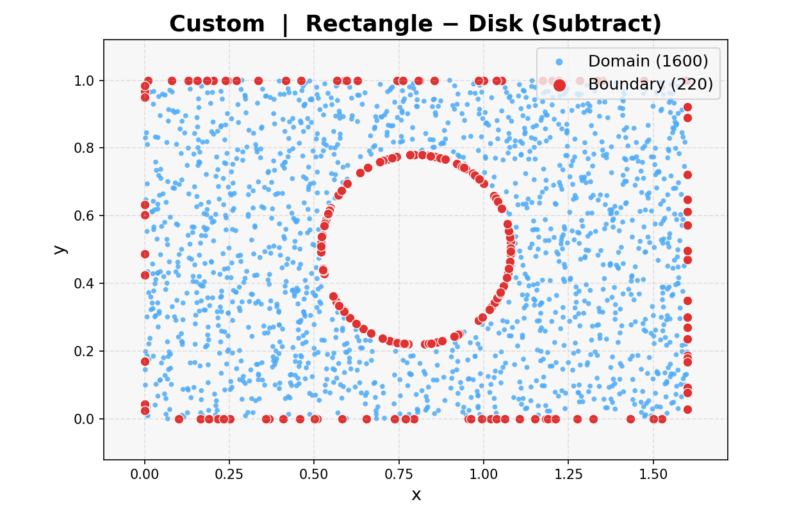
</p>

</details>

<details>
<summary><strong>Collocation point controls</strong></summary>

Domain, boundary, initial, and test point counts are all independently configurable, along with the sampling distribution, plus a live domain preview — a real, non-uniform PDE-collocation point cloud (domain points, boundary points, and initial-condition points, color-coded) plotted directly against your actual geometry, alongside a second panel showing the same points' distribution over time — so you can see exactly what will be handed to training before you click Solve. This works in 2D against any of the five 2D shapes (Rectangle, Disk, Ellipse, Triangle, Polygon) and in 3D too, with a real 3D scatter plot against a Cuboid or Sphere outline, not just a flat 2D preview.

<table>
<tr>
<td width="33%" align="center">

<sub>2D preview — Rectangle</sub>
</td>
<td width="33%" align="center">

<sub>2D preview — Disk</sub>
</td>
<td width="33%" align="center">

<sub>3D preview — Cuboid</sub>
</td>
</tr>
</table>

**Extra training points (anchors)** can be added on top of the sampled ones, either from a points file or at random inside a box, e.g. concentrated near a front or a free boundary (DeepXDE's `anchors=`).

</details>

### Training

<details>
<summary><strong>Configurable network architecture</strong></summary>

Hidden layer count, neurons per layer, activation function, and kernel initializer (Glorot uniform, Glorot normal, He uniform, He normal, zeros) are all exposed directly — no need to edit a script to try a wider or deeper network, a different nonlinearity, or a different weight initialization.

**Activation** offers every identifier DeepXDE's own `deepxde.nn.activations` module supports — tanh, sin, Sigmoid, ReLU, SiLU, Swish, ELU, GELU, SELU — spelled exactly the way DeepXDE's own documentation capitalizes them. (`sin` is worth trying for problems with smooth or periodic solutions — SIREN-style sinusoidal activations are a well-known good fit for PINNs; `Swish` and `SiLU` are DeepXDE's own two names for the identical function, both offered since DeepXDE documents both spellings.)

**Network Type** (FNN / PFNN) is its own independent dropdown: the default **FNN** is a single shared trunk; **PFNN** (DeepXDE's own `dde.nn.PFNN`, a real built-in — not a custom extension) gives each output its own parallel sub-network, merging only at the final layer. Useful for multi-output problems where the outputs have different scales/behavior and a single shared trunk ends up fighting itself trying to serve both — 1D Schrödinger's real/imaginary parts, for example. A training script and the script that later restores its checkpoint always agree on how the network was shaped, since both read it from the same saved `model_config.json`.

**MsFFN** and **STMsFFN** (multi-scale Fourier feature networks) pass the inputs through random Fourier features at several scales (`Fourier scales (σ)`, e.g. `1, 10`), which lets a PINN capture slow and fast variations together — see the multi-scale Poisson example under [Examples](#examples).

</details>

<details>
<summary><strong>Input/output scaling</strong></summary>

Optional affine rescaling on the way into and out of the network — $x_{\text{transformed}} = x_{\text{raw}} \times \text{scale} + \text{shift}$ per input dimension, and the same for each output — off by default (scale = 1, shift = 0 is the identity). Useful when a problem's natural coordinate or solution range is far from the network's comfortable operating range (e.g. a domain spanning thousands of units, or a solution that's always around $10^{-6}$) and normalizing it improves training behavior.

Each transform can also be a **formula**. An input formula gives the network's input features (e.g. `x*sin(y); x*cos(y)` for a problem in polar coordinates); an output formula rewrites each output, typically to impose boundary or initial conditions exactly, e.g. `x*(1 - x)*u` makes $u = 0$ at $x = 0$ and $x = 1$ with no boundary loss term at all.

</details>

<details>
<summary><strong>Two-stage optimization (Adam + L-BFGS)</strong></summary>

Every run trains with Adam first, then hands off to L-BFGS for the second stage — a standard, effective PINN training recipe — with L-BFGS's own convergence settings exposed, and a configurable float precision (float32 for speed, float64 when L-BFGS needs the extra precision to converge cleanly).

</details>

<details>
<summary><strong>Multi-phase optimizer scheduling and IC-guided pre-training</strong></summary>

Beyond the basic two-stage recipe, training can be broken into any number of phases (different optimizers, iteration counts, and loss weights per phase), and an optional IC-guided pre-training pass can warm-start the network toward the initial condition before the full PDE-residual loss is even switched on — useful for problems where a cold-start network otherwise struggles to find the right basin. Loss weights can also be set automatically from the first evaluation (**Scale by initial losses**, wᵢ = c / Lᵢ(0)), so every loss term starts at the same size, as in DeepXDE's wave-propagation example.

Each phase's learning rate can decay by step, cosine, exponential or **inverse time** schedule (DeepXDE's `("inverse time", decay_steps, decay_rate)`).

</details>

<details>
<summary><strong>Residual-based Adaptive Refinement (RAR)</strong></summary>

Periodically resamples collocation points toward wherever the PDE residual is currently largest, concentrating training effort on the hardest parts of the domain (a sharp front, a boundary layer) instead of spreading points uniformly the whole time. Supported in every dimension — for time-dependent problems and steady-state problems (e.g. a Poisson equation) alike, since residual-based resampling has no dependency on a time axis to begin with.

**Per-round diagnostics.** Every RAR round now saves two snapshots to this run's own `solution_results/rar_rounds/round_NN/` folder, so you can watch the refinement happen round by round instead of only seeing the final result, plus a checkpoint for each optimizer phase that actually ran that round (`model_adam-*.pt` and/or `model_lbfgs-*.pt` — a round with both phases active saves both, not just the last one):

- `solution_plot.png` — the same output field you've configured to plot, evaluated at that round's model state, titled **"PINN vs Reference"** whenever a comparison is shown. With 2+ matching Error Analysis reference files available anywhere in the domain, this becomes a 3-panel PINN | Reference | Error figure in **every dimension including 1D** — a real time × space comparison, not just a single-snapshot one — sharing one color scale between the PINN and Reference panels, and reading its Error panel's own colormap from the same Plot Settings as the other two panels rather than a fixed one. With fewer than 2 matching references, it's just the PINN prediction. For a steady-state problem there's no time axis to compare across, so this is instead a single PINN | Reference | Error snapshot (or just the PINN prediction with no reference configured) — 1D keeps its own plain `u(x)` line either way.
- `collocation_points.png` — a scatter of the training points, colored to show how refinement is progressing: gray for the original points present before RAR started, orange for points added in earlier rounds, and red for the points this round just added. In 3D-plus-time problems this renders as a single 3D scatter (with time shown via point transparency where a 4th axis isn't available). In **2D-plus-time problems this shows two views side by side**: the same 3D (x, y, t) scatter, plus a plain 2D (x, y) view collapsing time, so the spatial concentration of added points is readable at a glance without having to rotate the 3D view. A steady-state problem has no time axis to plot at all, so 2D/3D stay a single spatial scatter and 1D becomes three stacked rows (original / earlier rounds / this round).

**The added points track the error.** Comparing a round's `collocation_points.png` against its `solution_plot.png` shows RAR doing exactly what it's meant to: the points it adds cluster right where the current model is still least accurate, not spread evenly across the domain.

<table>
<tr>
<td width="50%" align="center">

<sub>1D Burgers, RAR round 2 — points added (red) vs. earlier/original points</sub>
</td>
<td width="50%" align="center">

<sub>1D Burgers, RAR round 2 — solution/error snapshot: the added points line up with the highest-error region above</sub>
</td>
</tr>
</table>

<table>
<tr>
<td width="50%" align="center">

<sub>2D Allen-Cahn (Wight & Zhao), RAR round 1 — points added vs. original points</sub>
</td>
<td width="50%" align="center">

<sub>2D Allen-Cahn (Wight & Zhao), RAR round 1 — solution/error surface: the added points track the highest-error region above</sub>
</td>
</tr>
</table>

**Points from:** for a PDE with more than one governing equation, RAR normally ranks candidate points by the combined (summed) residual across every equation. The "Points from" selector lets you restrict that ranking to a single output's equation instead — useful when only one output has the sharp feature you care about and you don't want the other outputs' residuals diluting the point selection.

"Export as DeepXDE Script" honors the output selector too, and writes the same per-round `collocation_points.png` and `solution_plot.png` plus one `model.pt` checkpoint of each round's final weights; the per-round comparison against reference data is live-Solve only (an exported script compares against reference data once, in its end-of-run Error Analysis).

**Stop on a tolerance:** RAR can stop as soon as the mean residual drops below a set value (*Stop when mean residual <*), the way DeepXDE's Burgers-RAR example does; the number of rounds is then only an upper limit.

</details>

<details>
<summary><strong>Time-Adaptive training</strong></summary>

Splits the time domain into a sequence of step groups and trains through them in order, optionally with transfer learning so each step warm-starts from the previous one's converged weights instead of training from scratch — effective for problems with a wide time window or fast-evolving dynamics that a single training pass struggles to fit all at once (see the two 2D Allen-Cahn templates below, both wide time windows that ship with Time-Adaptive on by default for exactly this reason). It works in 1D, 2D, and 3D alike.

One setting is worth understanding before using it in 3D: the "IC grid resolution" control is a *per-axis* point count for the grid handed between steps — 1D uses it directly, 2D squares it, and 3D **cubes** it, so a value that's perfectly reasonable in 1D/2D (101, say — 101² ≈ 10,201 points in 2D) becomes over a million points per step in 3D. PINNStudio defaults this to a 3D-safe value automatically when you switch into 3D, and shows an in-panel warning if you manually pick a larger one anyway — both added after exactly this scenario ran a real GPU out of memory partway through a 3D run. The control is an editable dropdown — pick one of the usual presets (101/51/21/11) or type any custom per-axis resolution of your own.

Each step also gets its own reference comparison when Error Analysis data is configured: 1D produces both a surface and a line comparison (merged against **every** reference file whose time falls inside that step's own window, not just the closest one); 2D/3D produce the surface comparison only. A step with no reference in its time window still gets a PINN-only plot.

</details>

<details>
<summary><strong>Training callbacks — early stopping, checkpointing, time budget</strong></summary>

Three optional, independently configurable callbacks, alongside Point Resampling (RAR, described above): **Early Stopping** halts training once the monitored loss (training or testing) stops improving by more than a minimum delta for a set number of iterations, with an optional baseline loss and a minimum iteration count before it can trigger. **Model Checkpoint** periodically saves the model during training — on a fixed iteration interval, either unconditionally or only when the monitored loss improves — which is also what makes a run resumable later through Restore & Visualize. **Training Timer** stops training after a wall-clock time budget (in minutes) regardless of iteration count, useful for a shared or time-limited machine.

*Note: an earlier version of PINNStudio had a separate "Mini-batch training" option. It's gone — DeepXDE's `PDE`/`TimePDE` data classes ignore the `batch_size` argument entirely for this training pattern, so it was a no-op that changed nothing. Point Resampling (RAR) is the actual mechanism DeepXDE recommends in its place, and PINNStudio already implements it.*

</details>

<details>
<summary><strong>Training Monitors — track any output or derivative expression during training</strong></summary>

Watch an arbitrary expression of the solution and its derivatives — not just the loss — throughout training: `u`, `du_x`, `du_xx`, `du_xy`, or any algebraic combination, evaluated at a point (or set of points) you choose and logged alongside the usual loss curve. Built on DeepXDE's own `dde.callbacks.OperatorPredictor` mechanism, reusing the same derivative-vocabulary builder the Custom PDE editor already uses — so a monitor expression follows the identical `d<output>_<vars>` syntax. Useful for watching a specific quantity of interest (a boundary flux, a derivative at a known critical point) converge in real time instead of only inferring it after training finishes.

</details>

<details>
<summary><strong>Live parameter convergence (Inverse mode)</strong></summary>

For an inverse problem, the estimated parameter's value is logged and saved periodically throughout training — including during the L-BFGS phase, not just once at the very end — so you can watch it converge (or fail to) as training progresses, and plot its convergence history afterward as a static figure or an animated GIF. When the parameter's true value is known (every built-in template's Inverse setup, or one you supply yourself), both the plot and the GIF draw it as a dashed reference line alongside the run's own final estimate — including when you revisit an older run through Restore & Visualize's Parameter Convergence Plot/Animation, which reads the true value back from that run's saved `model_config.json`, or lets you type one in directly.

</details>

### Parameter Sweep

<details>
<summary><strong>Run many training configurations from one setup, varying any parameter</strong></summary>

Rather than clicking Solve once per configuration and tracking the results yourself, tick **Enable Parameter Sweep** in the left panel (directly below Adaptive Training; the **📖 Show sweep reference** and **🔄 Refresh** buttons sit on the same row) and PINNStudio runs a whole batch of training configurations in sequence — each one a full, independent training run of the problem you've already set up, varying whichever parameter(s) you choose. The shared **Solve**/**Stop** buttons drive it (relabeled **Run Sweep** while a sweep is enabled), and the Training Log streams every run's progress in order, so nothing about the rest of the workflow changes.

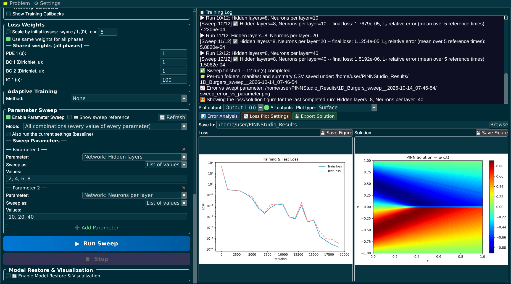

**Four ways to combine parameters**, picked from the Mode dropdown:
- **One-at-a-time** — vary each parameter separately, the others held at their current values (3 values of one parameter → 3 runs).
- **All combinations** (grid) — every value of every parameter, crossed together (2 parameters with 3 and 2 values → 6 runs).
- **Specified combinations** (zip) — pair up each parameter's *i*-th value across all parameters (2 parameters with matching-length value lists, paired index-for-index).
- **Bayesian search** — each run's settings are chosen by a Gaussian-process model of the results so far, to reach the lowest final loss (or L2 error) in as few runs as possible. Each parameter's Min/Max (linear or log) is its search range, a list its choices; **Runs** is the budget and **Random first** the number of random runs before the model takes over. The sweep folder gets `bayes_search.csv` and a convergence plot, and the best run is printed at the end — see the Helmholtz hyperparameter-optimization example under [Examples](#examples).

**Baseline run.** *Also run the current settings (baseline)* adds one run with the panel's settings unchanged, before the swept values, as a reference point. It is on by default for One-at-a-time with 2 or more parameters and for Bayesian search (its first point), and off otherwise; ticking or unticking it keeps your choice.

Each parameter row takes a comma-separated list of values, or a linear/log numeric range (min, max, number of steps); categorical parameters (activation, point distribution, etc.) are always a plain list of choices.

**Essentially anything you can configure elsewhere in the GUI can be swept** — click **🔄 Refresh** to update the Parameter dropdown with everything currently available for your problem, which adapts to what's selected. This currently spans:

- **Network** — hidden layers, neurons per layer, activation, kernel initializer, weight decay.
- **Collocation Points** — domain/boundary/initial/test point counts, sampling distribution.
- **Training Phases** — each Optimizer Scheduler phase's own iterations, learning rate, and optimizer.
- **Loss Weights** — every PDE/BC/IC loss weight, per phase or shared across all phases.
- **Inverse** (when Inverse mode is selected) — each trainable variable's initial guess, each observed-data file's loss weight.
- **RAR** (when selected as the adaptive method) — training rounds, residual sampling points, points added per cycle, Adam/L-BFGS iterations.
- **Time Adaptive** (when selected as the adaptive method) — each time-step group's own step count, IC grid resolution.
- **Input/Output Transform** (when enabled) — each input axis's and each output's own scale value.

**Every run gets its own results.** The sweep saves into one folder under the same **Save to:** location as a normal Solve, named like a normal run (`Poisson_1D-Dirichlet_sweep__2026-10-13_11-39-17`), with one subfolder per run named after what it set (`run_01__Phase-1-Iterations_1000`, `run_02__…`; `run_00__baseline` when the baseline runs), each with its own saved model checkpoint, loss/solution plots and (if configured) Error Analysis results. The sweep folder also gets `sweep_manifest.json`, `sweep_summary.csv` (one row per run: the swept values, status, final loss, the Error Analysis metrics you ticked, and the folder) and **`sweep_error_vs_parameter.png`**, a summary plot of the error ($L_2$, plus MSE and Max error if ticked in Error Analysis; for a time-dependent problem the mean over the reference times set in Error Analysis) and the final loss against the swept value — one panel per parameter for One-at-a-time, one line per value of the other parameters for combinations, the baseline as a star.

**Example — network size for Burgers 1D.** Load *Burgers 1D – Raissi et al.*, enable the sweep, choose *All combinations*, and sweep **Network: Hidden layers** over 2, 4, 6, 8 and **Network: Neurons per layer** over 10, 20, 40 — the same study as Table 1 of Raissi et al. (2019). The 12 runs (everything else as the template sets it: Adam 15,000 + L-BFGS 10,000 iterations, 8,000 collocation points) took about 17 minutes on an RTX 4090, and the sweep folder's summary plot shows the result:


Relative $L_2$ error (mean over the five reference times) from `sweep_summary.csv`:

| Hidden layers | 10 neurons | 20 neurons | 40 neurons |
|---|---|---|---|
| 2 | 1.4 × 10<sup>-2</sup> | 5.6 × 10<sup>-3</sup> | 3.8 × 10<sup>-3</sup> |
| 4 | 1.1 × 10<sup>-3</sup> | 1.0 × 10<sup>-3</sup> | 2.4 × 10<sup>-4</sup> |
| 6 | 5.6 × 10<sup>-4</sup> | 1.2 × 10<sup>-3</sup> | 5.3 × 10<sup>-4</sup> |
| 8 | 1.3 × 10<sup>-3</sup> | 2.6 × 10<sup>-3</sup> | 3.7 × 10<sup>-4</sup> |

Two hidden layers are too few for the shock at $x = 0$; at four layers the error is 5–16× lower, and 40 neurons per layer gives the lowest error at every depth from four layers. Deeper is not always better here: with 10 or 20 neurons, 8 layers trains to a higher loss and error than 4 or 6. (Raissi et al. trained with L-BFGS only and 10,000 collocation points, so their numbers differ; the trend is the same.) Once the sweep finishes, the right panel's Loss/Solution plots fill in with the last successfully completed run's own figure, the same as a normal Solve would show. **Stop** hard-stops the in-flight run immediately rather than letting it finish first.

</details>

### Analysis & Output

<details>
<summary><strong>Live training log</strong></summary>

Training runs as a background process with its stdout streamed straight into the Training Log panel in real time, with a Stop control that actually terminates the running process rather than just detaching from it.

</details>

<details>
<summary><strong>Loss Plot Settings</strong></summary>

A standalone dialog controlling how the loss curve itself is plotted, separate from the per-plot-type Plot Settings above since it applies to the whole run rather than one specific output plot: which losses to show (train+test totals, each individual loss term, or all of them together), a single shared "plot every N iterations" frequency applied everywhere a loss gets plotted (replacing what used to be several independent hardcoded values), line width, and a log/linear y-axis toggle.

</details>

<details>
<summary><strong>Error analysis against reference data</strong></summary>

Point a run at one or more reference solution files (at one or more time snapshots) and PINNStudio reports, for predicted values $u_{\text{pred}}$ against ground truth $u_{\text{true}}$ over $N$ evaluation points:

$$\Large L_2 \text{ relative error} = \frac{\lVert u_{\text{pred}} - u_{\text{true}} \rVert_2}{\lVert u_{\text{true}} \rVert_2}, \qquad \text{MSE} = \frac{1}{N}\sum_{i=1}^{N}\left(u_{\text{pred},i} - u_{\text{true},i}\right)^2$$

$$\Large \text{Max error} = \max_i \left| u_{\text{pred},i} - u_{\text{true},i} \right|, \qquad \text{Mean absolute error} = \frac{1}{N}\sum_{i=1}^{N}\left| u_{\text{pred},i} - u_{\text{true},i} \right|$$

alongside line-comparison and surface-comparison plots of the PINN prediction against reference, consistently titled **"PINN vs Reference"** everywhere these comparisons appear. All twelve built-in templates ship with bundled reference data so this works immediately with no setup; it works the same way for a data file of your own. A reference file can be checked against a derivative expression too (e.g. a reference `du_x` dataset), not just a raw output.

**Error Metrics to Compute** lets you choose which of L2 relative error, MSE, and Max error are actually computed and reported — unchecking one leaves it out of the console log, the saved metrics file, and any on-plot annotation entirely, rather than just hiding it from view. Mean absolute error always appears alongside whichever metrics you've enabled. Defaults to **L2 only**.

Every comparison plot's Error panel reads its colormap, levels, figure size, and axis settings from the same Plot Settings as the PINN and Reference panels beside it, so all three stay visually consistent rather than the Error panel defaulting to its own fixed look.

No reference files? If the problem has an exact solution, choose *Reference: Exact solution formula* and type it in (one formula per output, in `x`, `y`, `z`, `t`); the run evaluates it on a grid over the geometry at the chosen times and compares against it exactly as it would against files.

</details>

<details>
<summary><strong>Configurable result plotting</strong></summary>

Static Surface or Line plots, or animated GIFs of either over time, with colormap, contour resolution, DPI, colorbar, and snapshot-count all configurable. For a 1D time-dependent Surface plot (static or animated), the two axes can be swapped between "x on the x-axis, t on the y-axis" and the reverse — whichever reads more naturally for your problem. For a 2D/3D Line plot or Line Animation, the y/z "slice" position the line is cut through is its own configurable value too (defaulting to the domain midpoint), rather than a silent hardcoded one.

Figure size can be left at its default aspect ratio or switched to **Square** or **Wide**, or you can type an exact **Custom** width/height — and the title, per-panel subplot title, and axis-label font sizes are each independently adjustable too, without changing anything else about a plot's default look if you leave them alone. This Plot Settings dialog and the matching one in Restore & Visualize mirror each other field-for-field, so a setting you're used to on one side behaves identically on the other.

Beyond plotting a raw output column, the **Custom...** field lets you plot (and animate) any expression of the outputs **and their derivatives** — `sqrt(u**2+v**2)`, `du_x`, `du_xx`, any combination — evaluated through DeepXDE's own `dde.Model.predict(x, operator=...)` built-in, the same mechanism Training Monitors uses. This works in the live Results panel, the Restore & Visualize tab, and in Error Analysis's own per-group custom field, so a derivative you can watch during training is also one you can plot, animate, and error-check afterward.

For a problem with several outputs, every output is also saved as its own plot, `solution_plot_<name>.png`, and Error Analysis titles name the output they show.

</details>

<details>
<summary><strong>Solution data export</strong></summary>

The raw predicted solution — not just the rendered plot — is saved alongside the run's other output, so it's available for your own downstream analysis outside the GUI. Off by default — enable it with its own checkbox when you actually want the raw arrays — and the export grid resolution is an editable dropdown, same as Time-Adaptive's IC grid resolution: pick a preset or type your own.

</details>

<details>
<summary><strong>Export as a standalone DeepXDE script</strong></summary>

Every configured problem can be exported as a clean, dependency-minimal DeepXDE/PyTorch script (<code>File → Export as DeepXDE Script...</code>) — the same script the GUI itself would run, but meant to be read and handed off: to a cluster job, a collaborator without PINNStudio installed, or as a starting point for a hand-written project. A configured **Custom...** plot expression (including derivatives) and a Time-Adaptive run's full stitched loss history (every phase of every time sub-domain, not just the last one) both export the same way they display in the GUI.

</details>

### Restore & Visualize

<details>
<summary><strong>Reload a saved checkpoint — no retraining needed</strong></summary>

Point the Restore panel at a saved model checkpoint and its <code>model_config.json</code>, and PINNStudio reloads the trained network and regenerates whichever visualization you ask for — a static Surface or Line plot, an animated GIF of either, or (for a saved Inverse run) the parameter convergence history — without retraining anything. An animated result plays directly in the panel, the same as it would right after a fresh Solve, and Error Analysis re-runs against the same reference data if it was configured for that run originally.

The Restore panel's own **Custom...** field is derivative-aware too: a restored model can be plotted or animated as a derivative expression of its outputs (`du_x`, `du_xx`, `sqrt(du_x**2+du_y**2)`, ...), not just the raw solution it was saved with — so a quantity you didn't think to plot during the original training run is still available afterward, straight from the checkpoint, no retraining needed.

</details>

## Repository Structure

```text
pinnstudio/
├── pinnstudio/
│   ├── main.py            # Entry point
│   ├── ui/
│   │   └── main_window.py # PyQt6 interface — every tab, dialog, and control
│   └── core/
│       ├── config.py          # PINNConfig — the full problem definition
│       ├── codegen.py         # PINNConfig -> standalone DeepXDE/PyTorch script
│       ├── deepxde_examples.py # DeepXDE's documented examples as Quick Examples
│       ├── runner.py          # Runs the generated script, streams output to the GUI
│       ├── sweep_registry.py  # Parameter Sweep's list of sweepable parameters
│       └── sweep_runner.py    # Builds and runs each sweep configuration in turn
├── assets/
│   ├── screenshots/        # README screenshots
│   └── results/             # Example output (solution images, demo GIFs)
├── reference_data/          # Bundled ground truth for the built-in templates
│   ├── 1D/
│   ├── 2D/
│   ├── 3D/
│   └── deepxde/             # Reference/measurement data for the DeepXDE examples
├── tools/                   # Reference-data generator, DeepXDE example runner
├── requirements.txt
├── setup.py
├── install.sh              # One-command setup (macOS/Linux)
├── install.bat              # One-command setup (Windows)
└── README.md
```

## Quick Start

### Step 1: Open a terminal

- **Windows:** click the Start menu, type `PowerShell`, and open **Windows PowerShell**.
- **macOS:** press `Cmd + Space` to open Spotlight, type `Terminal`, and press Enter (or find it under Applications -> Utilities -> Terminal).
- **Linux:** open your terminal application (commonly `Ctrl + Alt + T`, or search "Terminal" in your application menu).

### Step 2: Check you have git and Python 3.9+

Paste these one at a time:

```bash
git --version
python3 --version
```

(On Windows, use `python --version` instead of `python3 --version`.)

If either command isn't recognized:

- **git missing?** Install it from [git-scm.com/downloads](https://git-scm.com/downloads). Default options are fine. On macOS, running `git --version` for the first time may itself prompt you to install Apple's Command Line Tools — accept and let it finish, then try again.
- **Python missing, or older than 3.9?** Install it from [python.org/downloads](https://www.python.org/downloads/). **On Windows, check "Add python.exe to PATH"** on the installer's first screen — this is the single most common thing people miss.

After installing either one, close your terminal window completely and open a new one before continuing, so the change takes effect.

### Step 3: Clone and install

```bash
git clone https://github.com/AsfandyarKhan72/PINNStudio.git
cd PINNStudio
```

**macOS / Linux:**
```bash
bash install.sh
./venv/bin/pinnstudio
```

**Windows:**
```
install.bat
.\venv\Scripts\pinnstudio.exe
```

The install script creates an isolated virtual environment inside the `PINNStudio` folder and installs PINNStudio and its dependencies into it — nothing is installed system-wide, and deleting the folder removes it completely. If it detects an NVIDIA GPU that the default PyTorch build can't use (an older driver, most commonly), it automatically installs a more compatible PyTorch build instead, so GPU support works out of the box on more machines. This step needs an internet connection and can take a few minutes.

> **Already have a working PyTorch + CUDA setup, or no GPU at all?** You can also install with `pip install pinnstudio` - just be aware it skips the GPU compatibility check above, so if you hit a GPU-related error afterward, re-run `install.sh` / `install.bat` instead.

### Step 4: Take the 60-second tour

Maximize the window for the best view — PINNStudio packs a lot of controls into the left panel. With the app open, leave the dimension on **1D**, pick **1D Heat** from the *Quick Examples* dropdown, and click **Solve**. The Training Log panel will stream progress, and the loss/solution plots will populate once the run finishes.

### Something not working?

Open an issue on GitHub with the exact command you ran and the full error message — see [Contributing](#contributing).

## Running PINNStudio Again

You only need to run the install steps above once. After that, launch PINNStudio again anytime with:

**macOS / Linux**, from inside the `PINNStudio` folder:
```bash
./venv/bin/pinnstudio
```

**Windows**, from inside the `PINNStudio` folder:
```
.\venv\Scripts\pinnstudio.exe
```

That's it - no need to reinstall or recreate the virtual environment.

## What Gets Installed

`install.sh` / `install.bat` (used in Quick Start above) set up an isolated Python virtual environment and install:

- [DeepXDE](https://github.com/lululxvi/deepxde) (PyTorch backend)
- PyTorch
- PyQt6
- NumPy (below 2.5 -- DeepXDE 1.15's Polygon/Triangle geometry breaks on NumPy 2.5+)
- Matplotlib
- Pandas

A CUDA-capable GPU is optional but recommended for larger 2D/3D problems and inverse runs.

## Examples

PINNStudio comes with 63 ready-to-run examples, all listed in the table below and loaded from *Quick Examples*. Its **Category** is **Forward** (every example, solving for the field) or **Inverse** (examples that learn unknown parameters or fields from data), and each list is ordered like the table, under ODE / 1D / 2D / 3D headings. Every name follows one style, *Equation Dimension – detail*. The table's **Source** column says where each example comes from:

- **PINNStudio templates** (12): our own problems; most reproduce a published PINN result, and the Source column names and links that paper (the heat and the disk/sphere Poisson templates are our own and show "—"). Each one works in both **Forward** and **Inverse** mode — picked from the Inverse list, it loads in Inverse mode with its measured-data file — and all of them ship with reference data in [`reference_data/`](reference_data), so Error Analysis is ready as soon as you load one.
- **DeepXDE examples** (41 forward, 10 inverse): the **DeepXDE** link in the Source column opens each one's script in DeepXDE's repository. These are the PINN examples from DeepXDE's documentation ([forward](https://deepxde.readthedocs.io/en/latest/demos/pinn_forward.html), [inverse](https://deepxde.readthedocs.io/en/latest/demos/pinn_inverse.html)), set up with each script's own equation, geometry, boundary/initial conditions, network, optimizers, iteration counts and loss weights, so pressing **Solve** trains what the DeepXDE script trains. Anything that differs from the script is printed in the Training Log when the example loads, and noted in its entry below.

Loading an example fills in every setting, and you can change any of them before pressing **Solve**; if you do, the Training Log lists what you changed. Your save folder, GPU, random-seed and plot-style settings are kept when you load one.

**Error Analysis reference:** where the problem has an exact solution, Error Analysis compares against it directly (*Exact solution*). Otherwise it uses reference files computed independently of the PINN (*Generated data*): PINNStudio's own reference solutions in [`reference_data/`](reference_data), or data computed by [`tools/make_deepxde_reference_data.py`](tools/make_deepxde_reference_data.py) (no data is copied from DeepXDE's repository). Examples marked "—" have no bundled reference; you can add your own files in the Error Analysis dialog.

Every result shown below comes from one training run with the example's settings on an RTX 4090. Errors are relative L2 errors from Error Analysis, and they vary a little from run to run.

The table is ordered by dimension (ODE, 1D, 2D, 3D), then steady before time-dependent and forward before inverse; examples of the same problem sit next to each other.

| # | Example | Dimension | Regime | Problem | Geometry | Error Analysis reference | Source |
|---|---|---|---|---|---|---|---|
| | **ODE (t only)** | | | | | | |
| 1 | [Integro-differential ODE](#dx-integro-differential-equation) | ODE | Time-dependent | Forward | — (t only) | Exact solution | [DeepXDE](https://github.com/lululxvi/deepxde/blob/master/examples/pinn_forward/ide.py) |
| 2 | [Integro-differential ODE – Volterra kernel](#dx-volterra-integro-differential-equation) | ODE | Time-dependent | Forward | — (t only) | Exact solution | [DeepXDE](https://github.com/lululxvi/deepxde/blob/master/examples/pinn_forward/Volterra_IDE.py) |
| 3 | [Linear ODE system](#dx-ode-system) | ODE | Time-dependent | Forward | — (t only) | Exact solution | [DeepXDE](https://github.com/lululxvi/deepxde/blob/master/examples/pinn_forward/ode_system.py) |
| 4 | [Lotka-Volterra ODE](#dx-lotka-volterra-equation) | ODE | Time-dependent | Forward | — (t only) | Generated data | [DeepXDE](https://github.com/lululxvi/deepxde/blob/master/examples/pinn_forward/Lotka_Volterra.py) |
| 5 | [Second-order ODE](#dx-second-order-ode) | ODE | Time-dependent | Forward | — (t only) | Exact solution | [DeepXDE](https://github.com/lululxvi/deepxde/blob/master/examples/pinn_forward/ode_2nd.py) |
| 6 | [Lorenz ODE – unknown C₁, C₂, C₃](#dx-inverse-lorenz-system) | ODE | Time-dependent | Inverse | — (t only) | Generated data | [DeepXDE](https://github.com/lululxvi/deepxde/blob/master/examples/pinn_inverse/Lorenz_inverse.py) |
| 7 | [Lorenz ODE – unknown C₁, C₂, C₃, exogenous input](#dx-inverse-lorenz-system-with-exogenous-input) | ODE | Time-dependent | Inverse | — (t only) | Generated data | [DeepXDE](https://github.com/lululxvi/deepxde/blob/master/examples/pinn_inverse/Lorenz_inverse_forced.py) |
| | **1D** | | | | | | |
| 8 | [Euler beam 1D](#dx-euler-beam) | 1D | Steady | Forward | Interval | Exact solution | [DeepXDE](https://github.com/lululxvi/deepxde/blob/master/examples/pinn_forward/Euler_beam.py) |
| 9 | [Fractional Poisson 1D](#dx-fractional-poisson-equation-1d) | 1D | Steady | Forward | Interval | Exact solution | [DeepXDE](https://github.com/lululxvi/deepxde/blob/master/examples/pinn_forward/fractional_Poisson_1d.py) |
| 10 | [Poisson 1D – Dirichlet](#dx-poisson-1d-dirichlet) | 1D | Steady | Forward | Interval | Exact solution | [DeepXDE](https://github.com/lululxvi/deepxde/blob/master/examples/pinn_forward/Poisson_Dirichlet_1d.py) |
| 11 | [Poisson 1D – Dirichlet/Neumann](#dx-poisson-1d-dirichlet-neumann) | 1D | Steady | Forward | Interval | Exact solution | [DeepXDE](https://github.com/lululxvi/deepxde/blob/master/examples/pinn_forward/Poisson_Neumann_1d.py) |
| 12 | [Poisson 1D – Dirichlet/Periodic](#dx-poisson-1d-dirichlet-periodic) | 1D | Steady | Forward | Interval | Exact solution | [DeepXDE](https://github.com/lululxvi/deepxde/blob/master/examples/pinn_forward/Poisson_periodic_1d.py) |
| 13 | [Poisson 1D – Dirichlet/point-set operator](#dx-poisson-1d-dirichlet-pointsetoperator) | 1D | Steady | Forward | Interval | Exact solution | [DeepXDE](https://github.com/lululxvi/deepxde/blob/master/examples/pinn_forward/Poisson_PointSetOperator_1d.py) |
| 14 | [Poisson 1D – Dirichlet/Robin](#dx-poisson-1d-dirichlet-robin) | 1D | Steady | Forward | Interval | Exact solution | [DeepXDE](https://github.com/lululxvi/deepxde/blob/master/examples/pinn_forward/Poisson_Robin_1d.py) |
| 15 | [Poisson 1D – hard BCs](#dx-poisson-1d-hard-boundary-conditions) | 1D | Steady | Forward | Interval | Exact solution | [DeepXDE](https://github.com/lululxvi/deepxde/blob/master/examples/pinn_forward/Poisson_Dirichlet_1d_exactBC.py) |
| 16 | [Poisson 1D – multi-scale Fourier features](#dx-poisson-1d-multi-scale-fourier-features) | 1D | Steady | Forward | Interval | Exact solution | [DeepXDE](https://github.com/lululxvi/deepxde/blob/master/examples/pinn_forward/Poisson_multiscale_1d.py) |
| 17 | [Brinkman-Forchheimer 1D – unknown ν_e, K](#dx-inverse-brinkman-forchheimer-model) | 1D | Steady | Inverse | Interval | Exact solution | [DeepXDE](https://github.com/lululxvi/deepxde/blob/master/examples/pinn_inverse/brinkman_forchheimer.py) |
| 18 | [Diffusion-reaction 1D – unknown rate field](#dx-inverse-diffusion-reaction-with-space-dependent-rate) | 1D | Steady | Inverse | Interval | Exact solution | [DeepXDE](https://github.com/lululxvi/deepxde/blob/master/examples/pinn_inverse/diffusion_reaction_rate.py) |
| 19 | [Fractional Poisson 1D – unknown order α](#dx-inverse-fractional-poisson-equation-1d) | 1D | Steady | Inverse | Interval | Exact solution | [DeepXDE](https://github.com/lululxvi/deepxde/blob/master/examples/pinn_inverse/fractional_Poisson_1d_inverse.py) |
| 20 | [Poisson 1D – unknown forcing field](#dx-inverse-poisson-with-unknown-forcing-field) | 1D | Steady | Inverse | Interval | Exact solution | [DeepXDE](https://github.com/lululxvi/deepxde/blob/master/examples/pinn_inverse/elliptic_inverse_field.py) |
| 21 | [Poisson 1D – unknown forcing field (batches)](#dx-inverse-poisson-with-unknown-forcing-field-batches) | 1D | Steady | Inverse | Interval | Exact solution | [DeepXDE](https://github.com/lululxvi/deepxde/blob/master/examples/pinn_inverse/elliptic_inverse_field_batch.py) |
| 22 | [Allen-Cahn 1D](#dx-allen-cahn-equation) | 1D | Time-dependent | Forward | Interval | Generated data | [DeepXDE](https://github.com/lululxvi/deepxde/blob/master/examples/pinn_forward/Allen_Cahn.py) |
| 23 | [Allen-Cahn 1D – Wight & Zhao](#1d-allen-cahn) | 1D | Time-dependent | Forward / Inverse | Interval | Generated data | [Wight & Zhao (2021)](https://doi.org/10.4208/cicp.OA-2020-0086) |
| 24 | [Black-Scholes 1D – American put](#dx-american-put-option) | 1D | Time-dependent | Forward | Interval | — | [DeepXDE](https://github.com/lululxvi/deepxde/blob/master/examples/pinn_forward/american_put.py) |
| 25 | [Black-Scholes 1D – European call](#dx-black-scholes-equation-call-option) | 1D | Time-dependent | Forward | Interval | Exact solution | [DeepXDE](https://github.com/lululxvi/deepxde/blob/master/examples/pinn_forward/black_scholes_call.py) |
| 26 | [Burgers 1D](#dx-burgers-equation) | 1D | Time-dependent | Forward | Interval | Generated data | [DeepXDE](https://github.com/lululxvi/deepxde/blob/master/examples/pinn_forward/Burgers.py) |
| 27 | [Burgers 1D – Raissi et al.](#1d-burgers) | 1D | Time-dependent | Forward / Inverse | Interval | Generated data | [Raissi et al. (2019)](https://doi.org/10.1016/j.jcp.2018.10.045) |
| 28 | [Burgers 1D – RAR](#dx-burgers-equation-with-rar) | 1D | Time-dependent | Forward | Interval | Generated data | [DeepXDE](https://github.com/lululxvi/deepxde/blob/master/examples/pinn_forward/Burgers_RAR.py) |
| 29 | [Diffusion 1D](#dx-diffusion-equation) | 1D | Time-dependent | Forward | Interval | Exact solution | [DeepXDE](https://github.com/lululxvi/deepxde/blob/master/examples/pinn_forward/diffusion_1d.py) |
| 30 | [Diffusion 1D – hard IC and BCs](#dx-diffusion-equation-with-hard-ic-and-bc) | 1D | Time-dependent | Forward | Interval | Exact solution | [DeepXDE](https://github.com/lululxvi/deepxde/blob/master/examples/pinn_forward/diffusion_1d_exactBC.py) |
| 31 | [Diffusion 1D – resampling](#dx-diffusion-equation-with-resampling) | 1D | Time-dependent | Forward | Interval | Exact solution | [DeepXDE](https://github.com/lululxvi/deepxde/blob/master/examples/pinn_forward/diffusion_1d_resample.py) |
| 32 | [Diffusion-reaction 1D](#dx-diffusion-reaction-equation) | 1D | Time-dependent | Forward | Interval | Exact solution | [DeepXDE](https://github.com/lululxvi/deepxde/blob/master/examples/pinn_forward/diffusion_reaction.py) |
| 33 | [Fractional diffusion 1D](#dx-fractional-diffusion-equation) | 1D | Time-dependent | Forward | Interval | Exact solution | [DeepXDE](https://github.com/lululxvi/deepxde/blob/master/examples/pinn_forward/fractional_diffusion_1d.py) |
| 34 | [Heat 1D](#1d-heat) | 1D | Time-dependent | Forward / Inverse | Interval | Generated data | — |
| 35 | [Heat 1D – Dirichlet](#dx-heat-equation) | 1D | Time-dependent | Forward | Interval | Exact solution | [DeepXDE](https://github.com/lululxvi/deepxde/blob/master/examples/pinn_forward/heat.py) |
| 36 | [Heat 1D – resampling](#dx-heat-equation-with-resampling) | 1D | Time-dependent | Forward | Interval | Exact solution | [DeepXDE](https://github.com/lululxvi/deepxde/blob/master/examples/pinn_forward/heat_resample.py) |
| 37 | [Klein-Gordon 1D](#dx-klein-gordon-equation) | 1D | Time-dependent | Forward | Interval | Exact solution | [DeepXDE](https://github.com/lululxvi/deepxde/blob/master/examples/pinn_forward/Klein_Gordon.py) |
| 38 | [Schrödinger 1D](#dx-schr-dinger-equation) | 1D | Time-dependent | Forward | Interval | Generated data | [DeepXDE](https://github.com/lululxvi/deepxde/blob/master/examples/pinn_forward/Schrodinger.ipynb) |
| 39 | [Schrödinger 1D – Raissi et al.](#1d-schrödinger) | 1D | Time-dependent | Forward / Inverse | Interval | Generated data | [Raissi et al. (2019)](https://doi.org/10.1016/j.jcp.2018.10.045) |
| 40 | [Wave 1D – space-time multi-scale Fourier features](#dx-wave-propagation-space-time-multi-scale-fourier-features) | 1D | Time-dependent | Forward | Interval | Exact solution | [DeepXDE](https://github.com/lululxvi/deepxde/blob/master/examples/pinn_forward/wave_1d.py) |
| 41 | [Diffusion 1D – unknown coefficient](#dx-inverse-diffusion-equation) | 1D | Time-dependent | Inverse | Interval | Exact solution | [DeepXDE](https://github.com/lululxvi/deepxde/blob/master/examples/pinn_inverse/diffusion_1d_inverse.py) |
| 42 | [Diffusion-reaction 1D – unknown k_f, D](#dx-inverse-diffusion-reaction-system) | 1D | Time-dependent | Inverse | Interval | — | [DeepXDE](https://github.com/lululxvi/deepxde/blob/master/examples/pinn_inverse/reaction_inverse.py) |
| | **2D** | | | | | | |
| 43 | [Fractional Poisson 2D – disk](#dx-fractional-poisson-equation-2d) | 2D | Steady | Forward | Disk | Exact solution | [DeepXDE](https://github.com/lululxvi/deepxde/blob/master/examples/pinn_forward/fractional_Poisson_2d.py) |
| 44 | [Helmholtz 2D – Dirichlet](#dx-helmholtz-2d-dirichlet) | 2D | Steady | Forward | Rectangle | Exact solution | [DeepXDE](https://github.com/lululxvi/deepxde/blob/master/examples/pinn_forward/Helmholtz_Dirichlet_2d.py) |
| 45 | [Helmholtz 2D – hyperparameter search](#dx-helmholtz-2d-hyperparameter-optimization) | 2D | Steady | Forward | Rectangle | Exact solution | [DeepXDE](https://github.com/lululxvi/deepxde/blob/master/examples/pinn_forward/Helmholtz_Dirichlet_2d_HPO.py) |
| 46 | [Helmholtz 2D – sound-hard scattering](#dx-helmholtz-sound-hard-scattering-absorbing-bc) | 2D | Steady | Forward | Rectangle − Disk | Generated data | [DeepXDE](https://github.com/lululxvi/deepxde/blob/master/examples/pinn_forward/Helmholtz_Sound_hard_ABC_2d.py) |
| 47 | [Helmholtz 2D – square with hole](#dx-helmholtz-2d-with-a-hole) | 2D | Steady | Forward | Rectangle − Disk | Exact solution | [DeepXDE](https://github.com/lululxvi/deepxde/blob/master/examples/pinn_forward/Helmholtz_Neumann_2d_hole.py) |
| 48 | [Laplace 2D – disk](#dx-laplace-equation-on-a-disk) | 2D | Steady | Forward | Rectangle in (r, θ) | Exact solution | [DeepXDE](https://github.com/lululxvi/deepxde/blob/master/examples/pinn_forward/Laplace_disk.py) |
| 49 | [Linear elasticity 2D – plate](#dx-linear-elastostatic-plate) | 2D | Steady | Forward | Rectangle | Exact solution | [DeepXDE](https://github.com/lululxvi/deepxde/blob/master/examples/pinn_forward/elasticity_plate.py) |
| 50 | [Linear elasticity 2D – plate, soft BCs](#dx-linear-elastostatic-plate-soft-bcs) | 2D | Steady | Forward | Rectangle | Exact solution | [DeepXDE](https://github.com/lululxvi/deepxde/blob/master/examples/pinn_forward/elasticity_plate.py) |
| 51 | [Navier-Stokes 2D – Kovasznay flow](#dx-kovasznay-flow) | 2D | Steady | Forward | Rectangle | Exact solution | [DeepXDE](https://github.com/lululxvi/deepxde/blob/master/examples/pinn_forward/Kovasznay_flow.py) |
| 52 | [Poisson 2D – disk](#2d-poisson-disk) | 2D | Steady | Forward / Inverse | Disk | Generated data | — |
| 53 | [Poisson 2D – L-shape](#dx-poisson-over-an-l-shaped-domain) | 2D | Steady | Forward | Polygon (L-shape) | Generated data | [DeepXDE](https://github.com/lululxvi/deepxde/blob/master/examples/pinn_forward/Poisson_Lshape.py) |
| 54 | [Poisson 2D – L-shape, Lu et al.](#2d-poisson-l-shape) | 2D | Steady | Forward / Inverse | Polygon (L-shape) | Generated data | [Lu et al. (2021)](https://doi.org/10.1137/19M1274067) |
| 55 | [Fractional Poisson 2D – unknown order α](#dx-inverse-fractional-poisson-equation-2d) | 2D | Steady | Inverse | Disk | Exact solution | [DeepXDE](https://github.com/lululxvi/deepxde/blob/master/examples/pinn_inverse/fractional_Poisson_2d_inverse.py) |
| 56 | [Allen-Cahn 2D – Mattey & Ghosh](#2d-allen-cahn-mattey--ghosh) | 2D | Time-dependent | Forward / Inverse | Rectangle | Generated data | [Mattey & Ghosh (2022)](https://doi.org/10.1016/j.cma.2021.114474) |
| 57 | [Allen-Cahn 2D – Wight & Zhao](#2d-allen-cahn-wight--zhao) | 2D | Time-dependent | Forward / Inverse | Rectangle | Generated data | [Wight & Zhao (2021)](https://doi.org/10.4208/cicp.OA-2020-0086) |
| 58 | [Burgers 2D – Mathias et al.](#2d-burgers-mathias) | 2D | Time-dependent | Forward / Inverse | Rectangle | Generated data | [Mathias et al. (2022)](https://arxiv.org/abs/2301.07824) |
| 59 | [Heat 2D](#2d-heat) | 2D | Time-dependent | Forward / Inverse | Rectangle | Generated data | — |
| | **3D** | | | | | | |
| 60 | [Fractional Poisson 3D – sphere](#dx-fractional-poisson-equation-3d) | 3D | Steady | Forward | Sphere | Exact solution | [DeepXDE](https://github.com/lululxvi/deepxde/blob/master/examples/pinn_forward/fractional_Poisson_3d.py) |
| 61 | [Poisson 3D – sphere](#3d-poisson-sphere) | 3D | Steady | Forward / Inverse | Sphere | Generated data | — |
| 62 | [Heat 3D](#3d-heat) | 3D | Time-dependent | Forward / Inverse | Cuboid | Generated data | — |
| 63 | [Navier-Stokes 3D – Beltrami flow](#dx-beltrami-flow) | 3D | Time-dependent | Forward | Cuboid | Exact solution | [DeepXDE](https://github.com/lululxvi/deepxde/blob/master/examples/pinn_forward/Beltrami_flow.py) |

The "unknown field" inverse examples learn the field as an extra network output from measurements given as a Point Set boundary condition, so they run in Forward mode, as in DeepXDE. To train the DeepXDE examples from the command line and print their Error Analysis results:

```bash
python tools/run_deepxde_examples.py --out deepxde_runs            # full settings
python tools/run_deepxde_examples.py --smoke --out deepxde_runs    # a few hundred iterations each
```


### ODE examples

*Click an example to expand it.*

<details id="dx-integro-differential-equation">
<summary><strong>Integro-differential ODE</strong></summary>

DeepXDE example: [`ide.py`](https://github.com/lululxvi/deepxde/blob/master/examples/pinn_forward/ide.py) ([documentation](https://deepxde.readthedocs.io/en/latest/demos/pinn_forward/ide.html))

$$\Large \frac{du}{dt} + \int_0^t u(s)\,ds = 2\pi\cos(2\pi t) + \frac{\sin^2(\pi t)}{\pi}, \qquad t \in [0, 1]$$

- **Problem dimension:** ODE (t) — `du_t + integral(u) - (2*pi*cos(2*pi*t) + sin(pi*t)**2/pi)`
- **Initial condition:** $u(0) = 0$
- **Integral:** 16-point Gauss-Legendre quadrature of the network (*∫ points* 16, DeepXDE's `quad_deg`)
- **Exact solution:** $u = \sin(2\pi t)$
- **Network:** FNN [2, 20, 20, 20, 1], tanh, Glorot uniform
- **Training:** Adam 10,000; 16 domain, 2 boundary points
- **GUI recipe:** Quick Examples → Category **Forward** → **Integro-differential ODE**

**Result (RTX 4090):** L2 = 1.5e-4

*PINN vs reference along a line*


</details>

<details id="dx-volterra-integro-differential-equation">
<summary><strong>Integro-differential ODE – Volterra kernel</strong></summary>

DeepXDE example: [`Volterra_IDE.py`](https://github.com/lululxvi/deepxde/blob/master/examples/pinn_forward/Volterra_IDE.py)

$$\Large \frac{du}{dt} + u(t) = \int_0^t e^{s - t}\,u(s)\,ds, \qquad t \in [0, 5]$$

- **Problem dimension:** ODE (t) — `du_t + u - integral(exp(s - t)*u)`, the kernel and $u$ written in the integration variable `s`
- **Initial condition:** $u(0) = 1$
- **Integral:** 20-point Gauss-Legendre quadrature; 10 uniformly spaced collocation points; L-BFGS only, as in DeepXDE's script
- **Exact solution:** $u = e^{-t}\cosh t$
- **Network:** FNN [2, 20, 20, 20, 1], tanh, Glorot uniform
- **Training:** L-BFGS 15,000; 10 domain, 2 boundary points
- **GUI recipe:** Quick Examples → Category **Forward** → **Integro-differential ODE – Volterra kernel**

**Result (RTX 4090):** L2 = 2.5e-3

*PINN vs reference along a line*


</details>

<details id="dx-ode-system">
<summary><strong>Linear ODE system</strong></summary>

DeepXDE example: [`ode_system.py`](https://github.com/lululxvi/deepxde/blob/master/examples/pinn_forward/ode_system.py) ([documentation](https://deepxde.readthedocs.io/en/latest/demos/pinn_forward/ode.system.html))

$$\Large \frac{dy_1}{dt} = y_2, \qquad \frac{dy_2}{dt} = -y_1, \qquad t \in [0, 10]$$

- **Problem dimension:** ODE (t) — derivatives written `dy1_t`, `dy2_t`
- **Initial conditions:** $y_1(0) = 0$, $y_2(0) = 1$
- **Exact solution:** $y_1 = \sin t$, $y_2 = \cos t$
- **Network:** FNN [2, 50, 50, 50, 2], tanh, Glorot uniform
- **Training:** Adam 20,000; 35 domain, 2 boundary points
- **GUI recipe:** Quick Examples → Category **Forward** → **Linear ODE system**

**Result (RTX 4090):** L2 = 3.6e-3 ($y_1$), 3.1e-3 ($y_2$)

*y1 — PINN vs reference along a line*


*y2 — PINN vs reference along a line*


</details>

<details id="dx-lotka-volterra-equation">
<summary><strong>Lotka-Volterra ODE</strong></summary>

DeepXDE example: [`Lotka_Volterra.py`](https://github.com/lululxvi/deepxde/blob/master/examples/pinn_forward/Lotka_Volterra.py) ([documentation](https://deepxde.readthedocs.io/en/latest/demos/pinn_forward/Lotka.Volterra.html))

$$\Large \frac{dr}{dt} = \frac{R}{U}\left(2Ur - 0.04U^2 rp\right), \qquad \frac{dp}{dt} = \frac{R}{U}\left(0.02U^2 rp - 1.06Up\right), \qquad t \in [0, 1]$$

- **Problem dimension:** ODE (t); populations scaled by $U = 200$ and time by $R = 20$ (constants `ub`, `rb`)
- **Initial conditions:** $r(0) = 100/U$, $p(0) = 15/U$, imposed exactly by the output transform $\hat r = r\tanh t + 100/U$, $\hat p = p\tanh t + 15/U$
- **Input features:** $(t, \sin t, \sin 2t, \ldots, \sin 6t)$ through an input-transform formula
- **Reference:** SciPy `solve_ivp` solution of the same system
- **Constants:** `ub = 200`, `rb = 20`
- **Network:** FNN [2, 64, 64, 64, 64, 64, 64, 2], tanh, Glorot normal
- **Training:** Adam 50,000 → L-BFGS 15,000; 3,000 domain, 2 boundary points
- **GUI recipe:** Quick Examples → Category **Forward** → **Lotka-Volterra ODE**

**Result (RTX 4090):** L2 = 2.1e-3 ($r$), 1.4e-3 ($p$)

*r — PINN vs reference along a line*


*p — PINN vs reference along a line*


</details>

<details id="dx-second-order-ode">
<summary><strong>Second-order ODE</strong></summary>

DeepXDE example: [`ode_2nd.py`](https://github.com/lululxvi/deepxde/blob/master/examples/pinn_forward/ode_2nd.py) ([documentation](https://deepxde.readthedocs.io/en/latest/demos/pinn_forward/ode.2nd.html))

$$\Large \frac{d^2u}{dt^2} - 10\frac{du}{dt} + 9u = 5t, \qquad t \in [0, 0.25]$$

- **Problem dimension:** ODE (t) — `du_tt - 10*du_t + 9*u - 5*t`
- **Initial conditions:** $u(0) = -1$ (initial condition); $u'(0) = 2$ as an Operator BC `du_t - 2` applied at the initial time
- **Loss weights:** 0.01 for the equation, 1 for both initial conditions, as in DeepXDE's script
- **Exact solution:** $u = \frac{50}{81} + \frac{5}{9}t - 2e^{t} + \frac{31}{81}e^{9t}$
- **Network:** FNN [2, 50, 50, 50, 1], tanh, Glorot uniform
- **Training:** Adam 10,000; 16 domain, 2 boundary points
- **GUI recipe:** Quick Examples → Category **Forward** → **Second-order ODE**

**Result (RTX 4090):** L2 = 3.2e-5

*PINN vs reference along a line*


</details>

<details id="dx-inverse-lorenz-system">
<summary><strong>Lorenz ODE – unknown C₁, C₂, C₃</strong></summary>

DeepXDE example: [`Lorenz_inverse.py`](https://github.com/lululxvi/deepxde/blob/master/examples/pinn_inverse/Lorenz_inverse.py) ([documentation](https://deepxde.readthedocs.io/en/latest/demos/pinn_inverse/Lorenz.inverse.html))

$$\Large \frac{dy_1}{dt} = C_1(y_2 - y_1), \qquad \frac{dy_2}{dt} = y_1(C_2 - y_3) - y_2, \qquad \frac{dy_3}{dt} = y_1y_2 - C_3y_3, \qquad t \in [0, 3]$$

- **Problem dimension:** ODE (t); initial conditions $y(0) = (-8, 7, 27)$
- **Unknowns:** $C_1, C_2, C_3$ (true $10, 15, 8/3$), all starting from 1
- **Data:** $y_1, y_2, y_3$ measured at 50 times (also used as anchor points), from SciPy's `solve_ivp`
- **Network:** FNN [2, 40, 40, 40, 3], tanh, Glorot uniform
- **Training:** Adam 20,000 → L-BFGS 15,000; 400 domain, 2 boundary points
- **GUI recipe:** Quick Examples → Category **Inverse** → **Lorenz ODE – unknown C₁, C₂, C₃**

**Result (RTX 4090):** $C_1$ = 9.9990, $C_2$ = 14.9997, $C_3$ = 2.66675 (true 10, 15, 8/3); L2 = 1.2e-4 ($y_1$), 1.2e-4 ($y_2$), 6.7e-5 ($y_3$)

*y1 — PINN vs reference along a line*


*y3 — PINN vs reference along a line*


*y1 — inferred parameters during training*

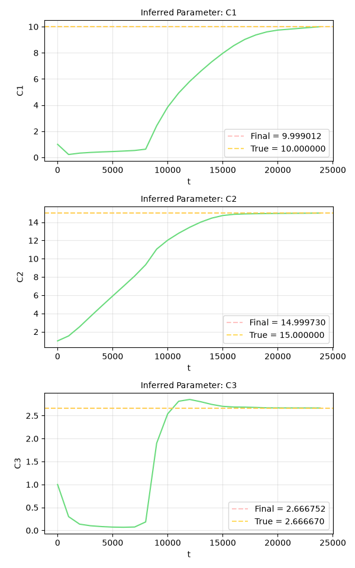

</details>

<details id="dx-inverse-lorenz-system-with-exogenous-input">
<summary><strong>Lorenz ODE – unknown C₁, C₂, C₃, exogenous input</strong></summary>

DeepXDE example: [`Lorenz_inverse_forced.py`](https://github.com/lululxvi/deepxde/blob/master/examples/pinn_inverse/Lorenz_inverse_forced.py) ([documentation](https://deepxde.readthedocs.io/en/latest/demos/pinn_inverse/Lorenz.inverse.forced.html))

$$\Large \frac{dy_1}{dt} = C_1(y_2 - y_1), \qquad \frac{dy_2}{dt} = y_1(C_2 - y_3) - y_2, \qquad \frac{dy_3}{dt} = y_1y_2 - C_3y_3 + 10\sin(2\pi t)$$

- **Problem dimension:** ODE (t), $t \in [0, 3]$; initial conditions $y(0) = (-8, 7, 27)$
- **Exogenous input:** $f(t) = 10\sin(2\pi t)$, written straight into the equation
- **Unknowns:** $C_1, C_2, C_3$ (true $10, 15, 8/3$), all starting from 1
- **Data:** $y_1, y_2, y_3$ measured at 200 times, from SciPy's `solve_ivp`
- **Network:** FNN [2, 40, 40, 40, 3], tanh, Glorot uniform
- **Training:** Adam 60,000; 400 domain, 2 boundary points
- **GUI recipe:** Quick Examples → Category **Inverse** → **Lorenz ODE – unknown C₁, C₂, C₃, exogenous input**

**Result (RTX 4090):** $C_1$ = 9.987, $C_2$ = 14.998, $C_3$ = 2.6669 (true 10, 15, 8/3); L2 = 7.3e-4 ($y_1$), 6.6e-4 ($y_2$), 2.9e-4 ($y_3$)

*y1 — PINN vs reference along a line*


*y3 — PINN vs reference along a line*


*y1 — inferred parameters during training*

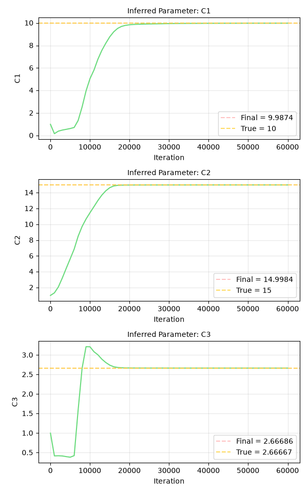

</details>

### 1D examples

*Click an example to expand it.*

<details id="dx-euler-beam">
<summary><strong>Euler beam 1D</strong></summary>

DeepXDE example: [`Euler_beam.py`](https://github.com/lululxvi/deepxde/blob/master/examples/pinn_forward/Euler_beam.py) ([documentation](https://deepxde.readthedocs.io/en/latest/demos/pinn_forward/eulerbeam.html))

$$\Large \frac{d^4u}{dx^4} = -1, \qquad x \in [0, 1]$$

- **Boundary conditions:** $u(0) = 0$, $u'(0) = 0$ (clamped); $u''(1) = 0$, $u'''(1) = 0$ (free) — the last two as Operator BCs
- **Exact solution:** $u = -\frac{x^4}{24} + \frac{x^3}{6} - \frac{x^2}{4}$
- **Network:** FNN [1, 20, 20, 20, 1], tanh, Glorot uniform
- **Training:** Adam 10,000; 10 domain, 2 boundary points
- **GUI recipe:** Quick Examples → Category **Forward** → **Euler beam 1D**

**Result (RTX 4090):** L2 = 8.4e-3

*PINN vs reference along a line*

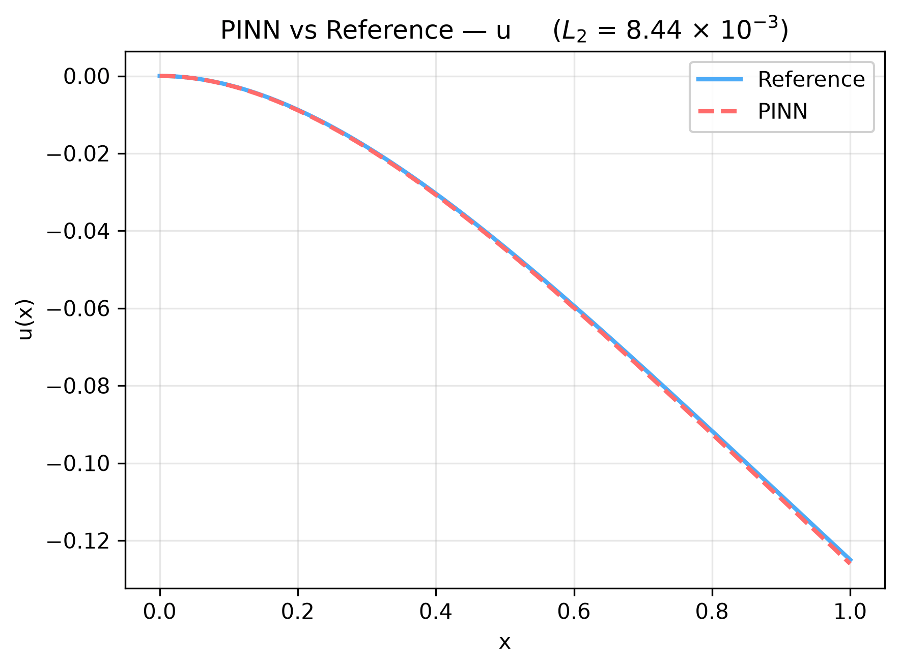

</details>

<details id="dx-fractional-poisson-equation-1d">
<summary><strong>Fractional Poisson 1D</strong></summary>

DeepXDE example: [`fractional_Poisson_1d.py`](https://github.com/lululxvi/deepxde/blob/master/examples/pinn_forward/fractional_Poisson_1d.py)

$$\Large D_{0+}^{\alpha}u + D_{1-}^{\alpha}u = f(x), \qquad x \in [0, 1],\ \alpha = 1.5$$

- **Equation in the panel:** `frac(u) - (...)`, with $f$ written out with `gamma(...)` as in DeepXDE's script; constant `alpha`
- **Fractional settings:** α `alpha`, resolution 101, static mesh (DeepXDE's FPDE, Grünwald-Letnikov)
- **Boundary conditions:** $u(0) = u(1) = 0$, imposed exactly by the output transform $\hat u = x(1-x)N$
- **Exact solution:** $u = x^3(1-x)^3$
- **Constants:** `alpha = 1.5`
- **Network:** FNN [1, 20, 20, 20, 20, 1], tanh, Glorot normal
- **Training:** Adam 10,000; 101 domain, 2 boundary points
- **GUI recipe:** Quick Examples → Category **Forward** → **Fractional Poisson 1D**

**Result (RTX 4090):** L2 = 3.7e-2

*PINN vs reference along a line*

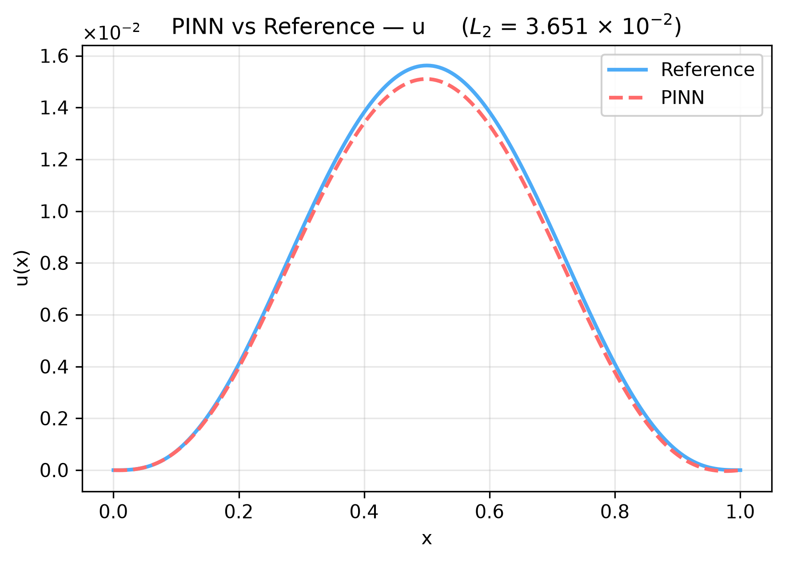

</details>

<details id="dx-poisson-1d-dirichlet">
<summary><strong>Poisson 1D – Dirichlet</strong></summary>

DeepXDE example: [`Poisson_Dirichlet_1d.py`](https://github.com/lululxvi/deepxde/blob/master/examples/pinn_forward/Poisson_Dirichlet_1d.py) ([documentation](https://deepxde.readthedocs.io/en/latest/demos/pinn_forward/poisson.1d.dirichlet.html))

$$\Large -\frac{d^2u}{dx^2} = \pi^2\sin(\pi x), \qquad x \in [-1, 1]$$

- **Boundary conditions:** Dirichlet, $u(\pm 1) = 0$ — in the panel: Where `True` (whole boundary), Value `0`
- **Exact solution:** $u = \sin(\pi x)$
- **Network:** FNN [1, 50, 50, 50, 1], tanh, Glorot uniform
- **Training:** Adam 10,000; 16 domain, 2 boundary points
- **GUI recipe:** Quick Examples → Category **Forward** → **Poisson 1D – Dirichlet**

**Result (RTX 4090):** L2 = 3.7e-4

*PINN vs reference along a line*


</details>

<details id="dx-poisson-1d-dirichlet-neumann">
<summary><strong>Poisson 1D – Dirichlet/Neumann</strong></summary>

DeepXDE example: [`Poisson_Neumann_1d.py`](https://github.com/lululxvi/deepxde/blob/master/examples/pinn_forward/Poisson_Neumann_1d.py) ([documentation](https://deepxde.readthedocs.io/en/latest/demos/pinn_forward/poisson.1d.neumanndirichlet.html))

$$\Large \frac{d^2u}{dx^2} = 2, \qquad x \in [-1, 1]$$

- **Boundary conditions:** Dirichlet $u(-1) = 0$ (Where `left`, Value `0`); Neumann $u'(1) = 4$ (Where `right`, Value `4` — at the right end the outward normal derivative is $du/dx$)
- **Exact solution:** $u = (x + 1)^2$
- **Network:** FNN [1, 50, 50, 50, 1], tanh, Glorot uniform
- **Training:** Adam 10,000; 16 domain, 2 boundary points
- **GUI recipe:** Quick Examples → Category **Forward** → **Poisson 1D – Dirichlet/Neumann**

**Result (RTX 4090):** L2 = 2.3e-4

*PINN vs reference along a line*


</details>

<details id="dx-poisson-1d-dirichlet-periodic">
<summary><strong>Poisson 1D – Dirichlet/Periodic</strong></summary>

DeepXDE example: [`Poisson_periodic_1d.py`](https://github.com/lululxvi/deepxde/blob/master/examples/pinn_forward/Poisson_periodic_1d.py) ([documentation](https://deepxde.readthedocs.io/en/latest/demos/pinn_forward/poisson.1d.dirichletperiodic.html))

$$\Large -\frac{d^2u}{dx^2} = \pi^2\sin(\pi x), \qquad x \in [-1, 1]$$

- **Boundary conditions:** Dirichlet $u(-1) = 0$ (Where `left`); periodic $u(-1) = u(1)$ (Where `right`)
- **Exact solution:** $u = \sin(\pi x)$
- **Network:** FNN [1, 50, 50, 50, 1], tanh, Glorot uniform
- **Training:** Adam 10,000; 16 domain, 2 boundary points
- **GUI recipe:** Quick Examples → Category **Forward** → **Poisson 1D – Dirichlet/Periodic**

**Result (RTX 4090):** L2 = 1.2e-2

*PINN vs reference along a line*

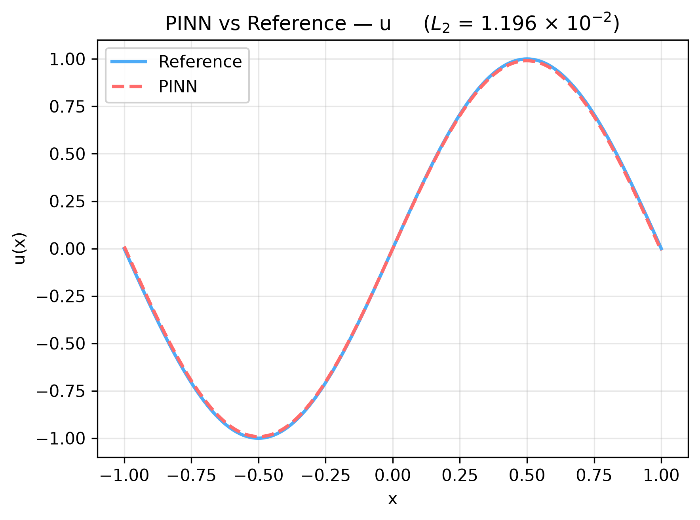

</details>

<details id="dx-poisson-1d-dirichlet-pointsetoperator">
<summary><strong>Poisson 1D – Dirichlet/point-set operator</strong></summary>

DeepXDE example: [`Poisson_PointSetOperator_1d.py`](https://github.com/lululxvi/deepxde/blob/master/examples/pinn_forward/Poisson_PointSetOperator_1d.py) ([documentation](https://deepxde.readthedocs.io/en/latest/demos/pinn_forward/poisson.1d.pointsetoperator.html))

$$\Large \frac{d^2u}{dx^2} = 2, \qquad x \in [-1, 1]$$

- **Boundary conditions:** Dirichlet $u(-1) = 0$ (Where `left`); point-set operator condition $u'(1) = 4$ — a Point Set Operator row with the point typed in (Points `1`, Function `du_x`, Target value `4`; no file)
- **Exact solution:** $u = (x + 1)^2$
- **Network:** FNN [1, 50, 50, 50, 1], tanh, Glorot uniform
- **Training:** Adam 20,000; 16 domain, 2 boundary points
- **GUI recipe:** Quick Examples → Category **Forward** → **Poisson 1D – Dirichlet/point-set operator**

**Result (RTX 4090):** L2 = 2.6e-5

*PINN vs reference along a line*


</details>

<details id="dx-poisson-1d-dirichlet-robin">
<summary><strong>Poisson 1D – Dirichlet/Robin</strong></summary>

DeepXDE example: [`Poisson_Robin_1d.py`](https://github.com/lululxvi/deepxde/blob/master/examples/pinn_forward/Poisson_Robin_1d.py) ([documentation](https://deepxde.readthedocs.io/en/latest/demos/pinn_forward/poisson.1d.dirichletrobin.html))

$$\Large \frac{d^2u}{dx^2} = 2, \qquad x \in [-1, 1]$$

- **Boundary conditions:** Dirichlet $u(-1) = 0$ (Where `left`); Robin $u'(1) = u(1)$ (Where `right`, Value `u`)
- **Exact solution:** $u = (x + 1)^2$
- **Network:** FNN [1, 50, 50, 50, 1], tanh, Glorot uniform
- **Training:** Adam 10,000; 16 domain, 2 boundary points
- **GUI recipe:** Quick Examples → Category **Forward** → **Poisson 1D – Dirichlet/Robin**

**Result (RTX 4090):** L2 = 2.4e-4

*PINN vs reference along a line*


</details>

<details id="dx-poisson-1d-hard-boundary-conditions">
<summary><strong>Poisson 1D – hard BCs</strong></summary>

DeepXDE example: [`Poisson_Dirichlet_1d_exactBC.py`](https://github.com/lululxvi/deepxde/blob/master/examples/pinn_forward/Poisson_Dirichlet_1d_exactBC.py)

$$\Large -\frac{d^2u}{dx^2} = \sum_{k=1}^{4} k\sin(kx) + 8\sin(8x), \qquad x \in [0, \pi]$$

- **Boundary conditions:** $u(0) = 0$, $u(\pi) = \pi$, imposed exactly by the output transform $\hat u = x(\pi - x)\,N(x) + x$
- **Exact solution:** $u = x + \sum_{k=1}^{4}\frac{\sin(kx)}{k} + \frac{\sin(8x)}{8}$
- **Learning rate:** inverse-time decay, $10^{-4}/(1 + 0.3\,n/1000)$ at iteration $n$
- **Network:** FNN [1, 50, 50, 50, 1], tanh, Glorot uniform
- **Training:** Adam 30,000; 64 domain points
- **GUI recipe:** Quick Examples → Category **Forward** → **Poisson 1D – hard BCs**

**Result (RTX 4090):** L2 = 2.2e-6

*PINN vs reference along a line*


</details>

<details id="dx-poisson-1d-multi-scale-fourier-features">
<summary><strong>Poisson 1D – multi-scale Fourier features</strong></summary>

DeepXDE example: [`Poisson_multiscale_1d.py`](https://github.com/lululxvi/deepxde/blob/master/examples/pinn_forward/Poisson_multiscale_1d.py)

$$\Large \frac{d^2u}{dx^2} = -(\pi A)^2\sin(\pi A x) - 0.1(\pi B)^2\sin(\pi B x), \qquad x \in [0, 1],\ A = 2,\ B = 50$$

- **Boundary conditions:** $u(0) = u(1) = 0$
- **Exact solution:** $u = \sin(2\pi x) + 0.1\sin(50\pi x)$ — a slow wave plus a fast, small one
- **Network:** a multi-scale Fourier feature network (MsFFN): the input goes through random Fourier features with scales $\sigma = 1$ and $10$, each through the same hidden layers, then combined
- **Points:** 1,280 pseudo-random collocation points, redrawn every iteration; learning rate $10^{-3}/(1 + 0.9\,n/2000)$
- **Constants:** `A = 2`, `B = 50`
- **Network:** MsFFN [1, 100, 100, 100, 1], Fourier scales σ = 1, 10, tanh, Glorot uniform
- **Training:** Adam 20,000; 1,280 domain, 2 boundary points
- **GUI recipe:** Quick Examples → Category **Forward** → **Poisson 1D – multi-scale Fourier features**

A plain network of the same size learns the slow wave and largely misses the fast one; the Fourier features at scale 10 are what let the PINN represent the sin(50πx) part.

**Result (RTX 4090):** L2 = 3.9e-3

*PINN vs reference along a line*


</details>

<details id="dx-inverse-brinkman-forchheimer-model">
<summary><strong>Brinkman-Forchheimer 1D – unknown ν_e, K</strong></summary>

DeepXDE example: [`brinkman_forchheimer.py`](https://github.com/lululxvi/deepxde/blob/master/examples/pinn_inverse/brinkman_forchheimer.py)

$$\Large -\frac{\nu_e}{\epsilon}\frac{d^2u}{dx^2} + \frac{\nu u}{K} = g, \qquad x \in [0, 1],\ \epsilon = 0.4,\ \nu = 10^{-3},\ g = 1$$

- **Unknowns:** effective viscosity $\nu_e$ and permeability $K$ (both $10^{-3}$, initial guesses 0.1)
- **Data:** 5 measurements of $u$; $u = 0$ at both walls through the output transform $\hat u = x(1-x)N$
- **Exact solution:** $u = 1 - \cosh(20(x - 0.5))/\cosh(10)$
- **Constants:** `g = 1`, `v = 1e-3`, `e = 0.4`
- **Network:** FNN [1, 20, 20, 20, 1], tanh, Glorot uniform
- **Training:** Adam 30,000; 100 domain points
- **GUI recipe:** Quick Examples → Category **Inverse** → **Brinkman-Forchheimer 1D – unknown ν_e, K**

DeepXDE's own script, run unchanged twice on the same GPU, ends with $\nu_e$ = 1.31–1.35e-3, $K$ = 0.984e-3 and an L2 error of 0.018–0.020 for $u$ — the same picture: $K$ is recovered closely, $\nu_e$ only to within about 30–50% from five measurements.

**Result (RTX 4090):** $\nu_e$ = 1.49e-3, $K$ = 0.985e-3 (both true 1e-3); L2 of $u$ = 2.9e-2

*PINN vs reference along a line*

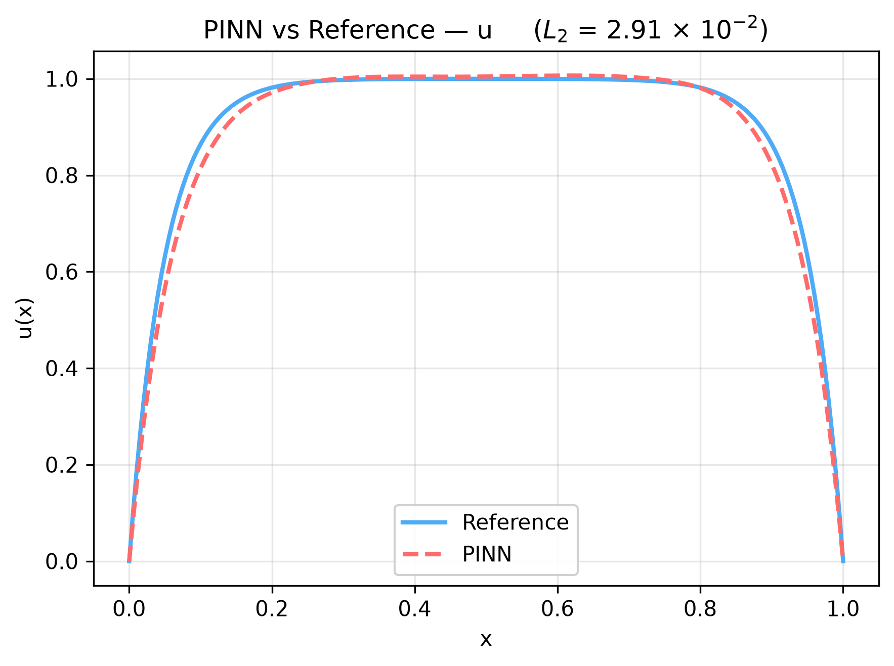

*Inferred parameters during training*

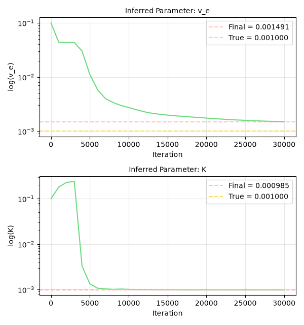

</details>

<details id="dx-inverse-diffusion-reaction-with-space-dependent-rate">
<summary><strong>Diffusion-reaction 1D – unknown rate field</strong></summary>

DeepXDE example: [`diffusion_reaction_rate.py`](https://github.com/lululxvi/deepxde/blob/master/examples/pinn_inverse/diffusion_reaction_rate.py)

$$\Large \lambda\frac{d^2u}{dx^2} - k(x)\,u = \sin(2\pi x), \qquad \lambda = 0.01,\ x \in [0, 1]$$

- **Unknown:** the reaction rate $k(x)$ (true $0.1 + e^{-0.5(x - 0.5)^2/0.15^2}$), learned as a second network output
- **Data:** 100 measurements of $u$ (computed with SciPy's `solve_bvp`, as DeepXDE does), $u = 0$ at both ends
- **Constants:** `l = 0.01`
- **Network:** PFNN, a separate [20, 20] subnetwork for each of the 2 outputs, tanh, Glorot uniform
- **Training:** Adam 20,000; 50 domain, 8 boundary points
- **GUI recipe:** Quick Examples → Category **Inverse** → **Diffusion-reaction 1D – unknown rate field**

**Result (RTX 4090):** L2 = 4.0e-2 ($k$)

*u — PINN vs reference along a line*

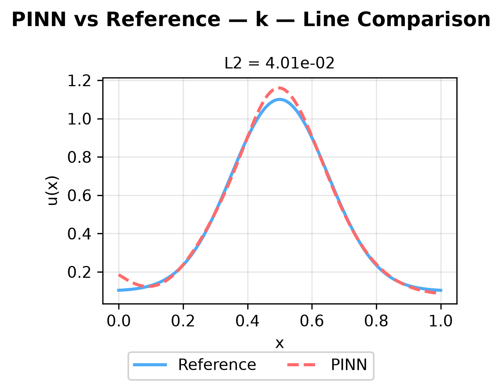

*u — PINN solution*

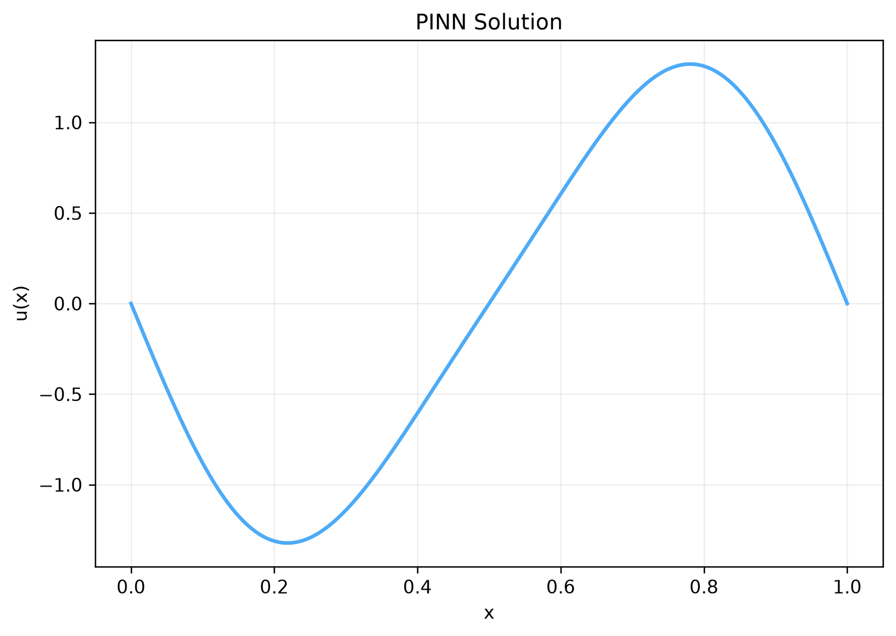

</details>

<details id="dx-inverse-fractional-poisson-equation-1d">
<summary><strong>Fractional Poisson 1D – unknown order α</strong></summary>

DeepXDE example: [`fractional_Poisson_1d_inverse.py`](https://github.com/lululxvi/deepxde/blob/master/examples/pinn_inverse/fractional_Poisson_1d_inverse.py)

$$\Large \frac{D_{-1+}^{\alpha}u + D_{1-}^{\alpha}u}{2\cos(\alpha\pi/2)} = \Gamma(\alpha_0 + 2)\,x, \qquad x \in [-1, 1]$$

- **Unknown:** the order $\alpha$ (true $\alpha_0 = 1.8$, start 1.5) — an inverse variable named `alpha`, also the fractional α
- **Data:** 20 measurements of $u = x(1 - x^2)^{\alpha_0/2}$, loss weight 100
- **Fractional settings:** 100 points per unit length, dynamic mesh (rebuilt every step as α changes)
- **Constants:** `a0 = 1.8`
- **Network:** FNN [1, 20, 20, 20, 20, 1], tanh, Glorot normal
- **Training:** Adam 10,000; 20 domain points
- **GUI recipe:** Quick Examples → Category **Inverse** → **Fractional Poisson 1D – unknown order α**

**Result (RTX 4090):** $\alpha$ = 1.792 (true 1.8); L2 of $u$ = 1.3e-2

*PINN vs reference along a line*


*Inferred parameters during training*

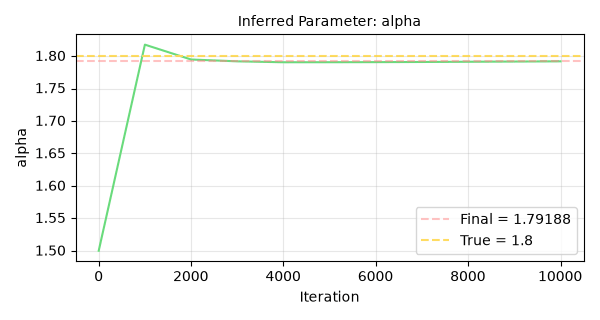

</details>

<details id="dx-inverse-poisson-with-unknown-forcing-field">
<summary><strong>Poisson 1D – unknown forcing field</strong></summary>

DeepXDE example: [`elliptic_inverse_field.py`](https://github.com/lululxvi/deepxde/blob/master/examples/pinn_inverse/elliptic_inverse_field.py) ([documentation](https://deepxde.readthedocs.io/en/latest/demos/pinn_inverse/elliptic.inverse.field.html))

$$\Large -\frac{d^2u}{dx^2} + q(x) = 0, \qquad x \in [-1, 1]$$

- **Unknown:** the field $q(x)$ (true $-\pi^2\sin(\pi x)$), learned as a second network output
- **Data:** 100 measurements of $u$, given as a Point Set BC (and as anchor points); $u = \sin(\pi x)$ on the boundary
- **Mode:** Forward — there are no unknown constants, only an unknown field, as in DeepXDE
- **Network:** PFNN, a separate [20, 20, 20] subnetwork for each of the 2 outputs, tanh, Glorot uniform
- **Training:** Adam 20,000; 200 domain, 2 boundary points
- **GUI recipe:** Quick Examples → Category **Inverse** → **Poisson 1D – unknown forcing field**

**Result (RTX 4090):** L2 = 8.3e-4 ($u$), 4.3e-2 ($q$)

*u — PINN vs reference along a line*

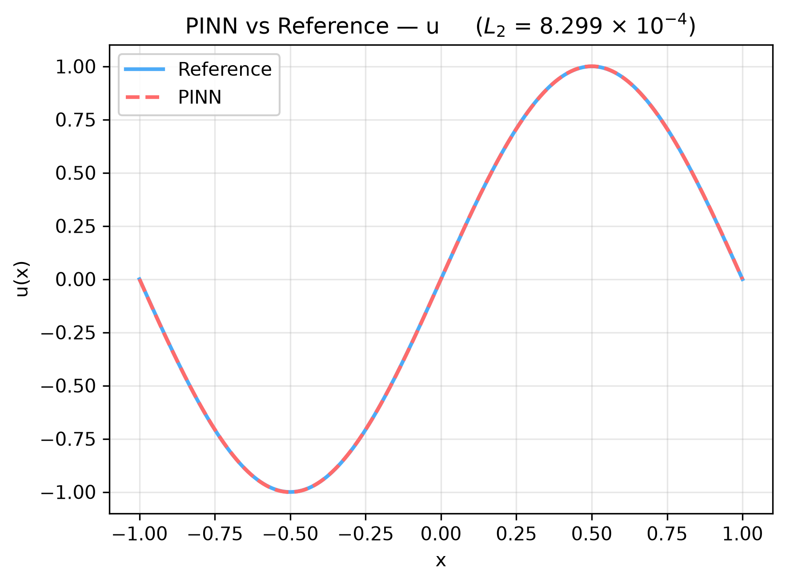

*q — PINN vs reference along a line*

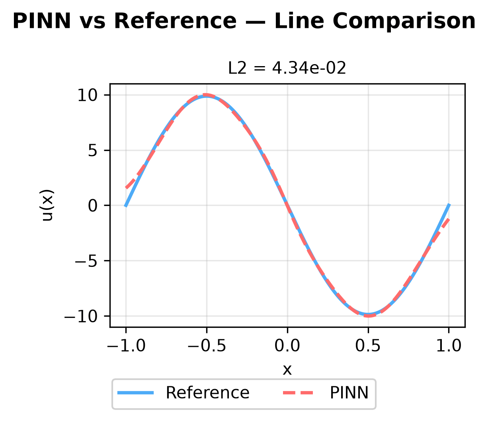

</details>

<details id="dx-inverse-poisson-with-unknown-forcing-field-batches">
<summary><strong>Poisson 1D – unknown forcing field (batches)</strong></summary>

DeepXDE example: [`elliptic_inverse_field_batch.py`](https://github.com/lululxvi/deepxde/blob/master/examples/pinn_inverse/elliptic_inverse_field_batch.py)

$$\Large -\frac{d^2u}{dx^2} + q(x) = 0, \qquad x \in [-1, 1]$$

- **Unknown:** the field $q(x)$ (true $-\pi^2\sin(\pi x)$)
- **Data:** 10,000 measurements of $u$, used 100 at a time (Point Set BC with batch size 100, redrawn every iteration)
- **Network:** PFNN, a separate [20, 20, 20] subnetwork for each of the 2 outputs, tanh, Glorot uniform
- **Training:** Adam 20,000; 200 domain, 2 boundary points
- **GUI recipe:** Quick Examples → Category **Inverse** → **Poisson 1D – unknown forcing field (batches)**

**Result (RTX 4090):** L2 = 7.6e-3 ($u$), 0.13 ($q$)

*q — PINN vs reference along a line*

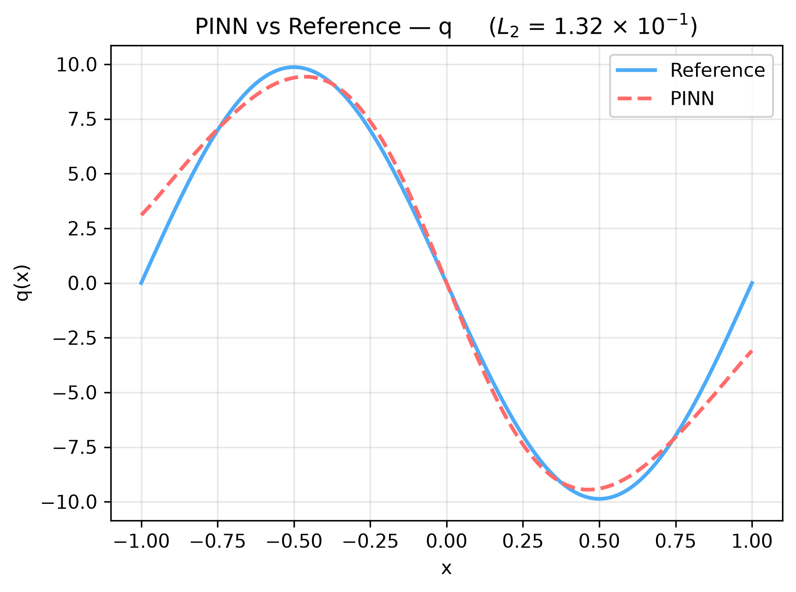

</details>

<details id="dx-allen-cahn-equation">
<summary><strong>Allen-Cahn 1D</strong></summary>

DeepXDE example: [`Allen_Cahn.py`](https://github.com/lululxvi/deepxde/blob/master/examples/pinn_forward/Allen_Cahn.py) ([documentation](https://deepxde.readthedocs.io/en/latest/demos/pinn_forward/allen.cahn.html))

$$\Large \frac{\partial u}{\partial t} = 0.001\frac{\partial^2 u}{\partial x^2} + 5(u - u^3), \qquad x \in [-1, 1],\ t \in [0, 1]$$

- **Initial and boundary conditions:** $u(x, 0) = x^2\cos(\pi x)$ and $u(\pm 1, t) = -1$, imposed exactly by $\hat u = x^2\cos(\pi x) + t(1 - x^2)N$
- **Reference:** computed by `tools/make_deepxde_reference_data.py` (agrees with DeepXDE's `Allen_Cahn.mat` to $5\times 10^{-4}$)
- **Constants:** `d = 0.001`
- **Network:** FNN [2, 20, 20, 20, 1], tanh, Glorot normal
- **Training:** Adam 40,000 → L-BFGS 15,000; 8,000 domain, 400 boundary points
- **GUI recipe:** Quick Examples → Category **Forward** → **Allen-Cahn 1D**

**Result (RTX 4090):** L2 = 9.5e-8 ($t = 0$), 1.9e-3 ($t = 0.25$), 5.2e-3 ($t = 0.5$), 1.3e-2 ($t = 0.75$), 2.9e-2 ($t = 1$)

*u — PINN solution over time*

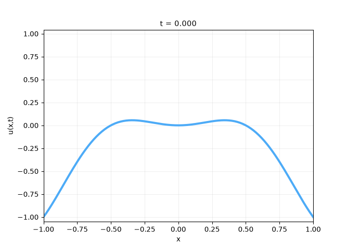

*PINN vs reference, error analysis*

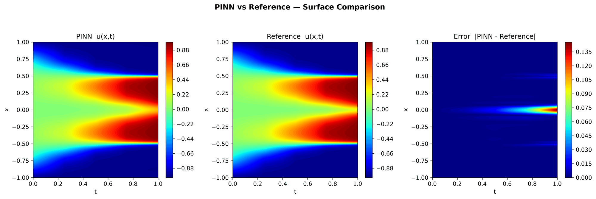

</details>

<details id="1d-allen-cahn">
<summary><strong>Allen-Cahn 1D – Wight & Zhao</strong></summary>

Benchmark problem after Wight & Zhao (2021) — see [References](#references).

$$\Large \frac{\partial u}{\partial t} = \gamma_1\frac{\partial^2 u}{\partial x^2} - \gamma_2 u^3 + \gamma_2 u, \qquad x \in [-1, 1],\ t \in [0, 1]$$

where $\gamma_1 = 0.0001$ and $\gamma_2 = 5$.

- **Initial condition:** $u(x, 0) = x^2\cos(\pi x)$
- **Boundary conditions:** Periodic
- **Geometry:** Interval
- **Time-Adaptive default:** on — $t \in [0,1]$ split into 4 steps of 0.25, L-BFGS transfer learning between steps
- **GUI recipe:** Quick Examples → Category **Forward** (or **Inverse**) → **Allen-Cahn 1D – Wight & Zhao**


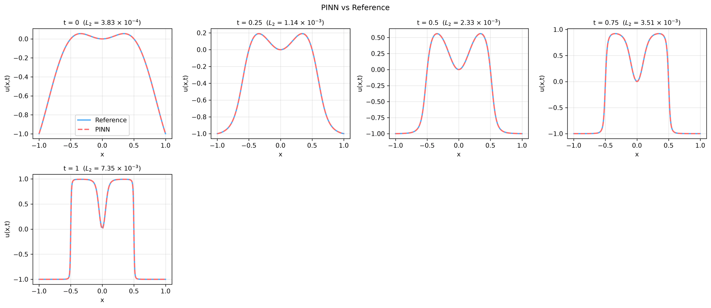

*Inverse mode* — same template, switched to **Inverse**, jointly recovering both $\gamma_1$ (diffusion) and $\gamma_2$ (reaction) as unknown parameters; the live convergence animation below shows each estimate settling onto its true value during training:


</details>

<details id="dx-american-put-option">
<summary><strong>Black-Scholes 1D – American put</strong></summary>

DeepXDE example: [`american_put.py`](https://github.com/lululxvi/deepxde/blob/master/examples/pinn_forward/american_put.py)

$$\Large \min\left(-\mathcal{L}V,\ V - \max(K - S, 0)\right) = 0, \qquad \mathcal{L}V = -\frac{\partial V}{\partial \tau} + \frac{\sigma^2}{2}S^2\frac{\partial^2 V}{\partial S^2} + rS\frac{\partial V}{\partial S} - rV$$

- **Domain:** $S \in [0, 4]$, $\tau \in [0, 1]$; strike $K = 1$, $r = 0.05$, $\sigma = 0.2$
- **Equations:** three residuals for one output (DeepXDE's Fischer-Burmeister form of the complementarity problem)
- **Extra points:** 1000 anchors in $S \in [0.5, 1.5]$ around the exercise boundary; point resampling every 1000 iterations
- **Reference:** none bundled (DeepXDE compares against a binomial-tree price) — add your own in Error Analysis
- **Constants:** `r = 0.05`, `sigma = 0.2`, `K = 1`
- **Network:** FNN [2, 128, 128, 128, 128, 1], tanh, Glorot normal
- **Training:** Adam 12,000 → L-BFGS 15,000; 6,000 domain, 1,500 boundary, 1,500 initial points
- **GUI recipe:** Quick Examples → Category **Forward** → **Black-Scholes 1D – American put**

**Result (RTX 4090):** trained without errors; no bundled reference to compare against

*u — PINN solution over time*

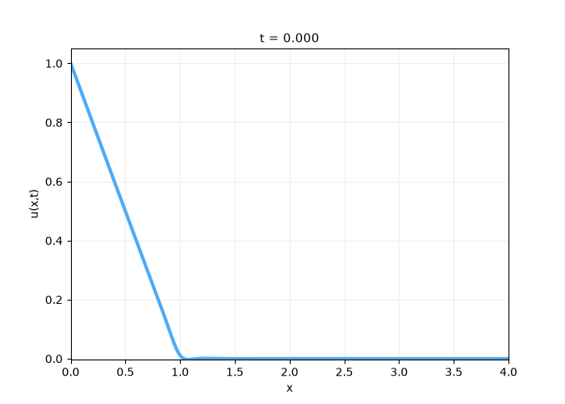

</details>

<details id="dx-black-scholes-equation-call-option">
<summary><strong>Black-Scholes 1D – European call</strong></summary>

DeepXDE example: [`black_scholes_call.py`](https://github.com/lululxvi/deepxde/blob/master/examples/pinn_forward/black_scholes_call.py) ([documentation](https://deepxde.readthedocs.io/en/latest/demos/pinn_forward/black_scholes.html))

$$\Large \frac{\partial V}{\partial \tau} = \frac{\sigma^2}{2}S^2\frac{\partial^2 V}{\partial S^2} + rS\frac{\partial V}{\partial S} - rV, \qquad S \in [0, 150],\ \tau \in [0, 1]$$

- **Parameters:** strike $K = 50$, rate $r = 0.05$, volatility $\sigma = 0.2$; $x$ is the stock price $S$ and $t$ the time to maturity $\tau$
- **Initial condition:** payoff $V(S, 0) = \max(S - K, 0)$; **boundary conditions:** $V(0, \tau) = 0$, $V(150, \tau) = 150 - Ke^{-r\tau}$
- **Exact solution:** the Black-Scholes formula (uses `norm_cdf` in the reference formula)
- **Constants:** `K = 50`, `r = 0.05`, `sigma = 0.2`
- **Network:** FNN [2, 28, 28, 28, 28, 1], tanh, Glorot normal
- **Training:** Adam 20,000 → L-BFGS 15,000; 2,047 domain, 63 boundary, 127 initial points
- **GUI recipe:** Quick Examples → Category **Forward** → **Black-Scholes 1D – European call**

**Result (RTX 4090):** L2 = 5.7e-4 ($t = 0.25$), 3.2e-4 ($t = 0.5$), 4.3e-4 ($t = 1$)

*u — PINN solution over time*

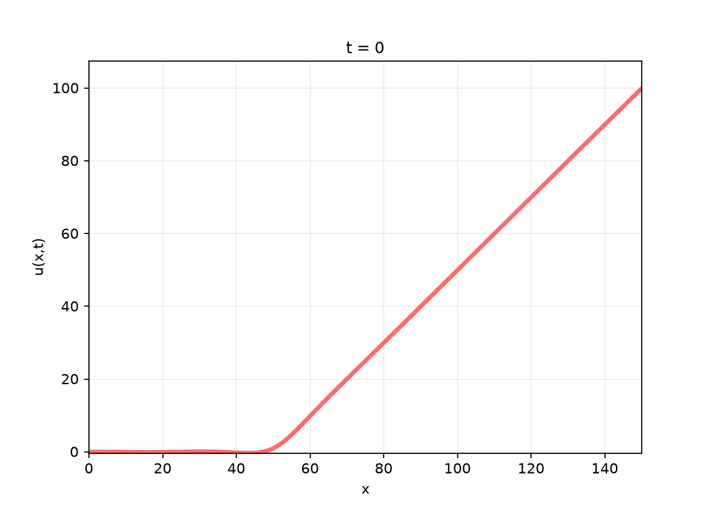

*PINN vs reference, error analysis*


</details>

<details id="dx-burgers-equation">
<summary><strong>Burgers 1D</strong></summary>

DeepXDE example: [`Burgers.py`](https://github.com/lululxvi/deepxde/blob/master/examples/pinn_forward/Burgers.py) ([documentation](https://deepxde.readthedocs.io/en/latest/demos/pinn_forward/burgers.html))

$$\Large \frac{\partial u}{\partial t} + u\frac{\partial u}{\partial x} = \frac{0.01}{\pi}\frac{\partial^2 u}{\partial x^2}, \qquad x \in [-1, 1],\ t \in [0, 1]$$

- **Initial condition:** $u(x, 0) = -\sin(\pi x)$
- **Boundary conditions:** Dirichlet, $u(\pm 1, t) = 0$
- **Time range:** $t \in [0, 1]$ (DeepXDE's script stops at $t = 0.99$, where its reference data ends)
- **Reference:** the exact (Cole–Hopf) solution at $t = 0, 0.25, 0.5, 0.75, 1$, from PINNStudio's [`reference_data/1D/burgers`](reference_data/1D/burgers) (made by [`tools/make_exact_reference_data.py`](tools/make_exact_reference_data.py))
- **Network:** FNN [2, 20, 20, 20, 1], tanh, Glorot normal
- **Training:** Adam 15,000 → L-BFGS 15,000; 2,540 domain, 80 boundary, 160 initial points
- **GUI recipe:** Quick Examples → Category **Forward** → **Burgers 1D**

**Result (RTX 4090):** L2 = 8.3e-4 ($t = 0$), 1.4e-2 ($t = 0.25$), 1.7e-2 ($t = 0.5$), 1.4e-2 ($t = 0.75$)

*u — PINN solution over time*

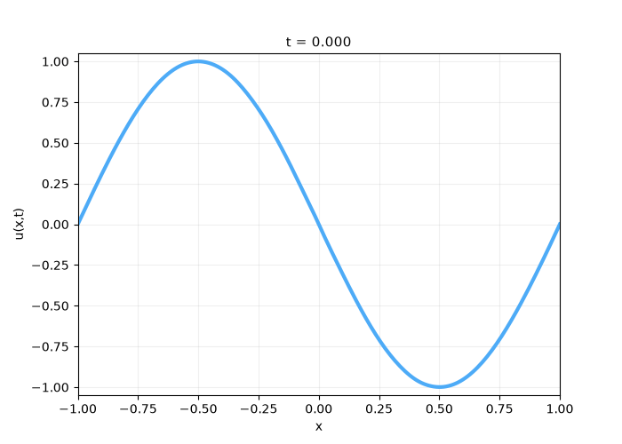

*PINN vs reference, error analysis*

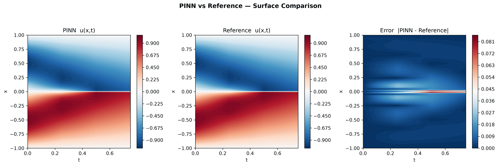

</details>

<details id="1d-burgers">
<summary><strong>Burgers 1D – Raissi et al.</strong></summary>

Exact equation, initial and boundary conditions as in Raissi, Perdikaris & Karniadakis (2019) — see [References](#references).

$$\Large \frac{\partial u}{\partial t} + u\frac{\partial u}{\partial x} = \frac{0.01}{\pi}\frac{\partial^2 u}{\partial x^2}, \qquad x \in [-1, 1],\ t \in [0, 1]$$

- **Initial condition:** $u(x, 0) = -\sin(\pi x)$
- **Boundary conditions:** Dirichlet, $u = 0$ at both ends
- **Geometry:** Interval
- **GUI recipe:** Quick Examples → Category **Forward** (or **Inverse**) → **Burgers 1D – Raissi et al.**

A shock forms near $x = 0$ as $t \to 1$; this template uses a larger fixed collocation count to resolve it rather than adaptive refinement.

**Result (RTX 4090):** $L_2$ = 1.0e-4 ($t = 0$), 4.8e-4 ($t = 0.25$), 7.1e-4 ($t = 0.5$), 9.6e-4 ($t = 0.75$), 7.7e-4 ($t = 1$), against the exact (Cole–Hopf) solution in [`reference_data/1D/burgers`](reference_data/1D/burgers). Inverse mode: $\lambda_1$ = 0.992 (true 1), $\lambda_2$ = 0.01001 (true 0.01; the template writes the viscous term as $\frac{\lambda_2}{\pi}\frac{\partial^2 u}{\partial x^2}$, so $\lambda_2 = 0.01$ is the paper's $0.01/\pi$).

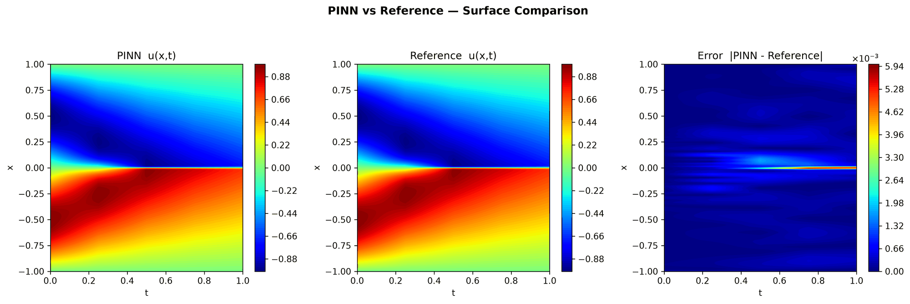

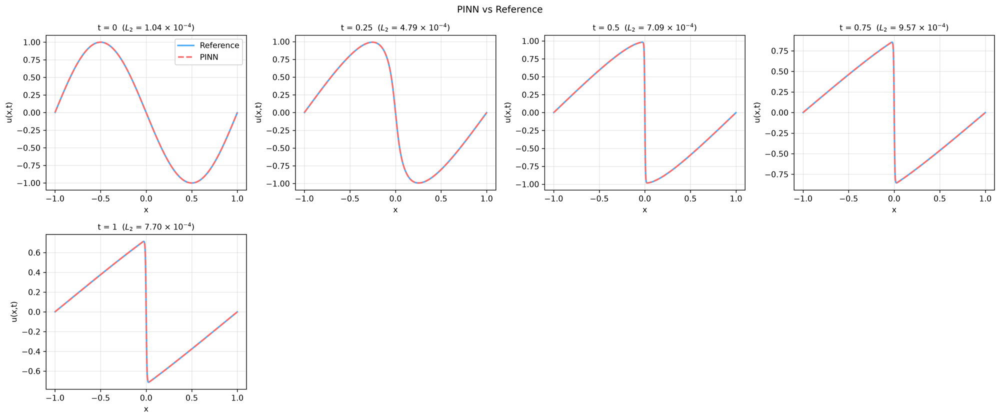

*Restore & Visualize* — the trained model restored from its saved checkpoint and re-animated without retraining:

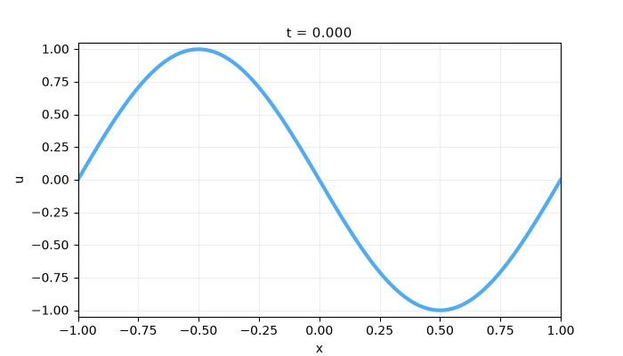

*Inverse mode* — same template, switched to **Inverse**, jointly recovering both coefficients of Raissi, Perdikaris & Karniadakis (2019)'s data-driven-discovery form of this equation, Appendix B, eq. B.1 — see [References](#references):

$$\Large \frac{\partial u}{\partial t} + \lambda_1 u\frac{\partial u}{\partial x} - \lambda_2\frac{\partial^2 u}{\partial x^2} = 0$$

with true values $\lambda_1 = 1.0$ and $\lambda_2 = 0.01/\pi$. $\lambda_1$'s initial guess starts at $0.1$ rather than $1.0$, since $1.0$ is already its true value. The live convergence animation below shows both estimates settling onto their true values during training:

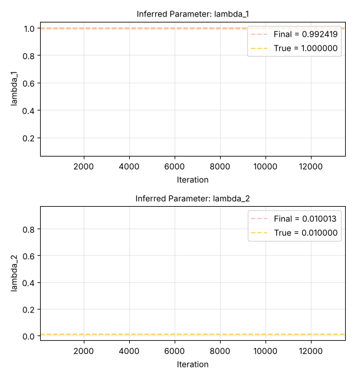

</details>

<details id="dx-burgers-equation-with-rar">
<summary><strong>Burgers 1D – RAR</strong></summary>

DeepXDE example: [`Burgers_RAR.py`](https://github.com/lululxvi/deepxde/blob/master/examples/pinn_forward/Burgers_RAR.py) ([documentation](https://deepxde.readthedocs.io/en/latest/demos/pinn_forward/burgers.rar.html))

$$\Large \frac{\partial u}{\partial t} + u\frac{\partial u}{\partial x} = \frac{0.01}{\pi}\frac{\partial^2 u}{\partial x^2}, \qquad x \in [-1, 1],\ t \in [0, 1]$$

- **Initial / boundary conditions:** $u(x, 0) = -\sin(\pi x)$, $u(\pm 1, t) = 0$
- **Time range / reference:** $t \in [0, 1]$, compared with the exact solution at $t = 0, 0.25, 0.5, 0.75, 1$
- **Residual-based adaptive refinement:** each round adds the 1 point with the largest residual (out of 100,000 candidates) and retrains, until the mean residual is below 0.005
- **Network:** FNN [2, 20, 20, 20, 1], tanh, Glorot normal
- **Training:** Adam 10,000 → L-BFGS 15,000 per RAR round; 2,500 domain, 100 boundary, 160 initial points
- **GUI recipe:** Quick Examples → Category **Forward** → **Burgers 1D – RAR**

**Result (RTX 4090):** L2 = 4.9e-4 ($t = 0$), 6.0e-4 ($t = 0.25$), 7.2e-3 ($t = 0.5$), 8.9e-3 ($t = 0.75$), 1.2e-2 ($t = 1$)

*u — PINN solution over time*

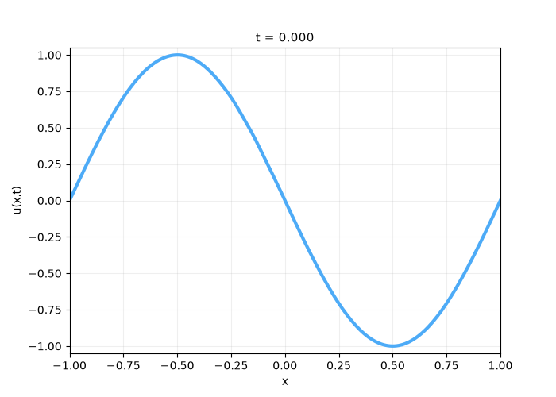

*PINN vs reference, error analysis*


</details>

<details id="dx-diffusion-equation">
<summary><strong>Diffusion 1D</strong></summary>

DeepXDE example: [`diffusion_1d.py`](https://github.com/lululxvi/deepxde/blob/master/examples/pinn_forward/diffusion_1d.py) ([documentation](https://deepxde.readthedocs.io/en/latest/demos/pinn_forward/diffusion.1d.html))

$$\Large \frac{\partial u}{\partial t} = \frac{\partial^2 u}{\partial x^2} - e^{-t}\left(\sin(\pi x) - \pi^2\sin(\pi x)\right), \qquad x \in [-1, 1],\ t \in [0, 1]$$

- **Initial condition:** $u(x, 0) = \sin(\pi x)$; **boundary condition:** $u = e^{-t}\sin(\pi x)$
- **Exact solution:** $u = e^{-t}\sin(\pi x)$
- **Network:** FNN [2, 32, 32, 32, 1], tanh, Glorot uniform
- **Training:** Adam 10,000; 40 domain, 20 boundary, 10 initial points
- **GUI recipe:** Quick Examples → Category **Forward** → **Diffusion 1D**

**Result (RTX 4090):** L2 = 4.8e-3 ($t = 0$), 9.0e-3 ($t = 0.25$), 6.4e-3 ($t = 0.5$), 5.8e-3 ($t = 0.75$), 3.0e-2 ($t = 1$)

*u — PINN solution over time*


*PINN vs reference, error analysis*

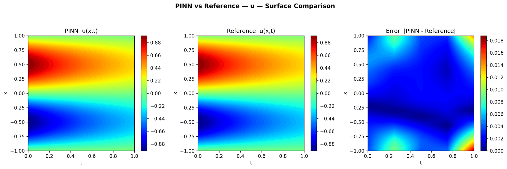

</details>

<details id="dx-diffusion-equation-with-hard-ic-and-bc">
<summary><strong>Diffusion 1D – hard IC and BCs</strong></summary>

DeepXDE example: [`diffusion_1d_exactBC.py`](https://github.com/lululxvi/deepxde/blob/master/examples/pinn_forward/diffusion_1d_exactBC.py) ([documentation](https://deepxde.readthedocs.io/en/latest/demos/pinn_forward/diffusion.1d.exactBC.html))

$$\Large \frac{\partial u}{\partial t} = \frac{\partial^2 u}{\partial x^2} - e^{-t}\left(\sin(\pi x) - \pi^2\sin(\pi x)\right), \qquad x \in [-1, 1],\ t \in [0, 1]$$

- **Initial and boundary conditions:** imposed exactly by $\hat u = t(1 - x^2)N + \sin(\pi x)$ — no IC/BC loss terms
- **Exact solution:** $u = e^{-t}\sin(\pi x)$
- **Network:** FNN [2, 32, 32, 32, 1], tanh, Glorot uniform
- **Training:** Adam 10,000; 40 domain points
- **GUI recipe:** Quick Examples → Category **Forward** → **Diffusion 1D – hard IC and BCs**

**Result (RTX 4090):** L2 = 9.4e-8 ($t = 0$), 1.6e-4 ($t = 0.25$), 4.6e-4 ($t = 0.5$), 1.3e-3 ($t = 0.75$), 2.8e-3 ($t = 1$)

*u — PINN solution over time*

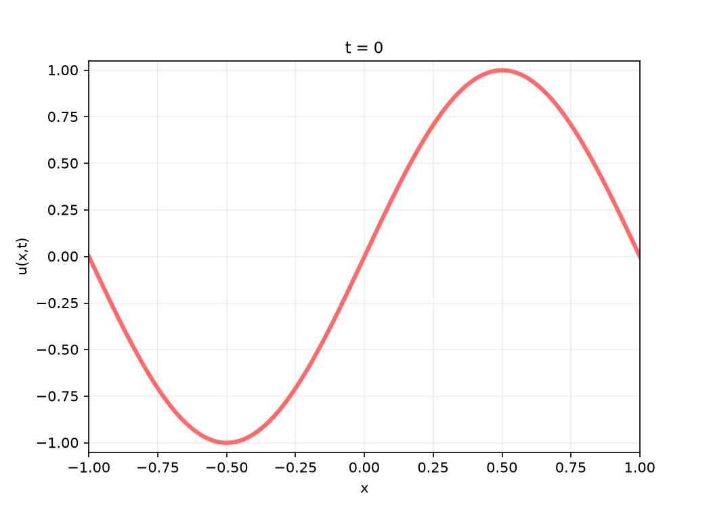

*PINN vs reference, error analysis*


</details>

<details id="dx-diffusion-equation-with-resampling">
<summary><strong>Diffusion 1D – resampling</strong></summary>

DeepXDE example: [`diffusion_1d_resample.py`](https://github.com/lululxvi/deepxde/blob/master/examples/pinn_forward/diffusion_1d_resample.py) ([documentation](https://deepxde.readthedocs.io/en/latest/demos/pinn_forward/diffusion.1d.resample.html))

$$\Large \frac{\partial u}{\partial t} = \frac{\partial^2 u}{\partial x^2} - e^{-t}\left(\sin(\pi x) - \pi^2\sin(\pi x)\right), \qquad x \in [-1, 1],\ t \in [0, 1]$$

- **Initial / boundary conditions:** $u(x, 0) = \sin(\pi x)$, $u = e^{-t}\sin(\pi x)$ on the boundary
- **Point resampling:** pseudo-random collocation points redrawn every 100 iterations
- **Exact solution:** $u = e^{-t}\sin(\pi x)$
- **Network:** FNN [2, 32, 32, 32, 1], tanh, Glorot uniform
- **Training:** Adam 2,000; 40 domain, 20 boundary, 10 initial points
- **GUI recipe:** Quick Examples → Category **Forward** → **Diffusion 1D – resampling**

**Result (RTX 4090):** L2 = 1.8e-2 ($t = 0$), 2.5e-2 ($t = 0.25$), 1.5e-2 ($t = 0.5$), 1.4e-2 ($t = 0.75$), 4.3e-2 ($t = 1$)

*u — PINN solution over time*

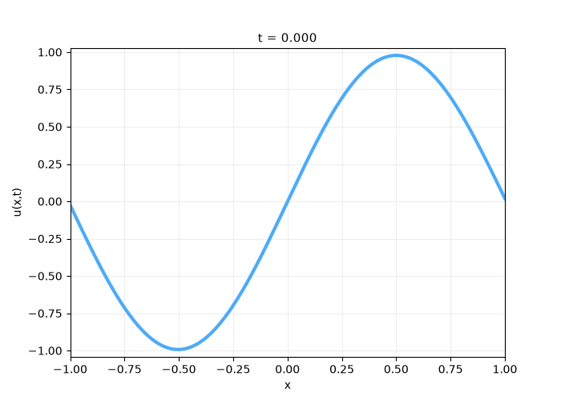

*PINN vs reference, error analysis*

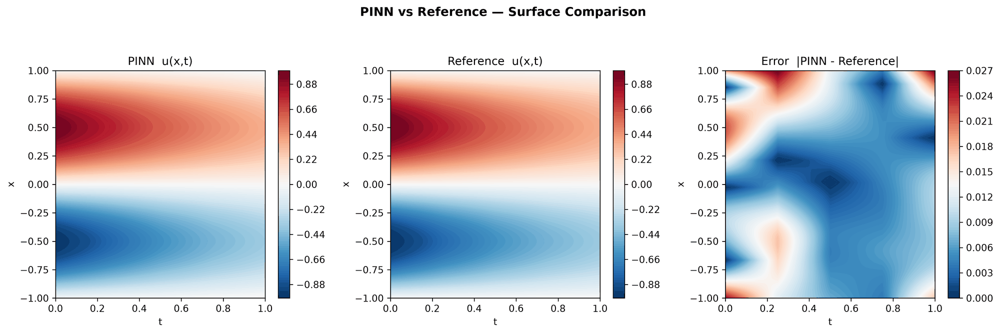

</details>

<details id="dx-diffusion-reaction-equation">
<summary><strong>Diffusion-reaction 1D</strong></summary>

DeepXDE example: [`diffusion_reaction.py`](https://github.com/lululxvi/deepxde/blob/master/examples/pinn_forward/diffusion_reaction.py) ([documentation](https://deepxde.readthedocs.io/en/latest/demos/pinn_forward/diffusion.reaction.html))

$$\Large \frac{\partial u}{\partial t} = \frac{\partial^2 u}{\partial x^2} + e^{-t}\left(\tfrac{3}{2}\sin 2x + \tfrac{8}{3}\sin 3x + \tfrac{15}{4}\sin 4x + \tfrac{63}{8}\sin 8x\right), \qquad x \in [-\pi, \pi],\ t \in [0, 1]$$

- **Initial and boundary conditions:** imposed exactly by $\hat u = t(\pi^2 - x^2)N + \sum_k \frac{\sin(kx)}{k}$
- **Exact solution:** $u = e^{-t}\left(\sin x + \tfrac{\sin 2x}{2} + \tfrac{\sin 3x}{3} + \tfrac{\sin 4x}{4} + \tfrac{\sin 8x}{8}\right)$
- **Network:** FNN [2, 30, 30, 30, 30, 30, 30, 1], tanh, Glorot uniform
- **Training:** Adam 20,000; 320 domain points
- **GUI recipe:** Quick Examples → Category **Forward** → **Diffusion-reaction 1D**

DeepXDE's own script, run unchanged on the same GPU, ends with a similar loss (and the same Adam loss spikes near the end of training).

**Result (RTX 4090):** L2 = 9.9e-8 ($t = 0$), 1.4e-2 ($t = 0.25$), 3.4e-2 ($t = 0.5$), 6.7e-2 ($t = 0.75$), 0.11 ($t = 1$)

*u — PINN solution over time*

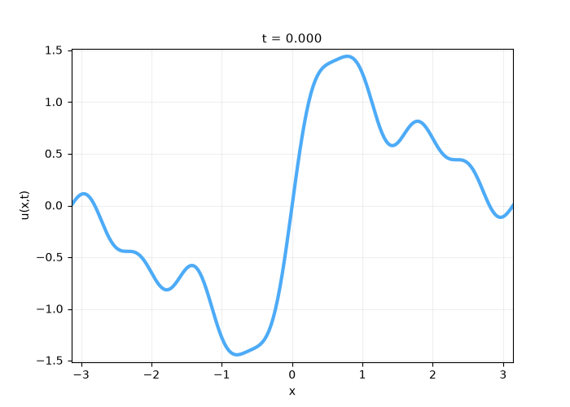

*PINN vs reference, error analysis*

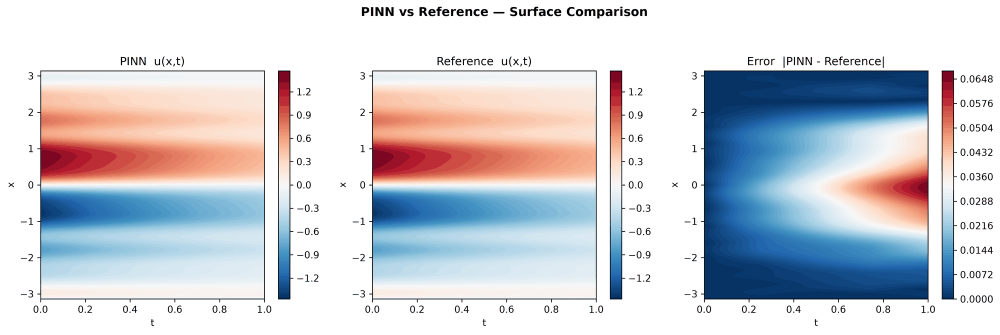

</details>

<details id="dx-fractional-diffusion-equation">
<summary><strong>Fractional diffusion 1D</strong></summary>

DeepXDE example: [`fractional_diffusion_1d.py`](https://github.com/lululxvi/deepxde/blob/master/examples/pinn_forward/fractional_diffusion_1d.py)

$$\Large \frac{\partial u}{\partial t} = D_{0+}^{\alpha}u + D_{1-}^{\alpha}u - e^{-t}\left(x^3(1-x)^3 + f_\alpha(x)\right), \qquad x \in [0, 1],\ t \in [0, 1],\ \alpha = 1.8$$

- **Equation in the panel:** `du_t - frac(u) + exp(-t)*(x**3*(1 - x)**3 + ...)` (DeepXDE's TimeFPDE)
- **Fractional settings:** 52-point static mesh in x at each time
- **Boundary and initial conditions:** $u(0, t) = u(1, t) = 0$, $u(x, 0) = x^3(1-x)^3$, both exact through $\hat u = x(1-x)\,t\,N + x^3(1-x)^3$
- **Exact solution:** $u = e^{-t}x^3(1-x)^3$
- **Constants:** `alpha = 1.8`
- **Network:** FNN [2, 20, 20, 20, 20, 1], tanh, Glorot normal
- **Training:** Adam 10,000; 400 domain, 2 boundary, 2 initial points
- **GUI recipe:** Quick Examples → Category **Forward** → **Fractional diffusion 1D**

**Result (RTX 4090):** L2 = 1.0e-7 ($t = 0$), 1.4e-3 ($t = 0.25$), 5.8e-3 ($t = 0.5$), 2.4e-3 ($t = 0.75$), 3.3e-3 ($t = 1$)

*u — PINN solution over time*

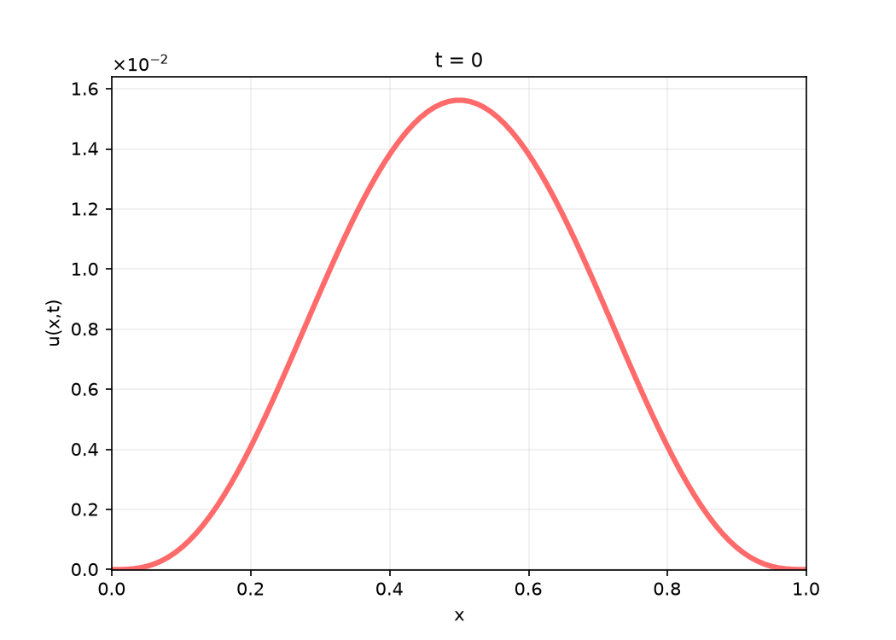

*PINN vs reference, error analysis*


</details>

<details id="1d-heat">
<summary><strong>Heat 1D</strong></summary>

$$\Large \frac{\partial u}{\partial t} = 0.4\frac{\partial^2 u}{\partial x^2}, \qquad x \in [0, 1],\ t \in [0, 1]$$

- **Initial condition:** $u(x, 0) = \sin(\pi x)$
- **Boundary conditions:** Dirichlet, $u = 0$ at both ends
- **Geometry:** Interval
- **Reference data:** bundled numerical solution (no external source)
- **GUI recipe:** Quick Examples → Category **Forward** (or **Inverse**) → **Heat 1D**

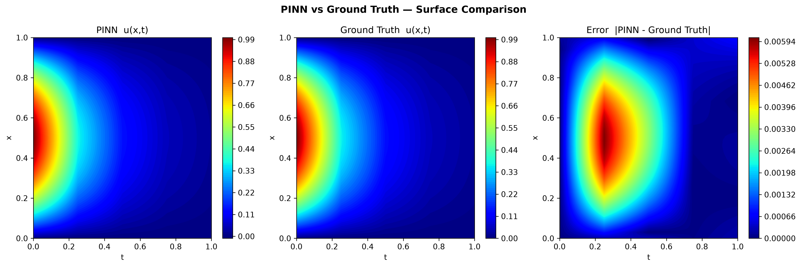

*Inverse mode* — same template, switched to **Inverse**, recovering the diffusivity coefficient (fixed at $0.4$ in Forward mode above) as an unknown parameter; the live convergence plot below shows the estimate settling onto its true value during training:

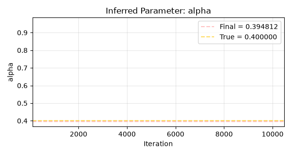

</details>

<details id="dx-heat-equation">
<summary><strong>Heat 1D – Dirichlet</strong></summary>

DeepXDE example: [`heat.py`](https://github.com/lululxvi/deepxde/blob/master/examples/pinn_forward/heat.py) ([documentation](https://deepxde.readthedocs.io/en/latest/demos/pinn_forward/heat.html))

$$\Large \frac{\partial u}{\partial t} = 0.4\frac{\partial^2 u}{\partial x^2}, \qquad x \in [0, 1],\ t \in [0, 1]$$

- **Initial condition:** $u(x, 0) = \sin(\pi x)$; **boundary conditions:** $u(0, t) = u(1, t) = 0$
- **Exact solution:** $u = e^{-0.4\pi^2 t}\sin(\pi x)$
- **Constants:** `a = 0.4`, `L = 1`, `n = 1`
- **Network:** FNN [2, 20, 20, 20, 1], tanh, Glorot normal
- **Training:** Adam 20,000 → L-BFGS 15,000; 2,540 domain, 80 boundary, 160 initial points
- **GUI recipe:** Quick Examples → Category **Forward** → **Heat 1D – Dirichlet**

The solution decays to about 2% of its initial size by $t = 1$, so the relative error grows over time even though the absolute error stays small.

**Result (RTX 4090):** L2 = 4.2e-4 ($t = 0$), 9.1e-4 ($t = 0.25$), 2.2e-3 ($t = 0.5$), 9.5e-3 ($t = 0.75$), 5.0e-2 ($t = 1$)

*u — PINN solution over time*

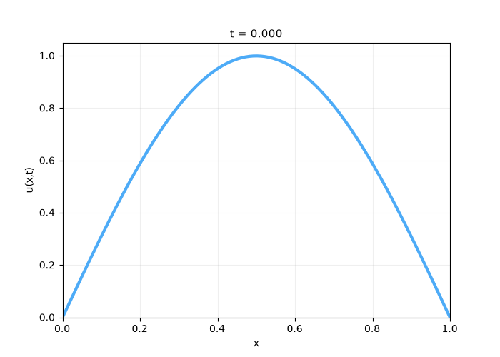

*PINN vs reference, error analysis*

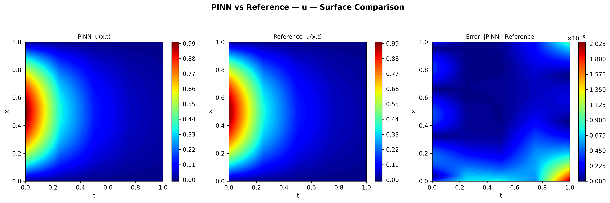

</details>

<details id="dx-heat-equation-with-resampling">
<summary><strong>Heat 1D – resampling</strong></summary>

DeepXDE example: [`heat_resample.py`](https://github.com/lululxvi/deepxde/blob/master/examples/pinn_forward/heat_resample.py) ([documentation](https://deepxde.readthedocs.io/en/latest/demos/pinn_forward/heat.resample.html))

$$\Large \frac{\partial u}{\partial t} = 0.4\frac{\partial^2 u}{\partial x^2}, \qquad x \in [0, 1],\ t \in [0, 1]$$

- **Initial / boundary conditions:** $u(x, 0) = \sin(\pi x)$, $u(0, t) = u(1, t) = 0$
- **Point resampling:** the collocation points are redrawn every 10 iterations (DeepXDE's `PDEPointResampler`)
- **Exact solution:** $u = e^{-0.4\pi^2 t}\sin(\pi x)$
- **Constants:** `a = 0.4`, `L = 1`, `n = 1`
- **Network:** FNN [2, 20, 20, 20, 1], tanh, Glorot normal
- **Training:** Adam 200,000 → L-BFGS 15,000; 2,540 domain, 80 boundary, 160 initial points
- **GUI recipe:** Quick Examples → Category **Forward** → **Heat 1D – resampling**

**Result (RTX 4090):** L2 = 1.6e-4 ($t = 0$), 4.6e-4 ($t = 0.25$), 5.8e-4 ($t = 0.5$), 4.1e-3 ($t = 0.75$), 1.4e-2 ($t = 1$)

*u — PINN solution over time*

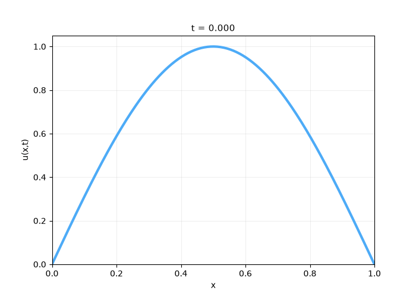

*PINN vs reference, error analysis*

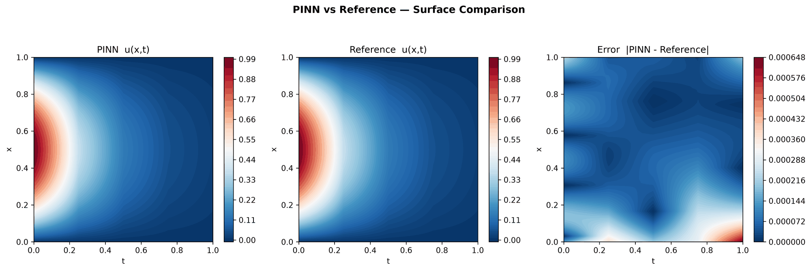

</details>

<details id="dx-klein-gordon-equation">
<summary><strong>Klein-Gordon 1D</strong></summary>

DeepXDE example: [`Klein_Gordon.py`](https://github.com/lululxvi/deepxde/blob/master/examples/pinn_forward/Klein_Gordon.py) ([documentation](https://deepxde.readthedocs.io/en/latest/demos/pinn_forward/klein.gordon.html))

$$\Large \frac{\partial^2 u}{\partial t^2} - \frac{\partial^2 u}{\partial x^2} + u^2 = -x\cos t + x^2\cos^2 t, \qquad x \in [-1, 1],\ t \in [0, 10]$$

- **Initial conditions:** $u(x, 0) = x$ and $\partial u/\partial t\,(x, 0) = 0$ (the second as an Operator BC applied at the initial time)
- **Boundary condition:** $u = x\cos t$
- **Training:** Adam with inverse-time decay ($10^{-3}$, steps 3000, rate 0.9), then L-BFGS
- **Exact solution:** $u = x\cos t$
- **Constants:** `alpha = -1`, `beta = 0`, `gamma = 1`, `k = 2`
- **Network:** FNN [2, 40, 40, 1], tanh, Glorot uniform
- **Training:** Adam 20,000 → L-BFGS 15,000; 30,000 domain, 1,500 boundary, 1,500 initial points
- **GUI recipe:** Quick Examples → Category **Forward** → **Klein-Gordon 1D**

**Result (RTX 4090):** L2 = 1.4e-3 ($t = 0$), 1.6e-2 ($t = 2.5$), 8.5e-2 ($t = 5$), 6.5e-2 ($t = 7.5$), 8.1e-2 ($t = 10$)

*u — PINN solution over time*

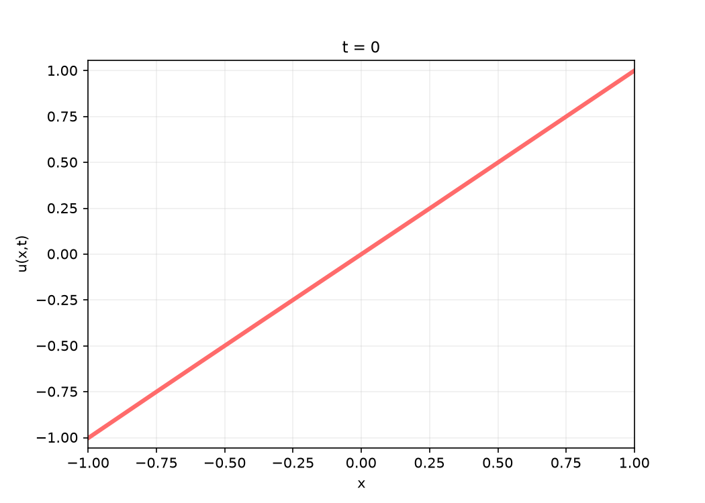

*PINN vs reference, error analysis*

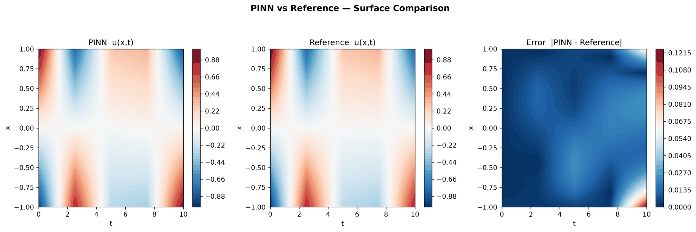

</details>

<details id="dx-schr-dinger-equation">
<summary><strong>Schrödinger 1D</strong></summary>

DeepXDE example: [`Schrodinger.ipynb`](https://github.com/lululxvi/deepxde/blob/master/examples/pinn_forward/Schrodinger.ipynb)

$$\Large i\frac{\partial h}{\partial t} + \frac{1}{2}\frac{\partial^2 h}{\partial x^2} + |h|^2 h = 0, \qquad x \in [-5, 5],\ t \in [0, \pi/2]$$

- **Solved as:** two real outputs, $h = u + iv$
- **Initial condition:** $h(x, 0) = 2\,\mathrm{sech}(x)$; **boundary conditions:** periodic in $u$, $v$ and their $x$-derivatives
- **Compared:** $|h| = \sqrt{u^2 + v^2}$ against PINNStudio's Schrödinger reference solution
- **Network:** FNN [2, 100, 100, 100, 100, 2], tanh, Glorot normal
- **Training:** Adam 10,000 → L-BFGS 10,000; 10,000 domain, 20 boundary, 200 initial points
- **GUI recipe:** Quick Examples → Category **Forward** → **Schrödinger 1D**

**Result (RTX 4090):** L2 of $|h|$ = 1.5e-3 ($t = 0$), 3.2e-2 ($t = 0.25$), 5.8e-2 ($t = 0.5$), 0.12 ($t = 0.75$), 0.14 ($t = 1$), 0.13 ($t = 1.25$), 8.6e-2 ($t = 1.5$)

*|h| — PINN solution over time*

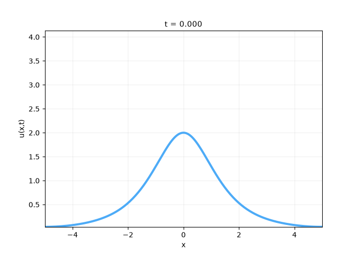

*|h| — PINN vs reference, error analysis*


</details>

<details id="1d-schrödinger">
<summary><strong>Schrödinger 1D – Raissi et al.</strong></summary>

Exact equation, initial condition, and periodic boundary condition as in Raissi, Perdikaris & Karniadakis (2019) — see [References](#references). The 1D nonlinear Schrödinger equation is complex-valued and represented here as two real, coupled outputs $h = u + iv$:

$$\Large i\,\frac{\partial h}{\partial t} + \frac{1}{2}\frac{\partial^2 h}{\partial x^2} + |h|^2 h = 0$$

which, writing $h = u + iv$ in real and imaginary parts, splits into the coupled real system PINNStudio actually solves:

$$\Large \frac{\partial u}{\partial t} + \frac{1}{2}\frac{\partial^2 v}{\partial x^2} + (u^2+v^2)v = 0$$

$$\Large \frac{\partial v}{\partial t} - \frac{1}{2}\frac{\partial^2 u}{\partial x^2} - (u^2+v^2)u = 0$$

$x \in [-5, 5]$, $t \in [0, \pi/2]$

- **Initial condition:** $h(x, 0) = 2\,\mathrm{sech}(x)$, i.e. $u(x,0) = 2/\cosh(x)$, $v(x,0) = 0$
- **Boundary conditions:** Periodic, enforced on both $h$ and its first $x$-derivative ($h_x(t,-5) = h_x(t,5)$), matching the paper's own condition
- **Geometry:** Interval
- **GUI recipe:** Quick Examples → Category **Forward** (or **Inverse**) → **Schrödinger 1D – Raissi et al.**

The quantity plotted by default is $|h| = \sqrt{u^2+v^2}$ (a custom derived output), matching Figure 1 of the paper — not $u$ or $v$ individually, since neither alone is physically meaningful.

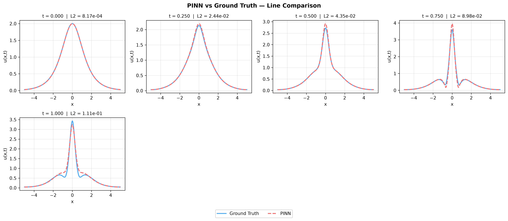

*Inverse mode* — same template, switched to **Inverse**, recovering the dispersion coefficient (fixed at $\frac{1}{2}$ in Forward mode above) as an unknown parameter; the live convergence plot below shows the estimate settling onto its true value during training:

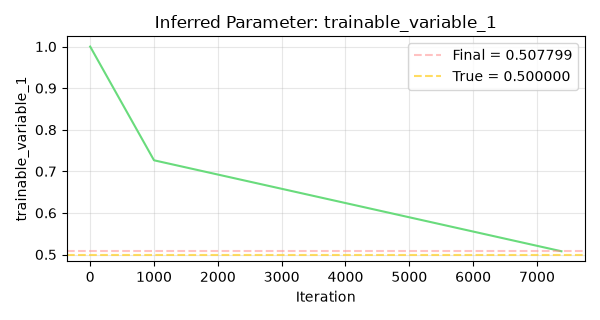

</details>

<details id="dx-wave-propagation-space-time-multi-scale-fourier-features">
<summary><strong>Wave 1D – space-time multi-scale Fourier features</strong></summary>

DeepXDE example: [`wave_1d.py`](https://github.com/lululxvi/deepxde/blob/master/examples/pinn_forward/wave_1d.py)

$$\Large \frac{\partial^2 u}{\partial t^2} = C^2\frac{\partial^2 u}{\partial x^2}, \qquad x \in [0, 1],\ t \in [0, 1],\ C = 10$$

- **Boundary conditions:** $u(0, t) = u(1, t) = 0$
- **Initial conditions:** $u(x, 0) = \sin(\pi x) + \sin(A\pi x)$ ($A = 2$); $\partial u/\partial t(x, 0) = 0$ as an Operator BC `du_t` applied at the initial time
- **Exact solution:** $u = \sin(\pi x)\cos(C\pi t) + \sin(A\pi x)\cos(AC\pi t)$ — ten and twenty oscillations in time
- **Network:** space-time multi-scale Fourier features (STMsFFN): space scale $\sigma_x = 1$, time scales $\sigma_t = 1, 10$; inputs rescaled to zero mean, unit variance by the input-transform formula `(x - 0.5)*2*sqrt(3); (t - 0.5)*2*sqrt(3)`
- **Loss weights:** set from the initial losses, $w_i = 5 / L_i(0)$ (*Scale by initial losses*); learning rate $10^{-3}/(1 + 0.9\,n/2000)$; collocation points redrawn every iteration
- **Constants:** `A = 2`, `C = 10`
- **Network:** STMsFFN [2, 100, 100, 100, 1], Fourier scales σ = 1, time scales 1, 10, tanh, Glorot uniform
- **Training:** Adam 10,000; 360 domain, 360 boundary, 360 initial points
- **GUI recipe:** Quick Examples → Category **Forward** → **Wave 1D – space-time multi-scale Fourier features**

Collocation points are redrawn every iteration from a pseudo-random distribution. DeepXDE's script keeps the default Hammersley distribution, which is deterministic, so its resampler redraws the same 360 points: run that way, the network fits them (training loss 4e-5) but not the wave in between (test loss near 1, L2 ≈ 1 for t > 0). This is a hard problem in 10,000 iterations — the error grows with t; longer training improves it.

**Result (RTX 4090):** L2 = 7.7e-4 ($t = 0$), 4.5e-2 ($t = 0.25$), 9.8e-2 ($t = 0.5$), 0.10 ($t = 0.75$), 0.14 ($t = 1$)

*u — PINN solution over time*

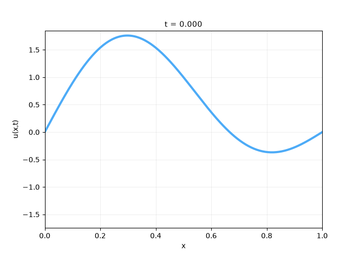

*PINN vs reference, error analysis*

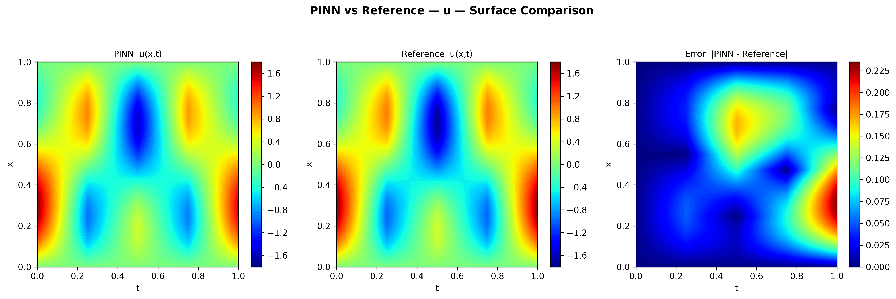

</details>

<details id="dx-inverse-diffusion-equation">
<summary><strong>Diffusion 1D – unknown coefficient</strong></summary>

DeepXDE example: [`diffusion_1d_inverse.py`](https://github.com/lululxvi/deepxde/blob/master/examples/pinn_inverse/diffusion_1d_inverse.py) ([documentation](https://deepxde.readthedocs.io/en/latest/demos/pinn_inverse/diffusion.1d.inverse.html))

$$\Large \frac{\partial u}{\partial t} = C\frac{\partial^2 u}{\partial x^2} - e^{-t}\left(\sin(\pi x) - \pi^2\sin(\pi x)\right), \qquad x \in [-1, 1],\ t \in [0, 1]$$

- **Unknown:** $C$ (true value 1, initial guess 2)
- **Data:** 10 measurements of $u$ at $t = 1$, plus the initial and boundary conditions
- **Exact solution:** $u = e^{-t}\sin(\pi x)$
- **Network:** FNN [2, 32, 32, 32, 1], tanh, Glorot uniform
- **Training:** Adam 50,000; 40 domain, 20 boundary, 10 initial points
- **GUI recipe:** Quick Examples → Category **Inverse** → **Diffusion 1D – unknown coefficient**

**Result (RTX 4090):** $C$ = 0.9988 (true 1); L2 = 1.2e-3 ($t = 0$), 1.8e-3 ($t = 0.25$), 1.9e-3 ($t = 0.5$), 2.8e-3 ($t = 0.75$), 3.1e-3 ($t = 1$)

*u — PINN solution over time*

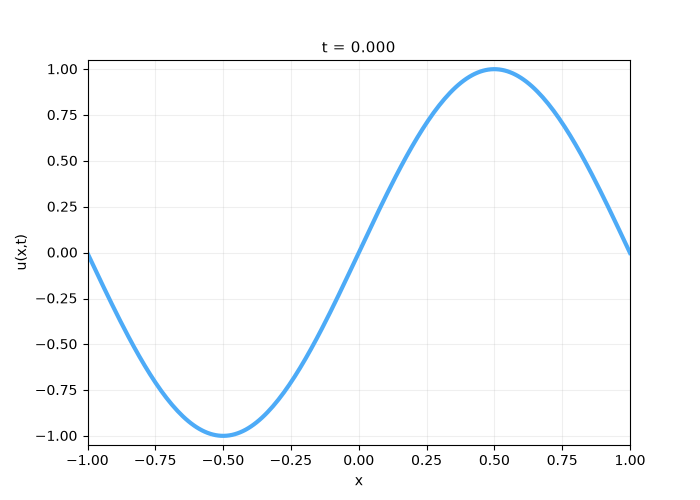

*PINN vs reference, error analysis*

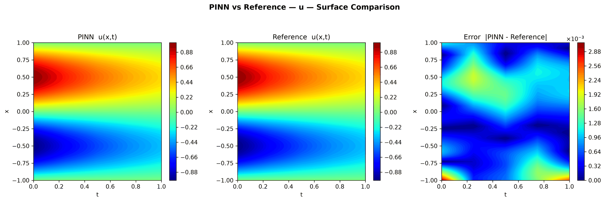

*Inferred parameters during training*

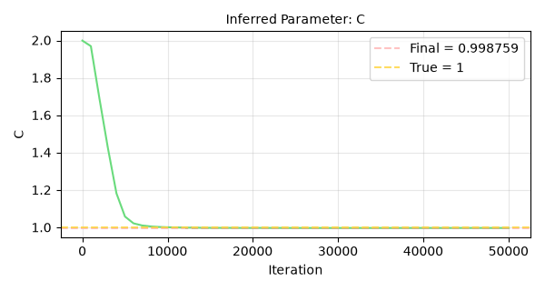

</details>

<details id="dx-inverse-diffusion-reaction-system">
<summary><strong>Diffusion-reaction 1D – unknown k_f, D</strong></summary>

DeepXDE example: [`reaction_inverse.py`](https://github.com/lululxvi/deepxde/blob/master/examples/pinn_inverse/reaction_inverse.py) ([documentation](https://deepxde.readthedocs.io/en/latest/demos/pinn_inverse/reaction.inverse.html))

$$\Large \frac{\partial C_A}{\partial t} = D\frac{\partial^2 C_A}{\partial x^2} - k_f C_A C_B^2, \qquad \frac{\partial C_B}{\partial t} = D\frac{\partial^2 C_B}{\partial x^2} - 2k_f C_A C_B^2$$

- **Domain:** $x \in [0, 1]$, $t \in [0, 10]$; $C_A = C_B = e^{-20x}$ at $t = 0$, $C_A = C_B = 1 - x$ on the boundary
- **Unknowns:** $k_f$ (true 0.1) and $D$ (true $2\times 10^{-3}$, written as $10^{-3}D$ with $D = 2$)
- **Data:** $C_A$ and $C_B$ on a space-time grid, computed by `tools/make_deepxde_reference_data.py`
- **Network:** FNN [2, 20, 20, 20, 2], tanh, Glorot uniform
- **Training:** Adam 80,000; 2,000 domain, 100 boundary, 100 initial points
- **GUI recipe:** Quick Examples → Category **Inverse** → **Diffusion-reaction 1D – unknown k_f, D**

**Result (RTX 4090):** $k_f$ = 0.0992 (true 0.1), $D$ = 1.995 (true 2)

*ca — PINN solution over time*


*ca — inferred parameters during training*


</details>

### 2D examples

*Click an example to expand it.*

<details id="dx-fractional-poisson-equation-2d">
<summary><strong>Fractional Poisson 2D – disk</strong></summary>

DeepXDE example: [`fractional_Poisson_2d.py`](https://github.com/lululxvi/deepxde/blob/master/examples/pinn_forward/fractional_Poisson_2d.py)

$$\Large -(-\Delta)^{\alpha/2}u = 2^{\alpha}\Gamma(2 + \tfrac{\alpha}{2})\Gamma(1 + \tfrac{\alpha}{2})\left(1 - (1 + \tfrac{\alpha}{2})|x|^2\right), \qquad |x| < 1,\ \alpha = 1.8$$

- **Equation in the panel:** `frac(u)*gamma((1 - alpha)/2)*gamma((2 + alpha)/2)/(2*pi**1.5) - ...` — `frac(u)` times $C(\alpha, 2)$ is $-(-\Delta)^{\alpha/2}u$
- **Fractional settings:** 8 directions, 100 Grünwald-Letnikov points per unit length, dynamic mesh
- **Geometry:** unit disk; $u = 0$ on the circle through $\hat u = (1 - x^2 - y^2)N$
- **Exact solution:** $u = (1 - |x|^2)^{1 + \alpha/2}$
- **Constants:** `alpha = 1.8`
- **Network:** FNN [2, 20, 20, 20, 20, 1], tanh, Glorot normal
- **Training:** Adam 20,000; 100 domain points
- **GUI recipe:** Quick Examples → Category **Forward** → **Fractional Poisson 2D – disk**

**Result (RTX 4090):** L2 = 3.1e-3

*PINN vs reference, error analysis*


</details>

<details id="dx-helmholtz-2d-dirichlet">
<summary><strong>Helmholtz 2D – Dirichlet</strong></summary>

DeepXDE example: [`Helmholtz_Dirichlet_2d.py`](https://github.com/lululxvi/deepxde/blob/master/examples/pinn_forward/Helmholtz_Dirichlet_2d.py) ([documentation](https://deepxde.readthedocs.io/en/latest/demos/pinn_forward/helmholtz.2d.dirichlet.html))

$$\Large -\nabla^2 u - k_0^2 u = k_0^2\sin(k_0 x)\sin(k_0 y), \qquad k_0 = 4\pi,\ (x, y) \in [0, 1]^2$$

- **Boundary conditions:** $u = 0$ on the boundary, imposed exactly by $\hat u = x(1-x)y(1-y)N$
- **Exact solution:** $u = \sin(k_0 x)\sin(k_0 y)$
- **Constants:** `n = 2`, `k0 = 2*pi*n`
- **Network:** FNN [2, 150, 150, 150, 1], sin, Glorot uniform
- **Training:** Adam 5,000; 400 domain, 80 boundary points
- **GUI recipe:** Quick Examples → Category **Forward** → **Helmholtz 2D – Dirichlet**

**Result (RTX 4090):** L2 = 1.9e-3

*PINN vs reference, error analysis*


</details>

<details id="dx-helmholtz-2d-hyperparameter-optimization">
<summary><strong>Helmholtz 2D – hyperparameter search</strong></summary>

DeepXDE example: [`Helmholtz_Dirichlet_2d_HPO.py`](https://github.com/lululxvi/deepxde/blob/master/examples/pinn_forward/Helmholtz_Dirichlet_2d_HPO.py)

$$\Large -\nabla^2 u - k_0^2 u = k_0^2\sin(k_0 x)\sin(k_0 y), \qquad k_0 = 4\pi,\ (x, y) \in [0, 1]^2$$

- **Same problem** as Helmholtz 2D (Dirichlet), with $\hat u = x(1-x)y(1-y)N$
- **Parameter Sweep, mode Bayesian search:** learning rate $10^{-4}$–$5\times10^{-2}$ (log), hidden layers 1–10, neurons per layer 5–500, activation sin / sigmoid / tanh
- **Budget:** 50 runs of 10,000 Adam iterations each — the baseline (lr $10^{-3}$, 4 × 50, sin), 10 random runs, then 39 chosen by the Gaussian-process model, minimizing the final loss
- **Output:** one folder per run, `bayes_search.csv` and `bayes_convergence.png`; the best run is printed at the end of the Training Log
- **Constants:** `n = 2`, `k0 = 2*pi*n`
- **Network:** FNN [2, 50, 50, 50, 50, 1], sin, Glorot uniform
- **Training:** Adam 10,000; 400 domain, 80 boundary points
- **GUI recipe:** Quick Examples → Category **Forward** → **Helmholtz 2D – hyperparameter search**

**Result (RTX 4090):** the baseline (lr $10^{-3}$, 4 × 50, sin) ends at final loss 5.7 (L2 = 0.33); the best of the 50 runs — lr $1.5\times10^{-3}$, 3 hidden layers of 87, sin — reaches final loss 0.020 and **L2 = 1.3e-3** (about 40 minutes for all 50 runs)

*PINN vs reference, error analysis*


*Bayesian search: final loss of every run and the best so far*


</details>

<details id="dx-helmholtz-sound-hard-scattering-absorbing-bc">
<summary><strong>Helmholtz 2D – sound-hard scattering</strong></summary>

DeepXDE example: [`Helmholtz_Sound_hard_ABC_2d.py`](https://github.com/lululxvi/deepxde/blob/master/examples/pinn_forward/Helmholtz_Sound_hard_ABC_2d.py)

$$\Large -\nabla^2 u - k_0^2 u = 0, \qquad u = u_{re} + i\,u_{im},\ k_0 = 2$$

- **Geometry:** Custom — the square $[-\pi, \pi]^2$ minus a disk of radius $R = \pi/4$
- **Scattered field** of the plane wave $e^{ik_0x}$ off a sound-hard disk: two outputs `u_re`, `u_im`, one equation each
- **On the disk** (Neumann): $\partial u/\partial n = -\partial e^{ik_0x}/\partial n$, i.e. `-k0*x*sin(k0*x)/R` and `k0*x*cos(k0*x)/R`
- **On the outer square** (absorbing, Robin): $\partial u/\partial n = ik_0u$, i.e. `-k0*u_im` on the `u_re` row and `k0*u_re` on the `u_im` row
- **Reference:** the Bessel/Hankel series solution of DeepXDE's script
- **Constants:** `k0 = 2`, `R = pi/4`
- **Network:** FNN [2, 350, 350, 350, 2], tanh, Glorot uniform
- **Training:** Adam 10,000; 1,600 domain, 320 boundary points
- **GUI recipe:** Quick Examples → Category **Forward** → **Helmholtz 2D – sound-hard scattering**

**Result (RTX 4090):** L2 = 7.8e-2 ($u_{re}$), 6.7e-2 ($u_{im}$) — DeepXDE's own script, run unchanged on the same GPU, ends at 9.1e-2 (best 7.1e-2)

*u_re — PINN vs reference, error analysis*


*u_im — PINN vs reference, error analysis*


</details>

<details id="dx-helmholtz-2d-with-a-hole">
<summary><strong>Helmholtz 2D – square with hole</strong></summary>

DeepXDE example: [`Helmholtz_Neumann_2d_hole.py`](https://github.com/lululxvi/deepxde/blob/master/examples/pinn_forward/Helmholtz_Neumann_2d_hole.py) ([documentation](https://deepxde.readthedocs.io/en/latest/demos/pinn_forward/helmholtz.2d.neumann.hole.html))

$$\Large -\nabla^2 u - k_0^2 u = k_0^2\sin(k_0 x)\sin(k_0 y), \qquad k_0 = 2\pi$$

- **Geometry:** Custom — the square $[-0.5, 0.5]^2$ minus a disk of radius 0.25
- **Boundary conditions:** Dirichlet (exact solution) on the outer square; Neumann (exact normal derivative) on the hole
- **Exact solution:** $u = \sin(k_0 x)\sin(k_0 y)$
- **Constants:** `n = 1`, `k0 = 2*pi*n`, `R = 1/4`
- **Network:** FNN [2, 350, 350, 350, 1], sin, Glorot uniform
- **Training:** Adam 5,000; 225 domain, 240 boundary points
- **GUI recipe:** Quick Examples → Category **Forward** → **Helmholtz 2D – square with hole**

**Result (RTX 4090):** L2 = 4.6e-2

*PINN vs reference, error analysis*


</details>

<details id="dx-laplace-equation-on-a-disk">
<summary><strong>Laplace 2D – disk</strong></summary>

DeepXDE example: [`Laplace_disk.py`](https://github.com/lululxvi/deepxde/blob/master/examples/pinn_forward/Laplace_disk.py) ([documentation](https://deepxde.readthedocs.io/en/latest/demos/pinn_forward/laplace.disk.html))

$$\Large r\frac{\partial u}{\partial r} + r^2\frac{\partial^2 u}{\partial r^2} + \frac{\partial^2 u}{\partial \theta^2} = 0, \qquad r \in [0, 1],\ \theta \in [0, 2\pi]$$

- **Boundary condition:** $u(1, \theta) = \cos\theta$
- **Input features:** $(r\sin\theta,\ r\cos\theta)$ through an input-transform formula, which makes the solution periodic in $\theta$
- **Exact solution:** $u = r\cos\theta$
- **In PINNStudio:** $x$ plays $r$ and $y$ plays $\theta$, so the plots show the $(r, \theta)$ rectangle
- **Network:** FNN [2, 20, 20, 20, 1], tanh, Glorot normal
- **Training:** Adam 15,000; 2,540 domain, 80 boundary points
- **GUI recipe:** Quick Examples → Category **Forward** → **Laplace 2D – disk**

**Result (RTX 4090):** L2 = 1.1e-3

*PINN vs reference, error analysis*


</details>

<details id="dx-linear-elastostatic-plate">
<summary><strong>Linear elasticity 2D – plate</strong></summary>

DeepXDE example: [`elasticity_plate.py`](https://github.com/lululxvi/deepxde/blob/master/examples/pinn_forward/elasticity_plate.py) ([documentation](https://deepxde.readthedocs.io/en/latest/demos/pinn_forward/elasticity.plate.html))

$$\Large \frac{\partial \sigma_{xx}}{\partial x} + \frac{\partial \sigma_{xy}}{\partial y} = f_x, \qquad \frac{\partial \sigma_{xy}}{\partial x} + \frac{\partial \sigma_{yy}}{\partial y} = f_y$$

$$\Large \sigma_{xx} = (\lambda + 2\mu)\varepsilon_{xx} + \lambda\varepsilon_{yy}, \quad \sigma_{yy} = (\lambda + 2\mu)\varepsilon_{yy} + \lambda\varepsilon_{xx}, \quad \sigma_{xy} = 2\mu\varepsilon_{xy}$$

- **Domain:** $[0, 1]^2$; $\lambda = 1$, $\mu = 0.5$, $Q = 4$ (constants `lmbd`, `mu`, `Q`); body forces $f_x$, $f_y$ as in DeepXDE's script
- **Outputs:** five, $u_x, u_y, \sigma_{xx}, \sigma_{yy}, \sigma_{xy}$, with five equations (two momentum, three constitutive)
- **Boundary conditions:** imposed exactly by an output transform, e.g. $\hat u_x = y(1-y)N_1$, $\hat\sigma_{yy} = (1-y)N_4 + (\lambda+2\mu)Q\sin(\pi x)$
- **Exact solution:** $u_x = \cos(2\pi x)\sin(\pi y)$, $u_y = \sin(\pi x)\,Qy^4/4$
- **Constants:** `lmbd = 1`, `mu = 0.5`, `Q = 4`
- **Network:** PFNN, a separate [40, 40, 40, 40] subnetwork for each of the 5 outputs, tanh, Glorot uniform
- **Training:** Adam 20,000 → L-BFGS 20,000; 500 domain, 500 boundary points
- **GUI recipe:** Quick Examples → Category **Forward** → **Linear elasticity 2D – plate**

**Note — more training than DeepXDE's script.** DeepXDE's script trains 5,000 Adam iterations, which are not enough for this problem: with exactly those settings the L2 errors are 0.35, 0.59, 0.19, 0.48 and 1.6 for $u_x, u_y, \sigma_{xx}, \sigma_{yy}, \sigma_{xy}$ (DeepXDE's own script, run unchanged on the same GPU, also ends at 0.33–0.36). This example therefore trains **20,000 Adam + 20,000 L-BFGS iterations** (Training Phases 1 and 2; about 9 minutes on an RTX 4090), and the results below are for these settings.

**Result (RTX 4090):** L2 = 4.9e-2 ($u_x$), 4.3e-2 ($u_y$), 7.2e-3 ($\sigma_{xx}$), 2.0e-2 ($\sigma_{yy}$), 6.7e-2 ($\sigma_{xy}$) — 20,000 Adam + 20,000 L-BFGS (DeepXDE's 5,000 Adam alone: 0.35, 0.59, 0.19, 0.48, 1.6)

*ux — PINN vs reference, error analysis*


*uy — PINN vs reference, error analysis*


*sxx — PINN vs reference, error analysis*


*syy — PINN vs reference, error analysis*


*sxy — PINN vs reference, error analysis*


</details>

<details id="dx-linear-elastostatic-plate-soft-bcs">
<summary><strong>Linear elasticity 2D – plate, soft BCs</strong></summary>

DeepXDE example: [`elasticity_plate.py`](https://github.com/lululxvi/deepxde/blob/master/examples/pinn_forward/elasticity_plate.py)

$$\Large \frac{\partial \sigma_{xx}}{\partial x} + \frac{\partial \sigma_{xy}}{\partial y} = f_x, \qquad \frac{\partial \sigma_{xy}}{\partial x} + \frac{\partial \sigma_{yy}}{\partial y} = f_y$$

- **Same problem** as the plate above (constants `lmbd`, `mu`, `Q`, five outputs and equations)
- **Boundary conditions as rows** (DeepXDE's `BC_type = \"soft\"`): $u_x = 0$ at top and bottom; $u_y = 0$ at left, bottom and right; $\sigma_{xx} = 0$ at left and right; $\sigma_{yy} = (\lambda + 2\mu)Q\sin(\pi x)$ at the top
- **Constants:** `lmbd = 1`, `mu = 0.5`, `Q = 4`
- **Network:** PFNN, a separate [40, 40, 40, 40] subnetwork for each of the 5 outputs, tanh, Glorot uniform
- **Training:** Adam 20,000 → L-BFGS 20,000; 500 domain, 500 boundary points
- **GUI recipe:** Quick Examples → Category **Forward** → **Linear elasticity 2D – plate, soft BCs**

**Note — more training than DeepXDE's script.** As for the plate above, DeepXDE's 5,000 Adam iterations are not enough (L2 errors 0.02–0.08 with exactly those settings), so this example trains **20,000 Adam + 20,000 L-BFGS iterations** (about 7 minutes on an RTX 4090); the results below are for these settings. With soft boundary conditions the plate trains more easily than with the hard output transform.

**Result (RTX 4090):** L2 = 4.9e-4 ($u_x$), 1.1e-3 ($u_y$), 6.4e-4 ($\sigma_{xx}$), 9.6e-4 ($\sigma_{yy}$), 2.7e-3 ($\sigma_{xy}$) — 20,000 Adam + 20,000 L-BFGS (DeepXDE's 5,000 Adam alone: 2.4e-2 to 7.8e-2)

*ux — PINN vs reference, error analysis*


*uy — PINN vs reference, error analysis*


*sxx — PINN vs reference, error analysis*


*syy — PINN vs reference, error analysis*


*sxy — PINN vs reference, error analysis*


</details>

<details id="dx-kovasznay-flow">
<summary><strong>Navier-Stokes 2D – Kovasznay flow</strong></summary>

DeepXDE example: [`Kovasznay_flow.py`](https://github.com/lululxvi/deepxde/blob/master/examples/pinn_forward/Kovasznay_flow.py) ([documentation](https://deepxde.readthedocs.io/en/latest/demos/pinn_forward/Kovasznay.flow.html))

$$\Large (\mathbf u\cdot\nabla)\mathbf u + \nabla p = \frac{1}{Re}\nabla^2\mathbf u, \qquad \nabla\cdot\mathbf u = 0, \qquad Re = 20$$

- **Domain:** $[-0.5, 1] \times [-0.5, 1.5]$; outputs $u, v, p$
- **Boundary conditions:** Dirichlet for $u$ and $v$ on the whole boundary, and for $p$ on the outlet $x = 1$
- **Exact solution:** $u = 1 - e^{\lambda x}\cos(2\pi y)$, $v = \frac{\lambda}{2\pi}e^{\lambda x}\sin(2\pi y)$, $p = \frac{1}{2}(1 - e^{2\lambda x})$, $\lambda = \frac{Re}{2} - \sqrt{\frac{Re^2}{4} + 4\pi^2}$
- **Constants:** `Re = 20`, `nu = 1/Re`, `l = 1/(2*nu) - sqrt(1/(4*nu**2) + 4*pi**2)`
- **Network:** FNN [2, 50, 50, 50, 50, 3], tanh, Glorot normal
- **Training:** Adam 30,000 → L-BFGS 15,000; 2,601 domain, 400 boundary points
- **GUI recipe:** Quick Examples → Category **Forward** → **Navier-Stokes 2D – Kovasznay flow**

**Result (RTX 4090):** L2 = 2.1e-4 ($u$), 9.0e-4 ($v$), 5.4e-4 ($p$)

*u — PINN vs reference, error analysis*


*p — PINN vs reference, error analysis*


</details>

<details id="2d-poisson-disk">
<summary><strong>Poisson 2D – disk</strong></summary>

The Poisson equation on the unit disk, steady-state (no time axis).

$$\Large -\frac{\partial^2 u}{\partial x^2} - \frac{\partial^2 u}{\partial y^2} = 1, \qquad x^2 + y^2 \le 1$$

- **Boundary conditions:** Dirichlet, $u = 0$ on the boundary circle
- **Geometry:** Disk, center $(0,0)$, radius $1$
- **GUI recipe:** Quick Examples → Category **Forward** (or **Inverse**) → **Poisson 2D – disk**

A companion to the L-Shape template above, on a smooth (curved, non-singular) boundary instead.


</details>

<details id="dx-poisson-over-an-l-shaped-domain">
<summary><strong>Poisson 2D – L-shape</strong></summary>

DeepXDE example: [`Poisson_Lshape.py`](https://github.com/lululxvi/deepxde/blob/master/examples/pinn_forward/Poisson_Lshape.py) ([documentation](https://deepxde.readthedocs.io/en/latest/demos/pinn_forward/poisson.Lshape.html))

$$\Large -\nabla^2 u = 1, \qquad \Omega = [-1, 1]^2 \setminus [0, 1]\times[-1, 0]$$

- **Boundary conditions:** Dirichlet, $u = 0$ on the whole boundary
- **Geometry:** Polygon (L-shape)
- **Network:** FNN [2, 50, 50, 50, 50, 1], tanh, Glorot uniform
- **Training:** Adam 50,000 → L-BFGS 15,000; 1,200 domain, 120 boundary points
- **GUI recipe:** Quick Examples → Category **Forward** → **Poisson 2D – L-shape**

**Result (RTX 4090):** L2 = 3.5e-2

*PINN vs reference, error analysis*


</details>

<details id="2d-poisson-l-shape">
<summary><strong>Poisson 2D – L-shape, Lu et al.</strong></summary>

A classic re-entrant-corner benchmark — the Poisson equation on an L-shaped domain (a unit square with a quadrant notched out), steady-state (no time axis). This is the same benchmark used as a demonstration example in the original DeepXDE paper — see Lu, Meng, Mao & Karniadakis (2021) under [References](#references).

$$\Large -\frac{\partial^2 u}{\partial x^2} - \frac{\partial^2 u}{\partial y^2} = 1, \qquad (x, y) \in \Omega_{L}$$

- **Boundary conditions:** Dirichlet, $u = 0$ on the whole boundary
- **Geometry:** Polygon, vertices $(0,0), (1,0), (1,-1), (-1,-1), (-1,1), (0,1)$
- **GUI recipe:** Quick Examples → Category **Forward** (or **Inverse**) → **Poisson 2D – L-shape, Lu et al.**

The re-entrant corner at the origin produces a solution singularity that's a standard stress-test for numerical solvers, PINNs included.


</details>

<details id="dx-inverse-fractional-poisson-equation-2d">
<summary><strong>Fractional Poisson 2D – unknown order α</strong></summary>

DeepXDE example: [`fractional_Poisson_2d_inverse.py`](https://github.com/lululxvi/deepxde/blob/master/examples/pinn_inverse/fractional_Poisson_2d_inverse.py)

$$\Large -(-\Delta)^{\alpha/2}u = 2^{\alpha_0}\Gamma(2 + \tfrac{\alpha_0}{2})\Gamma(1 + \tfrac{\alpha_0}{2})\left(1 - (1 + \tfrac{\alpha_0}{2})|x|^2\right), \qquad |x| < 1$$

- **Unknown:** the order $\alpha$ (true 1.8, start 1.5); $C(\alpha, 2)$ written with `lgamma` so it stays differentiable in α
- **Data:** 30 random measurements of $u = (1 - |x|^2)^{1 + \alpha_0/2}$, loss weight 100
- **Fractional settings:** 8 directions, 100 points per unit length, dynamic mesh
- **Constants:** `a0 = 1.8`
- **Network:** FNN [2, 20, 20, 20, 20, 1], tanh, Glorot normal
- **Training:** Adam 10,000; 64 domain points
- **GUI recipe:** Quick Examples → Category **Inverse** → **Fractional Poisson 2D – unknown order α**

**Result (RTX 4090):** $\alpha$ = 1.805 (true 1.8); L2 of $u$ = 1.9e-3

*PINN vs reference, error analysis*


*Inferred parameters during training*


</details>

<details id="2d-allen-cahn-mattey--ghosh">
<summary><strong>Allen-Cahn 2D – Mattey & Ghosh</strong></summary>

Benchmark problem after Mattey & Ghosh (2022) — see [References](#references).

$$\Large \frac{\partial u}{\partial t} = c_1^2\left(\frac{\partial^2 u}{\partial x^2} + \frac{\partial^2 u}{\partial y^2}\right) - c_2(u^3 - u), \qquad (x, y) \in [0, 1]^2,\ t \in (0, 1]$$

where $c_1^2 = 0.0001$ and $c_2 = 1$.

- **Initial condition:** $u(x, y, 0) = \sin(4\pi x)\cos(4\pi y)$
- **Boundary conditions:** Periodic
- **Geometry:** Rectangle
- **Time-Adaptive default:** on — $t \in [0,1]$ split into 4 steps of 0.25, L-BFGS transfer learning between steps
- **GUI recipe:** Quick Examples → Category **Forward** (or **Inverse**) → **Allen-Cahn 2D – Mattey & Ghosh**


*Restore & Visualize* — the trained model restored from its saved checkpoint and re-animated without retraining:


*Inverse mode* — same template, switched to **Inverse**, jointly recovering both $c_1^2$ (interfacial-thickness-squared) and $c_2$ (reaction) as unknown parameters; $c_2$'s initial guess starts at $0.1$ rather than $1.0$, since $1.0$ is already its true value. The live convergence animation below shows both estimates settling onto their true values during training:


</details>

<details id="2d-allen-cahn-wight--zhao">
<summary><strong>Allen-Cahn 2D – Wight & Zhao</strong></summary>

Benchmark problem after Wight & Zhao (2021) — see [References](#references). This is the paper's own shrinking-circle-interface benchmark, posed there for a field it calls $\phi$ (PINNStudio's $u$) with rate constant $\lambda$ and interface-width parameter $\varepsilon$ (eq. 3.11):

$$\Large \frac{\partial u}{\partial t} = \lambda\left(\varepsilon^2\left(\frac{\partial^2 u}{\partial x^2} + \frac{\partial^2 u}{\partial y^2}\right) - u^3 + u\right), \qquad (x, y) \in [0, 1]^2,\ t \in [0, 10]$$

where $\lambda = 10$ and $\varepsilon = 0.025$, matching the paper's own values ($\lambda\varepsilon^2 = 0.00625$ is the effective diffusion coefficient).

- **Initial condition:** a smooth circular interface, $u(x, y, 0) = \tanh\left(\dfrac{0.35 - \sqrt{(x-0.5)^2 + (y-0.5)^2}}{2\varepsilon}\right)$ (paper's eq. 3.12)
- **Boundary conditions:** Periodic
- **Geometry:** Rectangle
- **Time-Adaptive default:** on — $t \in [0,10]$ is a wide window for a single pass, so this template splits it into 10 steps of 1 (`0→1, 1→2, ..., 9→10`), L-BFGS transfer learning between steps
- **GUI recipe:** Quick Examples → Category **Forward** (or **Inverse**) → **Allen-Cahn 2D – Wight & Zhao**


*Restore & Visualize* — the trained model restored from its saved checkpoint and re-animated without retraining:


*Inverse mode* — same template, switched to **Inverse**, jointly recovering the two coefficients exactly as they appear in the PDE box — the reaction-term coefficient $\lambda$ and the lumped diffusion-term coefficient $\lambda\varepsilon^2$ (not $\varepsilon$ on its own):

$$\Large \frac{\partial u}{\partial t} = (\lambda\varepsilon^2)\left(\frac{\partial^2 u}{\partial x^2} + \frac{\partial^2 u}{\partial y^2}\right) - \lambda(u^3 - u)$$

with true values $\lambda = 10$ and $\lambda\varepsilon^2 = 0.00625$. The live convergence animation below shows both estimates settling onto their true values during training:


</details>

<details id="2d-burgers-mathias">
<summary><strong>Burgers 2D – Mathias et al.</strong></summary>

Physics after Mathias, de Almeida, de Barros, Coelho, et al. (2022) — see [References](#references). A coupled, two-output system for the velocity components $U$, $V$, with kinematic viscosity $\nu = \dfrac{0.01}{\pi}$:

$$\Large \frac{\partial U}{\partial t} + U\frac{\partial U}{\partial x} + V\frac{\partial U}{\partial y} = \nu\left(\frac{\partial^2 U}{\partial x^2} + \frac{\partial^2 U}{\partial y^2}\right)$$

$$\Large \frac{\partial V}{\partial t} + U\frac{\partial V}{\partial x} + V\frac{\partial V}{\partial y} = \nu\left(\frac{\partial^2 V}{\partial x^2} + \frac{\partial^2 V}{\partial y^2}\right)$$

$(x, y) \in [0, 1]^2$, $t \in [0, 1]$

- **Initial condition:** $U(x,y,0) = \sin(2\pi x)\sin(2\pi y)$, $\ V(x,y,0) = \sin(\pi x)\sin(\pi y)$
- **Boundary conditions:** Dirichlet, $U = V = 0$ on all four edges
- **Geometry:** Rectangle
- **Network:** 4 hidden layers × 128 neurons — wider than PINNStudio's global default (3 × 64), which gave better results for this coupled two-output velocity field
- **Time-Adaptive default:** on — $t \in [0,1]$ split into 4 steps of 0.25, L-BFGS transfer learning between steps
- **GUI recipe:** Quick Examples → Category **Forward** (or **Inverse**) → **Burgers 2D – Mathias et al.**

This template reproduces the paper's own PDE, domain, and initial/boundary conditions with PINNStudio's standard soft-constrained loss and plain MLP network — not the paper's own sparse-data augmentation or hard-constrained output layer, which are outside this template's scope.

PINN solution animated over time, for each of the two coupled outputs:

<table>
<tr>
<td width="50%" align="center">

<sub><strong>U</strong></sub>
</td>
<td width="50%" align="center">

<sub><strong>V</strong></sub>
</td>
</tr>
</table>

Error Analysis — PINN vs Ground Truth, for each output:

<table>
<tr>
<td width="50%" align="center">

<sub><strong>U</strong></sub>
</td>
<td width="50%" align="center">

<sub><strong>V</strong></sub>
</td>
</tr>
</table>

*Inverse mode* — same template, switched to **Inverse**, recovering the shared viscosity $\nu$, true value $0.01/\pi$.

</details>

<details id="2d-heat">
<summary><strong>Heat 2D</strong></summary>

$$\Large \frac{\partial u}{\partial t} = 0.4\left(\frac{\partial^2 u}{\partial x^2} + \frac{\partial^2 u}{\partial y^2}\right), \qquad (x, y) \in [0, 1]^2,\ t \in [0, 1]$$

- **Initial condition:** $u(x, y, 0) = 0$
- **Boundary conditions:** Dirichlet $u = 1$ on the $x = 1$ edge; Neumann (insulated) on the other three
- **Geometry:** Rectangle
- **GUI recipe:** Quick Examples → Category **Forward** (or **Inverse**) → **Heat 2D**


*Restore & Visualize* — the trained model restored from its saved checkpoint and re-animated without retraining:


*Inverse mode* — same template, switched to **Inverse**, recovering the diffusivity coefficient (fixed at $0.4$ in Forward mode above) as an unknown parameter; the live convergence animation below shows the estimate settling onto its true value during training:


</details>

### 3D examples

*Click an example to expand it.*

<details id="dx-fractional-poisson-equation-3d">
<summary><strong>Fractional Poisson 3D – sphere</strong></summary>

DeepXDE example: [`fractional_Poisson_3d.py`](https://github.com/lululxvi/deepxde/blob/master/examples/pinn_forward/fractional_Poisson_3d.py)

$$\Large -(-\Delta)^{\alpha/2}u = \frac{2^{\alpha}\Gamma(2 + \frac{\alpha}{2})\Gamma(\frac{3 + \alpha}{2})}{\Gamma(\frac{3}{2})}\left(1 - (1 + \tfrac{\alpha}{3})|x|^2\right), \qquad |x| < 1,\ \alpha = 1.8$$

- **Fractional settings:** 8 × 8 directions, 100 points per unit length, dynamic mesh; constant $C(\alpha, 3)$ written with `gamma`
- **Geometry:** unit sphere; $u = 0$ on the sphere through $\hat u = (1 - |x|^2)N$
- **Exact solution:** $u = (1 - |x|^2)^{1 + \alpha/2}$
- **Constants:** `alpha = 1.8`
- **Network:** FNN [3, 20, 20, 20, 20, 1], tanh, Glorot normal
- **Training:** Adam 10,000; 256 domain points
- **GUI recipe:** Quick Examples → Category **Forward** → **Fractional Poisson 3D – sphere**

**Result (RTX 4090):** L2 = 7.5e-3

*PINN vs reference, error analysis*


</details>

<details id="3d-poisson-sphere">
<summary><strong>Poisson 3D – sphere</strong></summary>

The Poisson equation on the unit ball, steady-state (no time axis) — the 3D companion to the 2D Poisson (Disk) template above.

$$\Large -\frac{\partial^2 u}{\partial x^2} - \frac{\partial^2 u}{\partial y^2} - \frac{\partial^2 u}{\partial z^2} = 1, \qquad x^2 + y^2 + z^2 \le 1$$

- **Boundary conditions:** Dirichlet, $u = 0$ on the boundary sphere
- **Geometry:** Sphere, center $(0,0,0)$, radius $1$
- **GUI recipe:** Quick Examples → Category **Forward** (or **Inverse**) → **Poisson 3D – sphere**


*Inverse mode* — same template, switched to **Inverse**, recovering the source term (fixed at $1$ in Forward mode above) as an unknown parameter; the live convergence plot below shows the estimate settling onto its true value during training:


</details>

<details id="3d-heat">
<summary><strong>Heat 3D</strong></summary>

The 2D Heat problem extended with a $z$ axis — diffusion in a unit cube.

$$\Large \frac{\partial u}{\partial t} = 0.4\left(\frac{\partial^2 u}{\partial x^2} + \frac{\partial^2 u}{\partial y^2} + \frac{\partial^2 u}{\partial z^2}\right), \qquad (x, y, z) \in [0, 1]^3,\ t \in [0, 1]$$

- **Initial condition:** $u(x, y, z, 0) = 0$
- **Boundary conditions:** Dirichlet $u = 1$ on the $x = 1$ face; Neumann (insulated) on the other five
- **Geometry:** Cuboid
- **GUI recipe:** Quick Examples → Category **Forward** (or **Inverse**) → **Heat 3D**

Time-Adaptive Training is fully supported for this template if you turn it on — see the note on 3D grid resolution under [Time-Adaptive training](#training) in Features before picking a large "IC grid resolution" value.


*Restore & Visualize* — the trained model restored from its saved checkpoint and re-animated without retraining:


*Inverse mode* — same template, switched to **Inverse**, recovering the diffusivity coefficient (fixed at $0.4$ in Forward mode above) as an unknown parameter; the live convergence animation below shows the estimate settling onto its true value during training:


</details>

<details id="dx-beltrami-flow">
<summary><strong>Navier-Stokes 3D – Beltrami flow</strong></summary>

DeepXDE example: [`Beltrami_flow.py`](https://github.com/lululxvi/deepxde/blob/master/examples/pinn_forward/Beltrami_flow.py)

$$\Large \frac{\partial \mathbf u}{\partial t} + (\mathbf u\cdot\nabla)\mathbf u + \nabla p = \nabla^2\mathbf u, \qquad \nabla\cdot\mathbf u = 0, \qquad (x, y, z) \in [-1, 1]^3,\ t \in [0, 1]$$

- **Outputs:** $u, v, w, p$; Dirichlet BCs and initial conditions for the velocity (the exact Beltrami solution)
- **Loss weights:** 1 for the four equations, 100 for the BCs and ICs
- **Exact solution:** e.g. $u = -\left(e^{x}\sin(y + z) + e^{z}\cos(x + y)\right)e^{-t}$
- **Network:** FNN [4, 50, 50, 50, 50, 4], tanh, Glorot normal
- **Training:** Adam 30,000 → L-BFGS 15,000; 50,000 domain, 5,000 boundary, 5,000 initial points
- **GUI recipe:** Quick Examples → Category **Forward** → **Navier-Stokes 3D – Beltrami flow**

**Why the pressure error is large.** This example is DeepXDE's script without changes: like the script, it gives boundary and initial conditions for the velocity $u, v, w$ only, and none for $p$. The pressure enters the equations only through its gradient $\nabla p$, so $p$ and $p + C$ satisfy them equally well for any constant $C$ — the training has nothing that fixes $C$. The PINN's pressure has the right shape but is shifted by a constant (about 24.7 in this run). The exact pressure decays like $e^{-2t}$ while the shift stays the same, so the relative error of $p$ grows with time: 5.6 at $t = 0$, $5.6\,e^{1} \approx 15$ at $t = 0.5$ and $5.6\,e^{2} \approx 41$ at $t = 1$ — exactly the reported values. DeepXDE's script computes the pressure error too but does not print it; it reports only $u, v, w$. Fixing $p$ at a single point (a Point Set BC row on $p$) would remove the free constant.

**Result (RTX 4090):** L2 at $t = 0, 0.5, 1$: $u$ 1.9e-4, 3.5e-4, 1.4e-3; $v$ 1.8e-4, 2.7e-4, 7.3e-4; $w$ 1.9e-4, 3.6e-4, 1.2e-3; $p$ 5.6, 15, 41 (a constant offset of about 24.7, see above)

*u — PINN solution over time*


*v — PINN solution over time*


*w — PINN solution over time*


*p — PINN solution over time*


*u — PINN vs reference, error analysis*


*v — PINN vs reference, error analysis*


*w — PINN vs reference, error analysis*


*p — PINN vs reference, error analysis*


</details>

> **Tip:** Accuracy can generally be improved by refining the time discretization — use more, smaller **Time Adaptive** step groups (a finer time step per phase) rather than one large training pass, or increase collocation points for finer spatial/adaptive refinement of the residual. Several templates above already default to Time-Adaptive for this reason; add or adjust step groups for any template — in any dimension — from the *Adaptive Training* panel.

## Getting Started with Your Own PDE

The examples above cover 63 specific problems, but PINNStudio isn't limited to them — every field in those examples is just a starting point you can overwrite. Here's a complete walkthrough for a PDE that **isn't** one of the examples, to show the general path from "I have an equation" to "I have a trained PINN."

We'll use the **Fisher-KPP equation**, a classic reaction-diffusion model of a population (or concentration front) that diffuses and grows logistically toward a carrying capacity of 1:

$$\Large \frac{\partial u}{\partial t} = D\frac{\partial^2 u}{\partial x^2} + r\,u(1-u), \qquad x \in [0, 1],\ t \in [0, 1]$$

with $D = 0.01$, $r = 1$, a localized initial bump, and no-flux (Neumann) boundaries — none of the examples above has a logistic nonlinearity like this one.

1. **Dimension & geometry.** Leave Dimension on **1D** (the default) — no geometry selector is needed outside 2D/3D.
2. **PDE residual.** In the free-form PDE editor, enter the residual (moving everything to one side):
   ```
   du_t - 0.01*du_xx - 1.0*u*(1 - u)
   ```
   This is exactly the `d<output>_<vars>` convention described under [Free-form, multi-output PDE editor](#problem-setup) — `du_t` is $\partial u/\partial t$, `du_xx` is $\partial^2 u/\partial x^2$, and the coefficients $D=0.01$ and $r=1$ are just written inline.
3. **Domain.** Set `x_min = 0`, `x_max = 1`, `t_min = 0`, `t_max = 1`. Leave Steady-state **off** — this is a time-dependent problem.
4. **Initial condition.** A localized bump that will spread and saturate toward 1:
   ```
   exp(-50*(x-0.5)**2)
   ```
5. **Boundary conditions.** Add one row in the Boundary Conditions panel: **Neumann**, value `0` (no-flux — the population can't leave through either edge), and in **Where** pick *Left and right* from the list (it writes `left or right`). Two rows, `left` and `right`, would do the same.
6. **Network & training.** The defaults (a handful of hidden layers, Adam then L-BFGS) are a reasonable starting point for a problem this size — adjust layer/neuron counts or add Time-Adaptive stepping later if convergence needs help.
7. **Solve.** Click **Solve** and watch the Training Log stream progress; the loss and solution plots populate once training finishes. Try the axis-swap option in Plot Settings on the resulting Surface plot — it's the same option described under [Configurable result plotting](#analysis--output).
8. **Error Analysis (optional).** Since this isn't a bundled template, there's no reference data pre-loaded — Error Analysis is entirely optional here, but if you have your own reference solution (from a separate FEM/FD solver, say), point the Error Analysis dialog at it the same way the built-in templates do automatically.

<table>
<tr>
<td width="33%" align="center">

<sub>Line snapshots over time</sub>
</td>
<td width="33%" align="center">

<sub>Surface</sub>
</td>
<td width="33%" align="center">

<sub>Animation</sub>
</td>
</tr>
</table>

From here, the same eight steps apply to essentially any PDE expressible with the derivative syntax under [Free-form, multi-output PDE editor](#problem-setup) — swap in your own residual, domain, and conditions.

## How It Works

PINNStudio doesn't wrap DeepXDE at runtime — it **generates code**. Every setting in the GUI maps to a field on a `PINNConfig` dataclass ([`pinnstudio/core/config.py`](pinnstudio/core/config.py)); clicking **Solve** passes that config to [`codegen.py`](pinnstudio/core/codegen.py), which writes out a complete, standalone DeepXDE/PyTorch script, and [`runner.py`](pinnstudio/core/runner.py) executes it as a subprocess, streaming stdout back into the Training Log panel in real time.

Because the output of every run is an ordinary Python script, you can take it and run it outside the GUI, hand it to a cluster job, or use it as a starting point for a hand-written DeepXDE project.

## Citation

If PINNStudio is useful in your work, please cite it — see [`CITATION.cff`](CITATION.cff):

```bibtex
@software{khan2026pinnstudio,
  author  = {Khan, Asfandyar and Mamivand, Mahmood},
  title   = {PINNStudio: A No-Code Scientific Computing Environment for Forward and Inverse Physics-Informed Neural Networks},
  year    = {2026},
  url     = {https://github.com/AsfandyarKhan72/PINNStudio}
}
```

## References

- Lu, L., Meng, X., Mao, Z., & Karniadakis, G. E. (2021). DeepXDE: A deep learning library for solving differential equations. *SIAM Review*, 63(1), 208–228. https://doi.org/10.1137/19M1274067
- Raissi, M., Perdikaris, P., & Karniadakis, G. E. (2019). Physics-informed neural networks: A deep learning framework for solving forward and inverse problems involving nonlinear partial differential equations. *Journal of Computational Physics*, 378, 686–707. https://doi.org/10.1016/j.jcp.2018.10.045
- Mattey, R., & Ghosh, S. (2022). A novel sequential method to train physics informed neural networks for Allen-Cahn and Cahn-Hilliard equations. *Computer Methods in Applied Mechanics and Engineering*, 390, 114474. https://doi.org/10.1016/j.cma.2021.114474
- Wight, C. L., & Zhao, J. (2021). Solving Allen-Cahn and Cahn-Hilliard equations using the adaptive physics informed neural networks. *Communications in Computational Physics*, 29(3), 930–954. https://doi.org/10.4208/cicp.OA-2020-0086
- Mathias, D. L., de Almeida, T. B. F., de Barros, G. F., Coelho, L. et al. (2022). Augmenting a Physics-Informed Neural Network for the 2D Burgers Equation by Addition of Solution Data Points. *Brazilian Conference on Intelligent Systems (BRACIS 2022)*. https://arxiv.org/abs/2301.07824

## Acknowledgment

PINNStudio is built on [DeepXDE](https://github.com/lululxvi/deepxde) (Lu et al., 2021) and PyQt6. Special thanks to Lu Lu and the DeepXDE team — DeepXDE is the scientific-machine-learning engine every generated script in this project ultimately runs on, and PINNStudio wouldn't exist without it. The 1D Burgers and 1D Schrödinger Quick Example templates follow the problem setups in Raissi, Perdikaris & Karniadakis (2019); the 2D Burgers template follows Mathias et al. (2022); the Allen-Cahn templates follow Mattey & Ghosh (2022) and Wight & Zhao (2021); the 2D Poisson (L-Shape) template follows the original DeepXDE paper's own demonstration example — see [References](#references).

Developed under the supervision of Prof. Mahmood Mamivand, Computational Materials Design Lab, Boise State University.

The authors appreciate the support of the National Science Foundation grant DMR-2142935. We would like to acknowledge the high-performance computing support of the Borah compute cluster (DOI: 10.18122/oit/3/boisestate) provided by Boise State University's Research Computing Department.

## Contributing

Bug reports, feature requests, and pull requests are welcome — see [`CONTRIBUTING.md`](CONTRIBUTING.md).

## Contact

Asfandyar Khan
PhD Candidate, Materials Science and Engineering
Boise State University
Email: [asfandyarkhan@u.boisestate.edu](mailto:asfandyarkhan@u.boisestate.edu)

## License

Released under the MIT License. See [`LICENSE`](LICENSE) for details.
