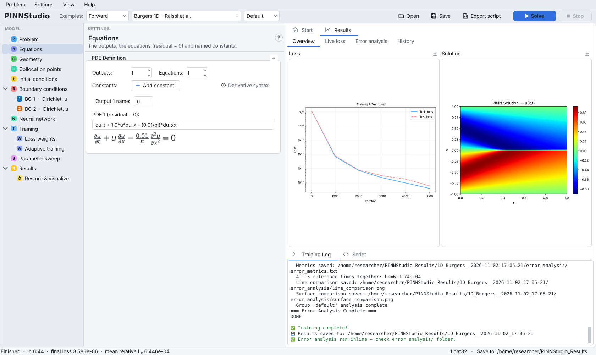

#  PINNStudio

*A graphical platform for forward and inverse physics-informed neural networks*

<p align="center">
  <a href="https://pypi.org/project/pinnstudio/"></a>
  <a href="https://pypi.org/project/pinnstudio/"></a>
  <a href="https://github.com/AsfandyarKhan72/PINNStudio/blob/main/LICENSE"></a>
  <a href="https://github.com/AsfandyarKhan72/PINNStudio/actions/workflows/platform-tests.yml"></a>
</p>

<p align="center">
  <strong><a href="https://asfandyarkhan72.github.io/PINNStudio/">Documentation</a></strong> &nbsp;·&nbsp;
  <strong><a href="https://asfandyarkhan72.github.io/PINNStudio/getting-started/installation/">Installation</a></strong> &nbsp;·&nbsp;
  <strong><a href="https://asfandyarkhan72.github.io/PINNStudio/tutorials/">Tutorials</a></strong> &nbsp;·&nbsp;
  <strong><a href="https://asfandyarkhan72.github.io/PINNStudio/examples/">Examples</a></strong> &nbsp;·&nbsp;
  <strong><a href="https://asfandyarkhan72.github.io/PINNStudio/help/troubleshooting/">Troubleshooting</a></strong> &nbsp;·&nbsp;
  <strong><a href="https://asfandyarkhan72.github.io/PINNStudio/help/faq/">FAQ</a></strong>
</p>

PINNStudio is a desktop application for solving ordinary and partial differential equations with
physics-informed neural networks (PINNs). You set up a problem in one window: the equations, the domain, the
boundary and initial conditions, the network and how it is trained. PINNStudio writes a DeepXDE/PyTorch script
from these settings, trains it while showing the loss, and compares the solution with reference data or an exact
formula. The same script can be exported, so every run can be read, rerun and shared outside the program.

It is meant for researchers and students in science and engineering who want to use PINNs without writing a new
script for every problem, including people who are new to scientific machine learning. It handles forward
problems, where the equation is known and the solution is wanted, and inverse problems, where unknown coefficients
or fields are learned from measured data.

<p align="center">

</p>
<p align="center"><sub>The Burgers 1D example after training: the model tree on the left, the equation in the middle,
the loss and the solution on the right, and the Training Log below.</sub></p>

## Key capabilities

- **Forward and inverse problems.** Solve a known equation, or learn unknown coefficients or a whole unknown field
  from measured data while the solution is found. Learn more: [forward problems](https://asfandyarkhan72.github.io/PINNStudio/reference/forward/), [inverse problems](https://asfandyarkhan72.github.io/PINNStudio/reference/inverse/), [parameter-estimation tutorial](https://asfandyarkhan72.github.io/PINNStudio/tutorials/06-inverse/).
- **ODEs and PDEs in 1D, 2D and 3D.** Steady or time-dependent equations and coupled systems, including
  integro-differential and fractional equations, typed as residuals such as `du_t + u*du_x - 0.01/pi*du_xx`.
  Learn more: [equations](https://asfandyarkhan72.github.io/PINNStudio/reference/equations/), [coupled systems](https://asfandyarkhan72.github.io/PINNStudio/reference/coupled/).
- **Domains and conditions.** Built-in shapes and combinations of them, or a domain drawn in the Sketch or imported
  from a DXF or SVG drawing; Dirichlet, Neumann, Robin, periodic, point-data and operator conditions, or conditions
  imposed exactly through the network output. Learn more: [geometry](https://asfandyarkhan72.github.io/PINNStudio/guide/geometry/), [boundary conditions](https://asfandyarkhan72.github.io/PINNStudio/reference/boundary-conditions/),
  [exact constraints](https://asfandyarkhan72.github.io/PINNStudio/reference/exact-constraints/).
- **Training methods.** Multi-phase training (for example Adam, then L-BFGS), residual-based adaptive refinement,
  time windows and bc-PINN, causal training, RBA and SA-PINN point weights, and an exact initial condition or
  exact periodicity. Learn more: [choosing a training strategy](https://asfandyarkhan72.github.io/PINNStudio/guide/choosing-a-strategy/), [RAR](https://asfandyarkhan72.github.io/PINNStudio/reference/rar/),
  [RBA and SA-PINN](https://asfandyarkhan72.github.io/PINNStudio/reference/point-weights/), [causal training](https://asfandyarkhan72.github.io/PINNStudio/reference/causal/), [time windows](https://asfandyarkhan72.github.io/PINNStudio/reference/time-windows/).
- **Parameter sweeps.** Vary almost any setting one at a time, in all combinations, as paired values or with a
  Bayesian search, and compare the runs on one plot. [Full guide](https://asfandyarkhan72.github.io/PINNStudio/reference/sweeps/).
- **Error analysis and plots.** Relative L₂, MSE, maximum and mean absolute error against reference data or an
  exact formula, with line and surface plots, animations and a history of every saved run. Learn more:
  [Error Analysis](https://asfandyarkhan72.github.io/PINNStudio/guide/error-analysis/), [error metrics](https://asfandyarkhan72.github.io/PINNStudio/reference/metrics/).
- **Standalone scripts and restore.** Every problem exports as a DeepXDE/PyTorch script that trains the same model
  as **Solve**, and a saved model can be reloaded and plotted again without retraining. Learn more:
  [generated scripts](https://asfandyarkhan72.github.io/PINNStudio/reference/scripts/), [checkpoints and restoring](https://asfandyarkhan72.github.io/PINNStudio/reference/checkpoints/).
- **64 built-in examples.** From simple ODEs to the Navier-Stokes equations in 3D, covering DeepXDE's documented
  examples and published PINN benchmarks, almost all with an exact solution or reference data.
  [Example gallery](https://asfandyarkhan72.github.io/PINNStudio/examples/).

## Installation

PINNStudio needs Python 3.11 or newer. In a Python environment you already have (a virtual or conda environment
is recommended):

```bash
pip install pinnstudio
```

**Or install with one command, without installing Python first.** The installer sets up PINNStudio with its own
Python and the PyTorch build that matches your computer's GPU (or a CPU-only build), and adds PINNStudio to the
Start menu and desktop (Windows), the Applications folder in your home folder (macOS) or the app menu (Linux).
Python and git do not need to be installed.

**macOS / Linux** (in a terminal):
```bash
curl -LsSf https://raw.githubusercontent.com/AsfandyarKhan72/PINNStudio/main/get-pinnstudio.sh | sh
```

**Windows** (in PowerShell):
```powershell
powershell -ExecutionPolicy ByPass -c "irm https://raw.githubusercontent.com/AsfandyarKhan72/PINNStudio/main/get-pinnstudio.ps1 | iex"
```

The install takes a few minutes, and at the end it says which version was installed and whether training will run
on the GPU. Running the same command again updates PINNStudio. Both `pip install pinnstudio` and the installer
install the latest release from PyPI; features listed under *Unreleased* in the
[CHANGELOG](https://github.com/AsfandyarKhan72/PINNStudio/blob/main/CHANGELOG.md) come with the next release, or
now with a source install.

The [installation guide](https://asfandyarkhan72.github.io/PINNStudio/getting-started/installation/) covers
choosing a CUDA build of PyTorch, the source install for development, the systems PINNStudio is tested on, Intel
Macs and Windows on ARM, updating and uninstalling, and common installation problems.

## Quick start

1. Open PINNStudio from its icon, or run `pinnstudio` in a terminal. It opens on the **Start** tab.
2. Under **Examples** on the Start tab, click **Heat 1D – Dirichlet**. Every setting fills in, and the model tree
   on the left shows each part of the problem.
3. Press **Solve** (or Ctrl+Enter). The loss is plotted while the model trains (*Results → Live loss*).
4. When the run finishes, *Results → Overview* shows the loss and the solution, and *Results → Error analysis*
   gives the relative L₂ error against the exact solution, with comparison plots.

The [first-run guide](https://asfandyarkhan72.github.io/PINNStudio/getting-started/first-run/) walks through
the same steps in more detail, and the [tutorials](https://asfandyarkhan72.github.io/PINNStudio/tutorials/) set up
problems from an empty window.

## Examples

A selection of the 64 built-in examples. Each loads from the toolbar's **Examples** list with one of two settings:
*Default*, the source's own settings (DeepXDE's, the paper's method or the template's), or *Tuned*, the most
accurate run of the tuning study (the fastest of the runs within 25% of the lowest error).

| Example | Dimension | What it shows |
|---|---|---|
| [Lorenz ODE – unknown C₁, C₂, C₃](https://asfandyarkhan72.github.io/PINNStudio/examples/ode/lorenz-ode-unknown-c1-c2-c3/) | ODE | Three coefficients of the Lorenz system learned from data |
| [Burgers 1D – Raissi et al.](https://asfandyarkhan72.github.io/PINNStudio/examples/1d/burgers-1d-raissi-et-al/) | 1D, time-dependent | The Burgers benchmark of Raissi et al. (2019), forward and inverse |
| [Schrödinger 1D](https://asfandyarkhan72.github.io/PINNStudio/examples/1d/schrodinger-1d/) | 1D, time-dependent | A coupled system for the real and imaginary parts |
| [Poisson 2D – L-shape](https://asfandyarkhan72.github.io/PINNStudio/examples/2d/poisson-2d-l-shape/) | 2D, steady | A polygon domain with a re-entrant corner |
| [Helmholtz 2D – square with hole](https://asfandyarkhan72.github.io/PINNStudio/examples/2d/helmholtz-2d-square-with-hole/) | 2D, steady | A domain with a hole and a Neumann condition on its edge |
| [Linear elasticity 2D – plate](https://asfandyarkhan72.github.io/PINNStudio/examples/2d/linear-elasticity-2d-plate/) | 2D, steady | Displacements and stresses as five coupled outputs |
| [Allen-Cahn 2D – Mattey & Ghosh](https://asfandyarkhan72.github.io/PINNStudio/examples/2d/allen-cahn-2d-mattey-ghosh/) | 2D, time-dependent | A phase-field problem, by default with the paper's bc-PINN method |
| [Navier-Stokes 3D – Beltrami flow](https://asfandyarkhan72.github.io/PINNStudio/examples/3d/navier-stokes-3d-beltrami-flow/) | 3D, time-dependent | Incompressible flow with velocity and pressure outputs |

The [example gallery](https://asfandyarkhan72.github.io/PINNStudio/examples/) describes every example: its
equations, domain, conditions and settings. The results and figures of each example are in
[benchmarks/examples.md](https://github.com/AsfandyarKhan72/PINNStudio/blob/main/benchmarks/examples.md).

## Documentation

- [Documentation website](https://asfandyarkhan72.github.io/PINNStudio/): getting started, the user guide for
  every page of the window, the feature reference and the theory behind the methods.
- [Tutorials](https://asfandyarkhan72.github.io/PINNStudio/tutorials/): step-by-step problems, from a first ODE to
  inverse problems, adaptive methods and exported scripts, and a
  [walkthrough for an equation of your own](https://asfandyarkhan72.github.io/PINNStudio/tutorials/18-own-problem/).
- [Example gallery](https://asfandyarkhan72.github.io/PINNStudio/examples/): all 64 built-in examples.
- [Troubleshooting](https://asfandyarkhan72.github.io/PINNStudio/help/troubleshooting/) and
  [FAQ](https://asfandyarkhan72.github.io/PINNStudio/help/faq/).
- [How PINNStudio works](https://asfandyarkhan72.github.io/PINNStudio/developer/architecture/), the
  [repository and the source code of each feature](https://asfandyarkhan72.github.io/PINNStudio/developer/structure/), and
  [how fast it trains](https://asfandyarkhan72.github.io/PINNStudio/reproducibility/environment/#training-speed).
- [Demo video](https://youtu.be/5ILxuutvEZw) on YouTube.

## Reproducibility and benchmarks

The examples were trained with their *Default* settings and with the changes tried in the tuning study, and the
records are kept in the repository, together with problem files that load the tuned setups.
[benchmarks/README.md](https://github.com/AsfandyarKhan72/PINNStudio/blob/main/benchmarks/README.md) compares, for
each example, the source's settings with PINNStudio's best and, for templates taken from a paper, with the error
the paper reports. The [Reproducibility](https://asfandyarkhan72.github.io/PINNStudio/reproducibility/) section of
the website describes how the reference solutions were computed, how seeds, precision and hardware are handled,
and how the exported scripts are checked against **Solve**. The errors reported there are relative L₂ errors of
the main output at the last reference time (papers' errors over all times are given separately), from seed 2026,
or the median of seeds 1, 2 and 2026 where a setting was run three times. Runs use a fixed random seed by default,
and each run saves its settings next to its results.

## Citation

If PINNStudio is useful in your work, please cite it — see
[`CITATION.cff`](https://github.com/AsfandyarKhan72/PINNStudio/blob/main/CITATION.cff); if you used a released
version, add its number (`version = {…}`). A paper describing PINNStudio is in preparation.

```bibtex
@software{khan2026pinnstudio,
  author  = {Khan, Asfandyar and Mamivand, Mahmood},
  title   = {PINNStudio: A graphical platform for forward and inverse physics-informed neural networks},
  year    = {2026},
  url     = {https://github.com/AsfandyarKhan72/PINNStudio}
}
```

## Acknowledgment

PINNStudio is built on [DeepXDE](https://github.com/lululxvi/deepxde) (Lu et al., 2021), [PyTorch](https://pytorch.org) and Qt for Python (PySide6). We are especially grateful to Lu Lu and the DeepXDE developers: DeepXDE is the physics-informed learning library that every script PINNStudio generates runs on, and its documented examples are included among PINNStudio's examples, each linked to its original script. PINNStudio is an independent project and is not affiliated with or endorsed by the DeepXDE developers.

The examples that reproduce published benchmarks follow the problem setups of the original papers: *Burgers 1D – Raissi et al.* follows [Raissi, Perdikaris & Karniadakis (2019)](https://doi.org/10.1016/j.jcp.2018.10.045); *Burgers 2D – Mathias et al.* follows [Mathias et al. (2022)](https://arxiv.org/abs/2301.07824); the Allen-Cahn and Cahn-Hilliard examples follow [Wight & Zhao (2021)](https://doi.org/10.4208/cicp.OA-2020-0086) and [Mattey & Ghosh (2022)](https://doi.org/10.1016/j.cma.2021.114474); and *Poisson 2D – L-shape* is the demonstration example of the DeepXDE paper ([Lu et al., 2021](https://doi.org/10.1137/19M1274067)). Full references are listed on the website's [Scientific references](https://asfandyarkhan72.github.io/PINNStudio/about/references/) page.

Developed under the supervision of Prof. Mahmood Mamivand, Computational Materials Design Lab, Boise State University.

The authors appreciate the support of the National Science Foundation grant DMR-2142935. We would like to acknowledge the high-performance computing support of the Borah compute cluster (DOI: 10.18122/oit/3/boisestate) provided by Boise State University's Research Computing Department.

## Contributing

Bug reports, feature requests, and pull requests are welcome — see [`CONTRIBUTING.md`](https://github.com/AsfandyarKhan72/PINNStudio/blob/main/CONTRIBUTING.md).

## Contact

Asfandyar Khan
PhD Candidate, Materials Science and Engineering
Boise State University
Email: [asfandyarkhan@u.boisestate.edu](mailto:asfandyarkhan@u.boisestate.edu)

## License

Copyright (C) 2026 the PINNStudio authors

PINNStudio is free software: you can redistribute it and/or modify it under the terms of the GNU General Public License as published by the Free Software Foundation, version 3 of the License (GPL-3.0-only). PINNStudio is distributed in the hope that it will be useful, but WITHOUT ANY WARRANTY; without even the implied warranty of MERCHANTABILITY or FITNESS FOR A PARTICULAR PURPOSE. See the GNU General Public License in [`LICENSE`](LICENSE) for more details.

PINNStudio's interface is built on PyQt6, which Riverbank Computing licenses under the GPL version 3 (or commercially), and PINNStudio is distributed under the same license. Releases up to and including 1.5.0 were published under the MIT License, and copies received under those releases keep that license.

**Additional permission for generated scripts (GNU GPL version 3, section 7).** PINNStudio writes a Python script for each problem: the script *Export script* saves, and the script *Solve* runs. Such a script contains code from PINNStudio's code templates. As an additional permission under section 7 of the GNU GPL version 3, the copyright holders of PINNStudio permit you to use, modify and distribute a script generated by PINNStudio, including the parts of PINNStudio's code templates it contains, under terms of your choice. This permission covers only the material in a generated script whose copyright is held by PINNStudio's copyright holders. It does not change the license of PINNStudio itself or of any part of PINNStudio other than generated scripts, and it does not grant any rights in third-party software: the libraries a generated script imports (such as DeepXDE, PyTorch, NumPy and Matplotlib) remain under their own licenses. If you modify PINNStudio, you may remove this additional permission from your version.

**Your input and your results.** What you enter into PINNStudio (equations, constants, settings, geometry, data) and what you produce by running PINNStudio or a generated script (data files, figures, animations, trained model weights, logs) are not part of PINNStudio, and PINNStudio's copyright holders claim no rights in them. Where your input appears in a generated script, it stays yours; the additional permission above concerns only the code PINNStudio adds to it.

**Third-party software.** PINNStudio runs on DeepXDE (LGPL-2.1), PyTorch (BSD-3-Clause), PyQt6 (GPL-3.0) with Qt (LGPL-3.0), NumPy, SciPy, Matplotlib and pandas, which are installed as separate packages and keep their own licenses; some of the interface's icons are derived from Lucide (ISC) and Feather (MIT). PINNStudio is an independent project, not affiliated with or endorsed by the developers of these packages. See [`THIRD_PARTY_LICENSES.md`](THIRD_PARTY_LICENSES.md).

**Application icon and reference data.** The PINNStudio application icon was created for PINNStudio, with the assistance of Claude (Anthropic), and is part of PINNStudio under the same license. The reference solutions in [`reference_data/`](reference_data) were computed for PINNStudio by its author, with the scripts in [`tools/`](tools) or, for four templates, with COMSOL Multiphysics (see [`THIRD_PARTY_LICENSES.md`](THIRD_PARTY_LICENSES.md)); none were copied from DeepXDE or from published papers.
