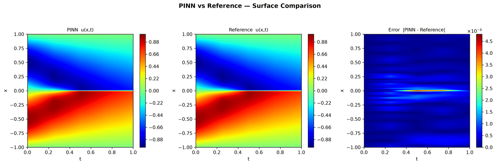
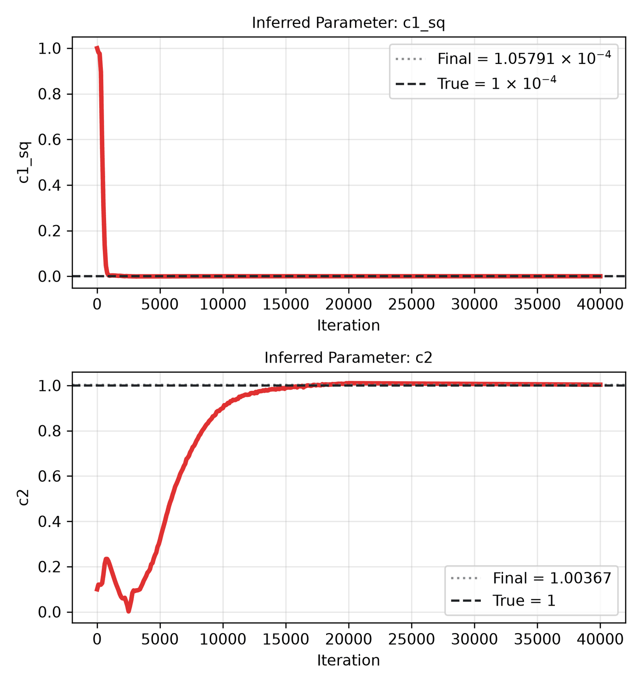
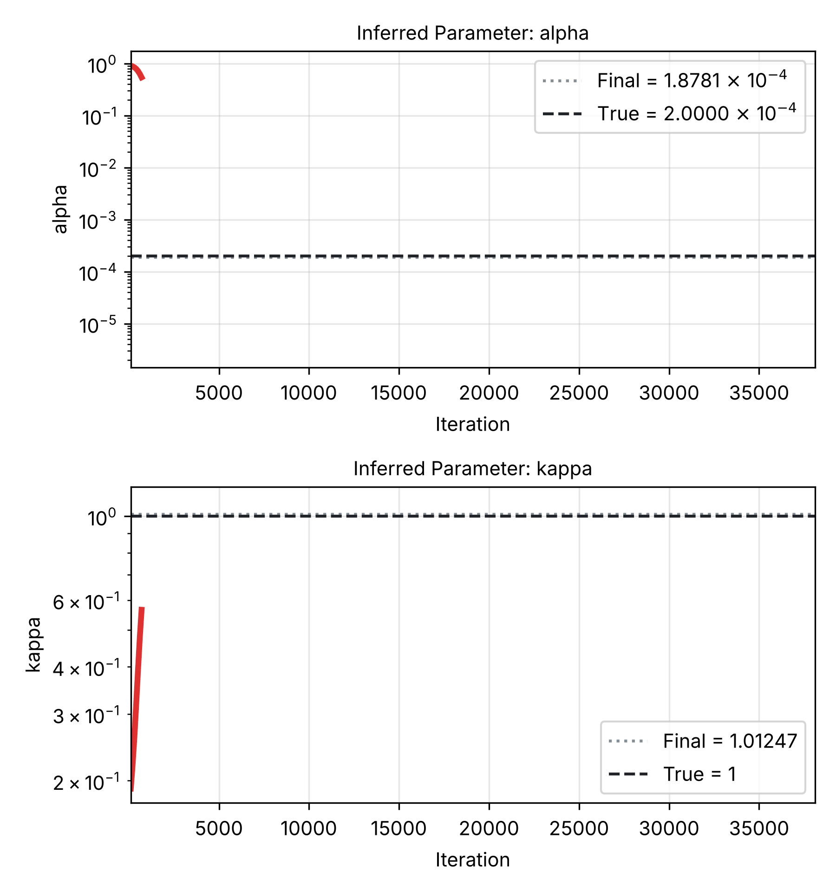
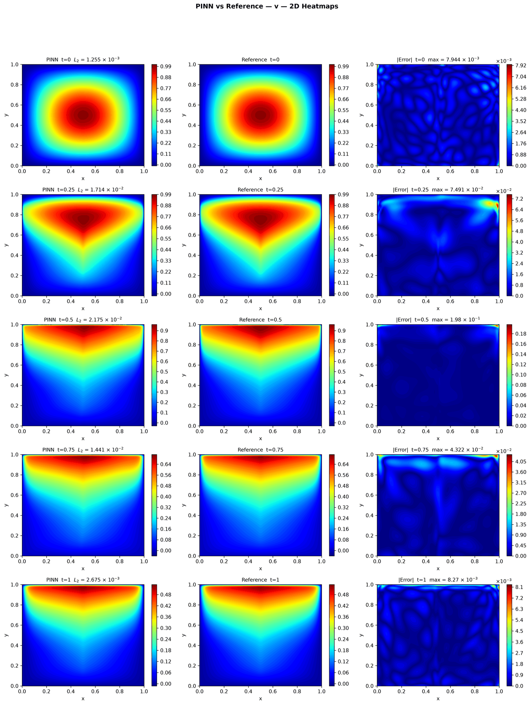
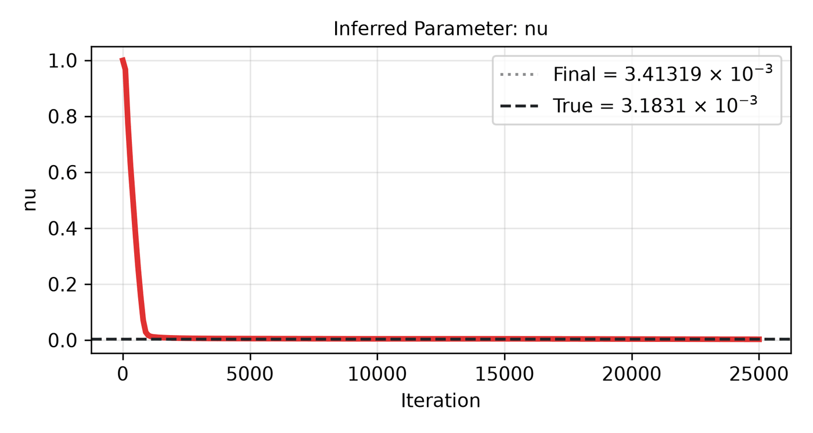
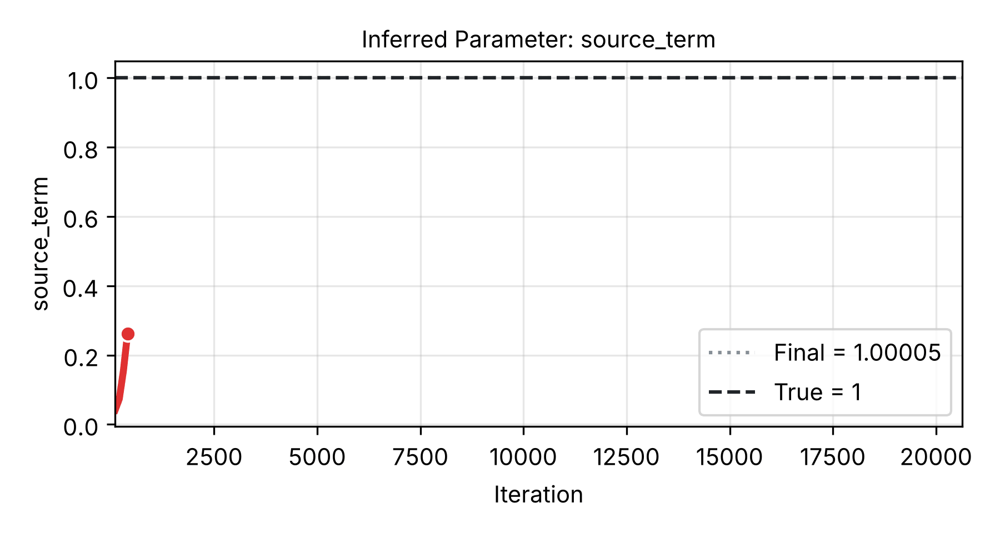

# PINNStudio benchmarks

*Every example of PINNStudio, forward and inverse, with the result of its reference settings and PINNStudio's best. Updated as the runs finish.*

**How to read an example.** Each example opens to one table for the forward problem and one for the inverse problem. The first row is the reference: **DeepXDE's own settings** for a DeepXDE example, the **template's starting settings** for a PINNStudio template (the settings PINNStudio's template was written with, before the tuning study; for a template from a paper this is not the paper's method, which has its own row). The next rows are the tuning study's changes, each tried on its own and then all together: 3× the iterations, a larger network (twice as wide, one more layer), 3× the training points, an L-BFGS phase after Adam (for inverse problems also 10× the weight of the measured data and 3× the L-BFGS iterations). The last row, **PINNStudio best**, is the most accurate run, and when several runs are about as accurate (within 25% of the lowest error) the fastest of them, so a change that costs time without helping is not chosen; that run is marked 🔴 in the table and its time is repeated in the last row. For an inverse problem, accuracy is the error of the learned parameters. These are the **Tuned** settings. Below the tables, two toggles hold the figures: **Forward results** (DeepXDE's settings, or for a template from a paper the paper's method run in PINNStudio, then PINNStudio's best) and **Inverse results** (PINNStudio's best; for DeepXDE's own inverse examples DeepXDE's settings first).

For a **template taken from a paper**, the forward table also lists a **base PINN** — the baseline each paper compares against, with the paper's network and points for it, soft initial and boundary conditions, the whole time interval, equal loss weights and no adaptive technique, the error the paper reports and the paper's own method run in PINNStudio ([how they are set up](paper_comparison.md)); for a template run from the [training methods study](training_methods.md)'s best setup, the changes are tried on that setup. Where a DeepXDE example has no inverse problem of its own, the inverse table is PINNStudio's inverse mode of it.

**The error** is the relative L₂ error of the main output (u, φ, h, …) at the last reference time, against the example's reference data; papers report one error over all times, so their rows give that too. Where a row ran with 3 seeds (1, 2, 2026) it gives the median, otherwise seed 2026. Times are training seconds on one RTX 4090.

The sweep was run on the 36 examples with the largest errors. The others were already accurate with their own settings: their result is the README's, marked **no tuning needed**.

*Open grey markers: DeepXDE's settings, or the paper's method run in PINNStudio; filled: PINNStudio's best (one filled marker where the two are the same, or where no tuning was needed). Right: the error of each learned parameter, labelled with its symbol.*

## ODEs

<strong>Integro-differential ODE</strong> · DeepXDE example

[problem and settings in the README](../README.md#dx-integro-differential-equation)

**Forward problem**

| Training | L₂ | Time (s) |
|---|---|---|
| DeepXDE's settings (README) | 1.5 × 10-4 | – |
| **PINNStudio best** (Settings: Tuned): no tuning needed | **1.5 × 10-4** | – |

<strong>Forward results: figures</strong>

*DeepXDE's settings (README):*

<strong>Integro-differential ODE – Volterra kernel</strong> · DeepXDE example

[problem and settings in the README](../README.md#dx-volterra-integro-differential-equation)

**Forward problem**

| Training | L₂ | Time (s) |
|---|---|---|
| DeepXDE's settings (README) | 2.5 × 10-3 | – |
| **PINNStudio best** (Settings: Tuned): no tuning needed | **2.5 × 10-3** | – |

<strong>Forward results: figures</strong>

*DeepXDE's settings (README):*

<strong>Linear ODE system</strong> · DeepXDE example

[problem and settings in the README](../README.md#dx-ode-system) · [inverse runs in the tuning study](tuning_study.md#tune-linear-ode-system-inverse-mode)

**Forward problem**

| Training | L₂ | Time (s) |
|---|---|---|
| DeepXDE's settings (README) | 3.6 × 10-3 | – |
| **PINNStudio best** (Settings: Tuned): no tuning needed | **3.6 × 10-3** | – |

**Inverse problem**

| Training | L₂ | Parameters found (true) | Worst parameter error | Time (s) |
|---|---|---|---|---|
| DeepXDE's settings | 3.3 × 10-4 | ω = 0.999776 (1) | 0.022% | 48 |
| Larger network (2× width, one more layer) | 4.5 × 10-4 | ω = 0.999558 (1) | 0.044% | 49 |
| 3× L-BFGS iterations | 3.3 × 10-4 | ω = 0.999776 (1) | 0.022% | 47 |
| 🔴 **All of the above together** | **2.0 × 10-4** | **ω = 0.999912 (1)** | **0.0088%** | **135** |
| 10× data weight, 3× L-BFGS and the larger network | 4.6 × 10-4 | ω = 0.999089 (1) | 0.091% | 50 |
| **PINNStudio best** (Settings: Tuned): all of the changes together | **2.0 × 10-4** | ω = 0.999912 (1) | **0.0088%** | **135** |

*DeepXDE's example is forward only; this inverse problem is PINNStudio's inverse mode of it.*

<strong>Forward results: figures</strong>

*DeepXDE's settings (README):*

<strong>Inverse results: figures</strong>

*PINNStudio best — all of the changes together:*

<strong>Lotka-Volterra ODE</strong> · DeepXDE example

[problem and settings in the README](../README.md#dx-lotka-volterra-equation) · [inverse runs in the tuning study](tuning_study.md#tune-lotka-volterra-ode-inverse-mode)

**Forward problem**

| Training | L₂ | Time (s) |
|---|---|---|
| DeepXDE's settings (README) | 2.1 × 10-3 | – |
| **PINNStudio best** (Settings: Tuned): no tuning needed | **2.1 × 10-3** | – |

**Inverse problem**

| Training | L₂ | Parameters found (true) | Worst parameter error | Time (s) |
|---|---|---|---|---|
| 🔴 **DeepXDE's settings** | **1.5 × 10-5** | **a = 2.00001 (2); d = 1.06 (1.06)** | **0.0005%** | **230** |
| Larger network (2× width, one more layer) | 1.8 × 10-5 | a = 2 (2); d = 1.05999 (1.06) | 0.00094% | 243 |
| 3× L-BFGS iterations | 1.5 × 10-5 | a = 2.00001 (2); d = 1.06 (1.06) | 0.0005% | 240 |
| All of the above together | 1.2 × 10-5 | a = 1.99999 (2); d = 1.06001 (1.06) | 0.00094% | 648 |
| 10× data weight, 3× L-BFGS and the larger network | 9.2 × 10-6 | a = 2.00001 (2); d = 1.06001 (1.06) | 0.00094% | 250 |
| **PINNStudio best** (Settings: Tuned): the example's own settings (no change did better) | **1.5 × 10-5** | a = 2.00001 (2); d = 1.06 (1.06) | **0.0005%** | **230** |

*DeepXDE's example is forward only; this inverse problem is PINNStudio's inverse mode of it.*

<strong>Forward results: figures</strong>

*DeepXDE's settings (README):*

<strong>Inverse results: figures</strong>

*PINNStudio best — the example's own settings (no change did better):*

<strong>Second-order ODE</strong> · DeepXDE example

[problem and settings in the README](../README.md#dx-second-order-ode) · [inverse runs in the tuning study](tuning_study.md#tune-second-order-ode-inverse-mode)

**Forward problem**

| Training | L₂ | Time (s) |
|---|---|---|
| DeepXDE's settings (README) | 6.9 × 10-4 | – |
| **PINNStudio best** (Settings: Tuned): no tuning needed | **6.9 × 10-4** | – |

**Inverse problem**

| Training | L₂ | Parameters found (true) | Worst parameter error | Time (s) |
|---|---|---|---|---|
| DeepXDE's settings | 1.6 × 10-3 | a = 9.93327 (10); b = 9.6526 (9) | 7.3% | 27 |
| 🔴 **Larger network (2× width, one more layer)** | **8.9 × 10-6** | **a = 10.0003 (10); b = 8.99262 (9)** | **0.082%** | **30** |
| 3× L-BFGS iterations | 1.6 × 10-3 | a = 9.93327 (10); b = 9.6526 (9) | 7.3% | 25 |
| All of the above together | 5.8 × 10-5 | a = 9.99773 (10); b = 9.0168 (9) | 0.19% | 74 |
| 10× data weight, 3× L-BFGS and the larger network | 4.1 × 10-4 | a = 9.97923 (10); b = 9.37949 (9) | 4.2% | 28 |
| **PINNStudio best** (Settings: Tuned): Larger network (2× width, one more layer) | **8.9 × 10-6** | a = 10.0003 (10); b = 8.99262 (9) | **0.082%** | **30** |

*DeepXDE's example is forward only; this inverse problem is PINNStudio's inverse mode of it.*

<strong>Forward results: figures</strong>

*DeepXDE's settings (README):*

<strong>Inverse results: figures</strong>

*PINNStudio best — Larger network (2× width, one more layer):*

<strong>Lorenz ODE – unknown C₁, C₂, C₃</strong> · DeepXDE example

[problem and settings in the README](../README.md#dx-inverse-lorenz-system)

**Inverse problem**

| Training | L₂ | Parameters found (true) | Worst parameter error | Time (s) |
|---|---|---|---|---|
| DeepXDE's settings (README) | 1.0 × 10-4 | C₁ = 10 (10); C₂ = 14.9998 (15); C₃ = 2.66664 (2.66667) | 0.0013% | – |
| **PINNStudio best** (Settings: Tuned): no tuning needed | **1.0 × 10-4** | C₁ = 10 (10); C₂ = 14.9998 (15); C₃ = 2.66664 (2.66667) | **0.0013%** | – |

<strong>Inverse results: figures</strong>

*PINNStudio best (README):*

<strong>Lorenz ODE – unknown C₁, C₂, C₃, exogenous input</strong> · DeepXDE example

[problem and settings in the README](../README.md#dx-inverse-lorenz-system-with-exogenous-input)

**Inverse problem**

| Training | L₂ | Parameters found (true) | Worst parameter error | Time (s) |
|---|---|---|---|---|
| DeepXDE's settings (README) | 1.6 × 10-3 | C₁ = 9.974 (10); C₂ = 14.996 (15); C₃ = 2.6669 (2.66667) | 0.26% | – |
| **PINNStudio best** (Settings: Tuned): no tuning needed | **1.6 × 10-3** | C₁ = 9.974 (10); C₂ = 14.996 (15); C₃ = 2.6669 (2.66667) | **0.26%** | – |

<strong>Inverse results: figures</strong>

*PINNStudio best (README):*

## 1D, steady

<strong>Euler beam 1D</strong> · DeepXDE example

[problem and settings in the README](../README.md#dx-euler-beam) · [forward runs in the tuning study](tuning_study.md#tune-euler-beam-1d) · [inverse runs in the tuning study](tuning_study.md#tune-euler-beam-1d-inverse-mode)

**Forward problem**

| Training | L₂ | Time (s) |
|---|---|---|
| DeepXDE's settings (3 seeds, median) | 3.5 × 10-3 | 55 |
| 3× iterations | 5.2 × 10-3 | 157 |
| Larger network (2× width, one more layer) | 8.2 × 10-3 | 74 |
| 3× training points | 2.8 × 10-2 | 56 |
| 🔴 **L-BFGS phase added** | **2.4 × 10-4** | **59** |
| All of the above together (3 seeds, median) | 2.8 × 10-4 | 217 |
| **PINNStudio best** (Settings: Tuned): L-BFGS phase added | **2.4 × 10-4** | **59** |

**Inverse problem**

| Training | L₂ | Parameters found (true) | Worst parameter error | Time (s) |
|---|---|---|---|---|
| DeepXDE's settings | 1.6 × 10-3 | EI = 1.02349 (1) | 2.3% | 61 |
| Larger network (2× width, one more layer) | 6.4 × 10-5 | EI = 1.00153 (1) | 0.15% | 80 |
| 3× L-BFGS iterations | 1.6 × 10-3 | EI = 1.02349 (1) | 2.3% | 60 |
| 🔴 **All of the above together** | **3.8 × 10-5** | **EI = 1.00075 (1)** | **0.075%** | **231** |
| 10× data weight, 3× L-BFGS and the larger network | 1.9 × 10-4 | EI = 0.995268 (1) | 0.47% | 80 |
| **PINNStudio best** (Settings: Tuned): all of the changes together | **3.8 × 10-5** | EI = 1.00075 (1) | **0.075%** | **231** |

*DeepXDE's example is forward only; this inverse problem is PINNStudio's inverse mode of it.*

<strong>Forward results: figures</strong>

*DeepXDE's settings:*

*PINNStudio best — L-BFGS phase added:*

<strong>Inverse results: figures</strong>

*PINNStudio best — all of the changes together:*

<strong>Fractional Poisson 1D</strong> · DeepXDE example

[problem and settings in the README](../README.md#dx-fractional-poisson-equation-1d) · [forward runs in the tuning study](tuning_study.md#tune-fractional-poisson-1d)

**Forward problem**

| Training | L₂ | Time (s) |
|---|---|---|
| DeepXDE's settings (3 seeds, median) | 2.3 × 10-2 | 20 |
| 3× iterations | 1.4 × 10-2 | 52 |
| 🔴 **Larger network (2× width, one more layer)** | **1.5 × 10-2** | **21** |
| 3× training points | 3.7 × 10-2 | 19 |
| L-BFGS phase added | 2.0 × 10-2 | 19 |
| All of the above together (3 seeds, median) | 1.2 × 10-2 | 57 |
| **PINNStudio best** (Settings: Tuned): Larger network (2× width, one more layer) | **1.5 × 10-2** | **21** |

<strong>Forward results: figures</strong>

*DeepXDE's settings:*

*PINNStudio best — Larger network (2× width, one more layer):*

<strong>Poisson 1D – Dirichlet</strong> · DeepXDE example

[problem and settings in the README](../README.md#dx-poisson-1d-dirichlet)

**Forward problem**

| Training | L₂ | Time (s) |
|---|---|---|
| DeepXDE's settings (README) | 3.7 × 10-4 | – |
| **PINNStudio best** (Settings: Tuned): no tuning needed | **3.7 × 10-4** | – |

<strong>Forward results: figures</strong>

*DeepXDE's settings (README):*

<strong>Poisson 1D – Dirichlet/Neumann</strong> · DeepXDE example

[problem and settings in the README](../README.md#dx-poisson-1d-dirichlet-neumann)

**Forward problem**

| Training | L₂ | Time (s) |
|---|---|---|
| DeepXDE's settings (README) | 2.3 × 10-4 | – |
| **PINNStudio best** (Settings: Tuned): no tuning needed | **2.3 × 10-4** | – |

<strong>Forward results: figures</strong>

*DeepXDE's settings (README):*

<strong>Poisson 1D – Dirichlet/Periodic</strong> · DeepXDE example

[problem and settings in the README](../README.md#dx-poisson-1d-dirichlet-periodic) · [forward runs in the tuning study](tuning_study.md#tune-poisson-1d-dirichlet-periodic)

**Forward problem**

| Training | L₂ | Time (s) |
|---|---|---|
| DeepXDE's settings (3 seeds, median) | 9.6 × 10-3 | 20 |
| 3× iterations | 1.1 × 10-3 | 54 |
| Larger network (2× width, one more layer) | 2.6 × 10-3 | 22 |
| 3× training points | 1.6 × 10-3 | 20 |
| L-BFGS phase added | 3.5 × 10-5 | 21 |
| 🔴 **All of the above together (3 seeds, median)** | **6.4 × 10-6** | **67** |
| **PINNStudio best** (Settings: Tuned): all of the changes together | **6.4 × 10-6** | **67** |

<strong>Forward results: figures</strong>

*DeepXDE's settings:*

*PINNStudio best — all of the changes together:*

<strong>Poisson 1D – Dirichlet/point-set operator</strong> · DeepXDE example

[problem and settings in the README](../README.md#dx-poisson-1d-dirichlet-pointsetoperator)

**Forward problem**

| Training | L₂ | Time (s) |
|---|---|---|
| DeepXDE's settings (README) | 2.6 × 10-5 | – |
| **PINNStudio best** (Settings: Tuned): no tuning needed | **2.6 × 10-5** | – |

<strong>Forward results: figures</strong>

*DeepXDE's settings (README):*

<strong>Poisson 1D – Dirichlet/Robin</strong> · DeepXDE example

[problem and settings in the README](../README.md#dx-poisson-1d-dirichlet-robin)

**Forward problem**

| Training | L₂ | Time (s) |
|---|---|---|
| DeepXDE's settings (README) | 2.4 × 10-4 | – |
| **PINNStudio best** (Settings: Tuned): no tuning needed | **2.4 × 10-4** | – |

<strong>Forward results: figures</strong>

*DeepXDE's settings (README):*

<strong>Poisson 1D – hard BCs</strong> · DeepXDE example

[problem and settings in the README](../README.md#dx-poisson-1d-hard-boundary-conditions)

**Forward problem**

| Training | L₂ | Time (s) |
|---|---|---|
| DeepXDE's settings (README) | 2.2 × 10-6 | – |
| **PINNStudio best** (Settings: Tuned): no tuning needed | **2.2 × 10-6** | – |

<strong>Forward results: figures</strong>

*DeepXDE's settings (README):*

<strong>Poisson 1D – multi-scale Fourier features</strong> · DeepXDE example

[problem and settings in the README](../README.md#dx-poisson-1d-multi-scale-fourier-features)

**Forward problem**

| Training | L₂ | Time (s) |
|---|---|---|
| DeepXDE's settings (README) | 3.9 × 10-3 | – |
| **PINNStudio best** (Settings: Tuned): no tuning needed | **3.9 × 10-3** | – |

<strong>Forward results: figures</strong>

*DeepXDE's settings (README):*

<strong>Brinkman-Forchheimer 1D – unknown ν_e, K</strong> · DeepXDE example

[problem and settings in the README](../README.md#dx-inverse-brinkman-forchheimer-model) · [forward runs in the tuning study](tuning_study.md#tune-brinkman-forchheimer-1d-unknown-e-k)

**Inverse problem**

| Training | L₂ | Parameters found (true) | Worst parameter error | Time (s) |
|---|---|---|---|---|
| DeepXDE's settings (3 seeds, median) | 2.0 × 10-2 | νₑ = 0.00127637 (0.001); K = 0.00103624 (0.001) | 28% | 74 |
| 🔴 **3× iterations** | **1.3 × 10-2** | **νₑ = 0.00115135 (0.001); K = 0.00103409 (0.001)** | **15%** | **234** |
| Larger network (2× width, one more layer) | 1.2 × 10-2 | νₑ = 0.0012027 (0.001); K = 0.000988846 (0.001) | 20% | 82 |
| 3× training points | 2.1 × 10-2 | νₑ = 0.0013006 (0.001); K = 0.00103805 (0.001) | 30% | 74 |
| L-BFGS phase added | 1.9 × 10-2 | νₑ = 0.00130008 (0.001); K = 0.00100827 (0.001) | 30% | 78 |
| All of the above together (3 seeds, median) | 1.2 × 10-2 | νₑ = 0.00117644 (0.001); K = 0.00100487 (0.001) | 18% | 237 |
| **PINNStudio best** (Settings: Tuned): 3× iterations | **1.3 × 10-2** | νₑ = 0.00115135 (0.001); K = 0.00103409 (0.001) | **15%** | **234** |

<strong>Inverse results: figures</strong>

*DeepXDE's settings:*

*PINNStudio best — 3× iterations:*

<strong>Diffusion-reaction 1D – unknown rate field</strong> · DeepXDE example

[problem and settings in the README](../README.md#dx-inverse-diffusion-reaction-with-space-dependent-rate) · [forward runs in the tuning study](tuning_study.md#tune-diffusion-reaction-1d-unknown-rate-field)

**Inverse problem**

| Training | L₂ | Parameters found (true) | Worst parameter error | Time (s) |
|---|---|---|---|---|
| DeepXDE's settings (3 seeds, median) | 4.0 × 10-2 | – | – | 49 |
| 3× iterations | 2.3 × 10-2 | – | – | 148 |
| 🔴 **Larger network (2× width, one more layer)** | **1.3 × 10-2** | – | – | **61** |
| 3× training points | 4.0 × 10-2 | – | – | 50 |
| L-BFGS phase added | 4.0 × 10-2 | – | – | 50 |
| All of the above together (3 seeds, median) | 2.8 × 10-2 | – | – | 178 |
| **PINNStudio best** (Settings: Tuned): Larger network (2× width, one more layer) | **1.3 × 10-2** | – | **–** | **61** |

<strong>Inverse results: figures</strong>

*DeepXDE's settings:*

*PINNStudio best — Larger network (2× width, one more layer):*

<strong>Fractional Poisson 1D – unknown order α</strong> · DeepXDE example

[problem and settings in the README](../README.md#dx-inverse-fractional-poisson-equation-1d)

**Inverse problem**

| Training | L₂ | Parameters found (true) | Worst parameter error | Time (s) |
|---|---|---|---|---|
| DeepXDE's settings (README) | 4.9 × 10-3 | α = 1.79183 (1.8) | 0.45% | – |
| **PINNStudio best** (Settings: Tuned): no tuning needed | **4.9 × 10-3** | α = 1.79183 (1.8) | **0.45%** | – |

<strong>Inverse results: figures</strong>

*PINNStudio best (README):*

<strong>Poisson 1D – unknown forcing field</strong> · DeepXDE example

[problem and settings in the README](../README.md#dx-inverse-poisson-with-unknown-forcing-field) · [forward runs in the tuning study](tuning_study.md#tune-poisson-1d-unknown-forcing-field)

**Inverse problem**

| Training | L₂ | Parameters found (true) | Worst parameter error | Time (s) |
|---|---|---|---|---|
| DeepXDE's settings (3 seeds, median) | 5.4 × 10-4 | – | – | 66 |
| 3× iterations | 1.1 × 10-3 | – | – | 171 |
| Larger network (2× width, one more layer) | 5.1 × 10-4 | – | – | 70 |
| 3× training points | 8.3 × 10-4 | – | – | 63 |
| L-BFGS phase added | 8.3 × 10-4 | – | – | 60 |
| 🔴 **All of the above together (3 seeds, median)** | **2.1 × 10-4** | – | – | **221** |
| **PINNStudio best** (Settings: Tuned): all of the changes together | **2.1 × 10-4** | – | **–** | **221** |

<strong>Inverse results: figures</strong>

*DeepXDE's settings:*

*PINNStudio best — all of the changes together:*

<strong>Poisson 1D – unknown forcing field (batches)</strong> · DeepXDE example

[problem and settings in the README](../README.md#dx-inverse-poisson-with-unknown-forcing-field-batches) · [forward runs in the tuning study](tuning_study.md#tune-poisson-1d-unknown-forcing-field-batches)

**Inverse problem**

| Training | L₂ | Parameters found (true) | Worst parameter error | Time (s) |
|---|---|---|---|---|
| DeepXDE's settings (3 seeds, median) | 4.5 × 10-3 | – | – | 62 |
| 3× iterations | 4.6 × 10-3 | – | – | 179 |
| Larger network (2× width, one more layer) | 5.3 × 10-3 | – | – | 74 |
| 3× training points | 7.5 × 10-3 | – | – | 61 |
| L-BFGS phase added | 7.5 × 10-3 | – | – | 61 |
| 🔴 **All of the above together (3 seeds, median)** | **7.8 × 10-4** | – | – | **215** |
| **PINNStudio best** (Settings: Tuned): all of the changes together | **7.8 × 10-4** | – | **–** | **215** |

<strong>Inverse results: figures</strong>

*DeepXDE's settings:*

*PINNStudio best — all of the changes together:*

## 1D, time-dependent

<strong>Allen-Cahn 1D – Wight & Zhao</strong> · PINNStudio template, after Wight & Zhao (2021)

[problem and settings in the README](../README.md#1d-allen-cahn)

**Forward problem**

| Training | L₂, last time | L₂, all times | Time (s) |
|---|---|---|---|
| Base PINN | – | – | – |
| Wight & Zhao's method, as reported (Wight & Zhao (2021), Table 3.1) | – | 2.3 × 10-2 | – |
| Wight & Zhao's method, run in PINNStudio | – | – | – |
| Mattey & Ghosh's bc-PINN, as reported (Mattey & Ghosh (2022), Table 2) | – | 1.7 × 10-2 | – |
| Mattey & Ghosh's bc-PINN, run in PINNStudio | – | – | – |
| **PINNStudio best** (Settings: Tuned): the template's starting settings | **1.4 × 10-3** | –  | – |

*The base PINN and the paper's method are queued on the GPU; their rows fill in as they finish.*

**Inverse problem**

| Training | L₂ | Parameters found (true) | Worst parameter error | Time (s) |
|---|---|---|---|---|
| The template's starting settings (README) | 2.1 × 10-4 | γ₁ = 9.81621e-05 (0.0001); γ₂ = 4.99953 (5) | 1.8% | – |
| **PINNStudio best** (Settings: Tuned): no tuning needed | **2.1 × 10-4** | γ₁ = 9.81621e-05 (0.0001); γ₂ = 4.99953 (5) | **1.8%** | – |

<strong>Forward results: figures</strong>

*Wight & Zhao's method, run in PINNStudio: the figures come when its run finishes.*

*Mattey & Ghosh's bc-PINN, run in PINNStudio: the figures come when its run finishes.*

*PINNStudio best (the template's own settings, README):*

<strong>Inverse results: figures</strong>

*PINNStudio best (README):*

<strong>Cahn-Hilliard 1D – Wight & Zhao</strong> · PINNStudio template, after Wight & Zhao (2021)

[problem and settings in the README](../README.md#1d-cahn-hilliard)

**Forward problem**

| Training | L₂, last time | L₂, all times | Time (s) |
|---|---|---|---|
| Base PINN | – | – | – |
| Wight & Zhao's method, as reported (Wight & Zhao (2021), Sec. 3.2) | – | 9.5 × 10-3 | – |
| Wight & Zhao's method, run in PINNStudio | – | – | – |
| **PINNStudio best** (Settings: Tuned): the template's starting settings | **6.0 × 10-4** | –  | – |

*The base PINN and the paper's method are queued on the GPU; their rows fill in as they finish.*

<strong>Forward results: figures</strong>

*Wight & Zhao's method, run in PINNStudio: the figures come when its run finishes.*

*PINNStudio best (the template's own settings, README):*

<strong>Cahn-Hilliard 1D – Mattey & Ghosh</strong> · PINNStudio template, after Mattey & Ghosh (2022)

[problem and settings in the README](../README.md#1d-cahn-hilliard-mattey--ghosh) · [forward runs in the tuning study](tuning_study.md#tune-cahn-hilliard-1d-mattey-ghosh-pinnstudio-template-best-setup)

**Forward problem**

| Training | L₂, last time | L₂, all times | Time (s) |
|---|---|---|---|
| Base PINN | – | – | – |
| Mattey & Ghosh's bc-PINN, as reported (Mattey & Ghosh (2022), Sec. 5.2) | – | 1.9 × 10-2 | – |
| Mattey & Ghosh's bc-PINN, run in PINNStudio | – | – | – |
| 🔴 **Best setup of the training methods study** | **3.9 × 10-3** | **3.2 × 10-2** | **1002** |
| Best setup + 3× iterations | 6.1 × 10-2 | 7.0 × 10-2 | 2165 |
| Best setup + larger network (2× width, one more layer) | 9.9 × 10-1 | 8.6 × 10-1 | 1893 |
| Best setup + 2× time windows | 1.5 × 10-2 | 3.6 × 10-2 | 1709 |
| Best setup + all of the above together | 9.9 × 10-1 | 9.3 × 10-1 | 13959 |
| **PINNStudio best** (Settings: Tuned): the best setup as it is | **3.9 × 10-3** | **3.2 × 10-2**  | **1002** |

*The base PINN and the paper's method are queued on the GPU; their rows fill in as they finish.*

<strong>Forward results: figures</strong>

*Mattey & Ghosh's bc-PINN, run in PINNStudio: the figures come when its run finishes.*

*PINNStudio best — the best setup as it is:*

<strong>Black-Scholes 1D – American put</strong> · DeepXDE example

[problem and settings in the README](../README.md#dx-american-put-option)

<strong>Black-Scholes 1D – European call</strong> · DeepXDE example

[problem and settings in the README](../README.md#dx-black-scholes-equation-call-option)

**Forward problem**

| Training | L₂ | Time (s) |
|---|---|---|
| DeepXDE's settings (README) | 4.3 × 10-4 | – |
| **PINNStudio best** (Settings: Tuned): no tuning needed | **4.3 × 10-4** | – |

<strong>Forward results: figures</strong>

*DeepXDE's settings (README):*

<strong>Burgers 1D – Raissi et al.</strong> · PINNStudio template, after Raissi et al. (2019)

[problem and settings in the README](../README.md#1d-burgers) · [forward runs in the tuning study](tuning_study.md#tune-burgers-1d-raissi-et-al-pinnstudio-template-best-setup)

**Forward problem**

| Training | L₂, last time | L₂, all times | Time (s) |
|---|---|---|---|
| Base PINN | – | – | – |
| Raissi et al.'s settings, as reported (Raissi et al. (2019), Sec. 2.1) | – | 6.7 × 10-4 | – |
| Raissi et al.'s settings, run in PINNStudio | – | – | – |
| Best setup of the training methods study | 1.7 × 10-3 | 1.0 × 10-3 | 86 |
| 🔴 **Best setup + 3× iterations** | **5.5 × 10-4** | **6.7 × 10-4** | **148** |
| Best setup + larger network (2× width, one more layer) | 6.8 × 10-4 | 6.2 × 10-4 | 75 |
| Best setup + all of the above together | 5.2 × 10-4 | 2.6 × 10-4 | 172 |
| **PINNStudio best** (Settings: Tuned): 3× iterations | **5.5 × 10-4** | **6.7 × 10-4**  | **148** |

*The base PINN and the paper's method are queued on the GPU; their rows fill in as they finish.*

**Inverse problem**

| Training | L₂ | Parameters found (true) | Worst parameter error | Time (s) |
|---|---|---|---|---|
| The template's starting settings (README) | 7.8 × 10-4 | λ₁ = 0.996107 (1); λ₂ = 0.0100386 (0.01) | 0.39% | – |
| **PINNStudio best** (Settings: Tuned): no tuning needed | **7.8 × 10-4** | λ₁ = 0.996107 (1); λ₂ = 0.0100386 (0.01) | **0.39%** | – |

<strong>Forward results: figures</strong>

*Raissi et al.'s settings, run in PINNStudio: the figures come when its run finishes.*

*PINNStudio best — 3× iterations:*

<strong>Inverse results: figures</strong>

*PINNStudio best (README):*

<strong>Burgers 1D – RAR</strong> · DeepXDE example

[problem and settings in the README](../README.md#dx-burgers-equation-with-rar)

**Forward problem**

| Training | L₂ | Time (s) |
|---|---|---|
| DeepXDE's settings (README) | 8.4 × 10-4 | – |
| **PINNStudio best** (Settings: Tuned): no tuning needed | **8.4 × 10-4** | – |

<strong>Forward results: figures</strong>

*DeepXDE's settings (README):*

<strong>Diffusion 1D</strong> · DeepXDE example

[problem and settings in the README](../README.md#dx-diffusion-equation) · [forward runs in the tuning study](tuning_study.md#tune-diffusion-1d)

**Forward problem**

| Training | L₂ | Time (s) |
|---|---|---|
| DeepXDE's settings (3 seeds, median) | 2.3 × 10-2 | 26 |
| 3× iterations | 1.1 × 10-2 | 61 |
| Larger network (2× width, one more layer) | 1.2 × 10-2 | 26 |
| 3× training points | 1.2 × 10-2 | 23 |
| L-BFGS phase added | 4.4 × 10-3 | 25 |
| 🔴 **All of the above together (3 seeds, median)** | **1.5 × 10-3** | **76** |
| **PINNStudio best** (Settings: Tuned): all of the changes together | **1.5 × 10-3** | **76** |

<strong>Forward results: figures</strong>

*DeepXDE's settings:*

*PINNStudio best — all of the changes together:*

<strong>Diffusion 1D – hard IC and BCs</strong> · DeepXDE example

[problem and settings in the README](../README.md#dx-diffusion-equation-with-hard-ic-and-bc)

**Forward problem**

| Training | L₂ | Time (s) |
|---|---|---|
| DeepXDE's settings (README) | 2.8 × 10-3 | – |
| **PINNStudio best** (Settings: Tuned): no tuning needed | **2.8 × 10-3** | – |

<strong>Forward results: figures</strong>

*DeepXDE's settings (README):*

<strong>Diffusion 1D – resampling</strong> · DeepXDE example

[problem and settings in the README](../README.md#dx-diffusion-equation-with-resampling) · [forward runs in the tuning study](tuning_study.md#tune-diffusion-1d-resampling)

**Forward problem**

| Training | L₂ | Time (s) |
|---|---|---|
| DeepXDE's settings (3 seeds, median) | 5.4 × 10-2 | 8 |
| 3× iterations | 6.7 × 10-3 | 16 |
| Larger network (2× width, one more layer) | 3.5 × 10-2 | 9 |
| 3× training points | 6.7 × 10-2 | 8 |
| 🔴 **L-BFGS phase added (3 seeds, median)** | **5.8 × 10-3** | **12** |
| All of the above together | 4.7 × 10-3 | 20 |
| **PINNStudio best** (Settings: Tuned): L-BFGS phase added | **5.8 × 10-3** | **12** |

<strong>Forward results: figures</strong>

*DeepXDE's settings:*

*PINNStudio best — L-BFGS phase added:*

<strong>Diffusion-reaction 1D</strong> · DeepXDE example

[problem and settings in the README](../README.md#dx-diffusion-reaction-equation) · [forward runs in the tuning study](tuning_study.md#tune-diffusion-reaction-1d) · [inverse runs in the tuning study](tuning_study.md#tune-diffusion-reaction-1d-inverse-mode)

**Forward problem**

| Training | L₂ | Time (s) |
|---|---|---|
| DeepXDE's settings (3 seeds, median) | 8.8 × 10-2 | 87 |
| 3× iterations | 2.3 × 10-2 | 251 |
| Larger network (2× width, one more layer) | 3.3 × 10-2 | 94 |
| 3× training points | 5.2 × 10-2 | 89 |
| L-BFGS phase added | 5.0 × 10-4 | 98 |
| 🔴 **All of the above together (3 seeds, median)** | **8.5 × 10-5** | **290** |
| **PINNStudio best** (Settings: Tuned): all of the changes together | **8.5 × 10-5** | **290** |

**Inverse problem**

| Training | L₂ | Parameters found (true) | Worst parameter error | Time (s) |
|---|---|---|---|---|
| DeepXDE's settings | 6.2 × 10-4 | D = 0.998802 (1) | 0.12% | 121 |
| Larger network (2× width, one more layer) | 5.2 × 10-4 | D = 0.998959 (1) | 0.1% | 130 |
| 3× L-BFGS iterations | 6.2 × 10-4 | D = 0.998802 (1) | 0.12% | 118 |
| 🔴 **All of the above together** | **1.4 × 10-4** | **D = 0.999773 (1)** | **0.023%** | **334** |
| 10× data weight, 3× L-BFGS and the larger network | 1.5 × 10-3 | D = 0.997953 (1) | 0.2% | 118 |
| **PINNStudio best** (Settings: Tuned): all of the changes together | **1.4 × 10-4** | D = 0.999773 (1) | **0.023%** | **334** |

*DeepXDE's example is forward only; this inverse problem is PINNStudio's inverse mode of it.*

<strong>Forward results: figures</strong>

*DeepXDE's settings:*

*PINNStudio best — all of the changes together:*

<strong>Inverse results: figures</strong>

*PINNStudio best — all of the changes together:*

<strong>Fractional diffusion 1D</strong> · DeepXDE example

[problem and settings in the README](../README.md#dx-fractional-diffusion-equation)

**Forward problem**

| Training | L₂ | Time (s) |
|---|---|---|
| DeepXDE's settings (README) | 3.3 × 10-3 | – |
| **PINNStudio best** (Settings: Tuned): no tuning needed | **3.3 × 10-3** | – |

<strong>Forward results: figures</strong>

*DeepXDE's settings (README):*

<strong>Heat 1D – Dirichlet</strong> · DeepXDE example

[problem and settings in the README](../README.md#dx-heat-equation) · [forward runs in the tuning study](tuning_study.md#tune-heat-1d-dirichlet) · [inverse runs in the tuning study](tuning_study.md#tune-heat-1d-dirichlet-inverse-mode)

**Forward problem**

| Training | L₂ | Time (s) |
|---|---|---|
| DeepXDE's settings (3 seeds, median) | 5.0 × 10-2 | 42 |
| 3× iterations | 2.9 × 10-2 | 108 |
| Larger network (2× width, one more layer) (3 seeds, median) | 2.6 × 10-2 | 46 |
| 3× training points | 3.1 × 10-2 | 40 |
| 🔴 **All of the above together (3 seeds, median)** | **1.3 × 10-2** | **128** |
| **PINNStudio best** (Settings: Tuned): all of the changes together | **1.3 × 10-2** | **128** |

**Inverse problem**

| Training | L₂ | Parameters found (true) | Worst parameter error | Time (s) |
|---|---|---|---|---|
| DeepXDE's settings (3 seeds, median) | 5.1 × 10-3 | a = 0.397247 (0.4) | 0.69% | 50 |
| 3× iterations | 3.0 × 10-3 | a = 0.398069 (0.4) | 0.48% | 130 |
| Larger network (2× width, one more layer) | 1.2 × 10-3 | a = 0.398489 (0.4) | 0.38% | 50 |
| 3× training points | 1.7 × 10-3 | a = 0.397791 (0.4) | 0.55% | 53 |
| 🔴 **All of the above together (3 seeds, median)** | **1.1 × 10-3** | **a = 0.400406 (0.4)** | **0.1%** | **146** |
| **PINNStudio best** (Settings: Tuned): all of the changes together | **1.1 × 10-3** | a = 0.400406 (0.4) | **0.1%** | **146** |

*DeepXDE's example is forward only; this inverse problem is PINNStudio's inverse mode of it.*

<strong>Forward results: figures</strong>

*DeepXDE's settings:*

*PINNStudio best — all of the changes together:*

<strong>Inverse results: figures</strong>

*PINNStudio best — all of the changes together:*

<strong>Heat 1D – resampling</strong> · DeepXDE example

[problem and settings in the README](../README.md#dx-heat-equation-with-resampling) · [forward runs in the tuning study](tuning_study.md#tune-heat-1d-resampling)

**Forward problem**

| Training | L₂ | Time (s) |
|---|---|---|
| DeepXDE's settings (3 seeds, median) | 1.4 × 10-2 | 509 |
| 3× iterations | 7.2 × 10-3 | 1502 |
| 🔴 **Larger network (2× width, one more layer)** | **3.1 × 10-3** | **558** |
| 3× training points | 1.0 × 10-2 | 626 |
| All of the above together (3 seeds, median) | 3.3 × 10-3 | 2060 |
| **PINNStudio best** (Settings: Tuned): Larger network (2× width, one more layer) | **3.1 × 10-3** | **558** |

<strong>Forward results: figures</strong>

*DeepXDE's settings:*

*PINNStudio best — Larger network (2× width, one more layer):*

<strong>Klein-Gordon 1D</strong> · DeepXDE example

[problem and settings in the README](../README.md#dx-klein-gordon-equation) · [forward runs in the tuning study](tuning_study.md#tune-klein-gordon-1d) · [inverse runs in the tuning study](tuning_study.md#tune-klein-gordon-1d-inverse-mode)

**Forward problem**

| Training | L₂ | Time (s) |
|---|---|---|
| DeepXDE's settings (3 seeds, median) | 6.9 × 10-2 | 60 |
| 3× iterations | 3.3 × 10-2 | 156 |
| 🔴 **Larger network (2× width, one more layer) (3 seeds, median)** | **2.3 × 10-3** | **151** |
| 3× training points | 1.1 × 10-2 | 159 |
| All of the above together (3 seeds, median) | 2.0 × 10-2 | 1216 |
| **PINNStudio best** (Settings: Tuned): Larger network (2× width, one more layer) | **2.3 × 10-3** | **151** |

**Inverse problem**

| Training | L₂ | Parameters found (true) | Worst parameter error | Time (s) |
|---|---|---|---|---|
| DeepXDE's settings | 1.4 × 10-2 | γ = 0.945226 (1) | 5.5% | 81 |
| Larger network (2× width, one more layer) | 1.5 × 10-2 | γ = 1.03306 (1) | 3.3% | 151 |
| 3× L-BFGS iterations | 1.4 × 10-2 | γ = 0.945226 (1) | 5.5% | 79 |
| 🔴 **All of the above together** | **6.3 × 10-4** | **γ = 1.00912 (1)** | **0.91%** | **1361** |
| 10× data weight, 3× L-BFGS and the larger network | 7.4 × 10-3 | γ = 1.06471 (1) | 6.5% | 151 |
| **PINNStudio best** (Settings: Tuned): all of the changes together | **6.3 × 10-4** | γ = 1.00912 (1) | **0.91%** | **1361** |

*DeepXDE's example is forward only; this inverse problem is PINNStudio's inverse mode of it.*

<strong>Forward results: figures</strong>

*DeepXDE's settings:*

*PINNStudio best — Larger network (2× width, one more layer):*

<strong>Inverse results: figures</strong>

*PINNStudio best — all of the changes together:*

<strong>Schrödinger 1D</strong> · DeepXDE example

[problem and settings in the README](../README.md#dx-schr-dinger-equation) · [inverse runs in the tuning study](tuning_study.md#tune-schr-dinger-1d-inverse-mode)

**Forward problem**

| Training | L₂ | Time (s) |
|---|---|---|
| DeepXDE's settings (README) | 1.8 × 10-3 | – |
| **PINNStudio best** (Settings: Tuned): no tuning needed | **1.8 × 10-3** | – |

**Inverse problem**

| Training | L₂ | Parameters found (true) | Worst parameter error | Time (s) |
|---|---|---|---|---|
| DeepXDE's settings | 1.8 × 10-1 | c = 0.514806 (0.5) | 3% | 196 |
| 3× iterations | 3.6 × 10-1 | c = 0.511656 (0.5) | 2.3% | 483 |
| 🔴 **Larger network (2× width, one more layer)** | **9.9 × 10-4** | **c = 0.500036 (0.5)** | **0.0072%** | **337** |
| 3× training points | 6.5 × 10-2 | c = 0.500117 (0.5) | 0.023% | 324 |
| All of the above together | 1.7 × 10-1 | c = 0.504096 (0.5) | 0.82% | 1745 |
| **PINNStudio best** (Settings: Tuned): Larger network (2× width, one more layer) | **9.9 × 10-4** | c = 0.500036 (0.5) | **0.0072%** | **337** |

*DeepXDE's example is forward only; this inverse problem is PINNStudio's inverse mode of it.*

<strong>Forward results: figures</strong>

*DeepXDE's settings (README):*

<strong>Inverse results: figures</strong>

*PINNStudio best — Larger network (2× width, one more layer):*

<strong>Wave 1D – space-time multi-scale Fourier features</strong> · DeepXDE example

[problem and settings in the README](../README.md#dx-wave-propagation-space-time-multi-scale-fourier-features) · [forward runs in the tuning study](tuning_study.md#tune-wave-1d-space-time-multi-scale-fourier-features) · [inverse runs in the tuning study](tuning_study.md#tune-wave-1d-space-time-multi-scale-fourier-features-inverse-mode)

**Forward problem**

| Training | L₂ | Time (s) |
|---|---|---|
| DeepXDE's settings (3 seeds, median) | 3.0 × 10-1 | 75 |
| 3× iterations | 8.5 × 10-3 | 220 |
| Larger network (2× width, one more layer) | 4.2 × 10-2 | 86 |
| 3× training points | 1.1 × 10-1 | 75 |
| L-BFGS phase added | 1.6 × 10-1 | 178 |
| 🔴 **All of the above together (3 seeds, median)** | **1.5 × 10-3** | **645** |
| **PINNStudio best** (Settings: Tuned): all of the changes together | **1.5 × 10-3** | **645** |

**Inverse problem**

| Training | L₂ | Parameters found (true) | Worst parameter error | Time (s) |
|---|---|---|---|---|
| DeepXDE's settings | 5.5 × 10-5 | C = 9.99999 (10) | 0.0001% | 303 |
| Larger network (2× width, one more layer) | 5.1 × 10-5 | C = 9.99999 (10) | 0.0001% | 608 |
| 🔴 **All of the above together** | **3.8 × 10-5** | **C = 10 (10)** | **0%** | **4354** |
| 10× data weight, 3× L-BFGS and the larger network | 4.1 × 10-5 | C = 9.99999 (10) | 0.0001% | 1513 |
| **PINNStudio best** (Settings: Tuned): all of the changes together | **3.8 × 10-5** | C = 10 (10) | **0%** | **4354** |

*DeepXDE's example is forward only; this inverse problem is PINNStudio's inverse mode of it.*

<strong>Forward results: figures</strong>

*DeepXDE's settings:*

*PINNStudio best — all of the changes together:*

<strong>Inverse results: figures</strong>

*PINNStudio best — all of the changes together:*

<strong>Diffusion 1D – unknown coefficient</strong> · DeepXDE example

[problem and settings in the README](../README.md#dx-inverse-diffusion-equation) · [forward runs in the tuning study](tuning_study.md#tune-diffusion-1d-unknown-coefficient)

**Inverse problem**

| Training | L₂ | Parameters found (true) | Worst parameter error | Time (s) |
|---|---|---|---|---|
| DeepXDE's settings (3 seeds, median) | 6.2 × 10-3 | C = 0.999553 (1) | 0.045% | 118 |
| 🔴 **3× iterations** | **1.2 × 10-3** | **C = 1.00004 (1)** | **0.004%** | **311** |
| Larger network (2× width, one more layer) | 1.5 × 10-2 | C = 0.998344 (1) | 0.17% | 127 |
| 3× training points | 1.6 × 10-2 | C = 0.99827 (1) | 0.17% | 106 |
| L-BFGS phase added | 1.1 × 10-3 | C = 1.00081 (1) | 0.081% | 111 |
| All of the above together (3 seeds, median) | 2.0 × 10-4 | C = 1.00017 (1) | 0.017% | 380 |
| **PINNStudio best** (Settings: Tuned): 3× iterations | **1.2 × 10-3** | C = 1.00004 (1) | **0.004%** | **311** |

<strong>Inverse results: figures</strong>

*DeepXDE's settings:*

*PINNStudio best — 3× iterations:*

<strong>Diffusion-reaction 1D – unknown k_f, D</strong> · DeepXDE example

[problem and settings in the README](../README.md#dx-inverse-diffusion-reaction-system)

**Inverse problem**

| Training | L₂ | Parameters found (true) | Worst parameter error | Time (s) |
|---|---|---|---|---|
| DeepXDE's settings (README) | – | k_f = 0.0992 (0.1); D = 1.993 (2) | 0.8% | – |
| **PINNStudio best** (Settings: Tuned): no tuning needed | **–** | k_f = 0.0992 (0.1); D = 1.993 (2) | **0.8%** | – |

<strong>Inverse results: figures</strong>

*PINNStudio best (README):*

## 2D, steady

<strong>Fractional Poisson 2D – disk</strong> · DeepXDE example

[problem and settings in the README](../README.md#dx-fractional-poisson-equation-2d)

**Forward problem**

| Training | L₂ | Time (s) |
|---|---|---|
| DeepXDE's settings (README) | 1.2 × 10-3 | – |
| **PINNStudio best** (Settings: Tuned): no tuning needed | **1.2 × 10-3** | – |

<strong>Forward results: figures</strong>

*DeepXDE's settings (README):*

<strong>Helmholtz 2D – Dirichlet</strong> · DeepXDE example

[problem and settings in the README](../README.md#dx-helmholtz-2d-dirichlet) · [inverse runs in the tuning study](tuning_study.md#tune-helmholtz-2d-dirichlet-inverse-mode)

**Forward problem**

| Training | L₂ | Time (s) |
|---|---|---|
| DeepXDE's settings (README) | 1.9 × 10-3 | – |
| **PINNStudio best** (Settings: Tuned): no tuning needed | **1.9 × 10-3** | – |

**Inverse problem**

| Training | L₂ | Parameters found (true) | Worst parameter error | Time (s) |
|---|---|---|---|---|
| DeepXDE's settings | 3.5 × 10-4 | k₀ = 12.565 (12.5664) | 0.011% | 35 |
| Larger network (2× width, one more layer) | 2.2 × 10-4 | k₀ = 12.565 (12.5664) | 0.011% | 64 |
| 3× L-BFGS iterations | 3.5 × 10-4 | k₀ = 12.565 (12.5664) | 0.011% | 35 |
| All of the above together | 8.7 × 10-5 | k₀ = 12.5669 (12.5664) | 0.0042% | 125 |
| 🔴 **10× data weight, 3× L-BFGS and the larger network** | **4.0 × 10-5** | **k₀ = 12.5664 (12.5664)** | **0.00023%** | **58** |
| **PINNStudio best** (Settings: Tuned): 10× data weight, 3× L-BFGS and the larger network | **4.0 × 10-5** | k₀ = 12.5664 (12.5664) | **0.00023%** | **58** |

*DeepXDE's example is forward only; this inverse problem is PINNStudio's inverse mode of it.*

<strong>Forward results: figures</strong>

*DeepXDE's settings (README):*

<strong>Inverse results: figures</strong>

*PINNStudio best — 10× data weight, 3× L-BFGS and the larger network:*

<strong>Helmholtz 2D – hyperparameter search</strong> · DeepXDE example

[problem and settings in the README](../README.md#dx-helmholtz-2d-hyperparameter-optimization)

**Forward problem**

| Training | L₂ | Time (s) |
|---|---|---|
| DeepXDE's settings (README) | 1.3 × 10-3 | – |
| **PINNStudio best** (Settings: Tuned): no tuning needed | **1.3 × 10-3** | – |

<strong>Helmholtz 2D – sound-hard scattering</strong> · DeepXDE example

[problem and settings in the README](../README.md#dx-helmholtz-sound-hard-scattering-absorbing-bc) · [forward runs in the tuning study](tuning_study.md#tune-helmholtz-2d-sound-hard-scattering)

**Forward problem**

| Training | L₂ | Time (s) |
|---|---|---|
| 🔴 **DeepXDE's settings (3 seeds, median)** | **8.0 × 10-2** | **61** |
| 3× iterations | 8.8 × 10-2 | 170 |
| Larger network (2× width, one more layer) | 7.9 × 10-2 | 101 |
| 3× training points | 7.7 × 10-2 | 135 |
| L-BFGS phase added | 7.7 × 10-2 | 108 |
| All of the above together (3 seeds, median) | 7.7 × 10-2 | 1017 |
| **PINNStudio best** (Settings: Tuned): the example's own settings (no change did better) | **8.0 × 10-2** | **61** |

<strong>Forward results: figures</strong>

*DeepXDE's settings (also PINNStudio best):*

<strong>Helmholtz 2D – square with hole</strong> · DeepXDE example

[problem and settings in the README](../README.md#dx-helmholtz-2d-with-a-hole) · [forward runs in the tuning study](tuning_study.md#tune-helmholtz-2d-square-with-hole)

**Forward problem**

| Training | L₂ | Time (s) |
|---|---|---|
| DeepXDE's settings (3 seeds, median) | 1.1 × 10-2 | 17 |
| 3× iterations | 5.8 × 10-3 | 40 |
| Larger network (2× width, one more layer) | 1.1 × 10-2 | 18 |
| 3× training points | 1.6 × 10-2 | 18 |
| 🔴 **L-BFGS phase added (3 seeds, median)** | **7.0 × 10-4** | **24** |
| All of the above together | 2.6 × 10-3 | 79 |
| **PINNStudio best** (Settings: Tuned): L-BFGS phase added | **7.0 × 10-4** | **24** |

<strong>Forward results: figures</strong>

*DeepXDE's settings:*

*PINNStudio best — L-BFGS phase added:*

<strong>Laplace 2D – disk</strong> · DeepXDE example

[problem and settings in the README](../README.md#dx-laplace-equation-on-a-disk)

**Forward problem**

| Training | L₂ | Time (s) |
|---|---|---|
| DeepXDE's settings (README) | 1.1 × 10-3 | – |
| **PINNStudio best** (Settings: Tuned): no tuning needed | **1.1 × 10-3** | – |

<strong>Forward results: figures</strong>

*DeepXDE's settings (README):*

<strong>Linear elasticity 2D – plate</strong> · DeepXDE example

[problem and settings in the README](../README.md#dx-linear-elastostatic-plate) · [forward runs in the tuning study](tuning_study.md#tune-linear-elasticity-2d-plate) · [inverse runs in the tuning study](tuning_study.md#tune-linear-elasticity-2d-plate-inverse-mode)

**Forward problem**

| Training | L₂ | Time (s) |
|---|---|---|
| DeepXDE's settings (3 seeds, median) | 6.7 × 10-2 | 541 |
| 3× iterations | 7.5 × 10-2 | 1010 |
| Larger network (2× width, one more layer) | 2.2 × 10-3 | 485 |
| 3× training points | 5.8 × 10-4 | 476 |
| 🔴 **All of the above together (3 seeds, median)** | **1.3 × 10-4** | **1147** |
| **PINNStudio best** (Settings: Tuned): all of the changes together | **1.3 × 10-4** | **1147** |

**Inverse problem**

| Training | L₂ | Parameters found (true) | Worst parameter error | Time (s) |
|---|---|---|---|---|
| 🔴 **DeepXDE's settings** | **1.9 × 10-3** | **λ = 0.999744 (1); μ = 0.500088 (0.5)** | **0.026%** | **546** |
| 3× L-BFGS iterations | 1.9 × 10-3 | λ = 0.999744 (1); μ = 0.500088 (0.5) | 0.026% | 561 |
| **PINNStudio best** (Settings: Tuned): the example's own settings (no change did better) | **1.9 × 10-3** | λ = 0.999744 (1); μ = 0.500088 (0.5) | **0.026%** | **546** |

*DeepXDE's example is forward only; this inverse problem is PINNStudio's inverse mode of it.*

<strong>Forward results: figures</strong>

*DeepXDE's settings:*

*PINNStudio best — all of the changes together:*

<strong>Inverse results: figures</strong>

*PINNStudio best — the example's own settings (no change did better):*

<strong>Linear elasticity 2D – plate, soft BCs</strong> · DeepXDE example

[problem and settings in the README](../README.md#dx-linear-elastostatic-plate-soft-bcs)

**Forward problem**

| Training | L₂ | Time (s) |
|---|---|---|
| DeepXDE's settings (README) | 4.9 × 10-4 | – |
| **PINNStudio best** (Settings: Tuned): no tuning needed | **4.9 × 10-4** | – |

<strong>Forward results: figures</strong>

*DeepXDE's settings (README):*

<strong>Navier-Stokes 2D – Kovasznay flow</strong> · DeepXDE example

[problem and settings in the README](../README.md#dx-kovasznay-flow) · [inverse runs in the tuning study](tuning_study.md#tune-navier-stokes-2d-kovasznay-flow-inverse-mode)

**Forward problem**

| Training | L₂ | Time (s) |
|---|---|---|
| DeepXDE's settings (README) | 2.1 × 10-4 | – |
| **PINNStudio best** (Settings: Tuned): no tuning needed | **2.1 × 10-4** | – |

**Inverse problem**

| Training | L₂ | Parameters found (true) | Worst parameter error | Time (s) |
|---|---|---|---|---|
| DeepXDE's settings | 9.1 × 10-5 | Re = 20.0026 (20) | 0.013% | 220 |
| 🔴 **Larger network (2× width, one more layer)** | **5.9 × 10-5** | **Re = 19.9978 (20)** | **0.011%** | **252** |
| 3× L-BFGS iterations | 9.1 × 10-5 | Re = 20.0026 (20) | 0.013% | 224 |
| All of the above together | 3.7 × 10-5 | Re = 19.9982 (20) | 0.009% | 956 |
| 10× data weight, 3× L-BFGS and the larger network | 7.1 × 10-5 | Re = 19.9915 (20) | 0.043% | 253 |
| **PINNStudio best** (Settings: Tuned): Larger network (2× width, one more layer) | **5.9 × 10-5** | Re = 19.9978 (20) | **0.011%** | **252** |

*DeepXDE's example is forward only; this inverse problem is PINNStudio's inverse mode of it.*

<strong>Forward results: figures</strong>

*DeepXDE's settings (README):*

<strong>Inverse results: figures</strong>

*PINNStudio best — Larger network (2× width, one more layer):*

<strong>Poisson 2D – disk</strong> · PINNStudio template

[problem and settings in the README](../README.md#2d-poisson-disk) · [inverse runs in the tuning study](tuning_study.md#tune-poisson-2d-disk-pinnstudio-template-inverse-mode)

**Forward problem**

| Training | L₂ | Time (s) |
|---|---|---|
| The template's starting settings (README) | 2.8 × 10-4 | – |
| **PINNStudio best** (Settings: Tuned): no tuning needed | **2.8 × 10-4** | – |

**Inverse problem**

| Training | L₂ | Parameters found (true) | Worst parameter error | Time (s) |
|---|---|---|---|---|
| 🔴 **The template's starting settings** | **5.4 × 10-4** | **f = 1.00002 (1)** | **0.002%** | **157** |
| **PINNStudio best** (Settings: Tuned): the example's own settings (tuning runs queued) | **5.4 × 10-4** | f = 1.00002 (1) | **0.002%** | **157** |

<strong>Forward results: figures</strong>

*The template's starting settings (README):*

<strong>Inverse results: figures</strong>

*PINNStudio best — the example's own settings (tuning runs queued):*

<strong>Poisson 2D – L-shape</strong> · DeepXDE example

[problem and settings in the README](../README.md#dx-poisson-over-an-l-shaped-domain) · [forward runs in the tuning study](tuning_study.md#tune-poisson-2d-l-shape)

**Forward problem**

| Training | L₂ | Time (s) |
|---|---|---|
| DeepXDE's settings (3 seeds, median) | 3.5 × 10-2 | 174 |
| 3× iterations | 3.1 × 10-2 | 413 |
| Larger network (2× width, one more layer) (3 seeds, median) | 2.3 × 10-2 | 182 |
| 3× training points | 1.9 × 10-2 | 175 |
| 🔴 **All of the above together (3 seeds, median)** | **1.2 × 10-2** | **500** |
| **PINNStudio best** (Settings: Tuned): all of the changes together | **1.2 × 10-2** | **500** |

<strong>Forward results: figures</strong>

*DeepXDE's settings:*

*PINNStudio best — all of the changes together:*

<strong>Fractional Poisson 2D – unknown order α</strong> · DeepXDE example

[problem and settings in the README](../README.md#dx-inverse-fractional-poisson-equation-2d)

**Inverse problem**

| Training | L₂ | Parameters found (true) | Worst parameter error | Time (s) |
|---|---|---|---|---|
| DeepXDE's settings (README) | 2.3 × 10-3 | α = 1.80445 (1.8) | 0.25% | – |
| **PINNStudio best** (Settings: Tuned): no tuning needed | **2.3 × 10-3** | α = 1.80445 (1.8) | **0.25%** | – |

<strong>Inverse results: figures</strong>

*PINNStudio best (README):*

## 2D, time-dependent

<strong>Allen-Cahn 2D – Wight & Zhao</strong> · PINNStudio template, after Wight & Zhao (2021)

[problem and settings in the README](../README.md#2d-allen-cahn-wight--zhao) · [forward runs in the tuning study](tuning_study.md#tune-allen-cahn-2d-wight-zhao-pinnstudio-template) · [forward runs in the tuning study](tuning_study.md#tune-allen-cahn-2d-wight-zhao-pinnstudio-template-best-setup) · [inverse runs in the tuning study](tuning_study.md#tune-allen-cahn-2d-wight-zhao-pinnstudio-template-inverse-mode)

**Forward problem**

| Training | L₂, last time | L₂, all times | Time (s) |
|---|---|---|---|
| Base PINN | – | – | – |
| Wight & Zhao's method, as reported (Wight & Zhao (2021), Fig. 3.8) | – | figures only | – |
| Wight & Zhao's method, run in PINNStudio | – | – | – |
| The template's starting settings | 7.9 × 10-3 | 1.2 × 10-2 | 1780 |
| 3× iterations | 9.3 × 10-2 | 5.0 × 10-2 | 3710 |
| Larger network (2× width, one more layer) | 1.4 × 10-1 | 7.5 × 10-2 | 4728 |
| 3× training points | 1.6 × 10-3 | 1.1 × 10-2 | 4108 |
| 🔴 **Best setup of the training methods study** | **1.6 × 10-3** | **1.1 × 10-2** | **1596** |
| Best setup + 3× iterations | 1.6 × 10-3 | 1.1 × 10-2 | 4504 |
| Best setup + larger network (2× width, one more layer) | 1.2 × 100 | 8.1 × 10-1 | 4991 |
| Best setup + 2× time windows | 1.5 × 10-3 | 1.1 × 10-2 | 3109 |
| **PINNStudio best** (Settings: Tuned): the best setup as it is | **1.6 × 10-3** | **1.1 × 10-2**  | **1596** |

*The base PINN and the paper's method are queued on the GPU; their rows fill in as they finish.*

**Inverse problem**

| Training | L₂ | Parameters found (true) | Worst parameter error | Time (s) |
|---|---|---|---|---|
| 🔴 **The template's starting settings** | **3.1 × 10-4** | **λ = 9.54428 (10); λε² = 0.00598505 (0.00625)** | **4.6%** | **396** |
| **PINNStudio best** (Settings: Tuned): the example's own settings (tuning runs queued) | **3.1 × 10-4** | λ = 9.54428 (10); λε² = 0.00598505 (0.00625) | **4.6%** | **396** |

<strong>Forward results: figures</strong>

*Wight & Zhao's method, run in PINNStudio: the figures come when its run finishes.*

*PINNStudio best — the best setup as it is:*

<strong>Inverse results: figures</strong>

*PINNStudio best — the example's own settings (tuning runs queued):*

<strong>Allen-Cahn 2D – Mattey & Ghosh</strong> · PINNStudio template, after Mattey & Ghosh (2022)

[problem and settings in the README](../README.md#2d-allen-cahn-mattey--ghosh) · [forward runs in the tuning study](tuning_study.md#tune-allen-cahn-2d-mattey-ghosh-pinnstudio-template-best-setup) · [inverse runs in the tuning study](tuning_study.md#tune-allen-cahn-2d-mattey-ghosh-pinnstudio-template-inverse-mode)

**Forward problem**

| Training | L₂, last time | L₂, all times | Time (s) |
|---|---|---|---|
| Base PINN | – | – | – |
| Mattey & Ghosh's bc-PINN, as reported (Mattey & Ghosh (2022), Sec. 6.1.1) | – | 2.5 × 10-2 | – |
| Mattey & Ghosh's bc-PINN, run in PINNStudio | – | – | – |
| 🔴 **Best setup of the training methods study** | **3.6 × 10-4** | **3.4 × 10-4** | **266** |
| Best setup + 3× iterations | 3.2 × 10-4 | 3.1 × 10-4 | 617 |
| Best setup + larger network (2× width, one more layer) | 5.9 × 10-4 | 4.4 × 10-4 | 464 |
| Best setup + all of the above together | 3.5 × 10-4 | 3.1 × 10-4 | 3872 |
| **PINNStudio best** (Settings: Tuned): the best setup as it is | **3.6 × 10-4** | **3.4 × 10-4**  | **266** |

*The base PINN and the paper's method are queued on the GPU; their rows fill in as they finish.*

**Inverse problem**

| Training | L₂ | Parameters found (true) | Worst parameter error | Time (s) |
|---|---|---|---|---|
| 🔴 **The template's starting settings** | **8.9 × 10-4** | **c₁² = 0.000105791 (0.0001); c₂ = 1.00367 (1)** | **5.8%** | **1735** |
| **PINNStudio best** (Settings: Tuned): the example's own settings (tuning runs queued) | **8.9 × 10-4** | c₁² = 0.000105791 (0.0001); c₂ = 1.00367 (1) | **5.8%** | **1735** |

<strong>Forward results: figures</strong>

*Mattey & Ghosh's bc-PINN, run in PINNStudio: the figures come when its run finishes.*

*PINNStudio best — the best setup as it is:*

<strong>Inverse results: figures</strong>

*PINNStudio best — the example's own settings (tuning runs queued):*

<strong>Cahn-Hilliard 2D – Wight & Zhao</strong> · PINNStudio template, after Wight & Zhao (2021)

[problem and settings in the README](../README.md#2d-cahn-hilliard-wight--zhao) · [forward runs in the tuning study](tuning_study.md#tune-cahn-hilliard-2d-wight-zhao-pinnstudio-template) · [inverse runs in the tuning study](tuning_study.md#tune-cahn-hilliard-2d-wight-zhao-pinnstudio-template-inverse-mode)

**Forward problem**

| Training | L₂, last time | L₂, all times | Time (s) |
|---|---|---|---|
| Base PINN | – | – | – |
| Wight & Zhao's method, as reported (Wight & Zhao (2021), Fig. 3.13) | – | figures only | – |
| Wight & Zhao's method, run in PINNStudio | – | – | – |
| The template's starting settings | 1.1 × 10-2 | 1.6 × 10-2 | 822 |
| 🔴 **3× iterations** | **4.5 × 10-3** | **7.2 × 10-3** | **1464** |
| Larger network (2× width, one more layer) | 8.0 × 10-3 | 1.1 × 10-2 | 1995 |
| **PINNStudio best** (Settings: Tuned): 3× iterations | **4.5 × 10-3** | **7.2 × 10-3**  | **1464** |

*The base PINN and the paper's method are queued on the GPU; their rows fill in as they finish.*

**Inverse problem**

| Training | L₂ | Parameters found (true) | Worst parameter error | Time (s) |
|---|---|---|---|---|
| 🔴 **The template's starting settings** | **6.9 × 10-5** | **ε² = 0.00251042 (0.0025)** | **0.42%** | **3736** |
| **PINNStudio best** (Settings: Tuned): the example's own settings (tuning runs queued) | **6.9 × 10-5** | ε² = 0.00251042 (0.0025) | **0.42%** | **3736** |

<strong>Forward results: figures</strong>

*Wight & Zhao's method, run in PINNStudio: the figures come when its run finishes.*

*PINNStudio best — 3× iterations:*

<strong>Inverse results: figures</strong>

*PINNStudio best — the example's own settings (tuning runs queued):*

<strong>Cahn-Hilliard 2D – Mattey & Ghosh</strong> · PINNStudio template, after Mattey & Ghosh (2022)

[problem and settings in the README](../README.md#2d-cahn-hilliard-mattey--ghosh)

**Forward problem**

| Training | L₂, last time | L₂, all times | Time (s) |
|---|---|---|---|
| Base PINN | – | – | – |
| Mattey & Ghosh's bc-PINN, as reported (Mattey & Ghosh (2022), Sec. 6.2.1) | – | figures only | – |
| Mattey & Ghosh's bc-PINN, run in PINNStudio | – | – | – |
| **PINNStudio best** (Settings: Tuned): the template's starting settings | **2.0 × 10-3** | –  | – |

*The base PINN and the paper's method are queued on the GPU; their rows fill in as they finish.*

**Inverse problem**

| Training | L₂ | Parameters found (true) | Worst parameter error | Time (s) |
|---|---|---|---|---|
| The template's starting settings (README) | – | α = 0.000188 (0.0002); κ = 1.012 (1) | 6% | – |
| **PINNStudio best** (Settings: Tuned): no tuning needed | **–** | α = 0.000188 (0.0002); κ = 1.012 (1) | **6%** | – |

<strong>Forward results: figures</strong>

*Mattey & Ghosh's bc-PINN, run in PINNStudio: the figures come when its run finishes.*

*PINNStudio best (the template's own settings, README):*

<strong>Inverse results: figures</strong>

*PINNStudio best (README):*

<strong>Burgers 2D – Mathias et al.</strong> · PINNStudio template, after Mathias et al. (2022)

[problem and settings in the README](../README.md#2d-burgers-mathias) · [forward runs in the tuning study](tuning_study.md#tune-burgers-2d-mathias-et-al-pinnstudio-template) · [inverse runs in the tuning study](tuning_study.md#tune-burgers-2d-mathias-et-al-pinnstudio-template-inverse-mode)

**Forward problem**

| Training | L₂, last time | L₂, all times | Time (s) |
|---|---|---|---|
| Base PINN | – | – | – |
| Mathias et al.'s settings, as reported (Mathias et al. (2022)) | – | figures only | – |
| Mathias et al.'s settings, run in PINNStudio | – | – | – |
| The template's starting settings | 1.1 × 10-2 | 1.2 × 10-2 | 1662 |
| 🔴 **3× iterations** | **8.4 × 10-3** | **1.1 × 10-2** | **3684** |
| Larger network (2× width, one more layer) | 8.9 × 10-3 | 1.1 × 10-2 | 4720 |
| 3× training points | 9.3 × 10-3 | 1.1 × 10-2 | 4352 |
| **PINNStudio best** (Settings: Tuned): 3× iterations | **8.4 × 10-3** | **1.1 × 10-2**  | **3684** |

*The base PINN and the paper's method are queued on the GPU; their rows fill in as they finish.*

**Inverse problem**

| Training | L₂ | Parameters found (true) | Worst parameter error | Time (s) |
|---|---|---|---|---|
| 🔴 **The template's starting settings** | **3.5 × 10-3** | **ν = 0.00341319 (0.0031831)** | **7.2%** | **1242** |
| **PINNStudio best** (Settings: Tuned): the example's own settings (tuning runs queued) | **3.5 × 10-3** | ν = 0.00341319 (0.0031831) | **7.2%** | **1242** |

<strong>Forward results: figures</strong>

*Mathias et al.'s settings, run in PINNStudio: the figures come when its run finishes.*

*PINNStudio best — 3× iterations:*

<strong>Inverse results: figures</strong>

*PINNStudio best — the example's own settings (tuning runs queued):*

<strong>Heat 2D</strong> · PINNStudio template

[problem and settings in the README](../README.md#2d-heat) · [inverse runs in the tuning study](tuning_study.md#tune-heat-2d-pinnstudio-template-inverse-mode)

**Forward problem**

| Training | L₂ | Time (s) |
|---|---|---|
| The template's starting settings (README) | 3.9 × 10-3 | – |
| **PINNStudio best** (Settings: Tuned): no tuning needed | **3.9 × 10-3** | – |

**Inverse problem**

| Training | L₂ | Parameters found (true) | Worst parameter error | Time (s) |
|---|---|---|---|---|
| 🔴 **The template's starting settings** | **5.8 × 10-4** | **α = 0.399893 (0.4)** | **0.027%** | **169** |
| **PINNStudio best** (Settings: Tuned): the example's own settings (tuning runs queued) | **5.8 × 10-4** | α = 0.399893 (0.4) | **0.027%** | **169** |

<strong>Forward results: figures</strong>

*The template's starting settings (README):*

<strong>Inverse results: figures</strong>

*PINNStudio best — the example's own settings (tuning runs queued):*

## 3D

<strong>Fractional Poisson 3D – sphere</strong> · DeepXDE example

[problem and settings in the README](../README.md#dx-fractional-poisson-equation-3d)

**Forward problem**

| Training | L₂ | Time (s) |
|---|---|---|
| DeepXDE's settings (README) | 6.7 × 10-3 | – |
| **PINNStudio best** (Settings: Tuned): no tuning needed | **6.7 × 10-3** | – |

<strong>Forward results: figures</strong>

*DeepXDE's settings (README):*

<strong>Poisson 3D – sphere</strong> · PINNStudio template

[problem and settings in the README](../README.md#3d-poisson-sphere)

**Forward problem**

| Training | L₂ | Time (s) |
|---|---|---|
| The template's starting settings (README) | 1.5 × 10-3 | – |
| **PINNStudio best** (Settings: Tuned): no tuning needed | **1.5 × 10-3** | – |

**Inverse problem**

| Training | L₂ | Parameters found (true) | Worst parameter error | Time (s) |
|---|---|---|---|---|
| The template's starting settings (README) | 1.4 × 10-3 | f = 1.00005 (1) | 0.005% | – |
| **PINNStudio best** (Settings: Tuned): no tuning needed | **1.4 × 10-3** | f = 1.00005 (1) | **0.005%** | – |

<strong>Forward results: figures</strong>

*The template's starting settings (README):*

<strong>Inverse results: figures</strong>

*PINNStudio best (README):*

<strong>Allen-Cahn 3D – Wight & Zhao</strong> · PINNStudio template, after Wight & Zhao (2021)

[problem and settings in the README](../README.md#3d-allen-cahn-wight--zhao) · [inverse runs in the tuning study](tuning_study.md#tune-allen-cahn-3d-wight-zhao-pinnstudio-template-inverse-mode)

**Forward problem**

| Training | L₂, last time | L₂, all times | Time (s) |
|---|---|---|---|
| Base PINN | – | – | – |
| Wight & Zhao's method, as reported (Wight & Zhao (2021), Fig. 3.9) | – | figures only | – |
| Wight & Zhao's method, run in PINNStudio | – | – | – |
| **PINNStudio best** (Settings: Tuned): the template's starting settings | **2.7 × 10-4** | –  | – |

*The base PINN and the paper's method are queued on the GPU; their rows fill in as they finish.*

**Inverse problem**

| Training | L₂ | Parameters found (true) | Worst parameter error | Time (s) |
|---|---|---|---|---|
| 🔴 **The template's starting settings** | **9.7 × 10-5** | **λ = 9.96899 (10); λε² = 0.0249817 (0.025)** | **0.31%** | **1419** |
| **PINNStudio best** (Settings: Tuned): the example's own settings (tuning runs queued) | **9.7 × 10-5** | λ = 9.96899 (10); λε² = 0.0249817 (0.025) | **0.31%** | **1419** |

<strong>Forward results: figures</strong>

*Wight & Zhao's method, run in PINNStudio: the figures come when its run finishes.*

*PINNStudio best (the template's own settings, README):*

<strong>Inverse results: figures</strong>

*PINNStudio best — the example's own settings (tuning runs queued):*

<strong>Heat 3D</strong> · PINNStudio template

[problem and settings in the README](../README.md#3d-heat) · [inverse runs in the tuning study](tuning_study.md#tune-heat-3d-pinnstudio-template-inverse-mode)

**Forward problem**

| Training | L₂ | Time (s) |
|---|---|---|
| The template's starting settings (README) | 2.6 × 10-3 | – |
| **PINNStudio best** (Settings: Tuned): no tuning needed | **2.6 × 10-3** | – |

**Inverse problem**

| Training | L₂ | Parameters found (true) | Worst parameter error | Time (s) |
|---|---|---|---|---|
| 🔴 **The template's starting settings** | **1.3 × 10-3** | **α = 0.400303 (0.4)** | **0.076%** | **729** |
| **PINNStudio best** (Settings: Tuned): the example's own settings (tuning runs queued) | **1.3 × 10-3** | α = 0.400303 (0.4) | **0.076%** | **729** |

<strong>Forward results: figures</strong>

*The template's starting settings (README):*

<strong>Inverse results: figures</strong>

*PINNStudio best — the example's own settings (tuning runs queued):*

<strong>Navier-Stokes 3D – Beltrami flow</strong> · DeepXDE example

[problem and settings in the README](../README.md#dx-beltrami-flow) · [inverse runs in the tuning study](tuning_study.md#tune-navier-stokes-3d-beltrami-flow-inverse-mode)

**Forward problem**

| Training | L₂ | Time (s) |
|---|---|---|
| DeepXDE's settings (README) | 1.4 × 10-3 | – |
| **PINNStudio best** (Settings: Tuned): no tuning needed | **1.4 × 10-3** | – |

**Inverse problem**

| Training | L₂ | Parameters found (true) | Worst parameter error | Time (s) |
|---|---|---|---|---|
| DeepXDE's settings | 3.5 × 10-4 | ν = 0.997797 (1) | 0.22% | 2514 |
| Larger network (2× width, one more layer) | 2.2 × 10-4 | ν = 0.998003 (1) | 0.2% | 6315 |
| 🔴 **3× L-BFGS iterations** | **3.5 × 10-4** | **ν = 0.998842 (1)** | **0.12%** | **2575** |
| 10× data weight, 3× L-BFGS and the larger network | 2.6 × 10-4 | ν = 0.997473 (1) | 0.25% | 6328 |
| **PINNStudio best** (Settings: Tuned): 3× L-BFGS iterations | **3.5 × 10-4** | ν = 0.998842 (1) | **0.12%** | **2575** |

*DeepXDE's example is forward only; this inverse problem is PINNStudio's inverse mode of it.*

<strong>Forward results: figures</strong>

*DeepXDE's settings (README):*

<strong>Inverse results: figures</strong>

*PINNStudio best — 3× L-BFGS iterations:*

---

Written by [`tools/make_benchmarks_readme.py`](../tools/make_benchmarks_readme.py) from the runs of [`tools/tuning_study.py`](../tools/tuning_study.py).
