# PINNStudio benchmarks

*Every example of PINNStudio, forward and inverse, with the result of its reference settings and PINNStudio's best. Updated as the runs finish.*

**How to read an example.** Each example opens to one table for the forward problem and one for the inverse problem. The first row is the reference: **DeepXDE's own settings** for a DeepXDE example, the **template's starting settings** for a PINNStudio template (the settings PINNStudio's template was written with, before the tuning study; for a template from a paper this is not the paper's method, which has its own row). The next rows are the tuning study's changes, each tried on its own and then all together: 3× the iterations, a larger network (twice as wide, one more layer), 3× the training points, an L-BFGS phase after Adam (for inverse problems also 10× the weight of the measured data and 3× the L-BFGS iterations). The last row, **PINNStudio best**, is the most accurate run, and when several runs are about as accurate (within 25% of the lowest error) the fastest of them, so a change that costs time without helping is not chosen; that run is marked 🔴 in the table and its time is repeated in the last row. For an inverse problem, accuracy is the error of the learned parameters. These are the **Tuned** settings. Above the tables, two ⚙️ toggles list the settings themselves, each with how to load it: **Default** — the source's own settings, DeepXDE's or the paper's method, for the problems the source solves (an inverse problem PINNStudio added appears only under PINNStudio best) — and **PINNStudio best** (Settings: Tuned). Below the tables, two toggles hold the figures: **Forward results** (DeepXDE's settings, or for a template from a paper the paper's method run in PINNStudio, then PINNStudio's best) and **Inverse results** (PINNStudio's best; for DeepXDE's own inverse examples DeepXDE's settings first).

For a **template taken from a paper**, the forward table also lists a **base PINN** — the baseline each paper compares against, with the paper's network and points for it, soft initial and boundary conditions, the whole time interval, equal loss weights and no adaptive technique, the error the paper reports and the paper's own method run in PINNStudio ([how they are set up](paper_comparison.md)); for a template run from the [training methods study](training_methods.md)'s best setup, the changes are tried on that setup. Where a DeepXDE example has no inverse problem of its own, the inverse table is PINNStudio's inverse mode of it.

**The error** is the relative L₂ error of the main output (u, φ, h, …) at the last reference time, against the example's reference data; papers report one error over all times, so their rows give that too. Where a row ran with 3 seeds (1, 2, 2026) it gives the median, otherwise seed 2026. Times are training seconds on one RTX 4090.

The sweep was run on the 39 examples with the largest errors. The others were already accurate with their own settings: their result is the README's, marked **no tuning needed**.

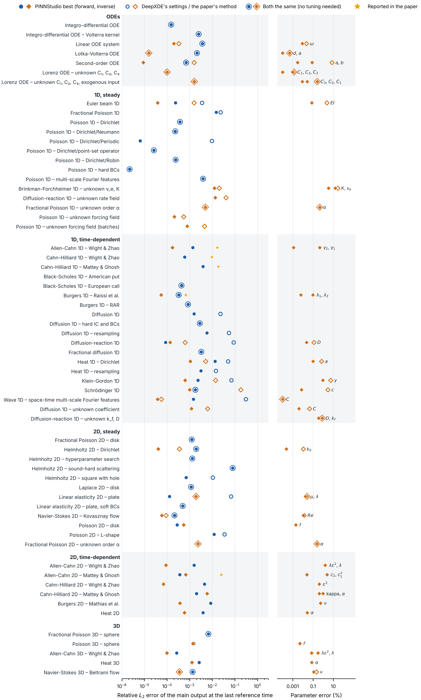

*Circles: forward problems; diamonds: inverse problems. Filled: PINNStudio's best; open: DeepXDE's settings, or the paper's method run in PINNStudio; a ring around a filled marker: the two are the same (no tuning was needed). Right: the error of each learned parameter, labelled with its symbol. ⭐: the error the paper reports (over all times) for the templates taken from a paper.*

📋 <em>All results — one table</em>

*Reference: DeepXDE's settings, the paper's method run in PINNStudio (paper templates) or the template's own settings. L₂ at the last reference time; all times where computed. Each name links to its section below.*

| Example | Source | Forward: reference L₂ | Forward: PINNStudio best L₂ | L₂, all times | Time (s) | Inverse: parameters found (true) | Worst parameter error | Time (s) |
|---|---|---|---|---|---|---|---|---|
| [Integro-differential ODE](#bench-integro-differential-ode) | DeepXDE | 1.5 × 10-4 | **1.5 × 10-4** | – | – | – | – | – |
| [Integro-differential ODE – Volterra kernel](#bench-integro-differential-ode-volterra-kernel) | DeepXDE | 2.5 × 10-3 | **2.5 × 10-3** | – | – | – | – | – |
| [Linear ODE system](#bench-linear-ode-system) | DeepXDE | 3.6 × 10-3 | **3.6 × 10-3** | – | – | ω = 0.999912 (1) | 0.0088% | 135 |
| [Lotka-Volterra ODE](#bench-lotka-volterra-ode) | DeepXDE | 2.1 × 10-3 | **2.1 × 10-3** | – | – | a = 2.00001 (2); d = 1.06 (1.06) | 0.0005% | 230 |
| [Second-order ODE](#bench-second-order-ode) | DeepXDE | 6.9 × 10-4 | **6.9 × 10-4** | – | – | a = 10.0003 (10); b = 8.99262 (9) | 0.082% | 30 |
| [Lorenz ODE – unknown C₁, C₂, C₃](#bench-lorenz-ode-unknown-c-c-c) | DeepXDE | – | – | – | – | C₁ = 10 (10); C₂ = 14.9998 (15); C₃ = 2.66664 (2.66667) | 0.0013% | – |
| [Lorenz ODE – unknown C₁, C₂, C₃, exogenous input](#bench-lorenz-ode-unknown-c-c-c-exogenous-input) | DeepXDE | – | – | – | – | C₁ = 9.974 (10); C₂ = 14.996 (15); C₃ = 2.6669 (2.66667) | 0.26% | – |
| [Euler beam 1D](#bench-euler-beam-1d) | DeepXDE | 3.5 × 10-3 | **2.4 × 10-4** | – | 59 | EI = 1.00075 (1) | 0.075% | 231 |
| [Fractional Poisson 1D](#bench-fractional-poisson-1d) | DeepXDE | 2.3 × 10-2 | **1.5 × 10-2** | – | 21 | – | – | – |
| [Poisson 1D – Dirichlet](#bench-poisson-1d-dirichlet) | DeepXDE | 3.7 × 10-4 | **3.7 × 10-4** | – | – | – | – | – |
| [Poisson 1D – Dirichlet/Neumann](#bench-poisson-1d-dirichlet-neumann) | DeepXDE | 2.3 × 10-4 | **2.3 × 10-4** | – | – | – | – | – |
| [Poisson 1D – Dirichlet/Periodic](#bench-poisson-1d-dirichlet-periodic) | DeepXDE | 9.6 × 10-3 | **6.4 × 10-6** | – | 67 | – | – | – |
| [Poisson 1D – Dirichlet/point-set operator](#bench-poisson-1d-dirichlet-point-set-operator) | DeepXDE | 2.6 × 10-5 | **2.6 × 10-5** | – | – | – | – | – |
| [Poisson 1D – Dirichlet/Robin](#bench-poisson-1d-dirichlet-robin) | DeepXDE | 2.4 × 10-4 | **2.4 × 10-4** | – | – | – | – | – |
| [Poisson 1D – hard BCs](#bench-poisson-1d-hard-bcs) | DeepXDE | 2.2 × 10-6 | **2.2 × 10-6** | – | – | – | – | – |
| [Poisson 1D – multi-scale Fourier features](#bench-poisson-1d-multi-scale-fourier-features) | DeepXDE | 3.9 × 10-3 | **3.9 × 10-3** | – | – | – | – | – |
| [Brinkman-Forchheimer 1D – unknown ν_e, K](#bench-brinkman-forchheimer-1d-unknown-e-k) | DeepXDE | – | – | – | – | νₑ = 0.00115135 (0.001); K = 0.00103409 (0.001) | 15% | 234 |
| [Diffusion-reaction 1D – unknown rate field](#bench-diffusion-reaction-1d-unknown-rate-field) | DeepXDE | – | – | – | – | field | – | 61 |
| [Fractional Poisson 1D – unknown order α](#bench-fractional-poisson-1d-unknown-order) | DeepXDE | – | – | – | – | α = 1.79183 (1.8) | 0.45% | – |
| [Poisson 1D – unknown forcing field](#bench-poisson-1d-unknown-forcing-field) | DeepXDE | – | – | – | – | field | – | 221 |
| [Poisson 1D – unknown forcing field (batches)](#bench-poisson-1d-unknown-forcing-field-batches) | DeepXDE | – | – | – | – | field | – | 215 |
| [Allen-Cahn 1D – Wight & Zhao](#bench-allen-cahn-1d-wight-zhao) | Paper | 1.4 × 10-3 | **1.4 × 10-3** | – | – | γ₁ = 9.95326e-05 (0.0001); γ₂ = 4.99994 (5) | 0.47% | 302 |
| [Cahn-Hilliard 1D – Wight & Zhao](#bench-cahn-hilliard-1d-wight-zhao) | Paper | 6.0 × 10-4 | **6.0 × 10-4** | – | – | – | – | – |
| [Cahn-Hilliard 1D – Mattey & Ghosh](#bench-cahn-hilliard-1d-mattey-ghosh) | Paper | 4.8 × 10-3 | **3.9 × 10-3** | 3.2 × 10-2 | 1002 | – | – | – |
| [Black-Scholes 1D – American put](#bench-black-scholes-1d-american-put) | DeepXDE | – | – | – | – | – | – | – |
| [Black-Scholes 1D – European call](#bench-black-scholes-1d-european-call) | DeepXDE | 4.3 × 10-4 | **4.3 × 10-4** | – | – | – | – | – |
| [Burgers 1D – Raissi et al.](#bench-burgers-1d-raissi-et-al) | Paper | 3.3 × 10-4 | **3.3 × 10-4** | 6.7 × 10-4 | 40 | λ₁ = 0.999937 (1); λ₂ = 0.0100099 (0.01) | 0.099% | 101 |
| [Burgers 1D – RAR](#bench-burgers-1d-rar) | DeepXDE | 8.4 × 10-4 | **8.4 × 10-4** | – | – | – | – | – |
| [Diffusion 1D](#bench-diffusion-1d) | DeepXDE | 2.3 × 10-2 | **1.5 × 10-3** | – | 76 | – | – | – |
| [Diffusion 1D – hard IC and BCs](#bench-diffusion-1d-hard-ic-and-bcs) | DeepXDE | 2.8 × 10-3 | **2.8 × 10-3** | – | – | – | – | – |
| [Diffusion 1D – resampling](#bench-diffusion-1d-resampling) | DeepXDE | 5.4 × 10-2 | **5.8 × 10-3** | – | 12 | – | – | – |
| [Diffusion-reaction 1D](#bench-diffusion-reaction-1d) | DeepXDE | 8.8 × 10-2 | **8.5 × 10-5** | – | 290 | D = 0.999773 (1) | 0.023% | 334 |
| [Fractional diffusion 1D](#bench-fractional-diffusion-1d) | DeepXDE | 3.3 × 10-3 | **3.3 × 10-3** | – | – | – | – | – |
| [Heat 1D – Dirichlet](#bench-heat-1d-dirichlet) | DeepXDE | 5.0 × 10-2 | **1.3 × 10-2** | – | 128 | a = 0.400406 (0.4) | 0.1% | 146 |
| [Heat 1D – resampling](#bench-heat-1d-resampling) | DeepXDE | 1.4 × 10-2 | **3.1 × 10-3** | – | 558 | – | – | – |
| [Klein-Gordon 1D](#bench-klein-gordon-1d) | DeepXDE | 6.9 × 10-2 | **2.3 × 10-3** | – | 151 | γ = 1.00912 (1) | 0.91% | 1361 |
| [Schrödinger 1D](#bench-schr-dinger-1d) | DeepXDE | 1.8 × 10-3 | **1.8 × 10-3** | – | – | c = 0.500036 (0.5) | 0.0072% | 337 |
| [Wave 1D – space-time multi-scale Fourier features](#bench-wave-1d-space-time-multi-scale-fourier-features) | DeepXDE | 3.0 × 10-1 | **1.5 × 10-3** | – | 645 | C = 10 (10) | 0% | 4354 |
| [Diffusion 1D – unknown coefficient](#bench-diffusion-1d-unknown-coefficient) | DeepXDE | – | – | – | – | C = 1.00004 (1) | 0.004% | 311 |
| [Diffusion-reaction 1D – unknown k_f, D](#bench-diffusion-reaction-1d-unknown-k-f-d) | DeepXDE | – | – | – | – | k_f = 0.0992 (0.1); D = 1.993 (2) | 0.8% | – |
| [Fractional Poisson 2D – disk](#bench-fractional-poisson-2d-disk) | DeepXDE | 1.2 × 10-3 | **1.2 × 10-3** | – | – | – | – | – |
| [Helmholtz 2D – Dirichlet](#bench-helmholtz-2d-dirichlet) | DeepXDE | 1.9 × 10-3 | **1.9 × 10-3** | – | – | k₀ = 12.5664 (12.5664) | 0.00023% | 58 |
| [Helmholtz 2D – hyperparameter search](#bench-helmholtz-2d-hyperparameter-search) | DeepXDE | 1.3 × 10-3 | **1.3 × 10-3** | – | – | – | – | – |
| [Helmholtz 2D – sound-hard scattering](#bench-helmholtz-2d-sound-hard-scattering) | DeepXDE | 8.0 × 10-2 | **8.0 × 10-2** | – | 61 | – | – | – |
| [Helmholtz 2D – square with hole](#bench-helmholtz-2d-square-with-hole) | DeepXDE | 1.1 × 10-2 | **7.0 × 10-4** | – | 24 | – | – | – |
| [Laplace 2D – disk](#bench-laplace-2d-disk) | DeepXDE | 1.1 × 10-3 | **1.1 × 10-3** | – | – | – | – | – |
| [Linear elasticity 2D – plate](#bench-linear-elasticity-2d-plate) | DeepXDE | 6.7 × 10-2 | **1.3 × 10-4** | – | 1147 | λ = 0.999744 (1); μ = 0.500088 (0.5) | 0.026% | 546 |
| [Linear elasticity 2D – plate, soft BCs](#bench-linear-elasticity-2d-plate-soft-bcs) | DeepXDE | 4.9 × 10-4 | **4.9 × 10-4** | – | – | – | – | – |
| [Navier-Stokes 2D – Kovasznay flow](#bench-navier-stokes-2d-kovasznay-flow) | DeepXDE | 2.1 × 10-4 | **2.1 × 10-4** | – | – | Re = 19.9978 (20) | 0.011% | 252 |
| [Poisson 2D – disk](#bench-poisson-2d-disk) | PINNStudio | 2.8 × 10-4 | **2.8 × 10-4** | – | – | f = 1.00002 (1) | 0.002% | 157 |
| [Poisson 2D – L-shape](#bench-poisson-2d-l-shape) | DeepXDE | 3.5 × 10-2 | **1.2 × 10-2** | – | 500 | – | – | – |
| [Fractional Poisson 2D – unknown order α](#bench-fractional-poisson-2d-unknown-order) | DeepXDE | – | – | – | – | α = 1.80445 (1.8) | 0.25% | – |
| [Allen-Cahn 2D – Wight & Zhao](#bench-allen-cahn-2d-wight-zhao) | Paper | 7.9 × 10-3 | **1.6 × 10-3** | 1.1 × 10-2 | 1596 | λ = 9.82765 (10); λε² = 0.00615365 (0.00625) | 1.7% | 1859 |
| [Allen-Cahn 2D – Mattey & Ghosh](#bench-allen-cahn-2d-mattey-ghosh) | Paper | 6.6 × 10-3 | **3.6 × 10-4** | 3.4 × 10-4 | 266 | c₁² = 0.000102452 (0.0001); c₂ = 1.00025 (1) | 2.5% | 1789 |
| [Cahn-Hilliard 2D – Wight & Zhao](#bench-cahn-hilliard-2d-wight-zhao) | Paper | 1.1 × 10-2 | **4.5 × 10-3** | 7.2 × 10-3 | 1464 | ε² = 0.00251042 (0.0025) | 0.42% | 3736 |
| [Cahn-Hilliard 2D – Mattey & Ghosh](#bench-cahn-hilliard-2d-mattey-ghosh) | Paper | 2.0 × 10-3 | **2.0 × 10-3** | – | – | α = 0.000189574 (0.0002); κ = 1.01558 (1) | 5.2% | 1741 |
| [Burgers 2D – Mathias et al.](#bench-burgers-2d-mathias-et-al) | Paper | 1.1 × 10-2 | **8.4 × 10-3** | 1.1 × 10-2 | 3684 | ν = 0.00320066 (0.0031831) | 0.55% | 6962 |
| [Heat 2D](#bench-heat-2d) | PINNStudio | 3.9 × 10-3 | **3.9 × 10-3** | – | – | α = 0.399893 (0.4) | 0.027% | 169 |
| [Fractional Poisson 3D – sphere](#bench-fractional-poisson-3d-sphere) | DeepXDE | 6.7 × 10-3 | **6.7 × 10-3** | – | – | – | – | – |
| [Poisson 3D – sphere](#bench-poisson-3d-sphere) | PINNStudio | 1.5 × 10-3 | **1.5 × 10-3** | – | – | f = 1.00005 (1) | 0.005% | 83 |
| [Allen-Cahn 3D – Wight & Zhao](#bench-allen-cahn-3d-wight-zhao) | Paper | 2.7 × 10-4 | **2.7 × 10-4** | – | – | λ = 9.96899 (10); λε² = 0.0249817 (0.025) | 0.31% | 1419 |
| [Heat 3D](#bench-heat-3d) | PINNStudio | 2.6 × 10-3 | **2.6 × 10-3** | – | – | α = 0.400303 (0.4) | 0.076% | 729 |
| [Navier-Stokes 3D – Beltrami flow](#bench-navier-stokes-3d-beltrami-flow) | DeepXDE | 1.4 × 10-3 | **1.4 × 10-3** | – | – | ν = 0.998842 (1) | 0.12% | 2575 |

📄 <em>Figure for the paper — 25 examples</em>

**Why these examples.** The full figure has 63 examples, which is too many for one page in a paper, so this one keeps one example of each kind of problem. They go from ODEs to 1D, 2D and 3D, and in each dimension from steady to time-dependent problems. Together they cover the main equation types: elliptic (Poisson, Helmholtz, linear elasticity), parabolic (heat, diffusion-reaction, Black-Scholes), hyperbolic and dispersive (wave, Klein-Gordon, Schrödinger), nonlinear flow (Burgers, Navier-Stokes in 2D and 3D), stiff phase-field equations (Allen-Cahn, and the fourth-order Cahn-Hilliard), and the less common fractional and integro-differential operators. Most of them (18 of the 25) have both a forward and an inverse problem, so one row shows both modes. A few are forward only (the integro-differential ODE, Poisson 1D, Cahn-Hilliard 1D, Black-Scholes), and Lorenz, the unknown forcing field and the fractional order α are inverse problems only. The set mixes DeepXDE's examples with templates taken from papers (Raissi et al.; Wight & Zhao; Mattey & Ghosh; Mathias et al.). The left panel shows the forward problems only: PINNStudio's best and DeepXDE's settings or the paper's method. Inverse problems are judged by their parameter error (right panel), not by their L₂, because an inverse run trains on the reference data at every time, so its L₂ is a fit to that data rather than a prediction (it is still in the tables, as "L₂ fit to measured data"). For the paper templates, the ⭐ is the error the paper itself reports, where it gives one (Burgers 1D, Allen-Cahn 1D, Cahn-Hilliard 1D, Allen-Cahn 2D of Mattey & Ghosh). Note that the papers report one error over all times, while the x-axis is the error at the last reference time, so the ⭐ is a guide rather than an exact like-for-like point; the all-times errors are in the tables below.

**For Word.** The figure is drawn at its printed size, 6.5 × 7.5 in (the text width of a Word page with 1 in margins), with 8.5–9 pt text, so insert it at 100% and it leaves about 1.5 in for the caption on the same page. The PDF keeps it sharp at any zoom. A caption to start from:

> *PINNStudio on 25 representative problems, from ODEs to 3D PDEs. Left: relative L₂ error of the forward problems with PINNStudio's best settings (filled) and with DeepXDE's settings or, for templates taken from a paper, that paper's method run in PINNStudio (open; a ring where the two are the same). Stars mark the error reported in the original paper. Right: the relative error of each parameter identified in the inverse problems, labelled with its symbol.*

*The list: [`paper_figure_examples.txt`](paper_figure_examples.txt) (one name per line; change a line to swap an example). PDF: [`figures/paper_figure.pdf`](figures/paper_figure.pdf).*

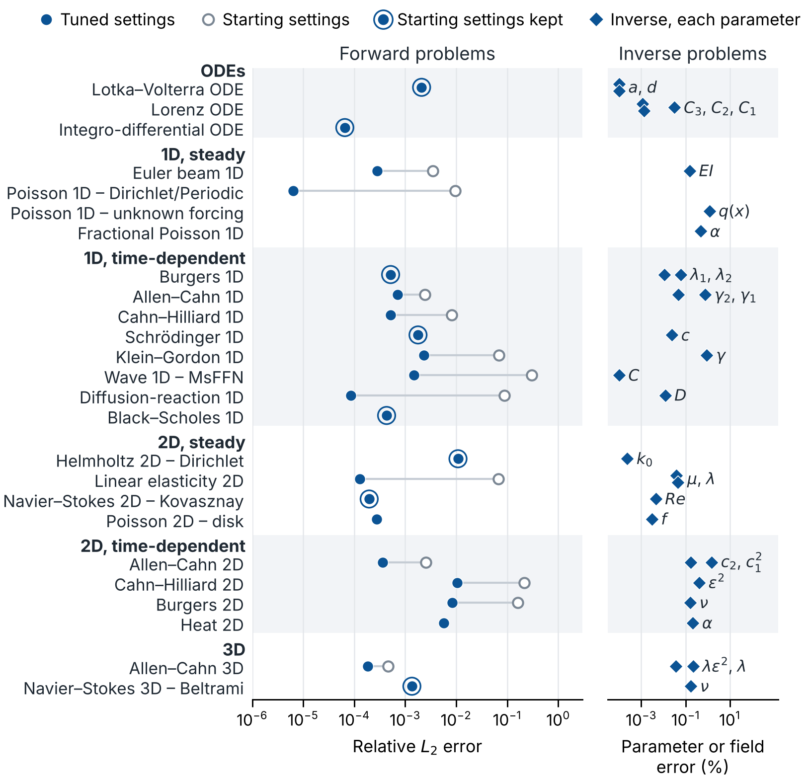

## ODEs

<strong>Integro-differential ODE</strong> · DeepXDE example

**The problem**

DeepXDE example: [`ide.py`](https://github.com/lululxvi/deepxde/blob/master/examples/pinn_forward/ide.py) ([documentation](https://deepxde.readthedocs.io/en/latest/demos/pinn_forward/ide.html))

$$\Large \frac{du}{dt} + \int_0^t u(s)\ ds = 2\pi\cos(2\pi t) + \frac{\sin^2(\pi t)}{\pi}, \qquad t \in [0, 1]$$

- **Problem dimension:** ODE (t) — `du_t + integral(u) - (2*pi*cos(2*pi*t) + sin(pi*t)**2/pi)`
- **Initial condition:** $u(0) = 0$
- **Exact solution:** $u = \sin(2\pi t)$

⚙️ <em>Default settings — DeepXDE's settings (also PINNStudio best)</em>

*Forward problem — also PINNStudio best* (already accurate, so it was not tuned)

- **Network:** FNN 3 × 20 (2 inputs, 1 output), tanh, Glorot uniform
- **Points:** 16 domain, 2 boundary
- **Training:** Adam 10,000

*Load it:* toolbar → Examples: **Forward** → **Integro-differential ODE** → **Default**, then Solve.

**Forward problem**

| Training | L₂ | Time (s) |
|---|---|---|
| DeepXDE's settings (README) | 1.5 × 10-4 | – |
| **PINNStudio best** (Settings: Tuned): no tuning needed | **1.5 × 10-4** | – |

📊 <em>Forward results — figures</em>

*DeepXDE's settings (README):*

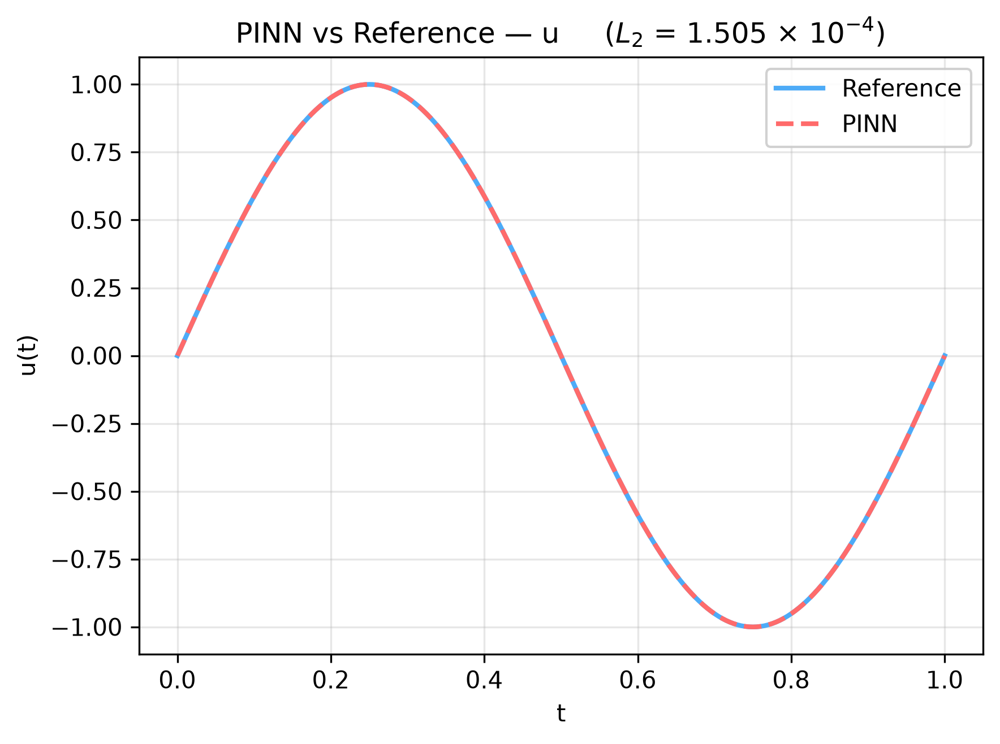

<strong>Integro-differential ODE – Volterra kernel</strong> · DeepXDE example

**The problem**

DeepXDE example: [`Volterra_IDE.py`](https://github.com/lululxvi/deepxde/blob/master/examples/pinn_forward/Volterra_IDE.py)

$$\Large \frac{du}{dt} + u(t) = \int_0^t e^{s - t}\ u(s)\ ds, \qquad t \in [0, 5]$$

- **Problem dimension:** ODE (t) — `du_t + u - integral(exp(s - t)*u)`, the kernel and $u$ written in the integration variable `s`
- **Initial condition:** $u(0) = 1$
- **Exact solution:** $u = e^{-t}\cosh t$

⚙️ <em>Default settings — DeepXDE's settings (also PINNStudio best)</em>

*Forward problem — also PINNStudio best* (already accurate, so it was not tuned)

- **Network:** FNN 3 × 20 (2 inputs, 1 output), tanh, Glorot uniform
- **Points:** 10 domain, 2 boundary
- **Training:** L-BFGS 15,000

*Load it:* toolbar → Examples: **Forward** → **Integro-differential ODE – Volterra kernel** → **Default**, then Solve.

**Forward problem**

| Training | L₂ | Time (s) |
|---|---|---|
| DeepXDE's settings (README) | 2.5 × 10-3 | – |
| **PINNStudio best** (Settings: Tuned): no tuning needed | **2.5 × 10-3** | – |

📊 <em>Forward results — figures</em>

*DeepXDE's settings (README):*

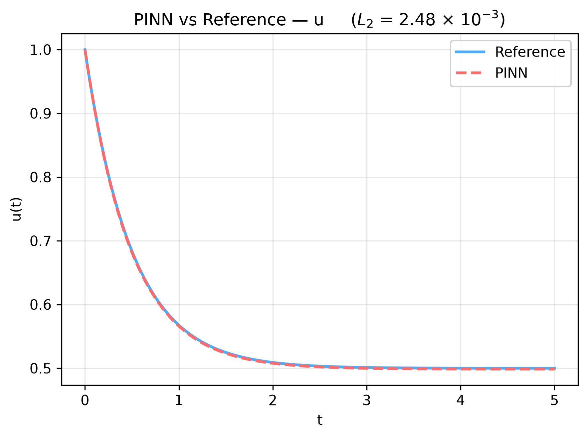

<strong>Linear ODE system</strong> · DeepXDE example

**The problem**

DeepXDE example: [`ode_system.py`](https://github.com/lululxvi/deepxde/blob/master/examples/pinn_forward/ode_system.py) ([documentation](https://deepxde.readthedocs.io/en/latest/demos/pinn_forward/ode.system.html))

$$\Large \frac{dy_1}{dt} = y_2, \qquad \frac{dy_2}{dt} = -y_1, \qquad t \in [0, 10]$$

- **Problem dimension:** ODE (t) — derivatives written `dy1_t`, `dy2_t`
- **Initial conditions:** $y_1(0) = 0$, $y_2(0) = 1$
- **Exact solution:** $y_1 = \sin t$, $y_2 = \cos t$

⚙️ <em>Default settings — DeepXDE's settings</em>

*Forward problem — also PINNStudio best* (already accurate, so it was not tuned)

- **Network:** FNN 3 × 50 (2 inputs, 2 outputs), tanh, Glorot uniform
- **Points:** 35 domain, 2 boundary
- **Training:** Adam 20,000

*Load it:* toolbar → Examples: **Forward** → **Linear ODE system** → **Default**, then Solve.

⚙️ <em>PINNStudio best — Tuned settings</em>

*Inverse problem — PINNStudio's own inverse setup, tuned*

- **Network:** FNN 4 × 100 (2 inputs, 2 outputs), tanh, Glorot uniform
- **Points:** 105 domain, 6 boundary
- **Training:** Adam 60,000 → L-BFGS 45,000
- **Unknowns:** w (initial guess 2.0, true 1.0)
- **Measured data:** y1_obs.txt for y1 (weight 100); y2_obs.txt for y2 (weight 100)

*Load it:* toolbar → Examples: **Inverse** → **Linear ODE system** → **Tuned**, then Solve.

*Found in:* [tuning study, inverse runs](tuning_study.md#tune-linear-ode-system-inverse-mode)

*Forward problem:* PINNStudio best is the Default settings above (no separate Tuned settings).

**Forward problem**

| Training | L₂ | Time (s) |
|---|---|---|
| DeepXDE's settings (README) | 3.6 × 10-3 | – |
| **PINNStudio best** (Settings: Tuned): no tuning needed | **3.6 × 10-3** | – |

**Inverse problem**

| Training | L₂ fit to measured data | Parameters found (true) | Worst parameter error | Time (s) |
|---|---|---|---|---|
| DeepXDE's settings | 3.3 × 10-4 | ω = 0.999776 (1) | 0.022% | 48 |
| Larger network (2× width, one more layer) | 4.5 × 10-4 | ω = 0.999558 (1) | 0.044% | 49 |
| 3× L-BFGS iterations | 3.3 × 10-4 | ω = 0.999776 (1) | 0.022% | 47 |
| 🔴 **All of the above together** | **2.0 × 10-4** | **ω = 0.999912 (1)** | **0.0088%** | **135** |
| 10× data weight, 3× L-BFGS and the larger network | 4.6 × 10-4 | ω = 0.999089 (1) | 0.091% | 50 |
| **PINNStudio best** (Settings: Tuned): all of the changes together | **2.0 × 10-4** | ω = 0.999912 (1) | **0.0088%** | **135** |

*L₂ fit to measured data: the error on the reference data the inverse run trains on (every reference time), a check that the fit worked, not a prediction error. The parameter error measures the accuracy and decides the best run.*

*DeepXDE's example is forward only; this inverse problem is PINNStudio's inverse mode of it.*

📊 <em>Forward results — figures</em>

*DeepXDE's settings (README):*

y1 — PINN against the reference along a line, at the reference times

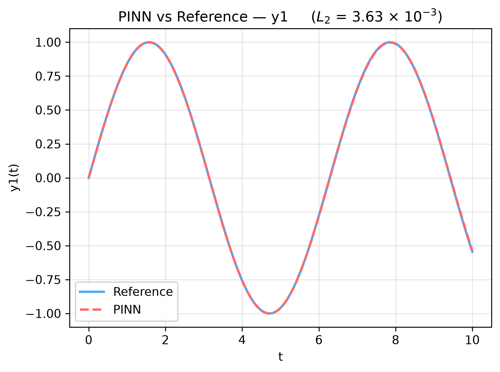

y2 — PINN against the reference along a line, at the reference times

📊 <em>Inverse results — figures</em>

*PINNStudio best — all of the changes together:*

y1 — PINN against the reference along a line, at the reference times

y2 — PINN against the reference along a line, at the reference times

the learned parameters during training

<strong>Lotka-Volterra ODE</strong> · DeepXDE example

**The problem**

DeepXDE example: [`Lotka_Volterra.py`](https://github.com/lululxvi/deepxde/blob/master/examples/pinn_forward/Lotka_Volterra.py) ([documentation](https://deepxde.readthedocs.io/en/latest/demos/pinn_forward/Lotka.Volterra.html))

$$\Large \frac{dr}{dt} = \frac{R}{U}\left(2Ur - 0.04U^2 rp\right), \qquad \frac{dp}{dt} = \frac{R}{U}\left(0.02U^2 rp - 1.06Up\right), \qquad t \in [0, 1]$$

- **Problem dimension:** ODE (t); populations scaled by $U = 200$ and time by $R = 20$ (constants `ub`, `rb`)
- **Initial conditions:** $r(0) = 100/U$, $p(0) = 15/U$, imposed exactly by the output transform $\hat r = r\tanh t + 100/U$, $\hat p = p\tanh t + 15/U$
- **Reference:** SciPy `solve_ivp` solution of the same system
- **Constants:** `ub = 200`, `rb = 20`

⚙️ <em>Default settings — DeepXDE's settings</em>

*Forward problem — also PINNStudio best* (already accurate, so it was not tuned)

- **Network:** FNN 6 × 64 (2 inputs, 2 outputs), tanh, Glorot normal
- **Points:** 3,000 domain, 2 boundary
- **Training:** Adam 50,000 → L-BFGS 15,000
- **Methods:** initial and boundary conditions built into the output (output transform formula)

*Load it:* toolbar → Examples: **Forward** → **Lotka-Volterra ODE** → **Default**, then Solve.

⚙️ <em>PINNStudio best — Tuned settings</em>

*Inverse problem — PINNStudio's own inverse setup*

- **Network:** FNN 6 × 64 (2 inputs, 2 outputs), tanh, Glorot normal
- **Points:** 3,000 domain, 2 boundary
- **Training:** Adam 50,000 → L-BFGS 15,000
- **Methods:** initial and boundary conditions built into the output (output transform formula)
- **Unknowns:** a (initial guess 1.0, true 2.0), d (initial guess 2.0, true 1.06)
- **Measured data:** r.txt for r (weight 100); p.txt for p (weight 100)

*Load it:* toolbar → Examples: **Inverse** → **Lotka-Volterra ODE** → **Tuned**, then Solve.

*Found in:* [tuning study, inverse runs](tuning_study.md#tune-lotka-volterra-ode-inverse-mode)

*Forward problem:* PINNStudio best is the Default settings above (no separate Tuned settings).

**Forward problem**

| Training | L₂ | Time (s) |
|---|---|---|
| DeepXDE's settings (README) | 2.1 × 10-3 | – |
| **PINNStudio best** (Settings: Tuned): no tuning needed | **2.1 × 10-3** | – |

**Inverse problem**

| Training | L₂ fit to measured data | Parameters found (true) | Worst parameter error | Time (s) |
|---|---|---|---|---|
| 🔴 **DeepXDE's settings** | **1.5 × 10-5** | **a = 2.00001 (2); d = 1.06 (1.06)** | **0.0005%** | **230** |
| Larger network (2× width, one more layer) | 1.8 × 10-5 | a = 2 (2); d = 1.05999 (1.06) | 0.00094% | 243 |
| 3× L-BFGS iterations | 1.5 × 10-5 | a = 2.00001 (2); d = 1.06 (1.06) | 0.0005% | 240 |
| All of the above together | 1.2 × 10-5 | a = 1.99999 (2); d = 1.06001 (1.06) | 0.00094% | 648 |
| 10× data weight, 3× L-BFGS and the larger network | 9.2 × 10-6 | a = 2.00001 (2); d = 1.06001 (1.06) | 0.00094% | 250 |
| **PINNStudio best** (Settings: Tuned): the example's own settings (no change did better) | **1.5 × 10-5** | a = 2.00001 (2); d = 1.06 (1.06) | **0.0005%** | **230** |

*L₂ fit to measured data: the error on the reference data the inverse run trains on (every reference time), a check that the fit worked, not a prediction error. The parameter error measures the accuracy and decides the best run.*

*DeepXDE's example is forward only; this inverse problem is PINNStudio's inverse mode of it.*

📊 <em>Forward results — figures</em>

*DeepXDE's settings (README):*

r — PINN against the reference along a line, at the reference times

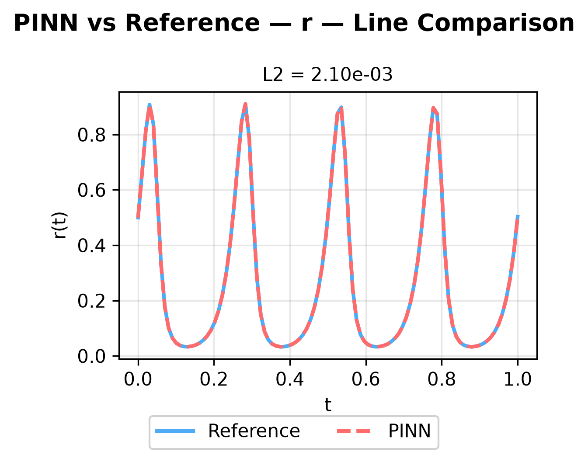

p — PINN against the reference along a line, at the reference times

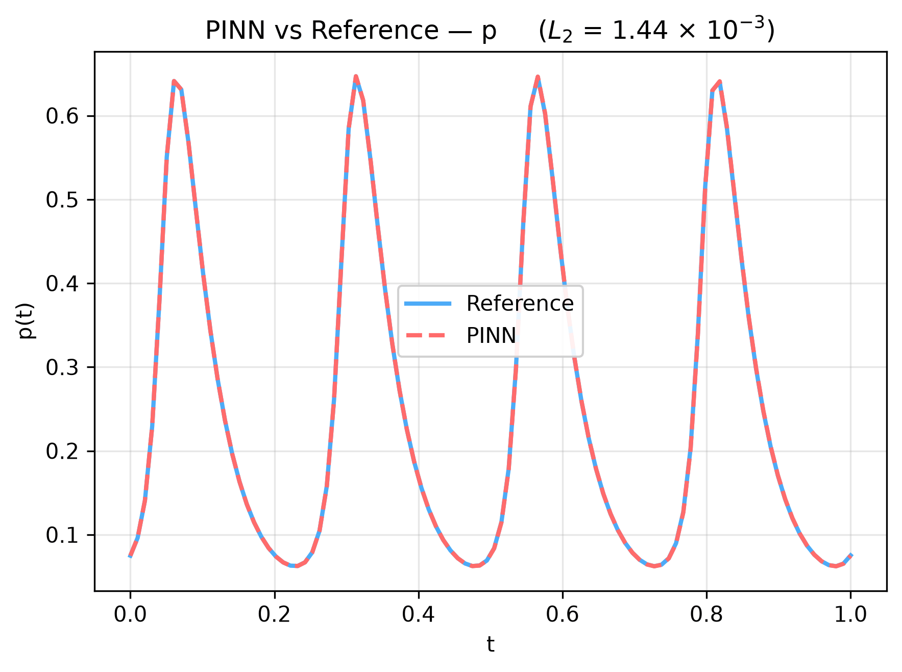

📊 <em>Inverse results — figures</em>

*PINNStudio best — the example's own settings (no change did better):*

r — PINN against the reference along a line, at the reference times

p — PINN against the reference along a line, at the reference times

the learned parameters during training

<strong>Second-order ODE</strong> · DeepXDE example

**The problem**

DeepXDE example: [`ode_2nd.py`](https://github.com/lululxvi/deepxde/blob/master/examples/pinn_forward/ode_2nd.py) ([documentation](https://deepxde.readthedocs.io/en/latest/demos/pinn_forward/ode.2nd.html))

$$\Large \frac{d^2u}{dt^2} - 10\frac{du}{dt} + 9u = 5t, \qquad t \in [0, 0.25]$$

- **Problem dimension:** ODE (t) — `du_tt - 10*du_t + 9*u - 5*t`
- **Initial conditions:** $u(0) = -1$ (initial condition); $u'(0) = 2$ as an Operator BC `du_t - 2` applied at the initial time
- **Exact solution:** $u = \frac{50}{81} + \frac{5}{9}t - 2e^{t} + \frac{31}{81}e^{9t}$

⚙️ <em>Default settings — DeepXDE's settings</em>

*Forward problem — also PINNStudio best* (already accurate, so it was not tuned)

- **Network:** FNN 3 × 50 (2 inputs, 1 output), tanh, Glorot uniform
- **Points:** 16 domain, 2 boundary
- **Training:** Adam 10,000

*Load it:* toolbar → Examples: **Forward** → **Second-order ODE** → **Default**, then Solve.

⚙️ <em>PINNStudio best — Tuned settings</em>

*Inverse problem — PINNStudio's own inverse setup, tuned*

- **Network:** FNN 4 × 100 (2 inputs, 1 output), tanh, Glorot uniform
- **Points:** 16 domain, 2 boundary
- **Training:** Adam 10,000 → L-BFGS 15,000
- **Unknowns:** a (initial guess 5.0, true 10.0), b (initial guess 4.5, true 9.0)
- **Measured data:** u_obs.txt for u (weight 100)

*Load it:* toolbar → Examples: **Inverse** → **Second-order ODE** → **Tuned**, then Solve.

*Found in:* [tuning study, inverse runs](tuning_study.md#tune-second-order-ode-inverse-mode)

*Forward problem:* PINNStudio best is the Default settings above (no separate Tuned settings).

**Forward problem**

| Training | L₂ | Time (s) |
|---|---|---|
| DeepXDE's settings (README) | 6.9 × 10-4 | – |
| **PINNStudio best** (Settings: Tuned): no tuning needed | **6.9 × 10-4** | – |

**Inverse problem**

| Training | L₂ fit to measured data | Parameters found (true) | Worst parameter error | Time (s) |
|---|---|---|---|---|
| DeepXDE's settings | 1.6 × 10-3 | a = 9.93327 (10); b = 9.6526 (9) | 7.3% | 27 |
| 🔴 **Larger network (2× width, one more layer)** | **8.9 × 10-6** | **a = 10.0003 (10); b = 8.99262 (9)** | **0.082%** | **30** |
| 3× L-BFGS iterations | 1.6 × 10-3 | a = 9.93327 (10); b = 9.6526 (9) | 7.3% | 25 |
| All of the above together | 5.8 × 10-5 | a = 9.99773 (10); b = 9.0168 (9) | 0.19% | 74 |
| 10× data weight, 3× L-BFGS and the larger network | 4.1 × 10-4 | a = 9.97923 (10); b = 9.37949 (9) | 4.2% | 28 |
| **PINNStudio best** (Settings: Tuned): Larger network (2× width, one more layer) | **8.9 × 10-6** | a = 10.0003 (10); b = 8.99262 (9) | **0.082%** | **30** |

*L₂ fit to measured data: the error on the reference data the inverse run trains on (every reference time), a check that the fit worked, not a prediction error. The parameter error measures the accuracy and decides the best run.*

*DeepXDE's example is forward only; this inverse problem is PINNStudio's inverse mode of it.*

📊 <em>Forward results — figures</em>

*DeepXDE's settings (README):*

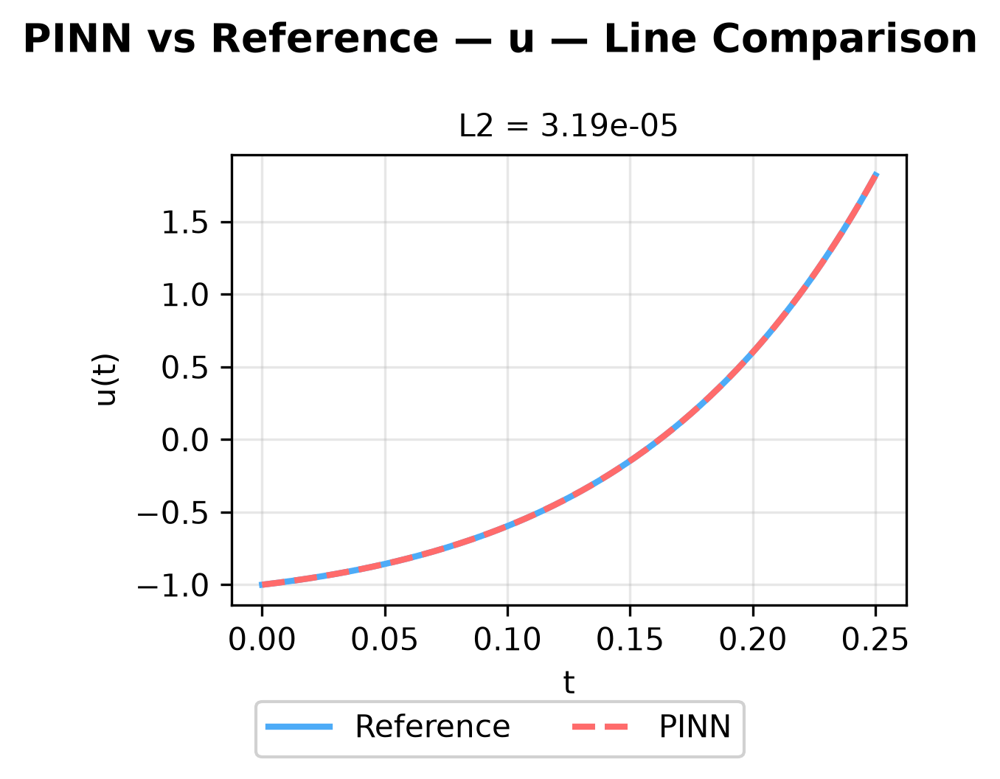

📊 <em>Inverse results — figures</em>

*PINNStudio best — Larger network (2× width, one more layer):*

PINN against the reference along a line, at the reference times

the learned parameters during training

<strong>Lorenz ODE – unknown C₁, C₂, C₃</strong> · DeepXDE example

**The problem**

DeepXDE example: [`Lorenz_inverse.py`](https://github.com/lululxvi/deepxde/blob/master/examples/pinn_inverse/Lorenz_inverse.py) ([documentation](https://deepxde.readthedocs.io/en/latest/demos/pinn_inverse/Lorenz.inverse.html))

$$\Large \frac{dy_1}{dt} = C_1(y_2 - y_1), \qquad \frac{dy_2}{dt} = y_1(C_2 - y_3) - y_2, \qquad \frac{dy_3}{dt} = y_1y_2 - C_3y_3, \qquad t \in [0, 3]$$

- **Problem dimension:** ODE (t); initial conditions $y(0) = (-8, 7, 27)$
- **Unknowns:** $C_1, C_2, C_3$ (true $10, 15, 8/3$), all starting from 1
- **Data:** $y_1, y_2, y_3$ measured at 50 times (also used as anchor points), from SciPy's `solve_ivp`

⚙️ <em>Default settings — DeepXDE's settings (also PINNStudio best)</em>

*Inverse problem — also PINNStudio best* (already accurate, so it was not tuned)

- **Network:** FNN 3 × 40 (2 inputs, 3 outputs), tanh, Glorot uniform
- **Points:** 400 domain, 2 boundary
- **Training:** Adam 20,000 → L-BFGS 15,000
- **Unknowns:** C1 (initial guess 1.0, true 10.0), C2 (initial guess 1.0, true 15.0), C3 (initial guess 1.0, true 2.66667)
- **Measured data:** y1_obs.txt for y1 (weight 1); y2_obs.txt for y2 (weight 1); y3_obs.txt for y3 (weight 1)

*Load it:* toolbar → Examples: **Inverse** → **Lorenz ODE – unknown C₁, C₂, C₃** → **Default**, then Solve.

**Inverse problem**

| Training | L₂ fit to measured data | Parameters found (true) | Worst parameter error | Time (s) |
|---|---|---|---|---|
| DeepXDE's settings (README) | 1.0 × 10-4 | C₁ = 10 (10); C₂ = 14.9998 (15); C₃ = 2.66664 (2.66667) | 0.0013% | – |
| **PINNStudio best** (Settings: Tuned): no tuning needed | **1.0 × 10-4** | C₁ = 10 (10); C₂ = 14.9998 (15); C₃ = 2.66664 (2.66667) | **0.0013%** | – |

*L₂ fit to measured data: the error on the reference data the inverse run trains on (every reference time), a check that the fit worked, not a prediction error. The parameter error measures the accuracy and decides the best run.*

📊 <em>Inverse results — figures</em>

*PINNStudio best (README):*

y1 — PINN against the reference along a line, at the reference times

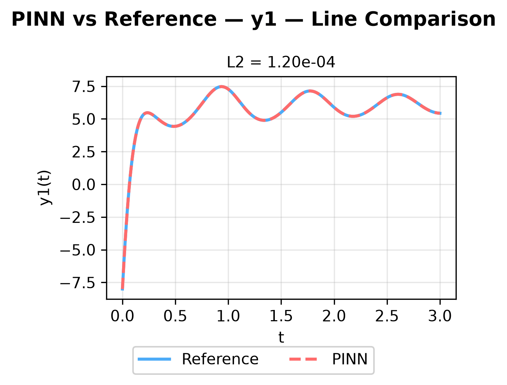

y2 — PINN against the reference along a line, at the reference times

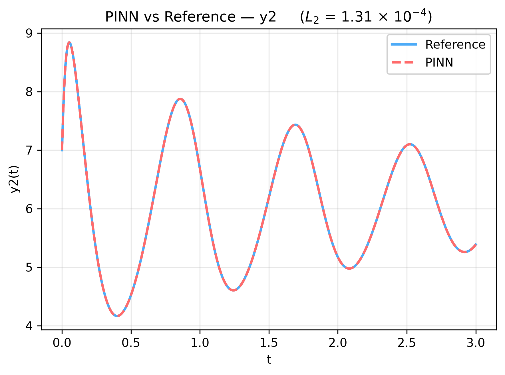

y3 — PINN against the reference along a line, at the reference times

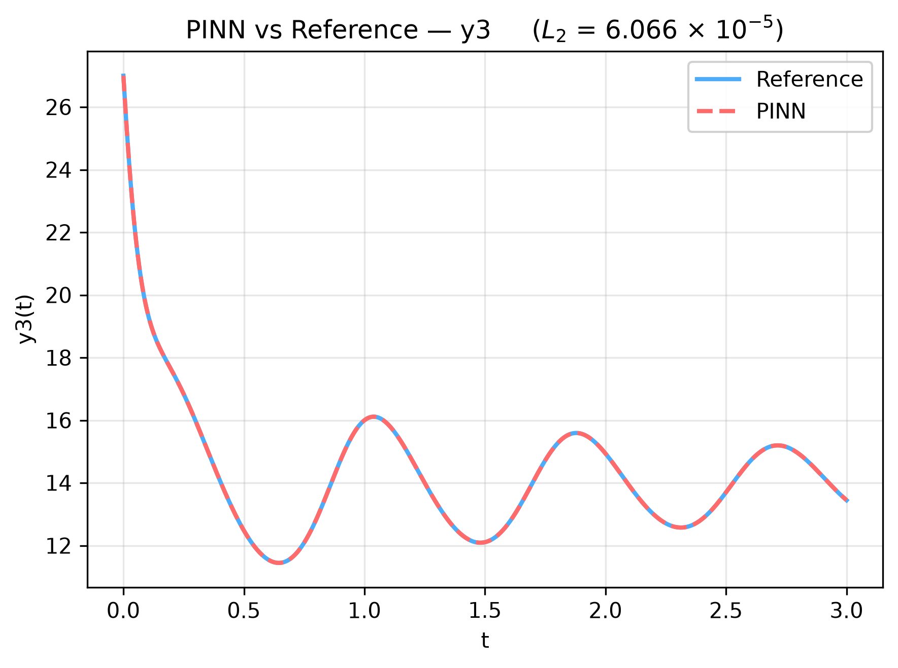

the learned parameters during training

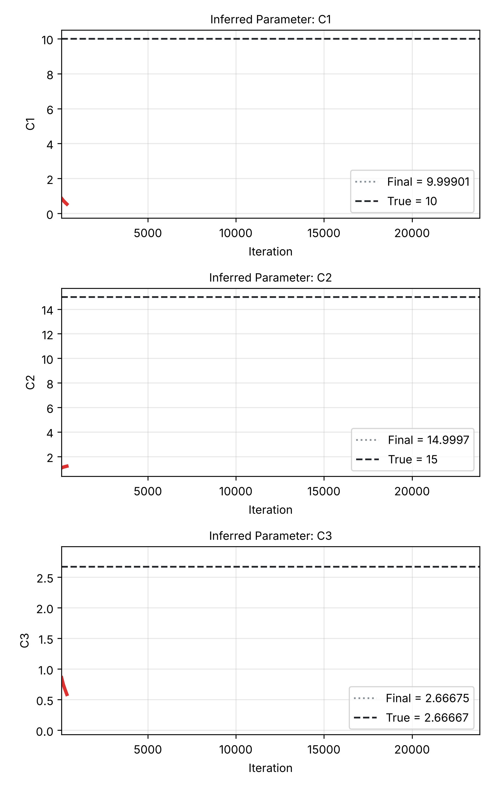

<strong>Lorenz ODE – unknown C₁, C₂, C₃, exogenous input</strong> · DeepXDE example

**The problem**

DeepXDE example: [`Lorenz_inverse_forced.py`](https://github.com/lululxvi/deepxde/blob/master/examples/pinn_inverse/Lorenz_inverse_forced.py) ([documentation](https://deepxde.readthedocs.io/en/latest/demos/pinn_inverse/Lorenz.inverse.forced.html))

$$\Large \frac{dy_1}{dt} = C_1(y_2 - y_1), \qquad \frac{dy_2}{dt} = y_1(C_2 - y_3) - y_2, \qquad \frac{dy_3}{dt} = y_1y_2 - C_3y_3 + 10\sin(2\pi t)$$

- **Problem dimension:** ODE (t), $t \in [0, 3]$; initial conditions $y(0) = (-8, 7, 27)$
- **Unknowns:** $C_1, C_2, C_3$ (true $10, 15, 8/3$), all starting from 1
- **Data:** $y_1, y_2, y_3$ measured at 200 times, from SciPy's `solve_ivp`

⚙️ <em>Default settings — DeepXDE's settings (also PINNStudio best)</em>

*Inverse problem — also PINNStudio best* (already accurate, so it was not tuned)

- **Network:** FNN 3 × 40 (2 inputs, 3 outputs), tanh, Glorot uniform
- **Points:** 400 domain, 2 boundary
- **Training:** Adam 60,000
- **Unknowns:** C1 (initial guess 1.0, true 10.0), C2 (initial guess 1.0, true 15.0), C3 (initial guess 1.0, true 2.66667)
- **Measured data:** y1_obs.txt for y1 (weight 1); y2_obs.txt for y2 (weight 1); y3_obs.txt for y3 (weight 1)

*Load it:* toolbar → Examples: **Inverse** → **Lorenz ODE – unknown C₁, C₂, C₃, exogenous input** → **Default**, then Solve.

**Inverse problem**

| Training | L₂ fit to measured data | Parameters found (true) | Worst parameter error | Time (s) |
|---|---|---|---|---|
| DeepXDE's settings (README) | 1.6 × 10-3 | C₁ = 9.974 (10); C₂ = 14.996 (15); C₃ = 2.6669 (2.66667) | 0.26% | – |
| **PINNStudio best** (Settings: Tuned): no tuning needed | **1.6 × 10-3** | C₁ = 9.974 (10); C₂ = 14.996 (15); C₃ = 2.6669 (2.66667) | **0.26%** | – |

*L₂ fit to measured data: the error on the reference data the inverse run trains on (every reference time), a check that the fit worked, not a prediction error. The parameter error measures the accuracy and decides the best run.*

📊 <em>Inverse results — figures</em>

*PINNStudio best (README):*

y1 — PINN against the reference along a line, at the reference times

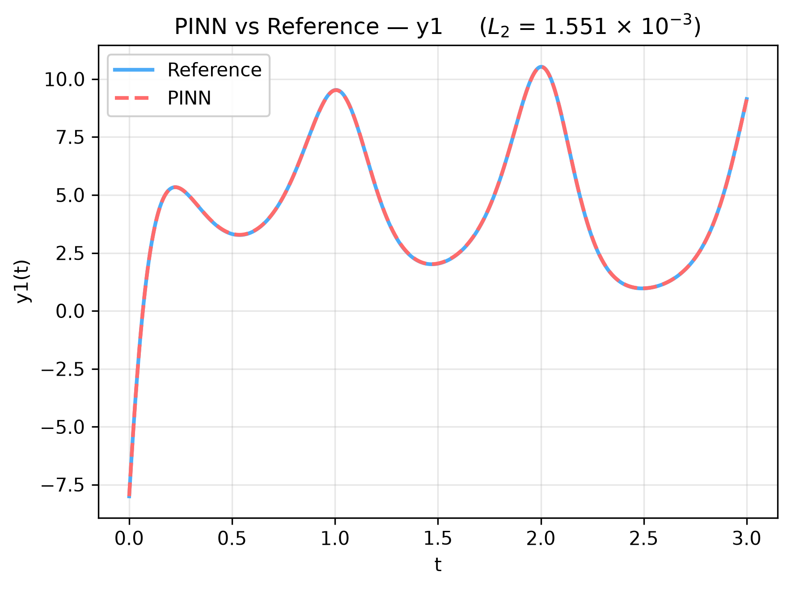

y2 — PINN against the reference along a line, at the reference times

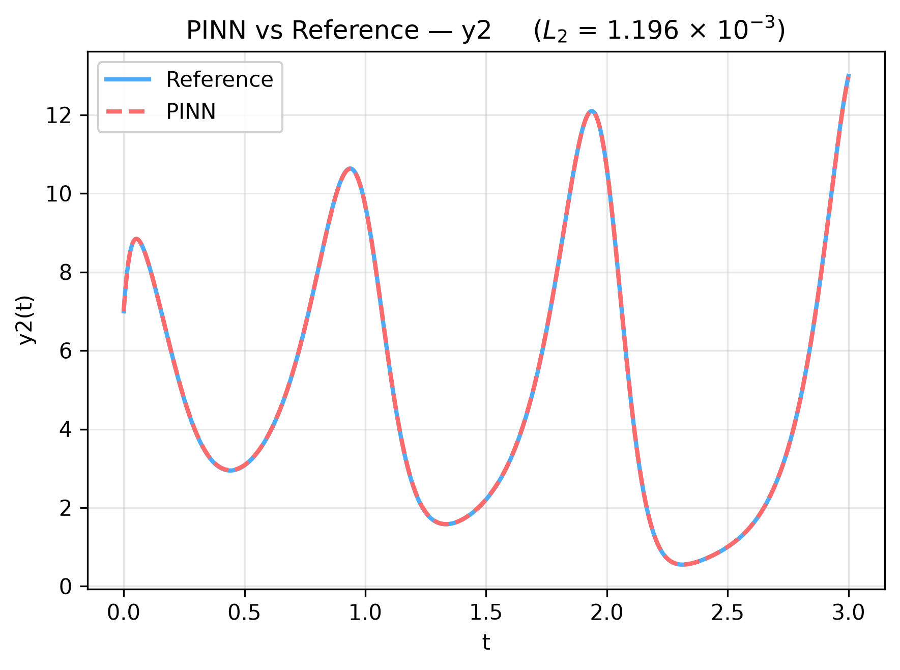

y3 — PINN against the reference along a line, at the reference times

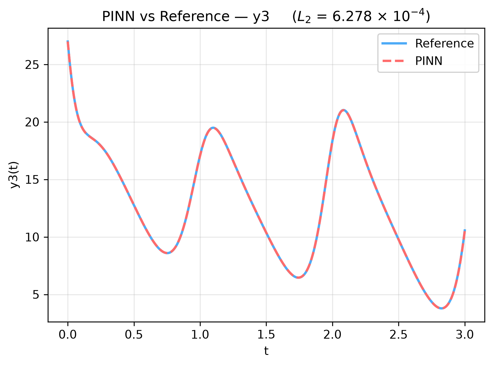

the learned parameters during training

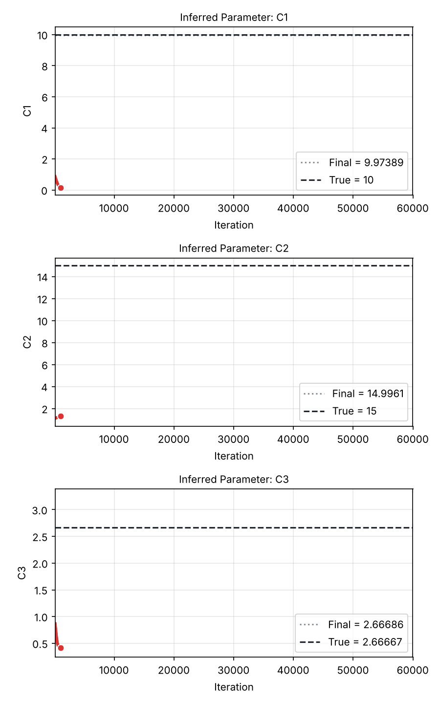

## 1D, steady

<strong>Euler beam 1D</strong> · DeepXDE example

**The problem**

DeepXDE example: [`Euler_beam.py`](https://github.com/lululxvi/deepxde/blob/master/examples/pinn_forward/Euler_beam.py) ([documentation](https://deepxde.readthedocs.io/en/latest/demos/pinn_forward/eulerbeam.html))

$$\Large \frac{d^4u}{dx^4} = -1, \qquad x \in [0, 1]$$

- **Boundary conditions:** $u(0) = 0$, $u'(0) = 0$ (clamped); $u''(1) = 0$, $u'''(1) = 0$ (free) — the last two as Operator BCs
- **Exact solution:** $u = -\frac{x^4}{24} + \frac{x^3}{6} - \frac{x^2}{4}$

⚙️ <em>Default settings — DeepXDE's settings</em>

*Forward problem*

- **Network:** FNN 3 × 20 (1 input, 1 output), tanh, Glorot uniform
- **Points:** 10 domain, 2 boundary
- **Training:** Adam 10,000

*Load it:* toolbar → Examples: **Forward** → **Euler beam 1D** → **Default**, then Solve.

⚙️ <em>PINNStudio best — Tuned settings</em>

*Forward problem*

- **Network:** FNN 3 × 20 (1 input, 1 output), tanh, Glorot uniform
- **Points:** 10 domain, 2 boundary
- **Training:** Adam 10,000 → L-BFGS 15,000

*Load it:* toolbar → Examples: **Forward** → **Euler beam 1D** → **Tuned**, then Solve.

*Found in:* [tuning study, forward runs](tuning_study.md#tune-euler-beam-1d)

*Inverse problem — PINNStudio's own inverse setup, tuned*

- **Network:** FNN 4 × 40 (1 input, 1 output), tanh, Glorot uniform
- **Points:** 30 domain, 6 boundary
- **Training:** Adam 30,000 → L-BFGS 45,000
- **Unknowns:** EI (initial guess 2.0, true 1.0)
- **Measured data:** u_obs.txt for u (weight 100)

*Load it:* toolbar → Examples: **Inverse** → **Euler beam 1D** → **Tuned**, then Solve.

*Found in:* [tuning study, inverse runs](tuning_study.md#tune-euler-beam-1d-inverse-mode)

**Forward problem**

| Training | L₂ | Time (s) |
|---|---|---|
| DeepXDE's settings (3 seeds, median) | 3.5 × 10-3 | 55 |
| 3× iterations | 5.2 × 10-3 | 157 |
| Larger network (2× width, one more layer) | 8.2 × 10-3 | 74 |
| 3× training points | 2.8 × 10-2 | 56 |
| 🔴 **L-BFGS phase added** | **2.4 × 10-4** | **59** |
| All of the above together (3 seeds, median) | 2.8 × 10-4 | 217 |
| **PINNStudio best** (Settings: Tuned): L-BFGS phase added | **2.4 × 10-4** | **59** |

**Inverse problem**

| Training | L₂ fit to measured data | Parameters found (true) | Worst parameter error | Time (s) |
|---|---|---|---|---|
| DeepXDE's settings | 1.6 × 10-3 | EI = 1.02349 (1) | 2.3% | 61 |
| Larger network (2× width, one more layer) | 6.4 × 10-5 | EI = 1.00153 (1) | 0.15% | 80 |
| 3× L-BFGS iterations | 1.6 × 10-3 | EI = 1.02349 (1) | 2.3% | 60 |
| 🔴 **All of the above together** | **3.8 × 10-5** | **EI = 1.00075 (1)** | **0.075%** | **231** |
| 10× data weight, 3× L-BFGS and the larger network | 1.9 × 10-4 | EI = 0.995268 (1) | 0.47% | 80 |
| **PINNStudio best** (Settings: Tuned): all of the changes together | **3.8 × 10-5** | EI = 1.00075 (1) | **0.075%** | **231** |

*L₂ fit to measured data: the error on the reference data the inverse run trains on (every reference time), a check that the fit worked, not a prediction error. The parameter error measures the accuracy and decides the best run.*

*DeepXDE's example is forward only; this inverse problem is PINNStudio's inverse mode of it.*

📊 <em>Forward results — figures</em>

*DeepXDE's settings:*

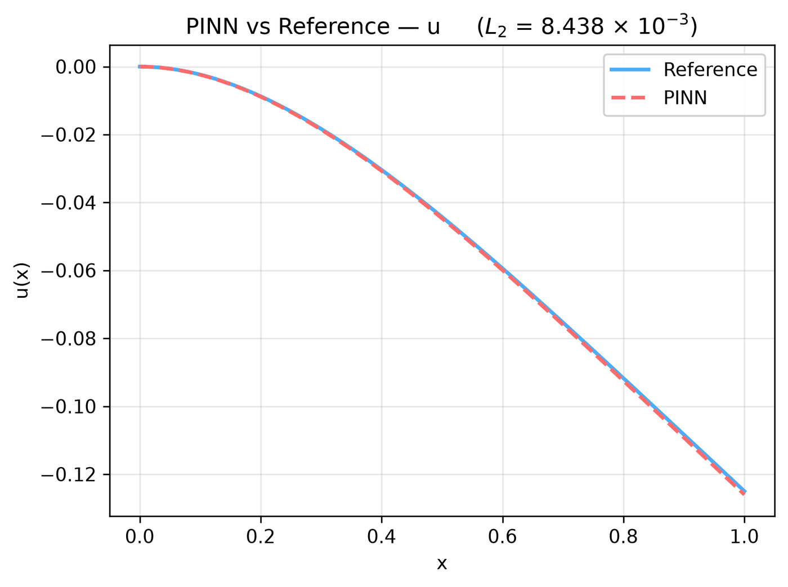

*PINNStudio best — L-BFGS phase added:*

📊 <em>Inverse results — figures</em>

*PINNStudio best — all of the changes together:*

PINN against the reference along a line, at the reference times

the learned parameters during training

<strong>Fractional Poisson 1D</strong> · DeepXDE example

**The problem**

DeepXDE example: [`fractional_Poisson_1d.py`](https://github.com/lululxvi/deepxde/blob/master/examples/pinn_forward/fractional_Poisson_1d.py)

$$\Large D_{0+}^{\alpha}u + D_{1-}^{\alpha}u = f(x), \qquad x \in [0, 1],\ \alpha = 1.5$$

- **Equation in the panel:** `frac(u) - (...)`, with $f$ written out with `gamma(...)` as in DeepXDE's script; constant `alpha`
- **Boundary conditions:** $u(0) = u(1) = 0$, imposed exactly by the output transform $\hat u = x(1-x)N$
- **Exact solution:** $u = x^3(1-x)^3$
- **Constants:** `alpha = 1.5`

⚙️ <em>Default settings — DeepXDE's settings</em>

*Forward problem*

- **Network:** FNN 4 × 20 (1 input, 1 output), tanh, Glorot normal
- **Points:** 101 domain, 2 boundary
- **Training:** Adam 10,000
- **Methods:** initial and boundary conditions built into the output (output transform formula)

*Load it:* toolbar → Examples: **Forward** → **Fractional Poisson 1D** → **Default**, then Solve.

⚙️ <em>PINNStudio best — Tuned settings</em>

*Forward problem*

- **Network:** FNN 5 × 40 (1 input, 1 output), tanh, Glorot normal
- **Points:** 101 domain, 2 boundary
- **Training:** Adam 10,000
- **Methods:** initial and boundary conditions built into the output (output transform formula)

*Load it:* toolbar → Examples: **Forward** → **Fractional Poisson 1D** → **Tuned**, then Solve.

*Found in:* [tuning study, forward runs](tuning_study.md#tune-fractional-poisson-1d)

**Forward problem**

| Training | L₂ | Time (s) |
|---|---|---|
| DeepXDE's settings (3 seeds, median) | 2.3 × 10-2 | 20 |
| 3× iterations | 1.4 × 10-2 | 52 |
| 🔴 **Larger network (2× width, one more layer)** | **1.5 × 10-2** | **21** |
| 3× training points | 3.7 × 10-2 | 19 |
| L-BFGS phase added | 2.0 × 10-2 | 19 |
| All of the above together (3 seeds, median) | 1.2 × 10-2 | 57 |
| **PINNStudio best** (Settings: Tuned): Larger network (2× width, one more layer) | **1.5 × 10-2** | **21** |

📊 <em>Forward results — figures</em>

*DeepXDE's settings:*

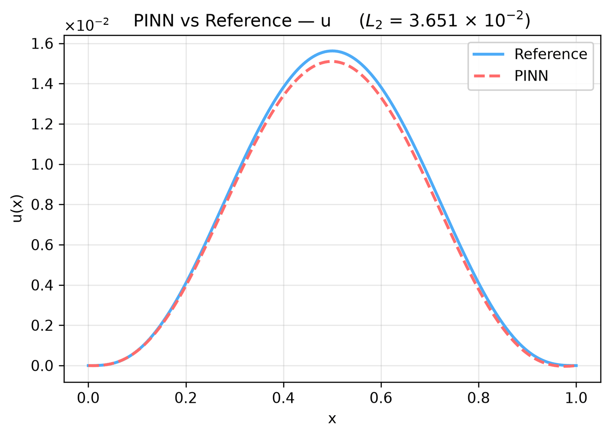

*PINNStudio best — Larger network (2× width, one more layer):*

<strong>Poisson 1D – Dirichlet</strong> · DeepXDE example

**The problem**

DeepXDE example: [`Poisson_Dirichlet_1d.py`](https://github.com/lululxvi/deepxde/blob/master/examples/pinn_forward/Poisson_Dirichlet_1d.py) ([documentation](https://deepxde.readthedocs.io/en/latest/demos/pinn_forward/poisson.1d.dirichlet.html))

$$\Large -\frac{d^2u}{dx^2} = \pi^2\sin(\pi x), \qquad x \in [-1, 1]$$

- **Boundary conditions:** Dirichlet, $u(\pm 1) = 0$ — in the panel: Where *Whole boundary*, Value `0`
- **Exact solution:** $u = \sin(\pi x)$

⚙️ <em>Default settings — DeepXDE's settings (also PINNStudio best)</em>

*Forward problem — also PINNStudio best* (already accurate, so it was not tuned)

- **Network:** FNN 3 × 50 (1 input, 1 output), tanh, Glorot uniform
- **Points:** 16 domain, 2 boundary
- **Training:** Adam 10,000

*Load it:* toolbar → Examples: **Forward** → **Poisson 1D – Dirichlet** → **Default**, then Solve.

**Forward problem**

| Training | L₂ | Time (s) |
|---|---|---|
| DeepXDE's settings (README) | 3.7 × 10-4 | – |
| **PINNStudio best** (Settings: Tuned): no tuning needed | **3.7 × 10-4** | – |

📊 <em>Forward results — figures</em>

*DeepXDE's settings (README):*

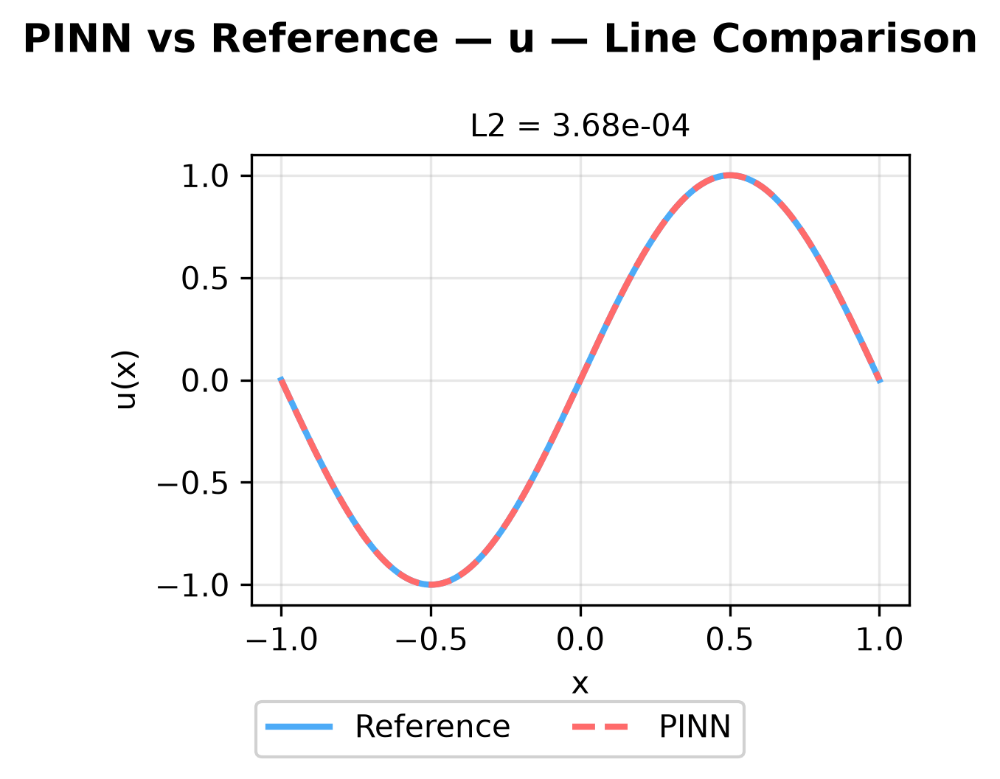

<strong>Poisson 1D – Dirichlet/Neumann</strong> · DeepXDE example

**The problem**

DeepXDE example: [`Poisson_Neumann_1d.py`](https://github.com/lululxvi/deepxde/blob/master/examples/pinn_forward/Poisson_Neumann_1d.py) ([documentation](https://deepxde.readthedocs.io/en/latest/demos/pinn_forward/poisson.1d.neumanndirichlet.html))

$$\Large \frac{d^2u}{dx^2} = 2, \qquad x \in [-1, 1]$$

- **Boundary conditions:** Dirichlet $u(-1) = 0$ (Where `left`, Value `0`); Neumann $u'(1) = 4$ (Where `right`, Value `4` — at the right end the outward normal derivative is $du/dx$)
- **Exact solution:** $u = (x + 1)^2$

⚙️ <em>Default settings — DeepXDE's settings (also PINNStudio best)</em>

*Forward problem — also PINNStudio best* (already accurate, so it was not tuned)

- **Network:** FNN 3 × 50 (1 input, 1 output), tanh, Glorot uniform
- **Points:** 16 domain, 2 boundary
- **Training:** Adam 10,000

*Load it:* toolbar → Examples: **Forward** → **Poisson 1D – Dirichlet/Neumann** → **Default**, then Solve.

**Forward problem**

| Training | L₂ | Time (s) |
|---|---|---|
| DeepXDE's settings (README) | 2.3 × 10-4 | – |
| **PINNStudio best** (Settings: Tuned): no tuning needed | **2.3 × 10-4** | – |

📊 <em>Forward results — figures</em>

*DeepXDE's settings (README):*

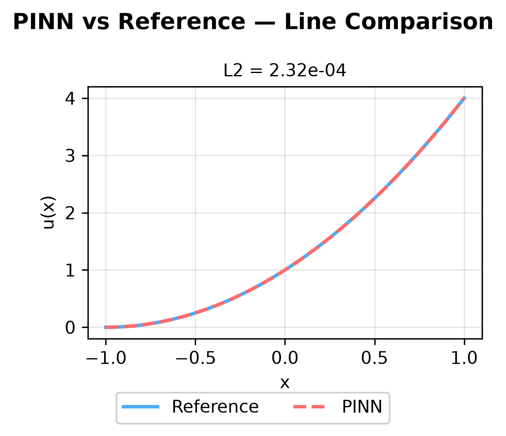

<strong>Poisson 1D – Dirichlet/Periodic</strong> · DeepXDE example

**The problem**

DeepXDE example: [`Poisson_periodic_1d.py`](https://github.com/lululxvi/deepxde/blob/master/examples/pinn_forward/Poisson_periodic_1d.py) ([documentation](https://deepxde.readthedocs.io/en/latest/demos/pinn_forward/poisson.1d.dirichletperiodic.html))

$$\Large -\frac{d^2u}{dx^2} = \pi^2\sin(\pi x), \qquad x \in [-1, 1]$$

- **Boundary conditions:** Dirichlet $u(-1) = 0$ (Where `left`); periodic $u(-1) = u(1)$ (Where `right`)
- **Exact solution:** $u = \sin(\pi x)$

⚙️ <em>Default settings — DeepXDE's settings</em>

*Forward problem*

- **Network:** FNN 3 × 50 (1 input, 1 output), tanh, Glorot uniform
- **Points:** 16 domain, 2 boundary
- **Training:** Adam 10,000

*Load it:* toolbar → Examples: **Forward** → **Poisson 1D – Dirichlet/Periodic** → **Default**, then Solve.

⚙️ <em>PINNStudio best — Tuned settings</em>

*Forward problem*

- **Network:** FNN 4 × 100 (1 input, 1 output), tanh, Glorot uniform
- **Points:** 48 domain, 6 boundary
- **Training:** Adam 30,000 → L-BFGS 15,000

*Load it:* toolbar → Examples: **Forward** → **Poisson 1D – Dirichlet/Periodic** → **Tuned**, then Solve.

*Found in:* [tuning study, forward runs](tuning_study.md#tune-poisson-1d-dirichlet-periodic)

**Forward problem**

| Training | L₂ | Time (s) |
|---|---|---|
| DeepXDE's settings (3 seeds, median) | 9.6 × 10-3 | 20 |
| 3× iterations | 1.1 × 10-3 | 54 |
| Larger network (2× width, one more layer) | 2.6 × 10-3 | 22 |
| 3× training points | 1.6 × 10-3 | 20 |
| L-BFGS phase added | 3.5 × 10-5 | 21 |
| 🔴 **All of the above together (3 seeds, median)** | **6.4 × 10-6** | **67** |
| **PINNStudio best** (Settings: Tuned): all of the changes together | **6.4 × 10-6** | **67** |

📊 <em>Forward results — figures</em>

*DeepXDE's settings:*

*PINNStudio best — all of the changes together:*

<strong>Poisson 1D – Dirichlet/point-set operator</strong> · DeepXDE example

**The problem**

DeepXDE example: [`Poisson_PointSetOperator_1d.py`](https://github.com/lululxvi/deepxde/blob/master/examples/pinn_forward/Poisson_PointSetOperator_1d.py) ([documentation](https://deepxde.readthedocs.io/en/latest/demos/pinn_forward/poisson.1d.pointsetoperator.html))

$$\Large \frac{d^2u}{dx^2} = 2, \qquad x \in [-1, 1]$$

- **Boundary conditions:** Dirichlet $u(-1) = 0$ (Where `left`); point-set operator condition $u'(1) = 4$ — a Point Set Operator row with the point typed in (Points `1`, Function `du_x`, Target value `4`; no file)
- **Exact solution:** $u = (x + 1)^2$

⚙️ <em>Default settings — DeepXDE's settings (also PINNStudio best)</em>

*Forward problem — also PINNStudio best* (already accurate, so it was not tuned)

- **Network:** FNN 3 × 50 (1 input, 1 output), tanh, Glorot uniform
- **Points:** 16 domain, 2 boundary
- **Training:** Adam 20,000

*Load it:* toolbar → Examples: **Forward** → **Poisson 1D – Dirichlet/point-set operator** → **Default**, then Solve.

**Forward problem**

| Training | L₂ | Time (s) |
|---|---|---|
| DeepXDE's settings (README) | 2.6 × 10-5 | – |
| **PINNStudio best** (Settings: Tuned): no tuning needed | **2.6 × 10-5** | – |

📊 <em>Forward results — figures</em>

*DeepXDE's settings (README):*

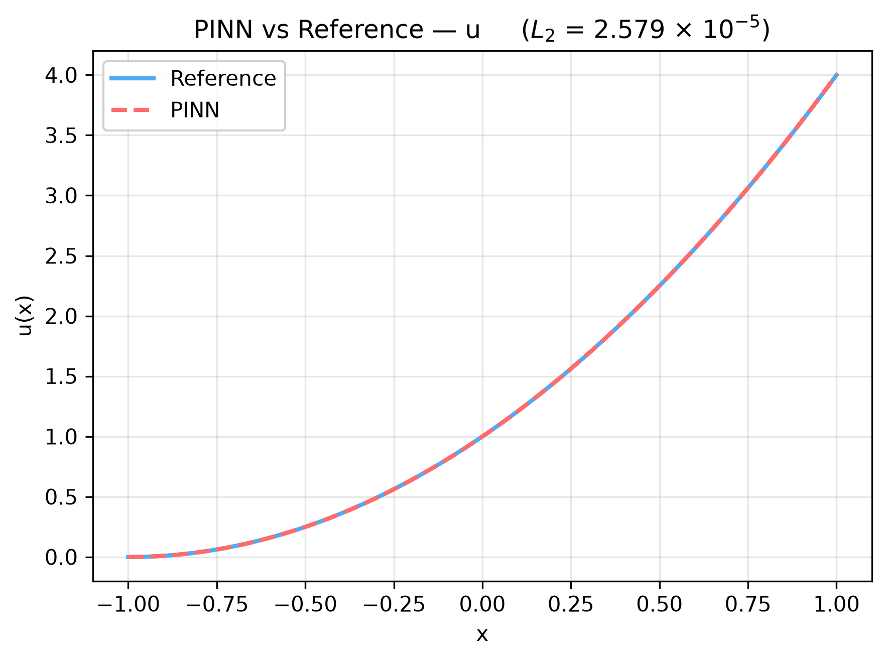

<strong>Poisson 1D – Dirichlet/Robin</strong> · DeepXDE example

**The problem**

DeepXDE example: [`Poisson_Robin_1d.py`](https://github.com/lululxvi/deepxde/blob/master/examples/pinn_forward/Poisson_Robin_1d.py) ([documentation](https://deepxde.readthedocs.io/en/latest/demos/pinn_forward/poisson.1d.dirichletrobin.html))

$$\Large \frac{d^2u}{dx^2} = 2, \qquad x \in [-1, 1]$$

- **Boundary conditions:** Dirichlet $u(-1) = 0$ (Where `left`); Robin $u'(1) = u(1)$ (Where `right`, Value `u`)
- **Exact solution:** $u = (x + 1)^2$

⚙️ <em>Default settings — DeepXDE's settings (also PINNStudio best)</em>

*Forward problem — also PINNStudio best* (already accurate, so it was not tuned)

- **Network:** FNN 3 × 50 (1 input, 1 output), tanh, Glorot uniform
- **Points:** 16 domain, 2 boundary
- **Training:** Adam 10,000

*Load it:* toolbar → Examples: **Forward** → **Poisson 1D – Dirichlet/Robin** → **Default**, then Solve.

**Forward problem**

| Training | L₂ | Time (s) |
|---|---|---|
| DeepXDE's settings (README) | 2.4 × 10-4 | – |
| **PINNStudio best** (Settings: Tuned): no tuning needed | **2.4 × 10-4** | – |

📊 <em>Forward results — figures</em>

*DeepXDE's settings (README):*

<strong>Poisson 1D – hard BCs</strong> · DeepXDE example

**The problem**

DeepXDE example: [`Poisson_Dirichlet_1d_exactBC.py`](https://github.com/lululxvi/deepxde/blob/master/examples/pinn_forward/Poisson_Dirichlet_1d_exactBC.py)

$$\Large -\frac{d^2u}{dx^2} = \sum_{k=1}^{4} k\sin(kx) + 8\sin(8x), \qquad x \in [0, \pi]$$

- **Boundary conditions:** $u(0) = 0$, $u(\pi) = \pi$, imposed exactly by the output transform $\hat u = x(\pi - x)\ N(x) + x$
- **Exact solution:** $u = x + \sum_{k=1}^{4}\frac{\sin(kx)}{k} + \frac{\sin(8x)}{8}$

⚙️ <em>Default settings — DeepXDE's settings (also PINNStudio best)</em>

*Forward problem — also PINNStudio best* (already accurate, so it was not tuned)

- **Network:** FNN 3 × 50 (1 input, 1 output), tanh, Glorot uniform
- **Points:** 64 domain
- **Training:** Adam 30,000 (lr 0.0001)
- **Methods:** initial and boundary conditions built into the output (output transform formula)

*Load it:* toolbar → Examples: **Forward** → **Poisson 1D – hard BCs** → **Default**, then Solve.

**Forward problem**

| Training | L₂ | Time (s) |
|---|---|---|
| DeepXDE's settings (README) | 2.2 × 10-6 | – |
| **PINNStudio best** (Settings: Tuned): no tuning needed | **2.2 × 10-6** | – |

📊 <em>Forward results — figures</em>

*DeepXDE's settings (README):*

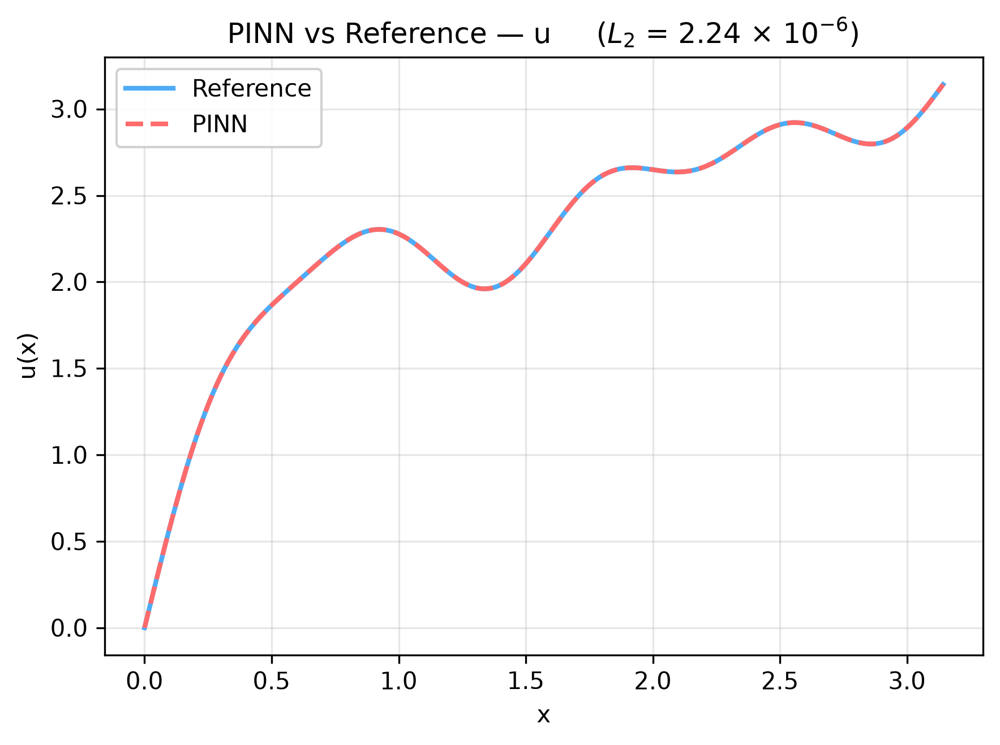

<strong>Poisson 1D – multi-scale Fourier features</strong> · DeepXDE example

**The problem**

DeepXDE example: [`Poisson_multiscale_1d.py`](https://github.com/lululxvi/deepxde/blob/master/examples/pinn_forward/Poisson_multiscale_1d.py)

$$\Large \frac{d^2u}{dx^2} = -(\pi A)^2\sin(\pi A x) - 0.1(\pi B)^2\sin(\pi B x), \qquad x \in [0, 1],\ A = 2,\ B = 50$$

- **Boundary conditions:** $u(0) = u(1) = 0$
- **Exact solution:** $u = \sin(2\pi x) + 0.1\sin(50\pi x)$ — a slow wave plus a fast, small one
- **Constants:** `A = 2`, `B = 50`

A plain network of the same size learns the slow wave and largely misses the fast one; the Fourier features at scale 10 allow the PINN to represent the sin(50πx) component.

⚙️ <em>Default settings — DeepXDE's settings (also PINNStudio best)</em>

*Forward problem — also PINNStudio best* (already accurate, so it was not tuned)

- **Network:** multi-scale Fourier features (MsFFN) 3 × 100 (1 input, 1 output), tanh, Glorot uniform, scales 1, 10
- **Points:** 1,280 domain, 2 boundary
- **Training:** Adam 20,000

*Load it:* toolbar → Examples: **Forward** → **Poisson 1D – multi-scale Fourier features** → **Default**, then Solve.

**Forward problem**

| Training | L₂ | Time (s) |
|---|---|---|
| DeepXDE's settings (README) | 3.9 × 10-3 | – |
| **PINNStudio best** (Settings: Tuned): no tuning needed | **3.9 × 10-3** | – |

📊 <em>Forward results — figures</em>

*DeepXDE's settings (README):*

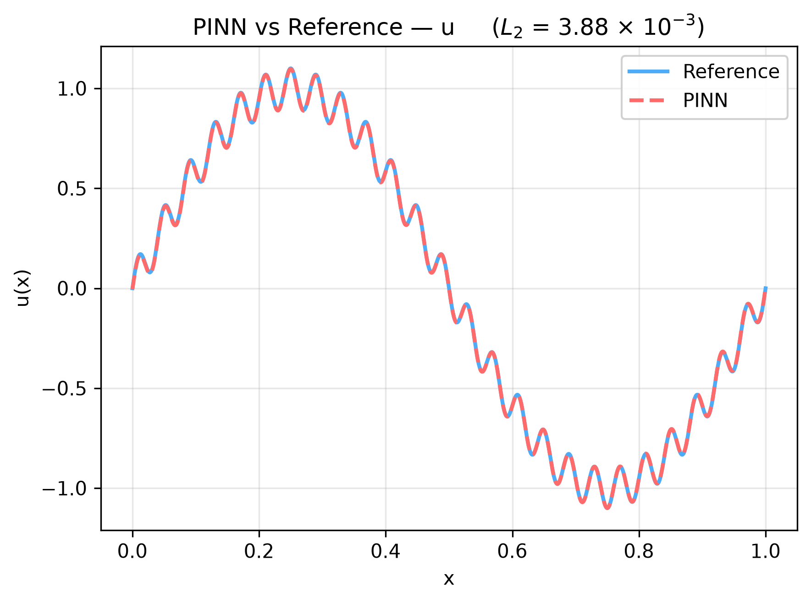

<strong>Brinkman-Forchheimer 1D – unknown ν_e, K</strong> · DeepXDE example

**The problem**

DeepXDE example: [`brinkman_forchheimer.py`](https://github.com/lululxvi/deepxde/blob/master/examples/pinn_inverse/brinkman_forchheimer.py)

$$\Large -\frac{\nu_e}{\epsilon}\frac{d^2u}{dx^2} + \frac{\nu u}{K} = g, \qquad x \in [0, 1],\ \epsilon = 0.4,\ \nu = 10^{-3},\ g = 1$$

- **Unknowns:** effective viscosity $\nu_e$ and permeability $K$ (both $10^{-3}$, initial guesses 0.1)
- **Data:** 5 measurements of $u$; $u = 0$ at both walls through the output transform $\hat u = x(1-x)N$
- **Exact solution:** $u = 1 - \cosh(20(x - 0.5))/\cosh(10)$
- **Constants:** `g = 1`, `v = 1e-3`, `e = 0.4`

⚙️ <em>Default settings — DeepXDE's settings (also PINNStudio best)</em>

*Inverse problem — also PINNStudio best* (no change in the tuning study did better)

*Found in:* [tuning study, forward runs](tuning_study.md#tune-brinkman-forchheimer-1d-unknown-e-k)

- **Network:** FNN 3 × 20 (1 input, 1 output), tanh, Glorot uniform
- **Points:** 100 domain
- **Training:** Adam 30,000
- **Methods:** initial and boundary conditions built into the output (output transform formula)
- **Unknowns:** v_e (initial guess 0.1, true 0.001), K (initial guess 0.1, true 0.001)
- **Measured data:** u_obs.txt for u (weight 1)

*Load it:* toolbar → Examples: **Inverse** → **Brinkman-Forchheimer 1D – unknown ν_e, K** → **Default**, then Solve.

**Inverse problem**

| Training | L₂ fit to measured data | Parameters found (true) | Worst parameter error | Time (s) |
|---|---|---|---|---|
| DeepXDE's settings (3 seeds, median) | 2.0 × 10-2 | νₑ = 0.00127637 (0.001); K = 0.00103624 (0.001) | 28% | 74 |
| 🔴 **3× iterations** | **1.3 × 10-2** | **νₑ = 0.00115135 (0.001); K = 0.00103409 (0.001)** | **15%** | **234** |
| Larger network (2× width, one more layer) | 1.2 × 10-2 | νₑ = 0.0012027 (0.001); K = 0.000988846 (0.001) | 20% | 82 |
| 3× training points | 2.1 × 10-2 | νₑ = 0.0013006 (0.001); K = 0.00103805 (0.001) | 30% | 74 |
| L-BFGS phase added | 1.9 × 10-2 | νₑ = 0.00130008 (0.001); K = 0.00100827 (0.001) | 30% | 78 |
| All of the above together (3 seeds, median) | 1.2 × 10-2 | νₑ = 0.00117644 (0.001); K = 0.00100487 (0.001) | 18% | 237 |
| **PINNStudio best** (Settings: Tuned): 3× iterations | **1.3 × 10-2** | νₑ = 0.00115135 (0.001); K = 0.00103409 (0.001) | **15%** | **234** |

*L₂ fit to measured data: the error on the reference data the inverse run trains on (every reference time), a check that the fit worked, not a prediction error. The parameter error measures the accuracy and decides the best run.*

📊 <em>Inverse results — figures</em>

*DeepXDE's settings:*

PINN against the reference along a line, at the reference times

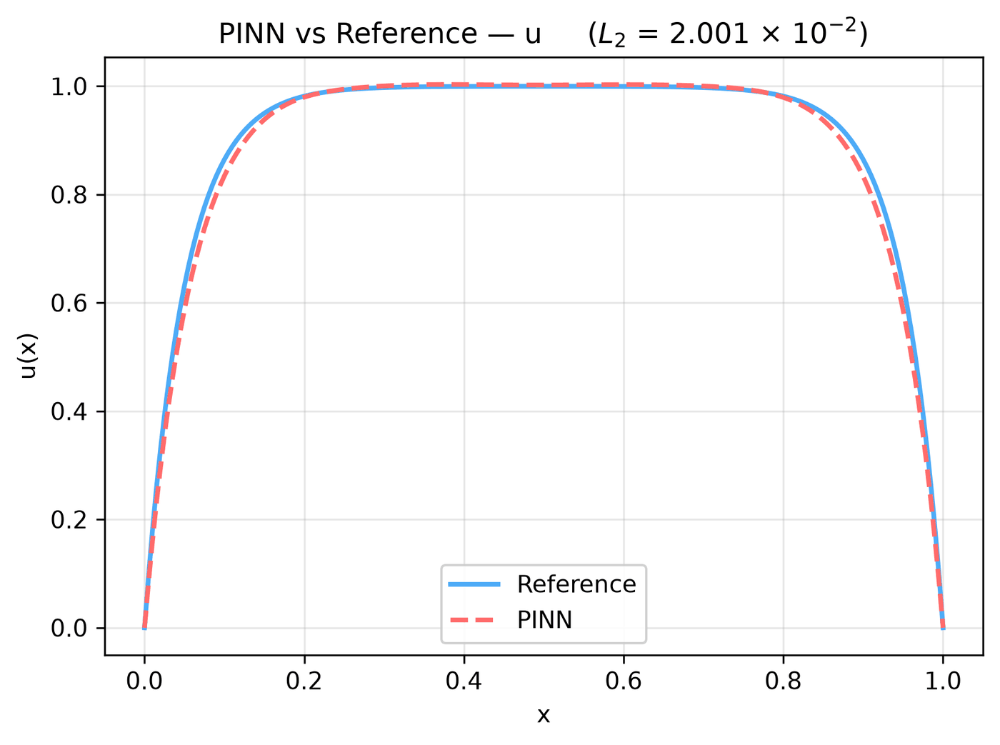

the learned parameters during training

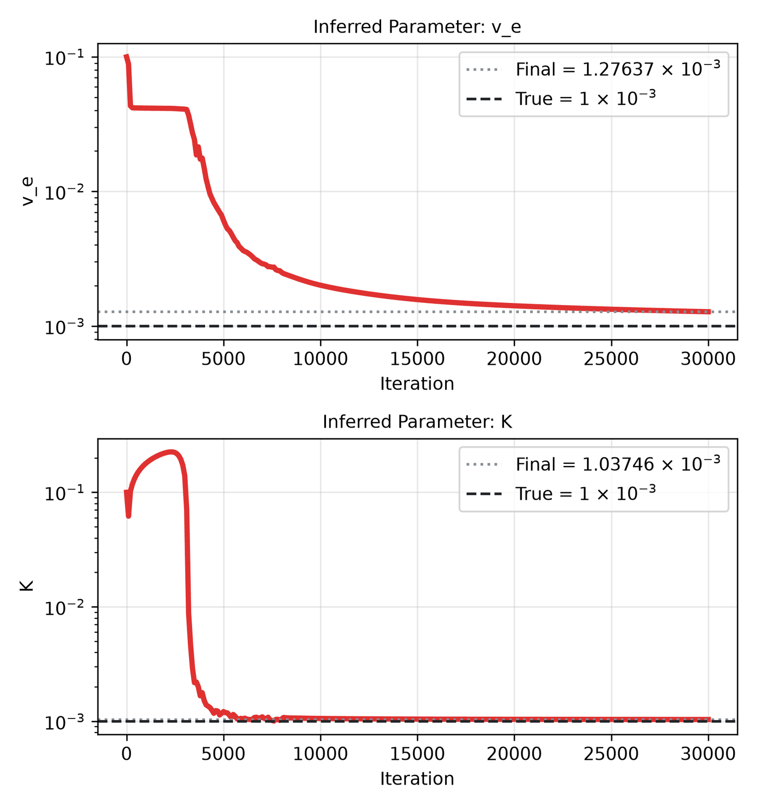

*PINNStudio best — 3× iterations:*

PINN against the reference along a line, at the reference times

the learned parameters during training

<strong>Diffusion-reaction 1D – unknown rate field</strong> · DeepXDE example

**The problem**

DeepXDE example: [`diffusion_reaction_rate.py`](https://github.com/lululxvi/deepxde/blob/master/examples/pinn_inverse/diffusion_reaction_rate.py)

$$\Large \lambda\frac{d^2u}{dx^2} - k(x)\ u = \sin(2\pi x), \qquad \lambda = 0.01,\ x \in [0, 1]$$

- **Unknown:** the reaction rate $k(x)$ (true $0.1 + e^{-0.5(x - 0.5)^2/0.15^2}$), learned as a second network output
- **Data:** 100 measurements of $u$ (computed with SciPy's `solve_bvp`, as DeepXDE does), $u = 0$ at both ends
- **Constants:** `l = 0.01`

⚙️ <em>Default settings — DeepXDE's settings (also PINNStudio best)</em>

*Inverse problem — also PINNStudio best* (no change in the tuning study did better)

*Found in:* [tuning study, forward runs](tuning_study.md#tune-diffusion-reaction-1d-unknown-rate-field)

- **Network:** PFNN 2 × 20 (1 input, 2 outputs), tanh, Glorot uniform
- **Points:** 50 domain, 8 boundary
- **Training:** Adam 20,000

*Load it:* toolbar → Examples: **Inverse** → **Diffusion-reaction 1D – unknown rate field** → **Default**, then Solve.

**Inverse problem**

| Training | L₂ fit to measured data | Parameters found (true) | Worst parameter error | Time (s) |
|---|---|---|---|---|
| DeepXDE's settings (3 seeds, median) | 4.0 × 10-2 | – | – | 49 |
| 3× iterations | 2.3 × 10-2 | – | – | 148 |
| 🔴 **Larger network (2× width, one more layer)** | **1.3 × 10-2** | – | – | **61** |
| 3× training points | 4.0 × 10-2 | – | – | 50 |
| L-BFGS phase added | 4.0 × 10-2 | – | – | 50 |
| All of the above together (3 seeds, median) | 2.8 × 10-2 | – | – | 178 |
| **PINNStudio best** (Settings: Tuned): Larger network (2× width, one more layer) | **1.3 × 10-2** | – | **–** | **61** |

*L₂ fit to measured data: the error on the reference data the inverse run trains on (every reference time), a check that the fit worked, not a prediction error. The parameter error measures the accuracy and decides the best run.*

📊 <em>Inverse results — figures</em>

*DeepXDE's settings:*

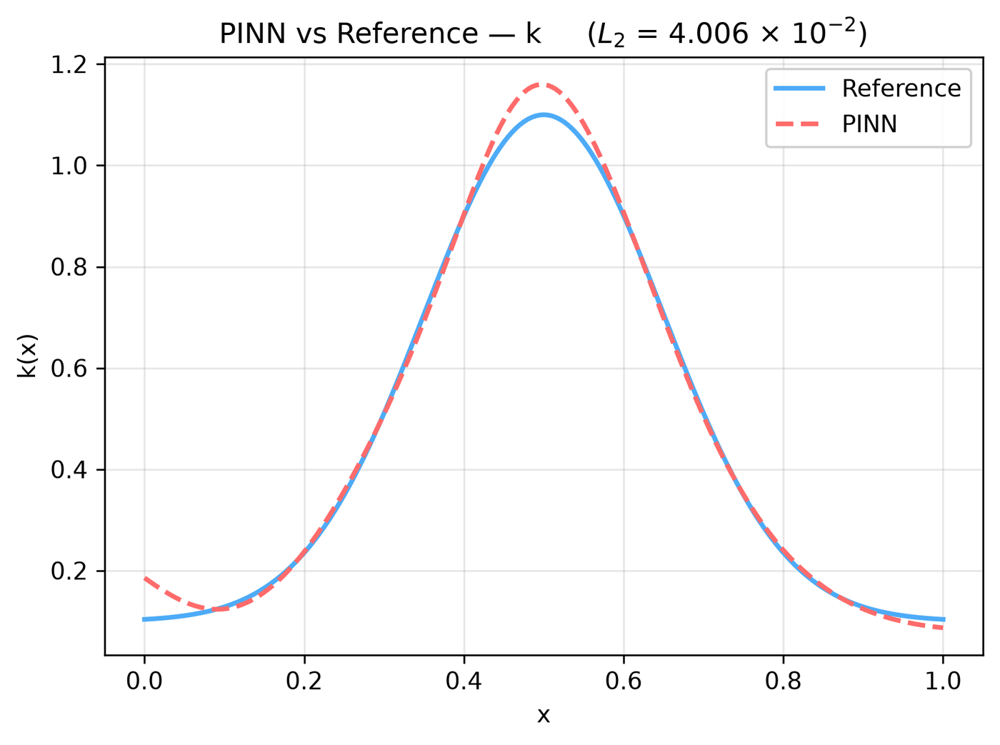

*PINNStudio best — Larger network (2× width, one more layer):*

<strong>Fractional Poisson 1D – unknown order α</strong> · DeepXDE example

**The problem**

DeepXDE example: [`fractional_Poisson_1d_inverse.py`](https://github.com/lululxvi/deepxde/blob/master/examples/pinn_inverse/fractional_Poisson_1d_inverse.py)

$$\Large \frac{D_{-1+}^{\alpha}u + D_{1-}^{\alpha}u}{2\cos(\alpha\pi/2)} = \Gamma(\alpha_0 + 2)\ x, \qquad x \in [-1, 1]$$

- **Unknown:** the order $\alpha$ (true $\alpha_0 = 1.8$, start 1.5) — an inverse variable named `alpha`, also the fractional α
- **Data:** 20 measurements of $u = x(1 - x^2)^{\alpha_0/2}$, loss weight 100
- **Constants:** `a0 = 1.8`

⚙️ <em>Default settings — DeepXDE's settings (also PINNStudio best)</em>

*Inverse problem — also PINNStudio best* (already accurate, so it was not tuned)

- **Network:** FNN 4 × 20 (1 input, 1 output), tanh, Glorot normal
- **Points:** 20 domain
- **Training:** Adam 10,000
- **Methods:** initial and boundary conditions built into the output (output transform formula)
- **Unknowns:** alpha (initial guess 1.5, true 1.8)
- **Measured data:** u_obs.txt for u (weight 100)

*Load it:* toolbar → Examples: **Inverse** → **Fractional Poisson 1D – unknown order α** → **Default**, then Solve.

**Inverse problem**

| Training | L₂ fit to measured data | Parameters found (true) | Worst parameter error | Time (s) |
|---|---|---|---|---|
| DeepXDE's settings (README) | 4.9 × 10-3 | α = 1.79183 (1.8) | 0.45% | – |
| **PINNStudio best** (Settings: Tuned): no tuning needed | **4.9 × 10-3** | α = 1.79183 (1.8) | **0.45%** | – |

*L₂ fit to measured data: the error on the reference data the inverse run trains on (every reference time), a check that the fit worked, not a prediction error. The parameter error measures the accuracy and decides the best run.*

📊 <em>Inverse results — figures</em>

*PINNStudio best (README):*

PINN against the reference along a line, at the reference times

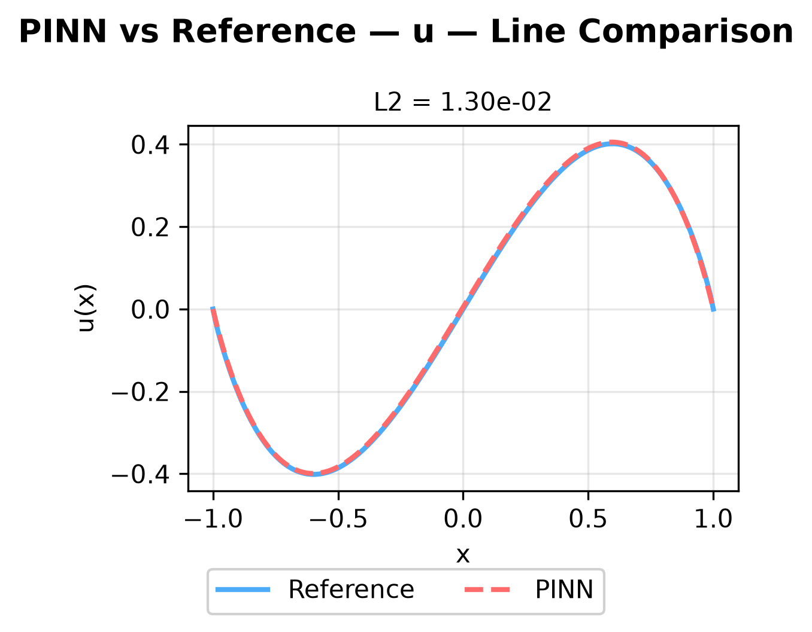

the learned parameters during training

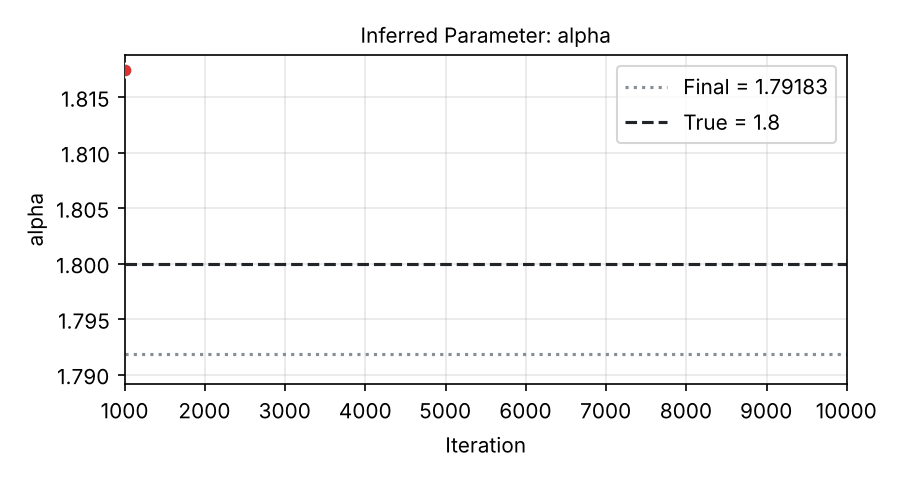

<strong>Poisson 1D – unknown forcing field</strong> · DeepXDE example

**The problem**

DeepXDE example: [`elliptic_inverse_field.py`](https://github.com/lululxvi/deepxde/blob/master/examples/pinn_inverse/elliptic_inverse_field.py) ([documentation](https://deepxde.readthedocs.io/en/latest/demos/pinn_inverse/elliptic.inverse.field.html))

$$\Large -\frac{d^2u}{dx^2} + q(x) = 0, \qquad x \in [-1, 1]$$

- **Unknown:** the field $q(x)$ (true $`-\pi^2\sin(\pi x)`$), learned as a second network output
- **Data:** 100 measurements of $u$, given as a Point Set BC (and as anchor points); $u = \sin(\pi x)$ on the boundary

⚙️ <em>Default settings — DeepXDE's settings (also PINNStudio best)</em>

*Inverse problem — also PINNStudio best* (no change in the tuning study did better)

*Found in:* [tuning study, forward runs](tuning_study.md#tune-poisson-1d-unknown-forcing-field)

- **Network:** PFNN 3 × 20 (1 input, 2 outputs), tanh, Glorot uniform
- **Points:** 200 domain, 2 boundary
- **Training:** Adam 20,000 (lr 0.0001)

*Load it:* toolbar → Examples: **Inverse** → **Poisson 1D – unknown forcing field** → **Default**, then Solve.

**Inverse problem**

| Training | L₂ fit to measured data | Parameters found (true) | Worst parameter error | Time (s) |
|---|---|---|---|---|
| DeepXDE's settings (3 seeds, median) | 5.4 × 10-4 | – | – | 66 |
| 3× iterations | 1.1 × 10-3 | – | – | 171 |
| Larger network (2× width, one more layer) | 5.1 × 10-4 | – | – | 70 |
| 3× training points | 8.3 × 10-4 | – | – | 63 |
| L-BFGS phase added | 8.3 × 10-4 | – | – | 60 |
| 🔴 **All of the above together (3 seeds, median)** | **2.1 × 10-4** | – | – | **221** |
| **PINNStudio best** (Settings: Tuned): all of the changes together | **2.1 × 10-4** | – | **–** | **221** |

*L₂ fit to measured data: the error on the reference data the inverse run trains on (every reference time), a check that the fit worked, not a prediction error. The parameter error measures the accuracy and decides the best run.*

📊 <em>Inverse results — figures</em>

*DeepXDE's settings:*

u — PINN against the reference along a line, at the reference times

q — PINN against the reference along a line, at the reference times

*PINNStudio best — all of the changes together:*

u — PINN against the reference along a line, at the reference times

q — PINN against the reference along a line, at the reference times

<strong>Poisson 1D – unknown forcing field (batches)</strong> · DeepXDE example

**The problem**

DeepXDE example: [`elliptic_inverse_field_batch.py`](https://github.com/lululxvi/deepxde/blob/master/examples/pinn_inverse/elliptic_inverse_field_batch.py)

$$\Large -\frac{d^2u}{dx^2} + q(x) = 0, \qquad x \in [-1, 1]$$

- **Unknown:** the field $q(x)$ (true $`-\pi^2\sin(\pi x)`$)
- **Data:** 10,000 measurements of $u$, used 100 at a time (Point Set BC with batch size 100, redrawn every iteration)

⚙️ <em>Default settings — DeepXDE's settings (also PINNStudio best)</em>

*Inverse problem — also PINNStudio best* (no change in the tuning study did better)

*Found in:* [tuning study, forward runs](tuning_study.md#tune-poisson-1d-unknown-forcing-field-batches)

- **Network:** PFNN 3 × 20 (1 input, 2 outputs), tanh, Glorot uniform
- **Points:** 200 domain, 2 boundary
- **Training:** Adam 20,000 (lr 0.0001)

*Load it:* toolbar → Examples: **Inverse** → **Poisson 1D – unknown forcing field (batches)** → **Default**, then Solve.

**Inverse problem**

| Training | L₂ fit to measured data | Parameters found (true) | Worst parameter error | Time (s) |
|---|---|---|---|---|
| DeepXDE's settings (3 seeds, median) | 4.5 × 10-3 | – | – | 62 |
| 3× iterations | 4.6 × 10-3 | – | – | 179 |
| Larger network (2× width, one more layer) | 5.3 × 10-3 | – | – | 74 |
| 3× training points | 7.5 × 10-3 | – | – | 61 |
| L-BFGS phase added | 7.5 × 10-3 | – | – | 61 |
| 🔴 **All of the above together (3 seeds, median)** | **7.8 × 10-4** | – | – | **215** |
| **PINNStudio best** (Settings: Tuned): all of the changes together | **7.8 × 10-4** | – | **–** | **215** |

*L₂ fit to measured data: the error on the reference data the inverse run trains on (every reference time), a check that the fit worked, not a prediction error. The parameter error measures the accuracy and decides the best run.*

📊 <em>Inverse results — figures</em>

*DeepXDE's settings:*

u — PINN against the reference along a line, at the reference times

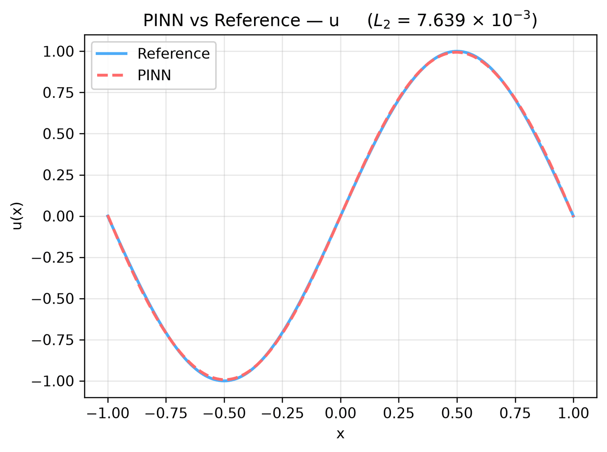

q — PINN against the reference along a line, at the reference times

*PINNStudio best — all of the changes together:*

u — PINN against the reference along a line, at the reference times

q — PINN against the reference along a line, at the reference times

## 1D, time-dependent

<strong>Allen-Cahn 1D – Wight & Zhao</strong> · PINNStudio template, after Wight & Zhao (2021)

**The problem**

Benchmark problem after [Wight & Zhao (2021)](https://doi.org/10.4208/cicp.OA-2020-0086).

$$\Large \frac{\partial u}{\partial t} = \gamma_1\frac{\partial^2 u}{\partial x^2} - \gamma_2 u^3 + \gamma_2 u, \qquad x \in [-1, 1],\ t \in [0, 1]$$

where $\gamma_1 = 0.0001$ and $\gamma_2 = 5$.

- **Initial condition:** $u(x, 0) = x^2\cos(\pi x)$
- **Boundary conditions:** Periodic
- **Geometry:** Interval

*Inverse mode* — same template, switched to **Inverse**, jointly recovering both $\gamma_1$ (diffusion) and $\gamma_2$ (reaction) as unknown parameters:

⚙️ <em>Default settings — Wight & Zhao's method, as in the paper</em>

*Forward problem*

- **Network:** FNN 4 × 128 (2 inputs, 1 output), tanh, Glorot uniform
- **Points:** 2,000 domain, 200 initial, 200 boundary
- **Training:** Adam 20,000 → L-BFGS 10,000
- **Loss weights:** equations 1; boundary 1; initial 100
- **Methods:** residual-based adaptive refinement (6 rounds of 200 points)

*Load it:* toolbar → Examples: **Forward** → **Allen-Cahn 1D – Wight & Zhao** → **Default**, then Solve.

*From the paper, and PINNStudio's choices where it is silent:* W&Z Sec. 3.1, Table 3.1 ("resampling" trial, their best on this problem, rel. L2 2.33e-2): 4 × 128 tanh, weighted loss C0 = 100 (Sec. 2.2.1 default), 2,000 LHS collocation points + 200 added per resampling, about six resamplings, Adam then L-BFGS-B. Not stated: Adam lr/iterations, L-BFGS settings, N_u, N_b (Sec. 3.1 defaults N_u = N_b = 200 used). Resampling = PINNStudio's RAR (residual-based refinement).

⚙️ <em>PINNStudio best — Tuned settings</em>

*Forward problem — the template's own settings*

- **Network:** multi-scale Fourier features (MsFFN) 4 × 128 (2 inputs, 1 output), tanh, Glorot uniform, scales 1, 5
- **Points:** 10,000 domain, 512 initial, 200 boundary
- **Training:** Adam 20,000 → L-BFGS 10,000
- **Methods:** exact initial condition (built into the network) for u; exact periodicity (periodic input features); causal training

*Load it:* toolbar → Examples: **Forward** → **Allen-Cahn 1D – Wight & Zhao** → **Tuned**, then Solve.

*Found in:* [training methods study: 1D Allen-Cahn (Wight & Zhao)](training_methods.md#1d-allen-cahn-wight--zhao)

*Inverse problem — PINNStudio's own inverse setup, tuned*

- **Network:** multi-scale Fourier features (MsFFN) 4 × 128 (2 inputs, 1 output), tanh, Glorot uniform, scales 1, 5
- **Points:** 10,000 domain, 512 initial, 200 boundary
- **Training:** Adam 20,000 → L-BFGS 10,000
- **Loss weights:** equations 1; boundary 1; measured data 100
- **Methods:** exact initial condition (built into the network) for u; exact periodicity (periodic input features); causal training
- **Unknowns:** gamma_1 (initial guess 1.0, true 0.0001), gamma_2 (initial guess 1.0, true 5.0)
- **Measured data:** t_0.25.txt for u (weight 100); t_0.50.txt for u (weight 100); t_0.75.txt for u (weight 100); t_1.0.txt for u (weight 100)

*Load it:* toolbar → Examples: **Inverse** → **Allen-Cahn 1D – Wight & Zhao** → **Tuned**, then Solve.

*Found in:* [tuning study, inverse runs](tuning_study.md#tune-allen-cahn-1d-wight-zhao-pinnstudio-template-inverse-mode)

**Forward problem**

| Training | L₂, last time | L₂, all times | Time (s) |
|---|---|---|---|
| Base PINN | – | – | – |
| Wight & Zhao's method, as reported (Wight & Zhao (2021), Table 3.1) | – | 2.3 × 10-2 | – |
| Wight & Zhao's method, run in PINNStudio | – | – | – |
| Mattey & Ghosh's bc-PINN, as reported (Mattey & Ghosh (2022), Table 2) | – | 1.7 × 10-2 | – |
| Mattey & Ghosh's bc-PINN, run in PINNStudio | – | – | – |
| **PINNStudio best** (Settings: Tuned): the template's starting settings | **1.4 × 10-3** | – | – |

*The base PINN and the paper's method are queued on the GPU; their rows fill in as they finish.*

**Inverse problem**

| Training | L₂ fit to measured data | Parameters found (true) | Worst parameter error | Time (s) |
|---|---|---|---|---|
| The template's starting settings | 1.4 × 10-4 | γ₁ = 9.9233e-05 (0.0001); γ₂ = 4.99833 (5) | 0.77% | 253 |
| 10× weight on the measured data | 9.7 × 10-5 | γ₁ = 9.72777e-05 (0.0001); γ₂ = 4.99859 (5) | 2.7% | 249 |
| 🔴 **Measured data at every reference time** | **1.7 × 10-4** | **γ₁ = 9.95326e-05 (0.0001); γ₂ = 4.99994 (5)** | **0.47%** | **302** |
| 10× data weight, 3× L-BFGS and the larger network | 2.3 × 10-4 | γ₁ = 3.98815e-06 (0.0001); γ₂ = 4.65939 (5) | 96% | 363 |
| **PINNStudio best** (Settings: Tuned): Measured data at every reference time | **1.7 × 10-4** | γ₁ = 9.95326e-05 (0.0001); γ₂ = 4.99994 (5) | **0.47%** | **302** |

*L₂ fit to measured data: the error on the reference data the inverse run trains on (every reference time), a check that the fit worked, not a prediction error. The parameter error measures the accuracy and decides the best run.*

📊 <em>Forward results — figures</em>

*Wight & Zhao's method, run in PINNStudio: the figures come when its run finishes.*

*Mattey & Ghosh's bc-PINN, run in PINNStudio: the figures come when its run finishes.*

*PINNStudio best (the template's own settings, README):*

PINN, reference and error over space and time

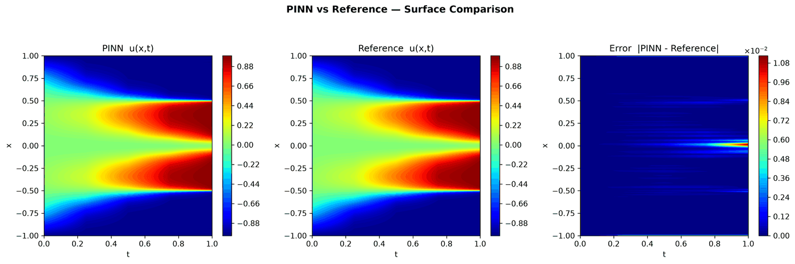

PINN against the reference along a line, at the reference times

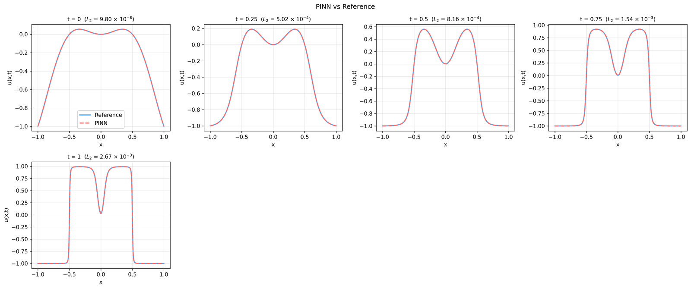

📊 <em>Inverse results — figures</em>

*PINNStudio best — Measured data at every reference time:*

PINN, reference and error over space and time

PINN against the reference along a line, at the reference times

the learned parameters during training

<strong>Cahn-Hilliard 1D – Wight & Zhao</strong> · PINNStudio template, after Wight & Zhao (2021)

**The problem**

Benchmark problem after [Wight & Zhao (2021)](https://doi.org/10.4208/cicp.OA-2020-0086), section 3.2.

$$\Large \frac{\partial u}{\partial t} = \frac{\partial^2 \mu}{\partial x^2}, \qquad \mu = \gamma_2 (u^3 - u) - \gamma_1 \frac{\partial^2 u}{\partial x^2}, \qquad x \in [-1, 1],\ t \in [0, 1]$$

where $\gamma_1 = 10^{-6}$ and $\gamma_2 = 0.01$. The fourth-order equation is solved in mixed form: the chemical potential $\mu$ is a second output, so no residual needs a fourth derivative.

- **Initial condition:** $u(x, 0) = -\cos(2\pi x)$; $\mu$ has none, since its equation has no time derivative and determines $\mu$ at each time
- **Boundary conditions:** Periodic in value and slope, for $u$ and $\mu$
- **Geometry:** Interval

⚙️ <em>Default settings — Wight & Zhao's method, as in the paper</em>

*Forward problem*

- **Network:** FNN 4 × 128 (2 inputs, 2 outputs), tanh, Glorot uniform
- **Points:** 10,000 domain, 512 initial, 200 boundary
- **Training:** Adam 5,000 → L-BFGS 5,000
- **Loss weights:** equations 1; boundary 1; initial 100
- **Methods:** time-adaptive training: 10 time windows, one network on a growing time range, resampling in each window (2 rounds of 200 points, 2,000 Adam iterations each)

*Load it:* toolbar → Examples: **Forward** → **Cahn-Hilliard 1D – Wight & Zhao** → **Default**, then Solve.

*From the paper, and PINNStudio's choices where it is silent:* W&Z Sec. 3.2: one network (u, mu), 4 × 128 tanh, time-adaptive approach I + resampling, Adam lr 1e-3 (max 20,000) then L-BFGS-B, weighted loss "as for AC" (C0 = 100); rel. L2 9.51e-3. Not stated: the time step of approach I (0.1 used, as their 1D AC), iterations per stage, the resampling schedule (here 2 rounds of 200 points per stage, 2,000 Adam iterations each; their 1D AC trial added 200 points per resampling).

⚙️ <em>PINNStudio best — Tuned settings</em>

*Forward problem — the template's own settings*

- **Network:** FNN 4 × 128 (2 inputs, 2 outputs), tanh, Glorot uniform
- **Points:** 10,000 domain, 512 initial, 200 boundary
- **Training:** Adam 20,000 → L-BFGS 20,000
- **Methods:** exact initial condition (built into the network) for u; exact periodicity (periodic input features); SA-PINN per-point weights

*Load it:* toolbar → Examples: **Forward** → **Cahn-Hilliard 1D – Wight & Zhao** → **Tuned**, then Solve.

*Found in:* [training methods study: 1D Cahn-Hilliard (Wight & Zhao)](training_methods.md#1d-cahn-hilliard-wight--zhao)

**Forward problem**

| Training | L₂, last time | L₂, all times | Time (s) |
|---|---|---|---|
| Base PINN | – | – | – |
| Wight & Zhao's method, as reported (Wight & Zhao (2021), Sec. 3.2) | – | 9.5 × 10-3 | – |
| Wight & Zhao's method, run in PINNStudio | – | – | – |
| **PINNStudio best** (Settings: Tuned): the template's starting settings | **6.0 × 10-4** | – | – |

*The base PINN and the paper's method are queued on the GPU; their rows fill in as they finish.*

📊 <em>Forward results — figures</em>

*Wight & Zhao's method, run in PINNStudio: the figures come when its run finishes.*

*PINNStudio best (the template's own settings, README):*

u — PINN, reference and error over space and time

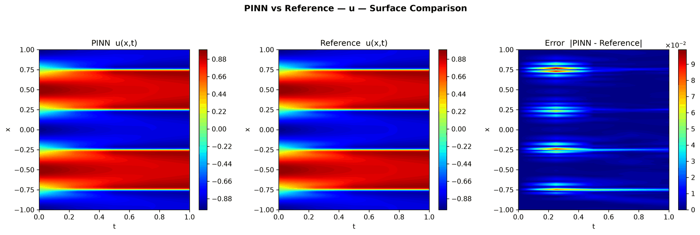

μ — PINN, reference and error over space and time

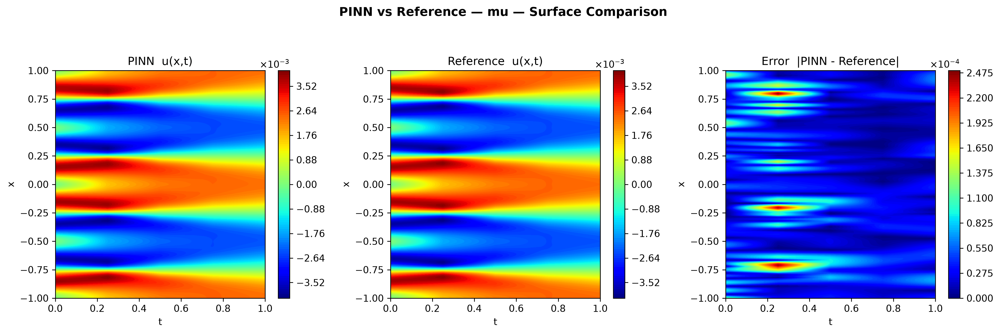

u — PINN against the reference along a line, at the reference times

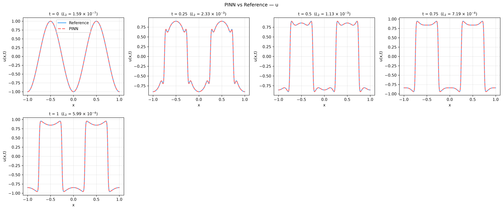

μ — PINN against the reference along a line, at the reference times

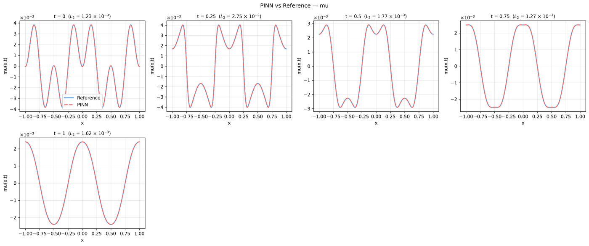

<strong>Cahn-Hilliard 1D – Mattey & Ghosh</strong> · PINNStudio template, after Mattey & Ghosh (2022)

**The problem**

Benchmark problem after [Mattey & Ghosh (2022)](https://doi.org/10.1016/j.cma.2021.114474), section 5.2 (eq. 25):

$$\Large \frac{\partial h}{\partial t} = \frac{\partial^2 \mu}{\partial x^2}, \qquad \mu = \kappa (h^3 - h) - \alpha\kappa \frac{\partial^2 h}{\partial x^2}, \qquad x \in [-1, 1],\ t \in [0, 1]$$

where $\alpha = 0.02$ and $\kappa = 1$. As in the paper (its phase-space form, eq. 19) and the Wight & Zhao example, $\mu$ is a second output, so no residual needs a fourth derivative. The same paper's 1D Allen-Cahn problem is the [Allen-Cahn 1D – Wight & Zhao](../README.md#1d-allen-cahn) example, and its 2D Allen-Cahn IBVP-1 is [Allen-Cahn 2D – Mattey & Ghosh](../README.md#2d-allen-cahn-mattey--ghosh).

- **Initial condition:** $h(x, 0) = \cos(\pi x) - \exp(-4(\pi x)^2)$; $\mu$ has none
- **Boundary conditions:** Periodic in value and slope, for $h$ and $\mu$
- **Geometry:** Interval

⚙️ <em>Default settings — Mattey & Ghosh's bc-PINN, as in the paper</em>

*Forward problem*

- **Network:** FNN 6 × 128 (2 inputs, 2 outputs), tanh, Glorot uniform
- **Points:** 10,000 domain, 128 initial, 20 boundary
- **Training:** Adam 10,000 → L-BFGS 50,000
- **Loss weights:** equations 1; boundary 1; initial 64
- **Methods:** time-adaptive training: 10 time windows, a network per window, each starting from the previous one, backward-compatibility term (weight 64), initial-condition guided learning (0.1 of Adam)

*Load it:* toolbar → Examples: **Forward** → **Cahn-Hilliard 1D – Mattey & Ghosh** → **Default**, then Solve.

*From the paper, and PINNStudio's choices where it is silent:* M&G Sec. 5.2, Table 3 [PAR]: bc-PINN, (h, mu), 6 × 128, N_i = 128, N_b = 20 and N_r = 10,000 per segment, 20 steps (0.1) per segment → 10 segments, 10,000 Adam per segment then L-BFGS, ICGL + TL; rel. L2 1.86e-2. Weights for CH are not stated: 64 on IC and backward terms as in their AC code.

⚙️ <em>PINNStudio best — Tuned settings</em>

*Forward problem*

- **Network:** FNN 4 × 128 (2 inputs, 2 outputs), tanh, Glorot uniform
- **Points:** 10,000 domain, 512 initial, 200 boundary
- **Training:** Adam 5,000 → L-BFGS 5,000
- **Loss weights:** equations 1; boundary 1; initial 100
- **Methods:** exact periodicity (periodic input features); SA-PINN per-point weights; time-adaptive training: 19 time windows, a network per window, each starting from the previous one

*Load it:* toolbar → Examples: **Forward** → **Cahn-Hilliard 1D – Mattey & Ghosh** → **Tuned**, then Solve.

*Found in:* [tuning study, forward runs](tuning_study.md#tune-cahn-hilliard-1d-mattey-ghosh-pinnstudio-template-best-setup) · [training methods study: 1D Cahn-Hilliard (Mattey & Ghosh)](training_methods.md#1d-cahn-hilliard-mattey--ghosh)

**Forward problem**

| Training | L₂ u, last time | L₂ μ, last time | L₂ u, all times | Time (s) |
|---|---|---|---|---|
| Base PINN | – | – | – | – |
| Mattey & Ghosh's bc-PINN, as reported (Mattey & Ghosh (2022), Sec. 5.2) | – | – | 1.9 × 10-2 | – |
| Mattey & Ghosh's bc-PINN, run in PINNStudio | – | – | – | – |
| 🔴 **Best setup of the training methods study** | **3.9 × 10-3** | **3.8 × 10-1** | **3.2 × 10-2** | **1002** |
| Best setup + 3× iterations | 6.1 × 10-2 | 1.9 × 100 | 7.0 × 10-2 | 2165 |
| Best setup + larger network (2× width, one more layer) | 9.9 × 10-1 | 6.4 × 101 | 8.6 × 10-1 | 1893 |
| Best setup + 2× time windows | 1.5 × 10-2 | 1.4 × 100 | 3.6 × 10-2 | 1709 |
| Best setup + all of the above together | 9.9 × 10-1 | 3.9 × 101 | 9.3 × 10-1 | 13959 |
| **PINNStudio best** (Settings: Tuned): the best setup as it is | **3.9 × 10-3** | **3.8 × 10-1** | **3.2 × 10-2** | **1002** |

*Each output's relative L₂ at its last reference time; the best run is chosen by u.*

*The base PINN and the paper's method are queued on the GPU; their rows fill in as they finish.*

📊 <em>Forward results — figures</em>

*Mattey & Ghosh's bc-PINN, run in PINNStudio: the figures come when its run finishes.*

*PINNStudio best — the best setup as it is:*

u — PINN, reference and error over space and time

μ — PINN, reference and error over space and time

u — PINN against the reference along a line, at the reference times

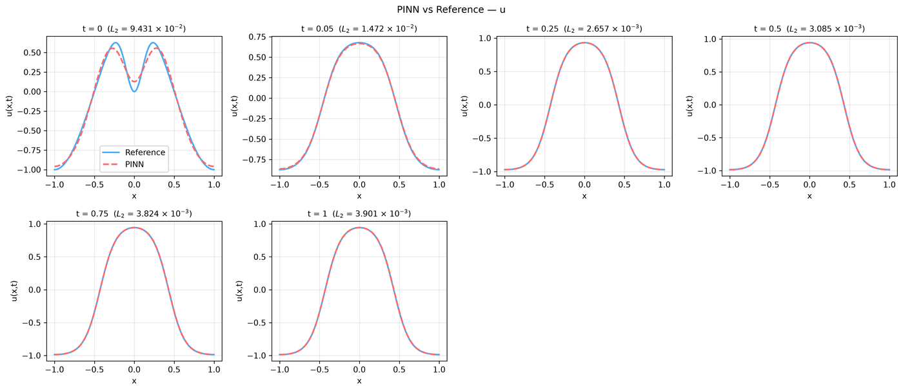

μ — PINN against the reference along a line, at the reference times

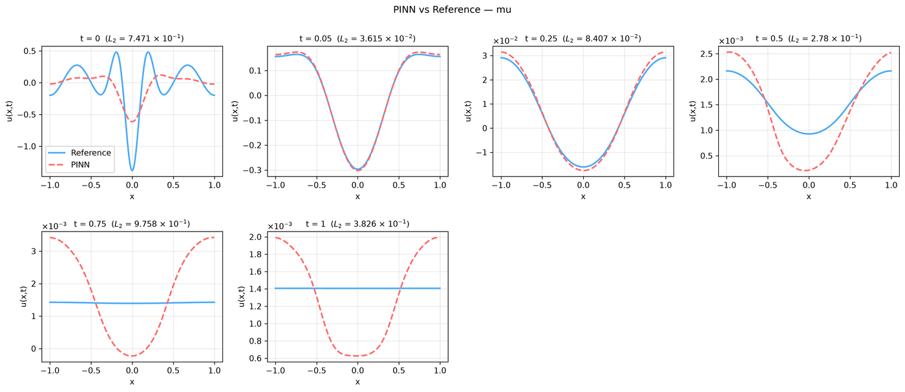

<strong>Black-Scholes 1D – American put</strong> · DeepXDE example

**The problem**

DeepXDE example: [`american_put.py`](https://github.com/lululxvi/deepxde/blob/master/examples/pinn_forward/american_put.py)

$$\Large \min\left(-\mathcal{L}V,\ V - \max(K - S, 0)\right) = 0, \qquad \mathcal{L}V = -\frac{\partial V}{\partial \tau} + \frac{\sigma^2}{2}S^2\frac{\partial^2 V}{\partial S^2} + rS\frac{\partial V}{\partial S} - rV$$

- **Domain:** $S \in [0, 4]$, $\tau \in [0, 1]$; strike $K = 1$, $r = 0.05$, $\sigma = 0.2$
- **Equations:** three residuals for one output (DeepXDE's Fischer-Burmeister form of the complementarity problem)
- **Reference:** none bundled (DeepXDE compares against a binomial-tree price) — add your own in Error Analysis
- **Constants:** `r = 0.05`, `sigma = 0.2`, `K = 1`

⚙️ <em>Default settings — DeepXDE's settings (also PINNStudio best)</em>

*Forward problem — also PINNStudio best* (already accurate, so it was not tuned)

- **Network:** FNN 4 × 128 (2 inputs, 1 output), tanh, Glorot normal
- **Points:** 6,000 domain, 1,500 initial, 1,500 boundary
- **Training:** Adam 12,000 → L-BFGS 15,000

*Load it:* toolbar → Examples: **Forward** → **Black-Scholes 1D – American put** → **Default**, then Solve.

<strong>Black-Scholes 1D – European call</strong> · DeepXDE example

**The problem**

DeepXDE example: [`black_scholes_call.py`](https://github.com/lululxvi/deepxde/blob/master/examples/pinn_forward/black_scholes_call.py) ([documentation](https://deepxde.readthedocs.io/en/latest/demos/pinn_forward/black_scholes.html))

$$\Large \frac{\partial V}{\partial \tau} = \frac{\sigma^2}{2}S^2\frac{\partial^2 V}{\partial S^2} + rS\frac{\partial V}{\partial S} - rV, \qquad S \in [0, 150],\ \tau \in [0, 1]$$

- **Parameters:** strike $K = 50$, rate $r = 0.05$, volatility $\sigma = 0.2$; $x$ is the stock price $S$ and $t$ the time to maturity $\tau$
- **Initial condition:** payoff $V(S, 0) = \max(S - K, 0)$; **boundary conditions:** $V(0, \tau) = 0$, $V(150, \tau) = 150 - Ke^{-r\tau}$
- **Exact solution:** the Black-Scholes formula (uses `norm_cdf` in the reference formula)
- **Constants:** `K = 50`, `r = 0.05`, `sigma = 0.2`

⚙️ <em>Default settings — DeepXDE's settings (also PINNStudio best)</em>

*Forward problem — also PINNStudio best* (already accurate, so it was not tuned)

- **Network:** FNN 4 × 28 (2 inputs, 1 output), tanh, Glorot normal
- **Points:** 2,047 domain, 127 initial, 63 boundary
- **Training:** Adam 20,000 → L-BFGS 15,000

*Load it:* toolbar → Examples: **Forward** → **Black-Scholes 1D – European call** → **Default**, then Solve.

**Forward problem**

| Training | L₂ | Time (s) |
|---|---|---|
| DeepXDE's settings (README) | 4.3 × 10-4 | – |
| **PINNStudio best** (Settings: Tuned): no tuning needed | **4.3 × 10-4** | – |

📊 <em>Forward results — figures</em>

*DeepXDE's settings (README):*

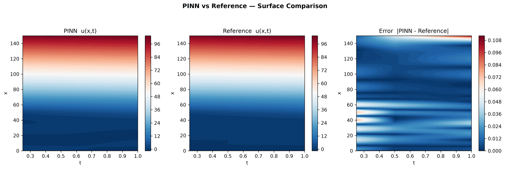

<strong>Burgers 1D – Raissi et al.</strong> · PINNStudio template, after Raissi et al. (2019)

**The problem**

Exact equation, initial and boundary conditions as in [Raissi, Perdikaris & Karniadakis (2019)](https://doi.org/10.1016/j.jcp.2018.10.045).

$$\Large \frac{\partial u}{\partial t} + u\frac{\partial u}{\partial x} = \frac{0.01}{\pi}\frac{\partial^2 u}{\partial x^2}, \qquad x \in [-1, 1],\ t \in [0, 1]$$

- **Initial condition:** $u(x, 0) = -\sin(\pi x)$
- **Boundary conditions:** Dirichlet, $u = 0$ at both ends
- **Geometry:** Interval

A shock forms near $x = 0$ as $t \to 1$; this template uses a larger fixed collocation count to resolve it rather than adaptive refinement.

*Restore & visualize* — the trained model restored from its saved checkpoint and re-animated without retraining:

*Inverse mode* — same template, switched to **Inverse**, jointly recovering both coefficients of the data-driven-discovery form of this equation in [Raissi, Perdikaris & Karniadakis (2019)](https://doi.org/10.1016/j.jcp.2018.10.045), Appendix B, eq. B.1:

$$\Large \frac{\partial u}{\partial t} + \lambda_1 u\frac{\partial u}{\partial x} - \lambda_2\frac{\partial^2 u}{\partial x^2} = 0$$

with true values $\lambda_1 = 1.0$ and $\lambda_2 = 0.01/\pi$ (the template writes the viscous term as $\frac{\lambda_2}{\pi}\frac{\partial^2 u}{\partial x^2}$, so the value it learns is 0.01). $\lambda_1$'s initial guess starts at $0.1$ rather than $1.0$, since $1.0$ is already its true value.

⚙️ <em>Default settings — Raissi et al.'s settings, as in the paper</em>

*Forward problem*

- **Network:** FNN 8 × 20 (2 inputs, 1 output), tanh, Glorot uniform
- **Points:** 10,000 domain, 50 initial, 50 boundary
- **Training:** L-BFGS 50,000

*Load it:* toolbar → Examples: **Forward** → **Burgers 1D – Raissi et al.** → **Default**, then Solve.

*From the paper, and PINNStudio's choices where it is silent:* Raissi et al. Sec. 2.1 and their code: 8x20 tanh (3,021 parameters), N_u = 100 IC/BC points, N_f = 10,000 LHS points, L-BFGS-B only (maxiter 50,000), equal weights; rel. L2 6.7e-4. The code normalises inputs to [-1, 1] (not done here; x is already in [-1, 1], t in [0, 1]).

⚙️ <em>PINNStudio best — Tuned settings</em>

*Forward problem*

- **Network:** FNN 8 × 20 (2 inputs, 1 output), tanh, Glorot uniform
- **Points:** 10,000 domain, 50 initial, 50 boundary
- **Training:** L-BFGS 50,000

*Load it:* toolbar → Examples: **Forward** → **Burgers 1D – Raissi et al.** → **Tuned**, then Solve.

*Inverse problem — PINNStudio's own inverse setup, tuned*

- **Network:** FNN 4 × 40 (2 inputs, 1 output), tanh, Glorot uniform
- **Points:** 8,000 domain, 200 initial, 200 boundary
- **Training:** Adam 15,000 → L-BFGS 30,000
- **Loss weights:** equations 1; boundary 1; initial 100; measured data 100
- **Unknowns:** lambda_1 (initial guess 0.1, true 1.0), lambda_2 (initial guess 1.0, true 0.01)
- **Measured data:** t_1.0.txt for u (weight 1000)

*Load it:* toolbar → Examples: **Inverse** → **Burgers 1D – Raissi et al.** → **Tuned**, then Solve.

*Found in:* [tuning study, inverse runs](tuning_study.md#tune-burgers-1d-raissi-et-al-pinnstudio-template-inverse-mode)

**Forward problem**

| Training | L₂, last time | L₂, all times | Time (s) |
|---|---|---|---|
| Base PINN | 3.3 × 10-4 | 4.0 × 10-4 | 42 |
| Raissi et al.'s settings, as reported (Raissi et al. (2019), Sec. 2.1) | – | 6.7 × 10-4 | – |
| 🔴 **Raissi et al.'s settings, run in PINNStudio** | **3.3 × 10-4** | **4.0 × 10-4** | **40** |
| Best setup of the training methods study | 1.7 × 10-3 | 1.0 × 10-3 | 86 |
| Best setup + 3× iterations | 5.5 × 10-4 | 6.7 × 10-4 | 148 |
| Best setup + larger network (2× width, one more layer) | 6.8 × 10-4 | 6.2 × 10-4 | 75 |
| Best setup + all of the above together | 5.2 × 10-4 | 2.6 × 10-4 | 172 |
| **PINNStudio best** (Settings: Tuned): Raissi et al.'s settings, run in PINNStudio | **3.3 × 10-4** | **4.0 × 10-4** | **40** |

**Inverse problem**

| Training | L₂ fit to measured data | Parameters found (true) | Worst parameter error | Time (s) |
|---|---|---|---|---|
| The template's starting settings | 7.8 × 10-4 | λ₁ = 0.996107 (1); λ₂ = 0.0100386 (0.01) | 0.39% | 97 |
| 10× weight on the measured data | 1.2 × 10-4 | λ₁ = 0.99847 (1); λ₂ = 0.00998163 (0.01) | 0.18% | 117 |
| Measured data at every reference time | 3.0 × 10-4 | λ₁ = 0.999186 (1); λ₂ = 0.0100091 (0.01) | 0.091% | 103 |
| Best whole-interval setup | 4.8 × 10-4 | λ₁ = 0.994327 (1); λ₂ = 0.0100096 (0.01) | 0.57% | 100 |
| 🔴 **10× data weight, 3× L-BFGS and the larger network** | **5.5 × 10-5** | **λ₁ = 0.999937 (1); λ₂ = 0.0100099 (0.01)** | **0.099%** | **101** |
| **PINNStudio best** (Settings: Tuned): 10× data weight, 3× L-BFGS and the larger network | **5.5 × 10-5** | λ₁ = 0.999937 (1); λ₂ = 0.0100099 (0.01) | **0.099%** | **101** |

*L₂ fit to measured data: the error on the reference data the inverse run trains on (every reference time), a check that the fit worked, not a prediction error. The parameter error measures the accuracy and decides the best run.*

📊 <em>Forward results — figures</em>

*Raissi et al.'s settings, run in PINNStudio (also PINNStudio best):*

PINN, reference and error over space and time

PINN against the reference along a line, at the reference times

📊 <em>Inverse results — figures</em>

*PINNStudio best — 10× data weight, 3× L-BFGS and the larger network:*

PINN, reference and error over space and time

PINN against the reference along a line, at the reference times

the learned parameters during training

<strong>Burgers 1D – RAR</strong> · DeepXDE example

**The problem**

DeepXDE example: [`Burgers_RAR.py`](https://github.com/lululxvi/deepxde/blob/master/examples/pinn_forward/Burgers_RAR.py) ([documentation](https://deepxde.readthedocs.io/en/latest/demos/pinn_forward/burgers.rar.html))

$$\Large \frac{\partial u}{\partial t} + u\frac{\partial u}{\partial x} = \frac{0.01}{\pi}\frac{\partial^2 u}{\partial x^2}, \qquad x \in [-1, 1],\ t \in [0, 1]$$

- **Initial / boundary conditions:** $u(x, 0) = -\sin(\pi x)$, $u(\pm 1, t) = 0$

⚙️ <em>Default settings — DeepXDE's settings (also PINNStudio best)</em>

*Forward problem — also PINNStudio best* (already accurate, so it was not tuned)

- **Network:** FNN 3 × 20 (2 inputs, 1 output), tanh, Glorot normal
- **Points:** 2,500 domain, 160 initial, 100 boundary
- **Training:** Adam 10,000 → L-BFGS 15,000
- **Methods:** residual-based adaptive refinement (3 rounds of 100 points)

*Load it:* toolbar → Examples: **Forward** → **Burgers 1D – RAR** → **Default**, then Solve.

**Forward problem**

| Training | L₂ | Time (s) |
|---|---|---|
| DeepXDE's settings (README) | 8.4 × 10-4 | – |
| **PINNStudio best** (Settings: Tuned): no tuning needed | **8.4 × 10-4** | – |

📊 <em>Forward results — figures</em>

*DeepXDE's settings (README):*

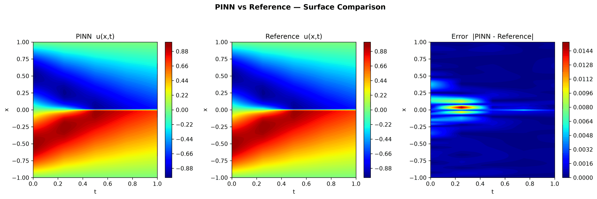

<strong>Diffusion 1D</strong> · DeepXDE example

**The problem**

DeepXDE example: [`diffusion_1d.py`](https://github.com/lululxvi/deepxde/blob/master/examples/pinn_forward/diffusion_1d.py) ([documentation](https://deepxde.readthedocs.io/en/latest/demos/pinn_forward/diffusion.1d.html))

$$\Large \frac{\partial u}{\partial t} = \frac{\partial^2 u}{\partial x^2} - e^{-t}\left(\sin(\pi x) - \pi^2\sin(\pi x)\right), \qquad x \in [-1, 1],\ t \in [0, 1]$$

- **Initial condition:** $u(x, 0) = \sin(\pi x)$; **boundary condition:** $u = e^{-t}\sin(\pi x)$
- **Exact solution:** $u = e^{-t}\sin(\pi x)$

⚙️ <em>Default settings — DeepXDE's settings</em>

*Forward problem*

- **Network:** FNN 3 × 32 (2 inputs, 1 output), tanh, Glorot uniform
- **Points:** 40 domain, 10 initial, 20 boundary
- **Training:** Adam 10,000

*Load it:* toolbar → Examples: **Forward** → **Diffusion 1D** → **Default**, then Solve.

⚙️ <em>PINNStudio best — Tuned settings</em>

*Forward problem*

- **Network:** FNN 4 × 64 (2 inputs, 1 output), tanh, Glorot uniform
- **Points:** 120 domain, 30 initial, 60 boundary
- **Training:** Adam 30,000 → L-BFGS 15,000

*Load it:* toolbar → Examples: **Forward** → **Diffusion 1D** → **Tuned**, then Solve.

*Found in:* [tuning study, forward runs](tuning_study.md#tune-diffusion-1d)

**Forward problem**

| Training | L₂ | Time (s) |
|---|---|---|
| DeepXDE's settings (3 seeds, median) | 2.3 × 10-2 | 26 |
| 3× iterations | 1.1 × 10-2 | 61 |
| Larger network (2× width, one more layer) | 1.2 × 10-2 | 26 |
| 3× training points | 1.2 × 10-2 | 23 |
| L-BFGS phase added | 4.4 × 10-3 | 25 |
| 🔴 **All of the above together (3 seeds, median)** | **1.5 × 10-3** | **76** |
| **PINNStudio best** (Settings: Tuned): all of the changes together | **1.5 × 10-3** | **76** |

📊 <em>Forward results — figures</em>

*DeepXDE's settings:*

PINN, reference and error over space and time

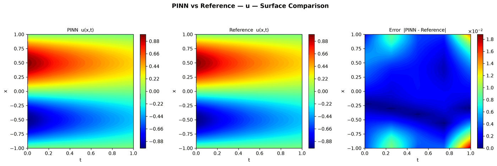

PINN against the reference along a line, at the reference times

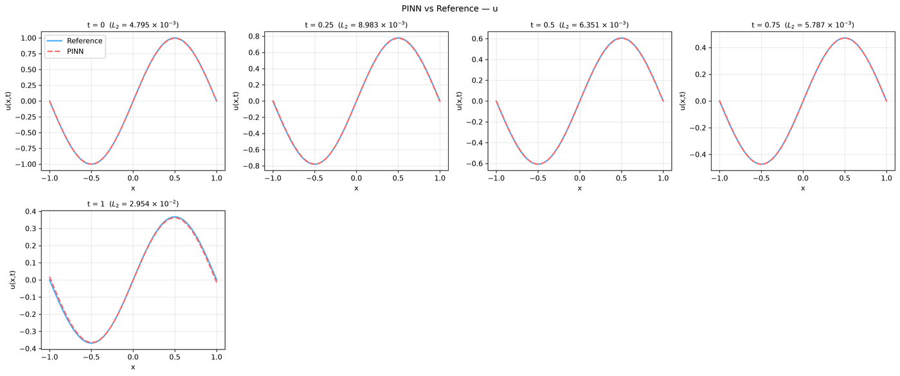

*PINNStudio best — all of the changes together:*

PINN, reference and error over space and time

PINN against the reference along a line, at the reference times

<strong>Diffusion 1D – hard IC and BCs</strong> · DeepXDE example

**The problem**

DeepXDE example: [`diffusion_1d_exactBC.py`](https://github.com/lululxvi/deepxde/blob/master/examples/pinn_forward/diffusion_1d_exactBC.py) ([documentation](https://deepxde.readthedocs.io/en/latest/demos/pinn_forward/diffusion.1d.exactBC.html))

$$\Large \frac{\partial u}{\partial t} = \frac{\partial^2 u}{\partial x^2} - e^{-t}\left(\sin(\pi x) - \pi^2\sin(\pi x)\right), \qquad x \in [-1, 1],\ t \in [0, 1]$$

- **Initial and boundary conditions:** imposed exactly by $\hat u = t(1 - x^2)N + \sin(\pi x)$ — no IC/BC loss terms
- **Exact solution:** $u = e^{-t}\sin(\pi x)$

⚙️ <em>Default settings — DeepXDE's settings (also PINNStudio best)</em>

*Forward problem — also PINNStudio best* (already accurate, so it was not tuned)

- **Network:** FNN 3 × 32 (2 inputs, 1 output), tanh, Glorot uniform
- **Points:** 40 domain
- **Training:** Adam 10,000
- **Methods:** initial and boundary conditions built into the output (output transform formula)

*Load it:* toolbar → Examples: **Forward** → **Diffusion 1D – hard IC and BCs** → **Default**, then Solve.

**Forward problem**

| Training | L₂ | Time (s) |
|---|---|---|
| DeepXDE's settings (README) | 2.8 × 10-3 | – |
| **PINNStudio best** (Settings: Tuned): no tuning needed | **2.8 × 10-3** | – |

📊 <em>Forward results — figures</em>

*DeepXDE's settings (README):*

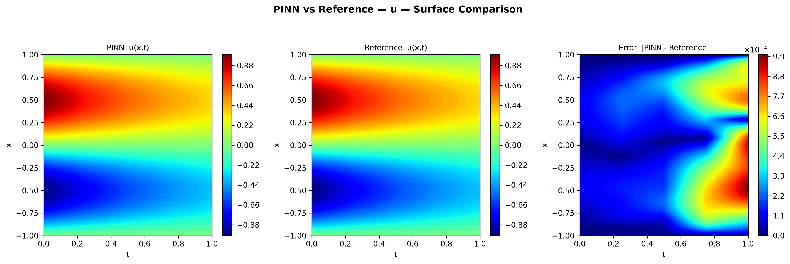

<strong>Diffusion 1D – resampling</strong> · DeepXDE example

**The problem**

DeepXDE example: [`diffusion_1d_resample.py`](https://github.com/lululxvi/deepxde/blob/master/examples/pinn_forward/diffusion_1d_resample.py) ([documentation](https://deepxde.readthedocs.io/en/latest/demos/pinn_forward/diffusion.1d.resample.html))

$$\Large \frac{\partial u}{\partial t} = \frac{\partial^2 u}{\partial x^2} - e^{-t}\left(\sin(\pi x) - \pi^2\sin(\pi x)\right), \qquad x \in [-1, 1],\ t \in [0, 1]$$

- **Initial / boundary conditions:** $u(x, 0) = \sin(\pi x)$, $u = e^{-t}\sin(\pi x)$ on the boundary
- **Exact solution:** $u = e^{-t}\sin(\pi x)$

⚙️ <em>Default settings — DeepXDE's settings</em>

*Forward problem*

- **Network:** FNN 3 × 32 (2 inputs, 1 output), tanh, Glorot uniform
- **Points:** 40 domain, 10 initial, 20 boundary
- **Training:** Adam 2,000

*Load it:* toolbar → Examples: **Forward** → **Diffusion 1D – resampling** → **Default**, then Solve.

⚙️ <em>PINNStudio best — Tuned settings</em>

*Forward problem*

- **Network:** FNN 3 × 32 (2 inputs, 1 output), tanh, Glorot uniform
- **Points:** 40 domain, 10 initial, 20 boundary
- **Training:** Adam 2,000 → L-BFGS 15,000

*Load it:* toolbar → Examples: **Forward** → **Diffusion 1D – resampling** → **Tuned**, then Solve.

*Found in:* [tuning study, forward runs](tuning_study.md#tune-diffusion-1d-resampling)

**Forward problem**

| Training | L₂ | Time (s) |
|---|---|---|
| DeepXDE's settings (3 seeds, median) | 5.4 × 10-2 | 8 |
| 3× iterations | 6.7 × 10-3 | 16 |
| Larger network (2× width, one more layer) | 3.5 × 10-2 | 9 |
| 3× training points | 6.7 × 10-2 | 8 |
| 🔴 **L-BFGS phase added (3 seeds, median)** | **5.8 × 10-3** | **12** |
| All of the above together | 4.7 × 10-3 | 20 |
| **PINNStudio best** (Settings: Tuned): L-BFGS phase added | **5.8 × 10-3** | **12** |

📊 <em>Forward results — figures</em>

*DeepXDE's settings:*

PINN, reference and error over space and time

PINN against the reference along a line, at the reference times

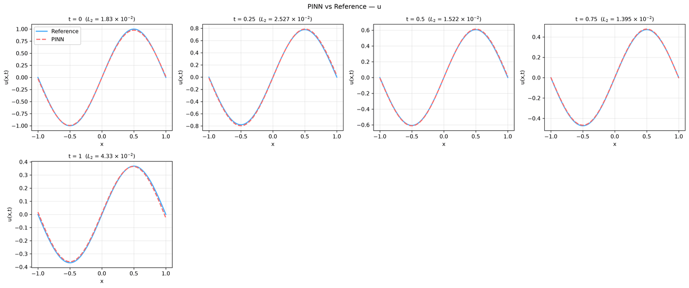

*PINNStudio best — L-BFGS phase added:*

PINN, reference and error over space and time

PINN against the reference along a line, at the reference times

<strong>Diffusion-reaction 1D</strong> · DeepXDE example

**The problem**

DeepXDE example: [`diffusion_reaction.py`](https://github.com/lululxvi/deepxde/blob/master/examples/pinn_forward/diffusion_reaction.py) ([documentation](https://deepxde.readthedocs.io/en/latest/demos/pinn_forward/diffusion.reaction.html))

$$\Large \frac{\partial u}{\partial t} = \frac{\partial^2 u}{\partial x^2} + e^{-t}\left(\tfrac{3}{2}\sin 2x + \tfrac{8}{3}\sin 3x + \tfrac{15}{4}\sin 4x + \tfrac{63}{8}\sin 8x\right), \qquad x \in [-\pi, \pi],\ t \in [0, 1]$$

- **Initial and boundary conditions:** imposed exactly by $\hat u = t(\pi^2 - x^2)N + \sum_k \frac{\sin(kx)}{k}$
- **Exact solution:** $u = e^{-t}\left(\sin x + \tfrac{\sin 2x}{2} + \tfrac{\sin 3x}{3} + \tfrac{\sin 4x}{4} + \tfrac{\sin 8x}{8}\right)$

⚙️ <em>Default settings — DeepXDE's settings</em>

*Forward problem*

- **Network:** FNN 6 × 30 (2 inputs, 1 output), tanh, Glorot uniform
- **Points:** 320 domain
- **Training:** Adam 20,000
- **Methods:** initial and boundary conditions built into the output (output transform formula)

*Load it:* toolbar → Examples: **Forward** → **Diffusion-reaction 1D** → **Default**, then Solve.

⚙️ <em>PINNStudio best — Tuned settings</em>

*Forward problem*

- **Network:** FNN 7 × 60 (2 inputs, 1 output), tanh, Glorot uniform
- **Points:** 960 domain
- **Training:** Adam 60,000 → L-BFGS 15,000
- **Methods:** initial and boundary conditions built into the output (output transform formula)

*Load it:* toolbar → Examples: **Forward** → **Diffusion-reaction 1D** → **Tuned**, then Solve.

*Found in:* [tuning study, forward runs](tuning_study.md#tune-diffusion-reaction-1d) · [training methods study: Diffusion-reaction 1D](training_methods.md#diffusion-reaction-1d)

*Inverse problem — PINNStudio's own inverse setup, tuned*

- **Network:** FNN 7 × 60 (2 inputs, 1 output), tanh, Glorot uniform
- **Points:** 960 domain
- **Training:** Adam 60,000 → L-BFGS 45,000
- **Methods:** initial and boundary conditions built into the output (output transform formula)
- **Unknowns:** D (initial guess 2.0, true 1.0)
- **Measured data:** t_0.25.txt for u (weight 100); t_0.5.txt for u (weight 100); t_0.75.txt for u (weight 100); t_1.txt for u (weight 100)

*Load it:* toolbar → Examples: **Inverse** → **Diffusion-reaction 1D** → **Tuned**, then Solve.

*Found in:* [tuning study, inverse runs](tuning_study.md#tune-diffusion-reaction-1d-inverse-mode)

**Forward problem**

| Training | L₂ | Time (s) |
|---|---|---|
| DeepXDE's settings (3 seeds, median) | 8.8 × 10-2 | 87 |
| 3× iterations | 2.3 × 10-2 | 251 |
| Larger network (2× width, one more layer) | 3.3 × 10-2 | 94 |
| 3× training points | 5.2 × 10-2 | 89 |
| L-BFGS phase added | 5.0 × 10-4 | 98 |
| 🔴 **All of the above together (3 seeds, median)** | **8.5 × 10-5** | **290** |
| **PINNStudio best** (Settings: Tuned): all of the changes together | **8.5 × 10-5** | **290** |

**Inverse problem**

| Training | L₂ fit to measured data | Parameters found (true) | Worst parameter error | Time (s) |
|---|---|---|---|---|
| DeepXDE's settings | 6.2 × 10-4 | D = 0.998802 (1) | 0.12% | 121 |
| Larger network (2× width, one more layer) | 5.2 × 10-4 | D = 0.998959 (1) | 0.1% | 130 |
| 3× L-BFGS iterations | 6.2 × 10-4 | D = 0.998802 (1) | 0.12% | 118 |
| 🔴 **All of the above together** | **1.4 × 10-4** | **D = 0.999773 (1)** | **0.023%** | **334** |
| 10× data weight, 3× L-BFGS and the larger network | 1.5 × 10-3 | D = 0.997953 (1) | 0.2% | 118 |
| **PINNStudio best** (Settings: Tuned): all of the changes together | **1.4 × 10-4** | D = 0.999773 (1) | **0.023%** | **334** |

*L₂ fit to measured data: the error on the reference data the inverse run trains on (every reference time), a check that the fit worked, not a prediction error. The parameter error measures the accuracy and decides the best run.*

*DeepXDE's example is forward only; this inverse problem is PINNStudio's inverse mode of it.*

📊 <em>Forward results — figures</em>

*DeepXDE's settings:*

PINN, reference and error over space and time

PINN against the reference along a line, at the reference times

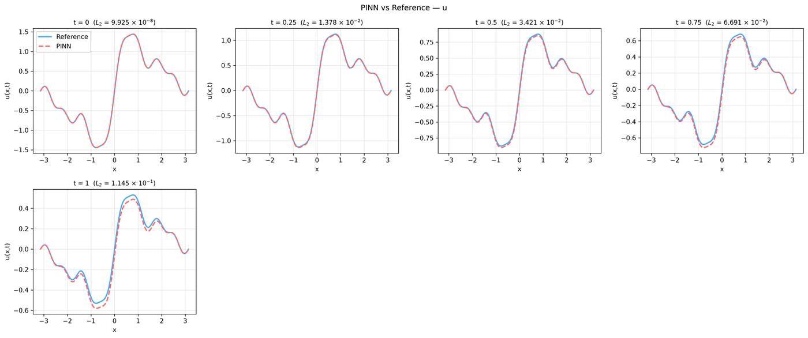

*PINNStudio best — all of the changes together:*

PINN, reference and error over space and time

PINN against the reference along a line, at the reference times

📊 <em>Inverse results — figures</em>

*PINNStudio best — all of the changes together:*

PINN, reference and error over space and time

PINN against the reference along a line, at the reference times

the learned parameters during training

<strong>Fractional diffusion 1D</strong> · DeepXDE example

**The problem**

DeepXDE example: [`fractional_diffusion_1d.py`](https://github.com/lululxvi/deepxde/blob/master/examples/pinn_forward/fractional_diffusion_1d.py)

$$\Large \frac{\partial u}{\partial t} = D_{0+}^{\alpha}u + D_{1-}^{\alpha}u - e^{-t}\left(x^3(1-x)^3 + f_\alpha(x)\right), \qquad x \in [0, 1],\ t \in [0, 1],\ \alpha = 1.8$$

- **Equation in the panel:** `du_t - frac(u) + exp(-t)*(x**3*(1 - x)**3 + ...)` (DeepXDE's TimeFPDE)
- **Boundary and initial conditions:** $u(0, t) = u(1, t) = 0$, $u(x, 0) = x^3(1-x)^3$, both exact through $\hat u = x(1-x)\ t\ N + x^3(1-x)^3$
- **Exact solution:** $u = e^{-t}x^3(1-x)^3$
- **Constants:** `alpha = 1.8`

⚙️ <em>Default settings — DeepXDE's settings (also PINNStudio best)</em>

*Forward problem — also PINNStudio best* (already accurate, so it was not tuned)

- **Network:** FNN 4 × 20 (2 inputs, 1 output), tanh, Glorot normal
- **Points:** 400 domain, 2 initial, 2 boundary
- **Training:** Adam 10,000
- **Methods:** initial and boundary conditions built into the output (output transform formula)

*Load it:* toolbar → Examples: **Forward** → **Fractional diffusion 1D** → **Default**, then Solve.

**Forward problem**

| Training | L₂ | Time (s) |
|---|---|---|
| DeepXDE's settings (README) | 3.3 × 10-3 | – |
| **PINNStudio best** (Settings: Tuned): no tuning needed | **3.3 × 10-3** | – |

📊 <em>Forward results — figures</em>

*DeepXDE's settings (README):*

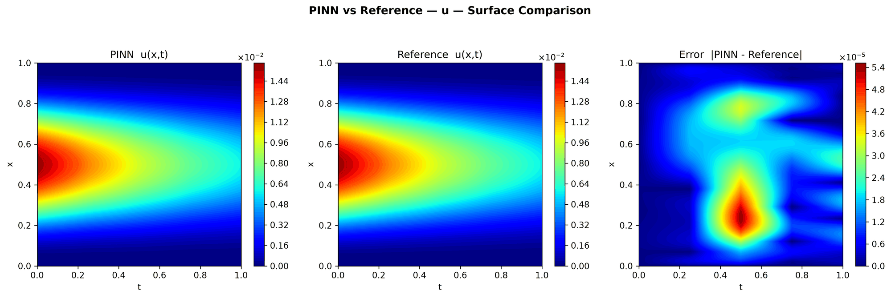

<strong>Heat 1D – Dirichlet</strong> · DeepXDE example

**The problem**

DeepXDE example: [`heat.py`](https://github.com/lululxvi/deepxde/blob/master/examples/pinn_forward/heat.py) ([documentation](https://deepxde.readthedocs.io/en/latest/demos/pinn_forward/heat.html))

$$\Large \frac{\partial u}{\partial t} = 0.4\frac{\partial^2 u}{\partial x^2}, \qquad x \in [0, 1],\ t \in [0, 1]$$

- **Initial condition:** $u(x, 0) = \sin(\pi x)$; **boundary conditions:** $u(0, t) = u(1, t) = 0$
- **Exact solution:** $u = e^{-0.4\pi^2 t}\sin(\pi x)$
- **Constants:** `a = 0.4`, `L = 1`, `n = 1`

The solution decays to about 2% of its initial size by $t = 1$, so the relative error grows over time even though the absolute error stays small.

*Inverse mode* — pick the example from the **Inverse** list: the diffusivity $a$ is unknown (initial guess 1, true value 0.4) and is learned together with $u$ from $u$ measured at $t = 1$ (the exact solution, [`reference_data/1D/heat/t_1.0.txt`](../reference_data/1D/heat/t_1.0.txt)):

$$\Large \frac{\partial u}{\partial t} = a\ \frac{\partial^2 u}{\partial x^2}$$

⚙️ <em>Default settings — DeepXDE's settings</em>

*Forward problem*

- **Network:** FNN 3 × 20 (2 inputs, 1 output), tanh, Glorot normal
- **Points:** 2,540 domain, 160 initial, 80 boundary
- **Training:** Adam 20,000 → L-BFGS 15,000

*Load it:* toolbar → Examples: **Forward** → **Heat 1D – Dirichlet** → **Default**, then Solve.

⚙️ <em>PINNStudio best — Tuned settings</em>

*Forward problem*

- **Network:** FNN 4 × 40 (2 inputs, 1 output), tanh, Glorot normal
- **Points:** 7,620 domain, 480 initial, 240 boundary
- **Training:** Adam 60,000 → L-BFGS 45,000

*Load it:* toolbar → Examples: **Forward** → **Heat 1D – Dirichlet** → **Tuned**, then Solve.

*Found in:* [tuning study, forward runs](tuning_study.md#tune-heat-1d-dirichlet)

*Inverse problem — PINNStudio's own inverse setup, tuned*

- **Network:** FNN 4 × 40 (2 inputs, 1 output), tanh, Glorot normal
- **Points:** 7,620 domain, 480 initial, 240 boundary
- **Training:** Adam 60,000 → L-BFGS 45,000
- **Unknowns:** a (initial guess 1.0, true 0.4)
- **Measured data:** t_1.0.txt for u (weight 100)

*Load it:* toolbar → Examples: **Inverse** → **Heat 1D – Dirichlet** → **Tuned**, then Solve.

*Found in:* [tuning study, inverse runs](tuning_study.md#tune-heat-1d-dirichlet-inverse-mode)

**Forward problem**

| Training | L₂ | Time (s) |
|---|---|---|
| DeepXDE's settings (3 seeds, median) | 5.0 × 10-2 | 42 |
| 3× iterations | 2.9 × 10-2 | 108 |
| Larger network (2× width, one more layer) (3 seeds, median) | 2.6 × 10-2 | 46 |
| 3× training points | 3.1 × 10-2 | 40 |
| 🔴 **All of the above together (3 seeds, median)** | **1.3 × 10-2** | **128** |
| **PINNStudio best** (Settings: Tuned): all of the changes together | **1.3 × 10-2** | **128** |

**Inverse problem**

| Training | L₂ fit to measured data | Parameters found (true) | Worst parameter error | Time (s) |
|---|---|---|---|---|
| DeepXDE's settings (3 seeds, median) | 5.1 × 10-3 | a = 0.397247 (0.4) | 0.69% | 50 |
| 3× iterations | 3.0 × 10-3 | a = 0.398069 (0.4) | 0.48% | 130 |
| Larger network (2× width, one more layer) | 1.2 × 10-3 | a = 0.398489 (0.4) | 0.38% | 50 |
| 3× training points | 1.7 × 10-3 | a = 0.397791 (0.4) | 0.55% | 53 |
| 🔴 **All of the above together (3 seeds, median)** | **1.1 × 10-3** | **a = 0.400406 (0.4)** | **0.1%** | **146** |
| **PINNStudio best** (Settings: Tuned): all of the changes together | **1.1 × 10-3** | a = 0.400406 (0.4) | **0.1%** | **146** |

*L₂ fit to measured data: the error on the reference data the inverse run trains on (every reference time), a check that the fit worked, not a prediction error. The parameter error measures the accuracy and decides the best run.*

*DeepXDE's example is forward only; this inverse problem is PINNStudio's inverse mode of it.*

📊 <em>Forward results — figures</em>

*DeepXDE's settings:*

PINN, reference and error over space and time

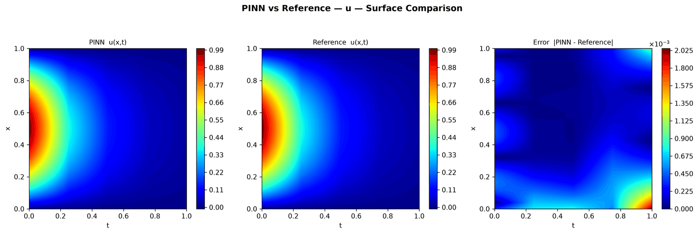

PINN against the reference along a line, at the reference times

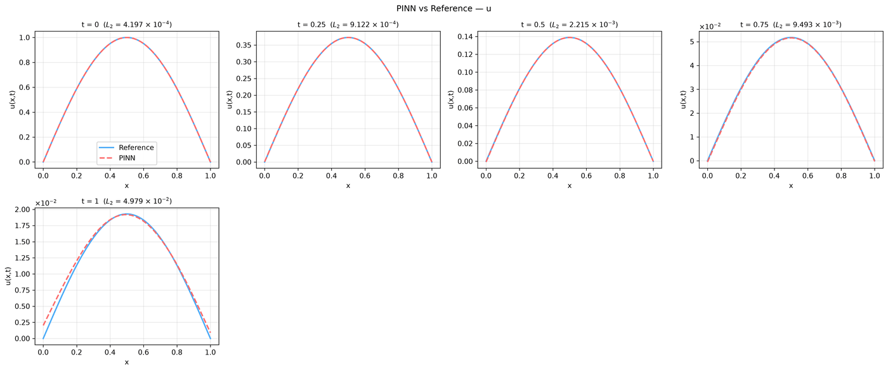

*PINNStudio best — all of the changes together:*

PINN, reference and error over space and time

PINN against the reference along a line, at the reference times

📊 <em>Inverse results — figures</em>

*PINNStudio best — all of the changes together:*

PINN, reference and error over space and time

PINN against the reference along a line, at the reference times

the learned parameters during training

<strong>Heat 1D – resampling</strong> · DeepXDE example

**The problem**

DeepXDE example: [`heat_resample.py`](https://github.com/lululxvi/deepxde/blob/master/examples/pinn_forward/heat_resample.py) ([documentation](https://deepxde.readthedocs.io/en/latest/demos/pinn_forward/heat.resample.html))

$$\Large \frac{\partial u}{\partial t} = 0.4\frac{\partial^2 u}{\partial x^2}, \qquad x \in [0, 1],\ t \in [0, 1]$$

- **Initial / boundary conditions:** $u(x, 0) = \sin(\pi x)$, $u(0, t) = u(1, t) = 0$
- **Exact solution:** $u = e^{-0.4\pi^2 t}\sin(\pi x)$
- **Constants:** `a = 0.4`, `L = 1`, `n = 1`

⚙️ <em>Default settings — DeepXDE's settings</em>

*Forward problem*

- **Network:** FNN 3 × 20 (2 inputs, 1 output), tanh, Glorot normal
- **Points:** 2,540 domain, 160 initial, 80 boundary
- **Training:** Adam 200,000 → L-BFGS 15,000

*Load it:* toolbar → Examples: **Forward** → **Heat 1D – resampling** → **Default**, then Solve.

⚙️ <em>PINNStudio best — Tuned settings</em>

*Forward problem*

- **Network:** FNN 4 × 40 (2 inputs, 1 output), tanh, Glorot normal
- **Points:** 2,540 domain, 160 initial, 80 boundary
- **Training:** Adam 200,000 → L-BFGS 15,000

*Load it:* toolbar → Examples: **Forward** → **Heat 1D – resampling** → **Tuned**, then Solve.

*Found in:* [tuning study, forward runs](tuning_study.md#tune-heat-1d-resampling)

**Forward problem**

| Training | L₂ | Time (s) |
|---|---|---|
| DeepXDE's settings (3 seeds, median) | 1.4 × 10-2 | 509 |
| 3× iterations | 7.2 × 10-3 | 1502 |
| 🔴 **Larger network (2× width, one more layer)** | **3.1 × 10-3** | **558** |
| 3× training points | 1.0 × 10-2 | 626 |
| All of the above together (3 seeds, median) | 3.3 × 10-3 | 2060 |
| **PINNStudio best** (Settings: Tuned): Larger network (2× width, one more layer) | **3.1 × 10-3** | **558** |

📊 <em>Forward results — figures</em>

*DeepXDE's settings:*

PINN, reference and error over space and time

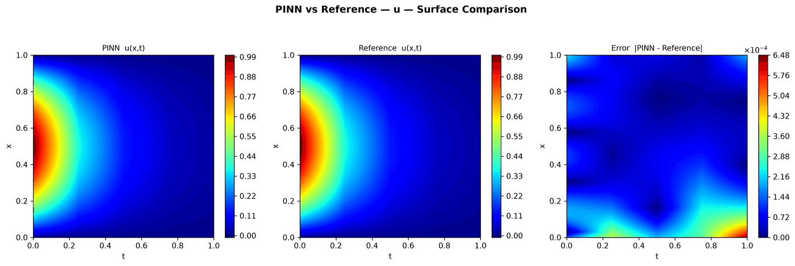

PINN against the reference along a line, at the reference times

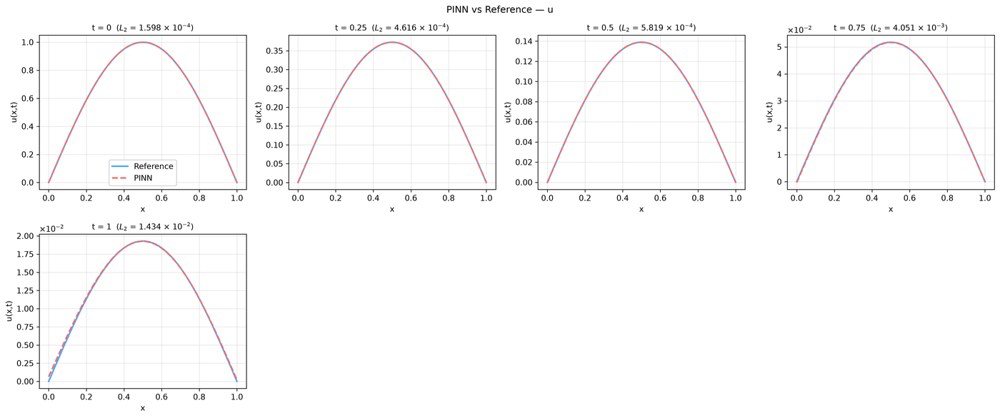

*PINNStudio best — Larger network (2× width, one more layer):*

PINN, reference and error over space and time

PINN against the reference along a line, at the reference times

<strong>Klein-Gordon 1D</strong> · DeepXDE example

**The problem**

DeepXDE example: [`Klein_Gordon.py`](https://github.com/lululxvi/deepxde/blob/master/examples/pinn_forward/Klein_Gordon.py) ([documentation](https://deepxde.readthedocs.io/en/latest/demos/pinn_forward/klein.gordon.html))

$$\Large \frac{\partial^2 u}{\partial t^2} - \frac{\partial^2 u}{\partial x^2} + u^2 = -x\cos t + x^2\cos^2 t, \qquad x \in [-1, 1],\ t \in [0, 10]$$

- **Initial conditions:** $u(x, 0) = x$ and $\partial u/\partial t\ (x, 0) = 0$ (the second as an Operator BC applied at the initial time)
- **Boundary condition:** $u = x\cos t$
- **Exact solution:** $u = x\cos t$
- **Constants:** `alpha = -1`, `beta = 0`, `gamma = 1`, `k = 2`

⚙️ <em>Default settings — DeepXDE's settings</em>

*Forward problem*

- **Network:** FNN 2 × 40 (2 inputs, 1 output), tanh, Glorot uniform
- **Points:** 30,000 domain, 1,500 initial, 1,500 boundary
- **Training:** Adam 20,000 → L-BFGS 15,000

*Load it:* toolbar → Examples: **Forward** → **Klein-Gordon 1D** → **Default**, then Solve.

⚙️ <em>PINNStudio best — Tuned settings</em>

*Forward problem*

- **Network:** FNN 3 × 80 (2 inputs, 1 output), tanh, Glorot uniform
- **Points:** 30,000 domain, 1,500 initial, 1,500 boundary
- **Training:** Adam 20,000 → L-BFGS 15,000

*Load it:* toolbar → Examples: **Forward** → **Klein-Gordon 1D** → **Tuned**, then Solve.

*Found in:* [tuning study, forward runs](tuning_study.md#tune-klein-gordon-1d) · [training methods study: Klein-Gordon](training_methods.md#klein-gordon)

*Inverse problem — PINNStudio's own inverse setup, tuned*

- **Network:** FNN 3 × 80 (2 inputs, 1 output), tanh, Glorot uniform
- **Points:** 90,000 domain, 4,500 initial, 4,500 boundary
- **Training:** Adam 60,000 → L-BFGS 45,000
- **Unknowns:** gamma (initial guess 0.5, true 1.0)
- **Measured data:** t_1.txt for u (weight 100); t_2.txt for u (weight 100); t_3.txt for u (weight 100); t_4.txt for u (weight 100); t_5.txt for u (weight 100); t_6.txt for u (weight 100); t_7.txt for u (weight 100); t_8.txt for u (weight 100); t_9.txt for u (weight 100); t_10.txt for u (weight 100)

*Load it:* toolbar → Examples: **Inverse** → **Klein-Gordon 1D** → **Tuned**, then Solve.

*Found in:* [tuning study, inverse runs](tuning_study.md#tune-klein-gordon-1d-inverse-mode)

**Forward problem**

| Training | L₂ | Time (s) |
|---|---|---|
| DeepXDE's settings (3 seeds, median) | 6.9 × 10-2 | 60 |
| 3× iterations | 3.3 × 10-2 | 156 |
| 🔴 **Larger network (2× width, one more layer) (3 seeds, median)** | **2.3 × 10-3** | **151** |
| 3× training points | 1.1 × 10-2 | 159 |
| All of the above together (3 seeds, median) | 2.0 × 10-2 | 1216 |
| **PINNStudio best** (Settings: Tuned): Larger network (2× width, one more layer) | **2.3 × 10-3** | **151** |

**Inverse problem**

| Training | L₂ fit to measured data | Parameters found (true) | Worst parameter error | Time (s) |
|---|---|---|---|---|
| DeepXDE's settings | 1.4 × 10-2 | γ = 0.945226 (1) | 5.5% | 81 |
| Larger network (2× width, one more layer) | 1.5 × 10-2 | γ = 1.03306 (1) | 3.3% | 151 |
| 3× L-BFGS iterations | 1.4 × 10-2 | γ = 0.945226 (1) | 5.5% | 79 |
| 🔴 **All of the above together** | **6.3 × 10-4** | **γ = 1.00912 (1)** | **0.91%** | **1361** |
| 10× data weight, 3× L-BFGS and the larger network | 7.4 × 10-3 | γ = 1.06471 (1) | 6.5% | 151 |
| **PINNStudio best** (Settings: Tuned): all of the changes together | **6.3 × 10-4** | γ = 1.00912 (1) | **0.91%** | **1361** |

*L₂ fit to measured data: the error on the reference data the inverse run trains on (every reference time), a check that the fit worked, not a prediction error. The parameter error measures the accuracy and decides the best run.*

*DeepXDE's example is forward only; this inverse problem is PINNStudio's inverse mode of it.*

📊 <em>Forward results — figures</em>

*DeepXDE's settings:*

PINN, reference and error over space and time

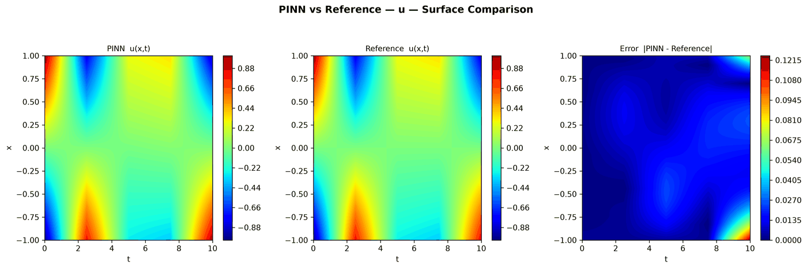

PINN against the reference along a line, at the reference times

*PINNStudio best — Larger network (2× width, one more layer):*

PINN, reference and error over space and time

PINN against the reference along a line, at the reference times

📊 <em>Inverse results — figures</em>

*PINNStudio best — all of the changes together:*

PINN, reference and error over space and time

PINN against the reference along a line, at the reference times

the learned parameters during training

<strong>Schrödinger 1D</strong> · DeepXDE example

**The problem**

DeepXDE example: [`Schrodinger.ipynb`](https://github.com/lululxvi/deepxde/blob/master/examples/pinn_forward/Schrodinger.ipynb)

$$\Large i\frac{\partial h}{\partial t} + \frac{1}{2}\frac{\partial^2 h}{\partial x^2} + |h|^2 h = 0, \qquad x \in [-5, 5],\ t \in [0, \pi/2]$$

$$\Large \frac{\partial u}{\partial t} + 0.5\frac{\partial^2 v}{\partial x^2} + (u^2 + v^2)\ v = 0$$

$$\Large \frac{\partial v}{\partial t} - 0.5\frac{\partial^2 u}{\partial x^2} - (u^2 + v^2)\ u = 0$$

- **Initial condition:** $h(x, 0) = 2\ \mathrm{sech}(x)$; **boundary conditions:** periodic in $u$, $v$ and their $x$-derivatives

*Inverse mode* — pick the example from the **Inverse** list: the coefficient $c$ of the second-derivative terms (0.5 above; initial guess 1) is unknown and is learned from $|h| = \sqrt{u^2 + v^2}$ measured at $t = 0.75$, with the same training as above:

$$\Large \frac{\partial u}{\partial t} + c\frac{\partial^2 v}{\partial x^2} + (u^2 + v^2) v = 0, \qquad \frac{\partial v}{\partial t} - c\frac{\partial^2 u}{\partial x^2} - (u^2 + v^2) u = 0$$

⚙️ <em>Default settings — DeepXDE's settings</em>

*Forward problem — also PINNStudio best* (already accurate, so it was not tuned)

- **Network:** FNN 4 × 100 (2 inputs, 2 outputs), tanh, Glorot normal
- **Points:** 10,000 domain, 200 initial, 20 boundary
- **Training:** Adam 10,000 → L-BFGS 10,000

*Load it:* toolbar → Examples: **Forward** → **Schrödinger 1D** → **Default**, then Solve.

⚙️ <em>PINNStudio best — Tuned settings</em>

*Inverse problem — PINNStudio's own inverse setup, tuned*

- **Network:** FNN 5 × 200 (2 inputs, 2 outputs), tanh, Glorot normal
- **Points:** 10,000 domain, 200 initial, 20 boundary
- **Training:** Adam 10,000 → L-BFGS 10,000
- **Unknowns:** c (initial guess 1.0, true 0.5)
- **Measured data:** t_0.75.txt for output (weight 100)

*Load it:* toolbar → Examples: **Inverse** → **Schrödinger 1D** → **Tuned**, then Solve.

*Found in:* [tuning study, inverse runs](tuning_study.md#tune-schr-dinger-1d-inverse-mode)

*Forward problem:* PINNStudio best is the Default settings above (no separate Tuned settings).

**Forward problem**

| Training | L₂ | Time (s) |
|---|---|---|
| DeepXDE's settings (README) | 1.8 × 10-3 | – |
| **PINNStudio best** (Settings: Tuned): no tuning needed | **1.8 × 10-3** | – |

**Inverse problem**

| Training | L₂ fit to measured data | Parameters found (true) | Worst parameter error | Time (s) |
|---|---|---|---|---|
| DeepXDE's settings | 1.8 × 10-1 | c = 0.514806 (0.5) | 3% | 196 |
| 3× iterations | 3.6 × 10-1 | c = 0.511656 (0.5) | 2.3% | 483 |
| 🔴 **Larger network (2× width, one more layer)** | **9.9 × 10-4** | **c = 0.500036 (0.5)** | **0.0072%** | **337** |
| 3× training points | 6.5 × 10-2 | c = 0.500117 (0.5) | 0.023% | 324 |
| All of the above together | 1.7 × 10-1 | c = 0.504096 (0.5) | 0.82% | 1745 |
| **PINNStudio best** (Settings: Tuned): Larger network (2× width, one more layer) | **9.9 × 10-4** | c = 0.500036 (0.5) | **0.0072%** | **337** |

*L₂ fit to measured data: the error on the reference data the inverse run trains on (every reference time), a check that the fit worked, not a prediction error. The parameter error measures the accuracy and decides the best run.*

*DeepXDE's example is forward only; this inverse problem is PINNStudio's inverse mode of it.*

📊 <em>Forward results — figures</em>

*DeepXDE's settings (README):*

📊 <em>Inverse results — figures</em>

*PINNStudio best — Larger network (2× width, one more layer):*

PINN, reference and error over space and time

PINN against the reference along a line, at the reference times

the learned parameters during training

<strong>Wave 1D – space-time multi-scale Fourier features</strong> · DeepXDE example

**The problem**

DeepXDE example: [`wave_1d.py`](https://github.com/lululxvi/deepxde/blob/master/examples/pinn_forward/wave_1d.py)

$$\Large \frac{\partial^2 u}{\partial t^2} = C^2\frac{\partial^2 u}{\partial x^2}, \qquad x \in [0, 1],\ t \in [0, 1],\ C = 10$$

- **Boundary conditions:** $u(0, t) = u(1, t) = 0$
- **Initial conditions:** $u(x, 0) = \sin(\pi x) + \sin(A\pi x)$ ($A = 2$); $\partial u/\partial t(x, 0) = 0$ as an Operator BC `du_t` applied at the initial time
- **Exact solution:** $u = \sin(\pi x)\cos(C\pi t) + \sin(A\pi x)\cos(AC\pi t)$ — ten and twenty oscillations in time
- **Constants:** `A = 2`, `C = 10`

Collocation points are redrawn every iteration from a pseudo-random distribution. DeepXDE's script keeps the default Hammersley distribution, which is deterministic, so its resampler redraws the same 360 points: run that way, the network fits them (training loss 4 × 10⁻⁵) but not the wave in between (test loss near 1, $L_2$ ≈ 1 for t > 0). With 10,000 iterations the problem remains difficult: the error grows with t, and longer training reduces it.

⚙️ <em>Default settings — DeepXDE's settings</em>

*Forward problem*

- **Network:** STMsFFN 3 × 100 (2 inputs, 1 output), tanh, Glorot uniform
- **Points:** 360 domain, 360 initial, 360 boundary
- **Training:** Adam 10,000

*Load it:* toolbar → Examples: **Forward** → **Wave 1D – space-time multi-scale Fourier features** → **Default**, then Solve.

⚙️ <em>PINNStudio best — Tuned settings</em>

*Forward problem*

- **Network:** STMsFFN 4 × 200 (2 inputs, 1 output), tanh, Glorot uniform
- **Points:** 1,080 domain, 1,080 initial, 1,080 boundary
- **Training:** Adam 30,000 → L-BFGS 15,000

*Load it:* toolbar → Examples: **Forward** → **Wave 1D – space-time multi-scale Fourier features** → **Tuned**, then Solve.

*Found in:* [tuning study, forward runs](tuning_study.md#tune-wave-1d-space-time-multi-scale-fourier-features)

*Inverse problem — PINNStudio's own inverse setup, tuned*

- **Network:** STMsFFN 4 × 200 (2 inputs, 1 output), tanh, Glorot uniform
- **Points:** 15,000 domain, 1,080 initial, 1,080 boundary
- **Training:** Adam 30,000 → L-BFGS 45,000
- **Unknowns:** C (initial guess 5.0, true 10.0)
- **Measured data:** u_obs.txt for u (weight 100)

*Load it:* toolbar → Examples: **Inverse** → **Wave 1D – space-time multi-scale Fourier features** → **Tuned**, then Solve.

*Found in:* [tuning study, inverse runs](tuning_study.md#tune-wave-1d-space-time-multi-scale-fourier-features-inverse-mode)

**Forward problem**

| Training | L₂ | Time (s) |
|---|---|---|
| DeepXDE's settings (3 seeds, median) | 3.0 × 10-1 | 75 |
| 3× iterations | 8.5 × 10-3 | 220 |
| Larger network (2× width, one more layer) | 4.2 × 10-2 | 86 |
| 3× training points | 1.1 × 10-1 | 75 |
| L-BFGS phase added | 1.6 × 10-1 | 178 |
| 🔴 **All of the above together (3 seeds, median)** | **1.5 × 10-3** | **645** |
| **PINNStudio best** (Settings: Tuned): all of the changes together | **1.5 × 10-3** | **645** |

**Inverse problem**

| Training | L₂ fit to measured data | Parameters found (true) | Worst parameter error | Time (s) |
|---|---|---|---|---|
| DeepXDE's settings | 5.5 × 10-5 | C = 9.99999 (10) | 0.0001% | 303 |
| Larger network (2× width, one more layer) | 5.1 × 10-5 | C = 9.99999 (10) | 0.0001% | 608 |
| 🔴 **All of the above together** | **3.8 × 10-5** | **C = 10 (10)** | **0%** | **4354** |
| 10× data weight, 3× L-BFGS and the larger network | 4.1 × 10-5 | C = 9.99999 (10) | 0.0001% | 1513 |
| **PINNStudio best** (Settings: Tuned): all of the changes together | **3.8 × 10-5** | C = 10 (10) | **0%** | **4354** |

*L₂ fit to measured data: the error on the reference data the inverse run trains on (every reference time), a check that the fit worked, not a prediction error. The parameter error measures the accuracy and decides the best run.*

*DeepXDE's example is forward only; this inverse problem is PINNStudio's inverse mode of it.*

📊 <em>Forward results — figures</em>

*DeepXDE's settings:*

PINN, reference and error over space and time

PINN against the reference along a line, at the reference times

*PINNStudio best — all of the changes together:*

PINN, reference and error over space and time

PINN against the reference along a line, at the reference times

📊 <em>Inverse results — figures</em>

*PINNStudio best — all of the changes together:*

PINN, reference and error over space and time

PINN against the reference along a line, at the reference times

the learned parameters during training

<strong>Diffusion 1D – unknown coefficient</strong> · DeepXDE example

**The problem**

DeepXDE example: [`diffusion_1d_inverse.py`](https://github.com/lululxvi/deepxde/blob/master/examples/pinn_inverse/diffusion_1d_inverse.py) ([documentation](https://deepxde.readthedocs.io/en/latest/demos/pinn_inverse/diffusion.1d.inverse.html))

$$\Large \frac{\partial u}{\partial t} = C\frac{\partial^2 u}{\partial x^2} - e^{-t}\left(\sin(\pi x) - \pi^2\sin(\pi x)\right), \qquad x \in [-1, 1],\ t \in [0, 1]$$

- **Unknown:** $C$ (true value 1, initial guess 2)
- **Data:** 10 measurements of $u$ at $t = 1$, plus the initial and boundary conditions
- **Exact solution:** $u = e^{-t}\sin(\pi x)$

⚙️ <em>Default settings — DeepXDE's settings (also PINNStudio best)</em>

*Inverse problem — also PINNStudio best* (no change in the tuning study did better)

*Found in:* [tuning study, forward runs](tuning_study.md#tune-diffusion-1d-unknown-coefficient)

- **Network:** FNN 3 × 32 (2 inputs, 1 output), tanh, Glorot uniform
- **Points:** 40 domain, 10 initial, 20 boundary
- **Training:** Adam 50,000
- **Unknowns:** C (initial guess 2.0, true 1.0)
- **Measured data:** u_obs_t1.txt for u (weight 1)

*Load it:* toolbar → Examples: **Inverse** → **Diffusion 1D – unknown coefficient** → **Default**, then Solve.

**Inverse problem**

| Training | L₂ fit to measured data | Parameters found (true) | Worst parameter error | Time (s) |
|---|---|---|---|---|
| DeepXDE's settings (3 seeds, median) | 6.2 × 10-3 | C = 0.999553 (1) | 0.045% | 118 |
| 🔴 **3× iterations** | **1.2 × 10-3** | **C = 1.00004 (1)** | **0.004%** | **311** |
| Larger network (2× width, one more layer) | 1.5 × 10-2 | C = 0.998344 (1) | 0.17% | 127 |
| 3× training points | 1.6 × 10-2 | C = 0.99827 (1) | 0.17% | 106 |
| L-BFGS phase added | 1.1 × 10-3 | C = 1.00081 (1) | 0.081% | 111 |
| All of the above together (3 seeds, median) | 2.0 × 10-4 | C = 1.00017 (1) | 0.017% | 380 |
| **PINNStudio best** (Settings: Tuned): 3× iterations | **1.2 × 10-3** | C = 1.00004 (1) | **0.004%** | **311** |

*L₂ fit to measured data: the error on the reference data the inverse run trains on (every reference time), a check that the fit worked, not a prediction error. The parameter error measures the accuracy and decides the best run.*

📊 <em>Inverse results — figures</em>

*DeepXDE's settings:*

PINN, reference and error over space and time

PINN against the reference along a line, at the reference times

the learned parameters during training

*PINNStudio best — 3× iterations:*

PINN, reference and error over space and time

PINN against the reference along a line, at the reference times

the learned parameters during training

<strong>Diffusion-reaction 1D – unknown k_f, D</strong> · DeepXDE example

**The problem**

DeepXDE example: [`reaction_inverse.py`](https://github.com/lululxvi/deepxde/blob/master/examples/pinn_inverse/reaction_inverse.py) ([documentation](https://deepxde.readthedocs.io/en/latest/demos/pinn_inverse/reaction.inverse.html))

$$\Large \frac{\partial C_A}{\partial t} = D\frac{\partial^2 C_A}{\partial x^2} - k_f C_A C_B^2, \qquad \frac{\partial C_B}{\partial t} = D\frac{\partial^2 C_B}{\partial x^2} - 2k_f C_A C_B^2$$

- **Domain:** $x \in [0, 1]$, $t \in [0, 10]$; $C_A = C_B = e^{-20x}$ at $t = 0$, $C_A = C_B = 1 - x$ on the boundary
- **Unknowns:** $k_f$ (true 0.1) and $D$ (true $2\times 10^{-3}$, written as $10^{-3}D$ with $D = 2$)
- **Data:** $C_A$ and $C_B$ on a space-time grid, computed by `tools/make_deepxde_reference_data.py`

⚙️ <em>Default settings — DeepXDE's settings (also PINNStudio best)</em>

*Inverse problem — also PINNStudio best* (already accurate, so it was not tuned)

- **Network:** FNN 3 × 20 (2 inputs, 2 outputs), tanh, Glorot uniform
- **Points:** 2,000 domain, 100 initial, 100 boundary
- **Training:** Adam 80,000
- **Unknowns:** kf (initial guess 0.05, true 0.1), D (initial guess 1.0, true 2.0)
- **Measured data:** ca_obs.txt for ca (weight 1); cb_obs.txt for cb (weight 1)

*Load it:* toolbar → Examples: **Inverse** → **Diffusion-reaction 1D – unknown k_f, D** → **Default**, then Solve.

**Inverse problem**

| Training | L₂ fit to measured data | Parameters found (true) | Worst parameter error | Time (s) |
|---|---|---|---|---|
| DeepXDE's settings (README) | – | k_f = 0.0992 (0.1); D = 1.993 (2) | 0.8% | – |
| **PINNStudio best** (Settings: Tuned): no tuning needed | **–** | k_f = 0.0992 (0.1); D = 1.993 (2) | **0.8%** | – |

*L₂ fit to measured data: the error on the reference data the inverse run trains on (every reference time), a check that the fit worked, not a prediction error. The parameter error measures the accuracy and decides the best run.*

📊 <em>Inverse results — figures</em>

*PINNStudio best (README):*

## 2D, steady

<strong>Fractional Poisson 2D – disk</strong> · DeepXDE example

**The problem**

DeepXDE example: [`fractional_Poisson_2d.py`](https://github.com/lululxvi/deepxde/blob/master/examples/pinn_forward/fractional_Poisson_2d.py)

$$\Large -(-\Delta)^{\alpha/2}u = 2^{\alpha}\Gamma(2 + \tfrac{\alpha}{2})\Gamma(1 + \tfrac{\alpha}{2})\left(1 - (1 + \tfrac{\alpha}{2})|x|^2\right), \qquad |x| < 1,\ \alpha = 1.8$$

- **Equation in the panel:** `frac(u)*gamma((1 - alpha)/2)*gamma((2 + alpha)/2)/(2*pi**1.5) - ...` — `frac(u)` times $C(\alpha, 2)$ is $-(-\Delta)^{\alpha/2}u$
- **Geometry:** unit disk; $u = 0$ on the circle through $\hat u = (1 - x^2 - y^2)N$
- **Exact solution:** $u = (1 - |x|^2)^{1 + \alpha/2}$
- **Constants:** `alpha = 1.8`

⚙️ <em>Default settings — DeepXDE's settings (also PINNStudio best)</em>

*Forward problem — also PINNStudio best* (already accurate, so it was not tuned)

- **Network:** FNN 4 × 20 (2 inputs, 1 output), tanh, Glorot normal
- **Points:** 100 domain
- **Training:** Adam 20,000
- **Methods:** initial and boundary conditions built into the output (output transform formula)

*Load it:* toolbar → Examples: **Forward** → **Fractional Poisson 2D – disk** → **Default**, then Solve.

**Forward problem**

| Training | L₂ | Time (s) |
|---|---|---|
| DeepXDE's settings (README) | 1.2 × 10-3 | – |
| **PINNStudio best** (Settings: Tuned): no tuning needed | **1.2 × 10-3** | – |

📊 <em>Forward results — figures</em>

*DeepXDE's settings (README):*

<strong>Helmholtz 2D – Dirichlet</strong> · DeepXDE example

**The problem**

DeepXDE example: [`Helmholtz_Dirichlet_2d.py`](https://github.com/lululxvi/deepxde/blob/master/examples/pinn_forward/Helmholtz_Dirichlet_2d.py) ([documentation](https://deepxde.readthedocs.io/en/latest/demos/pinn_forward/helmholtz.2d.dirichlet.html))

$$\Large -\nabla^2 u - k_0^2 u = k_0^2\sin(k_0 x)\sin(k_0 y), \qquad k_0 = 4\pi,\ (x, y) \in [0, 1]^2$$

- **Boundary conditions:** $u = 0$ on the boundary, imposed exactly by $\hat u = x(1-x)y(1-y)N$
- **Exact solution:** $u = \sin(k_0 x)\sin(k_0 y)$
- **Constants:** `n = 2`, `k0 = 2*pi*n`

⚙️ <em>Default settings — DeepXDE's settings</em>

*Forward problem — also PINNStudio best* (already accurate, so it was not tuned)

- **Network:** FNN 3 × 150 (2 inputs, 1 output), sin, Glorot uniform
- **Points:** 400 domain, 80 boundary
- **Training:** Adam 5,000
- **Methods:** initial and boundary conditions built into the output (output transform formula)

*Load it:* toolbar → Examples: **Forward** → **Helmholtz 2D – Dirichlet** → **Default**, then Solve.

⚙️ <em>PINNStudio best — Tuned settings</em>

*Inverse problem — PINNStudio's own inverse setup, tuned*

- **Network:** FNN 4 × 300 (2 inputs, 1 output), sin, Glorot uniform
- **Points:** 400 domain, 80 boundary
- **Training:** Adam 5,000 → L-BFGS 45,000
- **Methods:** initial and boundary conditions built into the output (output transform formula)
- **Unknowns:** k0 (initial guess 10.0, true 12.566370614359172)
- **Measured data:** u_obs.txt for u (weight 1000)

*Load it:* toolbar → Examples: **Inverse** → **Helmholtz 2D – Dirichlet** → **Tuned**, then Solve.

*Found in:* [tuning study, inverse runs](tuning_study.md#tune-helmholtz-2d-dirichlet-inverse-mode)

*Forward problem:* PINNStudio best is the Default settings above (no separate Tuned settings).

**Forward problem**

| Training | L₂ | Time (s) |
|---|---|---|
| DeepXDE's settings (README) | 1.9 × 10-3 | – |
| **PINNStudio best** (Settings: Tuned): no tuning needed | **1.9 × 10-3** | – |

**Inverse problem**

| Training | L₂ fit to measured data | Parameters found (true) | Worst parameter error | Time (s) |
|---|---|---|---|---|
| DeepXDE's settings | 3.5 × 10-4 | k₀ = 12.565 (12.5664) | 0.011% | 35 |
| Larger network (2× width, one more layer) | 2.2 × 10-4 | k₀ = 12.565 (12.5664) | 0.011% | 64 |
| 3× L-BFGS iterations | 3.5 × 10-4 | k₀ = 12.565 (12.5664) | 0.011% | 35 |
| All of the above together | 8.7 × 10-5 | k₀ = 12.5669 (12.5664) | 0.0042% | 125 |
| 🔴 **10× data weight, 3× L-BFGS and the larger network** | **4.0 × 10-5** | **k₀ = 12.5664 (12.5664)** | **0.00023%** | **58** |
| **PINNStudio best** (Settings: Tuned): 10× data weight, 3× L-BFGS and the larger network | **4.0 × 10-5** | k₀ = 12.5664 (12.5664) | **0.00023%** | **58** |

*L₂ fit to measured data: the error on the reference data the inverse run trains on (every reference time), a check that the fit worked, not a prediction error. The parameter error measures the accuracy and decides the best run.*

*DeepXDE's example is forward only; this inverse problem is PINNStudio's inverse mode of it.*

📊 <em>Forward results — figures</em>

*DeepXDE's settings (README):*

📊 <em>Inverse results — figures</em>

*PINNStudio best — 10× data weight, 3× L-BFGS and the larger network:*

PINN, reference and error over space and time

the learned parameters during training

<strong>Helmholtz 2D – hyperparameter search</strong> · DeepXDE example

**The problem**

DeepXDE example: [`Helmholtz_Dirichlet_2d_HPO.py`](https://github.com/lululxvi/deepxde/blob/master/examples/pinn_forward/Helmholtz_Dirichlet_2d_HPO.py)

$$\Large -\nabla^2 u - k_0^2 u = k_0^2\sin(k_0 x)\sin(k_0 y), \qquad k_0 = 4\pi,\ (x, y) \in [0, 1]^2$$

- **Parameter Sweep, mode Bayesian search:** learning rate $10^{-4}$ to $5\times10^{-2}$ (log), hidden layers 1–10, neurons per layer 5–500, activation sin / sigmoid / tanh
- **Constants:** `n = 2`, `k0 = 2*pi*n`

⚙️ <em>Default settings — DeepXDE's settings (also PINNStudio best)</em>

*Forward problem — also PINNStudio best* (already accurate, so it was not tuned)

- **Network:** FNN 4 × 50 (2 inputs, 1 output), sin, Glorot uniform
- **Points:** 400 domain, 80 boundary
- **Training:** Adam 10,000
- **Methods:** initial and boundary conditions built into the output (output transform formula)

*Load it:* toolbar → Examples: **Forward** → **Helmholtz 2D – hyperparameter search** → **Default**, then Solve.

**Forward problem**

| Training | L₂ | Time (s) |
|---|---|---|
| DeepXDE's settings (README) | 1.3 × 10-3 | – |
| **PINNStudio best** (Settings: Tuned): no tuning needed | **1.3 × 10-3** | – |

📊 <em>Forward results — figures</em>

*DeepXDE's settings (README):*

<strong>Helmholtz 2D – sound-hard scattering</strong> · DeepXDE example

**The problem**

DeepXDE example: [`Helmholtz_Sound_hard_ABC_2d.py`](https://github.com/lululxvi/deepxde/blob/master/examples/pinn_forward/Helmholtz_Sound_hard_ABC_2d.py)

$$\Large -\nabla^2 u - k_0^2 u = 0, \qquad u = u_{re} + i\ u_{im},\ k_0 = 2$$

- **Geometry:** Custom — the square $[-\pi, \pi]^2$ minus a disk of radius $R = \pi/4$
- **Reference:** the Bessel/Hankel series solution of DeepXDE's script
- **Constants:** `k0 = 2`, `R = pi/4`

⚙️ <em>Default settings — DeepXDE's settings (also PINNStudio best)</em>

*Forward problem — also PINNStudio best* (no change in the tuning study did better)

*Found in:* [tuning study, forward runs](tuning_study.md#tune-helmholtz-2d-sound-hard-scattering)

- **Network:** FNN 3 × 350 (2 inputs, 2 outputs), tanh, Glorot uniform
- **Points:** 1,600 domain, 320 boundary
- **Training:** Adam 10,000

*Load it:* toolbar → Examples: **Forward** → **Helmholtz 2D – sound-hard scattering** → **Default**, then Solve.

**Forward problem**

| Training | L₂ u_re | L₂ u_im | Time (s) |
|---|---|---|---|
| 🔴 **DeepXDE's settings (3 seeds, median)** | **8.0 × 10-2** | **6.9 × 10-2** | **61** |
| 3× iterations | 8.8 × 10-2 | 8.6 × 10-2 | 170 |
| Larger network (2× width, one more layer) | 7.9 × 10-2 | 6.9 × 10-2 | 101 |
| 3× training points | 7.7 × 10-2 | 6.7 × 10-2 | 135 |
| L-BFGS phase added | 7.7 × 10-2 | 6.1 × 10-2 | 108 |
| All of the above together (3 seeds, median) | 7.7 × 10-2 | 6.1 × 10-2 | 1017 |
| **PINNStudio best** (Settings: Tuned): the example's own settings (no change did better) | **8.0 × 10-2** | **6.9 × 10-2** | **61** |

*Each output's relative L₂ at its last reference time; the best run is chosen by u_re.*

📊 <em>Forward results — figures</em>

*DeepXDE's settings (also PINNStudio best):*

im — PINN, reference and error over space and time

re — PINN, reference and error over space and time

<strong>Helmholtz 2D – square with hole</strong> · DeepXDE example

**The problem**

DeepXDE example: [`Helmholtz_Neumann_2d_hole.py`](https://github.com/lululxvi/deepxde/blob/master/examples/pinn_forward/Helmholtz_Neumann_2d_hole.py) ([documentation](https://deepxde.readthedocs.io/en/latest/demos/pinn_forward/helmholtz.2d.neumann.hole.html))

$$\Large -\nabla^2 u - k_0^2 u = k_0^2\sin(k_0 x)\sin(k_0 y), \qquad k_0 = 2\pi$$

- **Geometry:** Custom — the square $[-0.5, 0.5]^2$ minus a disk of radius 0.25
- **Boundary conditions:** Dirichlet (exact solution) on the outer square; Neumann (exact normal derivative) on the hole
- **Exact solution:** $u = \sin(k_0 x)\sin(k_0 y)$
- **Constants:** `n = 1`, `k0 = 2*pi*n`, `R = 1/4`

⚙️ <em>Default settings — DeepXDE's settings</em>

*Forward problem*

- **Network:** FNN 3 × 350 (2 inputs, 1 output), sin, Glorot uniform
- **Points:** 225 domain, 240 boundary
- **Training:** Adam 5,000

*Load it:* toolbar → Examples: **Forward** → **Helmholtz 2D – square with hole** → **Default**, then Solve.

⚙️ <em>PINNStudio best — Tuned settings</em>

*Forward problem*

- **Network:** FNN 3 × 350 (2 inputs, 1 output), sin, Glorot uniform
- **Points:** 225 domain, 240 boundary
- **Training:** Adam 5,000 → L-BFGS 15,000

*Load it:* toolbar → Examples: **Forward** → **Helmholtz 2D – square with hole** → **Tuned**, then Solve.

*Found in:* [tuning study, forward runs](tuning_study.md#tune-helmholtz-2d-square-with-hole)

**Forward problem**

| Training | L₂ | Time (s) |
|---|---|---|
| DeepXDE's settings (3 seeds, median) | 1.1 × 10-2 | 17 |
| 3× iterations | 5.8 × 10-3 | 40 |
| Larger network (2× width, one more layer) | 1.1 × 10-2 | 18 |
| 3× training points | 1.6 × 10-2 | 18 |
| 🔴 **L-BFGS phase added (3 seeds, median)** | **7.0 × 10-4** | **24** |
| All of the above together | 2.6 × 10-3 | 79 |
| **PINNStudio best** (Settings: Tuned): L-BFGS phase added | **7.0 × 10-4** | **24** |

📊 <em>Forward results — figures</em>

*DeepXDE's settings:*

*PINNStudio best — L-BFGS phase added:*

<strong>Laplace 2D – disk</strong> · DeepXDE example

**The problem**

DeepXDE example: [`Laplace_disk.py`](https://github.com/lululxvi/deepxde/blob/master/examples/pinn_forward/Laplace_disk.py) ([documentation](https://deepxde.readthedocs.io/en/latest/demos/pinn_forward/laplace.disk.html))

$$\Large r\frac{\partial u}{\partial r} + r^2\frac{\partial^2 u}{\partial r^2} + \frac{\partial^2 u}{\partial \theta^2} = 0, \qquad r \in [0, 1],\ \theta \in [0, 2\pi]$$

- **Boundary condition:** $u(1, \theta) = \cos\theta$
- **Exact solution:** $u = r\cos\theta$

⚙️ <em>Default settings — DeepXDE's settings (also PINNStudio best)</em>

*Forward problem — also PINNStudio best* (already accurate, so it was not tuned)

- **Network:** FNN 3 × 20 (2 inputs, 1 output), tanh, Glorot normal
- **Points:** 2,540 domain, 80 boundary
- **Training:** Adam 15,000

*Load it:* toolbar → Examples: **Forward** → **Laplace 2D – disk** → **Default**, then Solve.

**Forward problem**

| Training | L₂ | Time (s) |
|---|---|---|
| DeepXDE's settings (README) | 1.1 × 10-3 | – |
| **PINNStudio best** (Settings: Tuned): no tuning needed | **1.1 × 10-3** | – |

📊 <em>Forward results — figures</em>

*DeepXDE's settings (README):*

<strong>Linear elasticity 2D – plate</strong> · DeepXDE example

**The problem**

DeepXDE example: [`elasticity_plate.py`](https://github.com/lululxvi/deepxde/blob/master/examples/pinn_forward/elasticity_plate.py) ([documentation](https://deepxde.readthedocs.io/en/latest/demos/pinn_forward/elasticity.plate.html))

$$\Large \frac{\partial \sigma_{xx}}{\partial x} + \frac{\partial \sigma_{xy}}{\partial y} = f_x, \qquad \frac{\partial \sigma_{xy}}{\partial x} + \frac{\partial \sigma_{yy}}{\partial y} = f_y$$

$$\Large \sigma_{xx} = (\lambda + 2\mu)\varepsilon_{xx} + \lambda\varepsilon_{yy}, \quad \sigma_{yy} = (\lambda + 2\mu)\varepsilon_{yy} + \lambda\varepsilon_{xx}, \quad \sigma_{xy} = 2\mu\varepsilon_{xy}$$

- **Domain:** $[0, 1]^2$; $\lambda = 1$, $\mu = 0.5$, $Q = 4$ (constants `lmbd`, `mu`, `Q`); body forces $f_x$, $f_y$ as in DeepXDE's script
- **Boundary conditions:** imposed exactly by an output transform, e.g. $\hat u_x = y(1-y)N_1$, $\hat\sigma_{yy} = (1-y)N_4 + (\lambda+2\mu)Q\sin(\pi x)$
- **Exact solution:** $u_x = \cos(2\pi x)\sin(\pi y)$, $u_y = \sin(\pi x)\ Qy^4/4$
- **Constants:** `lmbd = 1`, `mu = 0.5`, `Q = 4`

⚙️ <em>Default settings — DeepXDE's settings</em>

*Forward problem*

- **Network:** PFNN 4 × 40 (2 inputs, 5 outputs), tanh, Glorot uniform
- **Points:** 500 domain, 500 boundary
- **Training:** Adam 20,000 → L-BFGS 20,000
- **Methods:** initial and boundary conditions built into the output (output transform formula)

*Load it:* toolbar → Examples: **Forward** → **Linear elasticity 2D – plate** → **Default**, then Solve.

⚙️ <em>PINNStudio best — Tuned settings</em>

*Forward problem*

- **Network:** PFNN 5 × 80 (2 inputs, 5 outputs), tanh, Glorot uniform
- **Points:** 1,500 domain, 1,500 boundary
- **Training:** Adam 60,000 → L-BFGS 60,000
- **Methods:** initial and boundary conditions built into the output (output transform formula)

*Load it:* toolbar → Examples: **Forward** → **Linear elasticity 2D – plate** → **Tuned**, then Solve.

*Found in:* [tuning study, forward runs](tuning_study.md#tune-linear-elasticity-2d-plate)

*Inverse problem — PINNStudio's own inverse setup*

- **Network:** PFNN 4 × 40 (2 inputs, 5 outputs), tanh, Glorot uniform
- **Points:** 500 domain, 500 boundary
- **Training:** Adam 20,000 → L-BFGS 20,000
- **Methods:** initial and boundary conditions built into the output (output transform formula)
- **Unknowns:** lmbd (initial guess 2.0, true 1.0), mu (initial guess 1.0, true 0.5)
- **Measured data:** ux_obs.txt for ux (weight 100); uy_obs.txt for uy (weight 100)

*Load it:* toolbar → Examples: **Inverse** → **Linear elasticity 2D – plate** → **Tuned**, then Solve.

*Found in:* [tuning study, inverse runs](tuning_study.md#tune-linear-elasticity-2d-plate-inverse-mode)

**Forward problem**

| Training | L₂ uₓ | L₂ uᵧ | L₂ σₓₓ | L₂ σᵧᵧ | L₂ σₓᵧ | Time (s) |
|---|---|---|---|---|---|---|
| DeepXDE's settings (3 seeds, median) | 6.7 × 10-2 | 9.0 × 10-2 | 1.7 × 10-2 | 4.8 × 10-2 | 1.4 × 10-1 | 541 |
| 3× iterations | 7.5 × 10-2 | 5.9 × 10-2 | 1.1 × 10-2 | 2.4 × 10-2 | 9.2 × 10-2 | 1010 |
| Larger network (2× width, one more layer) | 2.2 × 10-3 | 6.1 × 10-3 | 1.3 × 10-3 | 3.5 × 10-3 | 8.7 × 10-3 | 485 |
| 3× training points | 5.8 × 10-4 | 3.8 × 10-4 | 2.5 × 10-4 | 4.2 × 10-4 | 1.3 × 10-3 | 476 |
| 🔴 **All of the above together (3 seeds, median)** | **1.3 × 10-4** | **2.7 × 10-4** | **1.7 × 10-4** | **3.8 × 10-4** | **8.4 × 10-4** | **1147** |
| **PINNStudio best** (Settings: Tuned): all of the changes together | **1.3 × 10-4** | **2.7 × 10-4** | **1.7 × 10-4** | **3.8 × 10-4** | **8.4 × 10-4** | **1147** |

*Each output's relative L₂ at its last reference time; the best run is chosen by uₓ.*

**Inverse problem**

| Training | L₂ fit to measured data | Parameters found (true) | Worst parameter error | Time (s) |
|---|---|---|---|---|
| 🔴 **DeepXDE's settings** | **1.9 × 10-3** | **λ = 0.999744 (1); μ = 0.500088 (0.5)** | **0.026%** | **546** |
| 3× L-BFGS iterations | 1.9 × 10-3 | λ = 0.999744 (1); μ = 0.500088 (0.5) | 0.026% | 561 |
| **PINNStudio best** (Settings: Tuned): the example's own settings (no change did better) | **1.9 × 10-3** | λ = 0.999744 (1); μ = 0.500088 (0.5) | **0.026%** | **546** |

*L₂ fit to measured data: the error on the reference data the inverse run trains on (every reference time), a check that the fit worked, not a prediction error. The parameter error measures the accuracy and decides the best run.*

*DeepXDE's example is forward only; this inverse problem is PINNStudio's inverse mode of it.*

📊 <em>Forward results — figures</em>

*DeepXDE's settings:*

σₓₓ — PINN, reference and error over space and time

σₓᵧ — PINN, reference and error over space and time

σᵧᵧ — PINN, reference and error over space and time

uₓ — PINN, reference and error over space and time

uᵧ — PINN, reference and error over space and time

*PINNStudio best — all of the changes together:*

σₓₓ — PINN, reference and error over space and time

σₓᵧ — PINN, reference and error over space and time

σᵧᵧ — PINN, reference and error over space and time

uₓ — PINN, reference and error over space and time

uᵧ — PINN, reference and error over space and time

📊 <em>Inverse results — figures</em>

*PINNStudio best — the example's own settings (no change did better):*

σₓₓ — PINN, reference and error over space and time

σₓᵧ — PINN, reference and error over space and time

σᵧᵧ — PINN, reference and error over space and time

uₓ — PINN, reference and error over space and time

uᵧ — PINN, reference and error over space and time

the learned parameters during training

<strong>Linear elasticity 2D – plate, soft BCs</strong> · DeepXDE example

**The problem**

DeepXDE example: [`elasticity_plate.py`](https://github.com/lululxvi/deepxde/blob/master/examples/pinn_forward/elasticity_plate.py)

$$\Large \frac{\partial \sigma_{xx}}{\partial x} + \frac{\partial \sigma_{xy}}{\partial y} = f_x, \qquad \frac{\partial \sigma_{xy}}{\partial x} + \frac{\partial \sigma_{yy}}{\partial y} = f_y$$

- **Boundary conditions as rows** (DeepXDE's `BC_type = \"soft\"`): $u_x = 0$ at top and bottom; $u_y = 0$ at left, bottom and right; $\sigma_{xx} = 0$ at left and right; $\sigma_{yy} = (\lambda + 2\mu)Q\sin(\pi x)$ at the top
- **Constants:** `lmbd = 1`, `mu = 0.5`, `Q = 4`

⚙️ <em>Default settings — DeepXDE's settings (also PINNStudio best)</em>

*Forward problem — also PINNStudio best* (already accurate, so it was not tuned)

- **Network:** PFNN 4 × 40 (2 inputs, 5 outputs), tanh, Glorot uniform
- **Points:** 500 domain, 500 boundary
- **Training:** Adam 20,000 → L-BFGS 20,000

*Load it:* toolbar → Examples: **Forward** → **Linear elasticity 2D – plate, soft BCs** → **Default**, then Solve.

**Forward problem**

| Training | L₂ | Time (s) |
|---|---|---|
| DeepXDE's settings (README) | 4.9 × 10-4 | – |
| **PINNStudio best** (Settings: Tuned): no tuning needed | **4.9 × 10-4** | – |

📊 <em>Forward results — figures</em>

*DeepXDE's settings (README):*

uₓ — PINN, reference and error over space and time

uᵧ — PINN, reference and error over space and time

σₓₓ — PINN, reference and error over space and time

σᵧᵧ — PINN, reference and error over space and time

σₓᵧ — PINN, reference and error over space and time

<strong>Navier-Stokes 2D – Kovasznay flow</strong> · DeepXDE example

**The problem**

DeepXDE example: [`Kovasznay_flow.py`](https://github.com/lululxvi/deepxde/blob/master/examples/pinn_forward/Kovasznay_flow.py) ([documentation](https://deepxde.readthedocs.io/en/latest/demos/pinn_forward/Kovasznay.flow.html))

$$\Large (\mathbf u\cdot\nabla)\mathbf u + \nabla p = \frac{1}{Re}\nabla^2\mathbf u, \qquad \nabla\cdot\mathbf u = 0, \qquad Re = 20$$

- **Domain:** $[-0.5, 1] \times [-0.5, 1.5]$; outputs $u, v, p$
- **Boundary conditions:** Dirichlet for $u$ and $v$ on the whole boundary, and for $p$ on the outlet $x = 1$
- **Exact solution:** $u = 1 - e^{\lambda x}\cos(2\pi y)$, $v = \frac{\lambda}{2\pi}e^{\lambda x}\sin(2\pi y)$, $p = \frac{1}{2}(1 - e^{2\lambda x})$, $\lambda = \frac{Re}{2} - \sqrt{\frac{Re^2}{4} + 4\pi^2}$
- **Constants:** `Re = 20`, `nu = 1/Re`, `l = 1/(2*nu) - sqrt(1/(4*nu**2) + 4*pi**2)`

⚙️ <em>Default settings — DeepXDE's settings</em>

*Forward problem — also PINNStudio best* (already accurate, so it was not tuned)

- **Network:** FNN 4 × 50 (2 inputs, 3 outputs), tanh, Glorot normal
- **Points:** 2,601 domain, 400 boundary
- **Training:** Adam 30,000 → L-BFGS 15,000

*Load it:* toolbar → Examples: **Forward** → **Navier-Stokes 2D – Kovasznay flow** → **Default**, then Solve.

⚙️ <em>PINNStudio best — Tuned settings</em>

*Inverse problem — PINNStudio's own inverse setup, tuned*

- **Network:** FNN 5 × 100 (2 inputs, 3 outputs), tanh, Glorot normal
- **Points:** 2,601 domain, 400 boundary
- **Training:** Adam 30,000 → L-BFGS 15,000
- **Unknowns:** Re (initial guess 10.0, true 20.0)
- **Measured data:** u_obs.txt for u (weight 100); v_obs.txt for v (weight 100)

*Load it:* toolbar → Examples: **Inverse** → **Navier-Stokes 2D – Kovasznay flow** → **Tuned**, then Solve.

*Found in:* [tuning study, inverse runs](tuning_study.md#tune-navier-stokes-2d-kovasznay-flow-inverse-mode)

*Forward problem:* PINNStudio best is the Default settings above (no separate Tuned settings).

**Forward problem**

| Training | L₂ | Time (s) |
|---|---|---|
| DeepXDE's settings (README) | 2.1 × 10-4 | – |
| **PINNStudio best** (Settings: Tuned): no tuning needed | **2.1 × 10-4** | – |

**Inverse problem**

| Training | L₂ fit to measured data | Parameters found (true) | Worst parameter error | Time (s) |
|---|---|---|---|---|
| DeepXDE's settings | 9.1 × 10-5 | Re = 20.0026 (20) | 0.013% | 220 |
| 🔴 **Larger network (2× width, one more layer)** | **5.9 × 10-5** | **Re = 19.9978 (20)** | **0.011%** | **252** |
| 3× L-BFGS iterations | 9.1 × 10-5 | Re = 20.0026 (20) | 0.013% | 224 |
| All of the above together | 3.7 × 10-5 | Re = 19.9982 (20) | 0.009% | 956 |
| 10× data weight, 3× L-BFGS and the larger network | 7.1 × 10-5 | Re = 19.9915 (20) | 0.043% | 253 |
| **PINNStudio best** (Settings: Tuned): Larger network (2× width, one more layer) | **5.9 × 10-5** | Re = 19.9978 (20) | **0.011%** | **252** |

*L₂ fit to measured data: the error on the reference data the inverse run trains on (every reference time), a check that the fit worked, not a prediction error. The parameter error measures the accuracy and decides the best run.*

*DeepXDE's example is forward only; this inverse problem is PINNStudio's inverse mode of it.*

📊 <em>Forward results — figures</em>

*DeepXDE's settings (README):*

u — PINN, reference and error over space and time

v — PINN, reference and error over space and time

p — PINN, reference and error over space and time

📊 <em>Inverse results — figures</em>

*PINNStudio best — Larger network (2× width, one more layer):*

u — PINN, reference and error over space and time

p — PINN, reference and error over space and time

v — PINN, reference and error over space and time

the learned parameters during training

<strong>Poisson 2D – disk</strong> · PINNStudio template

**The problem**

The Poisson equation on the unit disk, steady-state (no time axis).

$$\Large -\frac{\partial^2 u}{\partial x^2} - \frac{\partial^2 u}{\partial y^2} = 1, \qquad x^2 + y^2 \le 1$$

- **Boundary conditions:** Dirichlet, $u = 0$ on the boundary circle
- **Geometry:** Disk, center $(0,0)$, radius $1$

A companion to the L-Shape template above, on a smooth (curved, non-singular) boundary instead.

⚙️ <em>Default settings — the template's own settings (also PINNStudio best)</em>

*Forward problem — also PINNStudio best* (already accurate, so it was not tuned)

- **Network:** FNN 4 × 50 (2 inputs, 1 output), tanh, Glorot uniform
- **Points:** 1,200 domain, 120 boundary
- **Training:** Adam 50,000 → L-BFGS 50,000

*Load it:* toolbar → Examples: **Forward** → **Poisson 2D – disk** → **Default**, then Solve.

*Inverse problem — also PINNStudio best* (no change in the tuning study did better)

*Found in:* [tuning study, inverse runs](tuning_study.md#tune-poisson-2d-disk-pinnstudio-template-inverse-mode)

- **Network:** FNN 4 × 50 (2 inputs, 1 output), tanh, Glorot uniform
- **Points:** 1,200 domain, 120 boundary
- **Training:** Adam 50,000 → L-BFGS 50,000
- **Loss weights:** equations 1; boundary 1; initial 100
- **Unknowns:** source_term (initial guess 0.1, true 1.0)
- **Measured data:** u_obs.txt for u (weight 100)

*Load it:* toolbar → Examples: **Inverse** → **Poisson 2D – disk** → **Default**, then Solve.

**Forward problem**

| Training | L₂ | Time (s) |
|---|---|---|
| The template's starting settings (README) | 2.8 × 10-4 | – |
| **PINNStudio best** (Settings: Tuned): no tuning needed | **2.8 × 10-4** | – |

**Inverse problem**

| Training | L₂ fit to measured data | Parameters found (true) | Worst parameter error | Time (s) |
|---|---|---|---|---|
| 🔴 **The template's starting settings** | **5.4 × 10-4** | **f = 1.00002 (1)** | **0.002%** | **157** |
| 10× weight on the measured data | 2.9 × 10-4 | f = 0.999919 (1) | 0.0081% | 151 |
| 10× data weight, 3× L-BFGS and the larger network | 3.4 × 10-4 | f = 1.00006 (1) | 0.006% | 173 |
| **PINNStudio best** (Settings: Tuned): the example's own settings (no change did better) | **5.4 × 10-4** | f = 1.00002 (1) | **0.002%** | **157** |

*L₂ fit to measured data: the error on the reference data the inverse run trains on (every reference time), a check that the fit worked, not a prediction error. The parameter error measures the accuracy and decides the best run.*

📊 <em>Forward results — figures</em>

*The template's starting settings (README):*

📊 <em>Inverse results — figures</em>

*PINNStudio best — the example's own settings (no change did better):*

PINN, reference and error over space and time

the learned parameters during training

<strong>Poisson 2D – L-shape</strong> · DeepXDE example

**The problem**

DeepXDE example: [`Poisson_Lshape.py`](https://github.com/lululxvi/deepxde/blob/master/examples/pinn_forward/Poisson_Lshape.py) ([documentation](https://deepxde.readthedocs.io/en/latest/demos/pinn_forward/poisson.Lshape.html))

$$\Large -\nabla^2 u = f, \qquad \Omega = [-1, 1]^2 \setminus [0, 1]\times[-1, 0]$$

- **Boundary conditions:** Dirichlet, $u = 0$ on the whole boundary
- **Geometry:** Polygon (L-shape)

*Inverse mode* — the source term $f$ learned from $u$ measured at 300 points (initial guess 0.1, true 1).

⚙️ <em>Default settings — DeepXDE's settings</em>

*Forward problem*

- **Network:** FNN 4 × 50 (2 inputs, 1 output), tanh, Glorot uniform
- **Points:** 1,200 domain, 120 boundary
- **Training:** Adam 50,000 → L-BFGS 15,000

*Load it:* toolbar → Examples: **Forward** → **Poisson 2D – L-shape** → **Default**, then Solve.

⚙️ <em>PINNStudio best — Tuned settings</em>

*Forward problem*

- **Network:** FNN 5 × 100 (2 inputs, 1 output), tanh, Glorot uniform
- **Points:** 3,600 domain, 360 boundary
- **Training:** Adam 150,000 → L-BFGS 45,000

*Load it:* toolbar → Examples: **Forward** → **Poisson 2D – L-shape** → **Tuned**, then Solve.

*Found in:* [tuning study, forward runs](tuning_study.md#tune-poisson-2d-l-shape)

**Forward problem**

| Training | L₂ | Time (s) |
|---|---|---|
| DeepXDE's settings (3 seeds, median) | 3.5 × 10-2 | 174 |
| 3× iterations | 3.1 × 10-2 | 413 |
| Larger network (2× width, one more layer) (3 seeds, median) | 2.3 × 10-2 | 182 |
| 3× training points | 1.9 × 10-2 | 175 |
| 🔴 **All of the above together (3 seeds, median)** | **1.2 × 10-2** | **500** |
| **PINNStudio best** (Settings: Tuned): all of the changes together | **1.2 × 10-2** | **500** |

📊 <em>Forward results — figures</em>

*DeepXDE's settings:*

*PINNStudio best — all of the changes together:*

<strong>Fractional Poisson 2D – unknown order α</strong> · DeepXDE example

**The problem**

DeepXDE example: [`fractional_Poisson_2d_inverse.py`](https://github.com/lululxvi/deepxde/blob/master/examples/pinn_inverse/fractional_Poisson_2d_inverse.py)

$$\Large -(-\Delta)^{\alpha/2}u = 2^{\alpha_0}\Gamma(2 + \tfrac{\alpha_0}{2})\Gamma(1 + \tfrac{\alpha_0}{2})\left(1 - (1 + \tfrac{\alpha_0}{2})|x|^2\right), \qquad |x| < 1$$

- **Unknown:** the order $\alpha$ (true 1.8, start 1.5); $C(\alpha, 2)$ written with `lgamma` so it stays differentiable in α
- **Data:** 30 random measurements of $u = (1 - |x|^2)^{1 + \alpha_0/2}$, loss weight 100
- **Constants:** `a0 = 1.8`

⚙️ <em>Default settings — DeepXDE's settings (also PINNStudio best)</em>

*Inverse problem — also PINNStudio best* (already accurate, so it was not tuned)

- **Network:** FNN 4 × 20 (2 inputs, 1 output), tanh, Glorot normal
- **Points:** 64 domain
- **Training:** Adam 10,000
- **Methods:** initial and boundary conditions built into the output (output transform formula)
- **Unknowns:** alpha (initial guess 1.5, true 1.8)
- **Measured data:** u_obs.txt for u (weight 100)

*Load it:* toolbar → Examples: **Inverse** → **Fractional Poisson 2D – unknown order α** → **Default**, then Solve.

**Inverse problem**

| Training | L₂ fit to measured data | Parameters found (true) | Worst parameter error | Time (s) |
|---|---|---|---|---|
| DeepXDE's settings (README) | 2.3 × 10-3 | α = 1.80445 (1.8) | 0.25% | – |
| **PINNStudio best** (Settings: Tuned): no tuning needed | **2.3 × 10-3** | α = 1.80445 (1.8) | **0.25%** | – |

*L₂ fit to measured data: the error on the reference data the inverse run trains on (every reference time), a check that the fit worked, not a prediction error. The parameter error measures the accuracy and decides the best run.*

📊 <em>Inverse results — figures</em>

*PINNStudio best (README):*

PINN, reference and error over space and time

the learned parameters during training

## 2D, time-dependent

<strong>Allen-Cahn 2D – Wight & Zhao</strong> · PINNStudio template, after Wight & Zhao (2021)

**The problem**

Benchmark problem after [Wight & Zhao (2021)](https://doi.org/10.4208/cicp.OA-2020-0086). This is the paper's own shrinking-circle-interface benchmark, posed there for a field $\phi$ with rate constant $\lambda$ and interface-width parameter $\varepsilon$ (eq. 3.11):

$$\Large \frac{\partial \phi}{\partial t} = \lambda\left(\varepsilon^2\left(\frac{\partial^2 \phi}{\partial x^2} + \frac{\partial^2 \phi}{\partial y^2}\right) - \phi^3 + \phi\right), \qquad (x, y) \in [0, 1]^2,\ t \in [0, 10]$$

where $\lambda = 10$ and $\varepsilon = 0.025$, matching the paper's own values ($\lambda\varepsilon^2 = 0.00625$ is the effective diffusion coefficient).

- **Initial condition:** a smooth circular interface, $\phi(x, y, 0) = \tanh\left(\dfrac{0.35 - \sqrt{(x-0.5)^2 + (y-0.5)^2}}{2\varepsilon}\right)$ (paper's eq. 3.12) (written with $+10^{-6}$ under the square root, which keeps its derivatives finite at the centre, as in the 3D example)
- **Boundary conditions:** Periodic
- **Geometry:** Rectangle

*Restore & visualize* — the trained model restored from its saved checkpoint and re-animated without retraining:

*Inverse mode* — same template, switched to **Inverse**, jointly recovering the two coefficients as they are written in the PDE box: the reaction-term coefficient $\lambda$ and the lumped diffusion-term coefficient $\lambda\varepsilon^2$ (not $\varepsilon$ on its own):

$$\Large \frac{\partial \phi}{\partial t} = (\lambda\varepsilon^2)\left(\frac{\partial^2 \phi}{\partial x^2} + \frac{\partial^2 \phi}{\partial y^2}\right) - \lambda(\phi^3 - \phi)$$

with true values $\lambda = 10$ and $\lambda\varepsilon^2 = 0.00625$.

⚙️ <em>Default settings — Wight & Zhao's method, as in the paper</em>

*Forward problem*

- **Network:** FNN 6 × 128 (3 inputs, 1 output), tanh, Glorot uniform
- **Points:** 10,000 domain, 512 initial, 400 boundary
- **Training:** Adam 10,000 → L-BFGS 10,000
- **Loss weights:** equations 1; boundary 1; initial 1000
- **Methods:** time-adaptive training: 10 time windows, a separate network per window

*Load it:* toolbar → Examples: **Forward** → **Allen-Cahn 2D – Wight & Zhao** → **Default**, then Solve.

*From the paper, and PINNStudio's choices where it is silent:* Wight & Zhao's benchmarks (Sec. 3.1-3.2, Figs. 3.8, 3.9, 3.13): approach II, a separate network per time window starting from the previous one's prediction, 6 × 128, weighted loss C0 = 10^3, Adam with mini-batch 32 for 100 epochs per network, then L-BFGS-B. Not stated: the points, the BCs, the Adam learning rate and the L-BFGS settings; whether a network starts from the previous one's weights (here not). PINNStudio trains full batch: 10,000 Adam + 10,000 L-BFGS per window, the template's points and BCs. Sec. 3.1, Fig. 3.8: Δt = 1 on t in [0, 10] (the caption also says 0.2; the text says 1) → 10 windows.

⚙️ <em>PINNStudio best — Tuned settings</em>

*Forward problem*

- **Network:** FNN 4 × 128 (3 inputs, 1 output), tanh, Glorot uniform
- **Points:** 10,000 domain, 512 initial, 400 boundary
- **Training:** Adam 20,000 → L-BFGS 10,000
- **Loss weights:** equations 1; boundary 1; initial 100
- **Methods:** exact periodicity (periodic input features); RBA per-point weights; time-adaptive training: 10 time windows, a network per window, each starting from the previous one

*Load it:* toolbar → Examples: **Forward** → **Allen-Cahn 2D – Wight & Zhao** → **Tuned**, then Solve.

*Found in:* [tuning study, forward runs](tuning_study.md#tune-allen-cahn-2d-wight-zhao-pinnstudio-template-best-setup) · [training methods study: 2D Allen-Cahn (Wight & Zhao)](training_methods.md#2d-allen-cahn-wight--zhao)

*Inverse problem — PINNStudio's own inverse setup, tuned*

- **Network:** FNN 5 × 256 (3 inputs, 1 output), tanh, Glorot uniform
- **Points:** 10,000 domain, 512 initial, 400 boundary
- **Training:** Adam 20,000 → L-BFGS 30,000
- **Loss weights:** equations 1; boundary 1; initial 100; measured data 100
- **Unknowns:** lambda_ (initial guess 1.0, true 10.0), diff_coeff (initial guess 1.0, true 0.00625)
- **Measured data:** t_2.5.txt for phi (weight 1000)

*Load it:* toolbar → Examples: **Inverse** → **Allen-Cahn 2D – Wight & Zhao** → **Tuned**, then Solve.

*Found in:* [tuning study, inverse runs](tuning_study.md#tune-allen-cahn-2d-wight-zhao-pinnstudio-template-inverse-mode)

**Forward problem**

| Training | L₂, last time | L₂, all times | Time (s) |
|---|---|---|---|
| Base PINN | – | – | – |
| Wight & Zhao's method, as reported (Wight & Zhao (2021), Fig. 3.8) | – | figures only | – |
| Wight & Zhao's method, run in PINNStudio | – | – | – |
| The template's starting settings | 7.9 × 10-3 | 1.2 × 10-2 | 1780 |
| 3× iterations | 9.3 × 10-2 | 5.0 × 10-2 | 3710 |
| Larger network (2× width, one more layer) | 1.4 × 10-1 | 7.5 × 10-2 | 4728 |
| 3× training points | 1.6 × 10-3 | 1.1 × 10-2 | 4108 |
| 🔴 **Best setup of the training methods study** | **1.6 × 10-3** | **1.1 × 10-2** | **1596** |
| Best setup + 3× iterations | 1.6 × 10-3 | 1.1 × 10-2 | 4504 |
| Best setup + larger network (2× width, one more layer) | 1.2 × 100 | 8.1 × 10-1 | 4991 |
| Best setup + 2× time windows | 1.5 × 10-3 | 1.1 × 10-2 | 3109 |
| **PINNStudio best** (Settings: Tuned): the best setup as it is | **1.6 × 10-3** | **1.1 × 10-2** | **1596** |

*The base PINN and the paper's method are queued on the GPU; their rows fill in as they finish.*

**Inverse problem**

| Training | L₂ fit to measured data | Parameters found (true) | Worst parameter error | Time (s) |
|---|---|---|---|---|
| The template's starting settings | 3.1 × 10-4 | λ = 9.54428 (10); λε² = 0.00598505 (0.00625) | 4.6% | 396 |
| 10× weight on the measured data | 3.6 × 10-4 | λ = 3.16939 (10); λε² = 0.00211525 (0.00625) | 68% | 400 |
| Measured data at every reference time | 8.1 × 10-4 | λ = 4.24259 (10); λε² = 0.00273061 (0.00625) | 58% | 964 |
| 🔴 **10× data weight, 3× L-BFGS and the larger network** | **8.9 × 10-5** | **λ = 9.82765 (10); λε² = 0.00615365 (0.00625)** | **1.7%** | **1859** |
| **PINNStudio best** (Settings: Tuned): 10× data weight, 3× L-BFGS and the larger network | **8.9 × 10-5** | λ = 9.82765 (10); λε² = 0.00615365 (0.00625) | **1.7%** | **1859** |

*L₂ fit to measured data: the error on the reference data the inverse run trains on (every reference time), a check that the fit worked, not a prediction error. The parameter error measures the accuracy and decides the best run.*

📊 <em>Forward results — figures</em>

*Wight & Zhao's method, run in PINNStudio: the figures come when its run finishes.*

*PINNStudio best — the best setup as it is:*

📊 <em>Inverse results — figures</em>

*PINNStudio best — 10× data weight, 3× L-BFGS and the larger network:*

PINN, reference and error over space and time

the learned parameters during training

<strong>Allen-Cahn 2D – Mattey & Ghosh</strong> · PINNStudio template, after Mattey & Ghosh (2022)

**The problem**

Benchmark problem after [Mattey & Ghosh (2022)](https://doi.org/10.1016/j.cma.2021.114474).

$$\Large \frac{\partial h}{\partial t} = c_1^2\left(\frac{\partial^2 h}{\partial x^2} + \frac{\partial^2 h}{\partial y^2}\right) - c_2(h^3 - h), \qquad (x, y) \in [0, 1]^2,\ t \in (0, 1]$$

where $c_1^2 = 0.0001$ and $c_2 = 1$.

- **Initial condition:** $h(x, y, 0) = \sin(4\pi x)\cos(4\pi y)$
- **Boundary conditions:** Periodic
- **Geometry:** Rectangle

*Restore & visualize* — the trained model restored from its saved checkpoint and re-animated without retraining:

*Inverse mode* — same template, switched to **Inverse**, jointly recovering both $c_1^2$ (interfacial-thickness-squared) and $c_2$ (reaction) as unknown parameters; $c_2$'s initial guess starts at $0.1$ rather than $1.0$, since $1.0$ is already its true value. The template measures $h$ at every reference time after $t = 0$ ($t$ = 0.25, 0.5, 0.75 and 1, four data files, each with weight 100) and trains with Adam 20,000 → L-BFGS 20,000 (Forward keeps L-BFGS 10,000).

⚙️ <em>Default settings — Mattey & Ghosh's bc-PINN, as in the paper</em>

*Forward problem*

- **Network:** FNN 6 × 128 (3 inputs, 1 output), tanh, Glorot uniform
- **Points:** 20,000 domain, 4,096 initial, 640 boundary
- **Training:** Adam 12,000 → L-BFGS 10,000
- **Loss weights:** equations 1; boundary 1; initial 64
- **Methods:** time-adaptive training: 5 time windows, a network per window, each starting from the previous one, backward-compatibility term (weight 64), initial-condition guided learning (0.25 of Adam)

*Load it:* toolbar → Examples: **Forward** → **Allen-Cahn 2D – Mattey & Ghosh** → **Default**, then Solve.

*From the paper, and PINNStudio's choices where it is silent:* M&G Sec. 6.1.1, Table 4 [PAR] (IBVP-1): bc-PINN 6 × 128, N_i = 4096 (the 64^2 grid), N_b = 640 and N_r = 20,000 per segment, 20 steps (0.2) per segment → 5 segments, 15,000 Adam per segment of which 20% ICGL, then 10,000 L-BFGS; rel. L2 2.5e-2 (> 95% without ICGL). Weights not stated: 64 as in their code. Backward points (not stated): 1,000 of the 64^2 grid x 10 times per segment.

⚙️ <em>PINNStudio best — Tuned settings</em>

*Forward problem*

- **Network:** FNN 4 × 128 (3 inputs, 1 output), tanh, Glorot uniform
- **Points:** 10,000 domain, 512 initial, 400 boundary
- **Training:** Adam 20,000 → L-BFGS 10,000
- **Methods:** exact initial condition (built into the network) for h; exact periodicity (periodic input features); SA-PINN per-point weights

*Load it:* toolbar → Examples: **Forward** → **Allen-Cahn 2D – Mattey & Ghosh** → **Tuned**, then Solve.

*Found in:* [tuning study, forward runs](tuning_study.md#tune-allen-cahn-2d-mattey-ghosh-pinnstudio-template-best-setup) · [training methods study: 2D Allen-Cahn (Mattey & Ghosh)](training_methods.md#2d-allen-cahn-mattey--ghosh)

*Inverse problem — PINNStudio's own inverse setup, tuned*

- **Network:** FNN 4 × 128 (3 inputs, 1 output), tanh, Glorot uniform
- **Points:** 10,000 domain, 512 initial, 400 boundary
- **Training:** Adam 20,000 → L-BFGS 20,000
- **Loss weights:** equations 1; boundary 1; initial 100; measured data 100
- **Unknowns:** c1_sq (initial guess 1.0, true 0.0001), c2 (initial guess 0.1, true 1.0)
- **Measured data:** t_0.25.txt for h (weight 1000); t_0.5.txt for h (weight 1000); t_0.75.txt for h (weight 1000); t_1.0.txt for h (weight 1000)

*Load it:* toolbar → Examples: **Inverse** → **Allen-Cahn 2D – Mattey & Ghosh** → **Tuned**, then Solve.

*Found in:* [tuning study, inverse runs](tuning_study.md#tune-allen-cahn-2d-mattey-ghosh-pinnstudio-template-inverse-mode)

**Forward problem**

| Training | L₂, last time | L₂, all times | Time (s) |
|---|---|---|---|
| Base PINN | – | – | – |
| Mattey & Ghosh's bc-PINN, as reported (Mattey & Ghosh (2022), Sec. 6.1.1) | – | 2.5 × 10-2 | – |
| Mattey & Ghosh's bc-PINN, run in PINNStudio | – | – | – |
| 🔴 **Best setup of the training methods study** | **3.6 × 10-4** | **3.4 × 10-4** | **266** |
| Best setup + 3× iterations | 3.2 × 10-4 | 3.1 × 10-4 | 617 |
| Best setup + larger network (2× width, one more layer) | 5.9 × 10-4 | 4.4 × 10-4 | 464 |
| Best setup + all of the above together | 3.5 × 10-4 | 3.1 × 10-4 | 3872 |
| **PINNStudio best** (Settings: Tuned): the best setup as it is | **3.6 × 10-4** | **3.4 × 10-4** | **266** |

*The base PINN and the paper's method are queued on the GPU; their rows fill in as they finish.*

**Inverse problem**

| Training | L₂ fit to measured data | Parameters found (true) | Worst parameter error | Time (s) |
|---|---|---|---|---|
| The template's starting settings | 8.9 × 10-4 | c₁² = 0.000105791 (0.0001); c₂ = 1.00367 (1) | 5.8% | 1735 |
| 🔴 **10× weight on the measured data** | **6.7 × 10-4** | **c₁² = 0.000102452 (0.0001); c₂ = 1.00025 (1)** | **2.5%** | **1789** |
| Best whole-interval setup | 9.6 × 10-4 | c₁² = 0.000104321 (0.0001); c₂ = 1.00173 (1) | 4.3% | 1774 |
| 10× data weight, 3× L-BFGS and the larger network | 4.5 × 10-4 | c₁² = 0.000107025 (0.0001); c₂ = 1.00387 (1) | 7% | 5216 |
| **PINNStudio best** (Settings: Tuned): 10× weight on the measured data | **6.7 × 10-4** | c₁² = 0.000102452 (0.0001); c₂ = 1.00025 (1) | **2.5%** | **1789** |

*L₂ fit to measured data: the error on the reference data the inverse run trains on (every reference time), a check that the fit worked, not a prediction error. The parameter error measures the accuracy and decides the best run.*

📊 <em>Forward results — figures</em>

*Mattey & Ghosh's bc-PINN, run in PINNStudio: the figures come when its run finishes.*

*PINNStudio best — the best setup as it is:*

📊 <em>Inverse results — figures</em>

*PINNStudio best — 10× weight on the measured data:*

PINN, reference and error over space and time

the learned parameters during training

<strong>Cahn-Hilliard 2D – Wight & Zhao</strong> · PINNStudio template, after Wight & Zhao (2021)

**The problem**

Benchmark problem after [Wight & Zhao (2021)](https://doi.org/10.4208/cicp.OA-2020-0086), section 3.3 (eqs. 3.20–3.21): two bubbles that touch and merge into one, written for a field $\phi$,

$$\Large \frac{\partial \phi}{\partial t} = \lambda\left(\frac{\partial^2 \mu}{\partial x^2} + \frac{\partial^2 \mu}{\partial y^2}\right), \qquad \mu = \phi^3 - \phi - \varepsilon^2\left(\frac{\partial^2 \phi}{\partial x^2} + \frac{\partial^2 \phi}{\partial y^2}\right), \qquad (x, y) \in [-1, 1]^2,\ t \in [0, 1]$$

where $\lambda = 1$ and $\varepsilon = 0.05$. As in the 1D example, the chemical potential $\mu$ is a second output (the paper's network is also $`(\phi, \mu)`$), so no residual needs a fourth derivative.

- **Initial condition:** the paper's two bubbles of radius $r = 0.4$ centred at $(\pm 0.28, 0)$, $\phi = \max\left(\tanh\frac{r - R_1}{2\varepsilon}, \tanh\frac{r - R_2}{2\varepsilon}\right) = \tanh\frac{r - \min(R_1, R_2)}{2\varepsilon}$, with the minimum written smoothly, $\min(R_1, R_2) \approx \tfrac12\left(R_1 + R_2 - \sqrt{(R_1 - R_2)^2 + 0.0004}\right)$. The plain minimum has a corner where the bubbles touch, and the curvature at that corner drives the merging. A network built on the exact initial condition cannot capture curvature at a corner, and with it every setup learned an almost frozen solution (16% / 30% error at $t = 0.25$ / 1, about what leaving $\phi$ unchanged gives). The smoothing changes $\phi$ by 0.5% (relative $L_2$), only along the line where the bubbles meet; the reference data uses the same formula. $\mu$ has no initial condition.
- **Boundary conditions:** Periodic, for $\phi$ and $\mu$
- **Geometry:** Rectangle

*Inverse mode* — same template, switched to **Inverse**, recovering $\varepsilon^2$ (initial guess 1, true value 0.0025) from $\phi$ measured at $t = 1$.

⚙️ <em>Default settings — Wight & Zhao's method, as in the paper</em>

*Forward problem*

- **Network:** FNN 6 × 128 (3 inputs, 2 outputs), tanh, Glorot uniform
- **Points:** 20,000 domain, 1,024 initial, 800 boundary
- **Training:** Adam 10,000 → L-BFGS 10,000
- **Loss weights:** equations 1; boundary 1; initial 1000
- **Methods:** time-adaptive training: 5 time windows, a separate network per window

*Load it:* toolbar → Examples: **Forward** → **Cahn-Hilliard 2D – Wight & Zhao** → **Default**, then Solve.

*From the paper, and PINNStudio's choices where it is silent:* Wight & Zhao's benchmarks (Sec. 3.1-3.2, Figs. 3.8, 3.9, 3.13): approach II, a separate network per time window starting from the previous one's prediction, 6 × 128, weighted loss C0 = 10^3, Adam with mini-batch 32 for 100 epochs per network, then L-BFGS-B. Not stated: the points, the BCs, the Adam learning rate and the L-BFGS settings; whether a network starts from the previous one's weights (here not). PINNStudio trains full batch: 10,000 Adam + 10,000 L-BFGS per window, the template's points and BCs. Sec. 3.2, Fig. 3.13: (u, mu) network, Δt = 0.2 on [0, 1] → 5 windows.

⚙️ <em>PINNStudio best — Tuned settings</em>

*Forward problem*

- **Network:** FNN 4 × 128 (3 inputs, 2 outputs), tanh, Glorot uniform
- **Points:** 20,000 domain, 1,024 initial, 800 boundary
- **Training:** Adam 60,000 → L-BFGS 60,000
- **Loss weights:** equations 1; boundary 1; initial 100
- **Methods:** exact periodicity (periodic input features)

*Load it:* toolbar → Examples: **Forward** → **Cahn-Hilliard 2D – Wight & Zhao** → **Tuned**, then Solve.

*Found in:* [tuning study, forward runs](tuning_study.md#tune-cahn-hilliard-2d-wight-zhao-pinnstudio-template) · [training methods study: 2D Cahn-Hilliard (Wight & Zhao)](training_methods.md#2d-cahn-hilliard-wight--zhao)

*Inverse problem — PINNStudio's own inverse setup*

- **Network:** FNN 4 × 128 (3 inputs, 2 outputs), tanh, Glorot uniform
- **Points:** 20,000 domain, 1,024 initial, 800 boundary
- **Training:** Adam 20,000 → L-BFGS 20,000
- **Loss weights:** equations 1; boundary 1; initial 100; measured data 100
- **Methods:** exact periodicity (periodic input features)
- **Unknowns:** eps_sq (initial guess 1.0, true 0.0025)
- **Measured data:** t_1_phi.txt for phi (weight 100)

*Load it:* toolbar → Examples: **Inverse** → **Cahn-Hilliard 2D – Wight & Zhao** → **Tuned**, then Solve.

*Found in:* [tuning study, inverse runs](tuning_study.md#tune-cahn-hilliard-2d-wight-zhao-pinnstudio-template-inverse-mode)

**Forward problem**

| Training | L₂ u, last time | L₂ μ, last time | L₂ u, all times | Time (s) |
|---|---|---|---|---|
| Base PINN | – | – | – | – |
| Wight & Zhao's method, as reported (Wight & Zhao (2021), Fig. 3.13) | – | – | figures only | – |
| Wight & Zhao's method, run in PINNStudio | – | – | – | – |
| The template's starting settings | 1.1 × 10-2 | 2.5 × 10-2 | 1.6 × 10-2 | 822 |
| 🔴 **3× iterations** | **4.5 × 10-3** | **2.4 × 10-2** | **7.2 × 10-3** | **1464** |
| Larger network (2× width, one more layer) | 8.0 × 10-3 | 2.0 × 10-2 | 1.1 × 10-2 | 1995 |
| **PINNStudio best** (Settings: Tuned): 3× iterations | **4.5 × 10-3** | **2.4 × 10-2** | **7.2 × 10-3** | **1464** |

*Each output's relative L₂ at its last reference time; the best run is chosen by u.*

*The base PINN and the paper's method are queued on the GPU; their rows fill in as they finish.*

**Inverse problem**

| Training | L₂ fit to measured data | Parameters found (true) | Worst parameter error | Time (s) |
|---|---|---|---|---|
| 🔴 **The template's starting settings** | **6.9 × 10-5** | **ε² = 0.00251042 (0.0025)** | **0.42%** | **3736** |
| 10× weight on the measured data | 5.4 × 10-5 | ε² = 0.00252662 (0.0025) | 1.1% | 3984 |
| Measured data at every reference time | 1.1 × 10-4 | ε² = 0.00250963 (0.0025) | 0.39% | 10691 |
| **PINNStudio best** (Settings: Tuned): the example's own settings (no change did better) | **6.9 × 10-5** | ε² = 0.00251042 (0.0025) | **0.42%** | **3736** |

*L₂ fit to measured data: the error on the reference data the inverse run trains on (every reference time), a check that the fit worked, not a prediction error. The parameter error measures the accuracy and decides the best run.*

📊 <em>Forward results — figures</em>

*Wight & Zhao's method, run in PINNStudio: the figures come when its run finishes.*

*PINNStudio best — 3× iterations:*

u — PINN, reference and error over space and time

μ — PINN, reference and error over space and time

📊 <em>Inverse results — figures</em>

*PINNStudio best — the example's own settings (no change did better):*

u — PINN, reference and error over space and time

μ — PINN, reference and error over space and time

the learned parameters during training

<strong>Cahn-Hilliard 2D – Mattey & Ghosh</strong> · PINNStudio template, after Mattey & Ghosh (2022)

**The problem**

Benchmark problem after [Mattey & Ghosh (2022)](https://doi.org/10.1016/j.cma.2021.114474), section 6.2, IBVP-2: a pattern of stripes that sharpens into the two phases,

$$\Large \frac{\partial h}{\partial t'} = 0.005\left(\frac{\partial^2 \mu}{\partial x^2} + \frac{\partial^2 \mu}{\partial y^2}\right), \qquad \mu = h^3 - h - \alpha\left(\frac{\partial^2 h}{\partial x^2} + \frac{\partial^2 h}{\partial y^2}\right), \qquad (x, y) \in [0, 1]^2,\ t' \in [0, 1]$$

- **Initial condition:** $h(x, y, 0) = 0.4\cos(4\pi x)\cos(4\pi(x + y))$; $\mu$ has none
- **Boundary conditions:** Periodic, for $h$ and $\mu$
- **Geometry:** Rectangle

*Inverse mode* — same template, switched to **Inverse**, recovering $\alpha$ and $\kappa$ (initial guesses 1 and 0.1, true values 0.0002 and 1) from $h$ measured at $t' = 1$.

⚙️ <em>Default settings — Mattey & Ghosh's bc-PINN, as in the paper</em>

*Forward problem*

- **Network:** FNN 5 × 128 (3 inputs, 2 outputs), tanh, Glorot uniform
- **Points:** 50,000 domain, 4,096 initial, 1,600 boundary
- **Training:** Adam 40,000 → L-BFGS 75,000
- **Loss weights:** equations 1; boundary 1; initial 64
- **Methods:** time-adaptive training: 4 time windows, a network per window, each starting from the previous one, backward-compatibility term (weight 64), initial-condition guided learning (0.2 of Adam)

*Load it:* toolbar → Examples: **Forward** → **Cahn-Hilliard 2D – Mattey & Ghosh** → **Default**, then Solve.

*From the paper, and PINNStudio's choices where it is silent:* M&G Sec. 6.2.1, Table 7 (IBVP-2, the template's problem; t in (0, 0.005] in the paper, rescaled to [0, 1] in the template): bc-PINN, (h, mu), 5 × 128, N_i = 4096 (64^2), N_b = 1600 and N_r = 50,000 per segment, 25 steps per segment → 4 segments, 50,000 Adam and up to 75,000 L-BFGS per segment, ICGL, transfer learning with one more frozen layer per segment (layer freezing is not in PINNStudio). Not stated: the loss weights (64 as in their AC code), the ICGL fraction (20% as in their 2D AC).

⚙️ <em>PINNStudio best — Tuned settings</em>

*Forward problem — the template's own settings*

- **Network:** FNN 4 × 128 (3 inputs, 2 outputs), tanh, Glorot uniform
- **Points:** 20,000 domain, 1,024 initial, 800 boundary
- **Training:** Adam 20,000 → L-BFGS 20,000
- **Methods:** exact initial condition (built into the network) for h; exact periodicity (periodic input features); SA-PINN per-point weights

*Load it:* toolbar → Examples: **Forward** → **Cahn-Hilliard 2D – Mattey & Ghosh** → **Tuned**, then Solve.

*Found in:* [training methods study: 2D Cahn-Hilliard (Mattey & Ghosh)](training_methods.md#2d-cahn-hilliard-mattey--ghosh)

*Inverse problem — PINNStudio's own inverse setup*

- **Network:** FNN 4 × 128 (3 inputs, 2 outputs), tanh, Glorot uniform
- **Points:** 20,000 domain, 1,024 initial, 800 boundary
- **Training:** Adam 20,000 → L-BFGS 20,000
- **Loss weights:** equations 1; boundary 1; measured data 100
- **Methods:** exact initial condition (built into the network) for h; exact periodicity (periodic input features); SA-PINN per-point weights
- **Unknowns:** alpha (initial guess 1.0, true 0.0002), kappa (initial guess 0.1, true 1.0)
- **Measured data:** t_1_h.txt for h (weight 100)

*Load it:* toolbar → Examples: **Inverse** → **Cahn-Hilliard 2D – Mattey & Ghosh** → **Tuned**, then Solve.

*Found in:* [tuning study, inverse runs](tuning_study.md#tune-cahn-hilliard-2d-mattey-ghosh-pinnstudio-template-inverse-mode)

**Forward problem**

| Training | L₂, last time | L₂, all times | Time (s) |
|---|---|---|---|
| Base PINN | – | – | – |
| Mattey & Ghosh's bc-PINN, as reported (Mattey & Ghosh (2022), Sec. 6.2.1) | – | figures only | – |
| Mattey & Ghosh's bc-PINN, run in PINNStudio | – | – | – |
| **PINNStudio best** (Settings: Tuned): the template's starting settings | **2.0 × 10-3** | – | – |

*The base PINN and the paper's method are queued on the GPU; their rows fill in as they finish.*

**Inverse problem**

| Training | L₂ fit to measured data | Parameters found (true) | Worst parameter error | Time (s) |
|---|---|---|---|---|
| 🔴 **The template's starting settings** | **1.4 × 10-2** | **α = 0.000189574 (0.0002); κ = 1.01558 (1)** | **5.2%** | **1741** |
| 10× weight on the measured data | 8.0 × 10-3 | α = 0.000114763 (0.0002); κ = 0.853682 (1) | 43% | 776 |
| **PINNStudio best** (Settings: Tuned): the example's own settings (no change did better) | **1.4 × 10-2** | α = 0.000189574 (0.0002); κ = 1.01558 (1) | **5.2%** | **1741** |

*L₂ fit to measured data: the error on the reference data the inverse run trains on (every reference time), a check that the fit worked, not a prediction error. The parameter error measures the accuracy and decides the best run.*

📊 <em>Forward results — figures</em>

*Mattey & Ghosh's bc-PINN, run in PINNStudio: the figures come when its run finishes.*

*PINNStudio best (the template's own settings, README):*

u — PINN, reference and error over space and time

μ — PINN, reference and error over space and time

📊 <em>Inverse results — figures</em>

*PINNStudio best — the example's own settings (no change did better):*

h — PINN, reference and error over space and time

μ — PINN, reference and error over space and time

the learned parameters during training

<strong>Burgers 2D – Mathias et al.</strong> · PINNStudio template, after Mathias et al. (2022)

**The problem**

Physics after [Mathias et al. (2022)](https://arxiv.org/abs/2301.07824). A coupled, two-output system for the velocity components $U$, $V$, with kinematic viscosity $\nu = \dfrac{0.01}{\pi}$:

$$\Large \frac{\partial U}{\partial t} + U\frac{\partial U}{\partial x} + V\frac{\partial U}{\partial y} = \nu\left(\frac{\partial^2 U}{\partial x^2} + \frac{\partial^2 U}{\partial y^2}\right)$$

$$\Large \frac{\partial V}{\partial t} + U\frac{\partial V}{\partial x} + V\frac{\partial V}{\partial y} = \nu\left(\frac{\partial^2 V}{\partial x^2} + \frac{\partial^2 V}{\partial y^2}\right)$$

$(x, y) \in [0, 1]^2$, $t \in [0, 1]$

- **Initial condition:** $U(x,y,0) = \sin(2\pi x)\sin(2\pi y)$, $\ V(x,y,0) = \sin(\pi x)\sin(\pi y)$
- **Boundary conditions:** Dirichlet, $U = V = 0$ on all four edges
- **Geometry:** Rectangle

This template uses the paper's PDE, domain, and initial/boundary conditions with PINNStudio's standard soft-constrained loss and a plain MLP network. The paper's sparse-data augmentation and hard-constrained output layer are not included.

PINN solution animated over time, for each of the two coupled outputs:

<table>
<tr>
<td width="50%" align="center">

<strong>U</strong>
</td>
<td width="50%" align="center">

<strong>V</strong>
</td>
</tr>
</table>

Error Analysis — PINN vs Ground Truth, for each output:

<table>
<tr>
<td width="50%" align="center">

<strong>U</strong>
</td>
<td width="50%" align="center">

<strong>V</strong>
</td>
</tr>
</table>

*Inverse mode* — same template, switched to **Inverse**, recovering the shared viscosity $\nu$ (true value $0.01/\pi \approx 3.18 \times 10^{-3}$, initial guess 1) from $U$ and $V$ measured at $t = 1$, each against its own output. $\nu$ converges to 3.44 × 10⁻³, and the $L_2$ error at $t = 1$ is 3.7 × 10⁻³ for $U$ and 3.1 × 10⁻³ for $V$:

⚙️ <em>Default settings — Mathias et al.'s settings, as in the paper</em>

*Forward problem*

- **Network:** FNN 4 × 20 (3 inputs, 2 outputs), tanh, Glorot uniform
- **Points:** 10,000 domain
- **Training:** Adam 99,999 (lr 0.01), MAE loss
- **Methods:** initial and boundary conditions built into the output (output transform formula)

*Load it:* toolbar → Examples: **Forward** → **Burgers 2D – Mathias et al.** → **Default**, then Solve.

*From the paper, and PINNStudio's choices where it is silent:* Mathias et al. Sec. 2 and their code (github.com/C4AI/PINN_for_Burgers): the IC and the zero BCs built into the output, U = d*N + (1 - d)*U0 with d = 16x(1-x)y(1-y)tanh(26.4t); 4x20 tanh with residual connections every two layers (PINNStudio: a plain 4x20 network); mean absolute error loss; n_f = 10,000 uniform physics points and no solution data (their pure-physics case); Adam lr 1e-2 for 99,999 steps, full batch, no L-BFGS.

⚙️ <em>PINNStudio best — Tuned settings</em>

*Forward problem*

- **Network:** FNN 4 × 128 (3 inputs, 2 outputs), tanh, Glorot uniform
- **Points:** 8,000 domain, 2,000 initial, 2,000 boundary
- **Training:** Adam 45,000 → L-BFGS 30,000
- **Loss weights:** equations 1; boundary 1; initial 100
- **Methods:** time-adaptive training: 4 time windows, a network per window, each starting from the previous one

*Load it:* toolbar → Examples: **Forward** → **Burgers 2D – Mathias et al.** → **Tuned**, then Solve.

*Found in:* [tuning study, forward runs](tuning_study.md#tune-burgers-2d-mathias-et-al-pinnstudio-template)

*Inverse problem — PINNStudio's own inverse setup, tuned*

- **Network:** FNN 5 × 256 (3 inputs, 2 outputs), tanh, Glorot uniform
- **Points:** 8,000 domain, 2,000 initial, 2,000 boundary
- **Training:** Adam 15,000 → L-BFGS 30,000
- **Loss weights:** equations 1; boundary 1; initial 100; measured data 100
- **Unknowns:** nu (initial guess 1.0, true 0.00318309886184)
- **Measured data:** t_1.0_u.txt for u (weight 1000); t_1.0_v.txt for v (weight 1000)

*Load it:* toolbar → Examples: **Inverse** → **Burgers 2D – Mathias et al.** → **Tuned**, then Solve.

*Found in:* [tuning study, inverse runs](tuning_study.md#tune-burgers-2d-mathias-et-al-pinnstudio-template-inverse-mode)

**Forward problem**

| Training | L₂ u, last time | L₂ v, last time | L₂ u, all times | Time (s) |
|---|---|---|---|---|
| Base PINN | – | – | – | – |
| Mathias et al.'s settings, as reported (Mathias et al. (2022)) | – | – | figures only | – |
| Mathias et al.'s settings, run in PINNStudio | – | – | – | – |
| The template's starting settings | 1.1 × 10-2 | 4.7 × 10-3 | 1.2 × 10-2 | 1662 |
| 🔴 **3× iterations** | **8.4 × 10-3** | **4.7 × 10-3** | **1.1 × 10-2** | **3684** |
| Larger network (2× width, one more layer) | 8.9 × 10-3 | 4.7 × 10-3 | 1.1 × 10-2 | 4720 |
| 3× training points | 9.3 × 10-3 | 5.1 × 10-3 | 1.1 × 10-2 | 4352 |
| **PINNStudio best** (Settings: Tuned): 3× iterations | **8.4 × 10-3** | **4.7 × 10-3** | **1.1 × 10-2** | **3684** |

*Each output's relative L₂ at its last reference time; the best run is chosen by u.*

*The base PINN and the paper's method are queued on the GPU; their rows fill in as they finish.*

**Inverse problem**

| Training | L₂ fit to measured data | Parameters found (true) | Worst parameter error | Time (s) |
|---|---|---|---|---|
| The template's starting settings | 3.5 × 10-3 | ν = 0.00341319 (0.0031831) | 7.2% | 1242 |
| 10× weight on the measured data | 2.3 × 10-3 | ν = 0.00329503 (0.0031831) | 3.5% | 1250 |
| Measured data at every reference time | 3.2 × 10-3 | ν = 0.00320754 (0.0031831) | 0.77% | 4231 |
| 🔴 **10× data weight, 3× L-BFGS and the larger network** | **3.7 × 10-4** | **ν = 0.00320066 (0.0031831)** | **0.55%** | **6962** |
| **PINNStudio best** (Settings: Tuned): 10× data weight, 3× L-BFGS and the larger network | **3.7 × 10-4** | ν = 0.00320066 (0.0031831) | **0.55%** | **6962** |

*L₂ fit to measured data: the error on the reference data the inverse run trains on (every reference time), a check that the fit worked, not a prediction error. The parameter error measures the accuracy and decides the best run.*

📊 <em>Forward results — figures</em>

*Mathias et al.'s settings, run in PINNStudio: the figures come when its run finishes.*

*PINNStudio best — 3× iterations:*

u — PINN, reference and error over space and time

v — PINN, reference and error over space and time

📊 <em>Inverse results — figures</em>

*PINNStudio best — 10× data weight, 3× L-BFGS and the larger network:*

u — PINN, reference and error over space and time

v — PINN, reference and error over space and time

the learned parameters during training

<strong>Heat 2D</strong> · PINNStudio template

**The problem**

$$\Large \frac{\partial u}{\partial t} = 0.4\left(\frac{\partial^2 u}{\partial x^2} + \frac{\partial^2 u}{\partial y^2}\right), \qquad (x, y) \in [0, 1]^2,\ t \in [0, 1]$$

- **Initial condition:** $u(x, y, 0) = 0$
- **Boundary conditions:** Dirichlet $u = 1$ on the $x = 1$ edge; Neumann (insulated) on the other three
- **Geometry:** Rectangle

*Restore & visualize* — the trained model restored from its saved checkpoint and re-animated without retraining:

*Inverse mode* — same template, switched to **Inverse**, recovering the diffusivity coefficient (fixed at $0.4$ in Forward mode above) as an unknown parameter:

⚙️ <em>Default settings — the template's own settings (also PINNStudio best)</em>

*Forward problem — also PINNStudio best* (already accurate, so it was not tuned)

- **Network:** FNN 4 × 64 (3 inputs, 1 output), tanh, Glorot uniform
- **Points:** 10,000 domain, 400 initial, 400 boundary
- **Training:** Adam 20,000 → L-BFGS 10,000
- **Loss weights:** equations 1; boundary 1, 100, 1, 1; initial 100

*Load it:* toolbar → Examples: **Forward** → **Heat 2D** → **Default**, then Solve.

*Inverse problem — also PINNStudio best* (no change in the tuning study did better)

*Found in:* [tuning study, inverse runs](tuning_study.md#tune-heat-2d-pinnstudio-template-inverse-mode)

- **Network:** FNN 4 × 64 (3 inputs, 1 output), tanh, Glorot uniform
- **Points:** 10,000 domain, 400 initial, 400 boundary
- **Training:** Adam 20,000 → L-BFGS 10,000
- **Loss weights:** equations 1; boundary 1, 100, 1, 1; initial 100; measured data 100
- **Unknowns:** alpha (initial guess 1.0, true 0.4)
- **Measured data:** t_1.0.txt for u (weight 100)

*Load it:* toolbar → Examples: **Inverse** → **Heat 2D** → **Default**, then Solve.

**Forward problem**

| Training | L₂ | Time (s) |
|---|---|---|
| The template's starting settings (README) | 3.9 × 10-3 | – |
| **PINNStudio best** (Settings: Tuned): no tuning needed | **3.9 × 10-3** | – |

**Inverse problem**

| Training | L₂ fit to measured data | Parameters found (true) | Worst parameter error | Time (s) |
|---|---|---|---|---|
| 🔴 **The template's starting settings** | **5.8 × 10-4** | **α = 0.399893 (0.4)** | **0.027%** | **169** |
| 10× weight on the measured data | 1.6 × 10-4 | α = 0.401262 (0.4) | 0.32% | 160 |
| Measured data at every reference time | 4.1 × 10-4 | α = 0.399697 (0.4) | 0.076% | 464 |
| 10× data weight, 3× L-BFGS and the larger network | 2.5 × 10-4 | α = 0.402561 (0.4) | 0.64% | 386 |
| **PINNStudio best** (Settings: Tuned): the example's own settings (no change did better) | **5.8 × 10-4** | α = 0.399893 (0.4) | **0.027%** | **169** |

*L₂ fit to measured data: the error on the reference data the inverse run trains on (every reference time), a check that the fit worked, not a prediction error. The parameter error measures the accuracy and decides the best run.*

📊 <em>Forward results — figures</em>

*The template's starting settings (README):*

📊 <em>Inverse results — figures</em>

*PINNStudio best — the example's own settings (no change did better):*

PINN, reference and error over space and time

the learned parameters during training

## 3D

<strong>Fractional Poisson 3D – sphere</strong> · DeepXDE example

**The problem**

DeepXDE example: [`fractional_Poisson_3d.py`](https://github.com/lululxvi/deepxde/blob/master/examples/pinn_forward/fractional_Poisson_3d.py)

$$\Large -(-\Delta)^{\alpha/2}u = \frac{2^{\alpha}\Gamma(2 + \frac{\alpha}{2})\Gamma(\frac{3 + \alpha}{2})}{\Gamma(\frac{3}{2})}\left(1 - (1 + \tfrac{\alpha}{3})|x|^2\right), \qquad |x| < 1,\ \alpha = 1.8$$

- **Geometry:** unit sphere; $u = 0$ on the sphere through $\hat u = (1 - |x|^2)N$
- **Exact solution:** $u = (1 - |x|^2)^{1 + \alpha/2}$
- **Constants:** `alpha = 1.8`

⚙️ <em>Default settings — DeepXDE's settings (also PINNStudio best)</em>

*Forward problem — also PINNStudio best* (already accurate, so it was not tuned)

- **Network:** FNN 4 × 20 (3 inputs, 1 output), tanh, Glorot normal
- **Points:** 256 domain
- **Training:** Adam 10,000
- **Methods:** initial and boundary conditions built into the output (output transform formula)

*Load it:* toolbar → Examples: **Forward** → **Fractional Poisson 3D – sphere** → **Default**, then Solve.

**Forward problem**

| Training | L₂ | Time (s) |
|---|---|---|
| DeepXDE's settings (README) | 6.7 × 10-3 | – |
| **PINNStudio best** (Settings: Tuned): no tuning needed | **6.7 × 10-3** | – |

📊 <em>Forward results — figures</em>

*DeepXDE's settings (README):*

<strong>Poisson 3D – sphere</strong> · PINNStudio template

**The problem**

The Poisson equation on the unit ball, steady-state (no time axis) — the 3D companion to the 2D Poisson (Disk) template above.

$$\Large -\frac{\partial^2 u}{\partial x^2} - \frac{\partial^2 u}{\partial y^2} - \frac{\partial^2 u}{\partial z^2} = 1, \qquad x^2 + y^2 + z^2 \le 1$$

- **Boundary conditions:** Dirichlet, $u = 0$ on the boundary sphere
- **Geometry:** Sphere, center $(0,0,0)$, radius $1$

*Inverse mode* — same template, switched to **Inverse**, recovering the source term (fixed at $1$ in Forward mode above) as an unknown parameter from 300 measured points

⚙️ <em>Default settings — the template's own settings (also PINNStudio best)</em>

*Forward problem — also PINNStudio best* (already accurate, so it was not tuned)

- **Network:** FNN 4 × 50 (3 inputs, 1 output), tanh, Glorot uniform
- **Points:** 2,000 domain, 300 boundary
- **Training:** Adam 20,000 → L-BFGS 20,000

*Load it:* toolbar → Examples: **Forward** → **Poisson 3D – sphere** → **Default**, then Solve.

*Inverse problem — also PINNStudio best* (no change in the tuning study did better)

*Found in:* [tuning study, inverse runs](tuning_study.md#tune-poisson-3d-sphere-pinnstudio-template-inverse-mode)

- **Network:** FNN 4 × 50 (3 inputs, 1 output), tanh, Glorot uniform
- **Points:** 2,000 domain, 300 boundary
- **Training:** Adam 20,000 → L-BFGS 20,000
- **Loss weights:** equations 1; boundary 1; initial 100
- **Unknowns:** source_term (initial guess 0.1, true 1.0)
- **Measured data:** u_obs.txt for u (weight 100)

*Load it:* toolbar → Examples: **Inverse** → **Poisson 3D – sphere** → **Default**, then Solve.

**Forward problem**

| Training | L₂ | Time (s) |
|---|---|---|
| The template's starting settings (README) | 1.5 × 10-3 | – |
| **PINNStudio best** (Settings: Tuned): no tuning needed | **1.5 × 10-3** | – |

**Inverse problem**

| Training | L₂ fit to measured data | Parameters found (true) | Worst parameter error | Time (s) |
|---|---|---|---|---|
| 🔴 **The template's starting settings** | **1.4 × 10-3** | **f = 1.00005 (1)** | **0.005%** | **83** |
| 10× weight on the measured data | 1.3 × 10-3 | f = 0.999905 (1) | 0.0095% | 84 |
| 10× data weight, 3× L-BFGS and the larger network | 1.6 × 10-3 | f = 1.0004 (1) | 0.04% | 92 |
| **PINNStudio best** (Settings: Tuned): the example's own settings (no change did better) | **1.4 × 10-3** | f = 1.00005 (1) | **0.005%** | **83** |

*L₂ fit to measured data: the error on the reference data the inverse run trains on (every reference time), a check that the fit worked, not a prediction error. The parameter error measures the accuracy and decides the best run.*

📊 <em>Forward results — figures</em>

*The template's starting settings (README):*

📊 <em>Inverse results — figures</em>

*PINNStudio best — the example's own settings (no change did better):*

PINN, reference and error over space and time

the learned parameters during training

<strong>Allen-Cahn 3D – Wight & Zhao</strong> · PINNStudio template, after Wight & Zhao (2021)

**The problem**

Benchmark problem after [Wight & Zhao (2021)](https://doi.org/10.4208/cicp.OA-2020-0086), section 3.2 (eq. 3.13): a spherical drop inside the periodic cube $[0, 1]^3$ that shrinks under its own curvature,

$$\Large \frac{\partial \phi}{\partial t} = \lambda\left(\varepsilon^2\left(\frac{\partial^2 \phi}{\partial x^2} + \frac{\partial^2 \phi}{\partial y^2} + \frac{\partial^2 \phi}{\partial z^2}\right) - \phi^3 + \phi\right), \qquad (x, y, z) \in [0, 1]^3,\ t \in [0, 1]$$

where $\lambda = 10$ and $\varepsilon = 0.05$ ($\lambda\varepsilon^2 = 0.025$). Its radius goes from 0.35 to about 0.14 at $t = 1$.

- **Initial condition:** $\phi(x, y, z, 0) = \tanh\left(\dfrac{0.35 - \sqrt{(x-0.5)^2 + (y-0.5)^2 + (z-0.5)^2}}{2\varepsilon}\right)$ (written with $+10^{-6}$ under the square root, which keeps its derivatives finite at the centre)
- **Boundary conditions:** Periodic in x, y and z
- **Geometry:** Cuboid

*Inverse mode* — same template, switched to **Inverse**, recovering the two coefficients as they are written in the PDE box, the reaction coefficient $\lambda$ and the diffusion coefficient $\lambda\varepsilon^2$ (initial guesses 1, true values 10 and 0.025), from $\phi$ measured at $t = 1$ on every second point of the $51^3$ reference grid (*Measured data → Use: Grid, 26 points per axis*, 17,576 points).

⚙️ <em>Default settings — Wight & Zhao's method, as in the paper</em>

*Forward problem*

- **Network:** FNN 6 × 128 (4 inputs, 1 output), tanh, Glorot uniform
- **Points:** 30,000 domain, 2,000 initial, 1,500 boundary
- **Training:** Adam 10,000 → L-BFGS 10,000
- **Loss weights:** equations 1; boundary 1; initial 1000
- **Methods:** time-adaptive training: 2 time windows, a separate network per window

*Load it:* toolbar → Examples: **Forward** → **Allen-Cahn 3D – Wight & Zhao** → **Default**, then Solve.

*From the paper, and PINNStudio's choices where it is silent:* Wight & Zhao's benchmarks (Sec. 3.1-3.2, Figs. 3.8, 3.9, 3.13): approach II, a separate network per time window starting from the previous one's prediction, 6 × 128, weighted loss C0 = 10^3, Adam with mini-batch 32 for 100 epochs per network, then L-BFGS-B. Not stated: the points, the BCs, the Adam learning rate and the L-BFGS settings; whether a network starts from the previous one's weights (here not). PINNStudio trains full batch: 10,000 Adam + 10,000 L-BFGS per window, the template's points and BCs. Sec. 3.1, Fig. 3.9: Δt = 0.5 on [0, 1] → 2 windows.

⚙️ <em>PINNStudio best — Tuned settings</em>

*Forward problem — the template's own settings*

- **Network:** FNN 4 × 128 (4 inputs, 1 output), tanh, Glorot uniform
- **Points:** 30,000 domain, 2,000 initial, 1,500 boundary
- **Training:** Adam 20,000 → L-BFGS 20,000
- **Loss weights:** equations 1; boundary 1; initial 100
- **Methods:** exact periodicity (periodic input features)

*Load it:* toolbar → Examples: **Forward** → **Allen-Cahn 3D – Wight & Zhao** → **Tuned**, then Solve.

*Found in:* [training methods study: 3D Allen-Cahn (Wight & Zhao)](training_methods.md#3d-allen-cahn-wight--zhao)

*Inverse problem — PINNStudio's own inverse setup*

- **Network:** FNN 4 × 128 (4 inputs, 1 output), tanh, Glorot uniform
- **Points:** 30,000 domain, 2,000 initial, 1,500 boundary
- **Training:** Adam 20,000 → L-BFGS 20,000
- **Loss weights:** equations 1; boundary 1; initial 100; measured data 100
- **Methods:** exact periodicity (periodic input features)
- **Unknowns:** lambda_ (initial guess 1.0, true 10.0), diff_coeff (initial guess 1.0, true 0.025)
- **Measured data:** t_1.txt for phi (weight 100)

*Load it:* toolbar → Examples: **Inverse** → **Allen-Cahn 3D – Wight & Zhao** → **Tuned**, then Solve.

*Found in:* [tuning study, inverse runs](tuning_study.md#tune-allen-cahn-3d-wight-zhao-pinnstudio-template-inverse-mode)

**Forward problem**

| Training | L₂, last time | L₂, all times | Time (s) |
|---|---|---|---|
| Base PINN | – | – | – |
| Wight & Zhao's method, as reported (Wight & Zhao (2021), Fig. 3.9) | – | figures only | – |
| Wight & Zhao's method, run in PINNStudio | – | – | – |
| **PINNStudio best** (Settings: Tuned): the template's starting settings | **2.7 × 10-4** | – | – |

*The base PINN and the paper's method are queued on the GPU; their rows fill in as they finish.*

**Inverse problem**

| Training | L₂ fit to measured data | Parameters found (true) | Worst parameter error | Time (s) |
|---|---|---|---|---|
| 🔴 **The template's starting settings** | **9.7 × 10-5** | **λ = 9.96899 (10); λε² = 0.0249817 (0.025)** | **0.31%** | **1419** |
| **PINNStudio best** (Settings: Tuned): the example's own settings (tuning runs queued) | **9.7 × 10-5** | λ = 9.96899 (10); λε² = 0.0249817 (0.025) | **0.31%** | **1419** |

*L₂ fit to measured data: the error on the reference data the inverse run trains on (every reference time), a check that the fit worked, not a prediction error. The parameter error measures the accuracy and decides the best run.*

📊 <em>Forward results — figures</em>

*Wight & Zhao's method, run in PINNStudio: the figures come when its run finishes.*

*PINNStudio best (the template's own settings, README):*

📊 <em>Inverse results — figures</em>

*PINNStudio best — the example's own settings (tuning runs queued):*

PINN, reference and error over space and time

the learned parameters during training

<strong>Heat 3D</strong> · PINNStudio template

**The problem**

The 2D Heat problem extended with a $z$ axis — diffusion in a unit cube.

$$\Large \frac{\partial u}{\partial t} = 0.4\left(\frac{\partial^2 u}{\partial x^2} + \frac{\partial^2 u}{\partial y^2} + \frac{\partial^2 u}{\partial z^2}\right), \qquad (x, y, z) \in [0, 1]^3,\ t \in [0, 1]$$

- **Initial condition:** $u(x, y, z, 0) = 0$
- **Boundary conditions:** Dirichlet $u = 1$ on the $x = 1$ face; Neumann (insulated) on the other five
- **Geometry:** Cuboid

Time-Adaptive Training is fully supported for this template if you turn it on — see the note on 3D grid resolution under [Time-Adaptive training](../README.md#training) in Features before picking a large "IC grid resolution" value.

*Restore & visualize* — the trained model restored from its saved checkpoint and re-animated without retraining:

*Inverse mode* — same template, switched to **Inverse**, recovering the diffusivity coefficient (fixed at $0.4$ in Forward mode above) as an unknown parameter:

⚙️ <em>Default settings — the template's own settings (also PINNStudio best)</em>

*Forward problem — also PINNStudio best* (already accurate, so it was not tuned)

- **Network:** FNN 4 × 128 (4 inputs, 1 output), tanh, Glorot uniform
- **Points:** 15,000 domain, 1,000 initial, 1,000 boundary
- **Training:** Adam 20,000 → L-BFGS 20,000
- **Loss weights:** equations 1; boundary 1, 100, 1, 1, 1, 1; initial 100

*Load it:* toolbar → Examples: **Forward** → **Heat 3D** → **Default**, then Solve.

*Inverse problem — also PINNStudio best* (no change in the tuning study did better)

*Found in:* [tuning study, inverse runs](tuning_study.md#tune-heat-3d-pinnstudio-template-inverse-mode)

- **Network:** FNN 4 × 128 (4 inputs, 1 output), tanh, Glorot uniform
- **Points:** 15,000 domain, 1,000 initial, 1,000 boundary
- **Training:** Adam 20,000 → L-BFGS 20,000
- **Loss weights:** equations 1; boundary 1, 100, 1, 1, 1, 1; initial 100; measured data 100
- **Unknowns:** alpha (initial guess 1.0, true 0.4)
- **Measured data:** t_1.0_LessData.txt for u (weight 100)

*Load it:* toolbar → Examples: **Inverse** → **Heat 3D** → **Default**, then Solve.

**Forward problem**

| Training | L₂ | Time (s) |
|---|---|---|
| The template's starting settings (README) | 2.6 × 10-3 | – |
| **PINNStudio best** (Settings: Tuned): no tuning needed | **2.6 × 10-3** | – |

**Inverse problem**

| Training | L₂ fit to measured data | Parameters found (true) | Worst parameter error | Time (s) |
|---|---|---|---|---|
| 🔴 **The template's starting settings** | **1.3 × 10-3** | **α = 0.400303 (0.4)** | **0.076%** | **729** |
| 10× weight on the measured data | 8.1 × 10-4 | α = 0.398051 (0.4) | 0.49% | 709 |
| 10× data weight, 3× L-BFGS and the larger network | 9.7 × 10-4 | α = 0.396365 (0.4) | 0.91% | 1946 |
| **PINNStudio best** (Settings: Tuned): the example's own settings (no change did better) | **1.3 × 10-3** | α = 0.400303 (0.4) | **0.076%** | **729** |

*L₂ fit to measured data: the error on the reference data the inverse run trains on (every reference time), a check that the fit worked, not a prediction error. The parameter error measures the accuracy and decides the best run.*

📊 <em>Forward results — figures</em>

*The template's starting settings (README):*

📊 <em>Inverse results — figures</em>

*PINNStudio best — the example's own settings (no change did better):*

PINN, reference and error over space and time

the learned parameters during training

<strong>Navier-Stokes 3D – Beltrami flow</strong> · DeepXDE example

**The problem**

DeepXDE example: [`Beltrami_flow.py`](https://github.com/lululxvi/deepxde/blob/master/examples/pinn_forward/Beltrami_flow.py)

$$\Large \frac{\partial \mathbf u}{\partial t} + (\mathbf u\cdot\nabla)\mathbf u + \nabla p = \nabla^2\mathbf u, \qquad \nabla\cdot\mathbf u = 0, \qquad (x, y, z) \in [-1, 1]^3,\ t \in [0, 1]$$

- **Exact solution:** e.g. $u = -\left(e^{x}\sin(y + z) + e^{z}\cos(x + y)\right)e^{-t}$

⚙️ <em>Default settings — DeepXDE's settings</em>

*Forward problem — also PINNStudio best* (already accurate, so it was not tuned)

- **Network:** FNN 4 × 50 (4 inputs, 4 outputs), tanh, Glorot normal
- **Points:** 50,000 domain, 5,000 initial, 5,000 boundary
- **Training:** Adam 30,000 → L-BFGS 15,000

*Load it:* toolbar → Examples: **Forward** → **Navier-Stokes 3D – Beltrami flow** → **Default**, then Solve.

⚙️ <em>PINNStudio best — Tuned settings</em>

*Inverse problem — PINNStudio's own inverse setup, tuned*

- **Network:** FNN 4 × 50 (4 inputs, 4 outputs), tanh, Glorot normal
- **Points:** 50,000 domain, 5,000 initial, 5,000 boundary
- **Training:** Adam 30,000 → L-BFGS 45,000
- **Unknowns:** nu (initial guess 0.5, true 1.0)
- **Measured data:** u_obs.txt for u (weight 100); v_obs.txt for v (weight 100); w_obs.txt for w (weight 100)

*Load it:* toolbar → Examples: **Inverse** → **Navier-Stokes 3D – Beltrami flow** → **Tuned**, then Solve.

*Found in:* [tuning study, inverse runs](tuning_study.md#tune-navier-stokes-3d-beltrami-flow-inverse-mode)

*Forward problem:* PINNStudio best is the Default settings above (no separate Tuned settings).

**Forward problem**

| Training | L₂ | Time (s) |
|---|---|---|
| DeepXDE's settings (README) | 1.4 × 10-3 | – |
| **PINNStudio best** (Settings: Tuned): no tuning needed | **1.4 × 10-3** | – |

**Inverse problem**

| Training | L₂ fit to measured data | Parameters found (true) | Worst parameter error | Time (s) |
|---|---|---|---|---|
| DeepXDE's settings | 3.5 × 10-4 | ν = 0.997797 (1) | 0.22% | 2514 |
| Larger network (2× width, one more layer) | 2.2 × 10-4 | ν = 0.998003 (1) | 0.2% | 6315 |
| 🔴 **3× L-BFGS iterations** | **3.5 × 10-4** | **ν = 0.998842 (1)** | **0.12%** | **2575** |
| 10× data weight, 3× L-BFGS and the larger network | 2.6 × 10-4 | ν = 0.997473 (1) | 0.25% | 6328 |
| **PINNStudio best** (Settings: Tuned): 3× L-BFGS iterations | **3.5 × 10-4** | ν = 0.998842 (1) | **0.12%** | **2575** |

*L₂ fit to measured data: the error on the reference data the inverse run trains on (every reference time), a check that the fit worked, not a prediction error. The parameter error measures the accuracy and decides the best run.*

*DeepXDE's example is forward only; this inverse problem is PINNStudio's inverse mode of it.*

📊 <em>Forward results — figures</em>

*DeepXDE's settings (README):*

u — PINN, reference and error over space and time

v — PINN, reference and error over space and time

w — PINN, reference and error over space and time

p — PINN, reference and error over space and time

📊 <em>Inverse results — figures</em>

*PINNStudio best — 3× L-BFGS iterations:*

u — PINN, reference and error over space and time

3D view: the solution and its error in the domain

p — PINN, reference and error over space and time

v — PINN, reference and error over space and time

w — PINN, reference and error over space and time

3D view: the solution and its error in the domain

3D view: the solution and its error in the domain

3D view: the solution and its error in the domain

the learned parameters during training

---

Written by [`tools/make_benchmarks_readme.py`](../tools/make_benchmarks_readme.py) from the runs of [`tools/tuning_study.py`](../tools/tuning_study.py).
