# PINNStudio benchmarks

*Every example of PINNStudio, forward and inverse, with the result of its reference settings and PINNStudio's best. Updated as the runs finish.*

For a **DeepXDE example**, the reference is DeepXDE's own settings run in PINNStudio, and the best is the tuned run of the [tuning study](tuning_study.md). For a **template from a paper**, the table lists a plain PINN (soft initial and boundary conditions, the whole time interval, equal loss weights), the error the paper reports, the paper's method run in PINNStudio, and PINNStudio's best ([how the papers' methods are set up](paper_comparison.md)). Where a DeepXDE example has no inverse problem of its own, its inverse row is PINNStudio's inverse mode of it.

The error is the relative $L_2$ error of the main output (u, φ, h, …) at the last reference time, against the example's reference data; papers report one error over all times, so their rows also give that. So far 37 of the 65 examples have been run in the tuning study; the others show the README's result until they are.

*Open grey markers: DeepXDE's settings, or the paper's method run in PINNStudio; filled: PINNStudio's best (one filled marker where the two are the same or the problem is not tuned yet). Right: the error of each learned parameter, labelled with its symbol.*

## ODEs

<strong>Integro-differential ODE</strong> · DeepXDE example

[problem and settings in the README](../README.md#dx-integro-differential-equation)

| | DeepXDE's settings | PINNStudio best |
|---|---|---|
| Forward $L_2$ | 1.5 × 10-4 | 1.5 × 10-4 (not tuned yet) |

*Forward, the README's result:*

<strong>Integro-differential ODE – Volterra kernel</strong> · DeepXDE example

[problem and settings in the README](../README.md#dx-volterra-integro-differential-equation)

| | DeepXDE's settings | PINNStudio best |
|---|---|---|
| Forward $L_2$ | 2.5 × 10-3 | 2.5 × 10-3 (not tuned yet) |

*Forward, the README's result:*

<strong>Linear ODE system</strong> · DeepXDE example

[problem and settings in the README](../README.md#dx-ode-system) · [inverse runs in the tuning study](tuning_study.md#tune-linear-ode-system-inverse-mode)

| | DeepXDE's settings | PINNStudio best |
|---|---|---|
| Forward $L_2$ | 3.6 × 10-3 | 3.6 × 10-3 (not tuned yet) |
| Inverse $L_2$ | 3.3 × 10-4 | 2.0 × 10-4 |
| Parameters found (true) | ω = 0.999776 (1) | ω = 0.999912 (1) |

DeepXDE's example is forward only; the inverse problem is PINNStudio's inverse mode of it, run with the example's settings and tuned.

*Forward, the README's result:*

*Inverse, DeepXDE's settings:*

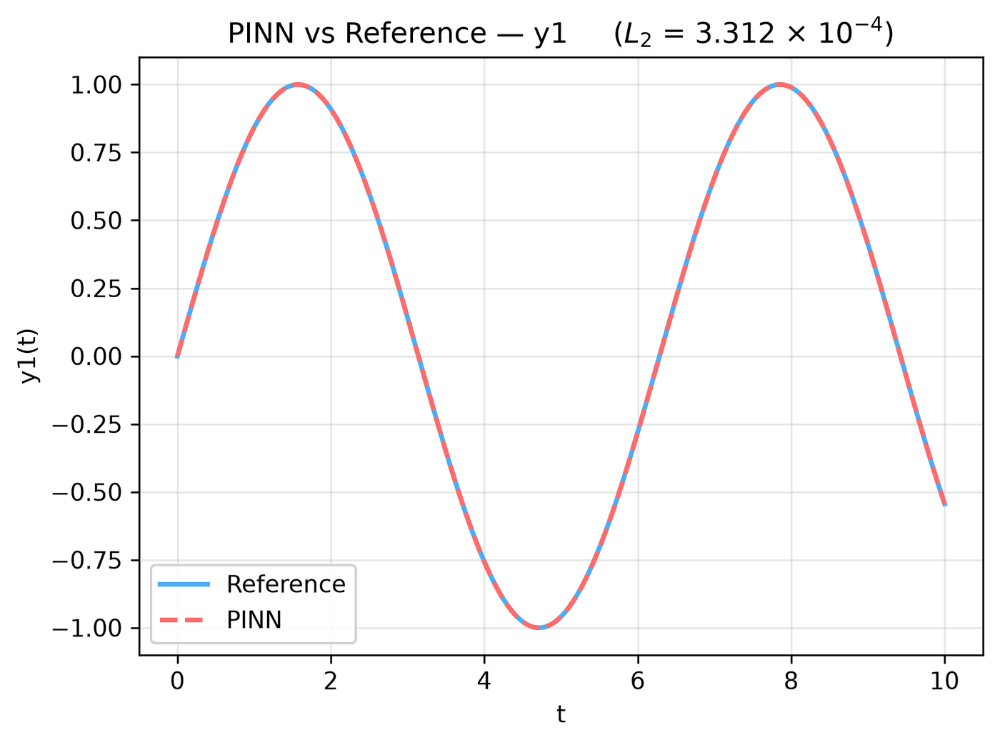

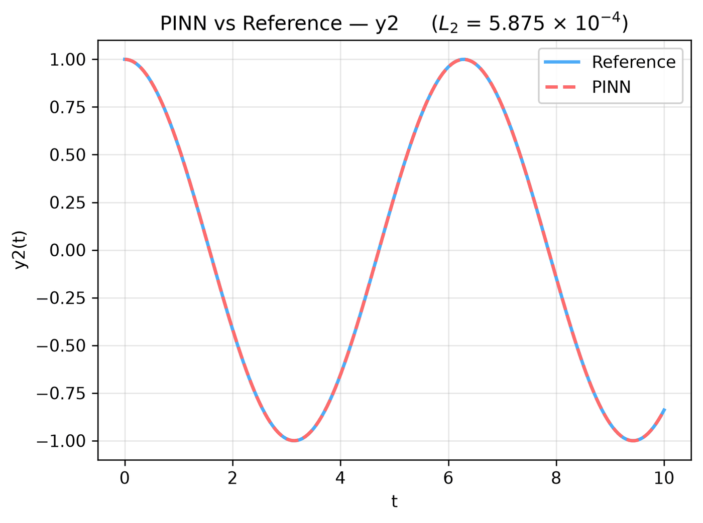

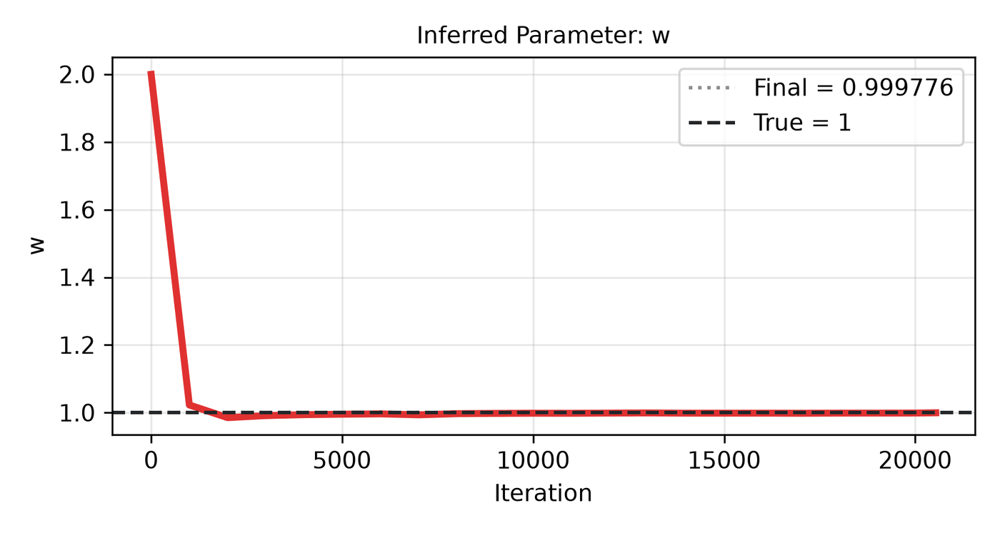

*Inverse, PINNStudio best:*

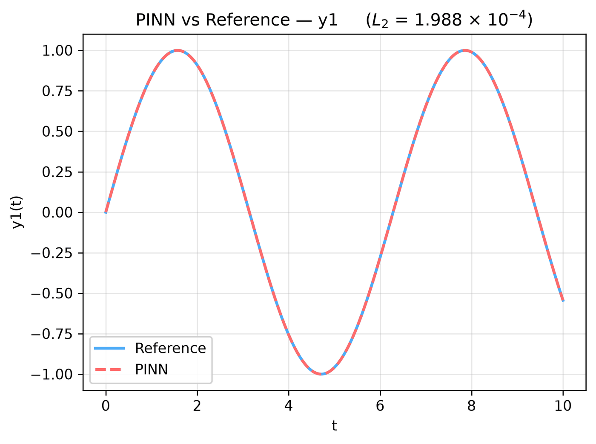

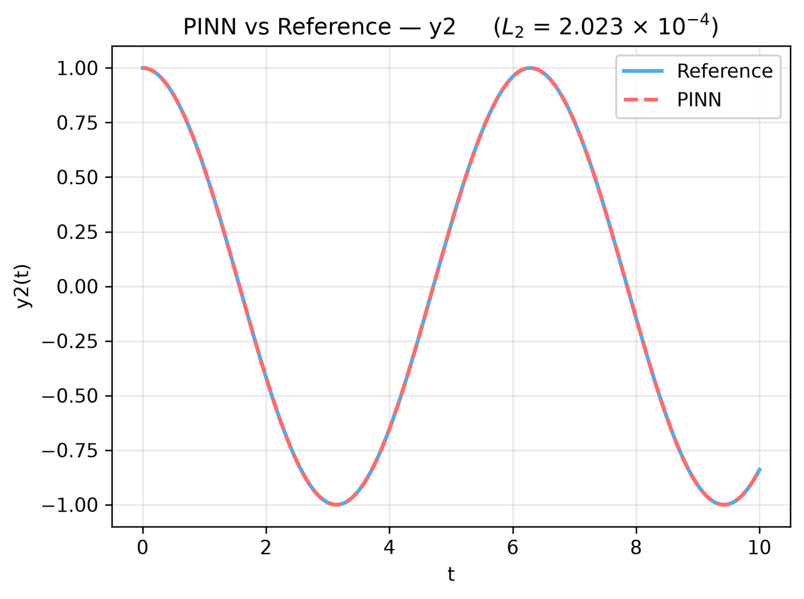

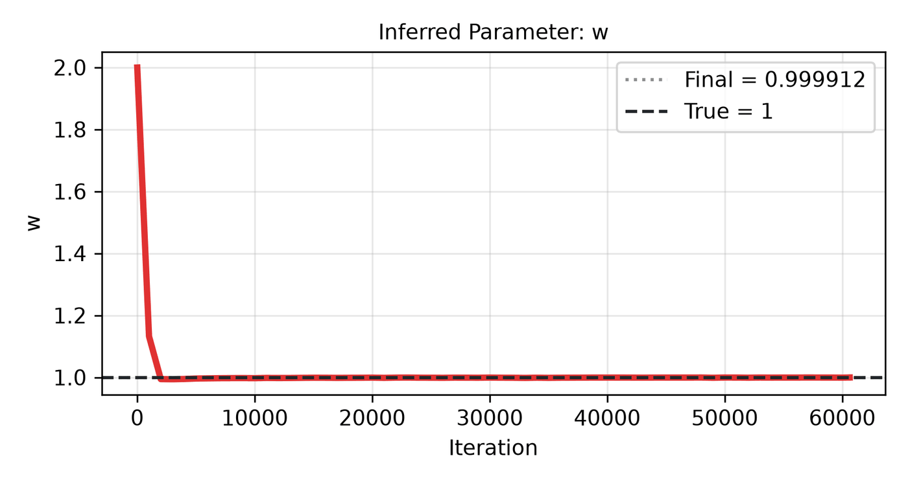

<strong>Lotka-Volterra ODE</strong> · DeepXDE example

[problem and settings in the README](../README.md#dx-lotka-volterra-equation) · [inverse runs in the tuning study](tuning_study.md#tune-lotka-volterra-ode-inverse-mode)

| | DeepXDE's settings | PINNStudio best |
|---|---|---|
| Forward $L_2$ | 2.1 × 10-3 | 2.1 × 10-3 (not tuned yet) |
| Inverse $L_2$ | 1.5 × 10-5 | 1.5 × 10-5 |
| Parameters found (true) | a = 2.00001 (2); d = 1.06 (1.06) | a = 2.00001 (2); d = 1.06 (1.06) |

DeepXDE's example is forward only; the inverse problem is PINNStudio's inverse mode of it, run with the example's settings and tuned.

*Forward, the README's result:*

*Inverse, DeepXDE's settings:*

<strong>Second-order ODE</strong> · DeepXDE example

[problem and settings in the README](../README.md#dx-second-order-ode) · [inverse runs in the tuning study](tuning_study.md#tune-second-order-ode-inverse-mode)

| | DeepXDE's settings | PINNStudio best |
|---|---|---|
| Forward $L_2$ | 6.9 × 10-4 | 6.9 × 10-4 (not tuned yet) |
| Inverse $L_2$ | 1.6 × 10-3 | 8.9 × 10-6 |
| Parameters found (true) | a = 9.93327 (10); b = 9.6526 (9) | a = 10.0003 (10); b = 8.99262 (9) |

DeepXDE's example is forward only; the inverse problem is PINNStudio's inverse mode of it, run with the example's settings and tuned.

*Forward, the README's result:*

*Inverse, DeepXDE's settings:*

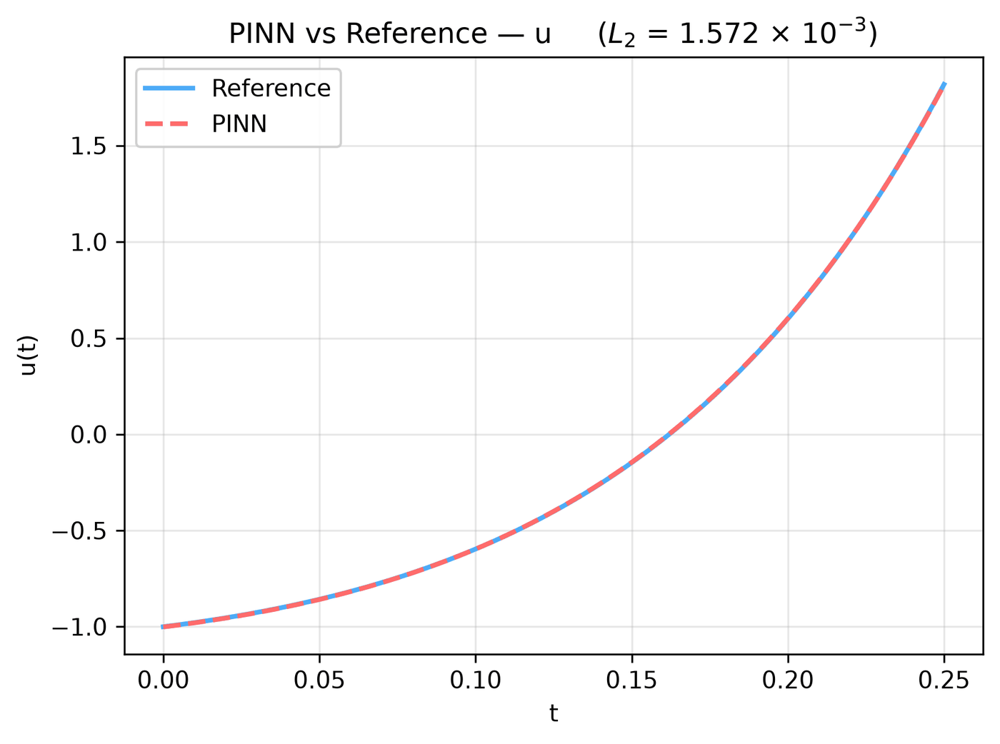

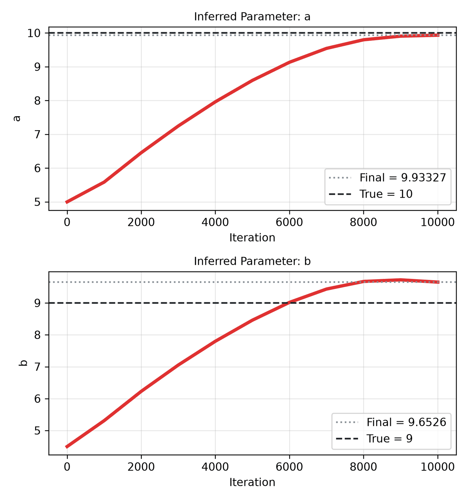

*Inverse, PINNStudio best:*

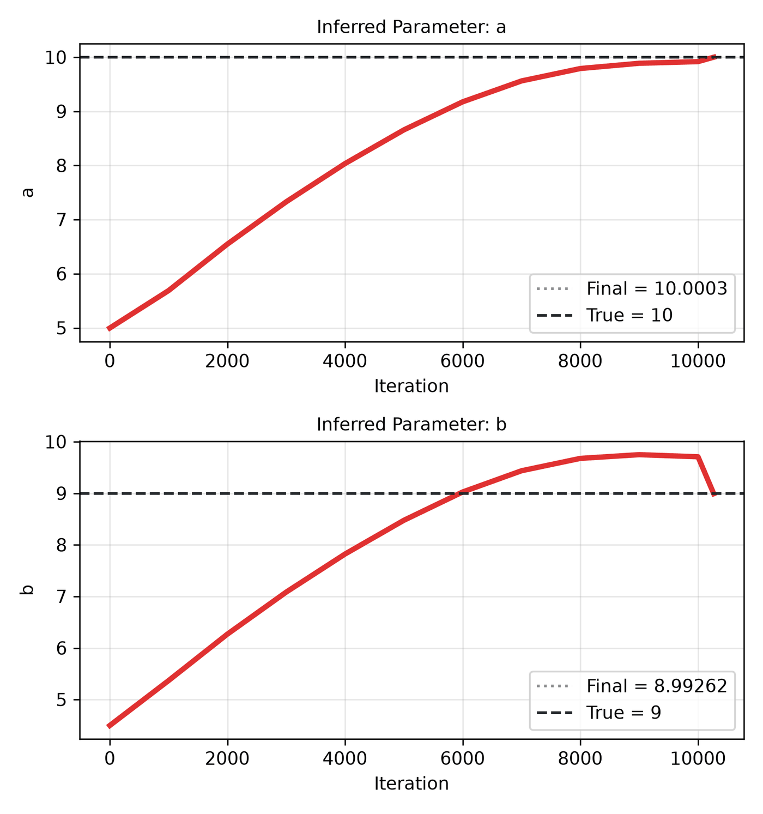

<strong>Lorenz ODE – unknown C₁, C₂, C₃</strong> · DeepXDE example

[problem and settings in the README](../README.md#dx-inverse-lorenz-system)

| | DeepXDE's settings | PINNStudio best |
|---|---|---|
| Inverse $L_2$ | 1.0 × 10-4 | 1.0 × 10-4 (not tuned yet) |
| Parameters found (true) | C₁ = 10 (10); C₂ = 14.9998 (15); C₃ = 2.66664 (2.66667) | C₁ = 10 (10); C₂ = 14.9998 (15); C₃ = 2.66664 (2.66667) |

*Inverse, the README's result:*

<strong>Lorenz ODE – unknown C₁, C₂, C₃, exogenous input</strong> · DeepXDE example

[problem and settings in the README](../README.md#dx-inverse-lorenz-system-with-exogenous-input)

| | DeepXDE's settings | PINNStudio best |
|---|---|---|
| Inverse $L_2$ | 1.6 × 10-3 | 1.6 × 10-3 (not tuned yet) |
| Parameters found (true) | C₁ = 9.974 (10); C₂ = 14.996 (15); C₃ = 2.6669 (2.66667) | C₁ = 9.974 (10); C₂ = 14.996 (15); C₃ = 2.6669 (2.66667) |

*Inverse, the README's result:*

## 1D, steady

<strong>Euler beam 1D</strong> · DeepXDE example

[problem and settings in the README](../README.md#dx-euler-beam) · [forward runs in the tuning study](tuning_study.md#tune-euler-beam-1d) · [inverse runs in the tuning study](tuning_study.md#tune-euler-beam-1d-inverse-mode)

| | DeepXDE's settings | PINNStudio best |
|---|---|---|
| Forward $L_2$ | 3.5 × 10-3 | 2.8 × 10-4 |
| Inverse $L_2$ | 1.6 × 10-3 | 3.8 × 10-5 |
| Parameters found (true) | EI = 1.02349 (1) | EI = 1.00075 (1) |

DeepXDE's example is forward only; the inverse problem is PINNStudio's inverse mode of it, run with the example's settings and tuned.

*Forward, DeepXDE's settings:*

*Forward, PINNStudio best:*

*Inverse, DeepXDE's settings:*

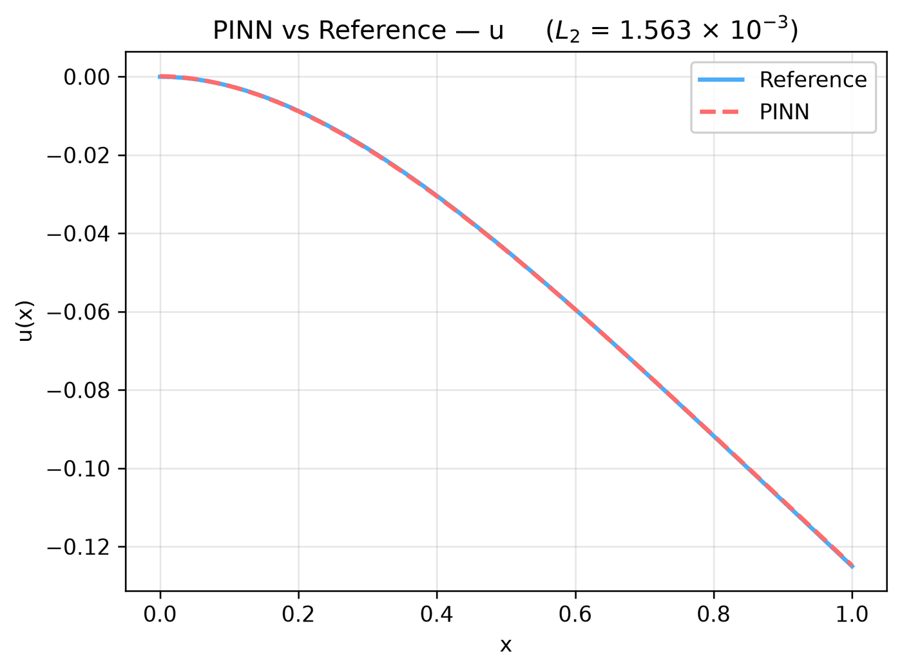

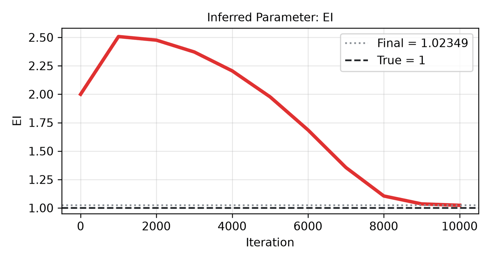

*Inverse, PINNStudio best:*

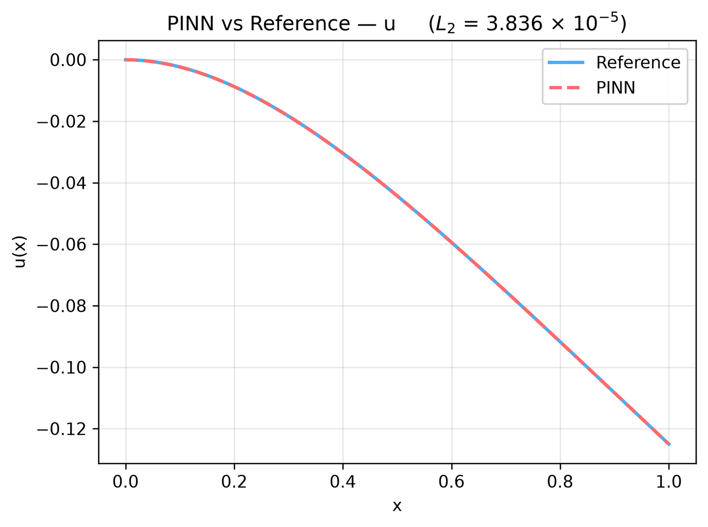

<strong>Fractional Poisson 1D</strong> · DeepXDE example

[problem and settings in the README](../README.md#dx-fractional-poisson-equation-1d) · [forward runs in the tuning study](tuning_study.md#tune-fractional-poisson-1d)

| | DeepXDE's settings | PINNStudio best |
|---|---|---|
| Forward $L_2$ | 2.3 × 10-2 | 1.2 × 10-2 |

*Forward, DeepXDE's settings:*

*Forward, PINNStudio best:*

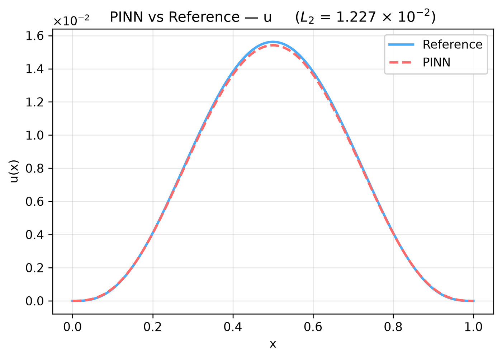

<strong>Poisson 1D – Dirichlet</strong> · DeepXDE example

[problem and settings in the README](../README.md#dx-poisson-1d-dirichlet)

| | DeepXDE's settings | PINNStudio best |
|---|---|---|
| Forward $L_2$ | 3.7 × 10-4 | 3.7 × 10-4 (not tuned yet) |

*Forward, the README's result:*

<strong>Poisson 1D – Dirichlet/Neumann</strong> · DeepXDE example

[problem and settings in the README](../README.md#dx-poisson-1d-dirichlet-neumann)

| | DeepXDE's settings | PINNStudio best |
|---|---|---|
| Forward $L_2$ | 2.3 × 10-4 | 2.3 × 10-4 (not tuned yet) |

*Forward, the README's result:*

<strong>Poisson 1D – Dirichlet/Periodic</strong> · DeepXDE example

[problem and settings in the README](../README.md#dx-poisson-1d-dirichlet-periodic) · [forward runs in the tuning study](tuning_study.md#tune-poisson-1d-dirichlet-periodic)

| | DeepXDE's settings | PINNStudio best |
|---|---|---|
| Forward $L_2$ | 9.6 × 10-3 | 6.4 × 10-6 |

*Forward, DeepXDE's settings:*

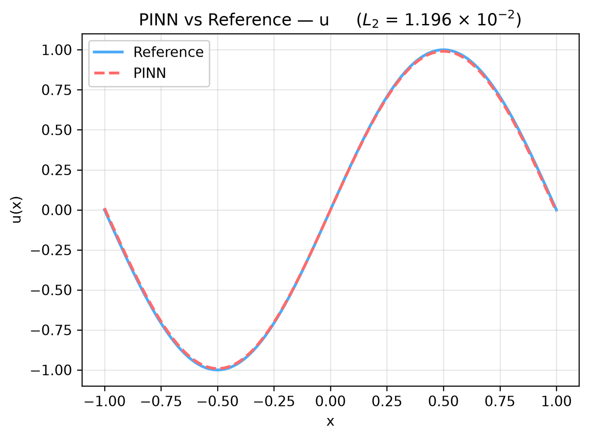

*Forward, PINNStudio best:*

<strong>Poisson 1D – Dirichlet/point-set operator</strong> · DeepXDE example

[problem and settings in the README](../README.md#dx-poisson-1d-dirichlet-pointsetoperator)

| | DeepXDE's settings | PINNStudio best |
|---|---|---|
| Forward $L_2$ | 2.6 × 10-5 | 2.6 × 10-5 (not tuned yet) |

*Forward, the README's result:*

<strong>Poisson 1D – Dirichlet/Robin</strong> · DeepXDE example

[problem and settings in the README](../README.md#dx-poisson-1d-dirichlet-robin)

| | DeepXDE's settings | PINNStudio best |
|---|---|---|
| Forward $L_2$ | 2.4 × 10-4 | 2.4 × 10-4 (not tuned yet) |

*Forward, the README's result:*

<strong>Poisson 1D – hard BCs</strong> · DeepXDE example

[problem and settings in the README](../README.md#dx-poisson-1d-hard-boundary-conditions)

| | DeepXDE's settings | PINNStudio best |
|---|---|---|
| Forward $L_2$ | 2.2 × 10-6 | 2.2 × 10-6 (not tuned yet) |

*Forward, the README's result:*

<strong>Poisson 1D – multi-scale Fourier features</strong> · DeepXDE example

[problem and settings in the README](../README.md#dx-poisson-1d-multi-scale-fourier-features)

| | DeepXDE's settings | PINNStudio best |
|---|---|---|
| Forward $L_2$ | 3.9 × 10-3 | 3.9 × 10-3 (not tuned yet) |

*Forward, the README's result:*

<strong>Brinkman-Forchheimer 1D – unknown ν_e, K</strong> · DeepXDE example

[problem and settings in the README](../README.md#dx-inverse-brinkman-forchheimer-model) · [forward runs in the tuning study](tuning_study.md#tune-brinkman-forchheimer-1d-unknown-e-k)

| | DeepXDE's settings | PINNStudio best |
|---|---|---|
| Inverse $L_2$ | 2.0 × 10-2 | 1.2 × 10-2 |
| Parameters found (true) | νₑ = 0.00127637 (0.001); K = 0.00103624 (0.001) | νₑ = 0.00117644 (0.001); K = 0.00100487 (0.001) |

*Inverse, DeepXDE's settings:*

*Inverse, PINNStudio best:*

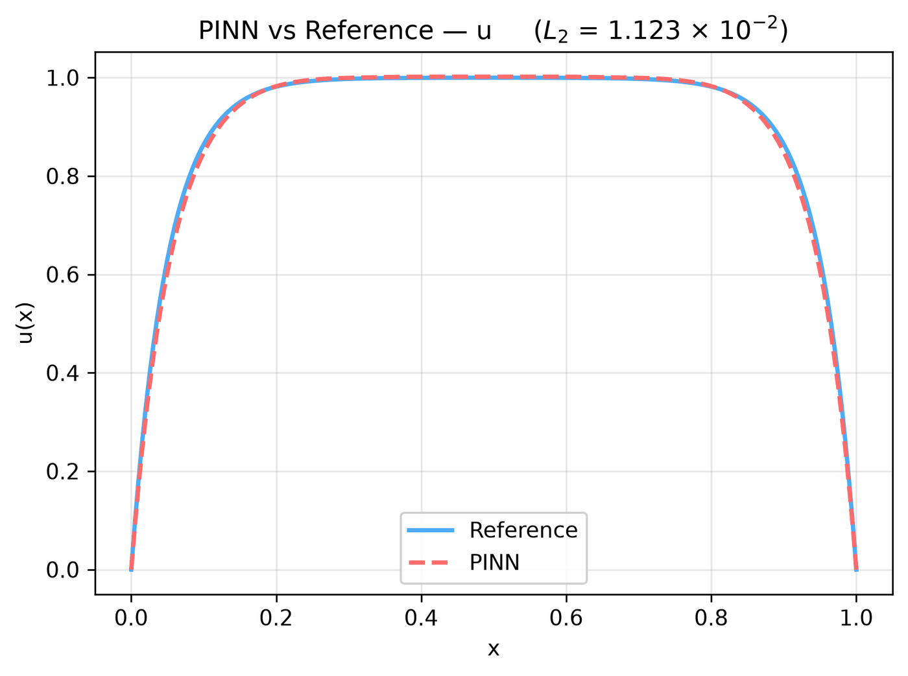

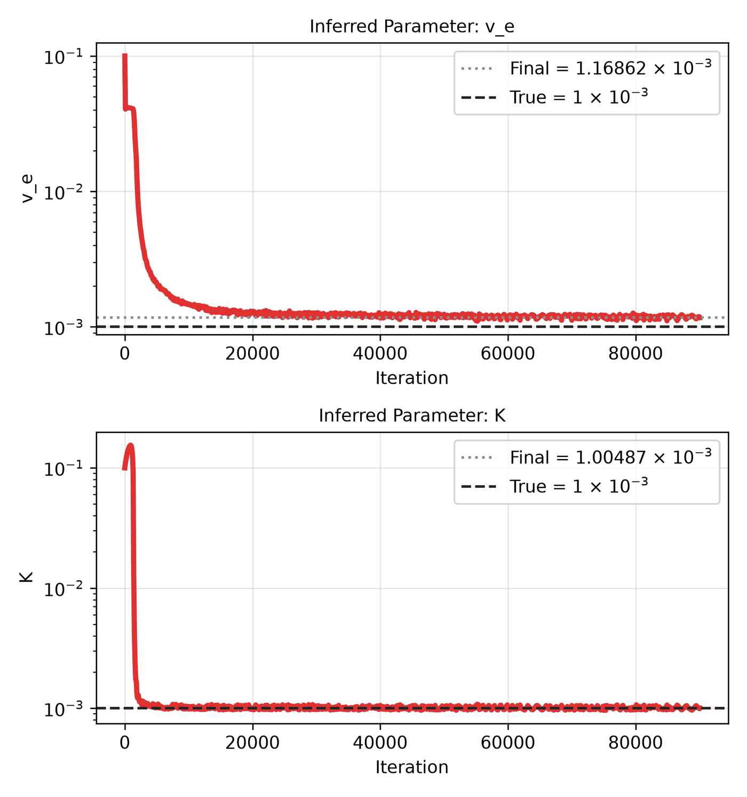

<strong>Diffusion-reaction 1D – unknown rate field</strong> · DeepXDE example

[problem and settings in the README](../README.md#dx-inverse-diffusion-reaction-with-space-dependent-rate) · [forward runs in the tuning study](tuning_study.md#tune-diffusion-reaction-1d-unknown-rate-field)

| | DeepXDE's settings | PINNStudio best |
|---|---|---|
| Inverse $L_2$ | 4.0 × 10-2 | 2.8 × 10-2 |
| Parameters found (true) | – | – |

*Inverse, DeepXDE's settings:*

*Inverse, PINNStudio best:*

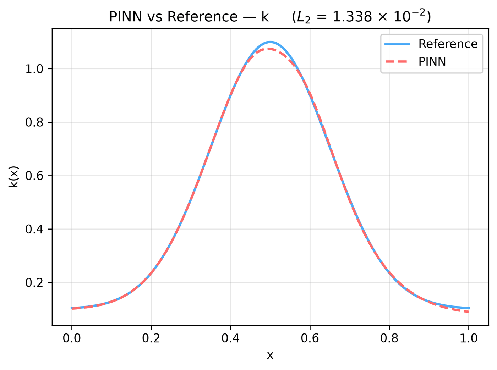

<strong>Fractional Poisson 1D – unknown order α</strong> · DeepXDE example

[problem and settings in the README](../README.md#dx-inverse-fractional-poisson-equation-1d)

| | DeepXDE's settings | PINNStudio best |
|---|---|---|
| Inverse $L_2$ | 4.9 × 10-3 | 4.9 × 10-3 (not tuned yet) |
| Parameters found (true) | α = 1.79183 (1.8) | α = 1.79183 (1.8) |

*Inverse, the README's result:*

<strong>Poisson 1D – unknown forcing field</strong> · DeepXDE example

[problem and settings in the README](../README.md#dx-inverse-poisson-with-unknown-forcing-field) · [forward runs in the tuning study](tuning_study.md#tune-poisson-1d-unknown-forcing-field)

| | DeepXDE's settings | PINNStudio best |
|---|---|---|
| Inverse $L_2$ | 5.4 × 10-4 | 2.1 × 10-4 |
| Parameters found (true) | – | – |

*Inverse, DeepXDE's settings:*

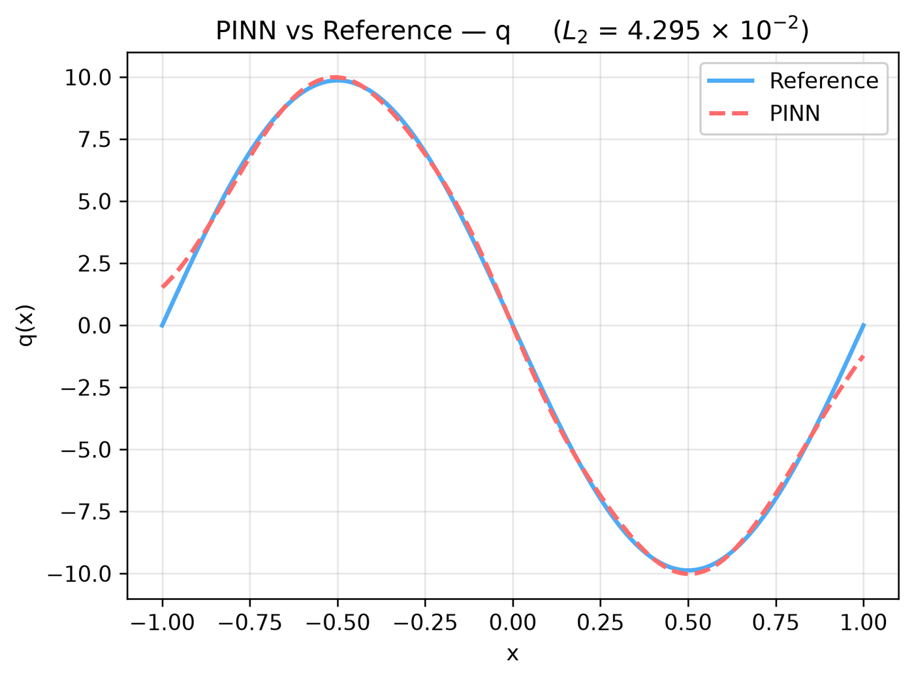

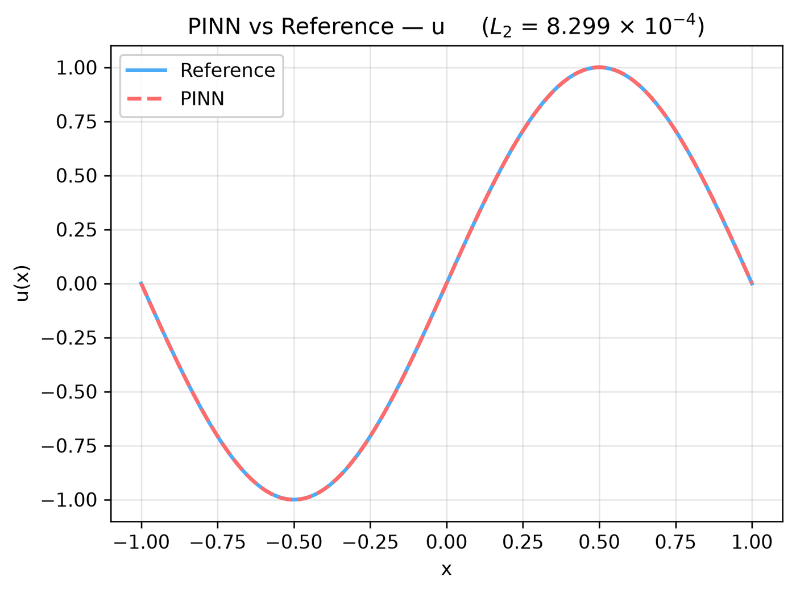

*Inverse, PINNStudio best:*

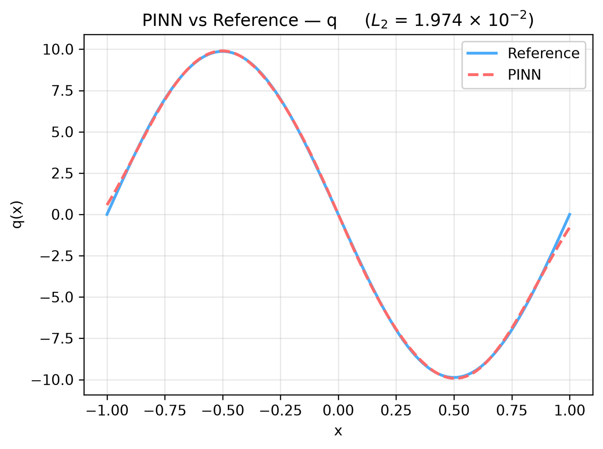

<strong>Poisson 1D – unknown forcing field (batches)</strong> · DeepXDE example

[problem and settings in the README](../README.md#dx-inverse-poisson-with-unknown-forcing-field-batches) · [forward runs in the tuning study](tuning_study.md#tune-poisson-1d-unknown-forcing-field-batches)

| | DeepXDE's settings | PINNStudio best |
|---|---|---|
| Inverse $L_2$ | 4.5 × 10-3 | 7.8 × 10-4 |
| Parameters found (true) | – | – |

*Inverse, DeepXDE's settings:*

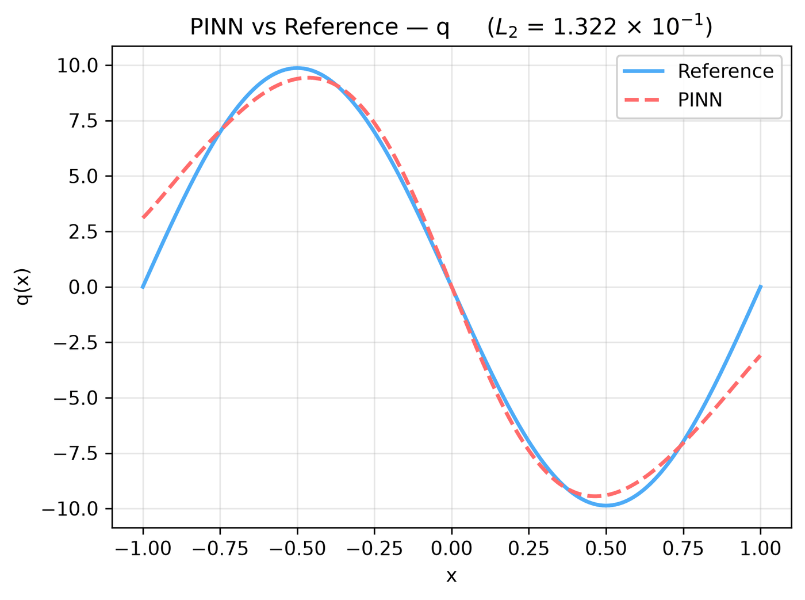

*Inverse, PINNStudio best:*

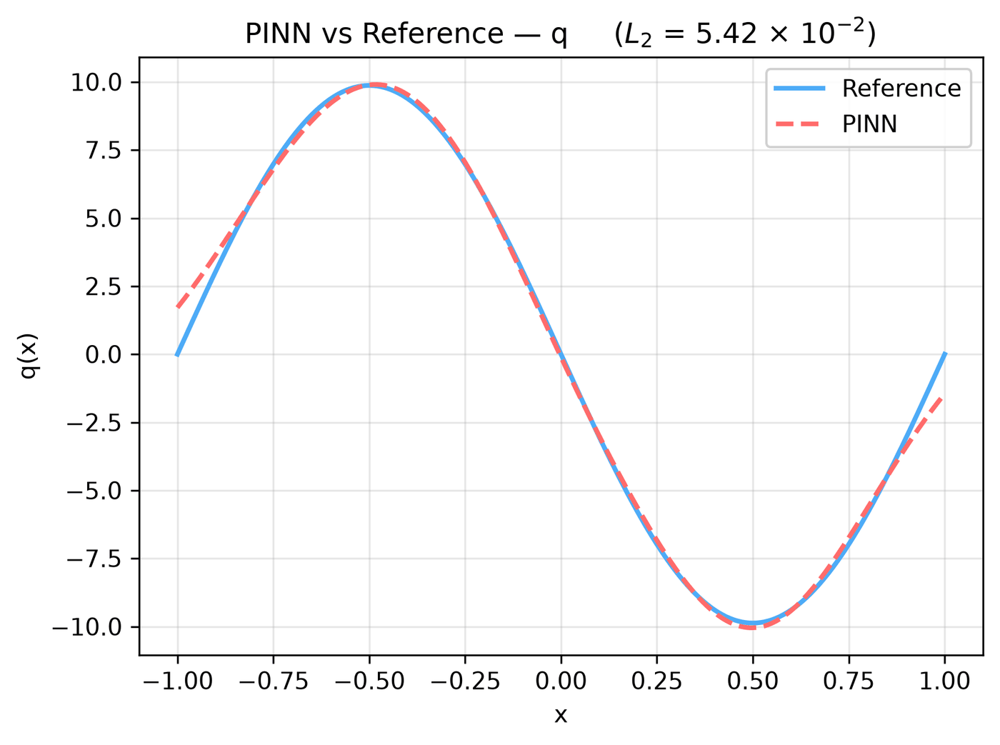

## 1D, time-dependent

<strong>Allen-Cahn 1D</strong> · DeepXDE example

[problem and settings in the README](../README.md#dx-allen-cahn-equation) · [forward runs in the tuning study](tuning_study.md#tune-allen-cahn-1d) · [inverse runs in the tuning study](tuning_study.md#tune-allen-cahn-1d-inverse-mode)

| | DeepXDE's settings | PINNStudio best |
|---|---|---|
| Forward $L_2$ | 3.4 × 10-2 | 1.2 × 10-2 |
| Inverse $L_2$ | 5.4 × 10-4 | 1.1 × 10-4 |
| Parameters found (true) | d = 0.00100154 (0.001); c = 4.9979 (5) | d = 0.00100055 (0.001); c = 5.00002 (5) |

DeepXDE's example is forward only; the inverse problem is PINNStudio's inverse mode of it, run with the example's settings and tuned.

*Forward, DeepXDE's settings:*

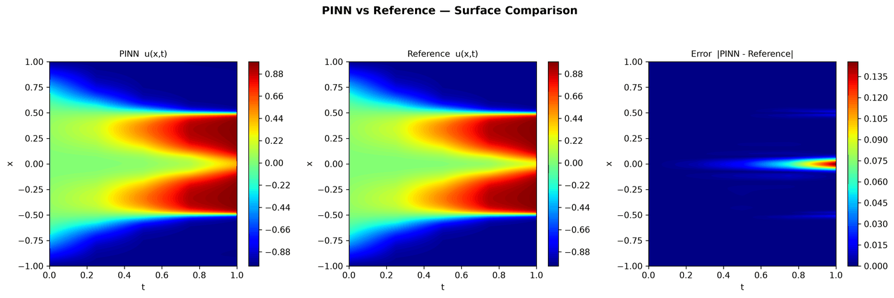

*Forward, PINNStudio best:*

*Inverse, DeepXDE's settings:*

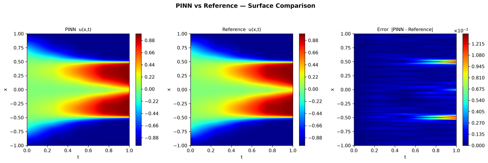

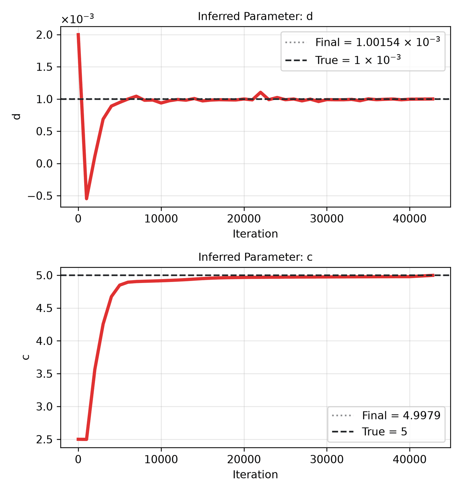

*Inverse, PINNStudio best:*

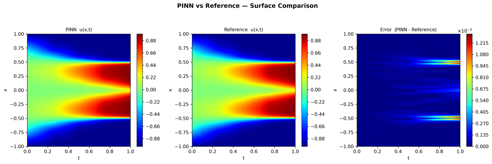

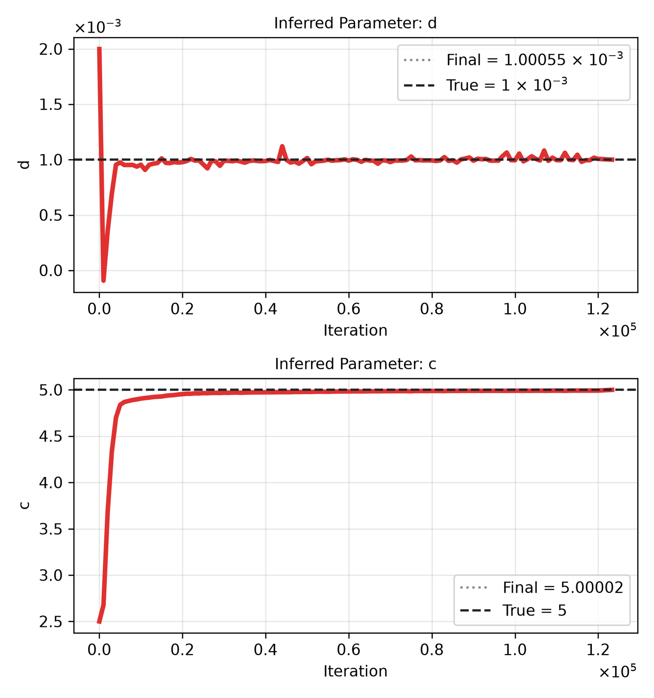

<strong>Allen-Cahn 1D – Wight & Zhao (time-adaptive)</strong> · PINNStudio template, after Wight & Zhao (2021)

| | $L_2$, last time | $L_2$, all times | Parameters found (true) |
|---|---|---|---|
| Plain PINN (in PINNStudio) | – | – | |
| Wight & Zhao's method: reported in Wight & Zhao (2021), Table 3.1 | – | 2.3 × 10-2 | |
| Wight & Zhao's method, run in PINNStudio | – | – | |
| Mattey & Ghosh's bc-PINN: reported in Mattey & Ghosh (2022), Table 2 | – | 1.7 × 10-2 | |
| Mattey & Ghosh's bc-PINN, run in PINNStudio | – | – | |
| The template as it loads | 4.8 × 10-3 | – | |
| **PINNStudio best** (forward) | 4.8 × 10-3 | – | |

*The plain PINN and the paper's method are queued on the GPU; their rows fill in as they finish.*

<strong>Allen-Cahn 1D – Wight & Zhao (whole interval)</strong> · PINNStudio template, after Wight & Zhao (2021)

| | $L_2$, last time | $L_2$, all times | Parameters found (true) |
|---|---|---|---|
| Plain PINN (in PINNStudio) | – | – | |
| Wight & Zhao's method: reported in Wight & Zhao (2021), Table 3.1 | – | 2.3 × 10-2 | |
| Wight & Zhao's method, run in PINNStudio | – | – | |
| Mattey & Ghosh's bc-PINN: reported in Mattey & Ghosh (2022), Table 2 | – | 1.7 × 10-2 | |
| Mattey & Ghosh's bc-PINN, run in PINNStudio | – | – | |
| The template as it loads | 1.4 × 10-3 | – | |
| **PINNStudio best** (forward) | 1.4 × 10-3 | – | |
| Inverse, the template's own settings | 2.1 × 10-4 | – | γ₁ = 9.81621e-05 (0.0001); γ₂ = 4.99953 (5) |
| **PINNStudio best** (inverse) | 2.1 × 10-4 | – | γ₁ = 9.81621e-05 (0.0001); γ₂ = 4.99953 (5) |

*The plain PINN and the paper's method are queued on the GPU; their rows fill in as they finish.*

<strong>Cahn-Hilliard 1D – Wight & Zhao</strong> · PINNStudio template, after Wight & Zhao (2021)

[problem and settings in the README](../README.md#1d-cahn-hilliard)

| | $L_2$, last time | $L_2$, all times | Parameters found (true) |
|---|---|---|---|
| Plain PINN (in PINNStudio) | – | – | |
| Wight & Zhao's method: reported in Wight & Zhao (2021), Sec. 3.2 | – | 9.5 × 10-3 | |
| Wight & Zhao's method, run in PINNStudio | – | – | |
| The template as it loads | 6.0 × 10-4 | – | |
| **PINNStudio best** (forward) | 6.0 × 10-4 | – | |

*The plain PINN and the paper's method are queued on the GPU; their rows fill in as they finish.*

*Forward, the README's result:*

<strong>Cahn-Hilliard 1D – Mattey & Ghosh</strong> · PINNStudio template, after Mattey & Ghosh (2022)

[problem and settings in the README](../README.md#1d-cahn-hilliard-mattey--ghosh) · [forward runs in the tuning study](tuning_study.md#tune-cahn-hilliard-1d-mattey-ghosh-pinnstudio-template-best-setup)

| | $L_2$, last time | $L_2$, all times | Parameters found (true) |
|---|---|---|---|
| Plain PINN (in PINNStudio) | – | – | |
| Mattey & Ghosh's bc-PINN: reported in Mattey & Ghosh (2022), Sec. 5.2 | – | 1.9 × 10-2 | |
| Mattey & Ghosh's bc-PINN, run in PINNStudio | – | – | |
| The template as it loads | 4.8 × 10-3 | – | |
| **PINNStudio best** (forward) | 3.9 × 10-3 | – | |

*The plain PINN and the paper's method are queued on the GPU; their rows fill in as they finish.*

*Forward, the README's result:*

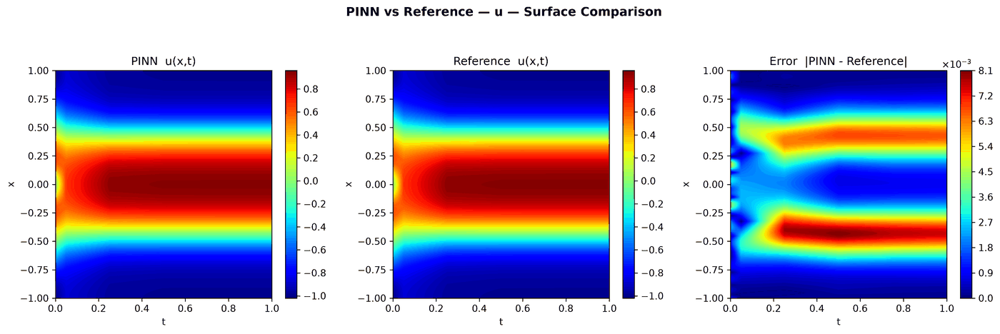

*Forward, PINNStudio best:*

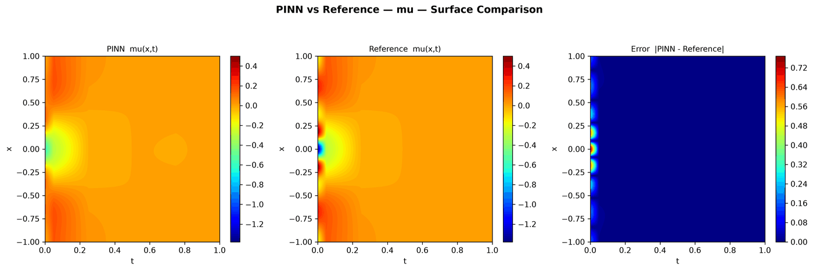

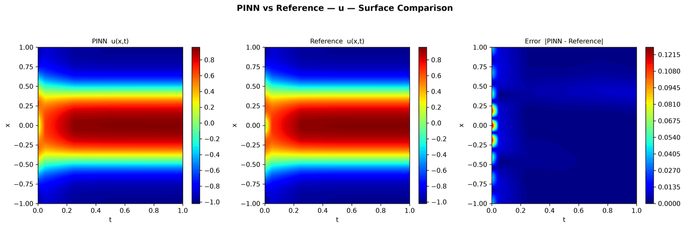

<strong>Black-Scholes 1D – American put</strong> · DeepXDE example

[problem and settings in the README](../README.md#dx-american-put-option)

| | DeepXDE's settings | PINNStudio best |
|---|---|---|

<strong>Black-Scholes 1D – European call</strong> · DeepXDE example

[problem and settings in the README](../README.md#dx-black-scholes-equation-call-option)

| | DeepXDE's settings | PINNStudio best |
|---|---|---|
| Forward $L_2$ | 4.3 × 10-4 | 4.3 × 10-4 (not tuned yet) |

*Forward, the README's result:*

<strong>Burgers 1D – Raissi et al.</strong> · PINNStudio template, after Raissi et al. (2019)

[problem and settings in the README](../README.md#1d-burgers) · [forward runs in the tuning study](tuning_study.md#tune-burgers-1d-raissi-et-al-pinnstudio-template-best-setup)

| | $L_2$, last time | $L_2$, all times | Parameters found (true) |
|---|---|---|---|
| Plain PINN (in PINNStudio) | – | – | |
| Raissi et al.'s settings: reported in Raissi et al. (2019), Sec. 2.1 | – | 6.7 × 10-4 | |
| Raissi et al.'s settings, run in PINNStudio | – | – | |
| The template as it loads | 1.3 × 10-3 | – | |
| **PINNStudio best** (forward) | 5.2 × 10-4 | – | |
| Inverse, the template's own settings | 7.8 × 10-4 | – | λ₁ = 0.996107 (1); λ₂ = 0.0100386 (0.01) |
| **PINNStudio best** (inverse) | 7.8 × 10-4 | – | λ₁ = 0.996107 (1); λ₂ = 0.0100386 (0.01) |

*The plain PINN and the paper's method are queued on the GPU; their rows fill in as they finish.*

*Forward, the README's result:*

*Forward, PINNStudio best:*

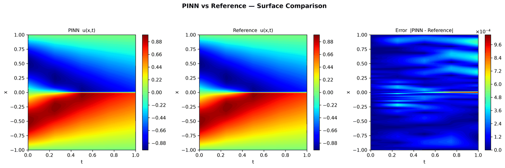

*Inverse, the README's result:*

<strong>Burgers 1D – RAR</strong> · DeepXDE example

[problem and settings in the README](../README.md#dx-burgers-equation-with-rar)

| | DeepXDE's settings | PINNStudio best |
|---|---|---|
| Forward $L_2$ | 8.4 × 10-4 | 8.4 × 10-4 (not tuned yet) |

*Forward, the README's result:*

<strong>Diffusion 1D</strong> · DeepXDE example

[problem and settings in the README](../README.md#dx-diffusion-equation) · [forward runs in the tuning study](tuning_study.md#tune-diffusion-1d)

| | DeepXDE's settings | PINNStudio best |
|---|---|---|
| Forward $L_2$ | 2.3 × 10-2 | 1.5 × 10-3 |

*Forward, DeepXDE's settings:*

*Forward, PINNStudio best:*

<strong>Diffusion 1D – hard IC and BCs</strong> · DeepXDE example

[problem and settings in the README](../README.md#dx-diffusion-equation-with-hard-ic-and-bc)

| | DeepXDE's settings | PINNStudio best |
|---|---|---|
| Forward $L_2$ | 2.8 × 10-3 | 2.8 × 10-3 (not tuned yet) |

*Forward, the README's result:*

<strong>Diffusion 1D – resampling</strong> · DeepXDE example

[problem and settings in the README](../README.md#dx-diffusion-equation-with-resampling) · [forward runs in the tuning study](tuning_study.md#tune-diffusion-1d-resampling)

| | DeepXDE's settings | PINNStudio best |
|---|---|---|
| Forward $L_2$ | 5.4 × 10-2 | 5.8 × 10-3 |

*Forward, DeepXDE's settings:*

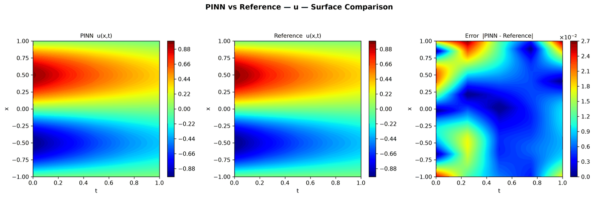

*Forward, PINNStudio best:*

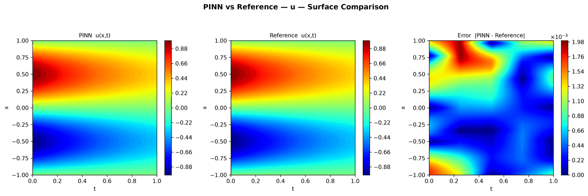

<strong>Diffusion-reaction 1D</strong> · DeepXDE example

[problem and settings in the README](../README.md#dx-diffusion-reaction-equation) · [forward runs in the tuning study](tuning_study.md#tune-diffusion-reaction-1d) · [inverse runs in the tuning study](tuning_study.md#tune-diffusion-reaction-1d-inverse-mode)

| | DeepXDE's settings | PINNStudio best |
|---|---|---|
| Forward $L_2$ | 8.8 × 10-2 | 8.5 × 10-5 |
| Inverse $L_2$ | 6.2 × 10-4 | 1.4 × 10-4 |
| Parameters found (true) | D = 0.998802 (1) | D = 0.999773 (1) |

DeepXDE's example is forward only; the inverse problem is PINNStudio's inverse mode of it, run with the example's settings and tuned.

*Forward, DeepXDE's settings:*

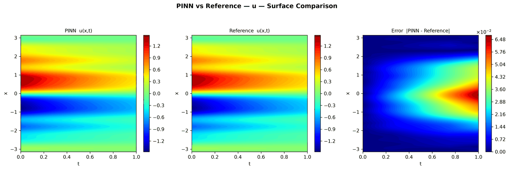

*Forward, PINNStudio best:*

*Inverse, DeepXDE's settings:*

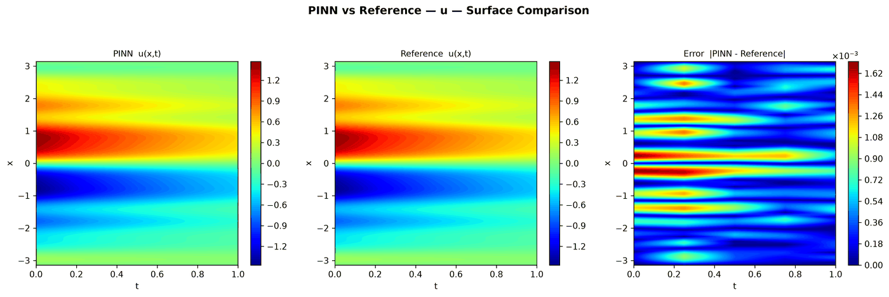

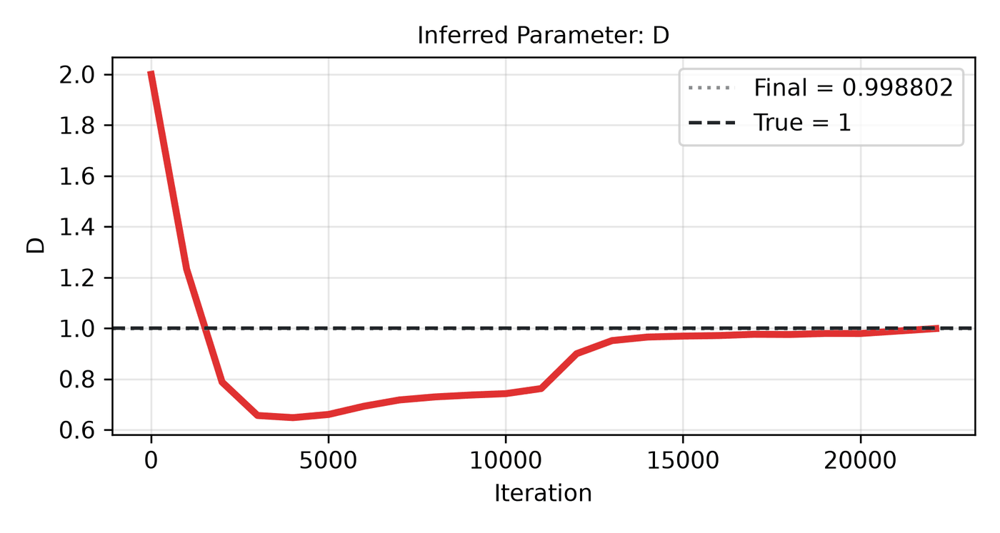

*Inverse, PINNStudio best:*

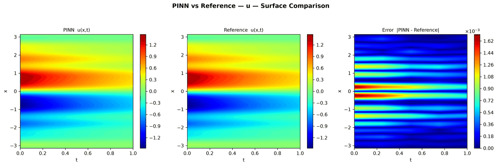

<strong>Fractional diffusion 1D</strong> · DeepXDE example

[problem and settings in the README](../README.md#dx-fractional-diffusion-equation)

| | DeepXDE's settings | PINNStudio best |
|---|---|---|
| Forward $L_2$ | 3.3 × 10-3 | 3.3 × 10-3 (not tuned yet) |

*Forward, the README's result:*

<strong>Heat 1D – Dirichlet</strong> · DeepXDE example

[problem and settings in the README](../README.md#dx-heat-equation) · [forward runs in the tuning study](tuning_study.md#tune-heat-1d-dirichlet) · [inverse runs in the tuning study](tuning_study.md#tune-heat-1d-dirichlet-inverse-mode)

| | DeepXDE's settings | PINNStudio best |
|---|---|---|
| Forward $L_2$ | 5.0 × 10-2 | 1.3 × 10-2 |
| Inverse $L_2$ | 5.1 × 10-3 | 1.1 × 10-3 |
| Parameters found (true) | a = 0.397247 (0.4) | a = 0.400406 (0.4) |

DeepXDE's example is forward only; the inverse problem is PINNStudio's inverse mode of it, run with the example's settings and tuned.

*Forward, DeepXDE's settings:*

*Forward, PINNStudio best:*

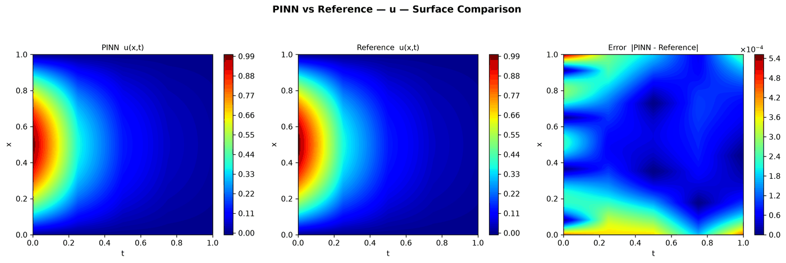

*Inverse, DeepXDE's settings:*

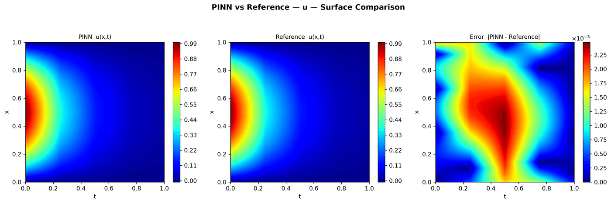

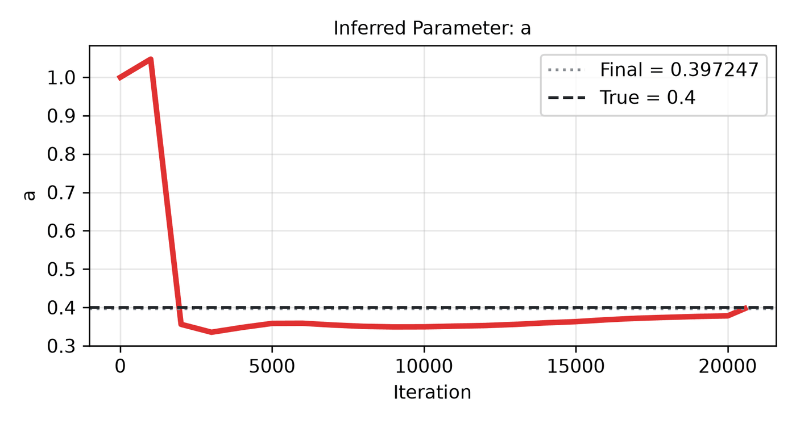

*Inverse, PINNStudio best:*

<strong>Heat 1D – resampling</strong> · DeepXDE example

[problem and settings in the README](../README.md#dx-heat-equation-with-resampling) · [forward runs in the tuning study](tuning_study.md#tune-heat-1d-resampling)

| | DeepXDE's settings | PINNStudio best |
|---|---|---|
| Forward $L_2$ | 1.4 × 10-2 | 3.3 × 10-3 |

*Forward, DeepXDE's settings:*

*Forward, PINNStudio best:*

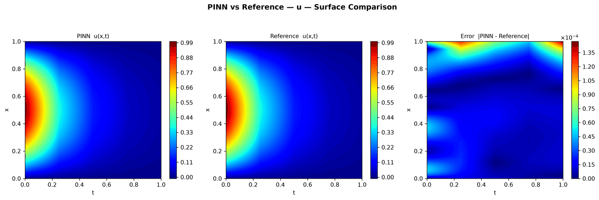

<strong>Klein-Gordon 1D</strong> · DeepXDE example

[problem and settings in the README](../README.md#dx-klein-gordon-equation) · [forward runs in the tuning study](tuning_study.md#tune-klein-gordon-1d)

| | DeepXDE's settings | PINNStudio best |
|---|---|---|
| Forward $L_2$ | 6.9 × 10-2 | 2.3 × 10-3 |

*Forward, DeepXDE's settings:*

*Forward, PINNStudio best:*

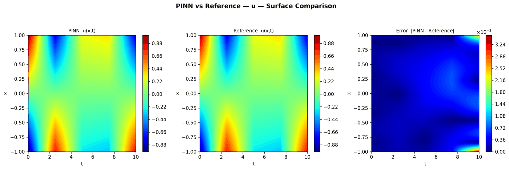

<strong>Schrödinger 1D</strong> · DeepXDE example

[problem and settings in the README](../README.md#dx-schr-dinger-equation) · [inverse runs in the tuning study](tuning_study.md#tune-schr-dinger-1d-inverse-mode)

| | DeepXDE's settings | PINNStudio best |
|---|---|---|
| Forward $L_2$ | 1.8 × 10-3 | 1.8 × 10-3 (not tuned yet) |
| Inverse $L_2$ | 1.8 × 10-1 | 9.9 × 10-4 |
| Parameters found (true) | c = 0.514806 (0.5) | c = 0.500036 (0.5) |

DeepXDE's example is forward only; the inverse problem is PINNStudio's inverse mode of it, run with the example's settings and tuned.

*Forward, the README's result:*

*Inverse, DeepXDE's settings:*

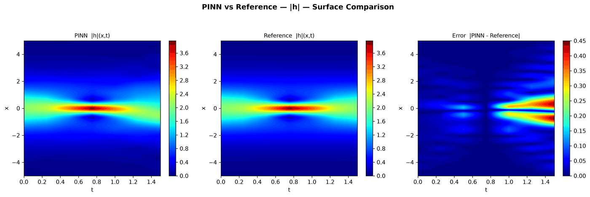

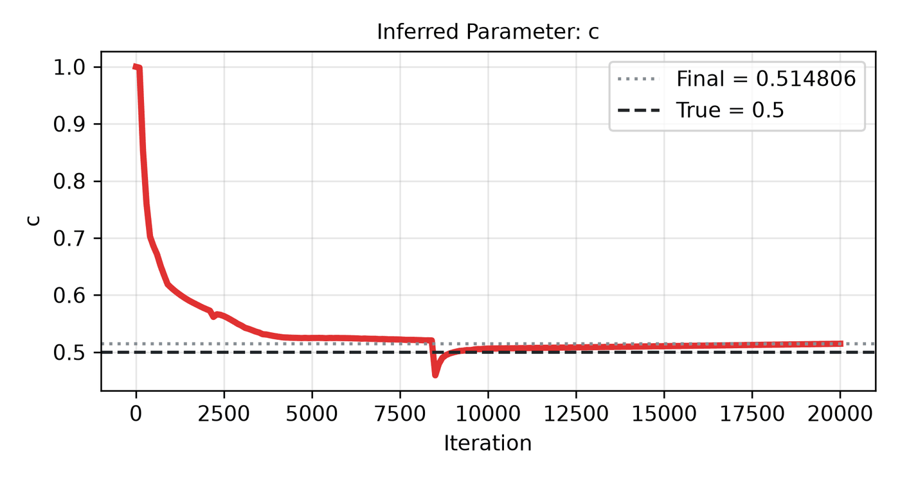

*Inverse, PINNStudio best:*

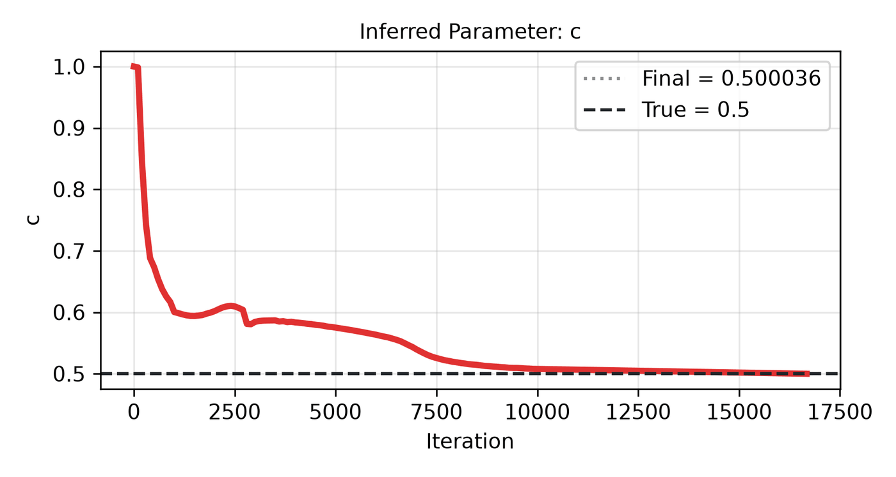

<strong>Wave 1D – space-time multi-scale Fourier features</strong> · DeepXDE example

[problem and settings in the README](../README.md#dx-wave-propagation-space-time-multi-scale-fourier-features) · [forward runs in the tuning study](tuning_study.md#tune-wave-1d-space-time-multi-scale-fourier-features)

| | DeepXDE's settings | PINNStudio best |
|---|---|---|
| Forward $L_2$ | 3.0 × 10-1 | 1.5 × 10-3 |

*Forward, DeepXDE's settings:*

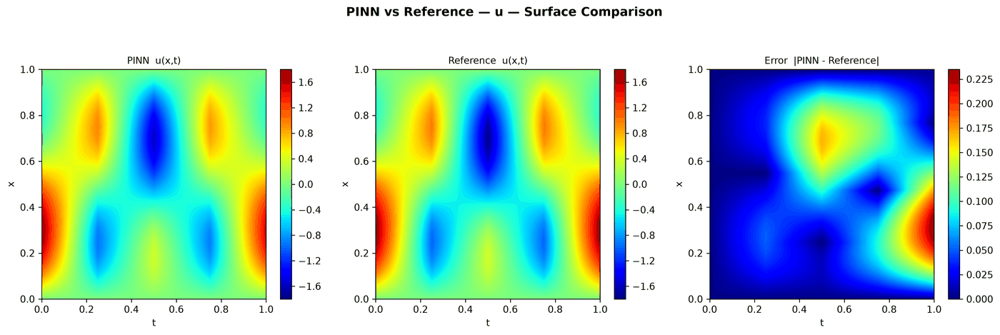

*Forward, PINNStudio best:*

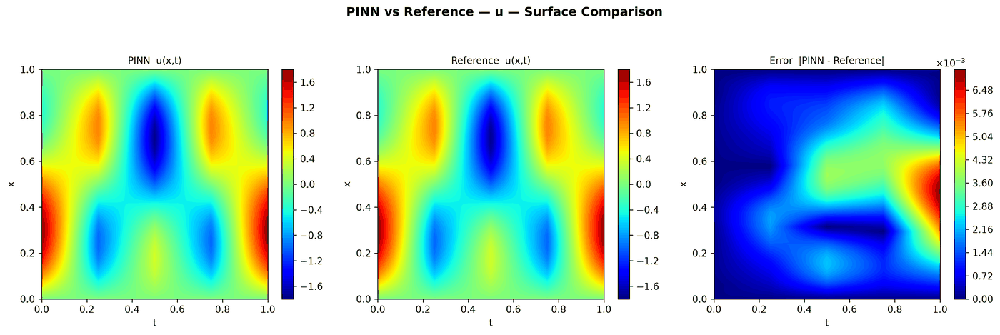

<strong>Diffusion 1D – unknown coefficient</strong> · DeepXDE example

[problem and settings in the README](../README.md#dx-inverse-diffusion-equation) · [forward runs in the tuning study](tuning_study.md#tune-diffusion-1d-unknown-coefficient)

| | DeepXDE's settings | PINNStudio best |
|---|---|---|
| Inverse $L_2$ | 6.2 × 10-3 | 2.0 × 10-4 |
| Parameters found (true) | C = 0.999553 (1) | C = 1.00017 (1) |

*Inverse, DeepXDE's settings:*

*Inverse, PINNStudio best:*

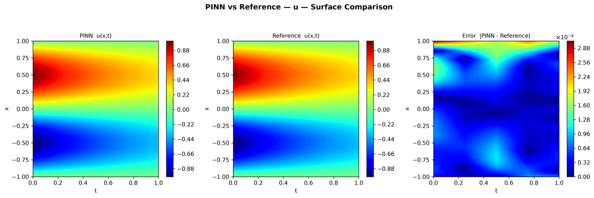

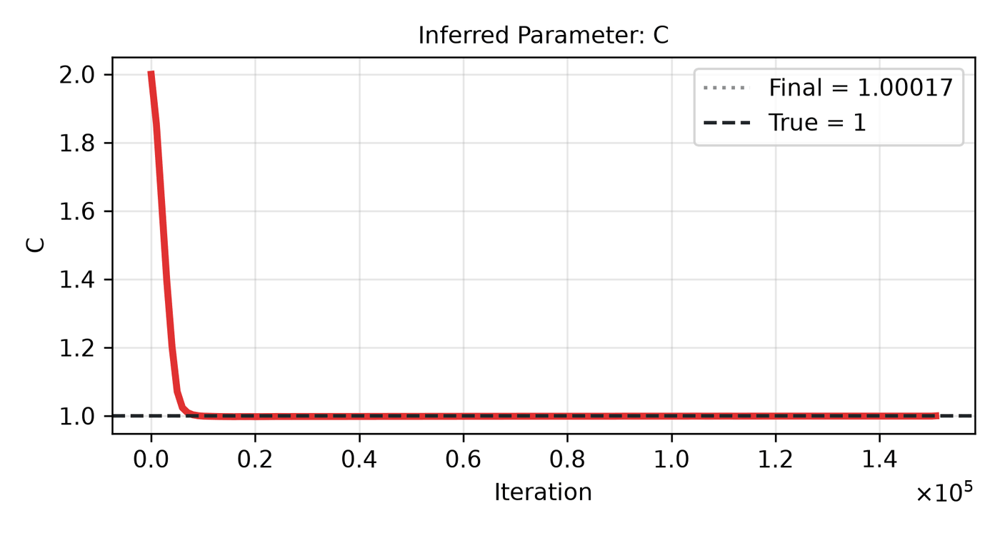

<strong>Diffusion-reaction 1D – unknown k_f, D</strong> · DeepXDE example

[problem and settings in the README](../README.md#dx-inverse-diffusion-reaction-system)

| | DeepXDE's settings | PINNStudio best |
|---|---|---|
| Inverse $L_2$ | – | – (not tuned yet) |
| Parameters found (true) | k_f = 0.0992 (0.1); D = 1.993 (2) | k_f = 0.0992 (0.1); D = 1.993 (2) |

*Inverse, the README's result:*

## 2D, steady

<strong>Fractional Poisson 2D – disk</strong> · DeepXDE example

[problem and settings in the README](../README.md#dx-fractional-poisson-equation-2d)

| | DeepXDE's settings | PINNStudio best |
|---|---|---|
| Forward $L_2$ | 1.2 × 10-3 | 1.2 × 10-3 (not tuned yet) |

*Forward, the README's result:*

<strong>Helmholtz 2D – Dirichlet</strong> · DeepXDE example

[problem and settings in the README](../README.md#dx-helmholtz-2d-dirichlet) · [inverse runs in the tuning study](tuning_study.md#tune-helmholtz-2d-dirichlet-inverse-mode)

| | DeepXDE's settings | PINNStudio best |
|---|---|---|
| Forward $L_2$ | 1.9 × 10-3 | 1.9 × 10-3 (not tuned yet) |
| Inverse $L_2$ | 3.5 × 10-4 | 8.7 × 10-5 |
| Parameters found (true) | k₀ = 12.565 (12.5664) | k₀ = 12.5669 (12.5664) |

DeepXDE's example is forward only; the inverse problem is PINNStudio's inverse mode of it, run with the example's settings and tuned.

*Forward, the README's result:*

<strong>Helmholtz 2D – hyperparameter search</strong> · DeepXDE example

[problem and settings in the README](../README.md#dx-helmholtz-2d-hyperparameter-optimization)

| | DeepXDE's settings | PINNStudio best |
|---|---|---|
| Forward $L_2$ | 1.3 × 10-3 | 1.3 × 10-3 (not tuned yet) |

<strong>Helmholtz 2D – sound-hard scattering</strong> · DeepXDE example

[problem and settings in the README](../README.md#dx-helmholtz-sound-hard-scattering-absorbing-bc) · [forward runs in the tuning study](tuning_study.md#tune-helmholtz-2d-sound-hard-scattering)

| | DeepXDE's settings | PINNStudio best |
|---|---|---|
| Forward $L_2$ | 8.0 × 10-2 | 7.7 × 10-2 |

*Forward, DeepXDE's settings:*

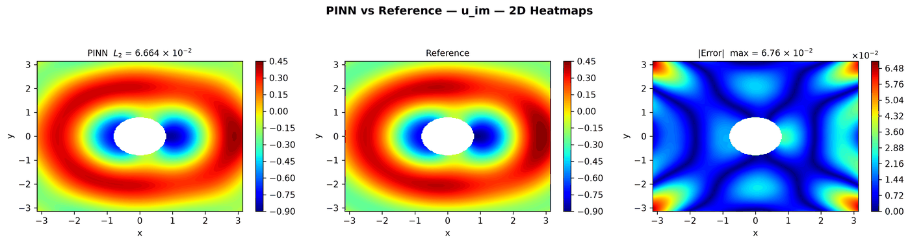

*Forward, PINNStudio best:*

<strong>Helmholtz 2D – square with hole</strong> · DeepXDE example

[problem and settings in the README](../README.md#dx-helmholtz-2d-with-a-hole) · [forward runs in the tuning study](tuning_study.md#tune-helmholtz-2d-square-with-hole)

| | DeepXDE's settings | PINNStudio best |
|---|---|---|
| Forward $L_2$ | 1.1 × 10-2 | 7.0 × 10-4 |

*Forward, DeepXDE's settings:*

*Forward, PINNStudio best:*

<strong>Laplace 2D – disk</strong> · DeepXDE example

[problem and settings in the README](../README.md#dx-laplace-equation-on-a-disk)

| | DeepXDE's settings | PINNStudio best |
|---|---|---|
| Forward $L_2$ | 1.1 × 10-3 | 1.1 × 10-3 (not tuned yet) |

*Forward, the README's result:*

<strong>Linear elasticity 2D – plate</strong> · DeepXDE example

[problem and settings in the README](../README.md#dx-linear-elastostatic-plate) · [forward runs in the tuning study](tuning_study.md#tune-linear-elasticity-2d-plate) · [inverse runs in the tuning study](tuning_study.md#tune-linear-elasticity-2d-plate-inverse-mode)

| | DeepXDE's settings | PINNStudio best |
|---|---|---|
| Forward $L_2$ | 6.7 × 10-2 | 1.3 × 10-4 |
| Inverse $L_2$ | 1.9 × 10-3 | 1.9 × 10-3 |
| Parameters found (true) | λ = 0.999744 (1); μ = 0.500088 (0.5) | λ = 0.999744 (1); μ = 0.500088 (0.5) |

DeepXDE's example is forward only; the inverse problem is PINNStudio's inverse mode of it, run with the example's settings and tuned.

*Forward, DeepXDE's settings:*

*Forward, PINNStudio best:*

<strong>Linear elasticity 2D – plate, soft BCs</strong> · DeepXDE example

[problem and settings in the README](../README.md#dx-linear-elastostatic-plate-soft-bcs)

| | DeepXDE's settings | PINNStudio best |
|---|---|---|
| Forward $L_2$ | 4.9 × 10-4 | 4.9 × 10-4 (not tuned yet) |

*Forward, the README's result:*

<strong>Navier-Stokes 2D – Kovasznay flow</strong> · DeepXDE example

[problem and settings in the README](../README.md#dx-kovasznay-flow) · [inverse runs in the tuning study](tuning_study.md#tune-navier-stokes-2d-kovasznay-flow-inverse-mode)

| | DeepXDE's settings | PINNStudio best |
|---|---|---|
| Forward $L_2$ | 2.1 × 10-4 | 2.1 × 10-4 (not tuned yet) |
| Inverse $L_2$ | 9.1 × 10-5 | 3.7 × 10-5 |
| Parameters found (true) | Re = 20.0026 (20) | Re = 19.9982 (20) |

DeepXDE's example is forward only; the inverse problem is PINNStudio's inverse mode of it, run with the example's settings and tuned.

*Forward, the README's result:*

*Inverse, DeepXDE's settings:*

*Inverse, PINNStudio best:*

<strong>Poisson 2D – disk</strong> · PINNStudio template

[problem and settings in the README](../README.md#2d-poisson-disk) · [inverse runs in the tuning study](tuning_study.md#tune-poisson-2d-disk-pinnstudio-template-inverse-mode)

| | The template's own settings | PINNStudio best |
|---|---|---|
| Forward $L_2$ | 2.8 × 10-4 | 2.8 × 10-4 (not tuned yet) |
| Inverse $L_2$ | 5.4 × 10-4 | 5.4 × 10-4 |
| Parameters found (true) | f = 1.00002 (1) | f = 1.00002 (1) |

*Forward, the README's result:*

*Inverse, the template's own settings:*

<strong>Poisson 2D – L-shape</strong> · DeepXDE example

[problem and settings in the README](../README.md#dx-poisson-over-an-l-shaped-domain) · [forward runs in the tuning study](tuning_study.md#tune-poisson-2d-l-shape)

| | DeepXDE's settings | PINNStudio best |
|---|---|---|
| Forward $L_2$ | 3.5 × 10-2 | 2.3 × 10-2 |

*Forward, DeepXDE's settings:*

*Forward, PINNStudio best:*

<strong>Fractional Poisson 2D – unknown order α</strong> · DeepXDE example

[problem and settings in the README](../README.md#dx-inverse-fractional-poisson-equation-2d)

| | DeepXDE's settings | PINNStudio best |
|---|---|---|
| Inverse $L_2$ | 2.3 × 10-3 | 2.3 × 10-3 (not tuned yet) |
| Parameters found (true) | α = 1.80445 (1.8) | α = 1.80445 (1.8) |

*Inverse, the README's result:*

## 2D, time-dependent

<strong>Allen-Cahn 2D – Wight & Zhao</strong> · PINNStudio template, after Wight & Zhao (2021)

[problem and settings in the README](../README.md#2d-allen-cahn-wight--zhao) · [forward runs in the tuning study](tuning_study.md#tune-allen-cahn-2d-wight-zhao-pinnstudio-template) · [forward runs in the tuning study](tuning_study.md#tune-allen-cahn-2d-wight-zhao-pinnstudio-template-best-setup) · [inverse runs in the tuning study](tuning_study.md#tune-allen-cahn-2d-wight-zhao-pinnstudio-template-inverse-mode)

| | $L_2$, last time | $L_2$, all times | Parameters found (true) |
|---|---|---|---|
| Plain PINN (in PINNStudio) | – | – | |
| Wight & Zhao's method: reported in Wight & Zhao (2021), Fig. 3.8 | – | figures only | |
| Wight & Zhao's method, run in PINNStudio | – | – | |
| The template as it loads | 7.9 × 10-3 | – | |
| **PINNStudio best** (forward) | 1.6 × 10-3 | – | |
| Inverse, the template's own settings | 3.1 × 10-4 | – | λ = 9.54428 (10); λε² = 0.00598505 (0.00625) |
| **PINNStudio best** (inverse) | 3.1 × 10-4 | – | λ = 9.54428 (10); λε² = 0.00598505 (0.00625) |

*The plain PINN and the paper's method are queued on the GPU; their rows fill in as they finish.*

*Forward, the template's own settings:*

*Forward, PINNStudio best:*

*Inverse, the template's own settings:*

<strong>Allen-Cahn 2D – Mattey & Ghosh</strong> · PINNStudio template, after Mattey & Ghosh (2022)

[problem and settings in the README](../README.md#2d-allen-cahn-mattey--ghosh) · [forward runs in the tuning study](tuning_study.md#tune-allen-cahn-2d-mattey-ghosh-pinnstudio-template-best-setup) · [inverse runs in the tuning study](tuning_study.md#tune-allen-cahn-2d-mattey-ghosh-pinnstudio-template-inverse-mode)

| | $L_2$, last time | $L_2$, all times | Parameters found (true) |
|---|---|---|---|
| Plain PINN (in PINNStudio) | – | – | |
| Mattey & Ghosh's bc-PINN: reported in Mattey & Ghosh (2022), Sec. 6.1.1 | – | 2.5 × 10-2 | |
| Mattey & Ghosh's bc-PINN, run in PINNStudio | – | – | |
| The template as it loads | 6.6 × 10-3 | – | |
| **PINNStudio best** (forward) | 3.6 × 10-4 | – | |
| Inverse, the template's own settings | 8.9 × 10-4 | – | c₁² = 0.000105791 (0.0001); c₂ = 1.00367 (1) |
| **PINNStudio best** (inverse) | 8.9 × 10-4 | – | c₁² = 0.000105791 (0.0001); c₂ = 1.00367 (1) |

*The plain PINN and the paper's method are queued on the GPU; their rows fill in as they finish.*

*Forward, the README's result:*

*Forward, PINNStudio best:*

*Inverse, the template's own settings:*

<strong>Cahn-Hilliard 2D – Wight & Zhao</strong> · PINNStudio template, after Wight & Zhao (2021)

[problem and settings in the README](../README.md#2d-cahn-hilliard-wight--zhao) · [forward runs in the tuning study](tuning_study.md#tune-cahn-hilliard-2d-wight-zhao-pinnstudio-template) · [inverse runs in the tuning study](tuning_study.md#tune-cahn-hilliard-2d-wight-zhao-pinnstudio-template-inverse-mode)

| | $L_2$, last time | $L_2$, all times | Parameters found (true) |
|---|---|---|---|
| Plain PINN (in PINNStudio) | – | – | |
| Wight & Zhao's method: reported in Wight & Zhao (2021), Fig. 3.13 | – | figures only | |
| Wight & Zhao's method, run in PINNStudio | – | – | |
| The template as it loads | 1.1 × 10-2 | – | |
| **PINNStudio best** (forward) | 8.0 × 10-3 | – | |
| Inverse, the template's own settings | 6.9 × 10-5 | – | ε² = 0.00251042 (0.0025) |
| **PINNStudio best** (inverse) | 6.9 × 10-5 | – | ε² = 0.00251042 (0.0025) |

*The plain PINN and the paper's method are queued on the GPU; their rows fill in as they finish.*

*Forward, the template's own settings:*

*Forward, PINNStudio best:*

*Inverse, the template's own settings:*

<strong>Cahn-Hilliard 2D – Mattey & Ghosh</strong> · PINNStudio template, after Mattey & Ghosh (2022)

[problem and settings in the README](../README.md#2d-cahn-hilliard-mattey--ghosh)

| | $L_2$, last time | $L_2$, all times | Parameters found (true) |
|---|---|---|---|
| Plain PINN (in PINNStudio) | – | – | |
| Mattey & Ghosh's bc-PINN: reported in Mattey & Ghosh (2022), Sec. 6.2.1 | – | figures only | |
| Mattey & Ghosh's bc-PINN, run in PINNStudio | – | – | |
| The template as it loads | 2.0 × 10-3 | – | |
| **PINNStudio best** (forward) | 2.0 × 10-3 | – | |
| Inverse, the template's own settings | – | – | α = 0.000188 (0.0002); κ = 1.012 (1) |
| **PINNStudio best** (inverse) | – | – | α = 0.000188 (0.0002); κ = 1.012 (1) |

*The plain PINN and the paper's method are queued on the GPU; their rows fill in as they finish.*

*Forward, the README's result:*

*Inverse, the README's result:*

<strong>Burgers 2D – Mathias et al.</strong> · PINNStudio template, after Mathias et al. (2022)

[problem and settings in the README](../README.md#2d-burgers-mathias) · [forward runs in the tuning study](tuning_study.md#tune-burgers-2d-mathias-et-al-pinnstudio-template) · [inverse runs in the tuning study](tuning_study.md#tune-burgers-2d-mathias-et-al-pinnstudio-template-inverse-mode)

| | $L_2$, last time | $L_2$, all times | Parameters found (true) |
|---|---|---|---|
| Plain PINN (in PINNStudio) | – | – | |
| Mathias et al.'s settings: reported in Mathias et al. (2022) | – | figures only | |
| Mathias et al.'s settings, run in PINNStudio | – | – | |
| The template as it loads | 1.1 × 10-2 | – | |
| **PINNStudio best** (forward) | 8.4 × 10-3 | – | |
| Inverse, the template's own settings | 3.5 × 10-3 | – | ν = 0.00341319 (0.0031831) |
| **PINNStudio best** (inverse) | 3.5 × 10-3 | – | ν = 0.00341319 (0.0031831) |

*The plain PINN and the paper's method are queued on the GPU; their rows fill in as they finish.*

*Forward, the template's own settings:*

*Forward, PINNStudio best:*

*Inverse, the template's own settings:*

<strong>Heat 2D</strong> · PINNStudio template

[problem and settings in the README](../README.md#2d-heat) · [inverse runs in the tuning study](tuning_study.md#tune-heat-2d-pinnstudio-template-inverse-mode)

| | The template's own settings | PINNStudio best |
|---|---|---|
| Forward $L_2$ | 3.9 × 10-3 | 3.9 × 10-3 (not tuned yet) |
| Inverse $L_2$ | 5.8 × 10-4 | 5.8 × 10-4 |
| Parameters found (true) | α = 0.399893 (0.4) | α = 0.399893 (0.4) |

*Forward, the README's result:*

*Inverse, the template's own settings:*

## 3D

<strong>Fractional Poisson 3D – sphere</strong> · DeepXDE example

[problem and settings in the README](../README.md#dx-fractional-poisson-equation-3d)

| | DeepXDE's settings | PINNStudio best |
|---|---|---|
| Forward $L_2$ | 6.7 × 10-3 | 6.7 × 10-3 (not tuned yet) |

*Forward, the README's result:*

<strong>Poisson 3D – sphere</strong> · PINNStudio template

[problem and settings in the README](../README.md#3d-poisson-sphere)

| | The template's own settings | PINNStudio best |
|---|---|---|
| Forward $L_2$ | 1.5 × 10-3 | 1.5 × 10-3 (not tuned yet) |
| Inverse $L_2$ | 1.4 × 10-3 | 1.4 × 10-3 (not tuned yet) |
| Parameters found (true) | f = 1.00005 (1) | f = 1.00005 (1) |

*Forward, the README's result:*

*Inverse, the README's result:*

<strong>Allen-Cahn 3D – Wight & Zhao</strong> · PINNStudio template, after Wight & Zhao (2021)

[problem and settings in the README](../README.md#3d-allen-cahn-wight--zhao) · [inverse runs in the tuning study](tuning_study.md#tune-allen-cahn-3d-wight-zhao-pinnstudio-template-inverse-mode)

| | $L_2$, last time | $L_2$, all times | Parameters found (true) |
|---|---|---|---|
| Plain PINN (in PINNStudio) | – | – | |
| Wight & Zhao's method: reported in Wight & Zhao (2021), Fig. 3.9 | – | figures only | |
| Wight & Zhao's method, run in PINNStudio | – | – | |
| The template as it loads | 2.7 × 10-4 | – | |
| **PINNStudio best** (forward) | 2.7 × 10-4 | – | |
| Inverse, the template's own settings | 9.7 × 10-5 | – | λ = 9.96899 (10); λε² = 0.0249817 (0.025) |
| **PINNStudio best** (inverse) | 9.7 × 10-5 | – | λ = 9.96899 (10); λε² = 0.0249817 (0.025) |

*The plain PINN and the paper's method are queued on the GPU; their rows fill in as they finish.*

*Forward, the README's result:*

*Inverse, the template's own settings:*

<strong>Heat 3D</strong> · PINNStudio template

[problem and settings in the README](../README.md#3d-heat) · [inverse runs in the tuning study](tuning_study.md#tune-heat-3d-pinnstudio-template-inverse-mode)

| | The template's own settings | PINNStudio best |
|---|---|---|
| Forward $L_2$ | 2.6 × 10-3 | 2.6 × 10-3 (not tuned yet) |
| Inverse $L_2$ | 1.3 × 10-3 | 1.3 × 10-3 |
| Parameters found (true) | α = 0.400303 (0.4) | α = 0.400303 (0.4) |

*Forward, the README's result:*

*Inverse, the template's own settings:*

<strong>Navier-Stokes 3D – Beltrami flow</strong> · DeepXDE example

[problem and settings in the README](../README.md#dx-beltrami-flow) · [inverse runs in the tuning study](tuning_study.md#tune-navier-stokes-3d-beltrami-flow-inverse-mode)

| | DeepXDE's settings | PINNStudio best |
|---|---|---|
| Forward $L_2$ | 1.4 × 10-3 | 1.4 × 10-3 (not tuned yet) |
| Inverse $L_2$ | 3.5 × 10-4 | 2.2 × 10-4 |
| Parameters found (true) | ν = 0.997797 (1) | ν = 0.998003 (1) |

DeepXDE's example is forward only; the inverse problem is PINNStudio's inverse mode of it, run with the example's settings and tuned.

*Forward, the README's result:*

*Inverse, DeepXDE's settings:*

*Inverse, PINNStudio best:*

---

Written by [`tools/make_benchmarks_readme.py`](../tools/make_benchmarks_readme.py) from the runs of [`tools/tuning_study.py`](../tools/tuning_study.py).
