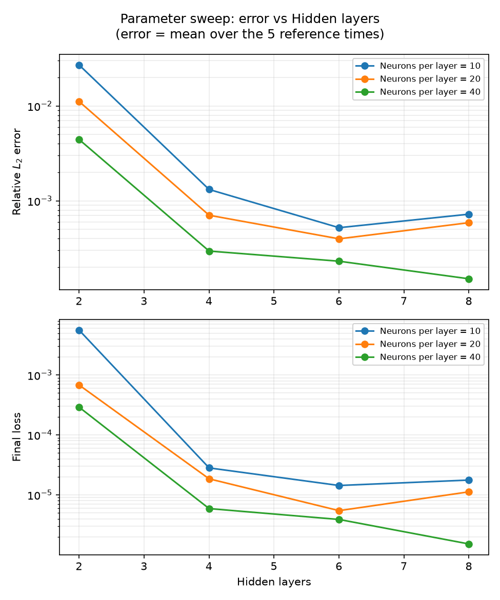

# Parameter sweep example: network size for Burgers 1D

*A worked Parameter Sweep, kept as a record. It was the README's sweep example (run 2026-10-14, commit 2eba67a, on
an RTX 4090) and moved here when the README's long sections were retired. The documentation's
[Parameter sweeps](https://asfandyarkhan72.github.io/PINNStudio/guide/sweeps/) page describes how to set up a
sweep like it.*

**The sweep.** *Burgers 1D – Raissi et al.*, **All combinations**, **Network: Hidden layers** over 2, 4, 6, 8 and
**Network: Neurons per layer** over 10, 20, 40: the same study as Table 1 of Raissi et al. (2019). Everything else
was the template's own settings at the time: Adam 15,000 + L-BFGS 10,000 iterations, 8,000 collocation points.
The 12 runs took about 17 minutes on an RTX 4090.

These are not the settings the example loads now: since then *Settings: Default* of this template is the paper's
method (L-BFGS 50,000 iterations, 10,000 domain points; see the example's entry in
[examples.md](examples.md#1d-burgers)). A sweep from today's Default would give different numbers.

Relative $L_2$ error (mean over the five reference times) from `sweep_summary.csv`:

| Hidden layers | 10 neurons | 20 neurons | 40 neurons |
|---|---|---|---|
| 2 | 2.7 × 10⁻² | 1.1 × 10⁻² | 4.4 × 10⁻³ |
| 4 | 1.3 × 10⁻³ | 7.0 × 10⁻⁴ | 3.0 × 10⁻⁴ |
| 6 | 5.2 × 10⁻⁴ | 4.0 × 10⁻⁴ | 2.3 × 10⁻⁴ |
| 8 | 7.2 × 10⁻⁴ | 5.9 × 10⁻⁴ | 1.5 × 10⁻⁴ |

Two hidden layers are too few for the shock at $x = 0$; at four layers the error is 15–21× lower, and 40 neurons
per layer gives the lowest error at every depth, down to 1.5 × 10⁻⁴ at eight layers. With 10 or 20 neurons, eight
layers is slightly worse than six. Comparing the 40-neuron runs in *History* shows where the difference comes from:
two layers stall during Adam and never reach the others' loss, while four to eight layers follow nearly the same
curve and differ mostly after L-BFGS. (Raissi et al. trained with L-BFGS only and 10,000 collocation points, so
their numbers differ; the trend is the same.)
