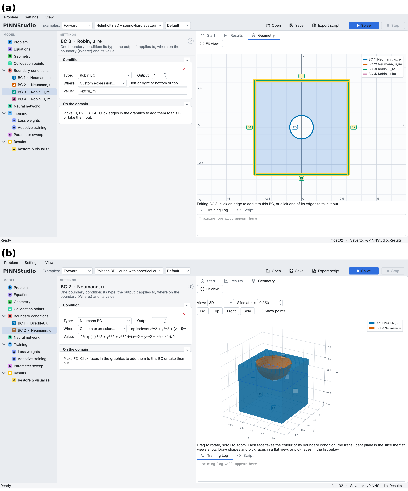
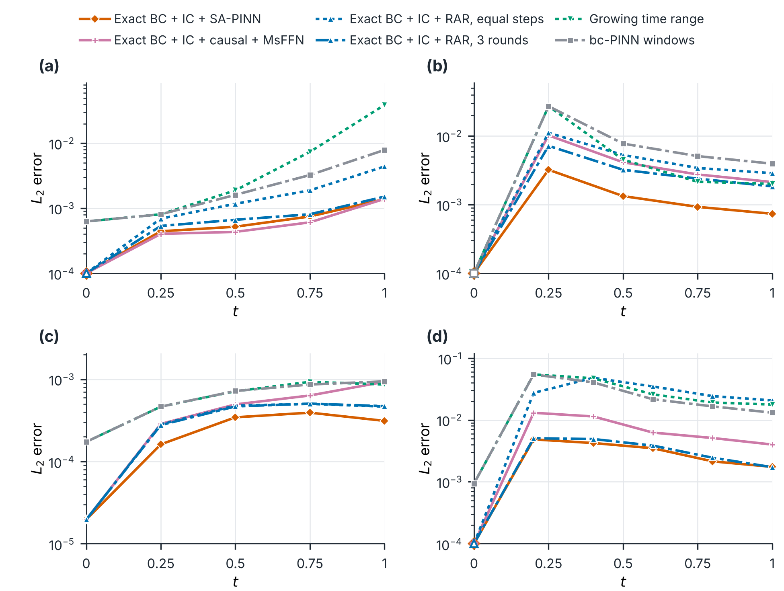
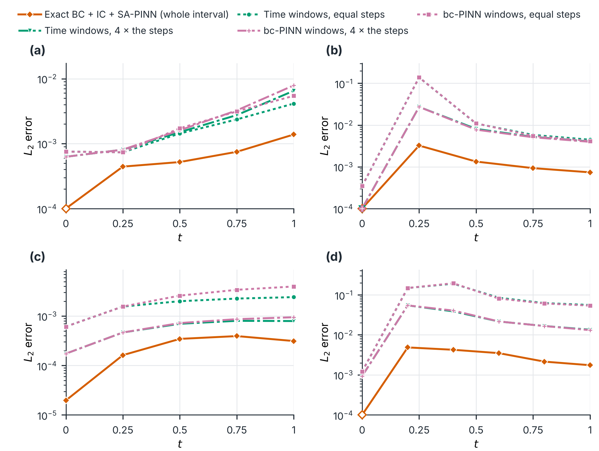
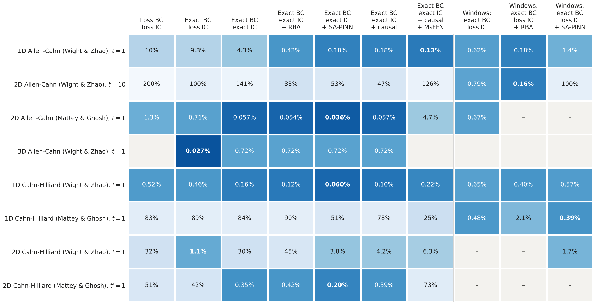
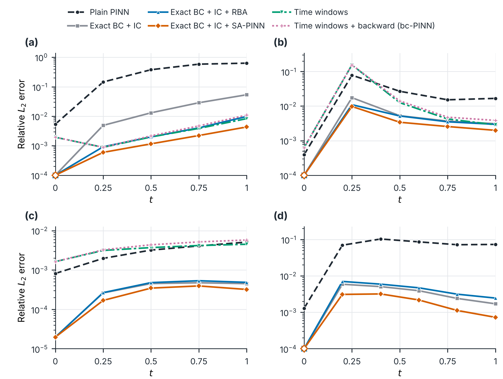
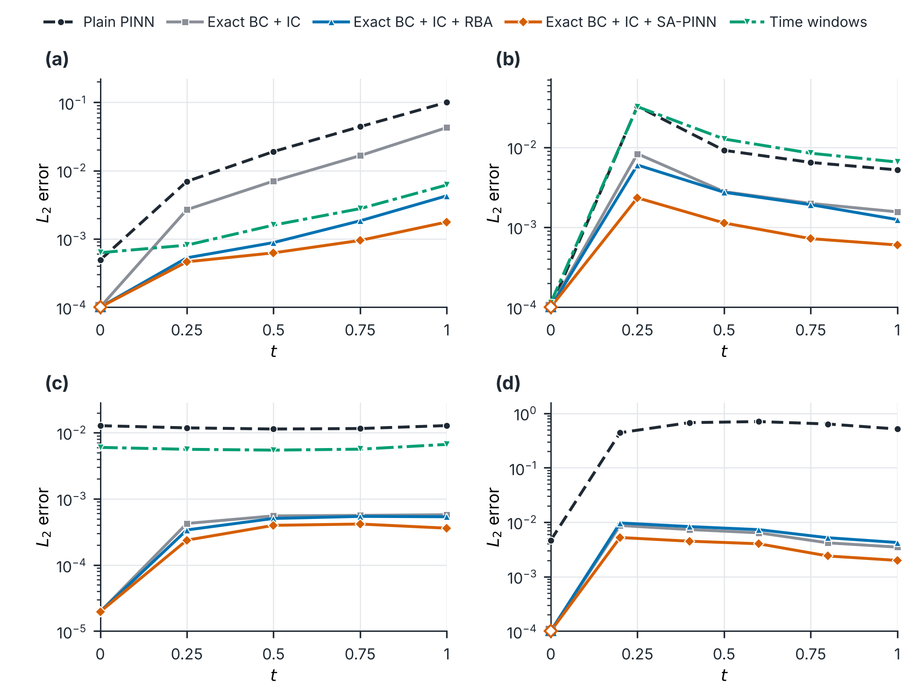

# PINNStudio paper — figures, tables and text

*Everything the paper uses, in the order of the paper. Each item has a short box (what it shows, how it was run, the data and scripts, its status) above the figure or table, its caption and a draft of the text. Generated by `tools/make_benchmarks_readme.py` from the same runs as the [benchmarks page](README.md); the studies themselves are written up for users in [tuning_study.md](tuning_study.md), [training_methods.md](training_methods.md), [paper_comparison.md](paper_comparison.md) and [performance.md](performance.md).*

| Paper item | Status |
|---|---|
| [Section 3.3 — geometry and boundary conditions (Figure 3)](#section-33--geometry-and-boundary-conditions-figure-3) | done (the 3D example's training runs are queued) |
| [Section 4.2 — accuracy on 25 representative problems (Figure 4)](#section-42--accuracy-on-25-representative-problems-figure-4) | done; the seed repeats for the Figure 4 medians and range bars are queued |
| [Forward examples in 1D, 2D and 3D (Figure 5)](#forward-examples-in-1d-2d-and-3d-figure-5) | done |
| [Inverse examples in 1D, 2D and 3D (Figure 6)](#inverse-examples-in-1d-2d-and-3d-figure-6) | done |
| [Section 4.5 — the published methods run in PINNStudio (table)](#section-45--the-published-methods-run-in-pinnstudio-table) | done (all 11 rows) |
| [Section 4.5 — training techniques on phase-field problems (Figure 7)](#section-45--training-techniques-on-phase-field-problems-figure-7) | main figure done; 51 of 52 runs done; missing: equal-compute bc-PINN on (d) (queued again: out of GPU memory) |
| [Supplementary Table S2 — every forward problem, each output](#supplementary-table-s2--every-forward-problem-each-output) | done |
| [Section 4.3 — the exported script trains the same model](#section-43--the-exported-script-trains-the-same-model) | done (91 checked: 84 identical, 3 skipped, 4 inverse problems differ only in the 6th digit of a parameter; 2 bugs found, fixed and checked again) |
| [Section 5 — performance (Tables 5, 6 and S3)](#section-5--performance-tables-5-6-and-s3) | done |

## Section 3.3 — geometry and boundary conditions (Figure 3)

| | |
|---|---|
| **What it shows** | how a domain is built from primitives and how boundary conditions are assigned to parts of its boundary, on two of the configured examples: a 2D domain with a hole and a 3D domain with a spherical cut-out |
| **How it was made** | each example loaded from the Examples list as it ships, one boundary condition selected in the model tree (its edges or faces are highlighted and its settings shown), the PINNStudio window drawn at twice the screen resolution; (a) above (b) so the window stays readable at full page width |
| **For users** | [README → Geometry](../README.md#problem-setup), the examples [Helmholtz 2D – sound-hard scattering](../README.md#dx-helmholtz-sound-hard-scattering-absorbing-bc) and [Poisson 3D – cube with spherical cut-out](README.md#bench-poisson-3d-cube-with-spherical-cut-out) |
| **Data and scripts** | `tools/make_geometry_figure.py` (writes `figures/paper_geometry.png` and `.pdf`); the examples are defined in `pinnstudio/core/deepxde_examples.py` and `pinnstudio/core/pinnstudio_examples.py` |
| **Status** | done; the 3D example's training runs (its own settings and the tuning study's changes) are queued on the GPU machine |

📄 <em>Figure 3 for the paper — geometry and boundary selection</em>

> **Figure 3.** Geometry definition and boundary selection in PINNStudio, shown for two of the configured examples. (a) Helmholtz 2D – sound-hard scattering: a square with a circular hole, built by subtracting a disk from a rectangle. The selected boundary condition (BC 3, a Robin condition on $u_{re}$) is assigned to the four outer edges E1–E4 (highlighted) through the named sides *left*, *right*, *bottom* and *top*; the Neumann conditions on the hole (E5) use a coordinate expression. (b) Poisson 3D – cube with spherical cut-out: a cube with a sphere subtracted, shown in the interactive 3D view. The selected boundary condition (BC 2, a Neumann condition) is assigned to the spherical surface (face F7, orange) through a coordinate expression, and BC 1 (Dirichlet) to the faces of the cube (blue). In both panels the settings of the selected condition are shown in the middle, and every edge or face takes the colour of its condition.

**The two examples.**

- *(a) Helmholtz 2D – sound-hard scattering* (DeepXDE's example `Helmholtz_Sound_hard_ABC_2d.py`): the scattered field of a plane wave around a sound-hard disk, with two outputs, the real and imaginary parts $u_{re}$ and $u_{im}$. Domain $[-\pi, \pi]^2$ minus the disk of radius $\pi/4$. Four boundary conditions, one per field and boundary part: Neumann on the hole for each part (BC 1, 2) and the first-order absorbing (Robin) condition on the outer square (BC 3, 4). It shows conditions set per solution field and both ways of choosing a boundary part, a named selection and a coordinate expression.
- *(b) Poisson 3D – cube with spherical cut-out* (a PINNStudio template): $-\nabla^2 u = (6 - 4r^2)\,e^{-r^2}$, $r^2 = x^2 + y^2 + z^2$, in the cube $[-1, 1]^3$ minus the sphere of radius 0.7 centred at $(0, 0, 1)$, with the exact solution $u = e^{-r^2}$. BC 1 sets $u$ on the cube's faces (Dirichlet, named sides) and BC 2 its normal derivative on the spherical surface (Neumann, a coordinate expression); Error Analysis compares against the exact solution.

**What to write in the paper (Section 3.3)** — a suggested change to the last sentence of the first paragraph and to the caption, so both say that the panels are configured examples:

> Figure 3 illustrates these tools for two of the configured examples: a two-dimensional domain with a circular hole and a three-dimensional domain with a spherical cut-out, each built from geometric primitives and shown with one of its boundary conditions selected.

## Section 4.2 — accuracy on 25 representative problems (Figure 4)

| | |
|---|---|
| **What it shows** | the relative L₂ error of 25 forward problems and the parameter error of their inverse versions, with the starting settings (DeepXDE's example or the paper's method) and PINNStudio's tuned settings |
| **How it was run** | every example with its starting settings and with the changes of the tuning study, seed 2026 (3 seeds for the close calls), one RTX 4090; *tuned* = lowest error, the fastest within 25% ([tuning_study.md](tuning_study.md)) |
| **Data and scripts** | `tools/make_benchmarks_readme.py` (figure and table), [`paper_figure_examples.txt`](paper_figure_examples.txt) (the 25 names), `tools/tuning_study.py` (runs) |
| **Status** | done; the seed repeats for the Figure 4 medians and range bars are queued |

📄 <em>Figure for the paper — 25 examples</em>

**Why these examples.** The full figure has 64 examples, which is too many for one page in a paper, so this one keeps one example of each kind of problem. They go from ODEs to 1D, 2D and 3D, and in each dimension from steady to time-dependent problems. Together they cover the main equation types: elliptic (Poisson, Helmholtz, linear elasticity), parabolic (heat, diffusion-reaction, Black-Scholes), hyperbolic and dispersive (wave, Klein-Gordon, Schrödinger), nonlinear flow (Burgers, Navier-Stokes in 2D and 3D), stiff phase-field equations (Allen-Cahn, and the fourth-order Cahn-Hilliard), and the less common fractional and integro-differential operators. Most of them (18 of the 25) have both a forward and an inverse problem, so one row shows both modes. A few are forward only (the integro-differential ODE, Poisson 1D, Cahn-Hilliard 1D, Black-Scholes), and Lorenz, the unknown forcing field and the fractional order α are inverse problems only. The set mixes DeepXDE's examples with templates taken from papers (Raissi et al.; Wight & Zhao; Mattey & Ghosh; Mathias et al.). The left panel shows the forward problems only: PINNStudio's tuned settings and the starting settings (DeepXDE's example, or the paper's method run in PINNStudio). Templates with no outside starting point have a filled point only. Inverse problems are judged by their parameter error (right panel), not by their L₂, because an inverse run trains on measured values of the solution (in most examples at every reference time), so its L₂ is largely a fit to that data rather than a prediction (it is still in the tables, as "L₂ fit to measured data"). The unknown forcing field is a function, not a number, so its row shows the relative L₂ error of the recovered field $q(x)$ instead.

**No reported errors in this figure.** The errors the original papers report are left out here: they come from other networks, point counts and training, and some are over all times while this axis is the last reference time, so next to PINNStudio's points they would read as like-for-like when they are not. They stay in the tables of each example ("as reported" rows, with the source and its setup) and in the full figure.

**In numbers (these 25).** 22 forward problems: median relative L₂ error 5.2 × 10-4 with the tuned settings, 21 below 10⁻² and 13 below 10⁻³. Of the 20 with an outside starting point (DeepXDE's example or the paper's method), tuning lowered the error by more than 25% in 12, by a median factor of 21.4 in those (median over all 20: 5.4). 20 inverse problems with scalar parameters: median worst parameter error 0.051%, 19 below 1%.

**All 64 examples.** 52 forward problems: median relative L₂ error 1.3 × 10-3 with the tuned settings, 47 below 10⁻² and 23 below 10⁻³. Of the 48 with an outside starting point (DeepXDE's example or the paper's method), tuning lowered the error by more than 25% in 21, by a median factor of 14.8 in those (median over all 48: 1.0). 32 inverse problems with scalar parameters: median worst parameter error 0.09%, 29 below 1%.

**How "tuned" was chosen.** The tuned settings are the run of the recorded tuning study (and, for the paper templates, of the paper-method and training-methods runs) with the lowest error against the reference (the fastest one where several are within 25% of it); the tuning study's own pages also show which run the final training loss alone would pick. They are shipped as the *Tuned* presets, so each point can be reloaded and run again.

**For Word.** The figure is drawn at its printed size, 6.5 × 7.5 in (the text width of a Word page with 1 in margins), with 8.5–9 pt text, so insert it at 100% and it leaves about 1.5 in for the caption on the same page. The PDF keeps it sharp at any zoom. A caption to start from:

> *PINNStudio on 25 representative forward and inverse problems, from ODEs to 3D PDEs. Left: relative L₂ error of the main output of each forward problem at its last reference time, with the starting settings (open circles: the DeepXDE example, or the original paper's method run in PINNStudio) and the settings selected in the PINNStudio tuning study (filled circles); a ring marks cases where the starting settings were kept. Right: relative error (%) of each parameter identified in the inverse problems, labelled with its symbol, and of the recovered field for the unknown-forcing problem. Full results, settings and the sources of the benchmark problems are in the software repository.*

*The list: [`paper_figure_examples.txt`](paper_figure_examples.txt) (one name per line; change a line to swap an example). PDF: [`figures/paper_figure.pdf`](figures/paper_figure.pdf).*

**The values in the figure.** Relative L₂ at the last reference time. *Starting settings* is given only where there is an outside starting point (DeepXDE's example or the paper's method run in PINNStudio). Where a setting was run with more than one seed, the value is the median with the range in brackets, and *Runs* gives the number of seeds.

| Example | Forward: starting settings, L₂ | Forward: PINNStudio tuned, L₂ | Runs | Inverse: parameters found (true) | Inverse: worst parameter error | Runs |
|---|---|---|---|---|---|---|
| Lotka-Volterra ODE | 2.1 × 10-3 | **2.1 × 10-3** | 1 | a = 2.00001 (2); d = 1.06 (1.06) | **0.0005%** | 1 |
| Lorenz ODE | – | **–** | – | C₁ = 10 (10); C₂ = 14.9998 (15); C₃ = 2.66664 (2.66667) | **0.0013%** | 1 |
| Integro-differential ODE | 1.5 × 10-4 | **1.5 × 10-4** | 1 | – | **–** | – |
| Euler beam 1D | 3.5 × 10-3 | **2.4 × 10-4** | 1 | EI = 1.00075 (1) | **0.075%** | 1 |
| Poisson 1D – Dirichlet/Periodic | 9.6 × 10-3 | **6.4 × 10-6 (3.2 × 10-6 – 8.8 × 10-6)** | 3 | – | **–** | – |
| Poisson 1D – unknown forcing | – | **–** | – | field q(x) (relative L₂) | **1.2%** | 3 |
| Fractional Poisson 1D | – | **–** | – | α = 1.79183 (1.8) | **0.45%** | 1 |
| Burgers 1D – Raissi et al. | 3.3 × 10-4 | **3.3 × 10-4** | 1 | λ₁ = 0.999937 (1); λ₂ = 0.0100099 (0.01) | **0.099%** | 1 |
| Allen-Cahn 1D – Wight & Zhao | 2.4 × 10-3 | **6.3 × 10-4** | 1 | γ₁ = 9.95326e-05 (0.0001); γ₂ = 4.99994 (5) | **0.47%** | 1 |
| Cahn-Hilliard 1D – Wight & Zhao | 8.6 × 10-3 | **6.0 × 10-4** | 1 | – | **–** | – |
| Schrödinger 1D | 1.8 × 10-3 | **1.8 × 10-3** | 1 | c = 0.500036 (0.5) | **0.0072%** | 1 |
| Klein-Gordon 1D | 6.9 × 10-2 | **2.3 × 10-3 (1.7 × 10-3 – 2.5 × 10-3)** | 3 | γ = 1.00912 (1) | **0.91%** | 1 |
| Wave 1D – multi-scale Fourier features | 3.0 × 10-1 | **1.5 × 10-3 (1.2 × 10-3 – 4.2 × 10-3)** | 3 | C = 10 (10) | **0%** | 1 |
| Diffusion-reaction 1D | 8.8 × 10-2 | **8.5 × 10-5 (6.1 × 10-5 – 9.0 × 10-5)** | 3 | D = 0.999773 (1) | **0.023%** | 1 |
| Black-Scholes 1D | 4.3 × 10-4 | **4.3 × 10-4** | 1 | – | **–** | – |
| Helmholtz 2D – Dirichlet | 1.9 × 10-3 | **1.9 × 10-3** | 1 | k₀ = 12.5664 (12.5664) | **0.00023%** | 1 |
| Linear elasticity 2D | 6.7 × 10-2 | **1.3 × 10-4 (1.3 × 10-4 – 1.3 × 10-4)** | 3 | λ = 0.999744 (1); μ = 0.500088 (0.5) | **0.026%** | 1 |
| Navier-Stokes 2D – Kovasznay | 2.1 × 10-4 | **2.1 × 10-4** | 1 | Re = 19.9978 (20) | **0.011%** | 1 |
| Poisson 2D – disk | – | **2.8 × 10-4** | 1 | f = 1.00002 (1) | **0.002%** | 1 |
| Allen-Cahn 2D – Mattey & Ghosh | 2.5 × 10-3 | **3.6 × 10-4** | 1 | c₁² = 0.000102452 (0.0001); c₂ = 1.00025 (1) | **2.5%** | 1 |
| Cahn-Hilliard 2D – Wight & Zhao | 2.4 × 10-1 | **1.1 × 10-2** | 1 | ε² = 0.00251042 (0.0025) | **0.42%** | 1 |
| Burgers 2D – Mathias et al. | 1.7 × 10-1 | **8.4 × 10-3** | 1 | ν = 0.00320066 (0.0031831) | **0.55%** | 1 |
| Heat 2D | – | **3.9 × 10-3** | 1 | α = 0.399893 (0.4) | **0.027%** | 1 |
| Allen-Cahn 3D – Wight & Zhao | 4.6 × 10-4 | **1.9 × 10-4** | 1 | λ = 9.96899 (10); λε² = 0.0249817 (0.025) | **0.31%** | 1 |
| Navier-Stokes 3D – Beltrami | 1.4 × 10-3 | **1.4 × 10-3** | 1 | ν = 0.998842 (1) | **0.12%** | 1 |

## Forward examples in 1D, 2D and 3D (Figure 5)

| | |
|---|---|
| **What it shows** | three forward problems, one per dimension: PINNStudio's solution, the reference and the error |
| **How it was run** | PINNStudio's best run of each problem (the same run as on the benchmarks page), drawn from its saved model |
| **Data and scripts** | `tools/make_paper_examples.py`, arrays in [`paper_examples/`](paper_examples) |
| **Status** | done |

🧪 <em>Forward examples for the paper — 1D, 2D, 3D</em>

Three forward problems, one per dimension and each from a different area: a multi-scale wave, a phase-field equation and 3D fluid flow. Each row is PINNStudio's best run of that problem (the same run as in its table below), drawn from its saved model.

**(a) Wave 1D — multi-scale Fourier features** ([DeepXDE example](README.md#bench-wave-1d-space-time-multi-scale-fourier-features), after [Wang, Wang & Perdikaris (2021)](https://arxiv.org/abs/2012.10047))

$$\frac{\partial^2 u}{\partial t^2} = C^2\frac{\partial^2 u}{\partial x^2}, \qquad x \in [0, 1],\ t \in [0, 1],\ C = 10$$

with $u(0, t) = u(1, t) = 0$, $u(x, 0) = \sin(\pi x) + \sin(2\pi x)$ and $u_t(x, 0) = 0$. The exact solution $u = \sin(\pi x)\cos(10\pi t) + \sin(2\pi x)\cos(20\pi t)$ oscillates ten and twenty times in $t$, which a plain network struggles to represent. PINNStudio: space-time multi-scale Fourier feature network 4 × 200, Adam 30,000 → L-BFGS 15,000. $L_2$ = 1.5 × 10⁻³ at $t = 1$ (median of 3 seeds) against 3.0 × 10⁻¹ with DeepXDE's settings; over the whole space-time domain (this seed) 3.3 × 10⁻³. The problem is from Wang, Wang & Perdikaris (2021), who report 9.8 × 10⁻⁴ over the whole domain with their network and adaptive (NTK) loss weights, and about 1 without the adaptive weights; PINNStudio's run uses no adaptive weights.

**(b) Allen-Cahn 2D — Mattey & Ghosh** ([PINNStudio template](README.md#bench-allen-cahn-2d-mattey-ghosh))

$$\frac{\partial h}{\partial t} = c_1^2\nabla^2 h - c_2\left(h^3 - h\right), \qquad (x, y) \in [0, 1]^2,\ t \in [0, 1],\ c_1^2 = 10^{-4},\ c_2 = 1$$

with $h(x, y, 0) = \sin(4\pi x)\cos(4\pi y)$ and periodic boundaries. PINNStudio: 4 × 128 network on periodic input features, the initial condition built into the output, self-adaptive (SA-PINN) point weights, Adam 20,000 → L-BFGS 10,000 over the whole time interval. $L_2$ = 3.4 × 10⁻⁴ over all reference times; Mattey & Ghosh report 2.5 × 10⁻² for their bc-PINN.

**(c) Navier-Stokes 3D — Beltrami flow** ([DeepXDE example](README.md#bench-navier-stokes-3d-beltrami-flow), after [Jin et al. (2021)](https://doi.org/10.1016/j.jcp.2020.109951))

$$\frac{\partial \mathbf u}{\partial t} + (\mathbf u\cdot\nabla)\mathbf u + \nabla p = \nabla^2\mathbf u, \qquad \nabla\cdot\mathbf u = 0, \qquad (x, y, z) \in [-1, 1]^3,\ t \in [0, 1]$$

with the exact Beltrami solution, e.g. $u = -\left(e^{x}\sin(y + z) + e^{z}\cos(x + y)\right)e^{-t}$, on the boundary and at $t = 0$. Four outputs $(u, v, w, p)$ from one network (4 × 50, DeepXDE's settings, already accurate). Shown: $u$ on the three visible faces of the cube at $t = 1$. Over the whole cube at $t = 1$: $L_2$ = 1.4 × 10⁻³ ($u$), 7.3 × 10⁻⁴ ($v$), 1.2 × 10⁻³ ($w$) and 2.4 × 10⁻² ($p$, which is fixed only up to a constant, so compared after removing the mean). The problem is the Beltrami test of NSFnets (Jin et al., 2021), who report 1.6 × 10⁻³ ($u$), 2.2 × 10⁻³ ($v$), 1.8 × 10⁻³ ($w$) and 8.9 × 10⁻² ($p$) at $t = 1$ for their VP-NSFnet with a 7 × 50 network (mean of five runs, Table 4). PINNStudio's single run with a 4 × 50 network is of the same order for $u$ and $w$ and lower for $v$ and $p$.

**Caption for the paper:**

> **Figure 5.** Forward problems solved with PINNStudio. (a) Wave equation in 1D, solved with a space-time multi-scale Fourier feature network: $u(x, t)$ over the whole space-time domain (relative $L_2$ error 3.3 × 10⁻³). (b) Allen-Cahn equation in 2D (Mattey & Ghosh, 2022): $h(x, y)$ at $t = 1$ (relative $L_2$ error over all reference times 3.4 × 10⁻⁴). (c) Navier-Stokes equations in 3D (Beltrami flow): the velocity component $u$ on the visible faces of the cube $[-1, 1]^3$ at $t = 1$ (relative $L_2$ error of $u$ over the cube 1.4 × 10⁻³). Left to right: the reference solution (exact for (a) and (c), numerical for (b)), PINNStudio's prediction and the absolute error between them. The reference and the prediction share a colour scale.

*PDF: [`figures/paper_forward.pdf`](figures/paper_forward.pdf). Made with [`tools/make_paper_examples.py`](../tools/make_paper_examples.py) from the saved models (the arrays are in [`paper_examples/`](paper_examples)).*

## Inverse examples in 1D, 2D and 3D (Figure 6)

| | |
|---|---|
| **What it shows** | three inverse problems, one per dimension: the solution and the learned coefficients against the true ones |
| **How it was run** | PINNStudio's best inverse run of each problem, drawn from its saved model |
| **Data and scripts** | `tools/make_paper_examples.py`, arrays in [`paper_examples/`](paper_examples) |
| **Status** | done |

🔍 <em>Inverse examples for the paper — 1D, 2D, 3D</em>

Three inverse problems, one per dimension: the classic PINN benchmark, material constants of an elastic plate, and the coefficients of a 3D phase-field equation. The unknown coefficients are trained together with the network from measured values of the solution. The second column shows the solution's error against the reference, the third how close each unknown gets to its true value during training.

**(a) Burgers 1D — Raissi et al.** ([PINNStudio template](README.md#bench-burgers-1d-raissi-et-al))

$$\frac{\partial u}{\partial t} + \lambda_1 u\frac{\partial u}{\partial x} - \frac{\lambda_2}{\pi}\frac{\partial^2 u}{\partial x^2} = 0, \qquad x \in [-1, 1],\ t \in [0, 1]$$

with $u(x, 0) = -\sin(\pi x)$ and $u(\pm 1, t) = 0$; true $\lambda_1 = 1$, $\lambda_2 = 0.01$ (initial guesses 0.1 and 1). Measured: $u$ at $t = 1$. PINNStudio: 4 × 40 network, Adam 15,000 → L-BFGS 30,000. Found $\lambda_1$ = 0.99994, $\lambda_2$ = 0.010010 (errors 0.006% and 0.099%). The solution is drawn over the whole $(x, t)$ domain, so everything before $t = 1$ is a prediction ($L_2$ = 1.1 × 10⁻³ against the exact Cole-Hopf solution).

**(b) Linear elasticity 2D — plate** ([DeepXDE example](README.md#bench-linear-elasticity-2d-plate), after [Haghighat et al. (2021)](https://arxiv.org/abs/2003.02751))

$$\frac{\partial \sigma_{xx}}{\partial x} + \frac{\partial \sigma_{xy}}{\partial y} = f_x, \quad \frac{\partial \sigma_{xy}}{\partial x} + \frac{\partial \sigma_{yy}}{\partial y} = f_y, \quad \sigma_{xx} = (\lambda + 2\mu)\varepsilon_{xx} + \lambda\varepsilon_{yy},\ \sigma_{yy} = (\lambda + 2\mu)\varepsilon_{yy} + \lambda\varepsilon_{xx},\ \sigma_{xy} = 2\mu\varepsilon_{xy}$$

on $[0, 1]^2$, with the boundary conditions built into the output and the known body force. The Lamé constants $\lambda$ (true 1, initial guess 2) and $\mu$ (true 0.5, initial guess 1) are unknown in the stress-strain law. Measured: $u_x$ and $u_y$ on a 19 × 19 grid. PINNStudio: parallel network (PFNN) 4 × 40 with five outputs, Adam 20,000 → L-BFGS 20,000. Found $\lambda$ = 0.99974, $\mu$ = 0.50009 (errors 0.026% and 0.018%). Shown: $u_x$.

**(c) Allen-Cahn 3D — Wight & Zhao** ([PINNStudio template](README.md#bench-allen-cahn-3d-wight-zhao))

$$\frac{\partial \phi}{\partial t} = \lambda\varepsilon^2\nabla^2\phi - \lambda\left(\phi^3 - \phi\right), \qquad (x, y, z) \in [0, 1]^3,\ t \in [0, 1]$$

a spherical drop (radius 0.35 at $t = 0$) shrinking in a periodic cube. Unknown: $\lambda$ (true 10) and $\lambda\varepsilon^2$ (true 0.025), both starting from 1. Measured: $\phi$ at $t = 1$ only, on every second point of the 51³ grid. PINNStudio: 4 × 128 network on periodic input features, Adam 20,000 → L-BFGS 20,000. Found $\lambda$ = 9.969, $\lambda\varepsilon^2$ = 0.02498 (errors 0.31% and 0.07%). Shown: $\phi$ at $t = 0.5$, a time with no measured data, in the cube with one corner cut away so the drop inside is visible ($L_2$ over the cube 3.7 × 10⁻⁴); the drop's radius over time follows the reference within 0.02% ([radius plot](../assets/Images/3D_AllenCahn-Wight/radius.png)).

**Caption for the paper:**

> **Figure 6.** Inverse problems solved with PINNStudio. (a) Burgers equation in 1D: $u(x, t)$, with $\lambda_1$ and $\lambda_2$ learned from $u$ measured at $t = 1$ only. (b) Linear elasticity in 2D: the displacement $u_x(x, y)$, with the Lamé constants $\lambda$ and $\mu$ learned from the measured displacements. (c) Allen-Cahn equation in 3D: $\phi$ at $t = 0.5$ in the cube $[0, 1]^3$ with one corner cut away, with $\lambda$ and $\lambda\varepsilon^2$ learned from $\phi$ measured at $t = 1$ only. Left to right: PINNStudio's prediction, its absolute error against the reference solution (exact for (a) and (b), numerical for (c)), and the relative error $|\theta - \theta^*|/|\theta^*|$ of each unknown parameter $\theta$ during training ($\theta^*$: its true value), with its final and true value. Final values: $\lambda_1$ = 0.99994 and $\lambda_2$ = 0.010010 (true 1 and 0.01); $\lambda$ = 0.99974 and $\mu$ = 0.50009 (true 1 and 0.5); $\lambda$ = 9.969 and $\lambda\varepsilon^2$ = 0.02498 (true 10 and 0.025).

*PDF: [`figures/paper_inverse.pdf`](figures/paper_inverse.pdf).*

## Section 4.5 — the published methods run in PINNStudio (table)

| | |
|---|---|
| **What it shows** | for each template taken from a paper: the paper's base PINN, the paper's own method set up in PINNStudio, the error the paper reports, and PINNStudio's tuned result |
| **How it was run** | the paper's network, points and training scheme as far as the paper states them (`pinnstudio/core/paper_settings.py`, one comment per problem with the section and table it follows), seed 2026 |
| **For users** | [paper_comparison.md](paper_comparison.md) |
| **Status** | done (all 11 rows) |

📄 <em>Table for the paper — the published methods run in PINNStudio (Section 4.5)</em>

For each template taken from a paper: the plain PINN (the template's equations with a standard network and training, no special method), the paper's own method set up in PINNStudio from the paper's description, the error the paper reports, and PINNStudio's tuned result. The error is the main output (u, h or φ); for Cahn-Hilliard the chemical potential μ is in each example's table. The papers report one error over all times, so that column is the like-for-like comparison with the reported value. Single runs, seed 2026.

| Problem | Paper's method | Base PINN, L₂ (last time) | Paper's method in PINNStudio, L₂ (last time) | Paper's method in PINNStudio, L₂ (all times) | Reported in the paper (all times) | PINNStudio tuned, L₂ (last time) |
|---|---|---|---|---|---|---|
| Allen-Cahn 1D – Wight & Zhao | Wight & Zhao's method | 7.6 × 10-1 | 4.6 × 10-2 | 2.9 × 10-2 | 2.3 × 10-2 (Wight & Zhao (2021), Table 3.1) | **6.3 × 10-4** |
| Allen-Cahn 1D – Wight & Zhao | Mattey & Ghosh's bc-PINN | 7.6 × 10-1 | 2.4 × 10-3 | 1.9 × 10-3 | 1.7 × 10-2 (Mattey & Ghosh (2022), Table 2) | **6.3 × 10-4** |
| Cahn-Hilliard 1D – Wight & Zhao | Wight & Zhao's method | 3.5 × 10-3 | 8.6 × 10-3 | 4.3 × 10-2 | 9.5 × 10-3 (Wight & Zhao (2021), Sec. 3.2) | **6.0 × 10-4** |
| Cahn-Hilliard 1D – Mattey & Ghosh | Mattey & Ghosh's bc-PINN | 1.9 × 10-3 | 5.7 × 10-3 | 5.5 × 10-3 | 1.9 × 10-2 (Mattey & Ghosh (2022), Sec. 5.2) | **5.7 × 10-3** |
| Burgers 1D – Raissi et al. | Raissi et al.'s settings | 3.3 × 10-4 | 3.3 × 10-4 | 4.0 × 10-4 | 6.7 × 10-4 (Raissi et al. (2019), Sec. 2.1) | **3.3 × 10-4** |
| Allen-Cahn 2D – Wight & Zhao | Wight & Zhao's method | 1.0 × 100 | 2.8 × 10-3 | 1.2 × 10-2 | figures only (Wight & Zhao (2021), Fig. 3.8) | **1.6 × 10-3** |
| Allen-Cahn 2D – Mattey & Ghosh | Mattey & Ghosh's bc-PINN | 2.8 × 10-2 | 2.5 × 10-3 | 1.8 × 10-3 | 2.5 × 10-2 (Mattey & Ghosh (2022), Sec. 6.1.1) | **3.6 × 10-4** |
| Cahn-Hilliard 2D – Wight & Zhao | Wight & Zhao's method | 1.1 × 10-1 | 2.4 × 10-1 | 7.5 × 10-1 | figures only (Wight & Zhao (2021), Fig. 3.13) | **1.1 × 10-2** |
| Cahn-Hilliard 2D – Mattey & Ghosh | Mattey & Ghosh's bc-PINN | 8.2 × 10-2 | 2.0 × 10-2 | 1.9 × 10-2 | figures only (Mattey & Ghosh (2022), Sec. 6.2.1) | **1.1 × 10-3** |
| Burgers 2D – Mathias et al. | Mathias et al.'s settings | 1.6 × 10-1 | 1.7 × 10-1 | 1.8 × 10-1 | figures only (Mathias et al. (2022)) | **8.4 × 10-3** |
| Allen-Cahn 3D – Wight & Zhao | Wight & Zhao's method | 9.9 × 10-1 | 4.6 × 10-4 | 8.1 × 10-4 | figures only (Wight & Zhao (2021), Fig. 3.9) | **1.9 × 10-4** |

> *Caption to start from: Relative L₂ errors for the phase-field and Burgers templates: a plain PINN, the training method of the original paper set up in PINNStudio, the error reported in that paper, and the configuration selected in the PINNStudio tuning study.*

## Section 4.5 — training techniques on phase-field problems (Figure 7)

| | |
|---|---|
| **What it shows** | six training setups (plain PINN, exact BC + IC, + RBA, + SA-PINN, + causal training, time windows) on four phase-field problems, error against time; bc-PINN, a growing time range, RAR and causal + MsFFN in the supplement (Figs. S3, S4) |
| **How it was run** | one common protocol: 1D 4 × 128 with 10,000 points, 2D 6 × 128 with 20,000 points, 20,000 Adam + 10,000 L-BFGS for every setup, 4 time windows with full and with equal compute |
| **For users** | [training_methods.md → The controlled comparison](training_methods.md#the-controlled-comparison-paper-figure-7) |
| **Data and scripts** | [`plans/fig7_v2.json`](plans/fig7_v2.json), [`plans/fig7_v2b.json`](plans/fig7_v2b.json), `benchmarks/study_runner.py`, `tools/make_methods_figure.py` |
| **Status** | main figure done; 51 of 52 runs done; missing: equal-compute bc-PINN on (d) (queued again: out of GPU memory) |

📄 <em>Figure 7 for the paper — the training-methods study</em>

**Figure 7.** Four phase-field problems under one common protocol: the equations, domains and initial conditions of the source papers, and for every problem of a dimension and every technique the same network, collocation points and training (1D: 4 × 128, 10,000 points; 2D: 6 × 128, 20,000 points; 20,000 Adam + 10,000 L-BFGS steps). Six setups: the plain PINN, exact BC + IC, + RBA, + SA-PINN, + causal training, and time windows (4 windows, each trained with the full 20,000 + 10,000 steps). (a) Allen–Cahn 1D and (b) Cahn–Hilliard 1D of Wight & Zhao, (c) Allen–Cahn 2D and (d) Cahn–Hilliard 2D of Mattey & Ghosh. Drawn at 6.5 × 4.9 in for Word (PDF next to it); data in [`figures/fig7_v2.json`](figures/fig7_v2.json), runs from [`plans/fig7_v2.json`](plans/fig7_v2.json) and [`plans/fig7_v2b.json`](plans/fig7_v2b.json); the full description is in the [training methods study](training_methods.md#the-controlled-comparison-paper-figure-7).

| Error at t = 1 (training time) | Plain PINN | Exact BC + IC | + RBA | + SA-PINN | + causal | Time windows |
|---|---|---|---|---|---|---|
| (a) Allen–Cahn 1D | 10% (8 min) | 1.1% (4 min) | 0.27% (6 min) | **0.14%** (7 min) | 0.37% (5 min) | 0.65% (13 min) |
| (b) Cahn–Hilliard 1D | 0.61% (9 min) | 0.16% (9 min) | 0.12% (10 min) | **0.074%** (11 min) | 0.091% (9 min) | 0.40% (26 min) |
| (c) Allen–Cahn 2D | 0.45% (19 min) | 0.042% (14 min) | 0.045% (15 min) | **0.031%** (28 min) | 0.048% (8 min) | 0.079% (93 min) |
| (d) Cahn–Hilliard 2D | 52% (40 min) | 0.19% (40 min) | 0.41% (40 min) | **0.17%** (40 min) | 0.20% (53 min) | 1.3% (232 min) |

*Single runs (seed 2026) on one RTX 4090, two runs at a time, so the times are for comparison within the table. For a phase-field problem the error is largest early on (the interfaces form) and is given at every reference time in the figure.*

**The techniques** (for the Methods part of Section 4.5; each is a setting in PINNStudio's interface, described for users in the [training methods study](training_methods.md#how-each-technique-works-in-pinnstudio)):

> *Exact BC + IC.* Periodicity is imposed by feeding the network cos(2πx/L) and sin(2πx/L) instead of x [Dong & Ni], and the initial condition by writing the output as u = u₀(x) + τN(x, t), τ = (t − t₀)/(t₁ − t₀) [Lagaris et al.], so both hold exactly and leave the loss. *RBA* [11] gives every collocation point a weight, updated after each Adam step as λ ← 0.999λ + 0.01|r|/max|r|, so that points with persistently large residuals gain weight. *SA-PINN* [12] makes these weights trainable: they are updated by gradient ascent on the same loss the network minimizes. In both, the weights start at 1 and are held fixed during L-BFGS. *Causal training* [Wang et al., 2024] divides the time interval into 32 chunks and weights the residual of each by exp(−ε × the residual loss of all earlier chunks), with ε raised from 0.01 to 100 during training, so that later times enter the loss only once earlier times are fitted. *Time windows* [8] train the interval in four successive windows, each initialized with the previous window's network and taking the previous window's final prediction as its initial condition (a loss term on a uniform grid); *bc-PINN* [9] adds a loss term that keeps the network's prediction on all earlier windows unchanged. *RAR* [Lu et al., 2021] adds, in rounds, the candidate points with the largest residual to the collocation points.

**How the other techniques were run** ([`plans/fig7_v2b.json`](plans/fig7_v2b.json)): the same network, points, learning rate, seed and loss weights per problem (copied from its plain run and checked by the runner), only the technique changes.

| Setup | Boundary / initial condition | Training | Where |
|---|---|---|---|
| Exact BC + IC + causal training (the paper's ε schedule, 32 time chunks) | built in | 20,000 Adam + 10,000 L-BFGS | main figure |
| Exact BC + IC + causal + MsFFN (Fourier-feature network of the same size, scales 1, 5) | built in | 20,000 + 10,000 | supplement; also changes the network |
| Exact BC + IC + RAR, equal steps (3 rounds, each adding the 500 (1D) / 1,000 (2D) highest-residual points) | built in | 8,000 + 4,000, then 3 × (4,000 + 2,000) = 20,000 + 10,000 | supplement |
| Exact BC + IC + RAR, as usually run | built in | 20,000 + 10,000, then 3 × (10,000 + 10,000) = 50,000 + 40,000 (about 3 ×) | supplement, with its training time |
| Growing time range (Wight & Zhao's approach I: one network on [0, t], t growing) | built-in periodicity, initial condition in the loss | 4 windows, each 20,000 + 10,000 | supplement |
| bc-PINN windows (time windows + backward compatibility) | built-in periodicity, initial condition in the loss | 4 windows, each 20,000 + 10,000 | supplement |

**Supplementary Fig. S4 — the other techniques** (the best whole-interval setup, SA-PINN, for reference):

| Error at t = 1 (training time) | + SA-PINN | + causal + MsFFN | + RAR, equal steps | + RAR, 3 rounds | Growing time range | bc-PINN windows |
|---|---|---|---|---|---|---|
| (a) Allen–Cahn 1D | **0.14%** (7 min) | **0.14%** (7 min) | 0.44% (8 min) | 0.15% (12 min) | 3.9% (19 min) | 0.79% (18 min) |
| (b) Cahn–Hilliard 1D | **0.074%** (11 min) | 0.21% (8 min) | 0.29% (11 min) | 0.18% (22 min) | 0.20% (58 min) | 0.40% (37 min) |
| (c) Allen–Cahn 2D | **0.031%** (28 min) | 0.093% (16 min) | 0.047% (15 min) | 0.047% (31 min) | 0.087% (98 min) | 0.095% (159 min) |
| (d) Cahn–Hilliard 2D | 0.17% (40 min) | 0.40% (56 min) | 2.1% (40 min) | **0.17%** (82 min) | 1.8% (120 min) | 1.3% (410 min) |

*The growing time range in 2D first stopped at its second window because of a bug in PINNStudio (fixed); both 2D runs were run again after the fix.*

> *Caption to start from: Relative L₂ error against time for the one-dimensional (a) Allen–Cahn and (b) Cahn–Hilliard equations of Wight and Zhao [8] and the two-dimensional (c) Allen–Cahn and (d) Cahn–Hilliard equations of Mattey and Ghosh [9], trained in PINNStudio with: the plain PINN with loss-based initial and boundary conditions; exactly imposed periodic boundary and initial conditions (Exact BC + IC); the same with residual-based attention (RBA) [11] or self-adaptive weights (SA-PINN) [12] or causal training [Wang et al., 2024]; and four successive time windows. All problems of one dimension use the same network (1D: 4 × 128; 2D: 6 × 128), the same collocation points (1D: 10,000; 2D: 20,000) and 20,000 Adam and 10,000 L-BFGS steps, in every window for the time-windowed setups. Hollow markers on the lower edge mark the zero error of an exactly imposed initial condition at t = 0.*

**What it shows.** Building the conditions into the network is the largest single gain on every problem (×9 in (a), ×4 in (b), ×11 in (c), ×270 in (d) at t = 1), and on 2D Cahn–Hilliard it is what makes the PINN work at all (52% → 0.19%). SA-PINN weights then give the lowest error on all four problems; RBA helps in (a) and (b) and not in 2D. Causal training comes close to SA-PINN on the Cahn–Hilliard problems (0.091% against 0.074% in (b), 0.20% against 0.17% in (d)) and is the cheapest setup in (a) and (c), but is less accurate on 1D Allen–Cahn. None of the other techniques (Supplementary Fig. S4) does better than SA-PINN: causal training with a Fourier-feature network ties it on 1D Allen–Cahn, RAR run three times longer ties it on 2D Cahn–Hilliard (0.173% against 0.175%) and comes close in (a), and the growing time range is the least accurate in 1D and close to the other time windows in 2D (0.087% in (c), 1.8% in (d)). Time windows, even with four times the training, are less accurate than the best whole-interval setup (SA-PINN) on every problem, by ×2.5–8, and than exact BC + IC alone on all but (a), and they take 2–6 times as long as SA-PINN (bc-PINN up to 10 times); backward compatibility changes them little. With the same total steps as the other setups (Supplementary Fig. S3) the windows are about as accurate as with four times the steps in 1D and clearly worse in 2D (×3 on (c), ×4 on (d)). On these problems, with the initial condition and periodicity imposed exactly, training on the whole interval at once is both more accurate and cheaper.

**Supplementary Fig. S3 — time windows at full and at equal compute** (the best whole-interval setup for reference; *equal steps*: the 20,000 + 10,000 steps shared out over the 4 windows, 5,000 + 2,500 each, all the points in every window):

| Error at t = 1 | Time windows, 4 × the steps | Time windows, equal steps | bc-PINN, 4 × the steps | bc-PINN, equal steps |
|---|---|---|---|---|
| (a) Allen–Cahn 1D | 0.65% | 0.41% | 0.79% | 0.54% |
| (b) Cahn–Hilliard 1D | 0.40% | 0.44% | 0.40% | 0.41% |
| (c) Allen–Cahn 2D | 0.079% | 0.24% | 0.095% | 0.40% |
| (d) Cahn–Hilliard 2D | 1.3% | 5.6% | 1.3% | queued again (ran out of GPU memory) |

**What to write in the paper (Section 4.5)** — a draft:

> Phase-field problems are hard for a plain PINN because the solution develops thin interfaces that move in time, and an error made early in time carries over to later times. We used four of them to compare the training options PINNStudio offers. The equations, domains and initial conditions follow the source papers [8, 9]; for a consistent comparison, all one-dimensional problems used a 4 × 128 network with 10,000 collocation points and all two-dimensional problems a 6 × 128 network with 20,000 points, trained for 20,000 Adam and 10,000 L-BFGS steps, and only the technique was changed: (i) a plain PINN with the initial and boundary conditions in the loss; (ii) the initial condition and the periodic boundaries imposed exactly through the network (Exact BC + IC); (iii) the same with residual-based attention (RBA), (iv) self-adaptive (SA-PINN) point weights or (v) causal training; and (vi) training in four successive time windows, each trained like a full run and started from the previous window's network. Backward-compatible windows (bc-PINN [9]), a growing time range, residual-based adaptive refinement and causal training with a Fourier-feature network were run the same way and are shown in the supplement. Figure 7 shows the relative L₂ error against time. Imposing the conditions exactly gave the largest single improvement on all four problems, from 10% to 1.1% at t = 1 for the 1D Allen–Cahn equation and from 52% to 0.19% for the 2D Cahn–Hilliard equation, where the plain PINN failed. Adding SA-PINN weights reduced the error further and gave the lowest error on every problem (0.03–0.17%); causal training came close on the Cahn–Hilliard problems, and none of the other techniques did better. Time windows, although each window was trained as long as a whole run, were less accurate than the best whole-interval setup on all four problems and took two to six times longer; with the same total number of steps they were clearly worse in 2D (Supplementary Fig. S3). For these problems, imposing the known conditions exactly is therefore the more effective remedy. Because PINNStudio offers these techniques as options in the interface, such a comparison takes no changes to code.

**Supplementary Fig. S1 — every setup and problem of the study** (the error at the last reference time; darker is lower, the best per row in bold, – not run):

**Supplementary Fig. S2 — the same study, every setup on one error axis** (one row per problem; open circle: plain PINN, star: best setup with the improvement factor; colour: the method added; square: time windows):

Earlier versions (all setups, all problems)

**Figure 7 with the settings matched per problem** (each problem with its own paper's settings, the same for all its setups; time windows with 1/k of the steps per window; single runs):

**Figure 7 from the original study** (the same four panels and five setups, before the matched-settings rerun: one seed, time windows with k times the steps, no time windows for (d)):

The same data drawn three ways (the study: [`training_methods.md`](training_methods.md); the data: [`figures/study.json`](figures/study.json); redraw with `python tools/make_methods_figure.py`). Each is drawn at 6.5 in wide for Word; PDFs next to the PNGs.

**Version A — every setup on one error axis.** One row per problem; each point is one training setup, coloured by the method added and shaped by whole interval (circle) or time windows (square). The open circle is the plain PINN, the star the best setup, and the arrow the factor between them. It shows the three findings at a glance: the gains are large (×9 to ×1270, except 3D Allen-Cahn, which the plain PINN already solves: ×1.2), the best method differs from problem to problem (SA-PINN for three, causal + MsFFN, RBA with time windows, time windows with SA-PINN, and for 3D Allen-Cahn and 2D Cahn-Hilliard (W&Z) no added method at all), and the long-time problems (2D Allen-Cahn to t = 10, 1D Cahn-Hilliard of M&G) are solved only with time windows.

> *Caption to start from: Relative L₂ error at the last reference time for eight Allen–Cahn and Cahn–Hilliard benchmarks under the training setups of the PINNStudio training-methods study. Open circles: plain PINN with loss-based initial and boundary conditions; stars: the most accurate setup, with the improvement factor. Colour gives the method added to exact boundary (and initial) conditions; squares mark training in successive time windows. W&Z: Wight and Zhao [8]; M&G: Mattey and Ghosh [9]. Single runs; the setups differ in computational cost.*

**Version B — where the error builds up (a second panel or a supplementary figure).** The error against time for three problems: the plain PINN, the best setup on the whole interval and the best with time windows. It explains *why* windows win on the long problems: on the whole interval the error grows with time (or never comes down), while each window starts from an accurate state.

## Supplementary Table S2 — every forward problem, each output

| | |
|---|---|
| **What it shows** | the tuned error of every output of every forward problem with a reference solution |
| **How it was run** | the same runs as the benchmarks page |
| **Status** | done |

📄 <em>Table S2 for the paper — every forward problem, each output</em>

PINNStudio's tuned result for every forward problem with a reference solution: the relative L₂ of each output at the last reference time (for Beltrami flow the pressure is left out, as it is fixed only up to a constant). Generated from the same runs as the tables below.

| Example | Source | Outputs | Relative L₂ of each output (last reference time) |
|---|---|---|---|
| Integro-differential ODE | DeepXDE | u | 1.5 × 10-4 |
| Integro-differential ODE – Volterra kernel | DeepXDE | u | 2.5 × 10-3 |
| Linear ODE system | DeepXDE | y1, y2 | 3.6 × 10-3, 3.1 × 10-3 |
| Lotka-Volterra ODE | DeepXDE | r, p | 2.1 × 10-3, 1.4 × 10-3 |
| Second-order ODE | DeepXDE | u | 6.9 × 10-4 |
| Euler beam 1D | DeepXDE | u | 2.4 × 10-4 |
| Fractional Poisson 1D | DeepXDE | u | 1.5 × 10-2 |
| Poisson 1D – Dirichlet | DeepXDE | u | 3.7 × 10-4 |
| Poisson 1D – Dirichlet/Neumann | DeepXDE | u | 2.3 × 10-4 |
| Poisson 1D – Dirichlet/Periodic | DeepXDE | u | 6.4 × 10-6 |
| Poisson 1D – Dirichlet/point-set operator | DeepXDE | u | 2.6 × 10-5 |
| Poisson 1D – Dirichlet/Robin | DeepXDE | u | 2.4 × 10-4 |
| Poisson 1D – hard BCs | DeepXDE | u | 2.2 × 10-6 |
| Poisson 1D – multi-scale Fourier features | DeepXDE | u | 3.9 × 10-3 |
| Allen-Cahn 1D – Wight & Zhao | PINNStudio | u | 6.3 × 10-4 |
| Cahn-Hilliard 1D – Wight & Zhao | PINNStudio | μ, u | 1.6 × 10-3, 6.0 × 10-4 |
| Cahn-Hilliard 1D – Mattey & Ghosh | PINNStudio | h, μ | 5.7 × 10-3, 4.6 × 10-2 |
| Black-Scholes 1D – European call | DeepXDE | u | 4.3 × 10-4 |
| Burgers 1D – Raissi et al. | PINNStudio | u | 3.3 × 10-4 |
| Burgers 1D – RAR | DeepXDE | u | 8.4 × 10-4 |
| Diffusion 1D | DeepXDE | u | 1.5 × 10-3 |
| Diffusion 1D – hard IC and BCs | DeepXDE | u | 2.8 × 10-3 |
| Diffusion 1D – resampling | DeepXDE | u | 5.8 × 10-3 |
| Diffusion-reaction 1D | DeepXDE | u | 8.5 × 10-5 |
| Fractional diffusion 1D | DeepXDE | u | 3.3 × 10-3 |
| Heat 1D – Dirichlet | DeepXDE | u | 1.3 × 10-2 |
| Heat 1D – resampling | DeepXDE | u | 3.1 × 10-3 |
| Klein-Gordon 1D | DeepXDE | u | 2.3 × 10-3 |
| Schrödinger 1D | DeepXDE | u | 1.8 × 10-3 |
| Wave 1D – space-time multi-scale Fourier features | DeepXDE | u | 1.5 × 10-3 |
| Fractional Poisson 2D – disk | DeepXDE | u | 9.2 × 10-4 |
| Helmholtz 2D – Dirichlet | DeepXDE | u | 1.9 × 10-3 |
| Helmholtz 2D – hyperparameter search | DeepXDE | u | 1.3 × 10-3 |
| Helmholtz 2D – sound-hard scattering | DeepXDE | u_re, u_im | 8.0 × 10-2, 6.9 × 10-2 |
| Helmholtz 2D – square with hole | DeepXDE | u | 7.0 × 10-4 |
| Laplace 2D – disk | DeepXDE | u | 1.1 × 10-3 |
| Linear elasticity 2D – plate | DeepXDE | uₓ, uᵧ, σₓₓ, σᵧᵧ, σₓᵧ | 1.3 × 10-4, 2.7 × 10-4, 1.7 × 10-4, 3.8 × 10-4, 8.4 × 10-4 |
| Linear elasticity 2D – plate, soft BCs | DeepXDE | uₓ, uᵧ, σₓₓ, σᵧᵧ, σₓᵧ | 4.9 × 10-4, 1.1 × 10-3, 6.4 × 10-4, 9.6 × 10-4, 2.7 × 10-3 |
| Navier-Stokes 2D – Kovasznay flow | DeepXDE | u, v, p | 2.1 × 10-4, 9.0 × 10-4, 5.4 × 10-4 |
| Poisson 2D – disk | PINNStudio | solution | 2.8 × 10-4 |
| Poisson 2D – L-shape | DeepXDE | solution | 1.2 × 10-2 |
| Allen-Cahn 2D – Wight & Zhao | PINNStudio | u | 1.6 × 10-3 |
| Allen-Cahn 2D – Mattey & Ghosh | PINNStudio | u | 3.6 × 10-4 |
| Cahn-Hilliard 2D – Wight & Zhao | PINNStudio | μ, u | 2.5 × 10-2, 1.1 × 10-2 |
| Cahn-Hilliard 2D – Mattey & Ghosh | PINNStudio | h, μ | 1.1 × 10-3, 3.1 × 10-2 |
| Burgers 2D – Mathias et al. | PINNStudio | u, v | 8.4 × 10-3, 4.7 × 10-3 |
| Heat 2D | PINNStudio | u | 3.9 × 10-3 |
| Fractional Poisson 3D – sphere | DeepXDE | u | 7.2 × 10-3 |
| Poisson 3D – sphere | PINNStudio | solution | 1.5 × 10-3 |
| Allen-Cahn 3D – Wight & Zhao | PINNStudio | u | 1.9 × 10-4 |
| Heat 3D | PINNStudio | u | 2.6 × 10-3 |
| Navier-Stokes 3D – Beltrami flow | DeepXDE | u, v, w | 1.4 × 10-3, 7.3 × 10-4, 1.2 × 10-3 |

## Section 4.3 — the exported script trains the same model

| | |
|---|---|
| **What it shows** | that *Export as DeepXDE script* gives a standalone script that trains exactly the same model as *Solve* inside PINNStudio, so a user can leave the GUI without losing anything |
| **How it was run** | every example (forward, and inverse where it has one) with its Tuned settings and a short training (every Adam phase 200 steps, every L-BFGS phase 50, IC pre-training and resampling cut down the same way); both scripts written from the same configuration and run on the CPU with the same seed; the printed loss history compared line by line, and for inverse problems the identified parameters |
| **For users** | [performance.md → Export check](performance.md#export-check-the-exported-script-trains-the-same-model) |
| **Data and scripts** | `tools/check_export_equivalence.py` (writes `results.json` and a summary) |
| **Status** | done on the GPU machine's CPU, every example: 91 checked, 84 identical, 3 skipped (a parameter sweep and two templates without an inverse version), and in 4 inverse problems (Linear ODE system: learned w = 1.81166 against 1.81165; Lorenz: the learned C's; the linear elastic plate: μ = 0.819561 against 0.81956; 2D Heat: α = 0.591128 against 0.591129) the loss history is identical and only the last printed digit of a parameter differs, as two runs of the same script on several CPU threads can. The check found two bugs, both fixed and checked again: the short export left out IC-guided learning and backward compatibility (1D Cahn-Hilliard of Mattey & Ghosh), and with time windows it started the first window from different random weights than Solve (2D Allen-Cahn of Wight & Zhao, 2D Burgers of Mathias et al.). The Poisson 3D cut-out example was added after this check |

**What to write in the paper (Section 4.3)** — a draft:

> The script exported from PINNStudio is not a simplified copy: it contains the same model, constraints and training schedule as the script PINNStudio runs itself. We checked this for 88 problems, every example in forward mode and, where it has one, in inverse mode, by writing both scripts from the same settings, running them with the same random seed and comparing the loss after every logged step; the two loss histories were identical in every case, and the identified parameters of the inverse problems agreed to at least five significant digits. Two differences the check found along the way were fixed.

## Section 5 — performance (Tables 5, 6 and S3)

| | |
|---|---|
| **What it shows** | Table 5: how much time the PINNStudio window adds over running the same training as a plain script. Table 6: how much faster training is on the GPU than on the CPU. Table S3: how training on the CPU scales with the number of threads |
| **How it was run** | one desktop PC (Intel Core i9-13900KF, 24 cores = 8 performance + 16 efficiency, 32 hardware threads; NVIDIA RTX 4090, driver 550.144; Linux, Python 3.11, PyTorch 2.6 with CUDA 12.4, DeepXDE 1.15); every run records the commit and versions. Table 5 on the logged-in desktop (the window really drawn) |
| **For users** | [performance.md](performance.md) |
| **Data and scripts** | `benchmarks/perf_study.py`; tables in [`performance/tables.md`](performance/tables.md), every run in [`performance/runs.csv`](performance/runs.csv), each problem's settings in [`performance/configs/`](performance/configs) |
| **Status** | done (October 2026) |

**Table 5 — the PINNStudio window adds no measurable time.** Five problems, each solved three ways from the same configuration: the exported script run with Python, the script *Solve* runs (run with Python, no window), and *Solve* in the PINNStudio window with the live loss plot and log.

| Problem (settings) | Exported script (s) | Solve script, no window (s) | PINNStudio window (s) | Window vs Solve script |
|---|---|---|---|---|
| Lorenz ODE, inverse (Default = best) | 71.5 | 76.7 | 72.8 | −5.0% |
| Wave 1D, multi-scale Fourier features (Default) | 75.5 | 74.7 | 75.0 | +0.5% |
| Allen-Cahn 2D, Mattey & Ghosh (Tuned) | 266.3 | 265.7 | 259.4 | −2.4% |
| Navier-Stokes 2D, Kovasznay flow (Default = best) | 204.0 | 207.4 | 204.4 | −1.5% |
| Allen-Cahn 3D, Wight & Zhao (Default) | 1563.2 | 1615.3 | 1553.7 | −3.8% |

*Training time (s) DeepXDE reports, summed over the training phases, median of 3 seeds; the same settings and number of steps in all three ways. "Default" for Wave 1D and Allen-Cahn 3D: these two ran with their Default settings because of a bug in loading Settings: Tuned after an example without Tuned settings (fixed); the comparison of the three ways is the same either way.*

**Table 6 — GPU against CPU.**

| Problem | CPU, 8 threads (s per 1,000 Adam steps) | GPU (s per 1,000 Adam steps) | GPU speed-up |
|---|---|---|---|
| Lorenz ODE, inverse | 1.79 | 2.96 | CPU 1.7× faster |
| Wave 1D, multi-scale Fourier features | 2.43 | 0.81 | 3.0× |
| Navier-Stokes 2D, Kovasznay flow | 22.5 | 5.46 | 4.1× |
| Allen-Cahn 2D, Mattey & Ghosh | 73.4 | 7.14 | 10.3× |
| Allen-Cahn 3D, Wight & Zhao | 526 | 28.5 | 18.5× |

*Adam only, same network, points and float precision on both; a 200-step warm-up timed separately; median of 3 repeats.*

**Table S3 — CPU threads.**

| Threads | 1 | 2 | 4 | 8 | 12 | 16 | 24 | 32 |
|---|---|---|---|---|---|---|---|---|
| Heat 1D (2k points) | 123 | 189 | 311 | **330** | 241 | 174 | 216 | 2.0 |
| Poisson 2D (20k points) | 2.0 | 3.3 | 5.3 | **7.2** | 6.4 | 6.7 | 7.0 | 0.6 |
| Heat 2D (30k points) | 3.1 | 4.9 | 7.5 | **10.0** | 8.8 | 9.2 | 9.7 | 0.5 |

*Adam steps per second on the CPU only, median of 3 repeats (the second in reverse order of thread count), each thread count in a fresh process.*

**What to write in the paper (Section 5)** — a draft:

> All timings were made on one desktop computer (Intel Core i9-13900KF, NVIDIA RTX 4090). Training a problem from the PINNStudio window, with the live loss plot and training log, took the same time as running the exported script from the command line: with the window, training took at most 5% longer or shorter than the same script run without it (and was slightly faster in four of the five problems), and all three ways in Table 5 agree within 7%, so the interface adds no measurable cost to training. On the GPU, Adam training was 3 to 18.5 times faster than on the CPU, the gain growing with the size of the problem; only the smallest problem, the Lorenz system, ran faster on the CPU (Table 6). On the CPU, training was fastest with 8 threads, 2.7 to 3.7 times faster than with one; more threads made it no faster or slower, because the work spreads onto the processor's slower efficiency cores, and using all 32 hardware threads slowed it down 12 to 165 times (Table S3). PINNStudio therefore uses half the logical processors, at most 8, by default (*CPU threads: Automatic*), which on this processor is one thread per performance core.
