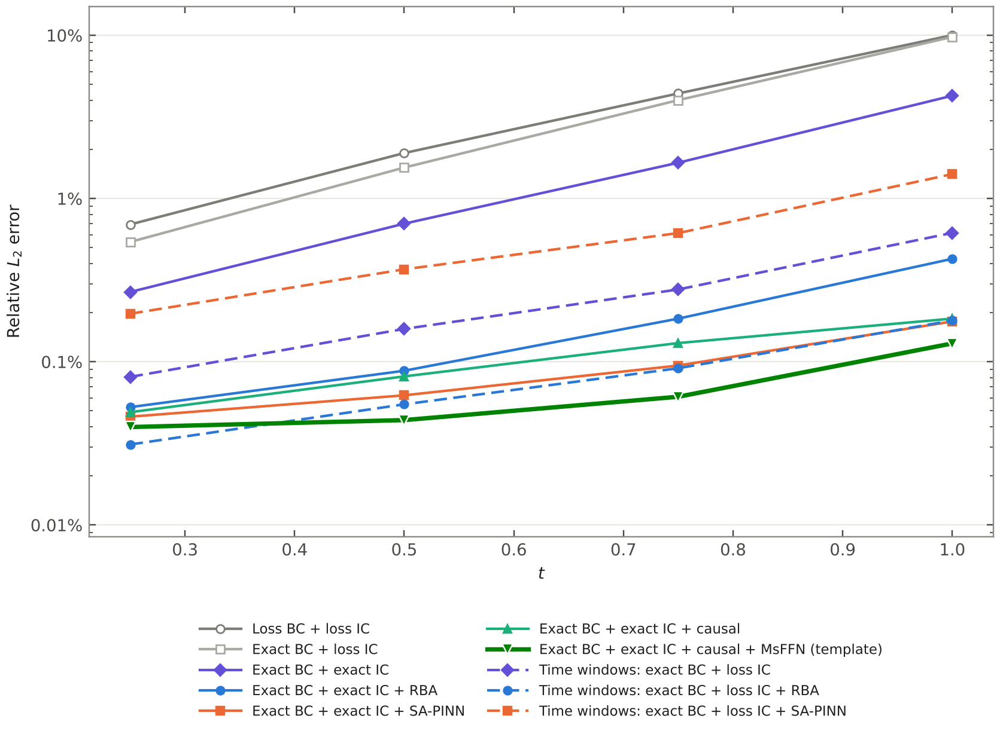
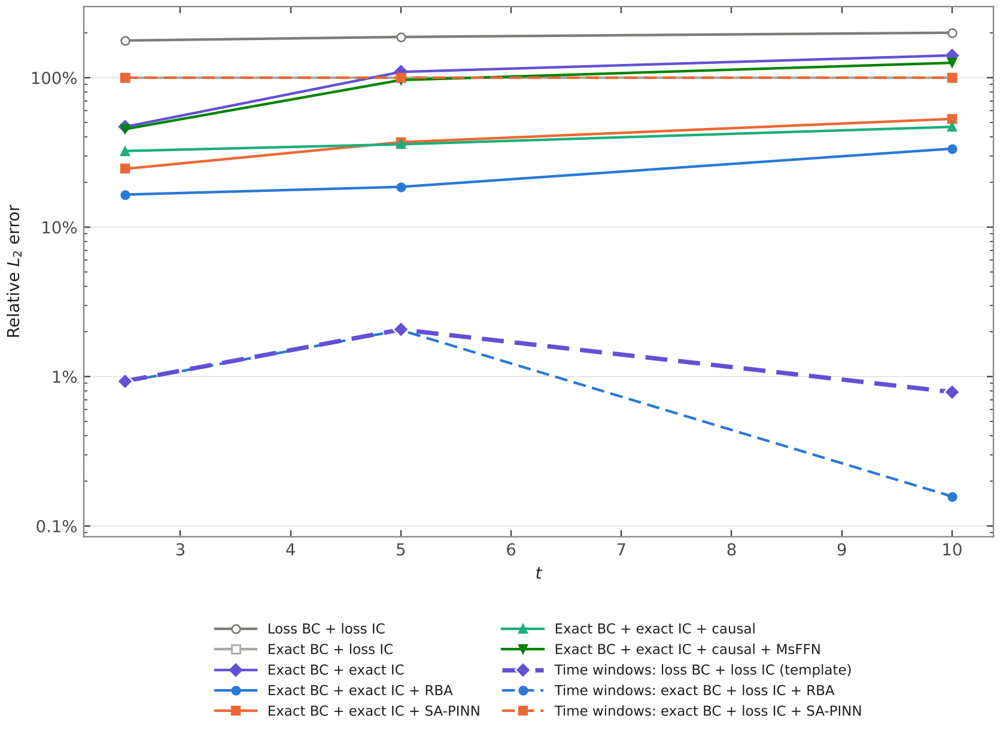
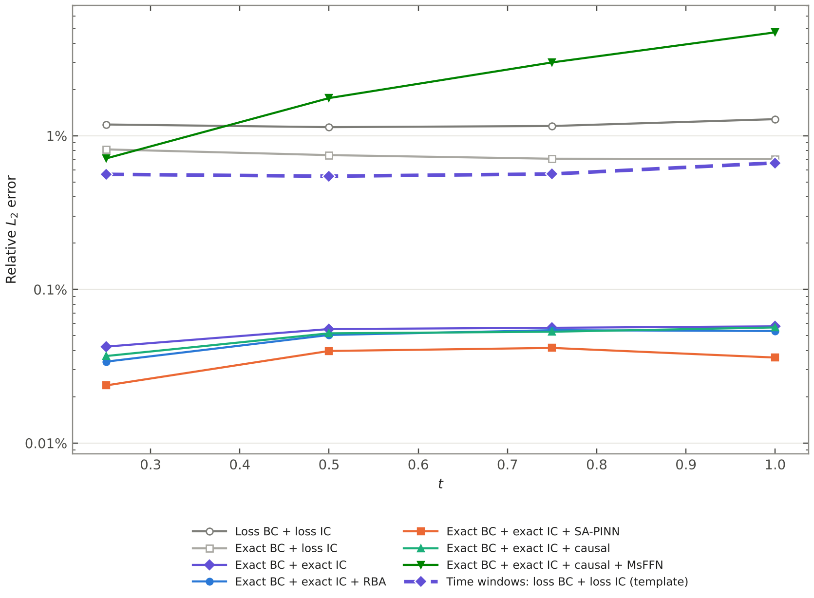
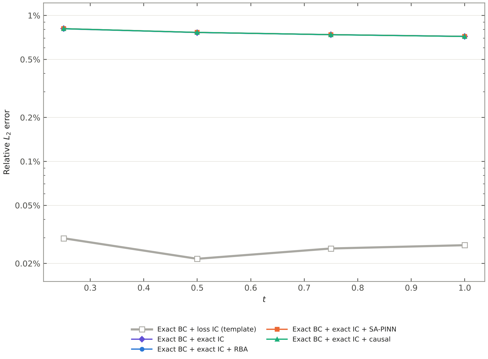
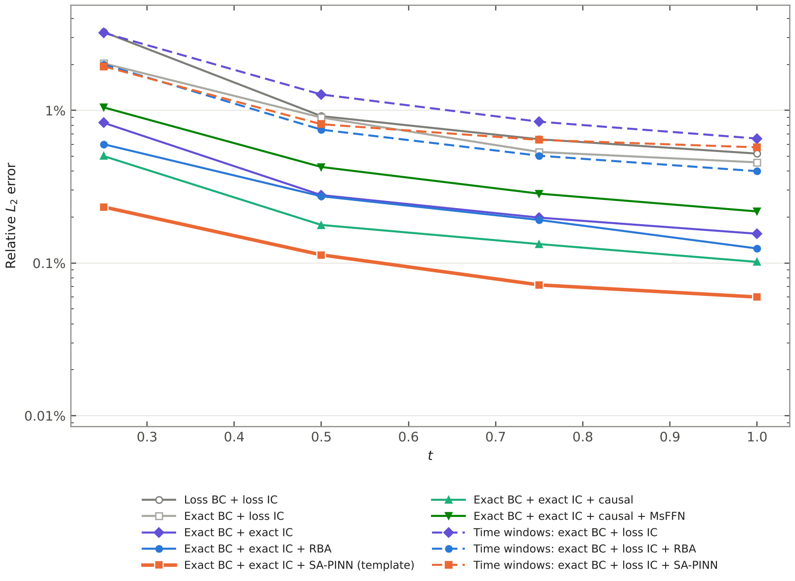
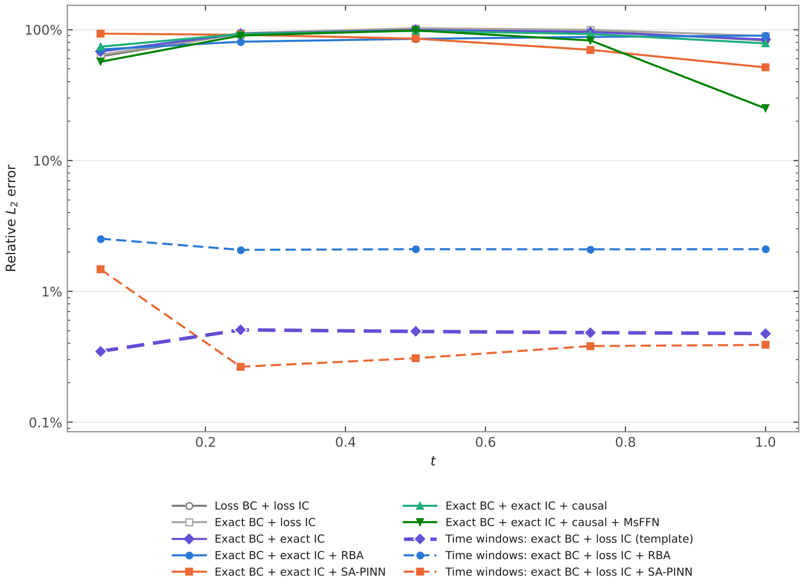
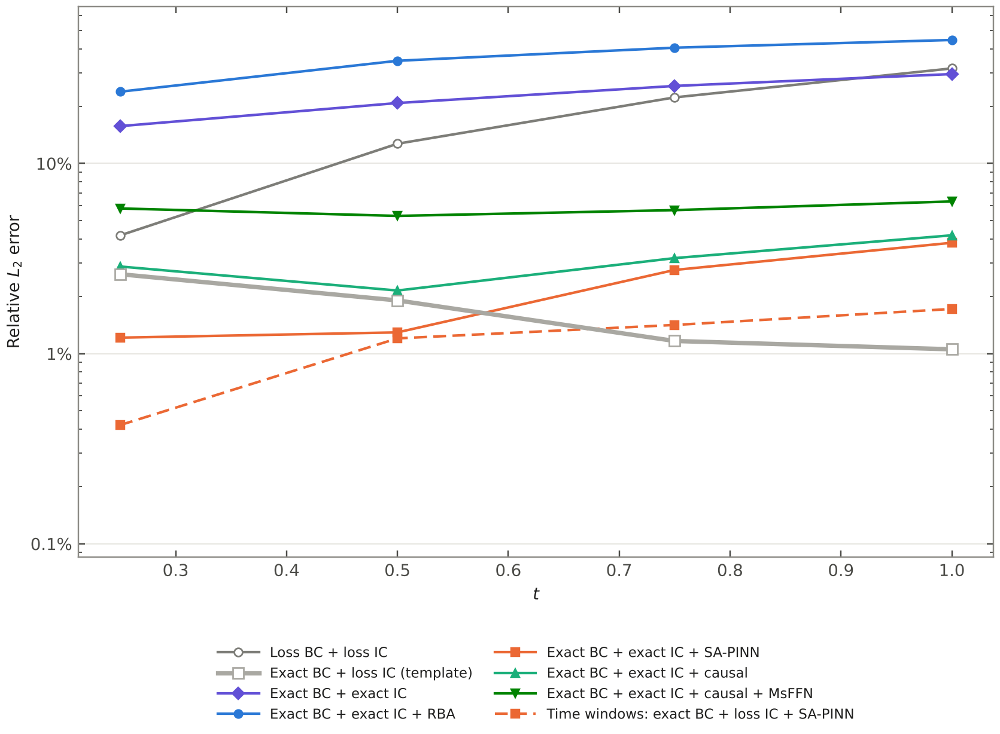
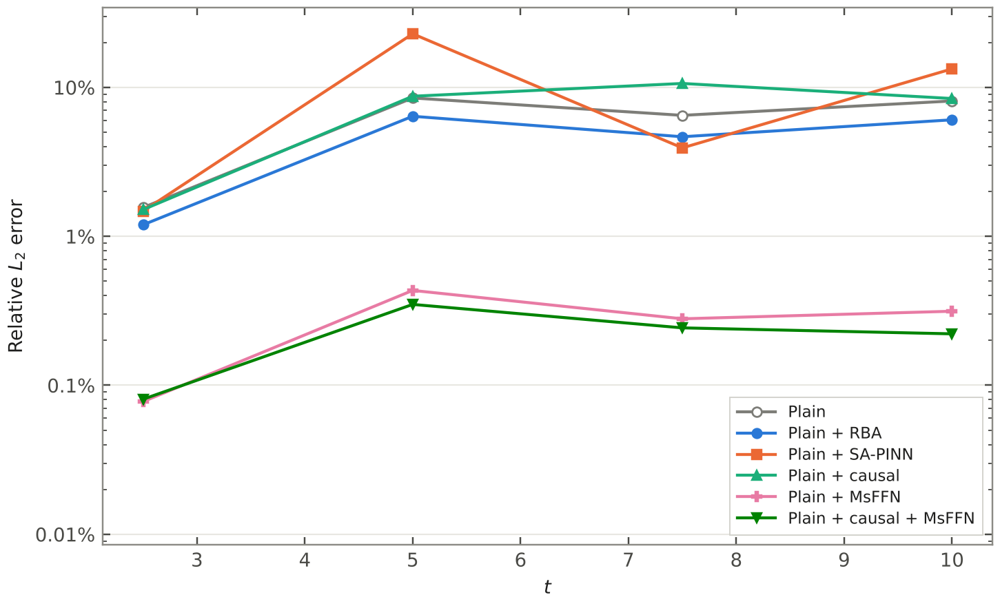

# Training methods study

*PINNStudio, October 2026*

This study tests which published PINN training techniques improve accuracy, using PINNStudio on one GPU (RTX 4090): about 180 runs on 14 problems. Every number is the relative $L_2$ error of the main output against the reference data the example ships with, as computed by PINNStudio's Error Analysis. Unless stated otherwise, each run uses its example's own network, collocation points and training budget, and the random seed 2026.

**Run-to-run variation.** Changing only the random seed moves the error by about ±20% (1D Cahn-Hilliard, three seeds), so only differences of about 1.5× or more should be read as real.

## How the study is organised

Every phase-field example (Allen-Cahn and Cahn-Hilliard, in 1D, 2D and 3D) is run with the same ten **core setups**. Each setup is named after what it contains, and a name means the same setup in every table, figure and paragraph (the Figure 7 tables shorten *Exact BC + exact IC* to *Exact BC + IC*, and call *Loss BC + loss IC* the *plain PINN*):

- **BC**: the periodic boundary condition, either a **loss** term or **exact** (built into the network: Boundary conditions → *Exact periodicity*).
- **IC**: the initial condition, either a **loss** term (weight 100) or **exact** (Initial conditions → *Exact (built into the network)*). An exact IC cannot be combined with time windows, so every time-window setup has the IC as a loss term.
- **Time**: the whole time interval at once, or **time windows** (Adaptive training → *Time Adaptive Training*): the interval in windows, each started from the previous window's network, with that window's starting state as a loss term.
- **Weighting**: none, RBA or SA-PINN (Loss weights → *Per-point weights*), causal training (Loss weights → *Causal training*, with the paper's $\varepsilon$ schedule), or causal training with an MsFFN network (Network → *Network type*).

| Setup | BC | IC | Time | Weighting |
|---|---|---|---|---|
| Loss BC + loss IC | loss | loss | whole interval | – |
| Exact BC + loss IC | exact | loss | whole interval | – |
| Exact BC + exact IC | exact | exact | whole interval | – |
| Exact BC + exact IC + RBA | exact | exact | whole interval | RBA |
| Exact BC + exact IC + SA-PINN | exact | exact | whole interval | SA-PINN |
| Exact BC + exact IC + causal | exact | exact | whole interval | causal |
| Exact BC + exact IC + causal + MsFFN | exact | exact | whole interval | causal, MsFFN network |
| Time windows: exact BC + loss IC | exact | loss | windows | – |
| Time windows: exact BC + loss IC + RBA | exact | loss | windows | RBA |
| Time windows: exact BC + loss IC + SA-PINN | exact | loss | windows | SA-PINN |

Everything else (network, points, iterations) is the example's own and is given at the start of its section. Within one example all setups share these settings, except that a time-window setup trains every window with the full number of steps (k times the training of a whole-interval setup). For the paper's Figure 7 the four main phase-field problems were rerun under one common protocol; see [The controlled comparison (paper Figure 7)](#the-controlled-comparison-paper-figure-7). Per-point weights are held fixed during the L-BFGS phase, as in the papers (Loss weights → *During L-BFGS*: *Keep the weights*); a row marked *unweighted L-BFGS* runs L-BFGS on the unweighted loss instead. "(template)" marks the setup the example's template uses, the best setup of each table is in bold, and "–" marks a setup that was not run. Under each core table, **other setups** lists further runs on that problem, named the same way. The other problems (Klein-Gordon, Burgers, and the steady problems) have no periodicity or initial condition to build in, so they are run as **Plain** (every condition a loss term) and **Plain +** one method.

**Figures.** Each figure shows the error against time on a log scale, every core setup in one plot, in the order and with the names of the table under it. The colour is the weighting method (purple none, blue RBA, orange SA-PINN, green causal, dark green causal + MsFFN), a **solid line** trains on the whole time interval at once and a **dashed line** in time windows, and the two setups without an exact IC on the whole interval are gray with open markers. A thick line is the template's setup. $t = 0$ is left out, because with an exact IC the error there is zero. Each figure is also available as a vector PDF in [`figures/pdf/`](figures/pdf/). Figures and core tables are drawn from [`figures/study.json`](figures/study.json) by [`make_figures.py`](make_figures.py), and the runs were made with [`study_runner.py`](study_runner.py) from the plans in [`plans/`](plans/).

## Methods

| Method | What it does | Where in PINNStudio |
|---|---|---|
| Scaling | each equation written so that its residual is of order 1 (see 1D Cahn-Hilliard) | the equations, and Network → *Output transform* |
| Exact periodicity | the inputs enter as $\cos(2\pi x/L)$, $\sin(2\pi x/L)$, so the solution is exactly periodic ([Dong & Ni, 2021](https://doi.org/10.1016/j.jcp.2021.110242)) | Boundary conditions → *Exact periodicity* |
| Exact IC | the output is $u = \text{IC}(x) + \tau N$, so the initial condition holds exactly ([Lagaris et al., 1998](https://doi.org/10.1109/72.712178)) | Initial conditions → *Exact (built into the network)* |
| RBA | residual-based attention: per-point weights that grow where the residual stays large ([Anagnostopoulos et al., 2024](https://doi.org/10.1016/j.cma.2024.116805)) | Loss weights → *Per-point weights* |
| SA-PINN | self-adaptive per-point weights, trained by gradient ascent ([McClenny & Braga-Neto, 2023](https://doi.org/10.1016/j.jcp.2022.111722)) | Loss weights → *Per-point weights* |
| Causal training | later times count only once earlier ones are fitted ([Wang, Sankaran & Perdikaris, 2024](https://doi.org/10.1016/j.cma.2024.116813)) | Loss weights → *Causal training* |
| MsFFN | multi-scale Fourier feature network, scales $\sigma = 1, 5$ ([Wang, Wang & Perdikaris, 2021](https://doi.org/10.1016/j.cma.2021.113938)) | Network → *Network type* |
| Time-adaptive training | the time interval is solved in windows, each started from the previous one ([Wight & Zhao, 2021](https://doi.org/10.4208/cicp.OA-2020-0086)) | Adaptive training → *Method* |
| Backward compatibility (bc-PINN) | time windows in which every later window also keeps the stored solution of the earlier ones ([Mattey & Ghosh, 2022](https://doi.org/10.1016/j.cma.2021.114474)) | Adaptive training → *Backward compatibility (bc-PINN)* |
| Growing time range | one network on $[t_0, t]$, $t$ growing window by window ([Wight & Zhao, 2021](https://doi.org/10.4208/cicp.OA-2020-0086), approach I) | Adaptive training → *Growing time range* |
| RAR | points with the largest residual added to the collocation points in rounds ([Lu et al., 2021](https://doi.org/10.1137/19M1274067)) | Adaptive training → *Method: RAR* |

Each method in detail: [How each technique works in PINNStudio](#how-each-technique-works-in-pinnstudio).

### How each technique works in PINNStudio

Every technique is a setting in the interface; none needs code. What each one does, where it comes from, and how PINNStudio applies it:

**Exact periodicity** (Boundary conditions → *Exact periodicity (periodic inputs)*; Dong & Ni, 2021). Instead of $x$, the network gets $\cos(2\pi x/L)$ and $\sin(2\pi x/L)$ for each periodic axis, with $L$ the length of the domain in that direction. Any function of these two inputs repeats every $L$, so the solution is periodic exactly and the periodic boundary condition is no longer a loss term.

**Exact initial condition** (Initial conditions → *Exact (built into the network)*; Lagaris et al., 1998). The output is written as $u = \text{IC}(x) + \tau\,N(x, t)$ with $\tau = (t - t_0)/(t_1 - t_0)$, so at $t = t_0$ it equals the initial condition whatever the network $N$ does, and the initial condition drops out of the loss. For a system it is applied to the outputs that have an initial condition (for Cahn-Hilliard, $u$ or $h$, not the chemical potential $\mu$).

**RBA — residual-based attention** (Loss weights → *Per-point weights: RBA*; Anagnostopoulos et al., 2024). Every collocation point gets its own weight on its residual, starting at 1. After each Adam step the weights are updated as $\lambda \leftarrow \gamma\lambda + \eta\,|r|/\max|r|$ ($\gamma = 0.999$, $\eta = 0.01$), so points where the residual stays large gain weight. The weights are not trained; they follow the residual.

**SA-PINN — self-adaptive weights** (Loss weights → *Per-point weights: SA-PINN*; McClenny & Braga-Neto, 2023). Also one weight per point, starting at 1, but here the weights are trainable: the network minimizes the weighted loss while the weights maximize it (gradient ascent, learning rate 0.005), so the weights grow where the network fails to fit. As in the paper they are not rescaled. For both RBA and SA-PINN, *During L-BFGS* sets whether the weights are kept at their last values (the setting used in this study) or dropped for the L-BFGS phase.

**Causal training** (Loss weights → *Causal training*; Wang, Sankaran & Perdikaris, 2024). The time interval is cut into 32 chunks, and the residual loss of each chunk is multiplied by $\exp(-\varepsilon\cdot$ the summed residual loss of the earlier chunks$)$. A later time therefore only counts once the earlier times are fitted, which follows the direction of time the way a time-stepping solver does. With *Raise ε step by step* (the default, the paper's Algorithm 1) $\varepsilon$ steps through 0.01, 0.1, 1, 10 and 100, moving on once every chunk weight is above 0.99.

**MsFFN — multi-scale Fourier features** (Network → *Network type: MsFFN*, scales `1, 5`; Wang, Wang & Perdikaris, 2021). The inputs pass through random Fourier features at each scale before the hidden layers, and the outputs of the scales are combined. It helps solutions with fine detail or several frequencies, but it changes the network, so it is not only a training technique.

**RAR — residual-based adaptive refinement** (Adaptive training → *Method: RAR*; Lu et al., 2021, as in DeepXDE, and Wight & Zhao's "resampling"). After the training phases, PINNStudio evaluates the residual at a set of random candidate points (50,000 by default), adds the ones with the largest residual (500 or 1,000 here) to the collocation points, and trains again; this is repeated for a set number of rounds, each with its own Adam and L-BFGS steps. The points therefore gather where the equation is hardest to satisfy, for example at moving interfaces.

**Time windows** (Adaptive training → *Method: Time Adaptive Training*; Wight & Zhao, 2021). The time interval is split into windows that are trained one after another. Each window samples its collocation points inside its own time slice, so the points are denser in time. Its initial condition is the previous window's prediction at its end time, given on a uniform grid (*IC grid*) as a loss term with weight 100; the first window has the true initial condition. With *Enable transfer learning* each window starts from the previous window's network weights (*Transfer optimizer: L-BFGS* takes them after the L-BFGS phase); the optimizers start fresh in every window. Because the initial condition of a window comes from the previous window, it cannot be imposed exactly, so time windows use it as a loss term.

**Backward compatibility, bc-PINN** (Adaptive training → *Backward compatibility (bc-PINN)*; Mattey & Ghosh, 2022). With time windows and one network carried through all of them, the network can drift away from the earlier windows while it learns a new one. Here, after each window its prediction is stored on the IC grid at 10 times inside the window, and every later window gets an extra loss term (weight 100) that keeps the network close to those stored values. Mattey & Ghosh also first fit each window's starting state for a while before the equation is switched on; that is *IC-guided learning* in PINNStudio (a fraction of the first Adam phase, off in this study).

**Growing time range** (Adaptive training → *Growing time range*; Wight & Zhao's approach I). One network is trained on $[t_0, t]$ with $t$ growing window by window, so every window also trains on all the earlier times, with the true initial condition at $t_0$ throughout.

## Results at a glance

**Figure 1.** Relative $L_2$ error at the last reference time, for every phase-field example (rows) and every core setup (columns). Darker is lower; the best setup of each example is in bold, and "–" marks a setup that was not run.

## Summary

| Problem | Plain (everything a loss term) | Best | Best setup |
|---|---|---|---|
| 1D Allen-Cahn (Wight & Zhao), $t = 1$ | 10% | 0.13% | Exact BC + exact IC + causal + MsFFN |
| 2D Allen-Cahn (Wight & Zhao), $t = 10$ | 200% | 0.16% | Time windows: exact BC + loss IC + RBA |
| 2D Allen-Cahn (Mattey & Ghosh), $t = 1$ | 1.3% | 0.036% | Exact BC + exact IC + SA-PINN |
| 3D Allen-Cahn (Wight & Zhao), $t = 1$ | 0.033% | 0.027% | Exact BC + loss IC (template) |
| 1D Cahn-Hilliard (Wight & Zhao), $t = 1$ | 0.52% (42% unscaled) | 0.060% | Exact BC + exact IC + SA-PINN (template) |
| 1D Cahn-Hilliard (Mattey & Ghosh), $t = 1$ | 83% | 0.39–0.48% | Time windows: exact BC + loss IC (template), and + SA-PINN |
| 2D Cahn-Hilliard (Wight & Zhao), $t = 1$ | 32% | 1.1% | Exact BC + loss IC (template) |
| 2D Cahn-Hilliard (Mattey & Ghosh), $t' = 1$ | 51% | 0.20% | Exact BC + exact IC + SA-PINN (template) |
| Klein-Gordon, $t = 10$ | 8.1% | 0.22% | Plain + causal + MsFFN |
| 1D Burgers, $t = 1$ | 0.13% | 0.077% | Plain + causal (the other methods are worse) |
| Diffusion-reaction 1D, $t = 1$ | 11% | 11% | Plain; causal training is worse |
| Schrödinger 1D, Helmholtz 2D, Kovasznay flow | 0.02–0.2% | same, or MsFFN 2× lower on Kovasznay | Plain |

**What worked.** On the phase-field problems, the largest gains came from enforcing the known conditions exactly: exact periodicity and an exact initial condition cut the error 2–150 times on most of them (not on the problems over a long time range or with a fast start, see below). One weighting method added to these helped further: SA-PINN on Cahn-Hilliard and 2D Allen-Cahn (Mattey & Ghosh), causal training with a Fourier-feature network on 1D Allen-Cahn. Time-adaptive training was the only thing that worked on a long time range (2D Allen-Cahn, $t \le 10$) and on a very fast start (1D Cahn-Hilliard, Mattey & Ghosh), and RBA was the weighting that went best with it. On the Cahn-Hilliard problem of Wight & Zhao the main improvement came from scaling the equations. A Fourier-feature network gave large gains on 1D Allen-Cahn and Klein-Gordon.

**What did not.** The exact initial condition is not always better than the initial condition as a loss term: on 3D Allen-Cahn and 2D Cahn-Hilliard (Wight & Zhao), whose solutions change quickly at the start, the loss term was 25 and 3.6 times more accurate at $t = 1$. Time windows made smooth problems worse (1D Cahn-Hilliard, Wight & Zhao). SA-PINN with the initial condition as a loss term can fail completely (2D Allen-Cahn, Wight & Zhao: $u = 0$ in every window). The Fourier-feature network hurt on the smooth 2D problems (2D Allen-Cahn and 2D Cahn-Hilliard of Mattey & Ghosh). Gradient-norm loss balancing was worse everywhere and has been removed; causal training with one fixed $\varepsilon$ had almost no effect, and causal training together with per-point weights did worse than either alone.

**Following the papers closely mattered.** The first versions of causal training and SA-PINN here used one fixed $\varepsilon$ and normalized SA-PINN's weights. Both then looked no better than RBA, or worse, until they were implemented as published (see [Checked against the papers](#checked-against-the-papers)); only the corrected versions are reported here.

## The controlled comparison (paper Figure 7)

The study above uses each example's own settings, which differ from problem to problem (they follow each paper), so it shows what works on each problem but is not a controlled comparison. For the paper's Figure 7 the four phase-field problems were rerun under **one protocol**: the equations, domains, initial conditions and reference solutions follow the source papers (1D Allen-Cahn and 1D Cahn-Hilliard of Wight & Zhao, 2D Allen-Cahn and 2D Cahn-Hilliard of Mattey & Ghosh), and the training settings are the same for every problem of a dimension and every technique. Within a panel only the technique changes.

**Shared settings** (plan: [`plans/fig7_v2.json`](plans/fig7_v2.json)):

| | 1D: (a) Allen-Cahn, (b) Cahn-Hilliard | 2D: (c) Allen-Cahn, (d) Cahn-Hilliard |
|---|---|---|
| Network | 4 × 128, tanh | 6 × 128, tanh |
| Domain (collocation) points | 10,000 | 20,000 |
| Boundary points | 200 | 1,600 |
| Initial-condition points | 512 | 4,096 (the 64 × 64 grid) |
| Training | 20,000 Adam (learning rate $10^{-3}$) + 10,000 L-BFGS | same |
| Loss weights | 1 on the equation and boundary terms; 100 on the initial condition when it is a loss term | same |
| Seed | 2026 | same |

**Setups** (the same in every panel):

| # | Setup | Boundary condition | Initial condition | Time | Weights | Training per run |
|---|---|---|---|---|---|---|
| 1 | Plain PINN | loss term | loss term | whole interval | – | 20,000 + 10,000 |
| 2 | Exact BC + IC | built into the network (periodic) | built into the network | whole interval | – | 20,000 + 10,000 |
| 3 | Exact BC + IC + RBA | built in | built in | whole interval | RBA | 20,000 + 10,000 |
| 4 | Exact BC + IC + SA-PINN | built in | built in | whole interval | SA-PINN | 20,000 + 10,000 |
| 5 | Time windows | built in | loss term | 4 windows of 0.25 | – | every window 20,000 + 10,000 (4 × the total) |
| 6 | Time windows + backward (bc-PINN) | built in | loss term | 4 windows, earlier windows' solution kept | – | every window 20,000 + 10,000 (4 × the total) |
| 5b | Time windows, equal compute | built in | loss term | 4 windows | – | every window 5,000 + 2,500 (30,000 in total, as setups 1–4) |
| 6b | bc-PINN windows, equal compute | built in | loss term | 4 windows + backward | – | every window 5,000 + 2,500 |
| 7 | Exact BC + IC + causal training | built in | built in | whole interval | causal (Wang et al.: later times weighted in once earlier times are fitted; the paper's ε schedule, 32 time chunks) | 20,000 + 10,000 |
| 8 | Exact BC + IC + causal + MsFFN | built in | built in | whole interval | causal; the network becomes a multi-scale Fourier-feature network of the same size (scales 1, 5) | 20,000 + 10,000 |
| 9 | Exact BC + IC + RAR, equal compute | built in | built in | whole interval | residual-based refinement: 3 rounds, each adding the 500 (1D) / 1,000 (2D) highest-residual points of 50,000 candidates | 8,000 + 4,000, then 3 rounds of 4,000 + 2,000 (20,000 + 10,000 in total) |
| 9b | Exact BC + IC + RAR, as usually run | built in | built in | whole interval | as 9 | 20,000 + 10,000, then 3 rounds of 10,000 + 10,000 (50,000 + 40,000, about 3 ×) |
| 10 | Growing time range (Wight & Zhao's approach I) | built in | loss term | 4 windows, each training one network on $[0, t]$ with $t$ growing | – | every window 20,000 + 10,000 (4 × the total) |

**How the time windows work in PINNStudio** (Adaptive training → *Time Adaptive Training*):

- The interval $[0, 1]$ is split into 4 windows that are trained one after the other. Every window samples **all** the domain and boundary points inside its own time slice, so a training step costs the same as in a whole-interval run and the points are 4 times denser in time.
- **Initial condition of a window.** The first window has the true initial condition; every later window has the previous window's prediction at its end time, both as a loss term (weight 100) on a uniform grid: 512 points in 1D, the 64 × 64 grid in 2D (the same numbers as the initial-condition points of setups 1–4). An exact initial condition cannot be combined with time windows in PINNStudio, so setups 5–6b have it as a loss term.
- **Transfer learning.** Each window starts from the previous window's network weights, taken after its L-BFGS phase (*Enable transfer learning*, *Transfer optimizer: L-BFGS*). The optimizers start fresh in every window (Adam, then L-BFGS).
- **Backward compatibility (setups 6, 6b).** After each window its prediction is stored on the same grid at 10 times inside the window, and every later window has an extra loss term (weight 100) that keeps the network close to those stored values. This is the backward-compatible part of Mattey & Ghosh's bc-PINN; their initial-condition-guided pre-training of each window is not included here.
- **Full or equal compute.** Setups 5 and 6 train every window like a full run, as the method is normally used; they cost about 4 times as much as setups 1–4, which is why the training times are reported. Setups 5b and 6b give the windows exactly the training of setups 1–4 (the steps shared out, all the points kept), so that the technique is the only difference.

**Reproducing.** `python benchmarks/study_runner.py benchmarks/plans/fig7_v2.json <out> --jobs 2` (in a plan, `"match"` copies the plain run's network, points, learning rate, seed and steps into every other setup of the problem and checks them, `"equal_budget"` shares the steps out over the windows). The runner writes each run's script (`run.py`), log and errors at every reference time (`result.json`); [`tools/make_methods_figure.py`](../tools/make_methods_figure.py) draws the figure from `figures/fig7_v2.json` (the results of these runs, collected in one file).

**Versions.** The figure went through three sets of runs; the paper uses the last one.

| Version | Settings | Time windows | Status |
|---|---|---|---|
| Original study (the sections below) | each example's own (from its paper) | full steps in every window (4–5 windows) | done; Supplementary Fig. S1 |
| Matched per problem ([`plans/fig7_confirm.json`](plans/fig7_confirm.json)) | each example's own, the same for all setups of a problem | steps shared out (1/k per window), all points; 4–5 windows | done except time windows on 2D Cahn-Hilliard (stopped) |
| **Common protocol** ([`plans/fig7_v2.json`](plans/fig7_v2.json)) | one per dimension, table above | full (5, 6) and equal compute (5b, 6b), 4 windows | 31 of 32 runs done (October 2026; 6b on 2D Cahn-Hilliard queued again); the paper's Figure 7 and Fig. S3 |
| Common protocol, more techniques ([`plans/fig7_v2b.json`](plans/fig7_v2b.json)) | the same | setups 7–10 (the plain runs are shared) | all 20 runs done (October 2026); causal training is in Figure 7, the rest in Fig. S4 |

Results of the common protocol, the paper's Figure 7 (error at $t = 1$, seed 2026; training time on one RTX 4090, two runs at a time):

| Problem | Plain PINN | Exact BC + IC | + RBA | + SA-PINN | Time windows (5) | bc-PINN windows (6) | Windows, equal compute (5b) | bc-PINN, equal compute (6b) |
|---|---|---|---|---|---|---|---|---|
| 1D Allen-Cahn | 10% (8 min) | 1.1% (4 min) | 0.27% (6 min) | **0.14%** (7 min) | 0.65% (13 min) | 0.79% (18 min) | 0.41% (10 min) | 0.54% (10 min) |
| 1D Cahn-Hilliard | 0.61% (9 min) | 0.16% (9 min) | 0.12% (10 min) | **0.074%** (11 min) | 0.40% (26 min) | 0.40% (37 min) | 0.44% (20 min) | 0.41% (22 min) |
| 2D Allen-Cahn | 0.45% (19 min) | 0.042% (14 min) | 0.045% (15 min) | **0.031%** (28 min) | 0.079% (93 min) | 0.095% (159 min) | 0.24% (40 min) | 0.40% (59 min) |
| 2D Cahn-Hilliard | 52% (40 min) | 0.19% (40 min) | 0.41% (40 min) | **0.17%** (40 min) | 1.3% (232 min) | 1.3% (410 min) | 5.6% (77 min) | queued again (ran out of GPU memory) |

Results of setups 7–10 under the same protocol (error at $t = 1$, seed 2026; SA-PINN, the best of setups 1–6, for comparison). RAR adds points as it trains (1,500 in 1D, 3,000 in 2D by the end), and causal + MsFFN also changes the network:

| Problem | + SA-PINN (4) | + causal (7) | + causal + MsFFN (8) | + RAR, equal compute (9) | + RAR, as usually run (9b) | Growing time range (10) |
|---|---|---|---|---|---|---|
| 1D Allen-Cahn | **0.14%** (7 min) | 0.37% (5 min) | **0.14%** (7 min) | 0.44% (8 min) | 0.15% (12 min) | 3.9% (19 min) |
| 1D Cahn-Hilliard | **0.074%** (11 min) | 0.091% (9 min) | 0.21% (8 min) | 0.29% (11 min) | 0.18% (22 min) | 0.20% (58 min) |
| 2D Allen-Cahn | **0.031%** (28 min) | 0.048% (8 min) | 0.093% (16 min) | 0.047% (15 min) | 0.047% (31 min) | 0.087% (98 min) |
| 2D Cahn-Hilliard | 0.17% (40 min) | 0.20% (53 min) | 0.40% (56 min) | 2.1% (40 min) | **0.17%** (82 min) | 1.8% (120 min) |

*The growing time range in 2D first stopped at its second window because of a bug in PINNStudio (fixed); both 2D runs were run again after the fix.* In the paper, causal training takes the place of bc-PINN windows in Figure 7; bc-PINN, the equal-compute windows, the growing range, causal + MsFFN and RAR go in the supplement (Figs. S3 and S4).

What it shows: exact conditions are the largest single gain on every problem (×4 to ×270), SA-PINN gives the lowest error everywhere (causal + MsFFN ties it on 1D Allen-Cahn), causal training comes close to it on both Cahn-Hilliard problems at the same or lower cost, RAR helps only when run about three times longer (then it ties SA-PINN on 2D Cahn-Hilliard, 0.173% against 0.175%), and time windows, even with four times the training, stay behind the best whole-interval setup (×2.5–8) while taking 2–6 times as long as SA-PINN (bc-PINN up to 10 times); with equal compute they are about as accurate as with four times the steps in 1D and clearly worse in 2D. Backward compatibility changes the windows little.

Results of the matched-per-problem version (error at $t = 1$, seed 2026):

| Problem | Plain PINN | Exact BC + IC | + RBA | + SA-PINN | Time windows | bc-PINN windows |
|---|---|---|---|---|---|---|
| 1D Allen-Cahn (4 × 128, 2,000 points, 20,000 + 10,000) | 63% | 5.4% | 0.98% | **0.43%** | 0.83% | 1.1% |
| 1D Cahn-Hilliard (4 × 128, 10,000 points, 5,000 + 5,000) | 1.7% | 0.31% | 0.30% | **0.20%** | 0.29% | 0.39% |
| 2D Allen-Cahn (6 × 128, 20,000 points, 12,000 + 10,000) | 0.51% | 0.045% | 0.049% | **0.032%** | 0.45% | 0.58% |
| 2D Cahn-Hilliard (5 × 128, 50,000 points, 40,000 + 75,000) | 7.3% | 0.17% | 0.25% | **0.073%** | – | – |

(The time-window columns had 1/k of the steps per window.) The ranking agrees with the original study, but some single values differ from it by a factor of 2–6 (the plain PINN on 1D Allen-Cahn: 10% there, 63% here), so single runs are only read for differences well above that; more seeds follow once the protocol is settled.

## Allen-Cahn

### 1D Allen-Cahn (Wight & Zhao)

$u_t = 10^{-4} u_{xx} - 5u^3 + 5u$ on $x \in [-1, 1]$ (periodic), $u(x, 0) = x^2\cos(\pi x)$, $t \in [0, 1]$ ([Wight & Zhao, 2021](https://doi.org/10.4208/cicp.OA-2020-0086)). 4 × 128 network, Adam 20,000 → L-BFGS 10,000 (per window in the time-window runs, 4 windows of 0.25).

**Figure 2.** 1D Allen-Cahn (Wight & Zhao), error in $u$.

<!-- core:ac1d -->
| Setup | $t = 0.25$ | $t = 1$ |
|---|---|---|
| Loss BC + loss IC | 0.69% | 10% |
| Exact BC + loss IC | 0.54% | 9.8% |
| Exact BC + exact IC | 0.27% | 4.3% |
| Exact BC + exact IC + RBA | 0.053% | 0.43% |
| Exact BC + exact IC + SA-PINN | 0.046% | 0.18% |
| Exact BC + exact IC + causal | 0.049% | 0.18% |
| **Exact BC + exact IC + causal + MsFFN (template)** | **0.040%** | **0.13%** |
| Time windows: exact BC + loss IC | 0.081% | 0.62% |
| Time windows: exact BC + loss IC + RBA | 0.031% | 0.18% |
| Time windows: exact BC + loss IC + SA-PINN | 0.20% | 1.4% |
<!-- /core -->

Seeds 1 and 2 of the whole-interval setups, at $t = 0.25$ / $t = 1$: loss BC + loss IC 0.85% / 10%; exact BC + exact IC + RBA 0.11% / 0.78% and 0.070% / 0.50%; + SA-PINN 0.061% / 0.20% and 0.049% / 0.13%; + causal 0.056% / 0.64% and 0.056% / 0.45%; + causal + MsFFN 0.041% / 0.12% and 0.042% / 0.065%. This last setup is now a template of its own, *Allen-Cahn 1D – Wight & Zhao (whole interval)*; rerun from the template it gave 0.041% / 0.24% and 0.041% / 0.18% (about 3 minutes on an RTX 4090 with nothing else running on it).

*Other setups*

| Setup | $t = 0.25$ | $t = 1$ |
|---|---|---|
| Time windows: loss BC + loss IC (template) | 0.050% | 0.48% |
| Time windows: loss BC + loss IC + causal | 0.034% | 0.48% |
| Time windows: loss BC + loss IC + gradient-norm balancing | 0.18% | 1.4% |
| Exact BC + exact IC + causal, fixed $\varepsilon = 1$ | 0.061% | 0.65% |
| Exact BC + exact IC + causal + RBA | 0.18% | 1.8% |
| Loss BC + loss IC + RBA | 1.0% | 11% |
| Exact BC + loss IC + RBA | 0.22% | 4.2% |
| Exact BC + loss IC + RBA, unweighted L-BFGS | 0.40% | 7.0% |
| Exact BC + loss IC + RBA + learning-rate decay | 0.26% | 5.7% |
| Loss BC + loss IC + MsFFN (2 seeds) | 0.08–0.12% | 1.8–2.3% |
| Loss BC + loss IC + MsFFN + RBA (2 seeds) | 0.051–0.055% | 0.74–0.89% |
| Loss BC + loss IC + MsFFN + RBA, unweighted L-BFGS | 0.14% | 2.5% |
| Loss BC + loss IC + gradient-norm balancing | 74% | 99% |

On the whole interval, built-in periodicity alone changes little (10% to 9.8% at $t = 1$), the exact initial condition on top of it halves the error (4.3%), and every weighting method on top of both brings it below 0.5%. Causal training with a Fourier-feature network is the most accurate and the most repeatable of these; SA-PINN and causal training alone are close behind. With time windows, RBA does as well as the best whole-interval setup (0.18% at $t = 1$), while SA-PINN is worse than no weighting at all: inside each window the initial condition is a loss term, and SA-PINN only weights the PDE points (see 2D Allen-Cahn, Wight & Zhao, where this setup fails entirely). Causal training together with per-point weights is worse than either alone, and with a fixed $\varepsilon = 1$ the causal weights hardly move (see [Checked against the papers](#checked-against-the-papers)).

### 2D Allen-Cahn (Wight & Zhao)

A shrinking circle over a long time range, $t \in [0, 10]$ ([Wight & Zhao, 2021](https://doi.org/10.4208/cicp.OA-2020-0086)). 4 × 128 network, 10,000 points, Adam 20,000 → L-BFGS 10,000 (per window in the time-window runs, 10 windows of 1).

**Figure 3.** 2D Allen-Cahn (Wight & Zhao), error in $u$.

<!-- core:ac2d_wz -->
| Setup | $t = 2.5$ | $t = 5$ | $t = 10$ |
|---|---|---|---|
| Loss BC + loss IC | 177% | 187% | 200% |
| Exact BC + loss IC | 100% | 100% | 100% |
| Exact BC + exact IC | 47% | 109% | 141% |
| Exact BC + exact IC + RBA | 17% | 19% | 33% |
| Exact BC + exact IC + SA-PINN | 25% | 37% | 53% |
| Exact BC + exact IC + causal | 32% | 36% | 47% |
| Exact BC + exact IC + causal + MsFFN | 45% | 96% | 126% |
| Time windows: loss BC + loss IC (template) | 0.93% | 2.1% | 0.79% |
| **Time windows: exact BC + loss IC + RBA** | **0.92%** | **2.0%** | **0.16%** |
| Time windows: exact BC + loss IC + SA-PINN | 100% | 100% | 100% |
<!-- /core -->

*Other setups*

| Setup | $t = 2.5$ | $t = 5$ | $t = 10$ |
|---|---|---|---|
| Loss BC + loss IC + RBA, unweighted L-BFGS | 3.5% | 5.7% | 19% |
| Loss BC + loss IC + MsFFN + RBA | 81% | 100% | 110% |

No whole-interval setup succeeds: the circle shrinks over $t \in [0, 10]$, and every whole-interval setup ends at 33% error or worse at $t = 10$ (with exact periodicity alone the network learns a flat field, exactly 100% everywhere). Only time windows solve this problem, and RBA combined with them gives the best result of the study's long-time problems, 0.16% at $t = 10$. SA-PINN fails on this problem. With time windows, the initial condition (and each window's starting state) is a loss term with a fixed weight of 100, while SA-PINN's weights on the PDE points only grow; within the first window the PDE term outweighs the initial condition, and the network converges to $u = 0$, which satisfies the Allen-Cahn equation exactly, in every window. The paper's SA-PINN also gives the initial-condition points their own growing weights, which PINNStudio does not do, so use SA-PINN with an exact initial condition only.

### 2D Allen-Cahn (Mattey & Ghosh)

IBVP-1 of [Mattey & Ghosh (2022)](https://doi.org/10.1016/j.cma.2021.114474), $t \in [0, 1]$. 4 × 128 network, 10,000 points, Adam 20,000 → L-BFGS 10,000 (per window in the time-window runs, 4 windows of 0.25).

**Figure 4.** 2D Allen-Cahn (Mattey & Ghosh), error in $u$.

<!-- core:ac2d_mg -->
| Setup | $t = 0.25$ | $t = 1$ |
|---|---|---|
| Loss BC + loss IC | 1.2% | 1.3% |
| Exact BC + loss IC | 0.81% | 0.71% |
| Exact BC + exact IC | 0.042% | 0.057% |
| Exact BC + exact IC + RBA | 0.034% | 0.054% |
| **Exact BC + exact IC + SA-PINN** | **0.024%** | **0.036%** |
| Exact BC + exact IC + causal | 0.037% | 0.057% |
| Exact BC + exact IC + causal + MsFFN | 0.71% | 4.7% |
| Time windows: loss BC + loss IC (template) | 0.56% | 0.67% |
| Time windows: exact BC + loss IC + RBA | – | – |
| Time windows: exact BC + loss IC + SA-PINN | – | – |
<!-- /core -->

The time-window row is the template itself, whose periodic BC is a loss term; the weighted time-window setups were not run for this example.

*Other setups*

| Setup | $t = 0.25$ | $t = 1$ |
|---|---|---|
| Loss BC + loss IC + RBA, unweighted L-BFGS | 1.6% | 1.7% |
| Loss BC + loss IC + MsFFN + RBA | 0.78% | 1.7% |

Here most of the improvement comes from the exact constraints: exact periodicity and an exact initial condition alone take the error at $t = 1$ from 1.3% to 0.057%, 23 times lower, and 12 times lower than the time-window template. A weighting method on top changes little (RBA and causal training give the same error; SA-PINN is 1.6 times lower, at the edge of the run-to-run variation; the RBA row is two runs, 0.052–0.054% at $t = 1$). The Fourier-feature network increases the error on this smooth problem, 4.7% at $t = 1$ with causal training.

### 3D Allen-Cahn (Wight & Zhao)

A shrinking sphere, $u_t = 0.025\nabla^2 u - 10(u^3 - u)$ on $[0, 1]^3$ (periodic), $t \in [0, 1]$; 4 × 128 network, 30,000 points, Adam 20,000 → L-BFGS 20,000 (Adam 10,000 → L-BFGS 10,000 per window in the time-window run, 4 windows of 0.25).

**Figure 5.** 3D Allen-Cahn (Wight & Zhao), error in $u$.

<!-- core:ac3d -->
| Setup | $t = 0.25$ | $t = 1$ |
|---|---|---|
| Loss BC + loss IC | 0.16% | 0.033% |
| **Exact BC + loss IC (template)** | **0.030%** | **0.027%** |
| Exact BC + exact IC | 0.81% | 0.72% |
| Exact BC + exact IC + RBA | 0.81% | 0.72% |
| Exact BC + exact IC + SA-PINN | 0.81% | 0.72% |
| Exact BC + exact IC + causal | 0.81% | 0.72% |
| Exact BC + exact IC + causal + MsFFN | 1.6% | 14% |
| Time windows: exact BC + loss IC | – | – |
| Time windows: exact BC + loss IC + RBA | – | – |
| Time windows: exact BC + loss IC + SA-PINN | – | – |
<!-- /core -->

The time-window setups were not run for this example yet.

With the exact initial condition every method gives the same error to three digits (the logs confirm that RBA and the causal schedule were active), so the limit is the $\text{IC} + tN$ form itself: the tanh profile relaxes quickly at the start, and the network has to produce that change through $tN$. Training the initial condition as a loss term instead (exact BC + loss IC, the template) gives 25 times less error, and the plain setup, with the boundaries as loss terms too, is almost as good (0.033% at $t = 1$): this problem is easy enough that the exact periodic inputs add little. Causal training with an MsFFN network, the best setup in 1D, is the worst one here (14% at $t = 1$), its error growing steadily with time. On the slice $z = 0.5$ the sphere stays round, and the largest pointwise error, about 0.013, sits on the interface.

## Cahn-Hilliard

### 1D Cahn-Hilliard (Wight & Zhao)

Mixed form after [Wight & Zhao (2021)](https://doi.org/10.4208/cicp.OA-2020-0086): $u_t = \mu_{xx}$, $\mu = \gamma_2(u^3 - u) - \gamma_1 u_{xx}$ with $\gamma_1 = 10^{-6}$ and $\gamma_2 = 0.01$, on $x \in [-1, 1]$, $t \in [0, 1]$, periodic. All core setups use the scaled equations (see below). Adam 20,000 → L-BFGS 20,000 (Adam 10,000 → L-BFGS 10,000 per window in the time-window runs, 4 windows of 0.25).

**Figure 6.** 1D Cahn-Hilliard (Wight & Zhao), error in $u$.

<!-- core:ch1d -->
| Setup | $t = 0.25$ | $t = 1$ |
|---|---|---|
| Loss BC + loss IC | 3.3% | 0.52% |
| Exact BC + loss IC | 2.0% | 0.46% |
| Exact BC + exact IC | 0.83% | 0.16% |
| Exact BC + exact IC + RBA | 0.60% | 0.12% |
| **Exact BC + exact IC + SA-PINN (template)** | **0.23%** | **0.060%** |
| Exact BC + exact IC + causal | 0.50% | 0.10% |
| Exact BC + exact IC + causal + MsFFN | 1.0% | 0.22% |
| Time windows: exact BC + loss IC | 3.2% | 0.65% |
| Time windows: exact BC + loss IC + RBA | 2.0% | 0.40% |
| Time windows: exact BC + loss IC + SA-PINN | 1.9% | 0.57% |
<!-- /core -->

Seeds: loss BC + loss IC 2.2–3.3% / 0.40–0.52% and the template 0.21–0.23% / 0.051–0.060% (three seeds each, $t = 0.25$ / $t = 1$). The error in $\mu$ with the template is 0.25–0.28% at $t = 0.25$ and 0.15–0.18% at $t = 1$. In every run with the physics check, mass was conserved to about $10^{-4}$ and the free energy decreased at all 40 time samples; $E(1)$ = 5.80 × 10⁻⁴ against 5.797 × 10⁻⁴ in the reference.

*Other setups*

| Setup | $t = 0.25$ | $t = 1$ |
|---|---|---|
| Loss BC + loss IC, unscaled equations | 28% | 42% |
| Loss BC + loss IC + gradient-norm balancing, unscaled equations | 28% | 41% |
| Loss BC + loss IC + gradient-norm balancing | 19% | 6.5% |
| Loss BC + loss IC + RBA | 1.1% | 0.30% |
| Exact BC + loss IC + RBA | 0.78% | 0.17% |
| Exact BC + loss IC + RBA, unweighted L-BFGS | 1.2% | 0.26% |
| Exact BC + loss IC + RBA + learning-rate decay | 1.1% | 0.29% |
| Loss BC + loss IC + MsFFN (2 seeds) | 1.4–1.5% | 0.17–0.25% |
| Loss BC + loss IC + MsFFN + RBA (2 seeds) | 0.54–0.57% | 0.11–0.14% |
| Loss BC + loss IC + MsFFN + RBA, unweighted L-BFGS | 1.1% | 0.11% |
| Loss BC + loss IC, separate $u$ and $\mu$ networks (PFNN) | 2.5% | 0.39% |
| Time windows: loss BC + loss IC | 3.4% | 0.41% |

**Scaling comes first.** $\mu$ is only about $\gamma_2 = 0.01$ in size, so written as above its equation's residual is about 100 times smaller than the $u_t$ equation's, and training converges to a wrong solution with a small loss (28–42% error, regardless of the other methods added). The template divides $\mu$'s equation by $\gamma_2$ and scales the network's $\mu$ output by 0.01, so both residuals are of order 1; all core setups use these scaled equations. After that, the exact constraints cut the error at $t = 1$ about three times (0.52% to 0.16%), and SA-PINN on top of them about three times more (0.060%). Time windows do not help here: this solution has no fast transient, and each window starts from the previous window's slightly wrong end state, so the error accumulates (0.40–0.65% at $t = 1$ for all three time-window setups).

### 1D Cahn-Hilliard (Mattey & Ghosh)

$u_t = (u^3 - u - 0.02 u_{xx})_{xx}$ on $[-1, 1]$ (periodic), $u(x, 0) = \cos(\pi x) - \exp(-4(\pi x)^2)$, $t \in [0, 1]$ ([Mattey & Ghosh, 2022](https://doi.org/10.1016/j.cma.2021.114474), eq. 25). The narrow Gaussian in the initial condition makes the solution change very fast at first (it is reshaped well before $t = 0.05$) and then settle. The paper's own standard PINN fails here too, with 86% error over the whole domain; the authors solve it with their bc-PINN, which trains time segments one after another. 4 × 128 network, 10,000 points. Whole-interval runs: Adam 20,000 → L-BFGS 20,000. Time-window runs (the template): 10 windows of 0.01 over the fast start and 9 windows of 0.1 for the rest, Adam 5,000 → L-BFGS 5,000 per window.

**Figure 7.** 1D Cahn-Hilliard (Mattey & Ghosh), error in $u$.

<!-- core:ch1d_mg -->
| Setup | $t = 0.05$ | $t = 0.25$ | $t = 1$ |
|---|---|---|---|
| Loss BC + loss IC | 62% | 94% | 83% |
| Exact BC + loss IC | 64% | 94% | 89% |
| Exact BC + exact IC | 68% | 93% | 84% |
| Exact BC + exact IC + RBA | 71% | 81% | 90% |
| Exact BC + exact IC + SA-PINN | 93% | 91% | 51% |
| Exact BC + exact IC + causal | 74% | 93% | 78% |
| Exact BC + exact IC + causal + MsFFN | 57% | 90% | 25% |
| Time windows: exact BC + loss IC (template) | 0.35% | 0.51% | 0.48% |
| Time windows: exact BC + loss IC + RBA | 2.5% | 2.1% | 2.1% |
| **Time windows: exact BC + loss IC + SA-PINN** | **1.5%** | **0.27%** | **0.39%** |
<!-- /core -->

Every setup on the whole time interval fails (25–90% at $t = 1$), regardless of the exact constraints or the weighting: a network trained on the whole interval at once cannot follow the Gaussian's collapse before $t = 0.05$ and the slow coarsening after it. Time windows succeed, consistent with the paper's bc-PINN: the template's 19 windows, each started from the previous window's network, give 0.35–0.51% at every time. Per-point weights do not improve on that. RBA is about four times worse (2.1%), and SA-PINN is slightly better later on but fits the start much worse (9.4% at $t = 0$, against 0.29%), since its weights grow on the PDE points while the initial condition is a fixed-weight loss term; so the template uses plain windows. The relative error in $\mu$ is larger, 3–13% after the merge, because $\mu$ is nearly zero once the two phases have settled.

### 2D Cahn-Hilliard (Wight & Zhao)

Two bubbles that merge, $u_t = \nabla^2\mu$, $\mu = u^3 - u - 0.0025\nabla^2 u$ on $[-1, 1]^2$ (periodic), $t \in [0, 1]$; 4 × 128 network, 20,000 points, Adam 20,000 → L-BFGS 20,000 (Adam 10,000 → L-BFGS 10,000 per window in the time-window runs, 5 windows of 0.2). Every run uses the template's smoothed initial condition (see below).

**Figure 8.** 2D Cahn-Hilliard (Wight & Zhao), error in $u$.

<!-- core:ch2d_wz -->
| Setup | $t = 0.25$ | $t = 1$ |
|---|---|---|
| Loss BC + loss IC | 4.2% | 32% |
| **Exact BC + loss IC (template)** | **2.6%** | **1.1%** |
| Exact BC + exact IC | 16% | 30% |
| Exact BC + exact IC + RBA | 24% | 45% |
| Exact BC + exact IC + SA-PINN | 1.2% | 3.8% |
| Exact BC + exact IC + causal | 2.9% | 4.2% |
| Exact BC + exact IC + causal + MsFFN | 5.8% | 6.3% |
| Time windows: exact BC + loss IC | – | – |
| Time windows: exact BC + loss IC + RBA | – | – |
| Time windows: exact BC + loss IC + SA-PINN | 0.42% | 1.7% |
<!-- /core -->

The time-window setups without weighting and with RBA were not run for this example.

*Other setups*

| Setup | $t = 0.25$ | $t = 1$ |
|---|---|---|
| $u$ left at its initial condition (for scale) | 16% | 30% |
| Exact BC + exact IC, the paper's initial condition (also with RBA, causal, or SA-PINN with normalized weights) | 13–15% | 27–31% |
| Exact BC + exact IC + SA-PINN, 6 × 128 network (the paper's size) | 3.5% | 3.3% |
| Exact BC + exact IC + SA-PINN, 40,000 Adam steps | 1.9% | 3.5% |

With the paper's initial condition every setup learned an almost frozen solution. That condition is a max of two tanh profiles, which has a corner where the bubbles touch, and the curvature at that corner drives the merging. With the exact initial condition, the network receives no curvature information at the corner, because automatic differentiation gives no second derivative there. The template writes the max as $\tanh((r - \min(R_1, R_2))/2\varepsilon)$ with a smoothed minimum, $(R_1 + R_2 - \sqrt{(R_1 - R_2)^2 + 0.0004})/2$. This changes $u$ by at most 0.5%, along the line where the bubbles meet, and the reference data uses the same formula. A larger network or twice the Adam steps did not help, so the template keeps 4 × 128 and 20,000 + 20,000 steps.

**The exact initial condition is not always the better choice.** With the initial condition built in, the plain network and RBA leave the bubbles almost frozen (30–45% at $t = 1$, no better than $u$ left at its initial condition); only SA-PINN (1.2% / 3.8%, the earlier template) and causal training (2.9% / 4.2%) start the merging. Keeping the initial condition as a loss term instead, with exact periodicity and no weighting at all, gives the lowest error at $t = 1$ of all, 1.1%, 3.6 times below SA-PINN, although it is about twice as far off at $t = 0.25$ (2.6% against 1.2%); the template now uses this setup. The same was observed on 3D Allen-Cahn, so for a problem whose solution changes quickly at the start, compare the exact initial condition with the initial condition as a loss term (weight 100). Time-adaptive training with SA-PINN, the paper's own method here, is more accurate after the start (1.2–1.7% from $t = 0.5$ on) but takes about 25 minutes instead of 15.

### 2D Cahn-Hilliard (Mattey & Ghosh)

Stripes that sharpen into two phases: $u_{t'} = 0.005\nabla^2\mu$, $\mu = u^3 - u - 0.0002\nabla^2 u$ on $[0, 1]^2$ (periodic), $u(x, y, 0) = 0.4\cos(4\pi x)\cos(4\pi(x + y))$, with time rescaled to $t' = t/0.005 \in [0, 1]$ (IBVP-2 of [Mattey & Ghosh, 2022](https://doi.org/10.1016/j.cma.2021.114474)). $\alpha = 0.0002$ reproduces the paper's figures, while the stated $\alpha = 0.02$ makes the pattern decay. 4 × 128 network, 20,000 points, Adam 20,000 → L-BFGS 20,000 (Adam 10,000 → L-BFGS 10,000 per window in the time-window run, 4 windows of 0.25).

**Figure 9.** 2D Cahn-Hilliard (Mattey & Ghosh), error in $u$.

<!-- core:ch2d_mg -->
| Setup | $t' = 0.2$ | $t' = 0.6$ | $t' = 1$ |
|---|---|---|---|
| Loss BC + loss IC | 44% | 71% | 51% |
| Exact BC + loss IC | 45% | 64% | 42% |
| Exact BC + exact IC | 0.87% | 0.64% | 0.35% |
| Exact BC + exact IC + RBA | 0.97% | 0.73% | 0.42% |
| **Exact BC + exact IC + SA-PINN (template)** | **0.52%** | **0.40%** | **0.20%** |
| Exact BC + exact IC + causal | 0.83% | 0.70% | 0.39% |
| Exact BC + exact IC + causal + MsFFN | 50% | 83% | 73% |
| Time windows: exact BC + loss IC | – | – | – |
| Time windows: exact BC + loss IC + RBA | – | – | – |
| Time windows: exact BC + loss IC + SA-PINN | – | – | – |
<!-- /core -->

The time-window setups were not run for this example.

Here the exact initial condition is essential: without it the pattern is lost (loss BC + loss IC 51%, exact BC + loss IC 42% at $t' = 1$), with it the error drops to 0.35%, 150 times lower. Unlike the 2D Wight & Zhao problem the solution changes slowly at the start, so the $\text{IC} + tN$ form is not a limitation. SA-PINN on top halves the error again (0.20%, the template); RBA and causal training change nothing, and the Fourier-feature network fails to reproduce the pattern (73%).

## Other problems

### Klein-Gordon

DeepXDE's Klein-Gordon example, $t \in [0, 10]$.

**Figure 10.** Klein-Gordon, error in $u$.

<!-- core:kg -->
| Setup | $t = 2.5$ | $t = 5$ | $t = 7.5$ | $t = 10$ |
|---|---|---|---|---|
| Plain | 1.6% | 8.5% | 6.5% | 8.1% |
| Plain + RBA | 1.2% | 6.4% | 4.7% | 6.1% |
| Plain + SA-PINN | 1.5% | 23% | 3.9% | 13% |
| Plain + causal | 1.5% | 8.7% | 11% | 8.4% |
| Plain + MsFFN | 0.078% | 0.43% | 0.28% | 0.31% |
| **Plain + causal + MsFFN** | **0.081%** | **0.35%** | **0.24%** | **0.22%** |
<!-- /core -->

*Other setups*

| Setup | $t = 2.5$ | $t = 5$ | $t = 7.5$ | $t = 10$ |
|---|---|---|---|---|
| Plain + SA-PINN, normalized weights | 0.15% | 0.55% | 0.41% | 0.61% |
| Plain + RBA, unweighted L-BFGS | 0.10% | 0.67% | 0.41% | 0.68% |

### 1D Burgers

The Burgers example of [Raissi et al. (2019)](https://doi.org/10.1016/j.jcp.2018.10.045), a problem the plain PINN already solves well.

**Figure 11.** 1D Burgers, error in $u$.

<!-- core:burgers -->
| Setup | $t = 0.25$ | $t = 0.5$ | $t = 0.75$ | $t = 1$ |
|---|---|---|---|---|
| Plain | 0.037% | 0.072% | 0.12% | 0.13% |
| Plain + RBA | 0.30% | 1.1% | 1.6% | 1.0% |
| Plain + SA-PINN | 0.95% | 0.66% | 0.51% | 0.69% |
| **Plain + causal** | **0.050%** | **0.045%** | **0.072%** | **0.077%** |
| Plain + MsFFN | 0.42% | 0.19% | 0.25% | 0.44% |
<!-- /core -->

*Other setups*

| Setup | $t = 0.25$ | $t = 0.5$ | $t = 0.75$ | $t = 1$ |
|---|---|---|---|---|
| Plain + SA-PINN, normalized weights | 0.22% | 0.76% | 2.0% | 1.3% |
| Plain + SA-PINN, normalized weights, unweighted L-BFGS | 0.07% | 0.15% | 0.09% | 0.12% |
| Plain + RBA, unweighted L-BFGS | 0.05% | 0.04% | 0.08% | 0.05% |

### Diffusion-reaction 1D

DeepXDE's diffusion-reaction example.

| Setup | $t = 0.25$ | $t = 0.5$ | $t = 0.75$ | $t = 1$ |
|---|---|---|---|---|
| Plain | 1.4% | 3.4% | 6.7% | 11% |
| Plain + causal | 0.98% | 2.5% | 10% | 32% |

### Steady problems

| Problem | Plain | Plain + RBA | Plain + RBA, unweighted L-BFGS | Plain + SA-PINN, normalized weights | Plain + MsFFN |
|---|---|---|---|---|---|
| Schrödinger 1D (worst of 6 times; time-dependent) | 0.18% | 0.19% | – | 0.88% | – |
| Helmholtz 2D (Adam only) | 0.19% | 0.41% | 0.41% | 5.2% | ~100% |
| Kovasznay flow, $u$ / $v$ / $p$ | 0.021 / 0.090 / 0.054% | 0.054 / 0.23 / 0.13% | 0.016 / 0.086 / 0.048% | 0.032 / 0.12 / 0.059% | 0.0077 / 0.040 / 0.036% |

## Recommendations for a hard problem

1. Scale the equations so that every residual is of order 1.
2. Build in what is known exactly: periodicity, and the initial condition. Write the initial condition as a smooth formula, since automatic differentiation gives no curvature at a kink (from a `max` or an `abs`). If the solution changes quickly right after the start, also try the initial condition as a loss term (weight 100) with exact periodicity: on 3D Allen-Cahn and 2D Cahn-Hilliard (Wight & Zhao) it was 25 and 3.6 times more accurate.
3. Add one weighting method: SA-PINN with its weights held during L-BFGS (best on Cahn-Hilliard and 2D Allen-Cahn; only with an exact initial condition), causal training with the $\varepsilon$ schedule and an MsFFN network (best on 1D Allen-Cahn and Klein-Gordon), or RBA (cheap, and the best with time windows). Do not combine causal training with per-point weights.
4. Try MsFFN for sharp or multi-scale solutions and compare: on smooth 2D problems it hurt, and so did causal training with MsFFN on 3D Allen-Cahn (14% at $t = 1$).
5. For long time ranges, or a very fast change right after the start, use time-adaptive training, with short windows over the fast part (as the 1D Cahn-Hilliard template after Mattey & Ghosh does), and RBA on top. Do not use time windows on a problem that is smooth in time.
6. Always compare against a plain run. On problems a plain PINN already solves well, most of these methods add nothing or make the result worse.

## Checked against the papers

Each method was compared, step by step, with the paper it comes from.

**RBA** ([Anagnostopoulos et al., 2024](https://doi.org/10.1016/j.cma.2024.116805)). The same update, $\lambda \leftarrow \gamma\lambda + \eta |r| / \max|r|$ (their eq. 12), with the same $\gamma = 0.999$ and $\eta = 0.01$, applied to the PDE residual only and with no gradient through $\lambda$. Differences: our weights start at 1 (theirs at 0), and we offer L-BFGS after Adam, where the paper uses Adam only. The paper's Allen-Cahn errors (5.2 × 10⁻³ with RBA alone, 5.8 × 10⁻⁵ with all of its improvements) come from 300,000 Adam steps on 25,600 points with a modified MLP; our runs use Adam 20,000 → L-BFGS 10,000, so the lower accuracy here reflects the budget, not the method.

**Exact periodicity** ([Dong & Ni, 2021](https://doi.org/10.1016/j.jcp.2021.110242)). The $C^\infty$ periodic layer: each first-layer neuron sees $\cos(\omega x)$ and $\sin(\omega x)$ with $\omega = 2\pi/L$, which spans the paper's $\sigma(A\cos(\omega x + \phi) + c)$. One difference: the paper builds a separate layer for each axis (its eq. 11), while ours feeds all axes' features into one shared first layer. The $C^k$ version (Hermite) is not implemented.

**Causal training** ([Wang, Sankaran & Perdikaris, 2024](https://doi.org/10.1016/j.cma.2024.116813)). The same weights, $w_i = \exp(-\varepsilon \sum_{k \lt i} \mathcal{L}_k)$, on the mean squared residual of each time chunk (their eq. 3.2), with no gradient through $w$. The first version here used one fixed $\varepsilon$; the paper's Algorithm 1 instead raises $\varepsilon$ through 0.01, 0.1, 1, 10 and 100, moving on once all weights are above 0.99, and this is now the default (*Raise ε step by step*). With a fixed $\varepsilon = 1$ the weights on 1D Allen-Cahn stayed at 0.98, so causal training had almost no effect, which explains its poor results in the first round. Remaining differences: the paper also puts the initial-condition loss at the start of the chain (chunk 0), which does not matter when the initial condition is exact, and we hold the weights during L-BFGS, where the paper uses Adam only.

**SA-PINN** ([McClenny & Braga-Neto, 2023](https://doi.org/10.1016/j.jcp.2022.111722)). One trainable weight per point, trained by gradient ascent with Adam at a learning rate of $5 \times 10^{-3}$ (their Section 4.5), with the mask $\lambda^2$ (one of their example masks), and the weights held during L-BFGS (*Keep the weights*). Differences: the paper also weights the initial-condition points (starting them at $U(0, 100)$ for Allen-Cahn), while here only the PDE points are weighted, which matters when the initial condition is a loss term (see 2D Allen-Cahn, Wight & Zhao); our weights start at 1, where the paper draws them from $[0, 1]$; and the option *Keep the mean weight at 1* is ours, not the paper's (unticked is the paper's method).

## References

- **RBA**: S. J. Anagnostopoulos, J. D. Toscano, N. Stergiopulos and G. E. Karniadakis (2024). Residual-based attention in physics-informed neural networks. *Computer Methods in Applied Mechanics and Engineering* 421, 116805. [doi:10.1016/j.cma.2024.116805](https://doi.org/10.1016/j.cma.2024.116805), [arXiv:2307.00379](https://arxiv.org/abs/2307.00379)
- **SA-PINN**: L. D. McClenny and U. M. Braga-Neto (2023). Self-adaptive physics-informed neural networks. *Journal of Computational Physics* 474, 111722. [doi:10.1016/j.jcp.2022.111722](https://doi.org/10.1016/j.jcp.2022.111722), [arXiv:2009.04544](https://arxiv.org/abs/2009.04544)
- **Causal training**: S. Wang, S. Sankaran and P. Perdikaris (2024). Respecting causality for training physics-informed neural networks. *Computer Methods in Applied Mechanics and Engineering* 421, 116813. [doi:10.1016/j.cma.2024.116813](https://doi.org/10.1016/j.cma.2024.116813), [arXiv:2203.07404](https://arxiv.org/abs/2203.07404)
- **Gradient-norm loss balancing** (tested, removed): S. Wang, Y. Teng and P. Perdikaris (2021). Understanding and mitigating gradient flow pathologies in physics-informed neural networks. *SIAM Journal on Scientific Computing* 43(5), A3055–A3081. [doi:10.1137/20M1318043](https://doi.org/10.1137/20M1318043)
- **Exact initial condition**: I. E. Lagaris, A. Likas and D. I. Fotiadis (1998). Artificial neural networks for solving ordinary and partial differential equations. *IEEE Transactions on Neural Networks* 9(5), 987–1000. [doi:10.1109/72.712178](https://doi.org/10.1109/72.712178)
- **Exact periodicity**: S. Dong and N. Ni (2021). A method for representing periodic functions and enforcing exactly periodic boundary conditions with deep neural networks. *Journal of Computational Physics* 435, 110242. [doi:10.1016/j.jcp.2021.110242](https://doi.org/10.1016/j.jcp.2021.110242)
- **MsFFN**: S. Wang, H. Wang and P. Perdikaris (2021). On the eigenvector bias of Fourier feature networks: from regression to solving multi-scale PDEs with physics-informed neural networks. *Computer Methods in Applied Mechanics and Engineering* 384, 113938. [doi:10.1016/j.cma.2021.113938](https://doi.org/10.1016/j.cma.2021.113938)
- **Time-adaptive training, Allen-Cahn and Cahn-Hilliard problems**: C. L. Wight and J. Zhao (2021). Solving Allen-Cahn and Cahn-Hilliard equations using the adaptive physics informed neural networks. *Communications in Computational Physics* 29(3), 930–954. [doi:10.4208/cicp.OA-2020-0086](https://doi.org/10.4208/cicp.OA-2020-0086)
- **Sequential training, Allen-Cahn and Cahn-Hilliard problems**: R. Mattey and S. Ghosh (2022). A novel sequential method to train physics informed neural networks for Allen-Cahn and Cahn-Hilliard equations. *Computer Methods in Applied Mechanics and Engineering* 390, 114474. [doi:10.1016/j.cma.2021.114474](https://doi.org/10.1016/j.cma.2021.114474)
- **1D Burgers**: M. Raissi, P. Perdikaris and G. E. Karniadakis (2019). Physics-informed neural networks: a deep learning framework for solving forward and inverse problems involving nonlinear partial differential equations. *Journal of Computational Physics* 378, 686–707. [doi:10.1016/j.jcp.2018.10.045](https://doi.org/10.1016/j.jcp.2018.10.045)
