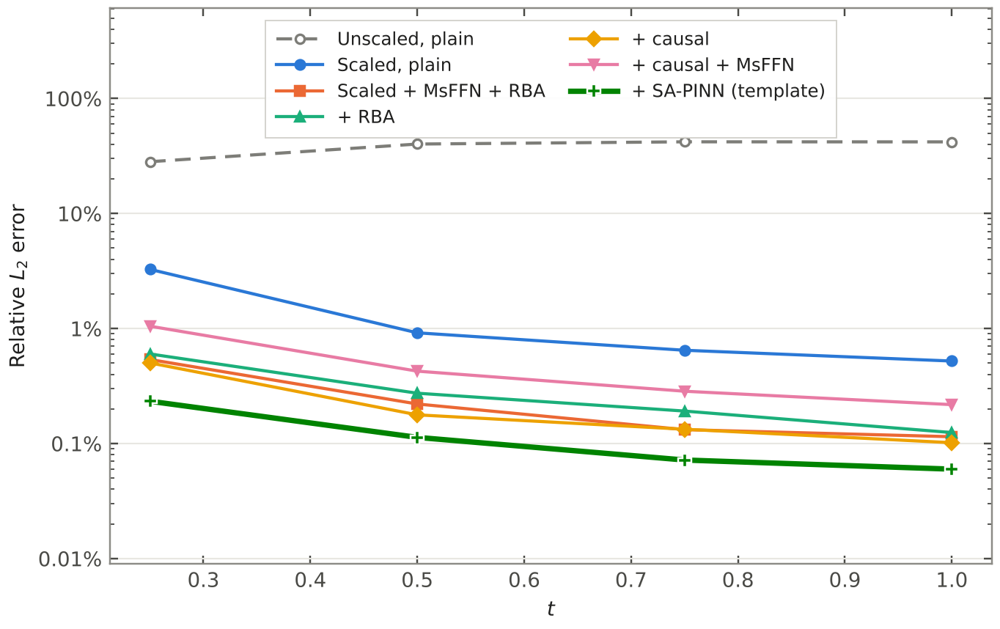
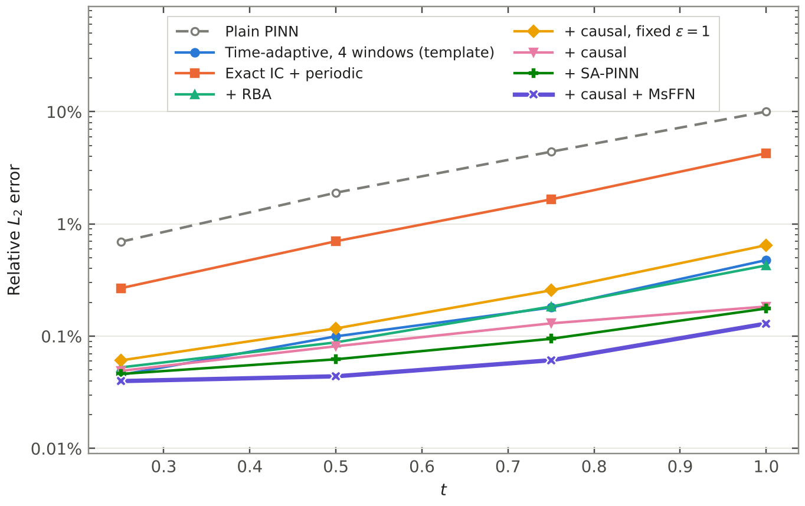
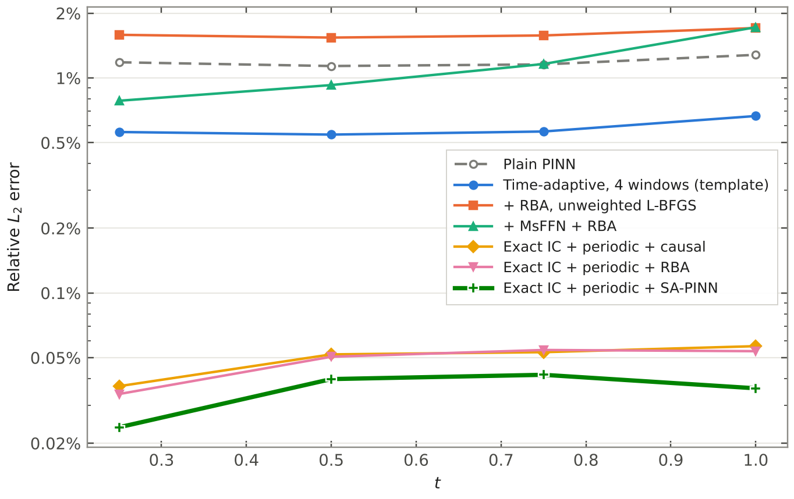
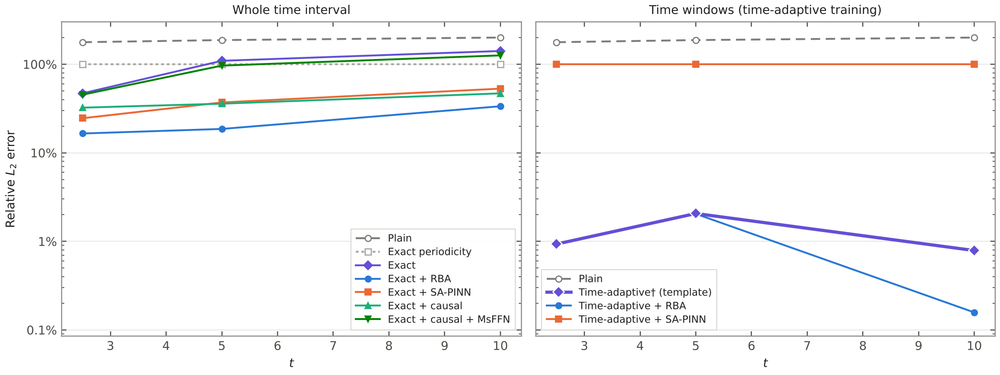
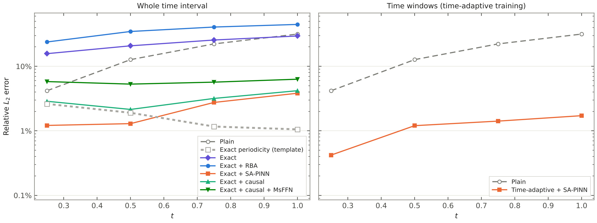
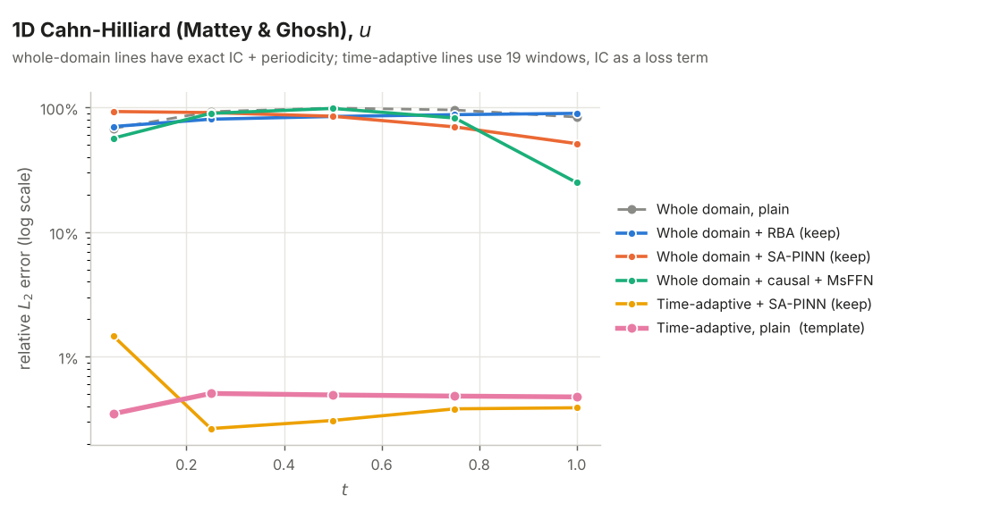
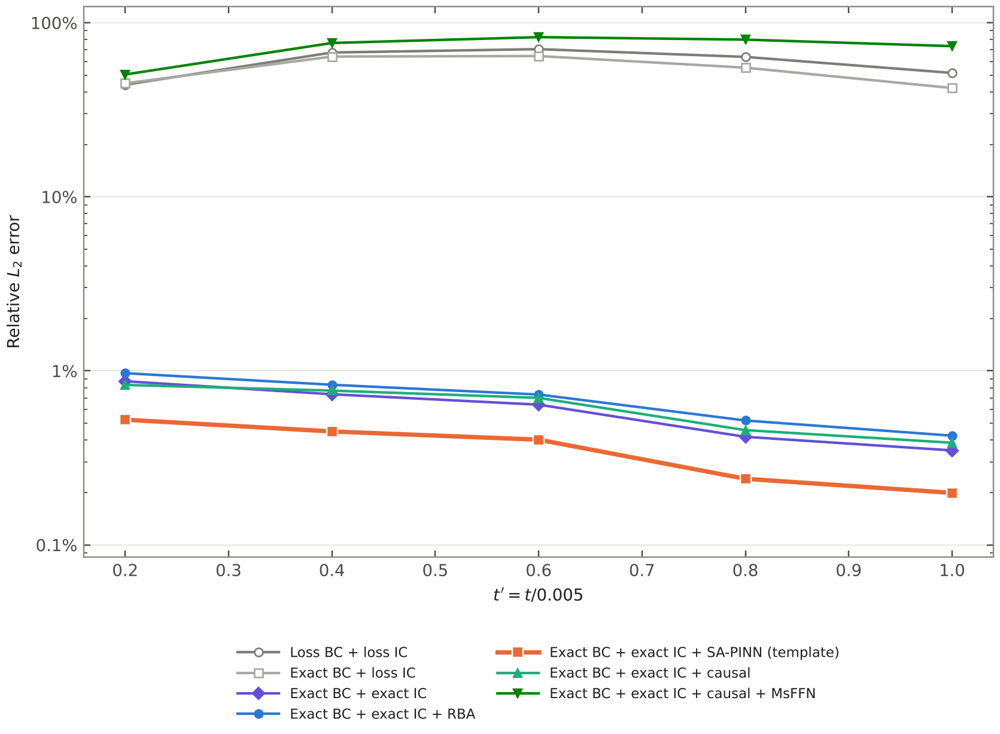
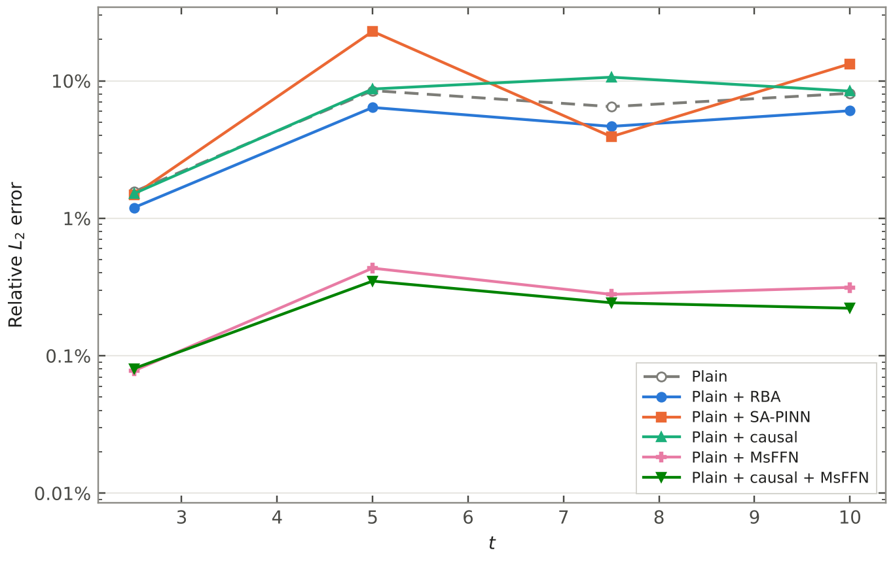
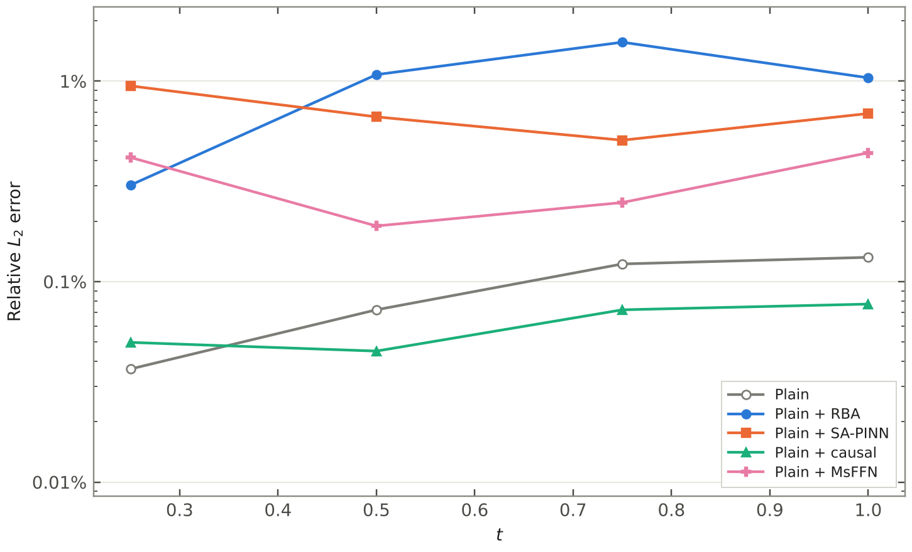

# Training methods study (October 2026)

Which published PINN training techniques actually help, tested with PINNStudio's own
templates on one GPU (RTX 4090). About 140 runs on 12 problems. Every number is the
relative L2 error of the main output against the reference data the template ships with
(PINNStudio's Error Analysis), at the template's own network and training settings unless
the row says otherwise.

**Figures.** Each example has a chart of the relative L2 error against time, one line per method (log scale; the dashed gray line is the plain PINN or another reference, the thick line the best setup). They are drawn from the runs' Error Analysis numbers in `figures/runs.json` by `make_figures.py`.

**Run-to-run noise.** Changing only the random seed moves the error by about ±20%
(1D Cahn-Hilliard, three seeds), so only differences of about 1.5x or more are real.

**Terms used below**

| Term | Meaning | Where in PINNStudio |
|---|---|---|
| Scaled | each equation written so its residual is O(1) (see 1D Cahn-Hilliard) | the equations / Output transform |
| Periodic | input embedding `cos(pi*x); sin(pi*x); t` (2D: also in y) -- periodic by construction | Boundary conditions → Exact periodicity (or Network → Input transform → Formula) |
| Hard IC | output transform `IC(x) + t*u` -- the initial condition holds exactly | Initial conditions → Exact (or Network → Output transform → Formula) |
| RBA | residual-based attention, per-point weights (Anagnostopoulos et al., CMAME 2024) | Loss weights → Per-point weights |
| SA-PINN | self-adaptive per-point weights (McClenny & Braga-Neto, JCP 2023) | Loss weights → Per-point weights |
| keep / plain L-BFGS | per-point weights kept during L-BFGS, or L-BFGS on the plain loss (the default) | Loss weights → During L-BFGS |
| Causal | causal training (Wang, Sankaran & Perdikaris, CMAME 2024) | Loss weights → Causal training |
| MsFFN | multi-scale Fourier feature network, scales `1, 5` | Network → Network type |
| Time-adaptive | time-marching in windows (Wight & Zhao) | Adaptive training → Method |

## Summary

| Problem | Plain PINN | Best | How |
|---|---|---|---|
| 1D Cahn-Hilliard | 28–42% unscaled; 0.4–3% scaled | 0.05–0.06% (t = 1) | scaling + periodic + hard IC + SA-PINN as in the paper (the template) |
| 1D Allen-Cahn, no time windows | 10% (t = 1) | 0.065–0.13% (t = 1) | periodic + hard IC + causal training (eps schedule) + MsFFN |
| 2D Allen-Cahn, Mattey & Ghosh (t ≤ 1) | 1.3% | 0.054–0.057% (25x) | periodic + hard IC + RBA, or + causal training (time-adaptive template: 0.67%) |
| 2D Allen-Cahn, Wight & Zhao (t ≤ 10) | 200% (fails) | 0.16–2.0% | time-adaptive + RBA + periodic (template alone 0.79–2.1%); best on the whole domain: RBA, 3.5–19% |
| 2D Cahn-Hilliard, Wight & Zhao | 16–30% (frozen) | 1.2% / 3.8% (t = 0.25 / 1) | smoothed initial condition + periodic + hard IC + SA-PINN as in the paper (the template) |
| 1D Cahn-Hilliard, Mattey & Ghosh | 84% (t = 1) | 0.29% / 0.48% (t = 0 / 1) | time-adaptive, 19 windows (10 of 0.01, then 9 of 0.1) + IC as a loss term + periodic (the template); every whole-domain setup failed |
| 2D Cahn-Hilliard, Mattey & Ghosh | 0.35% (t' = 1) | 0.20% (t' = 1) | periodic + hard IC + SA-PINN as in the paper (the template) |
| 3D Allen-Cahn, Wight & Zhao | – | 0.03% | periodic + IC as a loss term, weight 100 (the template); 0.7–0.8% with the exact IC, whatever the method |
| Klein-Gordon | 8% | 0.2–0.35% (25x) | MsFFN, or MsFFN + causal training |
| Kovasznay flow | 0.02–0.09% | 0.008–0.04% (2x) | MsFFN |
| 1D Burgers | 0.04–0.13% | same | nothing helps; several hurt |
| Diffusion-reaction 1D | 1.4–11% | same | causal training makes late times worse |
| Schrödinger 1D | 0.18% | same | nothing helps |
| Helmholtz 2D | 0.19% | same | nothing helps; MsFFN fails |

What worked: **scaling** the equations (the actual fix for Cahn-Hilliard); **hard IC +
periodic** on phase-field problems, then a weighting method on top -- **SA-PINN as in its
paper** (weights held during L-BFGS) on Cahn-Hilliard, **causal training with the paper's
eps schedule + MsFFN** on Allen-Cahn, **RBA** as a safe general choice; **MsFFN** (large
gains, but problem-dependent); **time-adaptive** training for long time ranges.
What did not: gradient-norm loss balancing (worse everywhere, removed); causal training with
one fixed eps (barely acts); causal training combined with per-point weights; SA-PINN with
the weights normalized (unstable across seeds); holding per-point weights during L-BFGS on
already-accurate problems (2–10x worse); separate u/mu networks; learning-rate decay.
Following the papers closely mattered: the first versions of causal training and SA-PINN
here left out the eps schedule and changed SA-PINN's weights, and both looked useless until
they were done as published (see *Checked against the papers*).

## 1D Cahn-Hilliard (u, t = 0.25 / 1)

Wight & Zhao (2021), mixed form u_t = mu_xx, mu = g2 (u^3 - u) - g1 u_xx, g1 = 1e-6, g2 = 0.01,
on [-1, 1] x [0, 1], periodic, 20k Adam + 20k L-BFGS, no time windows.

| Method | t = 0.25 | t = 1 |
|---|---|---|
| Unscaled template | 28% | 42% |
| Unscaled + causal (eps 1 / 10 / 100) | 25–30% | 42–69% |
| Unscaled + gradient-norm balancing | 28% | 41% |
| **Scaled template** (3 seeds) | **2.2–3.3%** | **0.40–0.52%** |
| + causal eps 1 (32 / 16 chunks) | 2.7–4.7% | 0.43–0.93% |
| + gradient-norm balancing | 19% | 6.5% |
| + time-adaptive (4 windows) | 3.4% | 0.41% |
| + separate u/mu networks (PFNN) | 2.5% | 0.39% |
| + periodic | 2.0% | 0.46% |
| + SA-PINN, mean-1 (keep) | 1.8% | 0.40% |
| + RBA (keep) | 1.1% | 0.30% |
| + SA-PINN, original (keep) | 0.91% | 0.24% |
| + RBA + periodic (plain L-BFGS) | 1.2% | 0.26% |
| + RBA + periodic + LR decay (keep) | 1.1% | 0.29% |
| + RBA + periodic (keep) | 0.78% | 0.17% |
| + MsFFN (2 seeds) | 1.4–1.5% | 0.17–0.25% |
| + MsFFN + SA-PINN (keep) | 0.97% | 0.21% |
| + MsFFN + RBA (plain L-BFGS) | 1.1% | 0.11% |
| **+ RBA + periodic + hard IC (keep)** | **0.60%** | **0.12%** |
| **+ MsFFN + RBA (keep)** (2 seeds) | **0.54–0.57%** | **0.11–0.14%** |

Second round, the methods as their papers describe them (all with periodic + hard IC):

| Method | t = 0.25 | t = 1 |
|---|---|---|
| + causal, eps schedule | 0.50% | 0.10% |
| + causal, eps schedule + MsFFN | 1.0% | 0.22% |
| + SA-PINN, mean-1 (keep) | 0.69% | 0.19% |
| **+ SA-PINN as in the paper (keep)** (3 seeds) | **0.21–0.23%** | **0.051–0.060%** |

SA-PINN as in the paper is now the template's setting (mu: 0.25–0.28% / 0.15–0.18%).

Physics check (runs with the mass/energy check): mass conserved to ~1e-4 and the free
energy decreasing at all 40 time samples in every run; E(1) = 5.80e-4 against the
reference 5.797e-4.

## 1D Allen-Cahn (u, t = 0.25 / 1)

Template settings with time-adaptive training switched off unless stated.

| Method | t = 0.25 | t = 1 |
|---|---|---|
| **Plain** (2 seeds) | **0.69–0.85%** | **10%** |
| + gradient-norm balancing | 74% | 99% |
| + SA-PINN, original | ~100% (diverged) | ~100% |
| + causal eps 100 (plain L-BFGS) | 15% | 67% |
| + causal eps 1 | 1.1% | 13% |
| + causal eps 10 | 0.24% | 12% |
| + RBA (keep) | 1.0% | 11% |
| + periodic | 0.54% | 9.8% |
| + SA-PINN mean-1 + periodic | 0.29% | 6.1% |
| + RBA + periodic (plain L-BFGS) | 0.40% | 7.0% |
| + RBA + periodic + LR decay | 0.26% | 5.7% |
| + SA-PINN mean-1 | 0.22% | 4.0% |
| + RBA + periodic (keep) | 0.22% | 4.2% |
| + MsFFN + SA-PINN (keep) | 1.4% | 13% |
| + MsFFN (2 seeds) | 0.08–0.12% | 1.8–2.3% |
| + MsFFN + RBA (plain L-BFGS) | 0.14% | 2.5% |
| + MsFFN + RBA (keep) (2 seeds) | 0.051–0.055% | 0.74–0.89% |
| **+ RBA + periodic + hard IC (keep)** | **0.050%** | **0.27%** |

Second round, the methods as their papers describe them, three seeds each (2026 / 1 / 2),
all with periodic + hard IC, no time windows:

| Method | t = 0.25 | t = 1 |
|---|---|---|
| Periodic + hard IC only | 0.27% | 4.3% |
| + RBA (keep) | 0.053 / 0.11 / 0.070% | 0.43 / 0.78 / 0.50% |
| + causal, fixed eps = 1 | 0.061% | 0.65% |
| + causal, eps schedule (paper) | 0.049 / 0.056 / 0.056% | 0.18 / 0.64 / 0.45% |
| + causal schedule + RBA | 0.18% | 1.8% |
| + SA-PINN, mean-1 (keep) | 0.053 / 0.31 / 0.14% | 0.10 / 2.7 / 1.05% |
| + SA-PINN as in the paper (keep) | 0.046 / 0.061 / 0.049% | 0.18 / 0.20 / 0.13% |
| **+ causal schedule + MsFFN** | **0.040 / 0.041 / 0.042%** | **0.13 / 0.12 / 0.065%** |

(The RBA row was 0.27% at t = 1 in the first round, with an earlier version of the code; the
current code gives 0.43% at seed 2026 every time -- two repeats were identical to the digit.) Causal training with the paper's schedule
and a Fourier-feature network is the most accurate and the most repeatable here; causal
training together with per-point weights is worse than either alone.
| Time-adaptive template (4 windows) | 0.05% | 0.48% |
| Time-adaptive + causal eps 1 / 10 | 0.07% | 0.57% / 0.81% |
| Time-adaptive + causal eps 100 | 25% | 86% |
| Time-adaptive + causal, eps schedule | 0.034% | 0.48% |
| Time-adaptive + gradient-norm balancing | 0.18% | 1.4% |

## 2D Allen-Cahn, Mattey & Ghosh (u, t = 0.25 / 1)

| Method | t = 0.25 | t = 1 |
|---|---|---|
| Time-adaptive template (4 windows) | 0.56% | 0.67% |
| Whole domain, plain | 1.2% | 1.3% |
| + RBA (plain L-BFGS) | 1.6% | 1.7% |
| + MsFFN + RBA (keep) | 0.78% | 1.7% |
| **+ RBA + periodic + hard IC (keep)** | **0.034%** | **0.054%** |
| + causal, eps schedule + periodic + hard IC | 0.037% | 0.057% |

## 2D Allen-Cahn, Wight & Zhao (u, t = 2.5 / 5 / 10)

| Method | t = 2.5 | t = 5 | t = 10 |
|---|---|---|---|
| **Time-adaptive template (10 windows)** | **0.93%** | **2.1%** | **0.79%** |
| Whole domain, plain | 177% | 187% | 200% |
| + MsFFN + RBA (keep) | 81% | 100% | 110% |
| + RBA + periodic + hard IC (keep) | 17% | 19% | 33% |
| + RBA (plain L-BFGS) | 3.5% | 5.7% | 19% |
| **Time-adaptive + RBA + periodic** | **0.92%** | **2.0%** | **0.16%** |

## 2D Cahn-Hilliard, Wight & Zhao (u, t = 0.25 / 1)

Two bubbles that merge, u_t = lap mu, mu = u^3 - u - 0.0025 lap u on [-1, 1]^2 (periodic),
t in [0, 1], 4 x 128 network, 20k Adam + 20k L-BFGS, periodic + hard IC, no time windows.
Leaving u at its initial condition would give 16% / 30%.

| Method | t = 0.25 | t = 1 |
|---|---|---|
| Paper's initial condition (a max of two tanh profiles), any of plain / RBA / causal / SA-PINN mean-1 | 13–15% | 27–31% |
| Smoothed initial condition, plain | 16% | 30% |
| Smoothed, + causal, eps schedule | 2.9% | 4.2% |
| **Smoothed, + SA-PINN as in the paper (keep)** | **1.2%** | **3.8%** |
| Smoothed, + SA-PINN, 6 x 128 network (the paper's size) | 3.5% | 3.3% |
| Smoothed, + SA-PINN, 40k Adam steps | 1.9% | 3.5% |
| Smoothed, + SA-PINN, time-adaptive (5 windows, 10k + 10k each), IC as a loss term | 0.42% | 1.7% |

A larger network or twice the Adam steps didn't help, so the template keeps 4 x 128 and
20k + 20k. Time-adaptive training, the paper's own method here, is better after t = 0
(1.2–1.7% from t = 0.5 on), but its initial condition is only fitted to 3.2%, and it takes
about 25 minutes instead of 15; the template stays on the whole domain, and time-adaptive
training is one setting away (Adaptive training → Time Adaptive Training).

With the paper's initial condition every setup learned an almost frozen solution: the max
has a corner where the bubbles touch, and that corner's curvature is what drives the merging,
but a network built on the exact initial condition sees no curvature in a corner (autograd
gives no second derivative there). The template writes the max as tanh((r - min(R1, R2))/2eps)
with the min smoothed, (R1 + R2 - sqrt((R1 - R2)^2 + 0.0004))/2 (u changes by 0.5%, along the
line where the bubbles meet), and the reference data uses the same formula.

## 1D Cahn-Hilliard, Mattey & Ghosh (u, t = 0.05 / 0.25 / 1)

u_t = (u^3 - u - 0.02 u_xx)_xx on [-1, 1] (periodic), u(x, 0) = cos(pi x) - exp(-4 (pi x)^2),
t in [0, 1] (Mattey & Ghosh 2022, eq. 25), whole domain, periodic + hard IC, 20k Adam + 20k
L-BFGS. The narrow Gaussian in the initial condition makes the solution change very fast
early on (it is reshaped well before t = 0.05), then settle. The paper's own plain PINN fails
here too (86% error over the whole domain); it is solved with their bc-PINN, which trains
time segments one after another.

| Method | t = 0.05 | t = 0.25 | t = 1 |
|---|---|---|---|
| Plain | 68% | 93% | 84% |
| + RBA (keep) | 71% | 81% | 90% |
| + causal, eps schedule | 66% | 93% | 77% |
| + causal schedule + MsFFN | 57% | 90% | 25% |
| + SA-PINN as in the paper (keep) | 93% | 91% | 51% |
| **Time-adaptive, 19 windows, IC as a loss term (the template)** | **0.35%** | **0.51%** | **0.48%** |
| Time-adaptive, 19 windows, + SA-PINN (keep) | 1.5% | 0.27% | 0.39% |

Time-adaptive training does what the paper's bc-PINN does: 10 windows of 0.01 cover the fast
start, then 9 windows of 0.1, each started from the previous network (L-BFGS transfer),
5k Adam + 5k L-BFGS per window, the IC (and each window's start) as a loss term with weight
100. Plain windows are the template: SA-PINN is a little better later on but fits the start
4x worse (9.4% at t = 0, against 0.29%). mu's relative error is larger (3-13% after the
merge) because mu is nearly zero once the phases have settled.

## 2D Cahn-Hilliard, Mattey & Ghosh (u, t' = 0.2 / 0.6 / 1)

Stripes that sharpen into two phases, u_t' = 0.005 lap mu, mu = u^3 - u - 0.0002 lap u on
[0, 1]^2 (periodic), u(x, y, 0) = 0.4 cos(4 pi x) cos(4 pi (x + y)), t' = t / 0.005 in [0, 1]
(Mattey & Ghosh 2022, IBVP-2; alpha = 0.0002 reproduces the paper's figures, the stated 0.02
makes the pattern decay), 4 x 128 network, 20,000 points, 20k Adam + 20k L-BFGS, periodic +
hard IC.

| Method | t' = 0.2 | t' = 0.6 | t' = 1 |
|---|---|---|---|
| Plain | 0.87% | 0.64% | 0.35% |
| + RBA (keep) | 0.97% | 0.73% | 0.42% |
| + causal, eps schedule | 0.83% | 0.70% | 0.39% |
| **+ SA-PINN as in the paper (keep) (the template)** | **0.52%** | **0.40%** | **0.20%** |

## 3D Allen-Cahn, Wight & Zhao (u, t = 0.25 / 1)

A shrinking sphere, u_t = 0.025 lap u - 10 (u^3 - u) on [0, 1]^3 (periodic), t in [0, 1],
4 x 128 network, 30,000 points, 20k Adam + 20k L-BFGS, exact periodicity.

| Method | t = 0.25 | t = 1 |
|---|---|---|
| Exact IC (u = IC + t N) | 0.81% | 0.72% |
| Exact IC + RBA (keep) | 0.81% | 0.72% |
| Exact IC + causal, eps schedule | 0.81% | 0.72% |
| Exact IC + SA-PINN as in the paper (keep) | 0.81% | 0.72% |
| **IC as a loss term, weight 100 (the template)** | **0.030%** | **0.027%** |

With the exact IC every method lands on the same error to three digits (the logs confirm RBA
and the causal schedule were active), so the limit is the t N form itself: the tanh profile
relaxes quickly at the start, and the network has to produce that change through t N.
Training the IC as a loss term instead gives 25 times less error. (A first soft-IC attempt,
made by only clearing the exact-IC box in a script, left the IC loss switched off and gave
100% error; through the GUI, clearing the box turns the IC loss on with weight 100.)
On the slice z = 0.5 the sphere stays round, and the largest pointwise error, about 0.013, sits
on the interface.

## Klein-Gordon (t = 2.5 / 5 / 7.5 / 10)

| Method | 2.5 | 5 | 7.5 | 10 |
|---|---|---|---|---|
| **Plain** | **1.6%** | **8.5%** | **6.5%** | **8.1%** |
| + RBA (keep) | 1.2% | 6.4% | 4.7% | 6.1% |
| + SA-PINN mean-1 (keep) | 0.15% | 0.55% | 0.41% | 0.61% |
| + RBA (plain L-BFGS) | 0.10% | 0.67% | 0.41% | 0.68% |
| **+ MsFFN** | **0.08%** | **0.43%** | **0.28%** | **0.31%** |
| + causal, eps schedule | 1.5% | 8.7% | 11% | 8.4% |
| + SA-PINN as in the paper (keep) | 1.5% | 23% | 3.9% | 13% |
| **+ causal, eps schedule + MsFFN** | **0.08%** | **0.35%** | **0.24%** | **0.22%** |

## 1D Burgers (t = 0.25 / 0.5 / 0.75 / 1)

| Method | 0.25 | 0.5 | 0.75 | 1 |
|---|---|---|---|---|
| **Plain** | **0.04%** | **0.07%** | **0.12%** | **0.13%** |
| + RBA (keep) | 0.30% | 1.1% | 1.6% | 1.0% |
| + SA-PINN (keep) | 0.22% | 0.76% | 2.0% | 1.3% |
| + MsFFN | 0.42% | 0.19% | 0.25% | 0.44% |
| + SA-PINN (plain L-BFGS) | 0.07% | 0.15% | 0.09% | 0.12% |
| + RBA (plain L-BFGS) | 0.05% | 0.04% | 0.08% | 0.05% |
| + causal, eps schedule | 0.05% | 0.05% | 0.07% | 0.08% |
| + SA-PINN as in the paper (keep) | 0.95% | 0.66% | 0.51% | 0.69% |

## Diffusion-reaction 1D (DeepXDE's example; t = 0.25 / 0.5 / 0.75 / 1)

| Method | 0.25 | 0.5 | 0.75 | 1 |
|---|---|---|---|---|
| Plain | 1.4% | 3.4% | 6.7% | 11% |
| + causal, eps schedule | 0.98% | 2.5% | 10% | 32% |

## Steady and other problems

| Problem | Plain | + RBA (keep) | + RBA (plain L-BFGS) | + SA-PINN (keep) | + MsFFN |
|---|---|---|---|---|---|
| Schrödinger 1D (worst of 6 times) | 0.18% | 0.19% | – | 0.88% | – |
| Helmholtz 2D (Adam only) | 0.19% | 0.41% | 0.41% | 5.2% | ~100% |
| Kovasznay u / v / p | 0.021 / 0.090 / 0.054% | 0.054 / 0.23 / 0.13% | 0.016 / 0.086 / 0.048% | 0.032 / 0.12 / 0.059% | 0.0077 / 0.040 / 0.036% |

## Recommendations for a hard problem

1. Scale the equations so every residual is O(1).
2. Enforce what is known exactly: the initial condition (hard IC) and periodicity. Write the
   initial condition as a smooth formula -- a corner (max, abs) carries curvature the network
   can't see. Compare the hard IC with the IC as a loss term (weight 100): on 3D Allen-Cahn
   the loss term was 25 times more accurate.
3. Add one weighting method: RBA (cheap, safe), SA-PINN with the weights held during L-BFGS
   (best on Cahn-Hilliard), or causal training with the eps schedule (best on Allen-Cahn,
   with MsFFN). Not causal training and per-point weights together.
4. Try MsFFN for sharp or multi-scale solutions -- and compare, it can hurt.
5. For long time ranges, use time-adaptive training.
6. Always compare against a plain run: on problems a plain PINN already solves well,
   most of these add nothing or make the result worse.

## Checked against the papers

Each method was compared, step by step, with the paper it comes from.

**RBA** (Anagnostopoulos et al. 2024). Same update, lambda <- gamma*lambda + eta*|r|/max|r|
(their eq. 12), the same gamma = 0.999 and eta = 0.01, applied to the PDE residual only,
with no gradient through lambda. Differences: our weights start at 1 (theirs at 0), and
we offer L-BFGS after Adam (the paper uses Adam only). The paper's Allen-Cahn numbers
(e.g. 5.2e-3 with RBA alone, 5.8e-5 with everything) come from 300k Adam steps on 25,600
points with a modified MLP; our runs use 20k Adam + 20k L-BFGS, so lower accuracy here is
budget, not the method.

**Exact periodicity** (Dong & Ni 2021). The C-infinity periodic layer: each first-layer
neuron sees cos(wx) and sin(wx), w = 2*pi/L, which spans the paper's
sigma(A cos(wx + phi) + c). One difference: the paper builds one such layer per axis
(its eq. 11); ours feeds all axes' features into one shared first layer. The Ck version
(Hermite) is not implemented.

**Causal training** (Wang, Sankaran & Perdikaris 2024). Same weights,
w_i = exp(-eps * sum_{k<i} L_k) on the mean squared residual of each time chunk (their
eq. 3.2), with no gradient through w. The first version here used one fixed eps; the
paper's Algorithm 1 instead raises eps through 0.01, 0.1, 1, 10, 100, moving on once all
weights are above 0.99 -- now the default ("Raise eps step by step"). With fixed eps = 1
the weights on 1D Allen-Cahn stayed at 0.98, i.e. causal training barely acted, which is
why it looked useless in the first round of tests. Remaining differences: the paper also
puts the initial-condition loss in front of the chain (chunk 0) -- irrelevant when the
initial condition is exact; and we hold the weights during L-BFGS (the paper uses Adam
only).

**SA-PINN** (McClenny & Braga-Neto 2023). One trainable weight per point, trained by
gradient ascent with Adam at learning rate 5e-3 (their Section 4.5), mask lambda^2 (one of
their example masks), weights held during L-BFGS ("Keep the weights" here). Differences:
the paper also weights the initial-condition points (and starts them at U(0, 100) for
Allen-Cahn) -- here only PDE points are weighted, which again doesn't matter with an
exact initial condition; weights start at 1 (the paper: random in [0, 1], 1 allowed); the
option "Keep the mean weight at 1" is ours, not the paper's (unticked = the paper).

## References

- **RBA** — Anagnostopoulos, Toscano, Stergiopulos & Karniadakis (2024), Residual-based attention in physics-informed neural networks, *CMAME* 421, 116805, [doi:10.1016/j.cma.2024.116805](https://doi.org/10.1016/j.cma.2024.116805), [arXiv:2307.00379](https://arxiv.org/abs/2307.00379)
- **SA-PINN** — McClenny & Braga-Neto (2023), Self-adaptive physics-informed neural networks, *J. Comput. Phys.* 474, 111722, [doi:10.1016/j.jcp.2022.111722](https://doi.org/10.1016/j.jcp.2022.111722), [arXiv:2009.04544](https://arxiv.org/abs/2009.04544)
- **Causal training** — Wang, Sankaran & Perdikaris (2024), Respecting causality for training physics-informed neural networks, *CMAME* 421, 116813, [doi:10.1016/j.cma.2024.116813](https://doi.org/10.1016/j.cma.2024.116813), [arXiv:2203.07404](https://arxiv.org/abs/2203.07404)
- **Gradient-norm loss balancing** (tested, removed) — Wang, Teng & Perdikaris (2021), Understanding and mitigating gradient flow pathologies in physics-informed neural networks, *SIAM J. Sci. Comput.* 43(5), A3055–A3081, [doi:10.1137/20M1318043](https://doi.org/10.1137/20M1318043)
- **Hard initial condition** — Lagaris, Likas & Fotiadis (1998), Artificial neural networks for solving ordinary and partial differential equations, *IEEE Trans. Neural Netw.* 9(5), 987–1000, [doi:10.1109/72.712178](https://doi.org/10.1109/72.712178)
- **Exact periodicity** — Dong & Ni (2021), A method for representing periodic functions and enforcing exactly periodic boundary conditions with deep neural networks, *J. Comput. Phys.* 435, 110242, [doi:10.1016/j.jcp.2021.110242](https://doi.org/10.1016/j.jcp.2021.110242)
- **MsFFN** — Wang, Wang & Perdikaris (2021), On the eigenvector bias of Fourier feature networks, *CMAME* 384, 113938, [doi:10.1016/j.cma.2021.113938](https://doi.org/10.1016/j.cma.2021.113938)
- **Time-adaptive training and the Allen-Cahn / Cahn-Hilliard problems** — Wight & Zhao (2021), *Commun. Comput. Phys.* 29(3), 930–954, [doi:10.4208/cicp.OA-2020-0086](https://doi.org/10.4208/cicp.OA-2020-0086); Mattey & Ghosh (2022), *CMAME* 390, 114474, [doi:10.1016/j.cma.2021.114474](https://doi.org/10.1016/j.cma.2021.114474)
