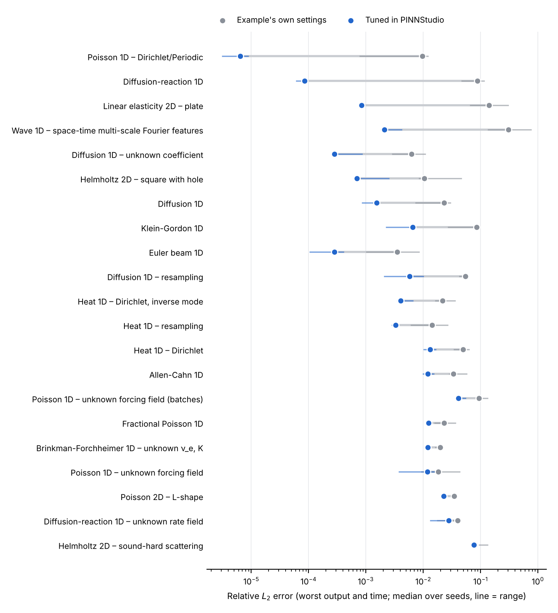

# Tuning study

*PINNStudio, October 2026*

DeepXDE's examples are written to show how the library is used, so many train briefly, on a small network or with Adam only. This study asks how far ordinary tuning in PINNStudio takes them: each example is run with its own settings and with the same five changes, and the change that trains best is reported next to the example's own result. It complements the [training methods study](training_methods.md), which tests specialised methods (causal training, per-point weights, time windows) on the hardest problems.

So far 21 problems are included, chosen as the ones with the largest errors in the [README results](../README.md). 19 of them improve by 1.5× or more; the median improvement is 5×.

## How it is done

| Variant | What changes |
|---|---|
| **base** | the example's own settings |
| **iters** | 3× the iterations of every training phase |
| **net** | hidden layers twice as wide (at most 512) and one layer more |
| **points** | 3× the domain, boundary and initial points |
| **lbfgs** | an L-BFGS phase (15,000 iterations) after Adam |
| **all** | all of the changes above together |

- **Choosing a variant.** For each problem the variant with the lowest final training loss is chosen. The reference solution is not looked at, so the choice is one a user could make without knowing the answer. The best error any variant reached is listed too, so it is visible when the training loss picks a less accurate variant.
- **The error** is the relative $L_2$ error from PINNStudio's Error Analysis, the worst over the outputs and the reference times, against the reference data the example ships with. For inverse problems the worst relative error of the learned parameters is given as well.
- **Seeds.** The example's own settings and the chosen variant are run with up to 3 random seeds (1, 2 and 2026); tables give the median and, in brackets, the range. The screening of all variants uses seed 2026.
- **Hardware.** One NVIDIA RTX 4090, PyTorch backend, PINNStudio 1.5. Times are wall-clock training time per run.
- **Reproducing a result.** Each problem's section links the tuned settings as a problem file in [`tuning/`](tuning/): open it in PINNStudio (*Open a saved problem…*) and press Solve. The runs were made with [`tools/tuning_study.py`](../tools/tuning_study.py) and this page is written from its results by [`tools/make_tuning_page.py`](../tools/make_tuning_page.py).

## Summary

| Problem | Own settings: $L_2$ | Tuned: $L_2$ | Improvement | Chosen variant | Parameter error: own → tuned | Time (s): own → tuned |
|---|---|---|---|---|---|---|
| [Poisson 1D – Dirichlet/Periodic](#tune-poisson-1d-dirichlet-periodic) | 9.6 × 10-3 | 6.4 × 10-6 | 1,495× | all | – | 20 → 67 |
| [Diffusion-reaction 1D](#tune-diffusion-reaction-1d) | 8.8 × 10-2 | 8.5 × 10-5 | 1,034× | all | – | 87 → 290 |
| [Linear elasticity 2D – plate](#tune-linear-elasticity-2d-plate) | 1.4 × 10-1 | 8.4 × 10-4 | 166× | all | – | 541 → 1147 |
| [Wave 1D – space-time multi-scale Fourier features](#tune-wave-1d-space-time-multi-scale-fourier-features) | 3.0 × 10-1 | 2.1 × 10-3 | 145× | all | – | 75 → 645 |
| [Diffusion 1D – unknown coefficient](#tune-diffusion-1d-unknown-coefficient) | 6.2 × 10-3 | 2.8 × 10-4 | 22× | all | 0.045% → 0.017% | 118 → 380 |
| [Helmholtz 2D – square with hole](#tune-helmholtz-2d-square-with-hole) | 1.1 × 10-2 | 7.0 × 10-4 | 15× | lbfgs | – | 17 → 24 |
| [Diffusion 1D](#tune-diffusion-1d) | 2.3 × 10-2 | 1.5 × 10-3 | 15× | all | – | 26 → 76 |
| [Klein-Gordon 1D](#tune-klein-gordon-1d) | 8.5 × 10-2 | 6.6 × 10-3 | 13× | net | – | 60 → 151 |
| [Euler beam 1D](#tune-euler-beam-1d) | 3.5 × 10-3 | 2.8 × 10-4 | 12× | all | – | 55 → 217 |
| [Diffusion 1D – resampling](#tune-diffusion-1d-resampling) | 5.4 × 10-2 | 5.8 × 10-3 | 9× | lbfgs | – | 8 → 12 |
| [Heat 1D – Dirichlet, inverse mode](#tune-heat-1d-dirichlet-inverse-mode) | 2.2 × 10-2 | 4.1 × 10-3 | 5× | all | 0.69% → 0.1% | 50 → 146 |
| [Heat 1D – resampling](#tune-heat-1d-resampling) | 1.4 × 10-2 | 3.3 × 10-3 | 4× | all | – | 509 → 2060 |
| [Heat 1D – Dirichlet](#tune-heat-1d-dirichlet) | 5.0 × 10-2 | 1.3 × 10-2 | 4× | all | – | 42 → 128 |
| [Allen-Cahn 1D](#tune-allen-cahn-1d) | 3.4 × 10-2 | 1.2 × 10-2 | 3× | all | – | 210 → 438 |
| [Poisson 1D – unknown forcing field (batches)](#tune-poisson-1d-unknown-forcing-field-batches) | 9.3 × 10-2 | 4.1 × 10-2 | 2× | all | – | 62 → 215 |
| [Fractional Poisson 1D](#tune-fractional-poisson-1d) | 2.3 × 10-2 | 1.2 × 10-2 | 2× | all | – | 20 → 57 |
| [Brinkman-Forchheimer 1D – unknown ν_e, K](#tune-brinkman-forchheimer-1d-unknown-e-k) | 2.0 × 10-2 | 1.2 × 10-2 | 2× | all | 28% → 18% | 74 → 237 |
| [Poisson 1D – unknown forcing field](#tune-poisson-1d-unknown-forcing-field) | 1.8 × 10-2 | 1.2 × 10-2 | 2× | all | – | 66 → 221 |
| [Poisson 2D – L-shape](#tune-poisson-2d-l-shape) | 3.5 × 10-2 | 2.3 × 10-2 | 2× | net | – | 174 → 182 |
| [Diffusion-reaction 1D – unknown rate field](#tune-diffusion-reaction-1d-unknown-rate-field) | 4.0 × 10-2 | 2.8 × 10-2 | none | all | – | 49 → 178 |
| [Helmholtz 2D – sound-hard scattering](#tune-helmholtz-2d-sound-hard-scattering) | 8.0 × 10-2 | 7.7 × 10-2 | none | all | – | 61 → 1017 |

## Problems

Click a problem to open its results.

<strong>Poisson 1D – Dirichlet/Periodic</strong>

Its own settings and results are in the README: [Poisson 1D – Dirichlet/Periodic](../README.md#dx-poisson-1d-dirichlet-periodic).

**Own settings:** network [1, 50, 50, 50, 1], Adam 10,000, 16 domain / 2 boundary / 0 initial points.

| Variant | Final training loss | $L_2$ (worst) | Parameter error | Time (s) |
|---|---|---|---|---|
| base | 1.30e-03 | 1.2 × 10-2 | – | 20 |
| iters | 1.40e-05 | 1.1 × 10-3 | – | 54 |
| net | 5.53e-04 | 2.6 × 10-3 | – | 22 |
| points | 5.12e-05 | 1.6 × 10-3 | – | 20 |
| lbfgs | 3.53e-06 | 3.5 × 10-5 | – | 21 |
| **all** | 4.71e-07 | 3.2 × 10-6 | – | 67 |

**Chosen: all** (all of the changes above together): network [1, 100, 100, 100, 100, 1], Adam 30,000 → L-BFGS 15,000, 48 / 6 / 0 points.

Over seeds: own settings 9.6 × 10-3 [7.9 × 10-4 – 1.2 × 10-2] (3 seeds), tuned 6.4 × 10-6 [3.2 × 10-6 – 8.8 × 10-6] (3 seeds).

Tuned settings: [`Poisson 1D – Dirichlet - Periodic (tuned).pinn.json`](tuning/Poisson%201D%20–%20Dirichlet%20-%20Periodic%20(tuned).pinn.json)

<strong>Diffusion-reaction 1D</strong>

Its own settings and results are in the README: [Diffusion-reaction 1D](../README.md#dx-diffusion-reaction-equation).

**Own settings:** network [2, 30, 30, 30, 30, 30, 30, 1], Adam 20,000, 320 domain / 0 boundary / 0 initial points.

| Variant | Final training loss | $L_2$ (worst) | Parameter error | Time (s) |
|---|---|---|---|---|
| base | 4.91e-03 | 1.1 × 10-1 | – | 88 |
| iters | 5.18e-04 | 2.3 × 10-2 | – | 251 |
| net | 4.57e-03 | 3.3 × 10-2 | – | 94 |
| points | 7.76e-03 | 5.2 × 10-2 | – | 89 |
| lbfgs | 1.19e-05 | 5.0 × 10-4 | – | 98 |
| **all** | 1.13e-06 | 8.5 × 10-5 | – | 290 |

**Chosen: all** (all of the changes above together): network [2, 60, 60, 60, 60, 60, 60, 60, 1], Adam 60,000 → L-BFGS 15,000, 960 / 0 / 0 points.

Over seeds: own settings 8.8 × 10-2 [4.7 × 10-2 – 1.1 × 10-1] (3 seeds), tuned 8.5 × 10-5 [6.1 × 10-5 – 9.0 × 10-5] (3 seeds).

Tuned settings: [`Diffusion-reaction 1D (tuned).pinn.json`](tuning/Diffusion-reaction%201D%20(tuned).pinn.json)

<strong>Linear elasticity 2D – plate</strong>

Its own settings and results are in the README: [Linear elasticity 2D – plate](../README.md#dx-linear-elastostatic-plate).

**Own settings:** network [2, 40, 40, 40, 40, 5], Adam 20,000 → L-BFGS 20,000, 500 domain / 500 boundary / 0 initial points.

| Variant | Final training loss | $L_2$ (worst) | Parameter error | Time (s) |
|---|---|---|---|---|
| base | 7.48e-05 | 6.7 × 10-2 | – | 498 |
| iters | 5.57e-05 | 9.2 × 10-2 | – | 1010 |
| net | 1.92e-05 | 8.7 × 10-3 | – | 485 |
| points | 1.12e-05 | 1.3 × 10-3 | – | 476 |
| **all** | 9.21e-06 | 8.0 × 10-4 | – | 1100 |

**Chosen: all** (all of the changes above together): network [2, 80, 80, 80, 80, 80, 5], Adam 60,000 → L-BFGS 60,000, 1,500 / 1,500 / 0 points.

Over seeds: own settings 1.4 × 10-1 [6.7 × 10-2 – 3.0 × 10-1] (3 seeds), tuned 8.4 × 10-4 [8.0 × 10-4 – 8.7 × 10-4] (3 seeds).

Tuned settings: [`Linear elasticity 2D – plate (tuned).pinn.json`](tuning/Linear%20elasticity%202D%20–%20plate%20(tuned).pinn.json)

<strong>Wave 1D – space-time multi-scale Fourier features</strong>

Its own settings and results are in the README: [Wave 1D – space-time multi-scale Fourier features](../README.md#dx-wave-propagation-space-time-multi-scale-fourier-features).

**Own settings:** network [2, 100, 100, 100, 1], Adam 10,000, 360 domain / 360 boundary / 360 initial points.

| Variant | Final training loss | $L_2$ (worst) | Parameter error | Time (s) |
|---|---|---|---|---|
| base | 9.24e-04 | 1.4 × 10-1 | – | 75 |
| iters | 1.27e-04 | 8.5 × 10-3 | – | 220 |
| net | 9.09e-04 | 4.2 × 10-2 | – | 86 |
| points | 7.59e-04 | 1.1 × 10-1 | – | 75 |
| lbfgs | 1.07e-06 | 1.6 × 10-1 | – | 178 |
| **all** | 9.92e-07 | 4.2 × 10-3 | – | 645 |

**Chosen: all** (all of the changes above together): network [2, 200, 200, 200, 200, 1], Adam 30,000 → L-BFGS 15,000, 1,080 / 1,080 / 1,080 points.

Over seeds: own settings 3.0 × 10-1 [1.4 × 10-1 – 7.6 × 10-1] (3 seeds), tuned 2.1 × 10-3 [1.8 × 10-3 – 4.2 × 10-3] (3 seeds).

Adding L-BFGS reaches almost the lowest training loss but a worse error (0.16), one of the cases where the training loss and the error do not agree. With every change together the error is about 150 times lower, and it barely changes between seeds while the example's own settings give 0.14 to 0.76.

Tuned settings: [`Wave 1D – space-time multi-scale Fourier features (tuned).pinn.json`](tuning/Wave%201D%20–%20space-time%20multi-scale%20Fourier%20features%20(tuned).pinn.json)

<strong>Diffusion 1D – unknown coefficient</strong>

Its own settings and results are in the README: [Diffusion 1D – unknown coefficient](../README.md#dx-inverse-diffusion-equation).

**Own settings:** network [2, 32, 32, 32, 1], Adam 50,000, 40 domain / 20 boundary / 10 initial points.

| Variant | Final training loss | $L_2$ (worst) | Parameter error | Time (s) |
|---|---|---|---|---|
| base | 4.43e-05 | 1.1 × 10-2 | 0.045% | 107 |
| iters | 3.89e-06 | 2.0 × 10-3 | 0.004% | 311 |
| net | 7.61e-05 | 1.5 × 10-2 | 0.17% | 127 |
| points | 2.57e-04 | 1.6 × 10-2 | 0.17% | 106 |
| lbfgs | 1.98e-06 | 2.2 × 10-3 | 0.081% | 111 |
| **all** | 4.88e-07 | 2.8 × 10-4 | 0.017% | 380 |

**Chosen: all** (all of the changes above together): network [2, 64, 64, 64, 64, 1], Adam 150,000 → L-BFGS 15,000, 120 / 60 / 30 points.

Over seeds: own settings 6.2 × 10-3 [2.9 × 10-3 – 1.1 × 10-2] (3 seeds), tuned 2.8 × 10-4 [2.7 × 10-4 – 8.5 × 10-4] (3 seeds).
 Learned parameters (tuned, median): C = 1.00017 (true 1.0).

Tuned settings: [`Diffusion 1D – unknown coefficient (tuned).pinn.json`](tuning/Diffusion%201D%20–%20unknown%20coefficient%20(tuned).pinn.json)

<strong>Helmholtz 2D – square with hole</strong>

Its own settings and results are in the README: [Helmholtz 2D – square with hole](../README.md#dx-helmholtz-2d-with-a-hole).

**Own settings:** network [2, 350, 350, 350, 1], Adam 5,000, 225 domain / 240 boundary / 0 initial points.

| Variant | Final training loss | $L_2$ (worst) | Parameter error | Time (s) |
|---|---|---|---|---|
| base | 1.17e+00 | 4.6 × 10-2 | – | 17 |
| iters | 1.98e-02 | 5.8 × 10-3 | – | 40 |
| net | 5.85e-02 | 1.1 × 10-2 | – | 18 |
| points | 5.11e-02 | 1.6 × 10-2 | – | 18 |
| **lbfgs** | 1.13e-04 | 7.0 × 10-4 | – | 24 |
| all | 8.82e-04 | 2.6 × 10-3 | – | 79 |

**Chosen: lbfgs** (an L-BFGS phase (15,000 iterations) after Adam): network [2, 350, 350, 350, 1], Adam 5,000 → L-BFGS 15,000, 225 / 240 / 0 points.

Over seeds: own settings 1.1 × 10-2 [8.5 × 10-3 – 4.6 × 10-2] (3 seeds), tuned 7.0 × 10-4 [6.7 × 10-4 – 2.5 × 10-3] (3 seeds).

An L-BFGS phase after Adam is all it needs: about 15 times lower error for 7 seconds more training.

Tuned settings: [`Helmholtz 2D – square with hole (tuned).pinn.json`](tuning/Helmholtz%202D%20–%20square%20with%20hole%20(tuned).pinn.json)

<strong>Diffusion 1D</strong>

Its own settings and results are in the README: [Diffusion 1D](../README.md#dx-diffusion-equation).

**Own settings:** network [2, 32, 32, 32, 1], Adam 10,000, 40 domain / 20 boundary / 10 initial points.

| Variant | Final training loss | $L_2$ (worst) | Parameter error | Time (s) |
|---|---|---|---|---|
| base | 6.19e-04 | 3.0 × 10-2 | – | 23 |
| iters | 2.66e-05 | 1.1 × 10-2 | – | 61 |
| net | 6.62e-04 | 1.5 × 10-2 | – | 26 |
| points | 3.51e-05 | 1.2 × 10-2 | – | 23 |
| lbfgs | 1.27e-06 | 4.4 × 10-3 | – | 25 |
| **all** | 1.25e-06 | 1.5 × 10-3 | – | 74 |

**Chosen: all** (all of the changes above together): network [2, 64, 64, 64, 64, 1], Adam 30,000 → L-BFGS 15,000, 120 / 60 / 30 points.

Over seeds: own settings 2.3 × 10-2 [7.5 × 10-3 – 3.0 × 10-2] (3 seeds), tuned 1.5 × 10-3 [8.7 × 10-4 – 1.7 × 10-3] (3 seeds).

Tuned settings: [`Diffusion 1D (tuned).pinn.json`](tuning/Diffusion%201D%20(tuned).pinn.json)

<strong>Klein-Gordon 1D</strong>

Its own settings and results are in the README: [Klein-Gordon 1D](../README.md#dx-klein-gordon-equation).

**Own settings:** network [2, 40, 40, 1], Adam 20,000 → L-BFGS 15,000, 30,000 domain / 1,500 boundary / 1,500 initial points.

| Variant | Final training loss | $L_2$ (worst) | Parameter error | Time (s) |
|---|---|---|---|---|
| base | 3.82e-04 | 8.5 × 10-2 | – | 55 |
| iters | 1.82e-05 | 3.3 × 10-2 | – | 156 |
| **net** | 7.07e-07 | 2.3 × 10-3 | – | 151 |
| points | 2.38e-06 | 1.7 × 10-2 | – | 159 |
| all | 8.86e-06 | 2.1 × 10-2 | – | 1214 |

**Chosen: net** (hidden layers twice as wide (at most 512) and one layer more): network [2, 80, 80, 80, 1], Adam 20,000 → L-BFGS 15,000, 30,000 / 1,500 / 1,500 points.

Over seeds: own settings 8.5 × 10-2 [2.8 × 10-2 – 8.6 × 10-2] (3 seeds), tuned 6.6 × 10-3 [2.3 × 10-3 – 6.9 × 10-3] (3 seeds).

The wider network alone is the best and steadiest change; with all the changes together the error is about three times higher.

Tuned settings: [`Klein-Gordon 1D (tuned).pinn.json`](tuning/Klein-Gordon%201D%20(tuned).pinn.json)

<strong>Euler beam 1D</strong>

Its own settings and results are in the README: [Euler beam 1D](../README.md#dx-euler-beam).

**Own settings:** network [1, 20, 20, 20, 1], Adam 10,000, 10 domain / 2 boundary / 0 initial points.

| Variant | Final training loss | $L_2$ (worst) | Parameter error | Time (s) |
|---|---|---|---|---|
| base | 4.64e-05 | 8.4 × 10-3 | – | 55 |
| iters | 9.30e-07 | 5.2 × 10-3 | – | 157 |
| net | 6.35e-04 | 8.2 × 10-3 | – | 74 |
| points | 2.12e-04 | 2.8 × 10-2 | – | 56 |
| lbfgs | 4.25e-07 | 2.4 × 10-4 | – | 59 |
| **all** | 1.44e-07 | 1.1 × 10-4 | – | 221 |

**Chosen: all** (all of the changes above together): network [1, 40, 40, 40, 40, 1], Adam 30,000 → L-BFGS 15,000, 30 / 6 / 0 points.

Over seeds: own settings 3.5 × 10-3 [1.0 × 10-3 – 8.4 × 10-3] (3 seeds), tuned 2.8 × 10-4 [1.1 × 10-4 – 4.0 × 10-4] (3 seeds).

Tuned settings: [`Euler beam 1D (tuned).pinn.json`](tuning/Euler%20beam%201D%20(tuned).pinn.json)

<strong>Diffusion 1D – resampling</strong>

Its own settings and results are in the README: [Diffusion 1D – resampling](../README.md#dx-diffusion-equation-with-resampling).

**Own settings:** network [2, 32, 32, 32, 1], Adam 2,000, 40 domain / 20 boundary / 10 initial points.

| Variant | Final training loss | $L_2$ (worst) | Parameter error | Time (s) |
|---|---|---|---|---|
| base | 6.64e-04 | 4.3 × 10-2 | – | 8 |
| iters | 7.75e-05 | 6.7 × 10-3 | – | 16 |
| net | 1.43e-03 | 3.5 × 10-2 | – | 9 |
| points | 7.11e-04 | 6.7 × 10-2 | – | 8 |
| **lbfgs** | 2.39e-06 | 2.1 × 10-3 | – | 11 |
| all | 2.79e-06 | 4.7 × 10-3 | – | 20 |

**Chosen: lbfgs** (an L-BFGS phase (15,000 iterations) after Adam): network [2, 32, 32, 32, 1], Adam 2,000 → L-BFGS 15,000, 40 / 20 / 10 points.

Over seeds: own settings 5.4 × 10-2 [4.3 × 10-2 – 5.6 × 10-2] (3 seeds), tuned 5.8 × 10-3 [2.1 × 10-3 – 9.9 × 10-3] (3 seeds).

Again L-BFGS alone gives most of the gain, at almost no extra time.

Tuned settings: [`Diffusion 1D – resampling (tuned).pinn.json`](tuning/Diffusion%201D%20–%20resampling%20(tuned).pinn.json)

<strong>Heat 1D – Dirichlet, inverse mode</strong>

Its own settings and results are in the README: [Heat 1D – Dirichlet](../README.md#dx-heat-equation).

**Own settings:** network [2, 20, 20, 20, 1], Adam 20,000 → L-BFGS 15,000, 2,540 domain / 80 boundary / 160 initial points.

| Variant | Final training loss | $L_2$ (worst) | Parameter error | Time (s) |
|---|---|---|---|---|
| base | 5.63e-06 | 2.2 × 10-2 | 0.69% | 46 |
| iters | 2.60e-06 | 1.4 × 10-2 | 0.48% | 130 |
| net | 2.32e-06 | 9.9 × 10-3 | 0.38% | 50 |
| points | 2.41e-06 | 1.3 × 10-2 | 0.55% | 53 |
| **all** | 1.43e-06 | 4.1 × 10-3 | 0.051% | 146 |

**Chosen: all** (all of the changes above together): network [2, 40, 40, 40, 40, 1], Adam 60,000 → L-BFGS 45,000, 7,620 / 240 / 480 points.

Over seeds: own settings 2.2 × 10-2 [1.6 × 10-2 – 3.6 × 10-2] (3 seeds), tuned 4.1 × 10-3 [3.6 × 10-3 – 6.6 × 10-3] (3 seeds).
 Learned parameters (tuned, median): a = 0.400406 (true 0.4).

Tuned settings: [`Heat 1D – Dirichlet, inverse mode (tuned).pinn.json`](tuning/Heat%201D%20–%20Dirichlet,%20inverse%20mode%20(tuned).pinn.json)

<strong>Heat 1D – resampling</strong>

Its own settings and results are in the README: [Heat 1D – resampling](../README.md#dx-heat-equation-with-resampling).

**Own settings:** network [2, 20, 20, 20, 1], Adam 200,000 → L-BFGS 15,000, 2,540 domain / 80 boundary / 160 initial points.

| Variant | Final training loss | $L_2$ (worst) | Parameter error | Time (s) |
|---|---|---|---|---|
| base | 3.35e-07 | 1.4 × 10-2 | – | 505 |
| iters | 1.65e-07 | 7.2 × 10-3 | – | 1502 |
| net | 2.53e-07 | 3.1 × 10-3 | – | 558 |
| points | 5.40e-07 | 1.0 × 10-2 | – | 626 |
| **all** | 6.42e-08 | 2.9 × 10-3 | – | 2054 |

**Chosen: all** (all of the changes above together): network [2, 40, 40, 40, 40, 1], Adam 600,000 → L-BFGS 45,000, 7,620 / 240 / 480 points.

Over seeds: own settings 1.4 × 10-2 [6.1 × 10-3 – 2.7 × 10-2] (3 seeds), tuned 3.3 × 10-3 [2.9 × 10-3 – 3.5 × 10-3] (3 seeds).

Tuned settings: [`Heat 1D – resampling (tuned).pinn.json`](tuning/Heat%201D%20–%20resampling%20(tuned).pinn.json)

<strong>Heat 1D – Dirichlet</strong>

Its own settings and results are in the README: [Heat 1D – Dirichlet](../README.md#dx-heat-equation).

**Own settings:** network [2, 20, 20, 20, 1], Adam 20,000 → L-BFGS 15,000, 2,540 domain / 80 boundary / 160 initial points.

| Variant | Final training loss | $L_2$ (worst) | Parameter error | Time (s) |
|---|---|---|---|---|
| base | 6.34e-06 | 5.0 × 10-2 | – | 40 |
| iters | 2.21e-06 | 2.9 × 10-2 | – | 108 |
| net | 7.55e-07 | 5.8 × 10-3 | – | 46 |
| points | 6.41e-06 | 3.1 × 10-2 | – | 40 |
| **all** | 6.48e-07 | 1.0 × 10-2 | – | 128 |

**Chosen: all** (all of the changes above together): network [2, 40, 40, 40, 40, 1], Adam 60,000 → L-BFGS 45,000, 7,620 / 240 / 480 points.

Over seeds: own settings 5.0 × 10-2 [3.4 × 10-2 – 6.3 × 10-2] (3 seeds), tuned 1.3 × 10-2 [1.0 × 10-2 – 1.6 × 10-2] (3 seeds).

With one seed the wider network looked best (5.8e-3), but over three seeds it varies from 5.8e-3 to 3.3e-2, while all the changes together stay between 1.0e-2 and 1.6e-2.

Tuned settings: [`Heat 1D – Dirichlet (tuned).pinn.json`](tuning/Heat%201D%20–%20Dirichlet%20(tuned).pinn.json)

<strong>Allen-Cahn 1D</strong>

Its own settings and results are in the README: [Allen-Cahn 1D](../README.md#dx-allen-cahn-equation).

**Own settings:** network [2, 20, 20, 20, 1], Adam 40,000 → L-BFGS 15,000, 8,000 domain / 400 boundary / 800 initial points.

| Variant | Final training loss | $L_2$ (worst) | Parameter error | Time (s) |
|---|---|---|---|---|
| base | 5.51e-06 | 2.9 × 10-2 | – | 200 |
| iters | 6.86e-06 | 3.9 × 10-2 | – | 426 |
| net | 2.90e-06 | 2.3 × 10-2 | – | 178 |
| points | 2.84e-04 | 1.4 × 10-1 | – | 124 |
| **all** | 1.71e-06 | 1.5 × 10-2 | – | 415 |

**Chosen: all** (all of the changes above together): network [2, 40, 40, 40, 40, 1], Adam 120,000 → L-BFGS 45,000, 24,000 / 1,200 / 2,400 points.

Over seeds: own settings 3.4 × 10-2 [2.9 × 10-2 – 5.7 × 10-2] (3 seeds), tuned 1.2 × 10-2 [1.0 × 10-2 – 1.5 × 10-2] (3 seeds).

Tuned settings: [`Allen-Cahn 1D (tuned).pinn.json`](tuning/Allen-Cahn%201D%20(tuned).pinn.json)

<strong>Poisson 1D – unknown forcing field (batches)</strong>

Its own settings and results are in the README: [Poisson 1D – unknown forcing field (batches)](../README.md#dx-inverse-poisson-with-unknown-forcing-field-batches).

**Own settings:** network [1, 20, 20, 20, 2], Adam 20,000, 200 domain / 2 boundary / 0 initial points.

| Variant | Final training loss | $L_2$ (worst) | Parameter error | Time (s) |
|---|---|---|---|---|
| base | 2.89e-02 | 1.3 × 10-1 | – | 60 |
| iters | 1.14e-02 | 8.7 × 10-2 | – | 179 |
| net | 1.42e-02 | 1.0 × 10-1 | – | 74 |
| points | 3.12e-02 | 1.3 × 10-1 | – | 61 |
| lbfgs | 2.95e-02 | 1.3 × 10-1 | – | 61 |
| **all** | 1.45e-03 | 5.4 × 10-2 | – | 214 |

**Chosen: all** (all of the changes above together): network [1, 40, 40, 40, 40, 2], Adam 60,000 → L-BFGS 15,000, 600 / 6 / 0 points.

Over seeds: own settings 9.3 × 10-2 [8.4 × 10-2 – 1.3 × 10-1] (3 seeds), tuned 4.1 × 10-2 [3.8 × 10-2 – 5.4 × 10-2] (3 seeds).

Tuned settings: [`Poisson 1D – unknown forcing field (batches) (tuned).pinn.json`](tuning/Poisson%201D%20–%20unknown%20forcing%20field%20(batches)%20(tuned).pinn.json)

<strong>Fractional Poisson 1D</strong>

Its own settings and results are in the README: [Fractional Poisson 1D](../README.md#dx-fractional-poisson-equation-1d).

**Own settings:** network [1, 20, 20, 20, 20, 1], Adam 10,000, 101 domain / 2 boundary / 0 initial points.

| Variant | Final training loss | $L_2$ (worst) | Parameter error | Time (s) |
|---|---|---|---|---|
| base | 7.79e-06 | 3.7 × 10-2 | – | 19 |
| iters | 5.03e-07 | 1.4 × 10-2 | – | 52 |
| net | 1.86e-06 | 1.5 × 10-2 | – | 21 |
| points | 7.79e-06 | 3.7 × 10-2 | – | 19 |
| lbfgs | 4.42e-06 | 2.0 × 10-2 | – | 19 |
| **all** | 3.02e-07 | 1.2 × 10-2 | – | 56 |

**Chosen: all** (all of the changes above together): network [1, 40, 40, 40, 40, 40, 1], Adam 30,000 → L-BFGS 15,000, 303 / 6 / 0 points.

Over seeds: own settings 2.3 × 10-2 [1.6 × 10-2 – 3.7 × 10-2] (3 seeds), tuned 1.2 × 10-2 [1.2 × 10-2 – 1.4 × 10-2] (3 seeds).

Tuned settings: [`Fractional Poisson 1D (tuned).pinn.json`](tuning/Fractional%20Poisson%201D%20(tuned).pinn.json)

<strong>Brinkman-Forchheimer 1D – unknown ν_e, K</strong>

Its own settings and results are in the README: [Brinkman-Forchheimer 1D – unknown ν_e, K](../README.md#dx-inverse-brinkman-forchheimer-model).

**Own settings:** network [1, 20, 20, 20, 1], Adam 30,000, 100 domain / 0 boundary / 0 initial points.

| Variant | Final training loss | $L_2$ (worst) | Parameter error | Time (s) |
|---|---|---|---|---|
| base | 8.74e-04 | 2.0 × 10-2 | 28% | 76 |
| iters | 8.36e-04 | 1.3 × 10-2 | 15% | 234 |
| net | 3.36e-04 | 1.2 × 10-2 | 20% | 82 |
| points | 8.62e-04 | 2.1 × 10-2 | 30% | 74 |
| lbfgs | 5.57e-05 | 1.9 × 10-2 | 30% | 78 |
| **all** | 1.63e-05 | 1.1 × 10-2 | 17% | 254 |

**Chosen: all** (all of the changes above together): network [1, 40, 40, 40, 40, 1], Adam 90,000 → L-BFGS 15,000, 300 / 0 / 0 points.

Over seeds: own settings 2.0 × 10-2 [1.7 × 10-2 – 2.0 × 10-2] (3 seeds), tuned 1.2 × 10-2 [1.1 × 10-2 – 1.3 × 10-2] (3 seeds).
 Learned parameters (tuned, median): v_e = 0.00117644 (true 0.001), K = 0.00100487 (true 0.001).

The field improves, but the effective viscosity stays about 18% too high in every seed, while K comes out within 0.5%. With the measured velocity at only a few points, ν_e is weakly determined by the data.

Tuned settings: [`Brinkman-Forchheimer 1D – unknown ν_e, K (tuned).pinn.json`](tuning/Brinkman-Forchheimer%201D%20–%20unknown%20ν_e,%20K%20(tuned).pinn.json)

<strong>Poisson 1D – unknown forcing field</strong>

Its own settings and results are in the README: [Poisson 1D – unknown forcing field](../README.md#dx-inverse-poisson-with-unknown-forcing-field).

**Own settings:** network [1, 20, 20, 20, 2], Adam 20,000, 200 domain / 2 boundary / 0 initial points.

| Variant | Final training loss | $L_2$ (worst) | Parameter error | Time (s) |
|---|---|---|---|---|
| base | 3.75e-04 | 4.3 × 10-2 | – | 59 |
| iters | 7.00e-04 | 2.1 × 10-2 | – | 171 |
| net | 1.53e-04 | 2.7 × 10-2 | – | 70 |
| points | 3.72e-04 | 4.3 × 10-2 | – | 63 |
| lbfgs | 3.75e-04 | 4.3 × 10-2 | – | 60 |
| **all** | 5.60e-05 | 2.0 × 10-2 | – | 216 |

**Chosen: all** (all of the changes above together): network [1, 40, 40, 40, 40, 2], Adam 60,000 → L-BFGS 15,000, 600 / 6 / 0 points.

Over seeds: own settings 1.8 × 10-2 [9.4 × 10-3 – 4.3 × 10-2] (3 seeds), tuned 1.2 × 10-2 [3.8 × 10-3 – 2.0 × 10-2] (3 seeds).

Tuned settings: [`Poisson 1D – unknown forcing field (tuned).pinn.json`](tuning/Poisson%201D%20–%20unknown%20forcing%20field%20(tuned).pinn.json)

<strong>Poisson 2D – L-shape</strong>

Its own settings and results are in the README: [Poisson 2D – L-shape](../README.md#dx-poisson-over-an-l-shaped-domain).

**Own settings:** network [2, 50, 50, 50, 50, 1], Adam 50,000 → L-BFGS 15,000, 1,200 domain / 120 boundary / 0 initial points.

| Variant | Final training loss | $L_2$ (worst) | Parameter error | Time (s) |
|---|---|---|---|---|
| base | 6.74e-06 | 3.5 × 10-2 | – | 160 |
| iters | 3.88e-06 | 3.1 × 10-2 | – | 413 |
| **net** | 1.96e-06 | 2.3 × 10-2 | – | 182 |
| points | 8.78e-06 | 1.9 × 10-2 | – | 175 |
| all | 2.97e-06 | 1.1 × 10-2 | – | 465 |

**Chosen: net** (hidden layers twice as wide (at most 512) and one layer more): network [2, 100, 100, 100, 100, 100, 1], Adam 50,000 → L-BFGS 15,000, 1,200 / 120 / 0 points.

Over seeds: own settings 3.5 × 10-2 [3.2 × 10-2 – 3.5 × 10-2] (3 seeds), tuned 2.3 × 10-2 [2.2 × 10-2 – 2.4 × 10-2] (3 seeds).

Training loss picks the wider network, but all the changes together give the lower error; the re-entrant corner keeps the error near 1–2% either way.

Tuned settings: [`Poisson 2D – L-shape (tuned).pinn.json`](tuning/Poisson%202D%20–%20L-shape%20(tuned).pinn.json)

<strong>Diffusion-reaction 1D – unknown rate field</strong>

Its own settings and results are in the README: [Diffusion-reaction 1D – unknown rate field](../README.md#dx-inverse-diffusion-reaction-with-space-dependent-rate).

**Own settings:** network [1, 20, 20, 2], Adam 20,000, 50 domain / 8 boundary / 0 initial points.

| Variant | Final training loss | $L_2$ (worst) | Parameter error | Time (s) |
|---|---|---|---|---|
| base | 6.77e-06 | 4.0 × 10-2 | – | 49 |
| iters | 1.11e-05 | 2.3 × 10-2 | – | 148 |
| net | 3.85e-06 | 1.3 × 10-2 | – | 61 |
| points | 2.03e-05 | 4.0 × 10-2 | – | 50 |
| lbfgs | 6.77e-06 | 4.0 × 10-2 | – | 50 |
| **all** | 6.57e-07 | 1.3 × 10-2 | – | 180 |

**Chosen: all** (all of the changes above together): network [1, 40, 40, 40, 2], Adam 60,000 → L-BFGS 15,000, 150 / 24 / 0 points.

Over seeds: own settings 4.0 × 10-2 [1.8 × 10-2 – 4.1 × 10-2] (3 seeds), tuned 2.8 × 10-2 [1.3 × 10-2 – 3.0 × 10-2] (3 seeds).

Tuned settings: [`Diffusion-reaction 1D – unknown rate field (tuned).pinn.json`](tuning/Diffusion-reaction%201D%20–%20unknown%20rate%20field%20(tuned).pinn.json)

<strong>Helmholtz 2D – sound-hard scattering</strong>

Its own settings and results are in the README: [Helmholtz 2D – sound-hard scattering](../README.md#dx-helmholtz-sound-hard-scattering-absorbing-bc).

**Own settings:** network [2, 350, 350, 350, 2], Adam 10,000, 1,600 domain / 320 boundary / 0 initial points.

| Variant | Final training loss | $L_2$ (worst) | Parameter error | Time (s) |
|---|---|---|---|---|
| base | 1.29e-03 | 7.8 × 10-2 | – | 61 |
| iters | 8.20e-03 | 8.8 × 10-2 | – | 170 |
| net | 1.69e-03 | 7.9 × 10-2 | – | 101 |
| points | 9.41e-04 | 7.7 × 10-2 | – | 135 |
| lbfgs | 5.40e-06 | 7.7 × 10-2 | – | 108 |
| **all** | 1.54e-06 | 7.7 × 10-2 | – | 1006 |

**Chosen: all** (all of the changes above together): network [2, 512, 512, 512, 512, 2], Adam 30,000 → L-BFGS 15,000, 4,800 / 960 / 0 points.

Over seeds: own settings 8.0 × 10-2 [7.8 × 10-2 – 1.3 × 10-1] (3 seeds), tuned 7.7 × 10-2 [7.7 × 10-2 – 7.7 × 10-2] (3 seeds).

No variant gets below about 7.7%, although the training loss falls about 800 times. The limit is the problem itself: the absorbing boundary condition only approximates the infinite domain the exact solution is written for, so a better-trained network converges to a slightly different answer.

Tuned settings: [`Helmholtz 2D – sound-hard scattering (tuned).pinn.json`](tuning/Helmholtz%202D%20–%20sound-hard%20scattering%20(tuned).pinn.json)

