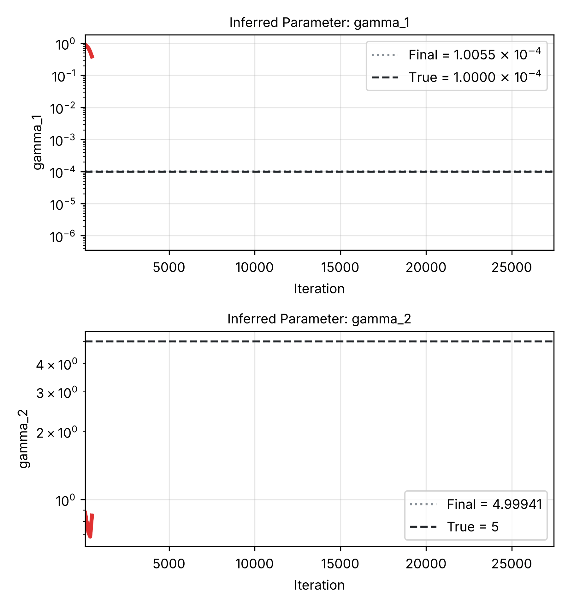

---
search:
  boost: 0.5
---

# Allen-Cahn 1D – Wight & Zhao

| Example | |
|---|---|
| **Source** | PINNStudio template |
| **Problem** | Forward and Inverse |
| **Dimension** | 1D (x, t) |
| **Regime** | Time-dependent |
| **Geometry** | Interval |
| **Outputs** | `u` |
| **Settings** | Default, Tuned |

<figure markdown="span">
  { loading=lazy }
  <figcaption>Animation from the repository's figures (`assets/Images/1D-AllenCahn/`): this example in Inverse mode, the two coefficients gamma_1 and gamma_2 during training, with their true values as dashed lines.</figcaption>
</figure>

## Governing equations

Mathematical form (from the benchmark records):

\[\frac{\partial u}{\partial t} = \gamma_1\frac{\partial^2 u}{\partial x^2} - \gamma_2 u^3 + \gamma_2 u, \qquad x \in [-1, 1],\ t \in [0, 1]\]

Where \(\gamma_1 = 0.0001\) and \(\gamma_2 = 5\).

As typed in PINNStudio's **Equations** page (each expression is a residual, set to zero):

```text
du_t - 0.0001*du_xx + 5*u**3 - 5*u
```

As typed in PINNStudio's **Equations** page (Inverse mode) (each expression is a residual, set to zero):

```text
du_t - gamma_1*du_xx + gamma_2*u**3 - gamma_2*u
```

## Domain

- Interval: \(x \in [-1, 1]\)
- Time interval: \(t \in [0, 1]\)

## Initial conditions

| Output | Initial value | How it is imposed (Settings: Default) |
|---|---|---|
| `u` | `x**2*cos(pi*x)` | loss term |

## Boundary conditions

| Type | Where | Output | Value | Details |
|---|---|---|---|---|
| Periodic BC | `left` | `u` | — | axis x, derivative order 0 |

## Unknowns and measured data (Inverse)

| Trainable parameter | Initial value | True value |
|---|---|---|
| `gamma_1` | 1 | 0.0001 |
| `gamma_2` | 1 | 5 |

Measured data (**Inverse** page, measured-data files):

- [`reference_data/1D/allen_cahn/t_1.0.txt`](https://github.com/AsfandyarKhan72/PINNStudio/blob/main/reference_data/1D/allen_cahn/t_1.0.txt) → output `u`, weight 100

From the benchmark records: same template, switched to **Inverse**, jointly recovering both \(\gamma_1\) (diffusion) and \(\gamma_2\) (reaction) as unknown parameters.

## Settings

### Forward mode

**Settings: Default** — the paper's method (Wight & Zhao 2021)

- **Network:** FNN, hidden layers 4 × 128, inputs (x, t), 1 output; activation tanh, initializer Glorot uniform
- **Points:** 2,000 domain, 200 boundary, 200 initial, 1,000 test
- **Loss weights:** `1.0,1.0,100.0` (equations, then boundary-condition rows, then initial conditions)
- **Methods:** [residual-based adaptive refinement (RAR, 6 rounds of 200 points)](../../reference/rar.md)

| Phase | Optimizer | Iterations | Learning rate | Decay |
|---|---|---|---|---|
| 1 | Adam | 20,000 | 0.001 | none |
| 2 | L-BFGS | 10,000 | — | none |

??? note "Settings: Tuned"

    The Training Log reports: *Tuned settings: a larger network (hidden layers twice as wide, one more layer).* The change is applied to the template's own settings (not the paper's method that Default loads).

    - **Network:** multi-scale Fourier-feature network (MsFFN), hidden layers 5 × 256, inputs (x, t), 1 output; activation tanh, initializer Glorot uniform; Fourier-feature scales 1, 5
    - **Points:** 10,000 domain, 200 boundary, 512 initial, 1,000 test
    - **Loss weights:** `1.0,1.0` (equations, then boundary-condition rows, then initial conditions)
    - **Methods:** [causal training](../../reference/causal.md); [multi-scale Fourier features](../../reference/networks.md); [exact initial condition](../../reference/exact-constraints.md); [exact periodicity (periodic input features)](../../reference/exact-constraints.md)

    | Phase | Optimizer | Iterations | Learning rate | Decay |
    |---|---|---|---|---|
    | 1 | Adam | 20,000 | 0.001 | none |
    | 2 | L-BFGS | 10,000 | — | none |

### Inverse mode

**Settings: Default** — the template's own settings

- **Network:** multi-scale Fourier-feature network (MsFFN), hidden layers 4 × 128, inputs (x, t), 1 output; activation tanh, initializer Glorot uniform; Fourier-feature scales 1, 5
- **Points:** 10,000 domain, 200 boundary, 512 initial, 1,000 test
- **Loss weights:** `1.0,1.0,100.0` (equations, then boundary-condition rows, then initial conditions, then measured data)
- **Methods:** [causal training](../../reference/causal.md); [multi-scale Fourier features](../../reference/networks.md); [exact initial condition](../../reference/exact-constraints.md); [exact periodicity (periodic input features)](../../reference/exact-constraints.md)

| Phase | Optimizer | Iterations | Learning rate | Decay |
|---|---|---|---|---|
| 1 | Adam | 20,000 | 0.001 | none |
| 2 | L-BFGS | 10,000 | — | none |

No separate **Tuned** preset: the **Tuned** item is greyed out for this example (its Default settings are PINNStudio's best).

## Loading it in PINNStudio

- Forward: toolbar **Examples:** › **Forward** › under the **── 1D ──** heading, **Allen-Cahn 1D – Wight & Zhao** › **Default** or **Tuned**, then **Solve**.
- Inverse: toolbar **Examples:** › **Inverse** › under the **── 1D ──** heading, **Allen-Cahn 1D – Wight & Zhao** › **Default**, then **Solve**.

Loading an example fills in every setting; anything you change before **Solve** is listed in the Training Log. Your save folder, GPU, random-seed and plot-style settings are kept.

## Reference solution

- Reference data files: [`reference_data/1D/allen_cahn/`](https://github.com/AsfandyarKhan72/PINNStudio/tree/main/reference_data/1D/allen_cahn)

## Notes

- The time-adaptive version of this template is not listed in the Examples list; it still loads by its name from saved problems (HIDDEN_TEMPLATES in example_catalog.py).

## Definition and records

- **Definition:** template "1D Allen-Cahn (whole interval)" in `MainWindow._on_template_selected`, [`pinnstudio/ui/main_window.py`](https://github.com/AsfandyarKhan72/PINNStudio/blob/main/pinnstudio/ui/main_window.py)
    - Inverse mode: `MainWindow.INVERSE_AUTO_VARS["1D Allen-Cahn (whole interval)"]` (unknowns) and `INVERSE_AUTO_OBS["1D Allen-Cahn (whole interval)"]` (measured data), same file
    - Settings: Default (the paper's method): `_ac1d_wz` in [`pinnstudio/core/paper_settings.py`](https://github.com/AsfandyarKhan72/PINNStudio/blob/main/pinnstudio/core/paper_settings.py)
    - Settings: Tuned: entry "1D Allen-Cahn (whole interval)" in [`pinnstudio/resources/tuned_settings.json`](https://github.com/AsfandyarKhan72/PINNStudio/blob/main/pinnstudio/resources/tuned_settings.json)
- **Equations:** [Governing equations](#governing-equations) on this page
- **Reference data:** [`reference_data/1D/allen_cahn/`](https://github.com/AsfandyarKhan72/PINNStudio/tree/main/reference_data/1D/allen_cahn), written by [`tools/make_exact_reference_data.py`](https://github.com/AsfandyarKhan72/PINNStudio/blob/main/tools/make_exact_reference_data.py)
- **Measured data** (Inverse): [`reference_data/1D/allen_cahn/`](https://github.com/AsfandyarKhan72/PINNStudio/tree/main/reference_data/1D/allen_cahn), written by [`tools/make_exact_reference_data.py`](https://github.com/AsfandyarKhan72/PINNStudio/blob/main/tools/make_exact_reference_data.py)
- **Benchmark records:** [`benchmarks/problems/allen-cahn-1d-wight-zhao.md`](https://github.com/AsfandyarKhan72/PINNStudio/blob/main/benchmarks/problems/allen-cahn-1d-wight-zhao.md), its entry in the [examples overview](https://github.com/AsfandyarKhan72/PINNStudio/blob/main/benchmarks/examples.md#1d-allen-cahn), the [benchmark collection](https://github.com/AsfandyarKhan72/PINNStudio/blob/main/benchmarks/README.md)
- **Tuning-study configurations** (records of the tuning study; open one with **Problem › Open Saved Problem...**; not presets of the Examples list): [`Allen-Cahn 1D – Wight & Zhao (PINNStudio template) (tuned).pinn.json`](https://github.com/AsfandyarKhan72/PINNStudio/blob/main/benchmarks/tuning/Allen-Cahn%201D%20%E2%80%93%20Wight%20%26%20Zhao%20%28PINNStudio%20template%29%20%28tuned%29.pinn.json), [`Allen-Cahn 1D – Wight & Zhao (PINNStudio template), inverse mode (tuned).pinn.json`](https://github.com/AsfandyarKhan72/PINNStudio/blob/main/benchmarks/tuning/Allen-Cahn%201D%20%E2%80%93%20Wight%20%26%20Zhao%20%28PINNStudio%20template%29%2C%20inverse%20mode%20%28tuned%29.pinn.json)
- **Methods** (Default and Tuned settings): [RAR](../../reference/rar.md), [Causal training](../../reference/causal.md), [Networks and Fourier features](../../reference/networks.md), [Exact constraints](../../reference/exact-constraints.md)
- **Cite:** [Wight & Zhao 2021](../../about/references.md#wight2021)

Verified error values are reported in the [Reproducibility](../../reproducibility/benchmarks.md) section, not on this page.

[← Back to the example gallery](../index.md)
