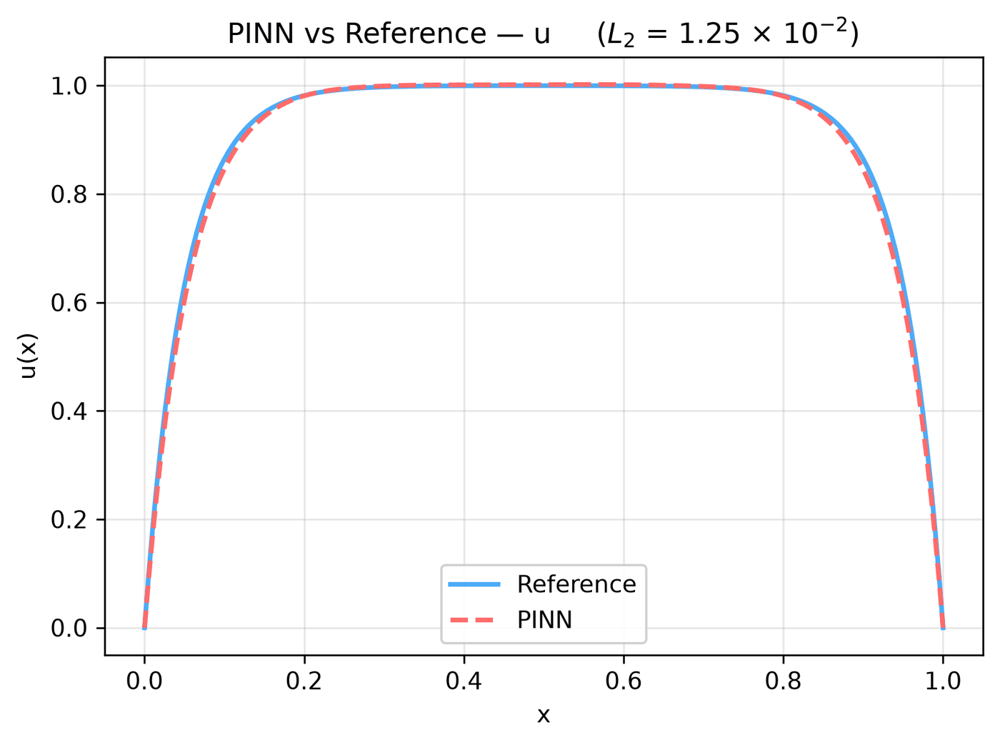
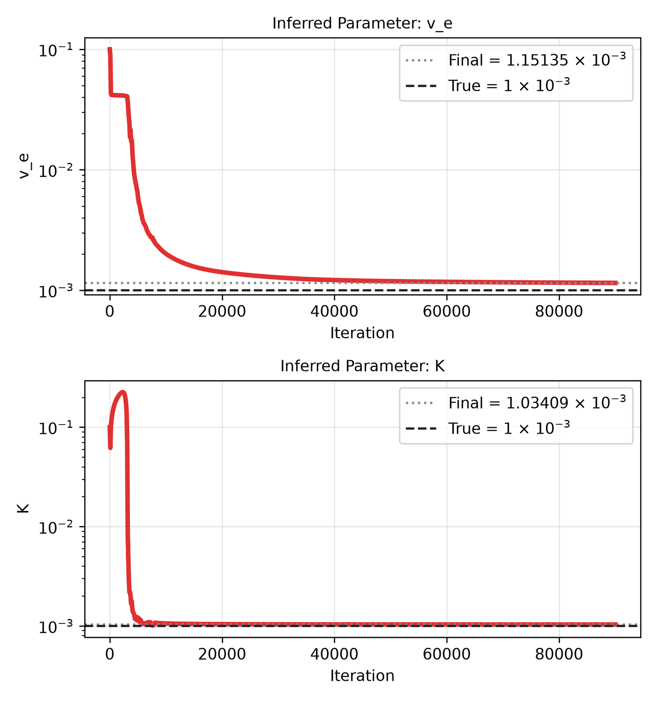

---
search:
  boost: 0.5
---

# Brinkman-Forchheimer 1D – unknown ν_e, K

| Example | |
|---|---|
| **Source** | DeepXDE example |
| **Problem** | Inverse (DeepXDE inverse example) |
| **Dimension** | 1D (x) |
| **Regime** | Steady |
| **Geometry** | Interval |
| **Outputs** | `u` |
| **Settings** | Default, Tuned |

## Governing equations

Mathematical form (from the benchmark records):

\[-\frac{\nu_e}{\epsilon}\frac{d^2u}{dx^2} + \frac{\nu u}{K} = g, \qquad x \in [0, 1],\ \epsilon = 0.4,\ \nu = 10^{-3},\ g = 1\]

As typed in PINNStudio's **Equations** page (each expression is a residual, set to zero):

```text
-v_e/e*du_xx + v*u/K - g
```

Constants: `g = 1`, `v = 1e-3`, `e = 0.4`

## Domain

- Interval: \(x \in [0, 1]\)

## Boundary conditions

No boundary-condition rows: the boundary values are imposed exactly through the network's output transform (see **Methods** below), or the problem has no boundary terms.

## Unknowns and measured data (Inverse)

| Trainable parameter | Initial value | True value |
|---|---|---|
| `v_e` | 0.1 | 0.001 |
| `K` | 0.1 | 0.001 |

Measured data (**Inverse** page, measured-data files):

- [`reference_data/deepxde/brinkman_forchheimer/u_obs.txt`](https://github.com/AsfandyarKhan72/PINNStudio/blob/main/reference_data/deepxde/brinkman_forchheimer/u_obs.txt) → output `u`, weight 1

## Settings

**Settings: Default** — DeepXDE's own settings

- **Network:** FNN, hidden layers 3 × 20, inputs (x), 1 output; activation tanh, initializer Glorot uniform
- **Points:** 100 domain, 0 boundary, 500 test
- **Loss weights:** `1` (equations, then boundary-condition rows)
- **Methods:** output transform `x*(1 - x)*u` ([reference](../../reference/networks.md))

| Phase | Optimizer | Iterations | Learning rate | Decay |
|---|---|---|---|---|
| 1 | Adam | 30,000 | 0.001 | none |

??? note "Settings: Tuned"

    The Training Log reports: *Tuned settings: 3× the iterations of every training phase.* The change is applied to the example's own settings.

    - **Network:** FNN, hidden layers 3 × 20, inputs (x), 1 output; activation tanh, initializer Glorot uniform
    - **Points:** 100 domain, 0 boundary, 500 test
    - **Loss weights:** `1` (equations, then boundary-condition rows)
    - **Methods:** output transform `x*(1 - x)*u` ([reference](../../reference/networks.md))

    | Phase | Optimizer | Iterations | Learning rate | Decay |
    |---|---|---|---|---|
    | 1 | Adam | 90,000 | 0.001 | none |

## Results

The configuration selected in PINNStudio's benchmark study, run on one RTX 4090. Forward: relative L₂ error of each output at the last reference time. Inverse: each parameter's relative error and, per seed, the largest of them (worst parameter error).

### Inverse problem

**Settings:** Tuned — 3× iterations. **Values:** one run, seed 2026.

| Parameter | True value | Recovered | Relative error |
|---|---|---|---|
| v_e | 0.001 | 0.00115135 | 15 % |
| K | 0.001 | 0.00103409 | 3.4 % |

Worst parameter error: **15 %**.

<figure markdown="span">
  { loading=lazy }
  <figcaption>Inverse, Tuned settings: PINN and reference along lines.</figcaption>
</figure>

<figure markdown="span">
  { loading=lazy }
  <figcaption>Inverse, Tuned settings: parameter convergence.</figcaption>
</figure>

**Full benchmark record:** every setting tried, the per-seed values and all figures are in [the benchmark records on GitHub](https://github.com/AsfandyarKhan72/PINNStudio/blob/main/benchmarks/examples.md#dx-inverse-brinkman-forchheimer-model).

## Loading it in PINNStudio

- Inverse: toolbar **Examples:** › **Inverse** › under the **── 1D ──** heading, **Brinkman-Forchheimer 1D – unknown ν_e, K** › **Default** or **Tuned**, then **Solve**.

Loading an example fills in every setting; anything you change before **Solve** is listed in the Training Log. Your save folder, GPU, random-seed and plot-style settings are kept.

## Reference solution

- Exact solution, **Error Analysis** › reference from formula: `u = 1 - cosh(20*(x - 0.5))/cosh(10)`

## Notes

- Unknown effective viscosity v_e and permeability K (both 1e-3), from 5 measurements; u = 0 at both walls through the output transform.

## Definition and records

- **Definition:** `EXAMPLES` entry "Inverse: Brinkman-Forchheimer model" in [`pinnstudio/core/deepxde_examples.py`](https://github.com/AsfandyarKhan72/PINNStudio/blob/main/pinnstudio/core/deepxde_examples.py)
    - Settings: Tuned: entry "Inverse: Brinkman-Forchheimer model" in [`pinnstudio/resources/tuned_settings.json`](https://github.com/AsfandyarKhan72/PINNStudio/blob/main/pinnstudio/resources/tuned_settings.json)
- **Equations:** [Governing equations](#governing-equations) on this page
- **Reference data:** the exact-solution formula under *Reference solution* (no data files)
- **Measured data** (Inverse): [`reference_data/deepxde/brinkman_forchheimer/`](https://github.com/AsfandyarKhan72/PINNStudio/tree/main/reference_data/deepxde/brinkman_forchheimer), written by [`tools/make_deepxde_reference_data.py`](https://github.com/AsfandyarKhan72/PINNStudio/blob/main/tools/make_deepxde_reference_data.py)
- **Benchmark records:** [`benchmarks/problems/brinkman-forchheimer-1d-unknown-e-k.md`](https://github.com/AsfandyarKhan72/PINNStudio/blob/main/benchmarks/problems/brinkman-forchheimer-1d-unknown-e-k.md), its entry in the [examples overview](https://github.com/AsfandyarKhan72/PINNStudio/blob/main/benchmarks/examples.md#dx-inverse-brinkman-forchheimer-model), the [benchmark collection](https://github.com/AsfandyarKhan72/PINNStudio/blob/main/benchmarks/README.md)
- **Tuning-study configurations** (records of the tuning study; open one with **Problem › Open Saved Problem...**; not presets of the Examples list): [`Brinkman-Forchheimer 1D – unknown ν_e, K (tuned).pinn.json`](https://github.com/AsfandyarKhan72/PINNStudio/blob/main/benchmarks/tuning/Brinkman-Forchheimer%201D%20%E2%80%93%20unknown%20%CE%BD_e%2C%20K%20%28tuned%29.pinn.json)
- **Methods** (Default and Tuned settings): [Networks and Fourier features](../../reference/networks.md)
- **DeepXDE example:** [brinkman_forchheimer.py](https://github.com/lululxvi/deepxde/blob/master/examples/pinn_inverse/brinkman_forchheimer.py)
- **Cite:** [Lu et al. 2021](../../about/references.md#lu2021deepxde) (DeepXDE); the problem follows [Yu et al. 2022](../../about/references.md#yu2022)

How the benchmark values were measured and checked: [Reproducibility](../../reproducibility/benchmarks.md).

[← Back to the example gallery](../index.md)
