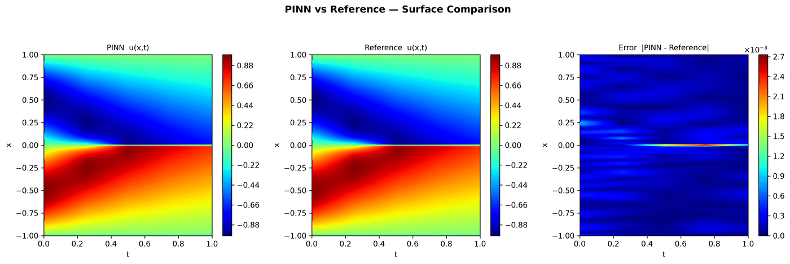
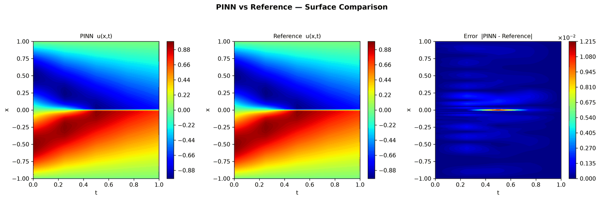
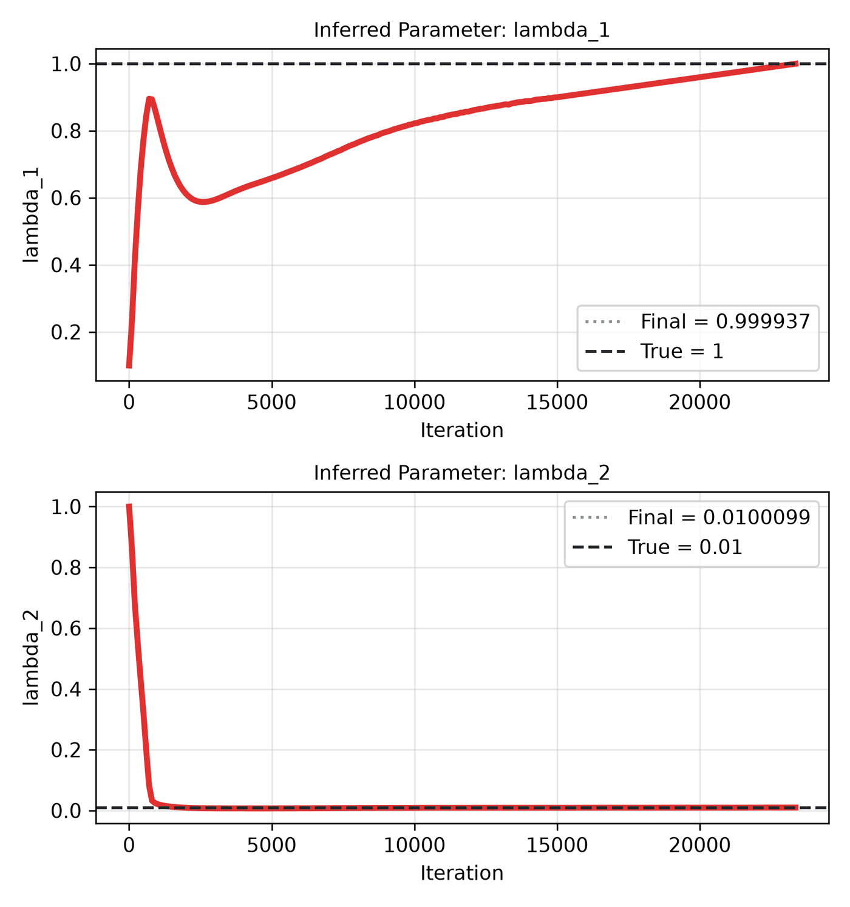

---
search:
  boost: 0.5
---

# Burgers 1D – Raissi et al.

| Example | |
|---|---|
| **Source** | PINNStudio template |
| **Problem** | Forward and Inverse |
| **Dimension** | 1D (x, t) |
| **Regime** | Time-dependent |
| **Geometry** | Interval |
| **Outputs** | `u` |
| **Settings** | Default, Tuned |

## Governing equations

Mathematical form (from the benchmark records):

\[\frac{\partial u}{\partial t} + u\frac{\partial u}{\partial x} = \frac{0.01}{\pi}\frac{\partial^2 u}{\partial x^2}, \qquad x \in [-1, 1],\ t \in [0, 1]\]

As typed in PINNStudio's **Equations** page (each expression is a residual, set to zero):

```text
du_t + 1.0*u*du_x - (0.01/pi)*du_xx
```

As typed in PINNStudio's **Equations** page (Inverse mode) (each expression is a residual, set to zero):

```text
du_t + lambda_1*u*du_x - (lambda_2/pi)*du_xx
```

Inverse-mode form (from the benchmark records):

\[\frac{\partial u}{\partial t} + \lambda_1 u\frac{\partial u}{\partial x} - \lambda_2\frac{\partial^2 u}{\partial x^2} = 0\]

## Domain

- Interval: \(x \in [-1, 1]\)
- Time interval: \(t \in [0, 1]\)

## Initial conditions

| Output | Initial value | How it is imposed (Settings: Default) |
|---|---|---|
| `u` | `-sin(pi*x)` | loss term |

## Boundary conditions

| Type | Where | Output | Value | Details |
|---|---|---|---|---|
| Dirichlet BC | `left` | `u` | `0.0` | — |
| Dirichlet BC | `right` | `u` | `0.0` | — |

## Unknowns and measured data (Inverse)

| Trainable parameter | Initial value | True value |
|---|---|---|
| `lambda_1` | 0.1 | 1 |
| `lambda_2` | 1 | 0.01 |

Measured data (**Inverse** page, measured-data files):

- [`reference_data/1D/burgers/t_1.0.txt`](https://github.com/AsfandyarKhan72/PINNStudio/blob/main/reference_data/1D/burgers/t_1.0.txt) → output `u`, weight 100

From the benchmark records: same template, switched to **Inverse**, jointly recovering both coefficients of the data-driven-discovery form of this equation in [Raissi, Perdikaris & Karniadakis (2019)](https://doi.org/10.1016/j.jcp.2018.10.045), Appendix B, eq. B.1.

## Settings

### Forward mode

**Settings: Default** — the paper's method (Raissi et al. 2019)

- **Network:** FNN, hidden layers 8 × 20, inputs (x, t), 1 output; activation tanh, initializer Glorot uniform
- **Points:** 10,000 domain, 50 boundary, 50 initial, 1,000 test
- **Loss weights:** `1.0,1.0,1.0,1.0` (equations, then boundary-condition rows, then initial conditions)

| Phase | Optimizer | Iterations | Learning rate | Decay |
|---|---|---|---|---|
| 1 | L-BFGS | 50,000 | — | none |

??? note "Settings: Tuned"

    The Training Log reports: *Tuned settings: Raissi et al.'s settings.* The change is applied to the template's own settings (not the paper's method that Default loads).

    - **Network:** FNN, hidden layers 8 × 20, inputs (x, t), 1 output; activation tanh, initializer Glorot uniform
    - **Points:** 10,000 domain, 50 boundary, 50 initial, 1,000 test
    - **Loss weights:** `1.0,1.0,1.0,1.0` (equations, then boundary-condition rows, then initial conditions)

    | Phase | Optimizer | Iterations | Learning rate | Decay |
    |---|---|---|---|---|
    | 1 | L-BFGS | 50,000 | — | none |

### Inverse mode

**Settings: Default** — the template's own settings

- **Network:** FNN, hidden layers 3 × 20, inputs (x, t), 1 output; activation tanh, initializer Glorot uniform
- **Points:** 8,000 domain, 200 boundary, 200 initial, 1,000 test
- **Loss weights:** `1.0,1.0,1.0,100.0,100.0` (equations, then boundary-condition rows, then initial conditions, then measured data)

| Phase | Optimizer | Iterations | Learning rate | Decay |
|---|---|---|---|---|
| 1 | Adam | 15,000 | 0.001 | none |
| 2 | L-BFGS | 10,000 | — | none |

??? note "Settings: Tuned"

    The Training Log reports: *Tuned settings: 10× the data weight, 3× the L-BFGS iterations and a larger network.* The change is applied to the example's own settings.

    - **Network:** FNN, hidden layers 4 × 40, inputs (x, t), 1 output; activation tanh, initializer Glorot uniform
    - **Points:** 8,000 domain, 200 boundary, 200 initial, 1,000 test
    - **Loss weights:** `1.0,1.0,1.0,100.0,100.0` (equations, then boundary-condition rows, then initial conditions, then measured data)

    | Phase | Optimizer | Iterations | Learning rate | Decay |
    |---|---|---|---|---|
    | 1 | Adam | 15,000 | 0.001 | none |
    | 2 | L-BFGS | 30,000 | — | none |

## Results

The configuration selected in PINNStudio's benchmark study, run on one RTX 4090. Forward: relative L₂ error of each output at the last reference time. Inverse: each parameter's relative error and, per seed, the largest of them (worst parameter error).

### Forward problem

**Settings:** Tuned — 3× iterations. **Values:** median over seeds 2026, 1, 2.

| Output | Relative L₂ |
|---|---|
| u | 5.2 × 10⁻⁴ |

<figure markdown="span">
  { loading=lazy }
  <figcaption>Forward, Tuned settings: PINN, reference and error.</figcaption>
</figure>

### Inverse problem

**Settings:** Tuned — 10× data weight, 3× L-BFGS and the larger network. **Values:** median over seeds 2026, 1, 2.

| Parameter | True value | Recovered | Relative error |
|---|---|---|---|
| lambda_1 | 1 | 0.999888 | 0.011 % |
| lambda_2 | 0.01 | 0.00999801 | 0.062 % |

Worst parameter error: **0.099 %** (the median over the seeds of each seed's largest error).

<figure markdown="span">
  { loading=lazy }
  <figcaption>Inverse, Tuned settings: PINN, reference and error.</figcaption>
</figure>

<figure markdown="span">
  { loading=lazy }
  <figcaption>Inverse, Tuned settings: parameter convergence.</figcaption>
</figure>

**Full benchmark record:** every setting tried, the per-seed values and all figures are in [the benchmark records on GitHub](https://github.com/AsfandyarKhan72/PINNStudio/blob/main/benchmarks/examples.md#1d-burgers).

## Loading it in PINNStudio

- Forward: toolbar **Examples:** › **Forward** › under the **── 1D ──** heading, **Burgers 1D – Raissi et al.** › **Default** or **Tuned**, then **Solve**.
- Inverse: toolbar **Examples:** › **Inverse** › under the **── 1D ──** heading, **Burgers 1D – Raissi et al.** › **Default** or **Tuned**, then **Solve**.

Loading an example fills in every setting; anything you change before **Solve** is listed in the Training Log. Your save folder, GPU, random-seed and plot-style settings are kept.

## Reference solution

- Reference data files: [`reference_data/1D/burgers/`](https://github.com/AsfandyarKhan72/PINNStudio/tree/main/reference_data/1D/burgers)

## Definition and records

- **Definition:** template "1D Burgers" in `MainWindow._on_template_selected`, [`pinnstudio/ui/main_window.py`](https://github.com/AsfandyarKhan72/PINNStudio/blob/main/pinnstudio/ui/main_window.py)
    - Inverse mode: `MainWindow.INVERSE_AUTO_VARS["1D Burgers"]` (unknowns) and `INVERSE_AUTO_OBS["1D Burgers"]` (measured data), same file
    - Settings: Default (the paper's method): `_burgers1d_raissi` in [`pinnstudio/core/paper_settings.py`](https://github.com/AsfandyarKhan72/PINNStudio/blob/main/pinnstudio/core/paper_settings.py)
    - Settings: Tuned: entry "1D Burgers" in [`pinnstudio/resources/tuned_settings.json`](https://github.com/AsfandyarKhan72/PINNStudio/blob/main/pinnstudio/resources/tuned_settings.json)
- **Equations:** [Governing equations](#governing-equations) on this page
- **Reference data:** [`reference_data/1D/burgers/`](https://github.com/AsfandyarKhan72/PINNStudio/tree/main/reference_data/1D/burgers), written by [`tools/make_exact_reference_data.py`](https://github.com/AsfandyarKhan72/PINNStudio/blob/main/tools/make_exact_reference_data.py)
- **Measured data** (Inverse): [`reference_data/1D/burgers/`](https://github.com/AsfandyarKhan72/PINNStudio/tree/main/reference_data/1D/burgers), written by [`tools/make_exact_reference_data.py`](https://github.com/AsfandyarKhan72/PINNStudio/blob/main/tools/make_exact_reference_data.py)
- **Benchmark records:** [`benchmarks/problems/burgers-1d-raissi-et-al.md`](https://github.com/AsfandyarKhan72/PINNStudio/blob/main/benchmarks/problems/burgers-1d-raissi-et-al.md), its entry in the [examples overview](https://github.com/AsfandyarKhan72/PINNStudio/blob/main/benchmarks/examples.md#1d-burgers), the [benchmark collection](https://github.com/AsfandyarKhan72/PINNStudio/blob/main/benchmarks/README.md)
- **Tuning-study configurations** (records of the tuning study; open one with **Problem › Open Saved Problem...**; not presets of the Examples list): [`Burgers 1D – Raissi et al. (PINNStudio template) (best setup) (tuned).pinn.json`](https://github.com/AsfandyarKhan72/PINNStudio/blob/main/benchmarks/tuning/Burgers%201D%20%E2%80%93%20Raissi%20et%20al.%20%28PINNStudio%20template%29%20%28best%20setup%29%20%28tuned%29.pinn.json), [`Burgers 1D – Raissi et al. (PINNStudio template), inverse mode (tuned).pinn.json`](https://github.com/AsfandyarKhan72/PINNStudio/blob/main/benchmarks/tuning/Burgers%201D%20%E2%80%93%20Raissi%20et%20al.%20%28PINNStudio%20template%29%2C%20inverse%20mode%20%28tuned%29.pinn.json)
- **Cite:** [Raissi et al. 2019](../../about/references.md#raissi2019)

How the benchmark values were measured and checked: [Reproducibility](../../reproducibility/benchmarks.md).

[← Back to the example gallery](../index.md)
