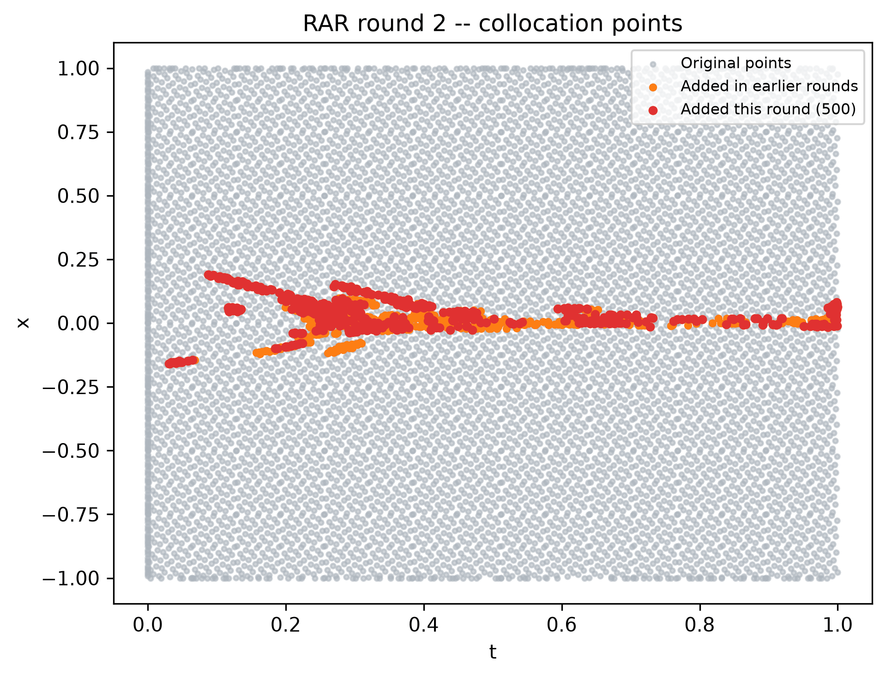
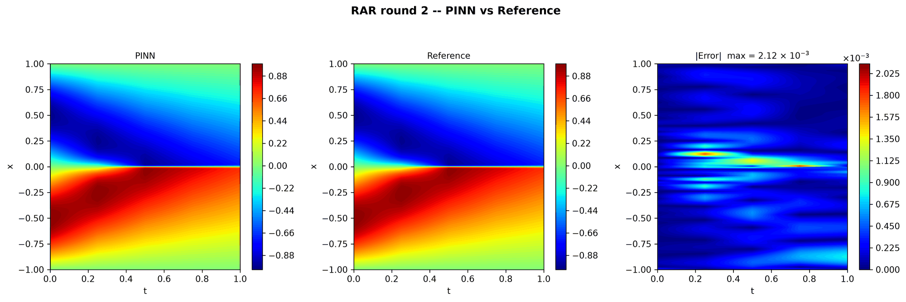
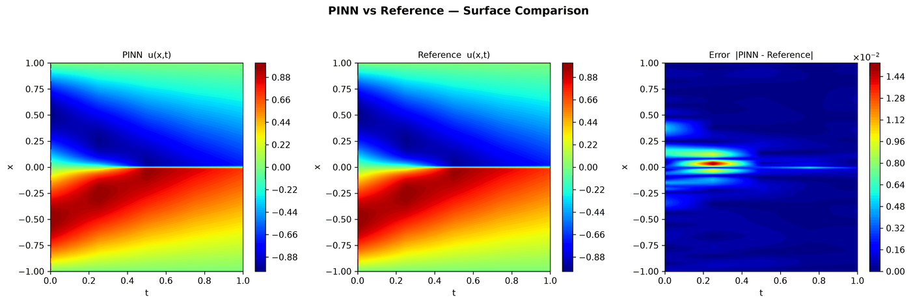

---
search:
  boost: 0.5
---

# Burgers 1D – RAR

| Example | |
|---|---|
| **Source** | DeepXDE example |
| **Problem** | Forward |
| **Dimension** | 1D (x, t) |
| **Regime** | Time-dependent |
| **Geometry** | Interval |
| **Outputs** | `u` |
| **Settings** | Default (no separate Tuned preset) |

<figure markdown="span">
  { loading=lazy }
  <figcaption>Figure from the repository's figures (`assets/Images/1D-Burgers/`): a Burgers 1D run with RAR, round 2 — original points, points added in earlier rounds and points added in this round. No record states which example's settings the run used.</figcaption>
</figure>

<figure markdown="span">
  { loading=lazy }
  <figcaption>Figure from the repository's figures (`assets/Images/1D-Burgers/`): the same Burgers 1D RAR run, PINN, reference and error after round 2.</figcaption>
</figure>

## Governing equations

Mathematical form (from the benchmark records):

\[\frac{\partial u}{\partial t} + u\frac{\partial u}{\partial x} = \frac{0.01}{\pi}\frac{\partial^2 u}{\partial x^2}, \qquad x \in [-1, 1],\ t \in [0, 1]\]

As typed in PINNStudio's **Equations** page (each expression is a residual, set to zero):

```text
du_t + u*du_x - 0.01/pi*du_xx
```

## Domain

- Interval: \(x \in [-1, 1]\)
- Time interval: \(t \in [0, 1]\)

## Initial conditions

| Output | Initial value | How it is imposed (Settings: Default) |
|---|---|---|
| `u` | `-sin(pi*x)` | loss term |

## Boundary conditions

| Type | Where | Output | Value | Details |
|---|---|---|---|---|
| Dirichlet BC | `True (the whole boundary)` | `u` | `0` | — |

## Settings

**Settings: Default** — DeepXDE's own settings

- **Network:** FNN, hidden layers 3 × 20, inputs (x, t), 1 output; activation tanh, initializer Glorot normal
- **Points:** 2,500 domain, 100 boundary, 160 initial, 1,000 test
- **Loss weights:** `1,1,1` (equations, then boundary-condition rows, then initial conditions)
- **Methods:** [residual-based adaptive refinement (RAR, 3 rounds of 100 points)](../../reference/rar.md)

| Phase | Optimizer | Iterations | Learning rate | Decay |
|---|---|---|---|---|
| 1 | Adam | 10,000 | 0.001 | none |
| 2 | L-BFGS | 15,000 | — | none |

No separate **Tuned** preset: the **Tuned** item is greyed out for this example (its Default settings are PINNStudio's best).

## Results

The configuration selected in PINNStudio's benchmark study, run on one RTX 4090. Forward: relative L₂ error of each output at the last reference time. Inverse: each parameter's relative error and, per seed, the largest of them (worst parameter error).

### Forward problem

**Settings:** Default — the example's own settings (not in the tuning sweep); the example has no separate Tuned preset for this mode. **Values:** one run, seed 2026.

| Output | Relative L₂ |
|---|---|
| u | 8.4 × 10⁻⁴ |

<figure markdown="span">
  { loading=lazy }
  <figcaption>Forward, Default settings: PINN, reference and error.</figcaption>
</figure>

**Full benchmark record:** every setting tried, the per-seed values and all figures are in [the benchmark records on GitHub](https://github.com/AsfandyarKhan72/PINNStudio/blob/main/benchmarks/examples.md#dx-burgers-equation-with-rar).

## Loading it in PINNStudio

- Forward: toolbar **Examples:** › **Forward** › under the **── 1D ──** heading, **Burgers 1D – RAR** › **Default**, then **Solve**.

Loading an example fills in every setting; anything you change before **Solve** is listed in the Training Log. Your save folder, GPU, random-seed and plot-style settings are kept.

## Reference solution

- Reference data files: [`reference_data/1D/burgers/`](https://github.com/AsfandyarKhan72/PINNStudio/tree/main/reference_data/1D/burgers)

## Notes

- Time runs from 0 to 1 (DeepXDE's script stops at 0.99, where its Burgers.npz data ends); Error Analysis compares with the exact (Cole-Hopf) solution at t = 0, 0.25, 0.5, 0.75 and 1. RAR: 3 rounds, each adding the 100 points with the largest residual (out of 100,000 candidates) and retraining, with no residual tolerance. DeepXDE's script adds 1 point per round until the mean residual is below 0.005, but after the first training the mean residual is already below that (about 3e-3), so its loop would add a single point and stop -- too little to show refinement.

## Definition and records

- **Definition:** `EXAMPLES` entry "Burgers equation with RAR" in [`pinnstudio/core/deepxde_examples.py`](https://github.com/AsfandyarKhan72/PINNStudio/blob/main/pinnstudio/core/deepxde_examples.py)
- **Equations:** [Governing equations](#governing-equations) on this page
- **Reference data:** [`reference_data/1D/burgers/`](https://github.com/AsfandyarKhan72/PINNStudio/tree/main/reference_data/1D/burgers), written by [`tools/make_exact_reference_data.py`](https://github.com/AsfandyarKhan72/PINNStudio/blob/main/tools/make_exact_reference_data.py)
- **Benchmark records:** [`benchmarks/problems/burgers-1d-rar.md`](https://github.com/AsfandyarKhan72/PINNStudio/blob/main/benchmarks/problems/burgers-1d-rar.md), its entry in the [examples overview](https://github.com/AsfandyarKhan72/PINNStudio/blob/main/benchmarks/examples.md#dx-burgers-equation-with-rar), the [benchmark collection](https://github.com/AsfandyarKhan72/PINNStudio/blob/main/benchmarks/README.md)
- **Tuning-study configurations** (records of the tuning study; open one with **Problem › Open Saved Problem...**; not presets of the Examples list): [`Burgers 1D – RAR (tuned).pinn.json`](https://github.com/AsfandyarKhan72/PINNStudio/blob/main/benchmarks/tuning/Burgers%201D%20%E2%80%93%20RAR%20%28tuned%29.pinn.json)
- **Methods** (Default and Tuned settings): [RAR](../../reference/rar.md)
- **DeepXDE example:** [Burgers_RAR.py](https://github.com/lululxvi/deepxde/blob/master/examples/pinn_forward/Burgers_RAR.py) ([documentation](https://deepxde.readthedocs.io/en/latest/demos/pinn_forward/burgers.rar.html))
- **Cite:** [Lu et al. 2021](../../about/references.md#lu2021deepxde) (DeepXDE)

How the benchmark values were measured and checked: [Reproducibility](../../reproducibility/benchmarks.md).

[← Back to the example gallery](../index.md)
