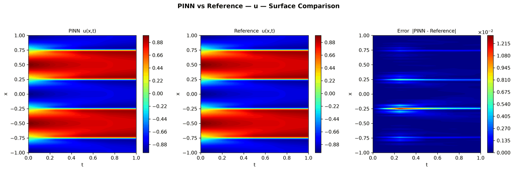

---
search:
  boost: 0.5
---

# Cahn-Hilliard 1D – Wight & Zhao

| Example | |
|---|---|
| **Source** | PINNStudio template |
| **Problem** | Forward |
| **Dimension** | 1D (x, t) |
| **Regime** | Time-dependent |
| **Geometry** | Interval |
| **Outputs** | `u`, `mu` |
| **Settings** | Default, Tuned |

## Governing equations

Mathematical form (from the benchmark records):

\[\frac{\partial u}{\partial t} = \frac{\partial^2 \mu}{\partial x^2}, \qquad \mu = \gamma_2 (u^3 - u) - \gamma_1 \frac{\partial^2 u}{\partial x^2}, \qquad x \in [-1, 1],\ t \in [0, 1]\]

Where \(\gamma_1 = 10^{-6}\) and \(\gamma_2 = 0.01\). The fourth-order equation is solved in mixed form: the chemical potential \(\mu\) is a second output, so no residual needs a fourth derivative.

As typed in PINNStudio's **Equations** page (each expression is a residual, set to zero):

```text
du_t - dmu_xx
(mu - 0.01*(u**3 - u) + 1e-6*du_xx)/0.01
```

## Domain

- Interval: \(x \in [-1, 1]\)
- Time interval: \(t \in [0, 1]\)

## Initial conditions

| Output | Initial value | How it is imposed (Settings: Default) |
|---|---|---|
| `u` | `-cos(2*pi*x)` | loss term |
| `mu` | `0` | not used as a loss term |

## Boundary conditions

| Type | Where | Output | Value | Details |
|---|---|---|---|---|
| Periodic BC | `left` | `u` | — | axis x, derivative order 0 |
| Periodic BC | `left` | `mu` | — | axis x, derivative order 0 |
| Periodic BC | `left` | `u` | — | axis x, derivative order 1 |
| Periodic BC | `left` | `mu` | — | axis x, derivative order 1 |

## Settings

**Settings: Default** — the paper's method (Wight & Zhao 2021)

- **Network:** FNN, hidden layers 4 × 128, inputs (x, t), 2 outputs; activation tanh, initializer Glorot uniform
- **Points:** 10,000 domain, 200 boundary, 512 initial, 1,000 test
- **Loss weights:** `1.0,1.0,1.0,1.0,1.0,1.0,100.0` (equations, then boundary-condition rows, then initial conditions)
- **Methods:** [time windows (10 windows, transfer learning)](../../reference/time-windows.md); [growing time range](../../reference/time-windows.md); [adaptive resampling in each window](../../reference/time-windows.md)

| Phase | Optimizer | Iterations | Learning rate | Decay |
|---|---|---|---|---|
| 1 | Adam | 5,000 | 0.001 | none |
| 2 | L-BFGS | 5,000 | — | none |

??? note "Settings: Tuned"

    The Training Log reports: *Tuned settings: the template's own settings (PINNStudio's best for it).*

    - **Network:** FNN, hidden layers 4 × 128, inputs (x, t), 2 outputs; activation tanh, initializer Glorot uniform
    - **Points:** 10,000 domain, 200 boundary, 512 initial, 1,000 test
    - **Loss weights:** `1.0,1.0,1.0,1.0,1.0,1.0` (equations, then boundary-condition rows, then initial conditions)
    - **Methods:** [SA-PINN point weights](../../reference/point-weights.md); [exact initial condition](../../reference/exact-constraints.md); [exact periodicity (periodic input features)](../../reference/exact-constraints.md)

    | Phase | Optimizer | Iterations | Learning rate | Decay |
    |---|---|---|---|---|
    | 1 | Adam | 20,000 | 0.001 | none |
    | 2 | L-BFGS | 20,000 | — | none |

## Results

From the benchmark records: one RTX 4090; relative L₂ error of the main output at the last reference time, and for an inverse problem the parameters it found (true value in brackets). *PINNStudio best* is what **Settings: Tuned** loads.

| | Default | PINNStudio best | Training time of the best (s) |
|---|---|---|---|
| Forward: relative L₂ at the last reference time | 1.1 × 10<sup>-2</sup> | **5.2 × 10<sup>-4</sup>** | 350 |

<figure markdown="span">
  { loading=lazy }
  <figcaption>PINNStudio best — the example's own settings (no change did better) — u — PINN, reference and error over space and time</figcaption>
</figure>

Every setting tried, the papers' reported errors and all figures: [the benchmark records](https://github.com/AsfandyarKhan72/PINNStudio/blob/main/benchmarks/examples.md#1d-cahn-hilliard).

## Loading it in PINNStudio

- Forward: toolbar **Examples:** › **Forward** › under the **── 1D ──** heading, **Cahn-Hilliard 1D – Wight & Zhao** › **Default** or **Tuned**, then **Solve**.

Loading an example fills in every setting; anything you change before **Solve** is listed in the Training Log. Your save folder, GPU, random-seed and plot-style settings are kept.

## Reference solution

- Reference data files: [`reference_data/1D/cahn_hilliard/`](https://github.com/AsfandyarKhan72/PINNStudio/tree/main/reference_data/1D/cahn_hilliard)

## Notes

- Forward only: the Inverse mode of this template is withdrawn for now because the parameters were not found (pinnstudio/core/example_catalog.py, FORWARD_ONLY_TEMPLATES).

## Definition and records

- **Definition:** template "1D Cahn-Hilliard" in `MainWindow._on_template_selected`, [`pinnstudio/ui/main_window.py`](https://github.com/AsfandyarKhan72/PINNStudio/blob/main/pinnstudio/ui/main_window.py)
    - Settings: Default (the paper's method): `_ch1d_wz` in [`pinnstudio/core/paper_settings.py`](https://github.com/AsfandyarKhan72/PINNStudio/blob/main/pinnstudio/core/paper_settings.py)
    - Settings: Tuned: entry "1D Cahn-Hilliard" in [`pinnstudio/resources/tuned_settings.json`](https://github.com/AsfandyarKhan72/PINNStudio/blob/main/pinnstudio/resources/tuned_settings.json)
- **Equations:** [Governing equations](#governing-equations) on this page
- **Reference data:** [`reference_data/1D/cahn_hilliard/`](https://github.com/AsfandyarKhan72/PINNStudio/tree/main/reference_data/1D/cahn_hilliard), written by [`tools/make_exact_reference_data.py`](https://github.com/AsfandyarKhan72/PINNStudio/blob/main/tools/make_exact_reference_data.py)
- **Measured data** (Inverse): [`reference_data/1D/cahn_hilliard/`](https://github.com/AsfandyarKhan72/PINNStudio/tree/main/reference_data/1D/cahn_hilliard), written by [`tools/make_exact_reference_data.py`](https://github.com/AsfandyarKhan72/PINNStudio/blob/main/tools/make_exact_reference_data.py)
- **Benchmark records:** [`benchmarks/problems/cahn-hilliard-1d-wight-zhao.md`](https://github.com/AsfandyarKhan72/PINNStudio/blob/main/benchmarks/problems/cahn-hilliard-1d-wight-zhao.md), its entry in the [examples overview](https://github.com/AsfandyarKhan72/PINNStudio/blob/main/benchmarks/examples.md#1d-cahn-hilliard), the [benchmark collection](https://github.com/AsfandyarKhan72/PINNStudio/blob/main/benchmarks/README.md)
- **Tuning-study configurations** (records of the tuning study; open one with **Problem › Open Saved Problem...**; not presets of the Examples list): [`Cahn-Hilliard 1D – Wight & Zhao (PINNStudio template) (tuned).pinn.json`](https://github.com/AsfandyarKhan72/PINNStudio/blob/main/benchmarks/tuning/Cahn-Hilliard%201D%20%E2%80%93%20Wight%20%26%20Zhao%20%28PINNStudio%20template%29%20%28tuned%29.pinn.json)
- **Methods** (Default and Tuned settings): [Time windows and bc-PINN](../../reference/time-windows.md), [RBA and SA-PINN](../../reference/point-weights.md), [Exact constraints](../../reference/exact-constraints.md)
- **Cite:** [Wight & Zhao 2021](../../about/references.md#wight2021)

Verified error values are reported in the [Reproducibility](../../reproducibility/benchmarks.md) section, not on this page.

[← Back to the example gallery](../index.md)
