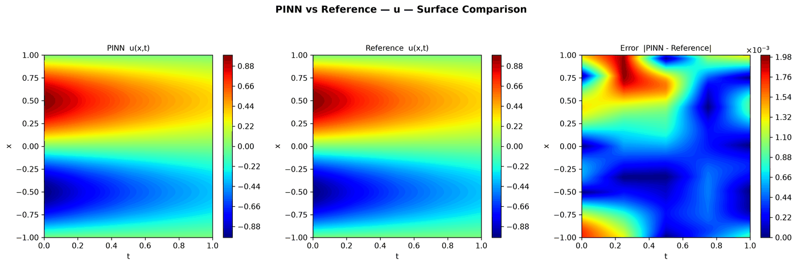

---
search:
  boost: 0.5
---

# Diffusion 1D – resampling

| Example | |
|---|---|
| **Source** | DeepXDE example |
| **Problem** | Forward |
| **Dimension** | 1D (x, t) |
| **Regime** | Time-dependent |
| **Geometry** | Interval |
| **Outputs** | `u` |
| **Settings** | Default, Tuned |

## Governing equations

Mathematical form (from the benchmark records):

\[\frac{\partial u}{\partial t} = \frac{\partial^2 u}{\partial x^2} - e^{-t}\left(\sin(\pi x) - \pi^2\sin(\pi x)\right), \qquad x \in [-1, 1],\ t \in [0, 1]\]

As typed in PINNStudio's **Equations** page (each expression is a residual, set to zero):

```text
du_t - du_xx + exp(-t)*(sin(pi*x) - pi**2*sin(pi*x))
```

## Domain

- Interval: \(x \in [-1, 1]\)
- Time interval: \(t \in [0, 1]\)

## Initial conditions

| Output | Initial value | How it is imposed (Settings: Default) |
|---|---|---|
| `u` | `sin(pi*x)` | loss term |

## Boundary conditions

| Type | Where | Output | Value | Details |
|---|---|---|---|---|
| Dirichlet BC | `True (the whole boundary)` | `u` | `0` | — |

## Settings

**Settings: Default** — DeepXDE's own settings

- **Network:** FNN, hidden layers 3 × 32, inputs (x, t), 1 output; activation tanh, initializer Glorot uniform
- **Points:** 40 domain, 20 boundary, 10 initial, 10,000 test
- **Loss weights:** `1,1,1` (equations, then boundary-condition rows, then initial conditions)
- **Methods:** collocation-point resampling every 100 iterations

| Phase | Optimizer | Iterations | Learning rate | Decay |
|---|---|---|---|---|
| 1 | Adam | 2,000 | 0.001 | none |

??? note "Settings: Tuned"

    The Training Log reports: *Tuned settings: an L-BFGS phase after Adam.* The change is applied to the example's own settings.

    - **Network:** FNN, hidden layers 3 × 32, inputs (x, t), 1 output; activation tanh, initializer Glorot uniform
    - **Points:** 40 domain, 20 boundary, 10 initial, 10,000 test
    - **Loss weights:** `1,1,1` (equations, then boundary-condition rows, then initial conditions)
    - **Methods:** collocation-point resampling every 100 iterations

    | Phase | Optimizer | Iterations | Learning rate | Decay |
    |---|---|---|---|---|
    | 1 | Adam | 2,000 | 0.001 | none |
    | 2 | L-BFGS | 15,000 | — | none |

## Results

From the benchmark records: one RTX 4090; relative L₂ error of the main output at the last reference time, and for an inverse problem the parameters it found (true value in brackets). *PINNStudio best* is what **Settings: Tuned** loads.

| | Default | PINNStudio best | Training time of the best (s) |
|---|---|---|---|
| Forward: relative L₂ at the last reference time | 5.4 × 10<sup>-2</sup> | **5.8 × 10<sup>-3</sup>** | 12 |

<figure markdown="span">
  { loading=lazy }
  <figcaption>PINNStudio best — L-BFGS phase added — PINN, reference and error over space and time</figcaption>
</figure>

Every setting tried, the papers' reported errors and all figures: [the benchmark records](https://github.com/AsfandyarKhan72/PINNStudio/blob/main/benchmarks/examples.md#dx-diffusion-equation-with-resampling).

## Loading it in PINNStudio

- Forward: toolbar **Examples:** › **Forward** › under the **── 1D ──** heading, **Diffusion 1D – resampling** › **Default** or **Tuned**, then **Solve**.

Loading an example fills in every setting; anything you change before **Solve** is listed in the Training Log. Your save folder, GPU, random-seed and plot-style settings are kept.

## Reference solution

- Exact solution, **Error Analysis** › reference from formula: `u = sin(pi*x)*exp(-t)`

## Notes

- DeepXDE's script passes the exact solution sin(pi x) exp(-t) as the boundary value; it is 0 at x = -1 and 1.

## Definition and records

- **Definition:** `EXAMPLES` entry "Diffusion equation with resampling" in [`pinnstudio/core/deepxde_examples.py`](https://github.com/AsfandyarKhan72/PINNStudio/blob/main/pinnstudio/core/deepxde_examples.py)
    - Settings: Tuned: entry "Diffusion equation with resampling" in [`pinnstudio/resources/tuned_settings.json`](https://github.com/AsfandyarKhan72/PINNStudio/blob/main/pinnstudio/resources/tuned_settings.json)
- **Equations:** [Governing equations](#governing-equations) on this page
- **Reference data:** the exact-solution formula under *Reference solution* (no data files)
- **Benchmark records:** [`benchmarks/problems/diffusion-1d-resampling.md`](https://github.com/AsfandyarKhan72/PINNStudio/blob/main/benchmarks/problems/diffusion-1d-resampling.md), its entry in the [examples overview](https://github.com/AsfandyarKhan72/PINNStudio/blob/main/benchmarks/examples.md#dx-diffusion-equation-with-resampling), the [benchmark collection](https://github.com/AsfandyarKhan72/PINNStudio/blob/main/benchmarks/README.md)
- **Tuning-study configurations** (records of the tuning study; open one with **Problem › Open Saved Problem...**; not presets of the Examples list): [`Diffusion 1D – resampling (tuned).pinn.json`](https://github.com/AsfandyarKhan72/PINNStudio/blob/main/benchmarks/tuning/Diffusion%201D%20%E2%80%93%20resampling%20%28tuned%29.pinn.json)
- **DeepXDE example:** [diffusion_1d_resample.py](https://github.com/lululxvi/deepxde/blob/master/examples/pinn_forward/diffusion_1d_resample.py) ([documentation](https://deepxde.readthedocs.io/en/latest/demos/pinn_forward/diffusion.1d.resample.html))
- **Cite:** [Lu et al. 2021](../../about/references.md#lu2021deepxde) (DeepXDE)

Verified error values are reported in the [Reproducibility](../../reproducibility/benchmarks.md) section, not on this page.

[← Back to the example gallery](../index.md)
