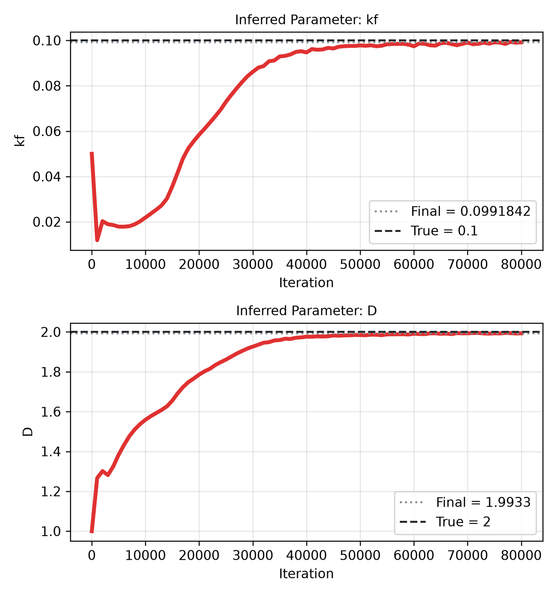

---
search:
  boost: 0.5
---

# Diffusion-reaction 1D – unknown k_f, D

| Example | |
|---|---|
| **Source** | DeepXDE example |
| **Problem** | Inverse (DeepXDE inverse example) |
| **Dimension** | 1D (x, t) |
| **Regime** | Time-dependent |
| **Geometry** | Interval |
| **Outputs** | `ca`, `cb` |
| **Settings** | Default (no separate Tuned preset) |

## Governing equations

Mathematical form (from the benchmark records):

\[\frac{\partial C_A}{\partial t} = D\frac{\partial^2 C_A}{\partial x^2} - k_f C_A C_B^2, \qquad \frac{\partial C_B}{\partial t} = D\frac{\partial^2 C_B}{\partial x^2} - 2k_f C_A C_B^2\]

As typed in PINNStudio's **Equations** page (each expression is a residual, set to zero):

```text
dca_t - 1e-3*D*dca_xx + kf*ca*cb**2
dcb_t - 1e-3*D*dcb_xx + 2*kf*ca*cb**2
```

## Domain

- Interval: \(x \in [0, 1]\)
- Time interval: \(t \in [0, 10]\)

## Initial conditions

| Output | Initial value | How it is imposed (Settings: Default) |
|---|---|---|
| `ca` | `exp(-20*x)` | loss term |
| `cb` | `exp(-20*x)` | loss term |

## Boundary conditions

| Type | Where | Output | Value | Details |
|---|---|---|---|---|
| Dirichlet BC | `True (the whole boundary)` | `ca` | `1 - x` | — |
| Dirichlet BC | `True (the whole boundary)` | `cb` | `1 - x` | — |

## Unknowns and measured data (Inverse)

| Trainable parameter | Initial value | True value |
|---|---|---|
| `kf` | 0.05 | 0.1 |
| `D` | 1 | 2 |

Measured data (**Inverse** page, measured-data files):

- [`reference_data/deepxde/reaction_inverse/ca_obs.txt`](https://github.com/AsfandyarKhan72/PINNStudio/blob/main/reference_data/deepxde/reaction_inverse/ca_obs.txt) → output `ca`, weight 1
- [`reference_data/deepxde/reaction_inverse/cb_obs.txt`](https://github.com/AsfandyarKhan72/PINNStudio/blob/main/reference_data/deepxde/reaction_inverse/cb_obs.txt) → output `cb`, weight 1

## Settings

**Settings: Default** — DeepXDE's own settings

- **Network:** FNN, hidden layers 3 × 20, inputs (x, t), 2 outputs; activation tanh, initializer Glorot uniform
- **Points:** 2,000 domain, 100 boundary, 100 initial, 50,000 test
- **Loss weights:** `1,1,1,1,1,1` (equations, then boundary-condition rows, then initial conditions)

| Phase | Optimizer | Iterations | Learning rate | Decay |
|---|---|---|---|---|
| 1 | Adam | 80,000 | 0.001 | none |

No separate **Tuned** preset: the **Tuned** item is greyed out for this example (its Default settings are PINNStudio's best).

## Results

The configuration selected in PINNStudio's benchmark study, run on one RTX 4090. Forward: relative L₂ error of each output at the last reference time. Inverse: each parameter's relative error and, per seed, the largest of them (worst parameter error).

### Inverse problem

**Settings:** Default — the example's own settings (not in the tuning sweep); the example has no separate Tuned preset for this mode. **Values:** one run, seed 2026.

| Parameter | True value | Recovered | Relative error |
|---|---|---|---|
| kf | 0.1 | 0.0991842 | 0.82 % |
| D | 2 | 1.9933 | 0.34 % |

Worst parameter error: **0.82 %**.

<figure markdown="span">
  { loading=lazy }
  <figcaption>Inverse, Default settings: parameter convergence.</figcaption>
</figure>

**Full benchmark record:** every setting tried, the per-seed values and all figures are in [the benchmark records on GitHub](https://github.com/AsfandyarKhan72/PINNStudio/blob/main/benchmarks/examples.md#dx-inverse-diffusion-reaction-system).

## Loading it in PINNStudio

- Inverse: toolbar **Examples:** › **Inverse** › under the **── 1D ──** heading, **Diffusion-reaction 1D – unknown k_f, D** › **Default**, then **Solve**.

Loading an example fills in every setting; anything you change before **Solve** is listed in the Training Log. Your save folder, GPU, random-seed and plot-style settings are kept.

## Reference solution

- None bundled; you can add your own files in the **Error Analysis** dialog.

## Notes

- Unknown kf (true 0.1) and D (true 2, i.e. diffusion 2e-3). Measured ca, cb computed by tools/make_deepxde_reference_data.py (DeepXDE uses its reaction.npz).

## Definition and records

- **Definition:** `EXAMPLES` entry "Inverse: diffusion-reaction system" in [`pinnstudio/core/deepxde_examples.py`](https://github.com/AsfandyarKhan72/PINNStudio/blob/main/pinnstudio/core/deepxde_examples.py)
- **Equations:** [Governing equations](#governing-equations) on this page
- **Reference data:** none bundled
- **Measured data** (Inverse): [`reference_data/deepxde/reaction_inverse/`](https://github.com/AsfandyarKhan72/PINNStudio/tree/main/reference_data/deepxde/reaction_inverse), written by [`tools/make_deepxde_reference_data.py`](https://github.com/AsfandyarKhan72/PINNStudio/blob/main/tools/make_deepxde_reference_data.py)
- **Benchmark records:** [`benchmarks/problems/diffusion-reaction-1d-unknown-k-f-d.md`](https://github.com/AsfandyarKhan72/PINNStudio/blob/main/benchmarks/problems/diffusion-reaction-1d-unknown-k-f-d.md), its entry in the [examples overview](https://github.com/AsfandyarKhan72/PINNStudio/blob/main/benchmarks/examples.md#dx-inverse-diffusion-reaction-system), the [benchmark collection](https://github.com/AsfandyarKhan72/PINNStudio/blob/main/benchmarks/README.md)
- **Tuning-study configurations** (records of the tuning study; open one with **Problem › Open Saved Problem...**; not presets of the Examples list): [`Diffusion-reaction 1D – unknown k_f, D (tuned).pinn.json`](https://github.com/AsfandyarKhan72/PINNStudio/blob/main/benchmarks/tuning/Diffusion-reaction%201D%20%E2%80%93%20unknown%20k_f%2C%20D%20%28tuned%29.pinn.json)
- **DeepXDE example:** [reaction_inverse.py](https://github.com/lululxvi/deepxde/blob/master/examples/pinn_inverse/reaction_inverse.py) ([documentation](https://deepxde.readthedocs.io/en/latest/demos/pinn_inverse/reaction.inverse.html))
- **Cite:** [Lu et al. 2021](../../about/references.md#lu2021deepxde) (DeepXDE)

How the benchmark values were measured and checked: [Reproducibility](../../reproducibility/benchmarks.md).

[← Back to the example gallery](../index.md)
