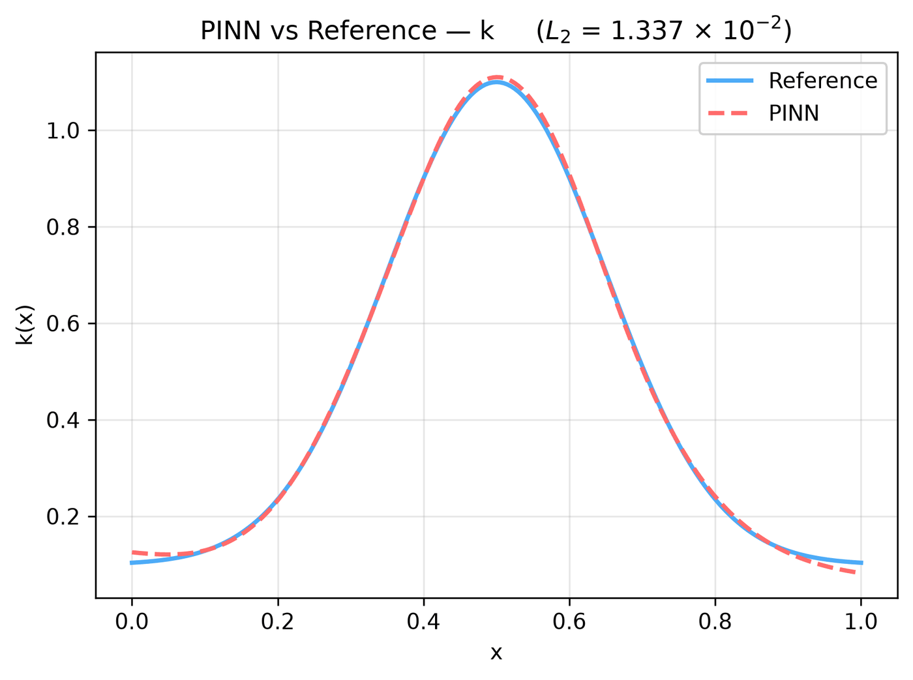

---
search:
  boost: 0.5
---

# Diffusion-reaction 1D – unknown rate field

| Example | |
|---|---|
| **Source** | DeepXDE example |
| **Problem** | Inverse (DeepXDE inverse example) |
| **Dimension** | 1D (x) |
| **Regime** | Steady |
| **Geometry** | Interval |
| **Outputs** | `u`, `k` |
| **Settings** | Default, Tuned |

## Governing equations

Mathematical form (from the benchmark records):

\[\lambda\frac{d^2u}{dx^2} - k(x)\ u = \sin(2\pi x), \qquad \lambda = 0.01,\ x \in [0, 1]\]

As typed in PINNStudio's **Equations** page (each expression is a residual, set to zero):

```text
l*du_xx - u*k - sin(2*pi*x)
```

Constants: `l = 0.01`

## Domain

- Interval: \(x \in [0, 1]\)

## Boundary conditions

| Type | Where | Output | Value | Details |
|---|---|---|---|---|
| Dirichlet BC | `True (the whole boundary)` | `u` | `0` | — |
| Point Set BC | — | `u` | (values from the file) | points from `reference_data/deepxde/diffusion_reaction_rate/u_obs.txt` |

## Unknowns and measured data (Inverse)

This example learns an unknown **field** as an extra network output (it has no scalar trainable parameters), from measurements given as a Point Set boundary condition; it runs as a Forward problem, as DeepXDE's script does.

## Settings

**Settings: Default** — DeepXDE's own settings

- **Network:** parallel FNN (PFNN), hidden layers 2 × 20, inputs (x), 2 outputs; activation tanh, initializer Glorot uniform
- **Points:** 50 domain, 8 boundary, 1,000 test
- **Loss weights:** `1,1,1` (equations, then boundary-condition rows)

| Phase | Optimizer | Iterations | Learning rate | Decay |
|---|---|---|---|---|
| 1 | Adam | 20,000 | 0.001 | none |

??? note "Settings: Tuned"

    The Training Log reports: *Tuned settings: a larger network (hidden layers twice as wide, one more layer).* The change is applied to the example's own settings.

    - **Network:** parallel FNN (PFNN), hidden layers 3 × 40, inputs (x), 2 outputs; activation tanh, initializer Glorot uniform
    - **Points:** 50 domain, 8 boundary, 1,000 test
    - **Loss weights:** `1,1,1` (equations, then boundary-condition rows)

    | Phase | Optimizer | Iterations | Learning rate | Decay |
    |---|---|---|---|---|
    | 1 | Adam | 20,000 | 0.001 | none |

## Results

From the benchmark records: one RTX 4090; relative L₂ error of the main output at the last reference time, and for an inverse problem the parameters it found (true value in brackets). *PINNStudio best* is what **Settings: Tuned** loads.

| | Default | PINNStudio best | Training time of the best (s) |
|---|---|---|---|
| Inverse: learned field | – | **see the benchmark** | 61 |

<figure markdown="span">
  { loading=lazy }
  <figcaption>PINNStudio best — Larger network (2× width, one more layer) — PINN against the reference along a line, at the reference times</figcaption>
</figure>

Every setting tried, the papers' reported errors and all figures: [the benchmark records](https://github.com/AsfandyarKhan72/PINNStudio/blob/main/benchmarks/examples.md#dx-inverse-diffusion-reaction-with-space-dependent-rate).

## Loading it in PINNStudio

- Inverse: toolbar **Examples:** › **Inverse** › under the **── 1D ──** heading, **Diffusion-reaction 1D – unknown rate field** › **Default** or **Tuned**, then **Solve**.

Loading an example fills in every setting; anything you change before **Solve** is listed in the Training Log. Your save folder, GPU, random-seed and plot-style settings are kept.

## Reference solution

- Exact solution, **Error Analysis** › reference from formula: `u = `, `k = 0.1 + exp(-0.5*(x - 0.5)**2/0.15**2)`

## Notes

- The unknown reaction rate k(x) (true: 0.1 + exp(-0.5 (x - 0.5)^2 / 0.15^2)) is a second network output, learned from 100 measurements of u (computed with scipy's solve_bvp, as DeepXDE does).

## Definition and records

- **Definition:** `EXAMPLES` entry "Inverse: diffusion-reaction with space-dependent rate" in [`pinnstudio/core/deepxde_examples.py`](https://github.com/AsfandyarKhan72/PINNStudio/blob/main/pinnstudio/core/deepxde_examples.py)
    - Settings: Tuned: entry "Inverse: diffusion-reaction with space-dependent rate" in [`pinnstudio/resources/tuned_settings.json`](https://github.com/AsfandyarKhan72/PINNStudio/blob/main/pinnstudio/resources/tuned_settings.json)
- **Equations:** [Governing equations](#governing-equations) on this page
- **Reference data:** the exact-solution formula under *Reference solution* (no data files)
- **Benchmark records:** [`benchmarks/problems/diffusion-reaction-1d-unknown-rate-field.md`](https://github.com/AsfandyarKhan72/PINNStudio/blob/main/benchmarks/problems/diffusion-reaction-1d-unknown-rate-field.md), its entry in the [examples overview](https://github.com/AsfandyarKhan72/PINNStudio/blob/main/benchmarks/examples.md#dx-inverse-diffusion-reaction-with-space-dependent-rate), the [benchmark collection](https://github.com/AsfandyarKhan72/PINNStudio/blob/main/benchmarks/README.md)
- **Tuning-study configurations** (records of the tuning study; open one with **Problem › Open Saved Problem...**; not presets of the Examples list): [`Diffusion-reaction 1D – unknown rate field (tuned).pinn.json`](https://github.com/AsfandyarKhan72/PINNStudio/blob/main/benchmarks/tuning/Diffusion-reaction%201D%20%E2%80%93%20unknown%20rate%20field%20%28tuned%29.pinn.json)
- **DeepXDE example:** [diffusion_reaction_rate.py](https://github.com/lululxvi/deepxde/blob/master/examples/pinn_inverse/diffusion_reaction_rate.py)
- **Cite:** [Lu et al. 2021](../../about/references.md#lu2021deepxde) (DeepXDE); the problem follows [Yu et al. 2022](../../about/references.md#yu2022)

Verified error values are reported in the [Reproducibility](../../reproducibility/benchmarks.md) section, not on this page.

[← Back to the example gallery](../index.md)
