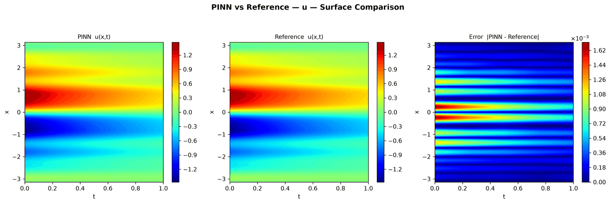
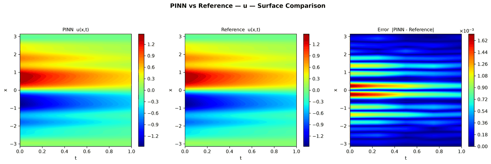
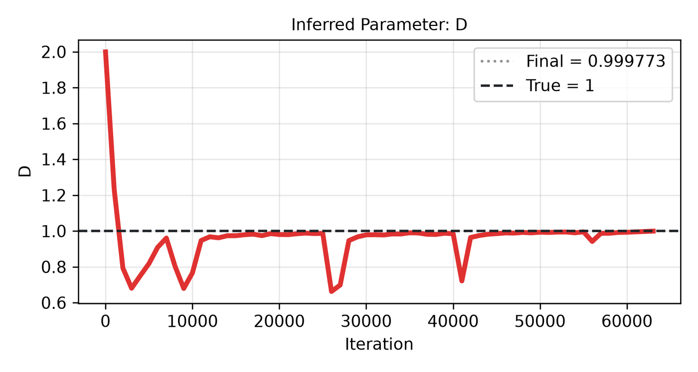

---
search:
  boost: 0.5
---

# Diffusion-reaction 1D

| Example | |
|---|---|
| **Source** | DeepXDE example |
| **Problem** | Forward and Inverse (the Inverse mode is PINNStudio's addition) |
| **Dimension** | 1D (x, t) |
| **Regime** | Time-dependent |
| **Geometry** | Interval |
| **Outputs** | `u` |
| **Settings** | Default, Tuned |

## Governing equations

Mathematical form (from the benchmark records):

\[\frac{\partial u}{\partial t} = \frac{\partial^2 u}{\partial x^2} + e^{-t}\left(\tfrac{3}{2}\sin 2x + \tfrac{8}{3}\sin 3x + \tfrac{15}{4}\sin 4x + \tfrac{63}{8}\sin 8x\right), \qquad x \in [-\pi, \pi],\ t \in [0, 1]\]

As typed in PINNStudio's **Equations** page (each expression is a residual, set to zero):

```text
du_t - du_xx - exp(-t)*(3*sin(2*x)/2 + 8*sin(3*x)/3 + 15*sin(4*x)/4 + 63*sin(8*x)/8)
```

As typed in PINNStudio's **Equations** page (Inverse mode) (each expression is a residual, set to zero):

```text
du_t - D*du_xx - exp(-t)*(3*sin(2*x)/2 + 8*sin(3*x)/3 + 15*sin(4*x)/4 + 63*sin(8*x)/8)
```

## Domain

- Interval: \(x \in [-3.14159, 3.14159]\)
- Time interval: \(t \in [0, 1]\)

## Initial conditions

| Output | Initial value | How it is imposed (Settings: Default) |
|---|---|---|
| `u` | `sin(x) + sin(2*x)/2 + sin(3*x)/3 + sin(4*x)/4 + sin(8*x)/8` | not used as a loss term |

## Boundary conditions

No boundary-condition rows: the boundary values are imposed exactly through the network's output transform (see **Methods** below), or the problem has no boundary terms.

## Unknowns and measured data (Inverse)

| Trainable parameter | Initial value | True value |
|---|---|---|
| `D` | 2 | 1 |

Measured data (**Inverse** page, measured-data files):

- [`reference_data/deepxde/diffusion_reaction_inverse/t_0.25.txt`](https://github.com/AsfandyarKhan72/PINNStudio/blob/main/reference_data/deepxde/diffusion_reaction_inverse/t_0.25.txt) → output `u`, weight 100
- [`reference_data/deepxde/diffusion_reaction_inverse/t_0.5.txt`](https://github.com/AsfandyarKhan72/PINNStudio/blob/main/reference_data/deepxde/diffusion_reaction_inverse/t_0.5.txt) → output `u`, weight 100
- [`reference_data/deepxde/diffusion_reaction_inverse/t_0.75.txt`](https://github.com/AsfandyarKhan72/PINNStudio/blob/main/reference_data/deepxde/diffusion_reaction_inverse/t_0.75.txt) → output `u`, weight 100
- [`reference_data/deepxde/diffusion_reaction_inverse/t_1.txt`](https://github.com/AsfandyarKhan72/PINNStudio/blob/main/reference_data/deepxde/diffusion_reaction_inverse/t_1.txt) → output `u`, weight 100

## Settings

### Forward mode

**Settings: Default** — DeepXDE's own settings

- **Network:** FNN, hidden layers 6 × 30, inputs (x, t), 1 output; activation tanh, initializer Glorot uniform
- **Points:** 320 domain, 0 boundary, 0 initial, 80,000 test
- **Loss weights:** `1` (equations, then boundary-condition rows, then initial conditions)
- **Methods:** output transform `t*(pi**2 - x**2)*u + sin(x) + sin(2*x)/2 + sin(3*x)/3 + sin(4*x)/4 + sin(8*x)/8` ([reference](../../reference/networks.md))

| Phase | Optimizer | Iterations | Learning rate | Decay |
|---|---|---|---|---|
| 1 | Adam | 20,000 | 0.001 | none |

??? note "Settings: Tuned"

    The Training Log reports: *Tuned settings: 3× iterations, a larger network, 3× points and an L-BFGS phase together.* The change is applied to the example's own settings.

    - **Network:** FNN, hidden layers 7 × 60, inputs (x, t), 1 output; activation tanh, initializer Glorot uniform
    - **Points:** 960 domain, 0 boundary, 0 initial, 80,000 test
    - **Loss weights:** `1` (equations, then boundary-condition rows, then initial conditions)
    - **Methods:** output transform `t*(pi**2 - x**2)*u + sin(x) + sin(2*x)/2 + sin(3*x)/3 + sin(4*x)/4 + sin(8*x)/8` ([reference](../../reference/networks.md))

    | Phase | Optimizer | Iterations | Learning rate | Decay |
    |---|---|---|---|---|
    | 1 | Adam | 60,000 | 0.001 | none |
    | 2 | L-BFGS | 15,000 | — | none |

### Inverse mode

**Settings: Default** — DeepXDE's settings with PINNStudio's Inverse-mode changes (see *Notes*)

- **Network:** FNN, hidden layers 6 × 30, inputs (x, t), 1 output; activation tanh, initializer Glorot uniform
- **Points:** 320 domain, 0 boundary, 0 initial, 80,000 test
- **Loss weights:** `1` (equations, then boundary-condition rows, then initial conditions)
- **Methods:** output transform `t*(pi**2 - x**2)*u + sin(x) + sin(2*x)/2 + sin(3*x)/3 + sin(4*x)/4 + sin(8*x)/8` ([reference](../../reference/networks.md))

| Phase | Optimizer | Iterations | Learning rate | Decay |
|---|---|---|---|---|
| 1 | Adam | 20,000 | 0.001 | none |
| 2 | L-BFGS | 15,000 | — | none |

??? note "Settings: Tuned"

    The Training Log reports: *Tuned settings: 3× iterations, a larger network, 3× points and an L-BFGS phase together.* The change is applied to the example's own settings.

    - **Network:** FNN, hidden layers 7 × 60, inputs (x, t), 1 output; activation tanh, initializer Glorot uniform
    - **Points:** 960 domain, 0 boundary, 0 initial, 80,000 test
    - **Loss weights:** `1` (equations, then boundary-condition rows, then initial conditions)
    - **Methods:** output transform `t*(pi**2 - x**2)*u + sin(x) + sin(2*x)/2 + sin(3*x)/3 + sin(4*x)/4 + sin(8*x)/8` ([reference](../../reference/networks.md))

    | Phase | Optimizer | Iterations | Learning rate | Decay |
    |---|---|---|---|---|
    | 1 | Adam | 60,000 | 0.001 | none |
    | 2 | L-BFGS | 45,000 | — | none |

## Results

The configuration selected in PINNStudio's benchmark study, run on one RTX 4090. Forward: relative L₂ error of each output at the last reference time. Inverse: each parameter's relative error and, per seed, the largest of them (worst parameter error).

### Forward problem

**Settings:** Tuned — all of the changes together. **Values:** median over seeds 2026, 1, 2.

| Output | Relative L₂ |
|---|---|
| u | 8.5 × 10⁻⁵ |

<figure markdown="span">
  { loading=lazy }
  <figcaption>Forward, Tuned settings: PINN, reference and error.</figcaption>
</figure>

### Inverse problem

**Settings:** Tuned — all of the changes together. **Values:** median over seeds 2026, 1, 2.

| Parameter | True value | Recovered | Relative error |
|---|---|---|---|
| D | 1 | 0.99988 | 0.012 % |

Worst parameter error: **0.012 %** (the median over the seeds of each seed's largest error).

<figure markdown="span">
  { loading=lazy }
  <figcaption>Inverse, Tuned settings: PINN, reference and error.</figcaption>
</figure>

<figure markdown="span">
  { loading=lazy }
  <figcaption>Inverse, Tuned settings: parameter convergence.</figcaption>
</figure>

**Full benchmark record:** every setting tried, the per-seed values and all figures are in [the benchmark records on GitHub](https://github.com/AsfandyarKhan72/PINNStudio/blob/main/benchmarks/examples.md#dx-diffusion-reaction-equation).

## Loading it in PINNStudio

- Forward: toolbar **Examples:** › **Forward** › under the **── 1D ──** heading, **Diffusion-reaction 1D** › **Default** or **Tuned**, then **Solve**.
- Inverse: toolbar **Examples:** › **Inverse** › under the **── 1D ──** heading, **Diffusion-reaction 1D** › **Default** or **Tuned**, then **Solve**.

Loading an example fills in every setting; anything you change before **Solve** is listed in the Training Log. Your save folder, GPU, random-seed and plot-style settings are kept.

## Reference solution

- Exact solution, **Error Analysis** › reference from formula: `u = exp(-t)*(sin(x) + sin(2*x)/2 + sin(3*x)/3 + sin(4*x)/4 + sin(8*x)/8)`

## Notes

- Inverse mode (PINNStudio's addition): the diffusivity D (1 in the forward equation; initial guess 2) is learned from u measured at t = 0.25, 0.5, 0.75 and 1 (reference_data/deepxde/diffusion_reaction_inverse). An L-BFGS phase follows Adam.

## Definition and records

- **Definition:** `EXAMPLES` entry "Diffusion-reaction equation" in [`pinnstudio/core/deepxde_examples.py`](https://github.com/AsfandyarKhan72/PINNStudio/blob/main/pinnstudio/core/deepxde_examples.py)
    - Inverse mode (PINNStudio's addition): `ADDED_INVERSE["Diffusion-reaction equation"]`, same file
    - Settings: Tuned: entry "Diffusion-reaction equation" in [`pinnstudio/resources/tuned_settings.json`](https://github.com/AsfandyarKhan72/PINNStudio/blob/main/pinnstudio/resources/tuned_settings.json)
- **Equations:** [Governing equations](#governing-equations) on this page
- **Reference data:** the exact-solution formula under *Reference solution* (no data files)
- **Measured data** (Inverse): [`reference_data/deepxde/diffusion_reaction_inverse/`](https://github.com/AsfandyarKhan72/PINNStudio/tree/main/reference_data/deepxde/diffusion_reaction_inverse), written by [`tools/make_deepxde_reference_data.py`](https://github.com/AsfandyarKhan72/PINNStudio/blob/main/tools/make_deepxde_reference_data.py)
- **Benchmark records:** [`benchmarks/problems/diffusion-reaction-1d.md`](https://github.com/AsfandyarKhan72/PINNStudio/blob/main/benchmarks/problems/diffusion-reaction-1d.md), its entry in the [examples overview](https://github.com/AsfandyarKhan72/PINNStudio/blob/main/benchmarks/examples.md#dx-diffusion-reaction-equation), the [benchmark collection](https://github.com/AsfandyarKhan72/PINNStudio/blob/main/benchmarks/README.md)
- **Tuning-study configurations** (records of the tuning study; open one with **Problem › Open Saved Problem...**; not presets of the Examples list): [`Diffusion-reaction 1D (tuned).pinn.json`](https://github.com/AsfandyarKhan72/PINNStudio/blob/main/benchmarks/tuning/Diffusion-reaction%201D%20%28tuned%29.pinn.json), [`Diffusion-reaction 1D, inverse mode (tuned).pinn.json`](https://github.com/AsfandyarKhan72/PINNStudio/blob/main/benchmarks/tuning/Diffusion-reaction%201D%2C%20inverse%20mode%20%28tuned%29.pinn.json)
- **Methods** (Default and Tuned settings): [Networks and Fourier features](../../reference/networks.md)
- **DeepXDE example:** [diffusion_reaction.py](https://github.com/lululxvi/deepxde/blob/master/examples/pinn_forward/diffusion_reaction.py) ([documentation](https://deepxde.readthedocs.io/en/latest/demos/pinn_forward/diffusion.reaction.html))
- **Cite:** [Lu et al. 2021](../../about/references.md#lu2021deepxde) (DeepXDE); the problem follows [Yu et al. 2022](../../about/references.md#yu2022)

How the benchmark values were measured and checked: [Reproducibility](../../reproducibility/benchmarks.md).

[← Back to the example gallery](../index.md)
