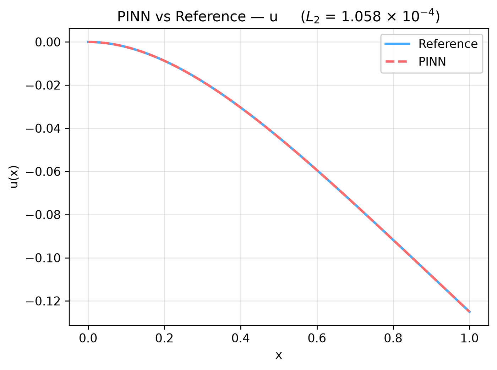
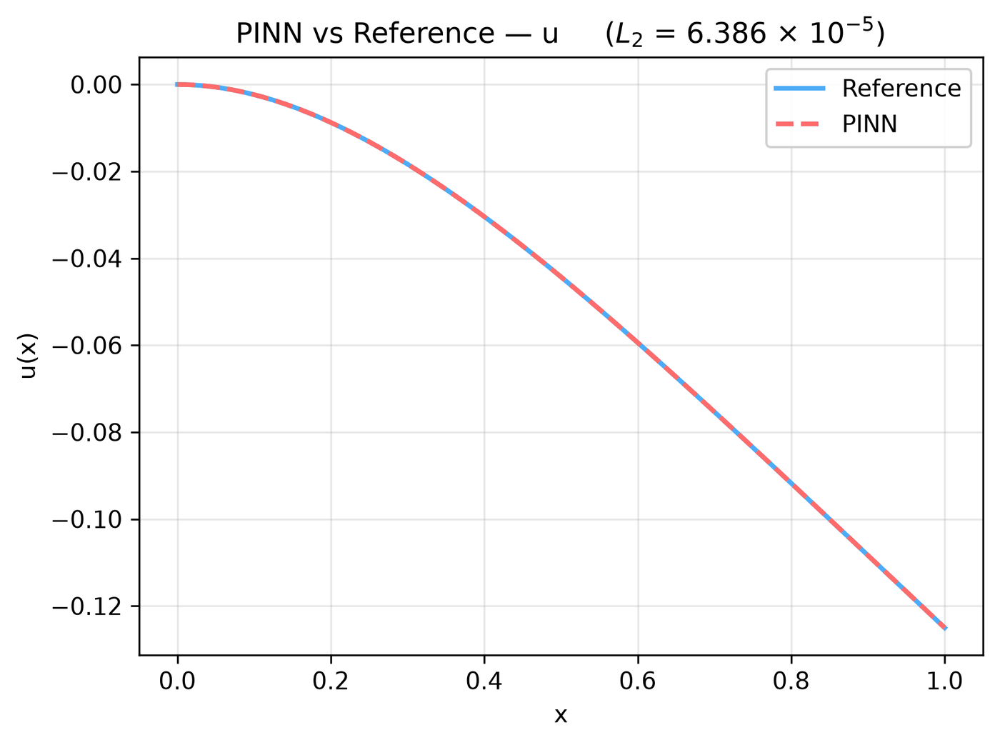
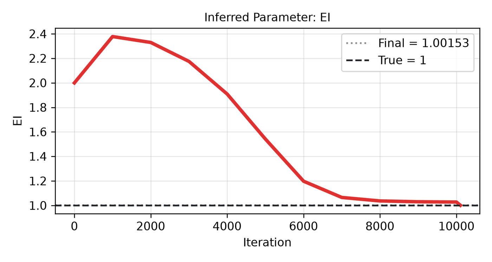

---
search:
  boost: 0.5
---

# Euler beam 1D

| Example | |
|---|---|
| **Source** | DeepXDE example |
| **Problem** | Forward and Inverse (the Inverse mode is PINNStudio's addition) |
| **Dimension** | 1D (x) |
| **Regime** | Steady |
| **Geometry** | Interval |
| **Outputs** | `u` |
| **Settings** | Default, Tuned |

## Governing equations

Mathematical form (from the benchmark records):

\[\frac{d^4u}{dx^4} = -1, \qquad x \in [0, 1]\]

As typed in PINNStudio's **Equations** page (each expression is a residual, set to zero):

```text
du_xxxx + 1
```

As typed in PINNStudio's **Equations** page (Inverse mode) (each expression is a residual, set to zero):

```text
EI*du_xxxx + 1
```

## Domain

- Interval: \(x \in [0, 1]\)

## Boundary conditions

| Type | Where | Output | Value | Details |
|---|---|---|---|---|
| Dirichlet BC | `left` | `u` | `0` | — |
| Neumann BC | `left` | `u` | `0` | — |
| Operator BC (advanced) | `right` | — | `du_xx` | — |
| Operator BC (advanced) | `right` | — | `du_xxx` | — |

## Unknowns and measured data (Inverse)

| Trainable parameter | Initial value | True value |
|---|---|---|
| `EI` | 2 | 1 |

Measured data (**Inverse** page, measured-data files):

- [`reference_data/deepxde/euler_beam_inverse/u_obs.txt`](https://github.com/AsfandyarKhan72/PINNStudio/blob/v1.6.0/reference_data/deepxde/euler_beam_inverse/u_obs.txt) → output `u`, weight 100

## Settings

### Forward mode

**Settings: Default** — DeepXDE's own settings

- **Network:** FNN, hidden layers 3 × 20, inputs (x), 1 output; activation tanh, initializer Glorot uniform
- **Points:** 10 domain, 2 boundary, 100 test
- **Loss weights:** `1,1,1,1,1` (equations, then boundary-condition rows)

| Phase | Optimizer | Iterations | Learning rate | Decay |
|---|---|---|---|---|
| 1 | Adam | 10,000 | 0.001 | none |

??? note "Settings: Tuned"

    The Training Log reports: *Tuned settings: 3× iterations, a larger network, 3× points and an L-BFGS phase together.* The change is applied to the example's own settings.

    - **Network:** FNN, hidden layers 4 × 40, inputs (x), 1 output; activation tanh, initializer Glorot uniform
    - **Points:** 30 domain, 6 boundary, 100 test
    - **Loss weights:** `1,1,1,1,1` (equations, then boundary-condition rows)

    | Phase | Optimizer | Iterations | Learning rate | Decay |
    |---|---|---|---|---|
    | 1 | Adam | 30,000 | 0.001 | none |
    | 2 | L-BFGS | 15,000 | — | none |

### Inverse mode

**Settings: Default** — DeepXDE's settings with PINNStudio's Inverse-mode changes (see *Notes*)

- **Network:** FNN, hidden layers 3 × 20, inputs (x), 1 output; activation tanh, initializer Glorot uniform
- **Points:** 10 domain, 2 boundary, 100 test
- **Loss weights:** `1,1,1,1,1` (equations, then boundary-condition rows)

| Phase | Optimizer | Iterations | Learning rate | Decay |
|---|---|---|---|---|
| 1 | Adam | 10,000 | 0.001 | none |
| 2 | L-BFGS | 15,000 | — | none |

??? note "Settings: Tuned"

    The Training Log reports: *Tuned settings: a larger network (hidden layers twice as wide, one more layer).* The change is applied to the example's own settings.

    - **Network:** FNN, hidden layers 4 × 40, inputs (x), 1 output; activation tanh, initializer Glorot uniform
    - **Points:** 10 domain, 2 boundary, 100 test
    - **Loss weights:** `1,1,1,1,1` (equations, then boundary-condition rows)

    | Phase | Optimizer | Iterations | Learning rate | Decay |
    |---|---|---|---|---|
    | 1 | Adam | 10,000 | 0.001 | none |
    | 2 | L-BFGS | 15,000 | — | none |

## Results

The configuration selected in PINNStudio's benchmark study, run on one RTX 4090. Forward: relative L₂ error of each output at the last reference time. Inverse: each parameter's relative error and, per seed, the largest of them (worst parameter error).

### Forward problem

**Settings:** Tuned — all of the changes together. **Values:** median over seeds 2026, 1, 2.

| Output | Relative L₂ |
|---|---|
| u | 2.8 × 10⁻⁴ |

<figure markdown="span">
  { loading=lazy }
  <figcaption>Forward, Tuned settings: PINN and reference along lines.</figcaption>
</figure>

### Inverse problem

**Settings:** Tuned — Larger network (2× width, one more layer). **Values:** median over seeds 2026, 1, 2.

| Parameter | True value | Recovered | Relative error |
|---|---|---|---|
| EI | 1 | 1.00153 | 0.15 % |

Worst parameter error: **0.15 %** (the median over the seeds of each seed's largest error).

<figure markdown="span">
  { loading=lazy }
  <figcaption>Inverse, Tuned settings: PINN and reference along lines.</figcaption>
</figure>

<figure markdown="span">
  { loading=lazy }
  <figcaption>Inverse, Tuned settings: parameter convergence.</figcaption>
</figure>

**Full benchmark record:** every setting tried, the per-seed values and all figures are in [the benchmark records on GitHub](https://github.com/AsfandyarKhan72/PINNStudio/blob/v1.6.0/benchmarks/examples.md#dx-euler-beam).

## Loading it in PINNStudio

- Forward: toolbar **Examples:** › **Forward** › under the **── 1D ──** heading, **Euler beam 1D** › **Default** or **Tuned**, then **Solve**.
- Inverse: toolbar **Examples:** › **Inverse** › under the **── 1D ──** heading, **Euler beam 1D** › **Default** or **Tuned**, then **Solve**.

Loading an example fills in every setting; anything you change before **Solve** is listed in the Training Log. Your save folder, GPU, random-seed and plot-style settings are kept.

## Reference solution

- Exact solution, **Error Analysis** › reference from formula: `u = -x**4/24 + x**3/6 - x**2/4`

## Notes

- Inverse mode (PINNStudio's addition): the bending stiffness EI (1 in the forward equation; initial guess 2) is learned from the deflection measured at 20 points (reference_data/deepxde/euler_beam_inverse). An L-BFGS phase follows Adam.

## Definition and records

- **Definition:** `EXAMPLES` entry "Euler beam" in [`pinnstudio/core/deepxde_examples.py`](https://github.com/AsfandyarKhan72/PINNStudio/blob/v1.6.0/pinnstudio/core/deepxde_examples.py)
    - Inverse mode (PINNStudio's addition): `ADDED_INVERSE["Euler beam"]`, same file
    - Settings: Tuned: entry "Euler beam" in [`pinnstudio/resources/tuned_settings.json`](https://github.com/AsfandyarKhan72/PINNStudio/blob/v1.6.0/pinnstudio/resources/tuned_settings.json)
- **Equations:** [Governing equations](#governing-equations) on this page
- **Reference data:** the exact-solution formula under *Reference solution* (no data files)
- **Measured data** (Inverse): [`reference_data/deepxde/euler_beam_inverse/`](https://github.com/AsfandyarKhan72/PINNStudio/tree/v1.6.0/reference_data/deepxde/euler_beam_inverse), written by [`tools/make_deepxde_reference_data.py`](https://github.com/AsfandyarKhan72/PINNStudio/blob/v1.6.0/tools/make_deepxde_reference_data.py)
- **Benchmark records:** [`benchmarks/problems/euler-beam-1d.md`](https://github.com/AsfandyarKhan72/PINNStudio/blob/v1.6.0/benchmarks/problems/euler-beam-1d.md), its entry in the [examples overview](https://github.com/AsfandyarKhan72/PINNStudio/blob/v1.6.0/benchmarks/examples.md#dx-euler-beam), the [benchmark collection](https://github.com/AsfandyarKhan72/PINNStudio/blob/v1.6.0/benchmarks/README.md)
- **Tuning-study configurations** (records of the tuning study; open one with **Problem › Open Saved Problem...**; not presets of the Examples list): [`Euler beam 1D (tuned).pinn.json`](https://github.com/AsfandyarKhan72/PINNStudio/blob/v1.6.0/benchmarks/tuning/Euler%20beam%201D%20%28tuned%29.pinn.json), [`Euler beam 1D, inverse mode (tuned).pinn.json`](https://github.com/AsfandyarKhan72/PINNStudio/blob/v1.6.0/benchmarks/tuning/Euler%20beam%201D%2C%20inverse%20mode%20%28tuned%29.pinn.json)
- **DeepXDE example:** [Euler_beam.py](https://github.com/lululxvi/deepxde/blob/master/examples/pinn_forward/Euler_beam.py) ([documentation](https://deepxde.readthedocs.io/en/latest/demos/pinn_forward/eulerbeam.html))
- **Cite:** [Lu et al. 2021](../../about/references.md#lu2021deepxde) (DeepXDE)

How the benchmark values were measured and checked: [Reproducibility](../../reproducibility/benchmarks.md).

[← Back to the example gallery](../index.md)
