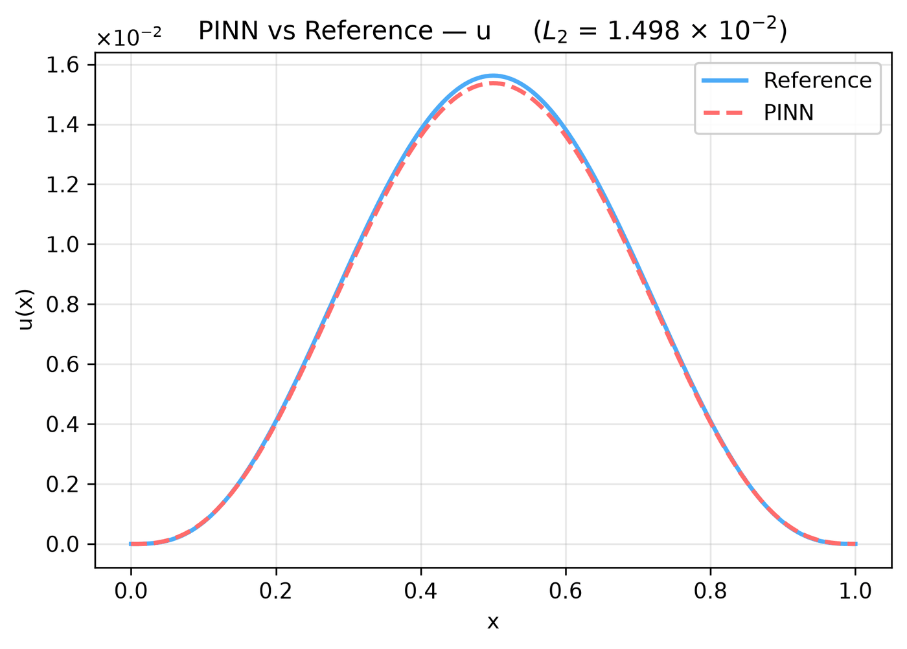

---
search:
  boost: 0.5
---

# Fractional Poisson 1D

| Example | |
|---|---|
| **Source** | DeepXDE example |
| **Problem** | Forward |
| **Dimension** | 1D (x) |
| **Regime** | Steady |
| **Geometry** | Interval |
| **Outputs** | `u` |
| **Settings** | Default, Tuned |

## Governing equations

Mathematical form (from the benchmark records):

\[D_{0+}^{\alpha}u + D_{1-}^{\alpha}u = f(x), \qquad x \in [0, 1],\ \alpha = 1.5\]

As typed in PINNStudio's **Equations** page (each expression is a residual, set to zero):

```text
frac(u) - (gamma(4)/gamma(4 - alpha)*(x**(3 - alpha) + (1 - x)**(3 - alpha)) - 3*gamma(5)/gamma(5 - alpha)*(x**(4 - alpha) + (1 - x)**(4 - alpha)) + 3*gamma(6)/gamma(6 - alpha)*(x**(5 - alpha) + (1 - x)**(5 - alpha)) - gamma(7)/gamma(7 - alpha)*(x**(6 - alpha) + (1 - x)**(6 - alpha)))
```

Constants: `alpha = 1.5`

## Domain

- Interval: \(x \in [0, 1]\)

## Boundary conditions

| Type | Where | Output | Value | Details |
|---|---|---|---|---|
| Dirichlet BC | `True (the whole boundary)` | `u` | `0` | — |

## Settings

**Settings: Default** — DeepXDE's own settings

- **Network:** FNN, hidden layers 4 × 20, inputs (x), 1 output; activation tanh, initializer Glorot normal
- **Points:** 101 domain, 2 boundary, 100 test
- **Loss weights:** `1,1` (equations, then boundary-condition rows)
- **Methods:** output transform `x*(1 - x)*u` ([reference](../../reference/networks.md))

| Phase | Optimizer | Iterations | Learning rate | Decay |
|---|---|---|---|---|
| 1 | Adam | 10,000 | 0.001 | none |

??? note "Settings: Tuned"

    The Training Log reports: *Tuned settings: a larger network (hidden layers twice as wide, one more layer).* The change is applied to the example's own settings.

    - **Network:** FNN, hidden layers 5 × 40, inputs (x), 1 output; activation tanh, initializer Glorot normal
    - **Points:** 101 domain, 2 boundary, 100 test
    - **Loss weights:** `1,1` (equations, then boundary-condition rows)
    - **Methods:** output transform `x*(1 - x)*u` ([reference](../../reference/networks.md))

    | Phase | Optimizer | Iterations | Learning rate | Decay |
    |---|---|---|---|---|
    | 1 | Adam | 10,000 | 0.001 | none |

## Results

From the benchmark records: one RTX 4090; relative L₂ error of the main output at the last reference time, and for an inverse problem the parameters it found (true value in brackets). *PINNStudio best* is what **Settings: Tuned** loads.

| | Default | PINNStudio best | Training time of the best (s) |
|---|---|---|---|
| Forward: relative L₂ at the last reference time | 2.3 × 10<sup>-2</sup> | **1.5 × 10<sup>-2</sup>** | 21 |

<figure markdown="span">
  { loading=lazy }
  <figcaption>PINNStudio best — Larger network (2× width, one more layer) — PINN against the reference along a line, at the reference times</figcaption>
</figure>

Every setting tried, the papers' reported errors and all figures: [the benchmark records](https://github.com/AsfandyarKhan72/PINNStudio/blob/main/benchmarks/examples.md#dx-fractional-poisson-equation-1d).

## Loading it in PINNStudio

- Forward: toolbar **Examples:** › **Forward** › under the **── 1D ──** heading, **Fractional Poisson 1D** › **Default** or **Tuned**, then **Solve**.

Loading an example fills in every setting; anything you change before **Solve** is listed in the Training Log. Your save folder, GPU, random-seed and plot-style settings are kept.

## Reference solution

- Exact solution, **Error Analysis** › reference from formula: `u = x**3*(1 - x)**3`

## Notes

- frac(u) is the sum of the left and right Riemann-Liouville derivatives of order alpha, discretized by DeepXDE's FPDE (Grunwald-Letnikov, static mesh of 101 points). DeepXDE's own script supports only the TensorFlow and Paddle backends; PINNStudio applies the same FPDE matrix with PyTorch.

## Definition and records

- **Definition:** `EXAMPLES` entry "Fractional Poisson equation 1D" in [`pinnstudio/core/deepxde_examples.py`](https://github.com/AsfandyarKhan72/PINNStudio/blob/main/pinnstudio/core/deepxde_examples.py)
    - Settings: Tuned: entry "Fractional Poisson equation 1D" in [`pinnstudio/resources/tuned_settings.json`](https://github.com/AsfandyarKhan72/PINNStudio/blob/main/pinnstudio/resources/tuned_settings.json)
- **Equations:** [Governing equations](#governing-equations) on this page
- **Reference data:** the exact-solution formula under *Reference solution* (no data files)
- **Benchmark records:** [`benchmarks/problems/fractional-poisson-1d.md`](https://github.com/AsfandyarKhan72/PINNStudio/blob/main/benchmarks/problems/fractional-poisson-1d.md), its entry in the [examples overview](https://github.com/AsfandyarKhan72/PINNStudio/blob/main/benchmarks/examples.md#dx-fractional-poisson-equation-1d), the [benchmark collection](https://github.com/AsfandyarKhan72/PINNStudio/blob/main/benchmarks/README.md)
- **Tuning-study configurations** (records of the tuning study; open one with **Problem › Open Saved Problem...**; not presets of the Examples list): [`Fractional Poisson 1D (tuned).pinn.json`](https://github.com/AsfandyarKhan72/PINNStudio/blob/main/benchmarks/tuning/Fractional%20Poisson%201D%20%28tuned%29.pinn.json)
- **Methods** (Default and Tuned settings): [Networks and Fourier features](../../reference/networks.md)
- **DeepXDE example:** [fractional_Poisson_1d.py](https://github.com/lululxvi/deepxde/blob/master/examples/pinn_forward/fractional_Poisson_1d.py)
- **Cite:** [Lu et al. 2021](../../about/references.md#lu2021deepxde) (DeepXDE); the problem follows [Pang et al. 2019](../../about/references.md#pang2019)

Verified error values are reported in the [Reproducibility](../../reproducibility/benchmarks.md) section, not on this page.

[← Back to the example gallery](../index.md)
