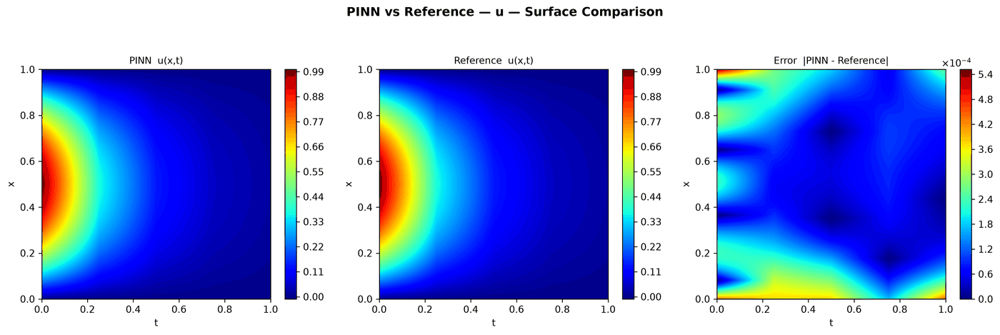
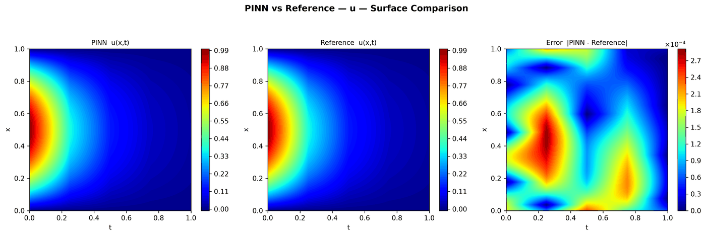

---
search:
  boost: 0.5
---

# Heat 1D – Dirichlet

| Example | |
|---|---|
| **Source** | DeepXDE example |
| **Problem** | Forward and Inverse (the Inverse mode is PINNStudio's addition) |
| **Dimension** | 1D (x, t) |
| **Regime** | Time-dependent |
| **Geometry** | Interval |
| **Outputs** | `u` |
| **Settings** | Default, Tuned |

## Governing equations

Mathematical form (from the benchmark records):

\[\frac{\partial u}{\partial t} = 0.4\frac{\partial^2 u}{\partial x^2}, \qquad x \in [0, 1],\ t \in [0, 1]\]

As typed in PINNStudio's **Equations** page (each expression is a residual, set to zero):

```text
du_t - a*du_xx
```

Constants: `a = 0.4`, `L = 1`, `n = 1`

Inverse-mode form (from the benchmark records):

\[\frac{\partial u}{\partial t} = a\ \frac{\partial^2 u}{\partial x^2}\]

## Domain

- Interval: \(x \in [0, 1]\)
- Time interval: \(t \in [0, 1]\)

## Initial conditions

| Output | Initial value | How it is imposed (Settings: Default) |
|---|---|---|
| `u` | `sin(n*pi*x/L)` | loss term |

## Boundary conditions

| Type | Where | Output | Value | Details |
|---|---|---|---|---|
| Dirichlet BC | `True (the whole boundary)` | `u` | `0` | — |

## Unknowns and measured data (Inverse)

| Trainable parameter | Initial value | True value |
|---|---|---|
| `a` | 1 | 0.4 |

Measured data (**Inverse** page, measured-data files):

- [`reference_data/1D/heat/t_1.0.txt`](https://github.com/AsfandyarKhan72/PINNStudio/blob/main/reference_data/1D/heat/t_1.0.txt) → output `u`, weight 100

From the benchmark records: pick the example from the **Inverse** list: the diffusivity \(a\) is unknown (initial guess 1, true value 0.4) and is learned together with \(u\) from \(u\) measured at \(t = 1\) (the exact solution, [`reference_data/1D/heat/t_1.0.txt`](https://github.com/AsfandyarKhan72/PINNStudio/blob/main/reference_data/1D/heat/t_1.0.txt)).

## Settings

### Forward mode

**Settings: Default** — DeepXDE's own settings

- **Network:** FNN, hidden layers 3 × 20, inputs (x, t), 1 output; activation tanh, initializer Glorot normal
- **Points:** 2,540 domain, 80 boundary, 160 initial, 2,540 test
- **Loss weights:** `1,1,1` (equations, then boundary-condition rows, then initial conditions)

| Phase | Optimizer | Iterations | Learning rate | Decay |
|---|---|---|---|---|
| 1 | Adam | 20,000 | 0.001 | none |
| 2 | L-BFGS | 15,000 | — | none |

??? note "Settings: Tuned"

    The Training Log reports: *Tuned settings: 3× iterations, a larger network, 3× points and an L-BFGS phase together.* The change is applied to the example's own settings.

    - **Network:** FNN, hidden layers 4 × 40, inputs (x, t), 1 output; activation tanh, initializer Glorot normal
    - **Points:** 7,620 domain, 240 boundary, 480 initial, 2,540 test
    - **Loss weights:** `1,1,1` (equations, then boundary-condition rows, then initial conditions)

    | Phase | Optimizer | Iterations | Learning rate | Decay |
    |---|---|---|---|---|
    | 1 | Adam | 60,000 | 0.001 | none |
    | 2 | L-BFGS | 45,000 | — | none |

### Inverse mode

**Settings: Default** — DeepXDE's settings with PINNStudio's Inverse-mode changes (see *Notes*)

- **Network:** FNN, hidden layers 3 × 20, inputs (x, t), 1 output; activation tanh, initializer Glorot normal
- **Points:** 2,540 domain, 80 boundary, 160 initial, 2,540 test
- **Loss weights:** `1,1,1` (equations, then boundary-condition rows, then initial conditions)

| Phase | Optimizer | Iterations | Learning rate | Decay |
|---|---|---|---|---|
| 1 | Adam | 20,000 | 0.001 | none |
| 2 | L-BFGS | 15,000 | — | none |

??? note "Settings: Tuned"

    The Training Log reports: *Tuned settings: 3× iterations, a larger network, 3× points and an L-BFGS phase together.* The change is applied to the example's own settings.

    - **Network:** FNN, hidden layers 4 × 40, inputs (x, t), 1 output; activation tanh, initializer Glorot normal
    - **Points:** 7,620 domain, 240 boundary, 480 initial, 2,540 test
    - **Loss weights:** `1,1,1` (equations, then boundary-condition rows, then initial conditions)

    | Phase | Optimizer | Iterations | Learning rate | Decay |
    |---|---|---|---|---|
    | 1 | Adam | 60,000 | 0.001 | none |
    | 2 | L-BFGS | 45,000 | — | none |

## Results

From the benchmark records: one RTX 4090; relative L₂ error of the main output at the last reference time, and for an inverse problem the parameters it found (true value in brackets). *PINNStudio best* is what **Settings: Tuned** loads.

| | Default | PINNStudio best | Training time of the best (s) |
|---|---|---|---|
| Forward: relative L₂ at the last reference time | 5.0 × 10<sup>-2</sup> | **1.3 × 10<sup>-2</sup>** | 128 |
| Inverse: parameters found (true) | – | **a = 0.400406 (0.4)** (worst error 0.1%) | 146 |

<figure markdown="span">
  { loading=lazy }
  <figcaption>PINNStudio best — all of the changes together — PINN, reference and error over space and time</figcaption>
</figure>

<figure markdown="span">
  { loading=lazy }
  <figcaption>PINNStudio best — all of the changes together — PINN, reference and error over space and time</figcaption>
</figure>

Every setting tried, the papers' reported errors and all figures: [the benchmark records](https://github.com/AsfandyarKhan72/PINNStudio/blob/main/benchmarks/examples.md#dx-heat-equation).

## Loading it in PINNStudio

- Forward: toolbar **Examples:** › **Forward** › under the **── 1D ──** heading, **Heat 1D – Dirichlet** › **Default** or **Tuned**, then **Solve**.
- Inverse: toolbar **Examples:** › **Inverse** › under the **── 1D ──** heading, **Heat 1D – Dirichlet** › **Default** or **Tuned**, then **Solve**.

Loading an example fills in every setting; anything you change before **Solve** is listed in the Training Log. Your save folder, GPU, random-seed and plot-style settings are kept.

## Reference solution

- Forward mode: exact solution, **Error Analysis** › reference from formula: `u = exp(-n**2*pi**2*a*t/L**2)*sin(n*pi*x/L)`
- Inverse mode: exact solution, **Error Analysis** › reference from formula: `u = exp(-n**2*pi**2*0.4*t/L**2)*sin(n*pi*x/L)`

## Notes

- Inverse mode (PINNStudio's addition): the diffusivity a is unknown (initial guess 1, true 0.4) and learned from u measured at t = 1 (the exact solution, reference_data/1D/heat/t_1.0.txt).

## Definition and records

- **Definition:** `EXAMPLES` entry "Heat equation" in [`pinnstudio/core/deepxde_examples.py`](https://github.com/AsfandyarKhan72/PINNStudio/blob/main/pinnstudio/core/deepxde_examples.py)
    - Settings: Tuned: entry "Heat equation" in [`pinnstudio/resources/tuned_settings.json`](https://github.com/AsfandyarKhan72/PINNStudio/blob/main/pinnstudio/resources/tuned_settings.json)
- **Equations:** [Governing equations](#governing-equations) on this page
- **Reference data:** the exact-solution formula under *Reference solution* (no data files)
- **Measured data** (Inverse): [`reference_data/1D/heat/`](https://github.com/AsfandyarKhan72/PINNStudio/tree/main/reference_data/1D/heat), written by [`tools/make_exact_reference_data.py`](https://github.com/AsfandyarKhan72/PINNStudio/blob/main/tools/make_exact_reference_data.py)
- **Benchmark records:** [`benchmarks/problems/heat-1d-dirichlet.md`](https://github.com/AsfandyarKhan72/PINNStudio/blob/main/benchmarks/problems/heat-1d-dirichlet.md), its entry in the [examples overview](https://github.com/AsfandyarKhan72/PINNStudio/blob/main/benchmarks/examples.md#dx-heat-equation), the [benchmark collection](https://github.com/AsfandyarKhan72/PINNStudio/blob/main/benchmarks/README.md)
- **Tuning-study configurations** (records of the tuning study; open one with **Problem › Open Saved Problem...**; not presets of the Examples list): [`Heat 1D – Dirichlet (tuned).pinn.json`](https://github.com/AsfandyarKhan72/PINNStudio/blob/main/benchmarks/tuning/Heat%201D%20%E2%80%93%20Dirichlet%20%28tuned%29.pinn.json), [`Heat 1D – Dirichlet, inverse mode (tuned).pinn.json`](https://github.com/AsfandyarKhan72/PINNStudio/blob/main/benchmarks/tuning/Heat%201D%20%E2%80%93%20Dirichlet%2C%20inverse%20mode%20%28tuned%29.pinn.json)
- **DeepXDE example:** [heat.py](https://github.com/lululxvi/deepxde/blob/master/examples/pinn_forward/heat.py) ([documentation](https://deepxde.readthedocs.io/en/latest/demos/pinn_forward/heat.html))
- **Cite:** [Lu et al. 2021](../../about/references.md#lu2021deepxde) (DeepXDE)

Verified error values are reported in the [Reproducibility](../../reproducibility/benchmarks.md) section, not on this page.

[← Back to the example gallery](../index.md)
