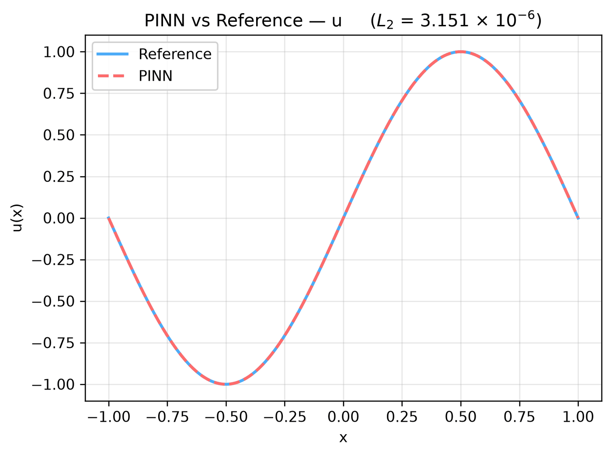

---
search:
  boost: 0.5
---

# Poisson 1D – Dirichlet/Periodic

| Example | |
|---|---|
| **Source** | DeepXDE example |
| **Problem** | Forward |
| **Dimension** | 1D (x) |
| **Regime** | Steady |
| **Geometry** | Interval |
| **Outputs** | `u` |
| **Settings** | Default, Tuned |

## Governing equations

Mathematical form (from the benchmark records):

\[-\frac{d^2u}{dx^2} = \pi^2\sin(\pi x), \qquad x \in [-1, 1]\]

As typed in PINNStudio's **Equations** page (each expression is a residual, set to zero):

```text
-du_xx - pi**2*sin(pi*x)
```

## Domain

- Interval: \(x \in [-1, 1]\)

## Boundary conditions

| Type | Where | Output | Value | Details |
|---|---|---|---|---|
| Dirichlet BC | `left` | `u` | `0` | — |
| Periodic BC | `right` | `u` | — | axis x, derivative order 0 |

## Settings

**Settings: Default** — DeepXDE's own settings

- **Network:** FNN, hidden layers 3 × 50, inputs (x), 1 output; activation tanh, initializer Glorot uniform
- **Points:** 16 domain, 2 boundary, 100 test
- **Loss weights:** `1,1,1` (equations, then boundary-condition rows)

| Phase | Optimizer | Iterations | Learning rate | Decay |
|---|---|---|---|---|
| 1 | Adam | 10,000 | 0.001 | none |

??? note "Settings: Tuned"

    The Training Log reports: *Tuned settings: 3× iterations, a larger network, 3× points and an L-BFGS phase together.* The change is applied to the example's own settings.

    - **Network:** FNN, hidden layers 4 × 100, inputs (x), 1 output; activation tanh, initializer Glorot uniform
    - **Points:** 48 domain, 6 boundary, 100 test
    - **Loss weights:** `1,1,1` (equations, then boundary-condition rows)

    | Phase | Optimizer | Iterations | Learning rate | Decay |
    |---|---|---|---|---|
    | 1 | Adam | 30,000 | 0.001 | none |
    | 2 | L-BFGS | 15,000 | — | none |

## Results

The configuration selected in PINNStudio's benchmark study, run on one RTX 4090. Forward: relative L₂ error of each output at the last reference time. Inverse: each parameter's relative error and, per seed, the largest of them (worst parameter error).

### Forward problem

**Settings:** Tuned — all of the changes together. **Values:** median over seeds 2026, 1, 2.

| Output | Relative L₂ |
|---|---|
| u | 6.4 × 10⁻⁶ |

<figure markdown="span">
  { loading=lazy }
  <figcaption>Forward, Tuned settings: PINN and reference along lines.</figcaption>
</figure>

**Full benchmark record:** every setting tried, the per-seed values and all figures are in [the benchmark records on GitHub](https://github.com/AsfandyarKhan72/PINNStudio/blob/main/benchmarks/examples.md#dx-poisson-1d-dirichlet-periodic).

## Loading it in PINNStudio

- Forward: toolbar **Examples:** › **Forward** › under the **── 1D ──** heading, **Poisson 1D – Dirichlet/Periodic** › **Default** or **Tuned**, then **Solve**.

Loading an example fills in every setting; anything you change before **Solve** is listed in the Training Log. Your save folder, GPU, random-seed and plot-style settings are kept.

## Reference solution

- Exact solution, **Error Analysis** › reference from formula: `u = sin(pi*x)`

## Notes

- DeepXDE's script passes sin(pi x) as the left boundary value; it is 0 at x = -1.

## Definition and records

- **Definition:** `EXAMPLES` entry "Poisson 1D – Dirichlet/Periodic" in [`pinnstudio/core/deepxde_examples.py`](https://github.com/AsfandyarKhan72/PINNStudio/blob/main/pinnstudio/core/deepxde_examples.py)
    - Settings: Tuned: entry "Poisson 1D – Dirichlet/Periodic" in [`pinnstudio/resources/tuned_settings.json`](https://github.com/AsfandyarKhan72/PINNStudio/blob/main/pinnstudio/resources/tuned_settings.json)
- **Equations:** [Governing equations](#governing-equations) on this page
- **Reference data:** the exact-solution formula under *Reference solution* (no data files)
- **Benchmark records:** [`benchmarks/problems/poisson-1d-dirichlet-periodic.md`](https://github.com/AsfandyarKhan72/PINNStudio/blob/main/benchmarks/problems/poisson-1d-dirichlet-periodic.md), its entry in the [examples overview](https://github.com/AsfandyarKhan72/PINNStudio/blob/main/benchmarks/examples.md#dx-poisson-1d-dirichlet-periodic), the [benchmark collection](https://github.com/AsfandyarKhan72/PINNStudio/blob/main/benchmarks/README.md)
- **Tuning-study configurations** (records of the tuning study; open one with **Problem › Open Saved Problem...**; not presets of the Examples list): [`Poisson 1D – Dirichlet - Periodic (tuned).pinn.json`](https://github.com/AsfandyarKhan72/PINNStudio/blob/main/benchmarks/tuning/Poisson%201D%20%E2%80%93%20Dirichlet%20-%20Periodic%20%28tuned%29.pinn.json)
- **DeepXDE example:** [Poisson_periodic_1d.py](https://github.com/lululxvi/deepxde/blob/master/examples/pinn_forward/Poisson_periodic_1d.py) ([documentation](https://deepxde.readthedocs.io/en/latest/demos/pinn_forward/poisson.1d.dirichletperiodic.html))
- **Cite:** [Lu et al. 2021](../../about/references.md#lu2021deepxde) (DeepXDE)

How the benchmark values were measured and checked: [Reproducibility](../../reproducibility/benchmarks.md).

[← Back to the example gallery](../index.md)
