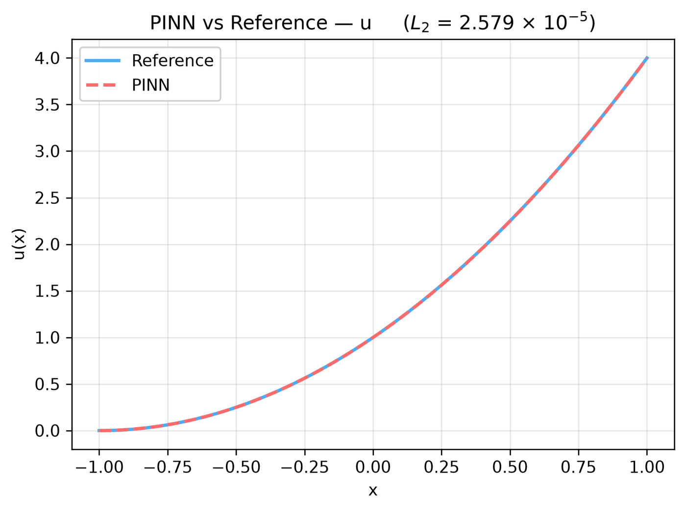

---
search:
  boost: 0.5
---

# Poisson 1D – Dirichlet/point-set operator

| Example | |
|---|---|
| **Source** | DeepXDE example |
| **Problem** | Forward |
| **Dimension** | 1D (x) |
| **Regime** | Steady |
| **Geometry** | Interval |
| **Outputs** | `u` |
| **Settings** | Default (no separate Tuned preset) |

## Governing equations

Mathematical form (from the benchmark records):

\[\frac{d^2u}{dx^2} = 2, \qquad x \in [-1, 1]\]

As typed in PINNStudio's **Equations** page (each expression is a residual, set to zero):

```text
du_xx - 2
```

## Domain

- Interval: \(x \in [-1, 1]\)

## Boundary conditions

| Type | Where | Output | Value | Details |
|---|---|---|---|---|
| Dirichlet BC | `left` | `u` | `0` | — |
| Point Set Operator BC (advanced, from file) | — | — | `du_x` | points: 1; operator `du_x` equals `4` at the points |

## Settings

**Settings: Default** — DeepXDE's own settings

- **Network:** FNN, hidden layers 3 × 50, inputs (x), 1 output; activation tanh, initializer Glorot uniform
- **Points:** 16 domain, 2 boundary, 100 test
- **Loss weights:** `1,1,1` (equations, then boundary-condition rows)

| Phase | Optimizer | Iterations | Learning rate | Decay |
|---|---|---|---|---|
| 1 | Adam | 20,000 | 0.001 | none |

No separate **Tuned** preset: the **Tuned** item is greyed out for this example (its Default settings are PINNStudio's best).

## Results

From the benchmark records: one RTX 4090; relative L₂ error of the main output at the last reference time, and for an inverse problem the parameters it found (true value in brackets). *PINNStudio best* is what **Settings: Tuned** loads.

| | Default | PINNStudio best | Training time of the best (s) |
|---|---|---|---|
| Forward: relative L₂ at the last reference time | 2.6 × 10<sup>-5</sup> | **2.6 × 10<sup>-5</sup>** | 44 |

<figure markdown="span">
  { loading=lazy }
  <figcaption>DeepXDE's settings (also PINNStudio best) — PINN against the reference along a line, at the reference times</figcaption>
</figure>

Every setting tried, the papers' reported errors and all figures: [the benchmark records](https://github.com/AsfandyarKhan72/PINNStudio/blob/main/benchmarks/examples.md#dx-poisson-1d-dirichlet-pointsetoperator).

## Loading it in PINNStudio

- Forward: toolbar **Examples:** › **Forward** › under the **── 1D ──** heading, **Poisson 1D – Dirichlet/point-set operator** › **Default**, then **Solve**.

Loading an example fills in every setting; anything you change before **Solve** is listed in the Training Log. Your save folder, GPU, random-seed and plot-style settings are kept.

## Reference solution

- Exact solution, **Error Analysis** › reference from formula: `u = (x + 1)**2`

## Notes

- DeepXDE trains Adam twice for 10,000 iterations (the first run with derivative-logging callbacks); here that is one 20,000-iteration Adam run. The left boundary value (x + 1)^2 in DeepXDE's script is 0 at x = -1, and its point-set operator condition is du/dx = 2(x + 1) = 4 at the one point x = 1 (typed in the row, no file).

## Definition and records

- **Definition:** `EXAMPLES` entry "Poisson 1D – Dirichlet/PointSetOperator" in [`pinnstudio/core/deepxde_examples.py`](https://github.com/AsfandyarKhan72/PINNStudio/blob/main/pinnstudio/core/deepxde_examples.py)
- **Equations:** [Governing equations](#governing-equations) on this page
- **Reference data:** the exact-solution formula under *Reference solution* (no data files)
- **Benchmark records:** [`benchmarks/problems/poisson-1d-dirichlet-point-set-operator.md`](https://github.com/AsfandyarKhan72/PINNStudio/blob/main/benchmarks/problems/poisson-1d-dirichlet-point-set-operator.md), its entry in the [examples overview](https://github.com/AsfandyarKhan72/PINNStudio/blob/main/benchmarks/examples.md#dx-poisson-1d-dirichlet-pointsetoperator), the [benchmark collection](https://github.com/AsfandyarKhan72/PINNStudio/blob/main/benchmarks/README.md)
- **Tuning-study configurations** (records of the tuning study; open one with **Problem › Open Saved Problem...**; not presets of the Examples list): [`Poisson 1D – Dirichlet - point-set operator (tuned).pinn.json`](https://github.com/AsfandyarKhan72/PINNStudio/blob/main/benchmarks/tuning/Poisson%201D%20%E2%80%93%20Dirichlet%20-%20point-set%20operator%20%28tuned%29.pinn.json)
- **DeepXDE example:** [Poisson_PointSetOperator_1d.py](https://github.com/lululxvi/deepxde/blob/master/examples/pinn_forward/Poisson_PointSetOperator_1d.py) ([documentation](https://deepxde.readthedocs.io/en/latest/demos/pinn_forward/poisson.1d.pointsetoperator.html))
- **Cite:** [Lu et al. 2021](../../about/references.md#lu2021deepxde) (DeepXDE)

Verified error values are reported in the [Reproducibility](../../reproducibility/benchmarks.md) section, not on this page.

[← Back to the example gallery](../index.md)
