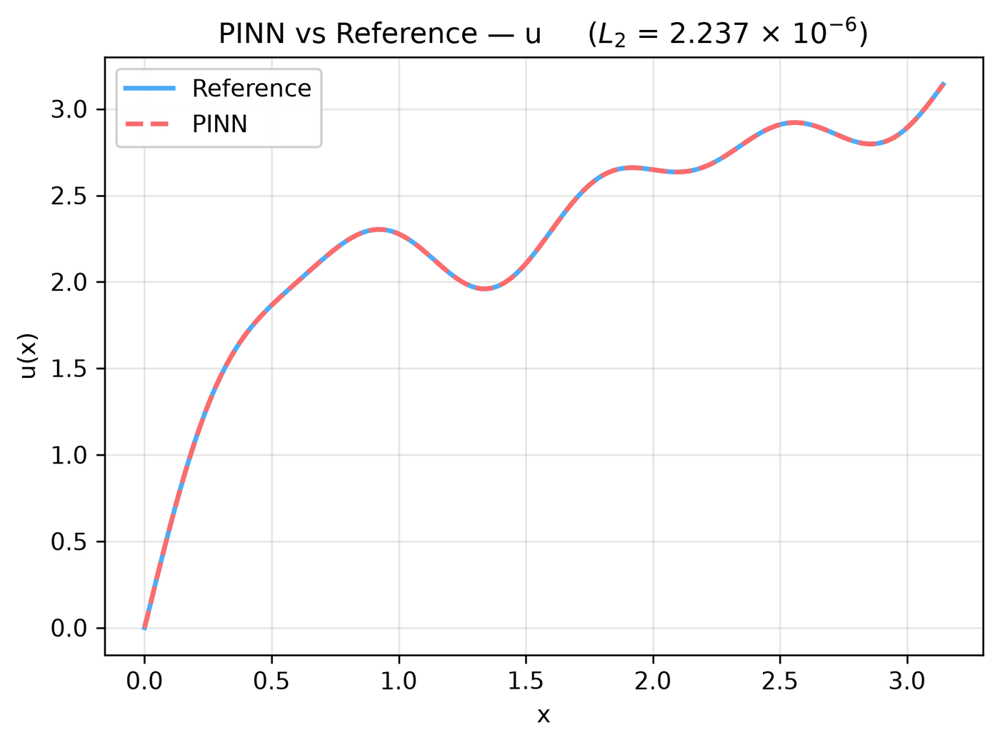

---
search:
  boost: 0.5
---

# Poisson 1D – hard BCs

| Example | |
|---|---|
| **Source** | DeepXDE example |
| **Problem** | Forward |
| **Dimension** | 1D (x) |
| **Regime** | Steady |
| **Geometry** | Interval |
| **Outputs** | `u` |
| **Settings** | Default (no separate Tuned preset) |

## Governing equations

Mathematical form (from the benchmark records):

\[-\frac{d^2u}{dx^2} = \sum_{k=1}^{4} k\sin(kx) + 8\sin(8x), \qquad x \in [0, \pi]\]

As typed in PINNStudio's **Equations** page (each expression is a residual, set to zero):

```text
-du_xx - (sin(x) + 2*sin(2*x) + 3*sin(3*x) + 4*sin(4*x)) - 8*sin(8*x)
```

## Domain

- Interval: \(x \in [0, 3.14159]\)

## Boundary conditions

No boundary-condition rows: the boundary values are imposed exactly through the network's output transform (see **Methods** below), or the problem has no boundary terms.

## Settings

**Settings: Default** — DeepXDE's own settings

- **Network:** FNN, hidden layers 3 × 50, inputs (x), 1 output; activation tanh, initializer Glorot uniform
- **Points:** 64 domain, 0 boundary, 400 test
- **Loss weights:** `1` (equations, then boundary-condition rows)
- **Methods:** output transform `x*(pi - x)*u + x` ([reference](../../reference/networks.md))

| Phase | Optimizer | Iterations | Learning rate | Decay |
|---|---|---|---|---|
| 1 | Adam | 30,000 | 0.0001 | inverse time (1000, 0.3) |

No separate **Tuned** preset: the **Tuned** item is greyed out for this example (its Default settings are PINNStudio's best).

## Results

The configuration selected in PINNStudio's benchmark study, run on one RTX 4090. Forward: relative L₂ error of each output at the last reference time. Inverse: each parameter's relative error and, per seed, the largest of them (worst parameter error).

### Forward problem

**Settings:** Default — the example's own settings (not in the tuning sweep); the example has no separate Tuned preset for this mode. **Values:** one run, seed 2026.

| Output | Relative L₂ |
|---|---|
| u | 2.2 × 10⁻⁶ |

<figure markdown="span">
  { loading=lazy }
  <figcaption>Forward, Default settings: PINN and reference along lines.</figcaption>
</figure>

**Full benchmark record:** every setting tried, the per-seed values and all figures are in [the benchmark records on GitHub](https://github.com/AsfandyarKhan72/PINNStudio/blob/main/benchmarks/examples.md#dx-poisson-1d-hard-boundary-conditions).

## Loading it in PINNStudio

- Forward: toolbar **Examples:** › **Forward** › under the **── 1D ──** heading, **Poisson 1D – hard BCs** › **Default**, then **Solve**.

Loading an example fills in every setting; anything you change before **Solve** is listed in the Training Log. Your save folder, GPU, random-seed and plot-style settings are kept.

## Reference solution

- Exact solution, **Error Analysis** › reference from formula: `u = x + sin(x) + sin(2*x)/2 + sin(3*x)/3 + sin(4*x)/4 + sin(8*x)/8`

## Definition and records

- **Definition:** `EXAMPLES` entry "Poisson 1D – hard boundary conditions" in [`pinnstudio/core/deepxde_examples.py`](https://github.com/AsfandyarKhan72/PINNStudio/blob/main/pinnstudio/core/deepxde_examples.py)
- **Equations:** [Governing equations](#governing-equations) on this page
- **Reference data:** the exact-solution formula under *Reference solution* (no data files)
- **Benchmark records:** [`benchmarks/problems/poisson-1d-hard-bcs.md`](https://github.com/AsfandyarKhan72/PINNStudio/blob/main/benchmarks/problems/poisson-1d-hard-bcs.md), its entry in the [examples overview](https://github.com/AsfandyarKhan72/PINNStudio/blob/main/benchmarks/examples.md#dx-poisson-1d-hard-boundary-conditions), the [benchmark collection](https://github.com/AsfandyarKhan72/PINNStudio/blob/main/benchmarks/README.md)
- **Tuning-study configurations** (records of the tuning study; open one with **Problem › Open Saved Problem...**; not presets of the Examples list): [`Poisson 1D – hard BCs (tuned).pinn.json`](https://github.com/AsfandyarKhan72/PINNStudio/blob/main/benchmarks/tuning/Poisson%201D%20%E2%80%93%20hard%20BCs%20%28tuned%29.pinn.json)
- **Methods** (Default and Tuned settings): [Networks and Fourier features](../../reference/networks.md)
- **DeepXDE example:** [Poisson_Dirichlet_1d_exactBC.py](https://github.com/lululxvi/deepxde/blob/master/examples/pinn_forward/Poisson_Dirichlet_1d_exactBC.py)
- **Cite:** [Lu et al. 2021](../../about/references.md#lu2021deepxde) (DeepXDE); the problem follows [Yu et al. 2022](../../about/references.md#yu2022)

How the benchmark values were measured and checked: [Reproducibility](../../reproducibility/benchmarks.md).

[← Back to the example gallery](../index.md)
