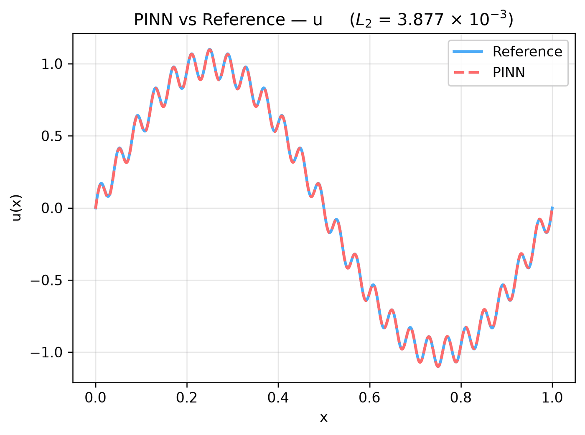

---
search:
  boost: 0.5
---

# Poisson 1D – multi-scale Fourier features

| Example | |
|---|---|
| **Source** | DeepXDE example |
| **Problem** | Forward |
| **Dimension** | 1D (x) |
| **Regime** | Steady |
| **Geometry** | Interval |
| **Outputs** | `u` |
| **Settings** | Default (no separate Tuned preset) |

## Governing equations

Mathematical form (from the benchmark records):

\[\frac{d^2u}{dx^2} = -(\pi A)^2\sin(\pi A x) - 0.1(\pi B)^2\sin(\pi B x), \qquad x \in [0, 1],\ A = 2,\ B = 50\]

As typed in PINNStudio's **Equations** page (each expression is a residual, set to zero):

```text
du_xx + (pi*A)**2*sin(pi*A*x) + 0.1*(pi*B)**2*sin(pi*B*x)
```

Constants: `A = 2`, `B = 50`

## Domain

- Interval: \(x \in [0, 1]\)

## Boundary conditions

| Type | Where | Output | Value | Details |
|---|---|---|---|---|
| Dirichlet BC | `True (the whole boundary)` | `u` | `0` | — |

## Settings

**Settings: Default** — DeepXDE's own settings

- **Network:** multi-scale Fourier-feature network (MsFFN), hidden layers 3 × 100, inputs (x), 1 output; activation tanh, initializer Glorot uniform; Fourier-feature scales 1, 10
- **Points:** 1,280 domain, 2 boundary, 10,000 test
- **Loss weights:** `1,1` (equations, then boundary-condition rows)
- **Methods:** [multi-scale Fourier features](../../reference/networks.md); collocation-point resampling every 1 iterations

| Phase | Optimizer | Iterations | Learning rate | Decay |
|---|---|---|---|---|
| 1 | Adam | 20,000 | 0.001 | inverse time (2000, 0.9) |

No separate **Tuned** preset: the **Tuned** item is greyed out for this example (its Default settings are PINNStudio's best).

## Results

The configuration selected in PINNStudio's benchmark study, run on one RTX 4090. Forward: relative L₂ error of each output at the last reference time. Inverse: each parameter's relative error and, per seed, the largest of them (worst parameter error).

### Forward problem

**Settings:** Default — the example's own settings (not in the tuning sweep); the example has no separate Tuned preset for this mode. **Values:** one run, seed 2026.

| Output | Relative L₂ |
|---|---|
| u | 3.9 × 10⁻³ |

<figure markdown="span">
  { loading=lazy }
  <figcaption>Forward, Default settings: PINN and reference along lines.</figcaption>
</figure>

**Full benchmark record:** every setting tried, the per-seed values and all figures are in [the benchmark records on GitHub](https://github.com/AsfandyarKhan72/PINNStudio/blob/v1.6.0/benchmarks/examples.md#dx-poisson-1d-multi-scale-fourier-features).

## Loading it in PINNStudio

- Forward: toolbar **Examples:** › **Forward** › under the **── 1D ──** heading, **Poisson 1D – multi-scale Fourier features** › **Default**, then **Solve**.

Loading an example fills in every setting; anything you change before **Solve** is listed in the Training Log. Your save folder, GPU, random-seed and plot-style settings are kept.

## Reference solution

- Exact solution, **Error Analysis** › reference from formula: `u = sin(pi*A*x) + 0.1*sin(pi*B*x)`

## Notes

- Multi-scale Fourier feature network (scales 1 and 10): the solution has a slow wave sin(2 pi x) and a fast one 0.1 sin(50 pi x). DeepXDE's script passes the exact solution as the boundary value; it is 0 at x = 0 and 1. Collocation points are redrawn every iteration.

## Definition and records

- **Definition:** `EXAMPLES` entry "Poisson 1D – multi-scale Fourier features" in [`pinnstudio/core/deepxde_examples.py`](https://github.com/AsfandyarKhan72/PINNStudio/blob/v1.6.0/pinnstudio/core/deepxde_examples.py)
- **Equations:** [Governing equations](#governing-equations) on this page
- **Reference data:** the exact-solution formula under *Reference solution* (no data files)
- **Benchmark records:** [`benchmarks/problems/poisson-1d-multi-scale-fourier-features.md`](https://github.com/AsfandyarKhan72/PINNStudio/blob/v1.6.0/benchmarks/problems/poisson-1d-multi-scale-fourier-features.md), its entry in the [examples overview](https://github.com/AsfandyarKhan72/PINNStudio/blob/v1.6.0/benchmarks/examples.md#dx-poisson-1d-multi-scale-fourier-features), the [benchmark collection](https://github.com/AsfandyarKhan72/PINNStudio/blob/v1.6.0/benchmarks/README.md)
- **Tuning-study configurations** (records of the tuning study; open one with **Problem › Open Saved Problem...**; not presets of the Examples list): [`Poisson 1D – multi-scale Fourier features (tuned).pinn.json`](https://github.com/AsfandyarKhan72/PINNStudio/blob/v1.6.0/benchmarks/tuning/Poisson%201D%20%E2%80%93%20multi-scale%20Fourier%20features%20%28tuned%29.pinn.json)
- **Methods** (Default and Tuned settings): [Networks and Fourier features](../../reference/networks.md)
- **DeepXDE example:** [Poisson_multiscale_1d.py](https://github.com/lululxvi/deepxde/blob/master/examples/pinn_forward/Poisson_multiscale_1d.py)
- **Cite:** [Lu et al. 2021](../../about/references.md#lu2021deepxde) (DeepXDE); the problem follows [Wang, Wang & Perdikaris 2021](../../about/references.md#wang2021fourier)

How the benchmark values were measured and checked: [Reproducibility](../../reproducibility/benchmarks.md).

[← Back to the example gallery](../index.md)
