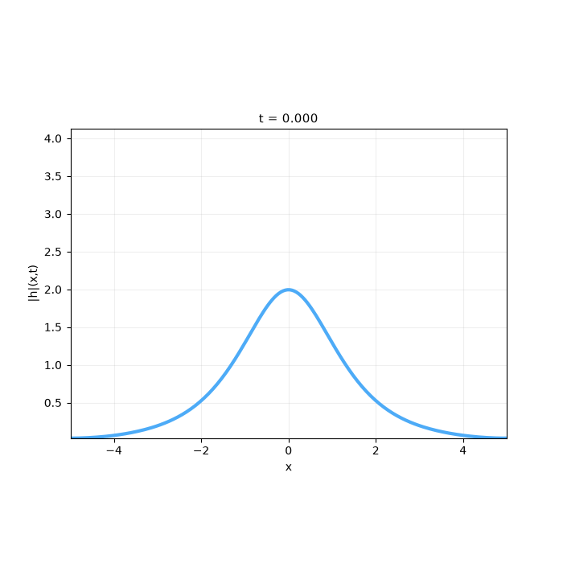

---
search:
  boost: 0.5
---

# Schrödinger 1D

| Example | |
|---|---|
| **Source** | DeepXDE example |
| **Problem** | Forward and Inverse (the Inverse mode is PINNStudio's addition) |
| **Dimension** | 1D (x, t) |
| **Regime** | Time-dependent |
| **Geometry** | Interval |
| **Outputs** | `u`, `v` |
| **Settings** | Default, Tuned |

<figure markdown="span">
  { loading=lazy }
  <figcaption>Animation from the repository's figures (`assets/Images/Top_GIFs/`): the PINN solution |h| of this example over time.</figcaption>
</figure>

## Governing equations

Mathematical form (from the benchmark records):

\[i\frac{\partial h}{\partial t} + \frac{1}{2}\frac{\partial^2 h}{\partial x^2} + |h|^2 h = 0, \qquad x \in [-5, 5],\ t \in [0, \pi/2]\]

\[\frac{\partial u}{\partial t} + 0.5\frac{\partial^2 v}{\partial x^2} + (u^2 + v^2)\ v = 0\]

\[\frac{\partial v}{\partial t} - 0.5\frac{\partial^2 u}{\partial x^2} - (u^2 + v^2)\ u = 0\]

As typed in PINNStudio's **Equations** page (each expression is a residual, set to zero):

```text
du_t + 0.5*dv_xx + (u**2 + v**2)*v
dv_t - 0.5*du_xx - (u**2 + v**2)*u
```

As typed in PINNStudio's **Equations** page (Inverse mode) (each expression is a residual, set to zero):

```text
du_t + c*dv_xx + (u**2 + v**2)*v
dv_t - c*du_xx - (u**2 + v**2)*u
```

Inverse-mode form (from the benchmark records):

\[\frac{\partial u}{\partial t} + c\frac{\partial^2 v}{\partial x^2} + (u^2 + v^2) v = 0, \qquad \frac{\partial v}{\partial t} - c\frac{\partial^2 u}{\partial x^2} - (u^2 + v^2) u = 0\]

## Domain

- Interval: \(x \in [-5, 5]\)
- Time interval: \(t \in [0, 1.5708]\)

## Initial conditions

| Output | Initial value | How it is imposed (Settings: Default) |
|---|---|---|
| `u` | `2/cosh(x)` | loss term |
| `v` | `0` | loss term |

## Boundary conditions

| Type | Where | Output | Value | Details |
|---|---|---|---|---|
| Periodic BC | `True (the whole boundary)` | `u` | — | axis x, derivative order 0 |
| Periodic BC | `True (the whole boundary)` | `u` | — | axis x, derivative order 1 |
| Periodic BC | `True (the whole boundary)` | `v` | — | axis x, derivative order 0 |
| Periodic BC | `True (the whole boundary)` | `v` | — | axis x, derivative order 1 |

## Unknowns and measured data (Inverse)

| Trainable parameter | Initial value | True value |
|---|---|---|
| `c` | 1 | 0.5 |

Measured data (**Inverse** page, measured-data files):

- [`reference_data/1D/schrodinger/t_0.75.txt`](https://github.com/AsfandyarKhan72/PINNStudio/blob/main/reference_data/1D/schrodinger/t_0.75.txt) → output `2`, weight 100

From the benchmark records: pick the example from the **Inverse** list: the coefficient \(c\) of the second-derivative terms (0.5 in Forward mode; initial guess 1) is unknown and is learned from \(|h| = \sqrt{u^2 + v^2}\) measured at \(t = 0.75\), with the same training as the forward problem.

## Settings

### Forward mode

**Settings: Default** — DeepXDE's own settings

- **Network:** FNN, hidden layers 4 × 100, inputs (x, t), 2 outputs; activation tanh, initializer Glorot normal
- **Points:** 10,000 domain, 20 boundary, 200 initial, 1,000 test
- **Loss weights:** `1,1,1,1,1,1,1,1` (equations, then boundary-condition rows, then initial conditions)

| Phase | Optimizer | Iterations | Learning rate | Decay |
|---|---|---|---|---|
| 1 | Adam | 10,000 | 0.001 | none |
| 2 | L-BFGS | 10,000 | — | none |

No separate **Tuned** preset: the **Tuned** item is greyed out for this example (its Default settings are PINNStudio's best).

### Inverse mode

**Settings: Default** — DeepXDE's settings with PINNStudio's Inverse-mode changes (see *Notes*)

- **Network:** FNN, hidden layers 4 × 100, inputs (x, t), 2 outputs; activation tanh, initializer Glorot normal
- **Points:** 10,000 domain, 20 boundary, 200 initial, 1,000 test
- **Loss weights:** `1,1,1,1,1,1,1,1` (equations, then boundary-condition rows, then initial conditions)

| Phase | Optimizer | Iterations | Learning rate | Decay |
|---|---|---|---|---|
| 1 | Adam | 10,000 | 0.001 | none |
| 2 | L-BFGS | 10,000 | — | none |

??? note "Settings: Tuned"

    The Training Log reports: *Tuned settings: 3× the training points.* The change is applied to the example's own settings.

    - **Network:** FNN, hidden layers 4 × 100, inputs (x, t), 2 outputs; activation tanh, initializer Glorot normal
    - **Points:** 30,000 domain, 60 boundary, 600 initial, 1,000 test
    - **Loss weights:** `1,1,1,1,1,1,1,1` (equations, then boundary-condition rows, then initial conditions)

    | Phase | Optimizer | Iterations | Learning rate | Decay |
    |---|---|---|---|---|
    | 1 | Adam | 10,000 | 0.001 | none |
    | 2 | L-BFGS | 10,000 | — | none |

## Loading it in PINNStudio

- Forward: toolbar **Examples:** › **Forward** › under the **── 1D ──** heading, **Schrödinger 1D** › **Default**, then **Solve**.
- Inverse: toolbar **Examples:** › **Inverse** › under the **── 1D ──** heading, **Schrödinger 1D** › **Default** or **Tuned**, then **Solve**.

Loading an example fills in every setting; anything you change before **Solve** is listed in the Training Log. Your save folder, GPU, random-seed and plot-style settings are kept.

## Reference solution

- Reference data files: [`reference_data/1D/schrodinger/`](https://github.com/AsfandyarKhan72/PINNStudio/tree/main/reference_data/1D/schrodinger)

## Notes

- |h| = sqrt(u^2 + v^2) is compared against a Fourier pseudo-spectral (split-step) solution in PINNStudio's reference_data/1D/schrodinger.
- Inverse mode (PINNStudio's addition): the coefficient c (0.5 in the equations; initial guess 1) is learned from |h| = sqrt(u^2 + v^2) measured at t = 0.75, with the forward example's training. |h| at t = 1.5 alone would not do: c = 1.95 reproduces it almost as well as c = 0.5.

## Definition and records

- **Definition:** `EXAMPLES` entry "Schrödinger equation" in [`pinnstudio/core/deepxde_examples.py`](https://github.com/AsfandyarKhan72/PINNStudio/blob/main/pinnstudio/core/deepxde_examples.py)
    - Settings: Tuned: entry "Schrödinger equation" in [`pinnstudio/resources/tuned_settings.json`](https://github.com/AsfandyarKhan72/PINNStudio/blob/main/pinnstudio/resources/tuned_settings.json)
- **Equations:** [Governing equations](#governing-equations) on this page
- **Reference data:** [`reference_data/1D/schrodinger/`](https://github.com/AsfandyarKhan72/PINNStudio/tree/main/reference_data/1D/schrodinger), written by [`tools/make_exact_reference_data.py`](https://github.com/AsfandyarKhan72/PINNStudio/blob/main/tools/make_exact_reference_data.py)
- **Measured data** (Inverse): [`reference_data/1D/schrodinger/`](https://github.com/AsfandyarKhan72/PINNStudio/tree/main/reference_data/1D/schrodinger), written by [`tools/make_exact_reference_data.py`](https://github.com/AsfandyarKhan72/PINNStudio/blob/main/tools/make_exact_reference_data.py)
- **Benchmark records:** [`benchmarks/problems/schr-dinger-1d.md`](https://github.com/AsfandyarKhan72/PINNStudio/blob/main/benchmarks/problems/schr-dinger-1d.md), its entry in the [examples overview](https://github.com/AsfandyarKhan72/PINNStudio/blob/main/benchmarks/examples.md#dx-schr-dinger-equation), the [benchmark collection](https://github.com/AsfandyarKhan72/PINNStudio/blob/main/benchmarks/README.md)
- **Tuning-study configurations** (records of the tuning study; open one with **Problem › Open Saved Problem...**; not presets of the Examples list): [`Schrödinger 1D (tuned).pinn.json`](https://github.com/AsfandyarKhan72/PINNStudio/blob/main/benchmarks/tuning/Schr%C3%B6dinger%201D%20%28tuned%29.pinn.json), [`Schrödinger 1D, inverse mode (tuned).pinn.json`](https://github.com/AsfandyarKhan72/PINNStudio/blob/main/benchmarks/tuning/Schr%C3%B6dinger%201D%2C%20inverse%20mode%20%28tuned%29.pinn.json)
- **DeepXDE example:** [Schrodinger.ipynb](https://github.com/lululxvi/deepxde/blob/master/examples/pinn_forward/Schrodinger.ipynb)
- **Cite:** [Lu et al. 2021](../../about/references.md#lu2021deepxde) (DeepXDE); the problem follows [Raissi et al. 2019](../../about/references.md#raissi2019)

Verified error values are reported in the [Reproducibility](../../reproducibility/benchmarks.md) section, not on this page.

[← Back to the example gallery](../index.md)
