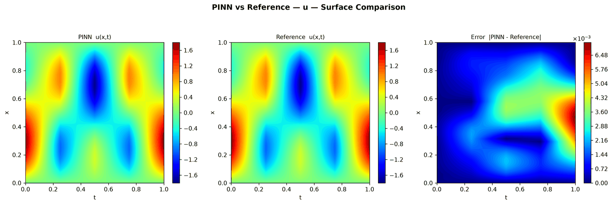
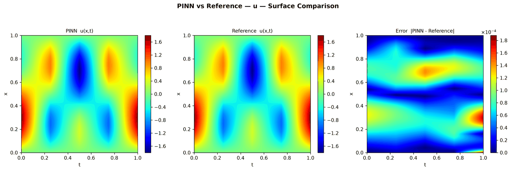
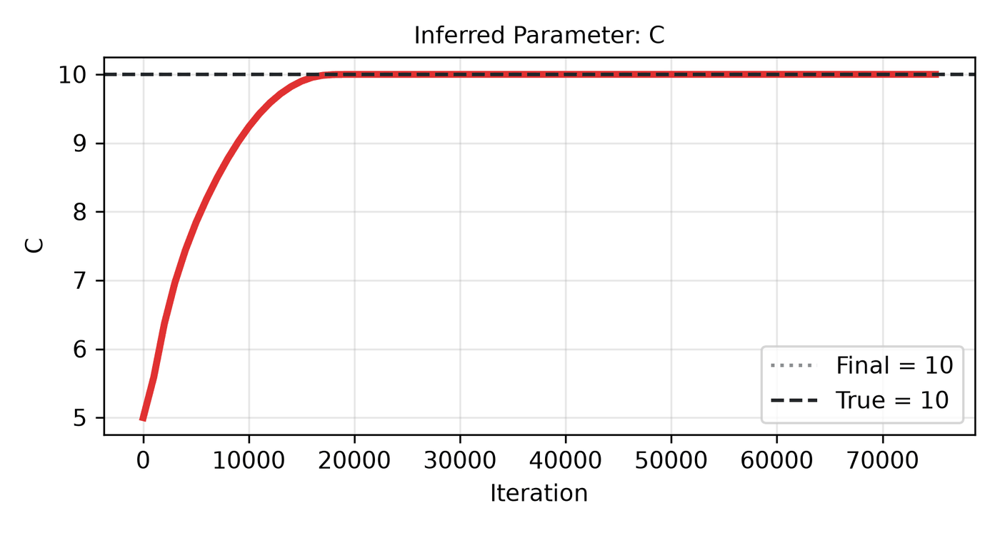

---
search:
  boost: 0.5
---

# Wave 1D – space-time multi-scale Fourier features

| Example | |
|---|---|
| **Source** | DeepXDE example |
| **Problem** | Forward and Inverse (the Inverse mode is PINNStudio's addition) |
| **Dimension** | 1D (x, t) |
| **Regime** | Time-dependent |
| **Geometry** | Interval |
| **Outputs** | `u` |
| **Settings** | Default, Tuned |

## Governing equations

Mathematical form (from the benchmark records):

\[\frac{\partial^2 u}{\partial t^2} = C^2\frac{\partial^2 u}{\partial x^2}, \qquad x \in [0, 1],\ t \in [0, 1],\ C = 10\]

As typed in PINNStudio's **Equations** page (each expression is a residual, set to zero):

```text
du_tt - C**2*du_xx
```

Constants: `A = 2`, `C = 10`

## Domain

- Interval: \(x \in [0, 1]\)
- Time interval: \(t \in [0, 1]\)

## Initial conditions

| Output | Initial value | How it is imposed (Settings: Default) |
|---|---|---|
| `u` | `sin(pi*x) + sin(A*pi*x)` | loss term |

## Boundary conditions

| Type | Where | Output | Value | Details |
|---|---|---|---|---|
| Dirichlet BC | `True (the whole boundary)` | `u` | `0` | — |
| Operator BC (advanced) | initial time | — | `du_t` | applied at the initial time |

## Unknowns and measured data (Inverse)

| Trainable parameter | Initial value | True value |
|---|---|---|
| `C` | 5 | 10 |

Measured data (**Inverse** page, measured-data files):

- [`reference_data/deepxde/wave_inverse/u_obs.txt`](https://github.com/AsfandyarKhan72/PINNStudio/blob/v1.6.0/reference_data/deepxde/wave_inverse/u_obs.txt) → output `u`, weight 100

## Settings

### Forward mode

**Settings: Default** — DeepXDE's own settings

- **Network:** space-time multi-scale Fourier-feature network (STMsFFN), hidden layers 3 × 100, inputs (x, t), 1 output; activation tanh, initializer Glorot uniform; scales 1 (space), 1, 10 (time)
- **Points:** 360 domain, 360 boundary, 360 initial, 10,000 test
- **Loss weights:** `1,1,1,1` (equations, then boundary-condition rows, then initial conditions)
- **Methods:** [multi-scale Fourier features](../../reference/networks.md); collocation-point resampling every 1 iterations; input features `(x - 0.5)*2*sqrt(3); (t - 0.5)*2*sqrt(3)` ([reference](../../reference/networks.md)); [loss weights set from the initial losses](../../reference/loss-weights.md)

| Phase | Optimizer | Iterations | Learning rate | Decay |
|---|---|---|---|---|
| 1 | Adam | 10,000 | 0.001 | inverse time (2000, 0.9) |

??? note "Settings: Tuned"

    The Training Log reports: *Tuned settings: 3× iterations, a larger network, 3× points and an L-BFGS phase together.* The change is applied to the example's own settings.

    - **Network:** space-time multi-scale Fourier-feature network (STMsFFN), hidden layers 4 × 200, inputs (x, t), 1 output; activation tanh, initializer Glorot uniform; scales 1 (space), 1, 10 (time)
    - **Points:** 1,080 domain, 1,080 boundary, 1,080 initial, 10,000 test
    - **Loss weights:** `1,1,1,1` (equations, then boundary-condition rows, then initial conditions)
    - **Methods:** [multi-scale Fourier features](../../reference/networks.md); collocation-point resampling every 1 iterations; input features `(x - 0.5)*2*sqrt(3); (t - 0.5)*2*sqrt(3)` ([reference](../../reference/networks.md)); [loss weights set from the initial losses](../../reference/loss-weights.md)

    | Phase | Optimizer | Iterations | Learning rate | Decay |
    |---|---|---|---|---|
    | 1 | Adam | 30,000 | 0.001 | inverse time (2000, 0.9) |
    | 2 | L-BFGS | 15,000 | — | none |

### Inverse mode

**Settings: Default** — DeepXDE's settings with PINNStudio's Inverse-mode changes (see *Notes*)

- **Network:** space-time multi-scale Fourier-feature network (STMsFFN), hidden layers 3 × 100, inputs (x, t), 1 output; activation tanh, initializer Glorot uniform; scales 1 (space), 1, 10 (time)
- **Points:** 5,000 domain, 360 boundary, 360 initial, 10,000 test
- **Loss weights:** `1,1,1,1` (equations, then boundary-condition rows, then initial conditions)
- **Methods:** [multi-scale Fourier features](../../reference/networks.md); collocation-point resampling every 1 iterations; input features `(x - 0.5)*2*sqrt(3); (t - 0.5)*2*sqrt(3)` ([reference](../../reference/networks.md)); [loss weights set from the initial losses](../../reference/loss-weights.md)

| Phase | Optimizer | Iterations | Learning rate | Decay |
|---|---|---|---|---|
| 1 | Adam | 10,000 | 0.001 | inverse time (2000, 0.9) |
| 2 | L-BFGS | 15,000 | — | none |

??? note "Settings: Tuned"

    The Training Log reports: *Tuned settings: 3× iterations, a larger network, 3× points and an L-BFGS phase together.* The change is applied to the example's own settings.

    - **Network:** space-time multi-scale Fourier-feature network (STMsFFN), hidden layers 4 × 200, inputs (x, t), 1 output; activation tanh, initializer Glorot uniform; scales 1 (space), 1, 10 (time)
    - **Points:** 15,000 domain, 1,080 boundary, 1,080 initial, 10,000 test
    - **Loss weights:** `1,1,1,1` (equations, then boundary-condition rows, then initial conditions)
    - **Methods:** [multi-scale Fourier features](../../reference/networks.md); collocation-point resampling every 1 iterations; input features `(x - 0.5)*2*sqrt(3); (t - 0.5)*2*sqrt(3)` ([reference](../../reference/networks.md)); [loss weights set from the initial losses](../../reference/loss-weights.md)

    | Phase | Optimizer | Iterations | Learning rate | Decay |
    |---|---|---|---|---|
    | 1 | Adam | 30,000 | 0.001 | inverse time (2000, 0.9) |
    | 2 | L-BFGS | 45,000 | — | none |

## Results

The configuration selected in PINNStudio's benchmark study, run on one RTX 4090. Forward: relative L₂ error of each output at the last reference time. Inverse: each parameter's relative error and, per seed, the largest of them (worst parameter error).

### Forward problem

**Settings:** Tuned — all of the changes together. **Values:** median over seeds 2026, 1, 2.

| Output | Relative L₂ |
|---|---|
| u | 1.5 × 10⁻³ |

<figure markdown="span">
  { loading=lazy }
  <figcaption>Forward, Tuned settings: PINN, reference and error.</figcaption>
</figure>

### Inverse problem

**Settings:** Tuned — all of the changes together. **Values:** median over seeds 2026, 1, 2.

| Parameter | True value | Recovered | Relative error |
|---|---|---|---|
| C | 10 | 10 | 0 % |

Worst parameter error: **0 %** (the median over the seeds of each seed's largest error).

<figure markdown="span">
  { loading=lazy }
  <figcaption>Inverse, Tuned settings: PINN, reference and error.</figcaption>
</figure>

<figure markdown="span">
  { loading=lazy }
  <figcaption>Inverse, Tuned settings: parameter convergence.</figcaption>
</figure>

**Full benchmark record:** every setting tried, the per-seed values and all figures are in [the benchmark records on GitHub](https://github.com/AsfandyarKhan72/PINNStudio/blob/v1.6.0/benchmarks/examples.md#dx-wave-propagation-space-time-multi-scale-fourier-features).

## Loading it in PINNStudio

- Forward: toolbar **Examples:** › **Forward** › under the **── 1D ──** heading, **Wave 1D – space-time multi-scale Fourier features** › **Default** or **Tuned**, then **Solve**.
- Inverse: toolbar **Examples:** › **Inverse** › under the **── 1D ──** heading, **Wave 1D – space-time multi-scale Fourier features** › **Default** or **Tuned**, then **Solve**.

Loading an example fills in every setting; anything you change before **Solve** is listed in the Training Log. Your save folder, GPU, random-seed and plot-style settings are kept.

## Reference solution

- Forward mode: exact solution, **Error Analysis** › reference from formula: `u = sin(pi*x)*cos(C*pi*t) + sin(A*pi*x)*cos(A*C*pi*t)`
- Inverse mode: exact solution, **Error Analysis** › reference from formula: `u = sin(pi*x)*cos(10*pi*t) + sin(A*pi*x)*cos(A*10*pi*t)`

## Notes

- Space-time multi-scale Fourier feature network (space scale 1, time scales 1 and 10) for a wave that oscillates fast in time. Loss weights are set from the initial losses (5 / L_i(0)), as in DeepXDE's script; the inputs are rescaled to zero mean and unit variance by an input-transform formula; collocation points are redrawn every iteration -- pseudo-random here: DeepXDE's script keeps the default Hammersley distribution, which is deterministic, so its resampler redraws the same points and the network overfits them (test loss stays near 1). DeepXDE's script passes the exact solution as the boundary value; it is 0 at x = 0 and 1.
- Inverse mode (PINNStudio's addition): the wave speed C (initial guess 5, true 10) is learned from u measured at 2,000 random points in space and time (reference_data/deepxde/wave_inverse). At regular times the fast mode cos(20 pi t) is sampled in step with its period, so a slower wave fits the same data (at t = 0.25, 0.5, 0.75 and 1, speeds 10 and 6 give the same u). 5,000 residual points instead of the forward example's 360. An L-BFGS phase follows Adam.

## Definition and records

- **Definition:** `EXAMPLES` entry "Wave propagation – space-time multi-scale Fourier features" in [`pinnstudio/core/deepxde_examples.py`](https://github.com/AsfandyarKhan72/PINNStudio/blob/v1.6.0/pinnstudio/core/deepxde_examples.py)
    - Inverse mode (PINNStudio's addition): `ADDED_INVERSE["Wave propagation – space-time multi-scale Fourier features"]`, same file
    - Settings: Tuned: entry "Wave propagation – space-time multi-scale Fourier features" in [`pinnstudio/resources/tuned_settings.json`](https://github.com/AsfandyarKhan72/PINNStudio/blob/v1.6.0/pinnstudio/resources/tuned_settings.json)
- **Equations:** [Governing equations](#governing-equations) on this page
- **Reference data:** the exact-solution formula under *Reference solution* (no data files)
- **Measured data** (Inverse): [`reference_data/deepxde/wave_inverse/`](https://github.com/AsfandyarKhan72/PINNStudio/tree/v1.6.0/reference_data/deepxde/wave_inverse), written by [`tools/make_deepxde_reference_data.py`](https://github.com/AsfandyarKhan72/PINNStudio/blob/v1.6.0/tools/make_deepxde_reference_data.py)
- **Benchmark records:** [`benchmarks/problems/wave-1d-space-time-multi-scale-fourier-features.md`](https://github.com/AsfandyarKhan72/PINNStudio/blob/v1.6.0/benchmarks/problems/wave-1d-space-time-multi-scale-fourier-features.md), its entry in the [examples overview](https://github.com/AsfandyarKhan72/PINNStudio/blob/v1.6.0/benchmarks/examples.md#dx-wave-propagation-space-time-multi-scale-fourier-features), the [benchmark collection](https://github.com/AsfandyarKhan72/PINNStudio/blob/v1.6.0/benchmarks/README.md)
- **Tuning-study configurations** (records of the tuning study; open one with **Problem › Open Saved Problem...**; not presets of the Examples list): [`Wave 1D – space-time multi-scale Fourier features (tuned).pinn.json`](https://github.com/AsfandyarKhan72/PINNStudio/blob/v1.6.0/benchmarks/tuning/Wave%201D%20%E2%80%93%20space-time%20multi-scale%20Fourier%20features%20%28tuned%29.pinn.json), [`Wave 1D – space-time multi-scale Fourier features, inverse mode (tuned).pinn.json`](https://github.com/AsfandyarKhan72/PINNStudio/blob/v1.6.0/benchmarks/tuning/Wave%201D%20%E2%80%93%20space-time%20multi-scale%20Fourier%20features%2C%20inverse%20mode%20%28tuned%29.pinn.json)
- **Methods** (Default and Tuned settings): [Networks and Fourier features](../../reference/networks.md), [Loss weights](../../reference/loss-weights.md)
- **DeepXDE example:** [wave_1d.py](https://github.com/lululxvi/deepxde/blob/master/examples/pinn_forward/wave_1d.py)
- **Cite:** [Lu et al. 2021](../../about/references.md#lu2021deepxde) (DeepXDE); the problem follows [Wang, Wang & Perdikaris 2021](../../about/references.md#wang2021fourier)

How the benchmark values were measured and checked: [Reproducibility](../../reproducibility/benchmarks.md).

[← Back to the example gallery](../index.md)
