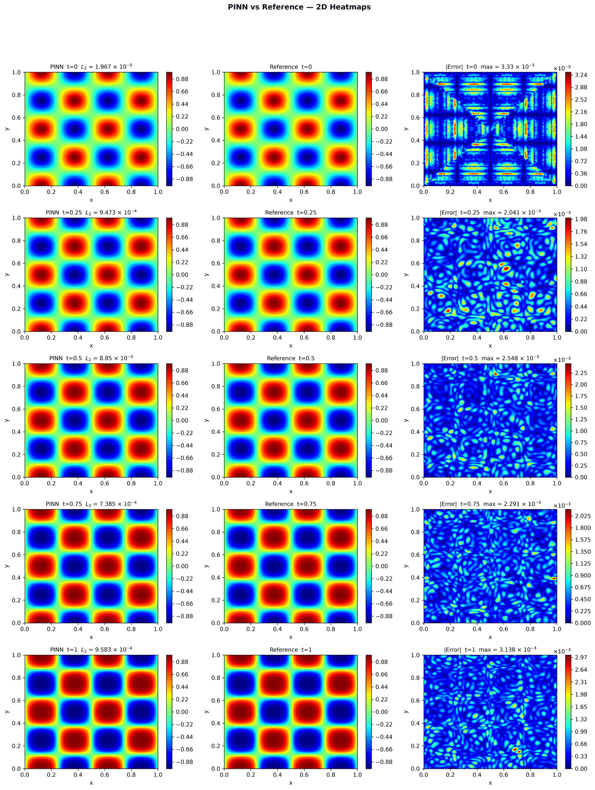
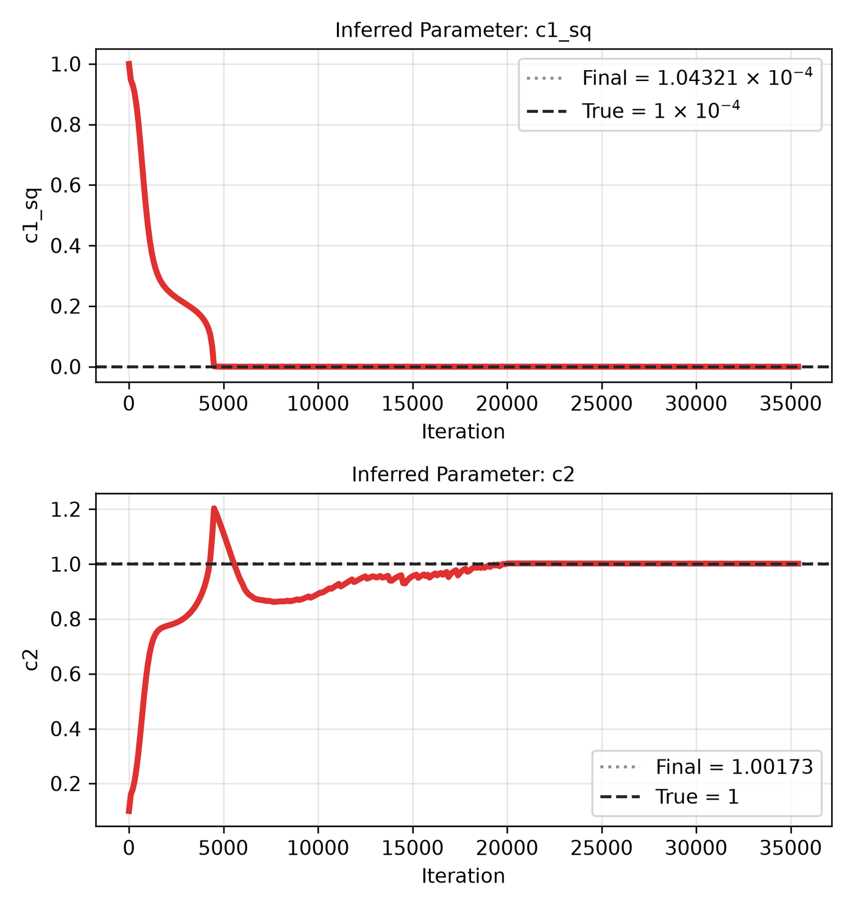

---
search:
  boost: 0.5
---

# Allen-Cahn 2D – Mattey & Ghosh

| Example | |
|---|---|
| **Source** | PINNStudio template |
| **Problem** | Forward and Inverse |
| **Dimension** | 2D (x, y, t) |
| **Regime** | Time-dependent |
| **Geometry** | Rectangle |
| **Outputs** | `h` |
| **Settings** | Default, Tuned |

## Governing equations

Mathematical form (from the benchmark records):

\[\frac{\partial h}{\partial t} = c_1^2\left(\frac{\partial^2 h}{\partial x^2} + \frac{\partial^2 h}{\partial y^2}\right) - c_2(h^3 - h), \qquad (x, y) \in [0, 1]^2,\ t \in (0, 1]\]

Where \(c_1^2 = 0.0001\) and \(c_2 = 1\).

As typed in PINNStudio's **Equations** page (each expression is a residual, set to zero):

```text
dh_t - 0.0001*(dh_xx + dh_yy) + 1.0*(h**3 - h)
```

As typed in PINNStudio's **Equations** page (Inverse mode) (each expression is a residual, set to zero):

```text
dh_t - c1_sq*(dh_xx + dh_yy) + c2*(h**3 - h)
```

## Domain

- Rectangle: \(x \in [0, 1]\), \(y \in [0, 1]\)
- Time interval: \(t \in [0, 1]\)

## Initial conditions

| Output | Initial value | How it is imposed (Settings: Default) |
|---|---|---|
| `h` | `sin(4*pi*x)*cos(4*pi*y)` | loss term |

## Boundary conditions

| Type | Where | Output | Value | Details |
|---|---|---|---|---|
| Periodic BC | `left` | `h` | — | axis x, derivative order 0 |
| Periodic BC | `bottom` | `h` | — | axis y, derivative order 0 |

## Unknowns and measured data (Inverse)

| Trainable parameter | Initial value | True value |
|---|---|---|
| `c1_sq` | 1 | 0.0001 |
| `c2` | 0.1 | 1 |

Measured data (**Inverse** page, measured-data files):

- [`reference_data/2D/allen_cahn_mattey/t_0.25.txt`](https://github.com/AsfandyarKhan72/PINNStudio/blob/main/reference_data/2D/allen_cahn_mattey/t_0.25.txt) → output `h`, weight 100
- [`reference_data/2D/allen_cahn_mattey/t_0.5.txt`](https://github.com/AsfandyarKhan72/PINNStudio/blob/main/reference_data/2D/allen_cahn_mattey/t_0.5.txt) → output `h`, weight 100
- [`reference_data/2D/allen_cahn_mattey/t_0.75.txt`](https://github.com/AsfandyarKhan72/PINNStudio/blob/main/reference_data/2D/allen_cahn_mattey/t_0.75.txt) → output `h`, weight 100
- [`reference_data/2D/allen_cahn_mattey/t_1.0.txt`](https://github.com/AsfandyarKhan72/PINNStudio/blob/main/reference_data/2D/allen_cahn_mattey/t_1.0.txt) → output `h`, weight 100

From the benchmark records: same template, switched to **Inverse**, jointly recovering both \(c_1^2\) (interfacial-thickness-squared) and \(c_2\) (reaction) as unknown parameters; \(c_2\)'s initial guess starts at \(0.1\) rather than \(1.0\), since \(1.0\) is already its true value. The template measures \(h\) at every reference time after \(t = 0\) (\(t\) = 0.25, 0.5, 0.75 and 1, four data files, each with weight 100) and trains with Adam 20,000 → L-BFGS 20,000 (Forward keeps L-BFGS 10,000).

## Settings

### Forward mode

**Settings: Default** — the paper's method (Mattey & Ghosh 2022, bc-PINN)

- **Network:** FNN, hidden layers 6 × 128, inputs (x, y, t), 1 output; activation tanh, initializer Glorot uniform
- **Points:** 20,000 domain, 640 boundary, 4,096 initial, 1,000 test
- **Loss weights:** `1.0,1.0,1.0,64.0` (equations, then boundary-condition rows, then initial conditions)
- **Methods:** [time windows (5 windows, transfer learning)](../../reference/time-windows.md); [backward-compatible PINN (bc-PINN) across the windows](../../reference/time-windows.md); [initial-condition guided learning](../../reference/pretraining.md)

| Phase | Optimizer | Iterations | Learning rate | Decay |
|---|---|---|---|---|
| 1 | Adam | 12,000 | 0.001 | none |
| 2 | L-BFGS | 10,000 | — | none |

??? note "Settings: Tuned"

    The Training Log reports: *Tuned settings: exact IC, exact periodicity, the whole time interval, SA-PINN weights; 3× the iterations of every training phase.* The change is applied to the template's own settings (not the paper's method that Default loads).

    - **Network:** FNN, hidden layers 4 × 128, inputs (x, y, t), 1 output; activation tanh, initializer Glorot uniform
    - **Points:** 10,000 domain, 400 boundary, 512 initial, 1,000 test
    - **Loss weights:** `1.0,1.0,1.0` (equations, then boundary-condition rows, then initial conditions)
    - **Methods:** [SA-PINN point weights](../../reference/point-weights.md); [exact initial condition](../../reference/exact-constraints.md); [exact periodicity (periodic input features)](../../reference/exact-constraints.md)

    | Phase | Optimizer | Iterations | Learning rate | Decay |
    |---|---|---|---|---|
    | 1 | Adam | 60,000 | 0.001 | none |
    | 2 | L-BFGS | 30,000 | — | none |

### Inverse mode

**Settings: Default** — the template's own settings

- **Network:** FNN, hidden layers 4 × 128, inputs (x, y, t), 1 output; activation tanh, initializer Glorot uniform
- **Points:** 10,000 domain, 400 boundary, 512 initial, 1,000 test
- **Loss weights:** `1.0,1.0,1.0,100.0,100.0,100.0,100.0,100.0` (equations, then boundary-condition rows, then initial conditions, then measured data)

| Phase | Optimizer | Iterations | Learning rate | Decay |
|---|---|---|---|---|
| 1 | Adam | 20,000 | 0.001 | none |
| 2 | L-BFGS | 20,000 | — | none |

??? note "Settings: Tuned"

    The Training Log reports: *Tuned settings: exact IC, exact periodicity, the whole time interval, SA-PINN weights.* The change is applied to the example's own settings.

    - **Network:** FNN, hidden layers 4 × 128, inputs (x, y, t), 1 output; activation tanh, initializer Glorot uniform
    - **Points:** 10,000 domain, 400 boundary, 512 initial, 1,000 test
    - **Loss weights:** `1.0,1.0,1.0` (equations, then boundary-condition rows, then initial conditions)
    - **Methods:** [SA-PINN point weights](../../reference/point-weights.md); [exact initial condition](../../reference/exact-constraints.md); [exact periodicity (periodic input features)](../../reference/exact-constraints.md)

    | Phase | Optimizer | Iterations | Learning rate | Decay |
    |---|---|---|---|---|
    | 1 | Adam | 20,000 | 0.001 | none |
    | 2 | L-BFGS | 20,000 | — | none |

## Results

The configuration selected in PINNStudio's benchmark study, run on one RTX 4090. Forward: relative L₂ error of each output at the last reference time. Inverse: each parameter's relative error and, per seed, the largest of them (worst parameter error).

### Forward problem

**Settings:** Tuned — 3× iterations. **Values:** median over seeds 2026, 1, 2.

| Output | Relative L₂ |
|---|---|
| u | 1.3 × 10⁻⁴ |

!!! note "No figure"
    No figure of the selected configuration has been recorded yet; the values above are from the benchmark records.

### Inverse problem

**Settings:** Tuned — Best whole-interval setup. **Values:** median over seeds 2026, 1, 2.

| Parameter | True value | Recovered | Relative error |
|---|---|---|---|
| c₁² | 0.0001 | 0.000103879 | 3.9 % |
| c₂ | 1 | 1.00192 | 0.19 % |

Worst parameter error: **3.9 %** (the median over the seeds of each seed's largest error).

<figure markdown="span">
  { loading=lazy }
  <figcaption>Inverse, Tuned settings: PINN, reference and error.</figcaption>
</figure>

<figure markdown="span">
  { loading=lazy }
  <figcaption>Inverse, Tuned settings: parameter convergence.</figcaption>
</figure>

**Full benchmark record:** every setting tried, the per-seed values and all figures are in [the benchmark records on GitHub](https://github.com/AsfandyarKhan72/PINNStudio/blob/main/benchmarks/examples.md#2d-allen-cahn-mattey--ghosh).

## Loading it in PINNStudio

- Forward: toolbar **Examples:** › **Forward** › under the **── 2D ──** heading, **Allen-Cahn 2D – Mattey & Ghosh** › **Default** or **Tuned**, then **Solve**.
- Inverse: toolbar **Examples:** › **Inverse** › under the **── 2D ──** heading, **Allen-Cahn 2D – Mattey & Ghosh** › **Default** or **Tuned**, then **Solve**.

Loading an example fills in every setting; anything you change before **Solve** is listed in the Training Log. Your save folder, GPU, random-seed and plot-style settings are kept.

## Reference solution

- Reference data files: [`reference_data/2D/allen_cahn_mattey/`](https://github.com/AsfandyarKhan72/PINNStudio/tree/main/reference_data/2D/allen_cahn_mattey)

## Definition and records

- **Definition:** template "2D Allen-Cahn (Mattey & Ghosh)" in `MainWindow._on_template_selected`, [`pinnstudio/ui/main_window.py`](https://github.com/AsfandyarKhan72/PINNStudio/blob/main/pinnstudio/ui/main_window.py)
    - Inverse mode: `MainWindow.INVERSE_AUTO_VARS["2D Allen-Cahn (Mattey & Ghosh)"]` (unknowns) and `INVERSE_AUTO_OBS["2D Allen-Cahn (Mattey & Ghosh)"]` (measured data), same file
    - Settings: Default (the paper's method): `_ac2d_mg` in [`pinnstudio/core/paper_settings.py`](https://github.com/AsfandyarKhan72/PINNStudio/blob/main/pinnstudio/core/paper_settings.py)
    - Settings: Tuned: entry "2D Allen-Cahn (Mattey & Ghosh)" in [`pinnstudio/resources/tuned_settings.json`](https://github.com/AsfandyarKhan72/PINNStudio/blob/main/pinnstudio/resources/tuned_settings.json)
- **Equations:** [Governing equations](#governing-equations) on this page
- **Reference data:** [`reference_data/2D/allen_cahn_mattey/`](https://github.com/AsfandyarKhan72/PINNStudio/tree/main/reference_data/2D/allen_cahn_mattey), no generator script in the repository (checked against an independent solution by [`benchmarks/reference_regeneration/check_other_references.py`](https://github.com/AsfandyarKhan72/PINNStudio/blob/main/benchmarks/reference_regeneration/check_other_references.py))
- **Measured data** (Inverse): [`reference_data/2D/allen_cahn_mattey/`](https://github.com/AsfandyarKhan72/PINNStudio/tree/main/reference_data/2D/allen_cahn_mattey), no generator script in the repository (checked against an independent solution by [`benchmarks/reference_regeneration/check_other_references.py`](https://github.com/AsfandyarKhan72/PINNStudio/blob/main/benchmarks/reference_regeneration/check_other_references.py))
- **Benchmark records:** [`benchmarks/problems/allen-cahn-2d-mattey-ghosh.md`](https://github.com/AsfandyarKhan72/PINNStudio/blob/main/benchmarks/problems/allen-cahn-2d-mattey-ghosh.md), its entry in the [examples overview](https://github.com/AsfandyarKhan72/PINNStudio/blob/main/benchmarks/examples.md#2d-allen-cahn-mattey--ghosh), the [benchmark collection](https://github.com/AsfandyarKhan72/PINNStudio/blob/main/benchmarks/README.md)
- **Tuning-study configurations** (records of the tuning study; open one with **Problem › Open Saved Problem...**; not presets of the Examples list): [`Allen-Cahn 2D – Mattey & Ghosh (PINNStudio template) (best setup) (tuned).pinn.json`](https://github.com/AsfandyarKhan72/PINNStudio/blob/main/benchmarks/tuning/Allen-Cahn%202D%20%E2%80%93%20Mattey%20%26%20Ghosh%20%28PINNStudio%20template%29%20%28best%20setup%29%20%28tuned%29.pinn.json), [`Allen-Cahn 2D – Mattey & Ghosh (PINNStudio template), inverse mode (tuned).pinn.json`](https://github.com/AsfandyarKhan72/PINNStudio/blob/main/benchmarks/tuning/Allen-Cahn%202D%20%E2%80%93%20Mattey%20%26%20Ghosh%20%28PINNStudio%20template%29%2C%20inverse%20mode%20%28tuned%29.pinn.json)
- **Methods** (Default and Tuned settings): [Time windows and bc-PINN](../../reference/time-windows.md), [IC pre-training and guided learning](../../reference/pretraining.md), [RBA and SA-PINN](../../reference/point-weights.md), [Exact constraints](../../reference/exact-constraints.md)
- **Cite:** [Mattey & Ghosh 2022](../../about/references.md#mattey2022)

How the benchmark values were measured and checked: [Reproducibility](../../reproducibility/benchmarks.md).

[← Back to the example gallery](../index.md)
