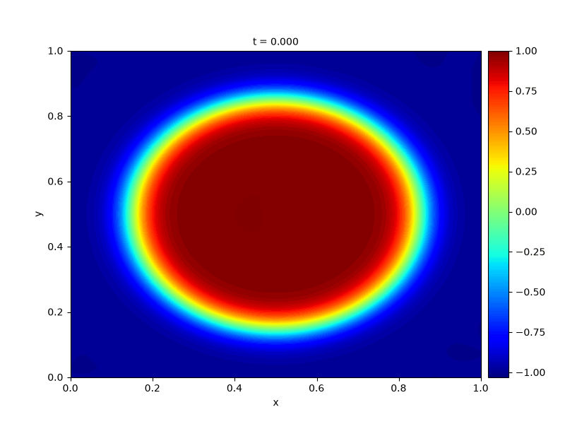
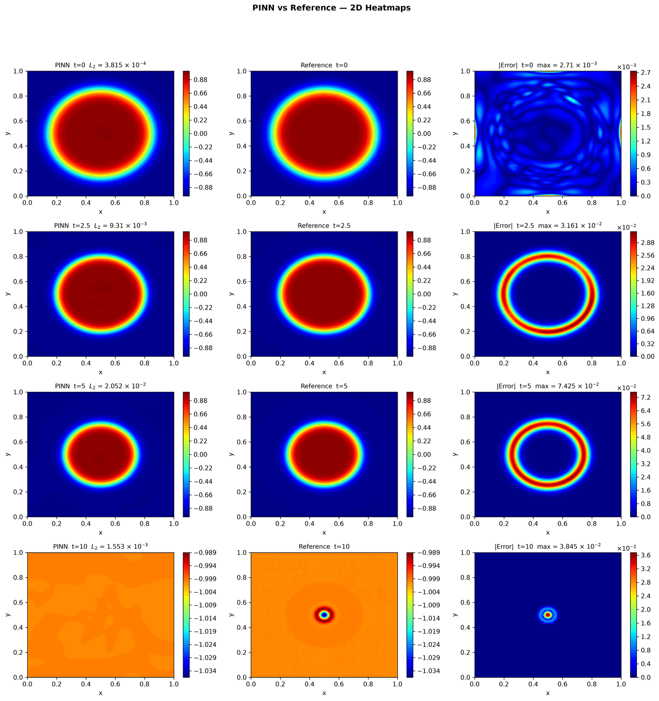
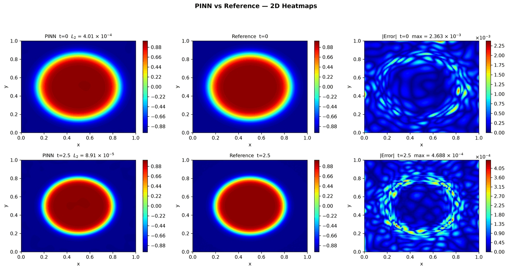
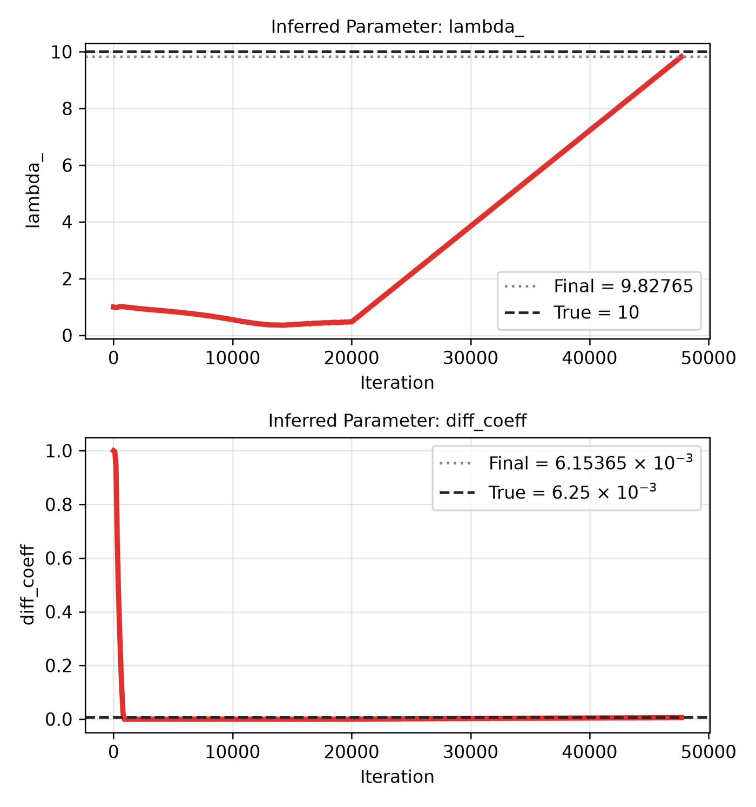

---
search:
  boost: 0.5
---

# Allen-Cahn 2D – Wight & Zhao

| Example | |
|---|---|
| **Source** | PINNStudio template |
| **Problem** | Forward and Inverse |
| **Dimension** | 2D (x, y, t) |
| **Regime** | Time-dependent |
| **Geometry** | Rectangle |
| **Outputs** | `phi` |
| **Settings** | Default, Tuned |

<figure markdown="span">
  { loading=lazy }
  <figcaption>Animation from the repository's figures (`assets/Images/Top_GIFs/`): the PINN solution of this example over time.</figcaption>
</figure>

<figure markdown="span">
  { loading=lazy }
  <figcaption>Figure from the repository's figures (`assets/Images/2D_AllenCahn-Wight/`): a run of this example with RAR switched on, round 1 — the collocation points added in that round. RAR is not part of the example's Default settings.</figcaption>
</figure>

<figure markdown="span">
  { loading=lazy }
  <figcaption>Figure from the repository's figures (`assets/Images/2D_AllenCahn-Wight/`): the same RAR run, PINN, reference and error after round 1.</figcaption>
</figure>

## Governing equations

Mathematical form (from the benchmark records):

\[\frac{\partial \phi}{\partial t} = \lambda\left(\varepsilon^2\left(\frac{\partial^2 \phi}{\partial x^2} + \frac{\partial^2 \phi}{\partial y^2}\right) - \phi^3 + \phi\right), \qquad (x, y) \in [0, 1]^2,\ t \in [0, 10]\]

Where \(\lambda = 10\) and \(\varepsilon = 0.025\), matching the paper's own values (\(\lambda\varepsilon^2 = 0.00625\) is the effective diffusion coefficient).

As typed in PINNStudio's **Equations** page (each expression is a residual, set to zero):

```text
dphi_t - 0.00625*(dphi_xx + dphi_yy) + 10*(phi**3 - phi)
```

As typed in PINNStudio's **Equations** page (Inverse mode) (each expression is a residual, set to zero):

```text
dphi_t - diff_coeff*(dphi_xx + dphi_yy) + lambda_*(phi**3 - phi)
```

Inverse-mode form (from the benchmark records):

\[\frac{\partial \phi}{\partial t} = (\lambda\varepsilon^2)\left(\frac{\partial^2 \phi}{\partial x^2} + \frac{\partial^2 \phi}{\partial y^2}\right) - \lambda(\phi^3 - \phi)\]

## Domain

- Rectangle: \(x \in [0, 1]\), \(y \in [0, 1]\)
- Time interval: \(t \in [0, 10]\)

## Initial conditions

| Output | Initial value | How it is imposed (Settings: Default) |
|---|---|---|
| `phi` | `tanh((0.35 - sqrt((x-0.5)**2 + (y-0.5)**2 + 1e-6)) / (2*0.025))` | loss term |

## Boundary conditions

| Type | Where | Output | Value | Details |
|---|---|---|---|---|
| Periodic BC | `left` | `phi` | — | axis x, derivative order 0 |
| Periodic BC | `bottom` | `phi` | — | axis y, derivative order 0 |

## Unknowns and measured data (Inverse)

| Trainable parameter | Initial value | True value |
|---|---|---|
| `lambda_` | 1 | 10 |
| `diff_coeff` | 1 | 0.00625 |

Measured data (**Inverse** page, measured-data files):

- [`reference_data/2D/allen_cahn_wight/t_2.5.txt`](https://github.com/AsfandyarKhan72/PINNStudio/blob/main/reference_data/2D/allen_cahn_wight/t_2.5.txt) → output `phi`, weight 100

From the benchmark records: same template, switched to **Inverse**, jointly recovering the two coefficients as they are written in the PDE box: the reaction-term coefficient \(\lambda\) and the lumped diffusion-term coefficient \(\lambda\varepsilon^2\) (not \(\varepsilon\) on its own).

## Settings

### Forward mode

**Settings: Default** — the paper's method (Wight & Zhao 2021)

- **Network:** FNN, hidden layers 6 × 128, inputs (x, y, t), 1 output; activation tanh, initializer Glorot uniform
- **Points:** 10,000 domain, 400 boundary, 512 initial, 1,000 test
- **Loss weights:** `1.0,1.0,1.0,1000.0` (equations, then boundary-condition rows, then initial conditions)
- **Methods:** [time windows (10 windows)](../../reference/time-windows.md)

| Phase | Optimizer | Iterations | Learning rate | Decay |
|---|---|---|---|---|
| 1 | Adam | 10,000 | 0.001 | none |
| 2 | L-BFGS | 10,000 | — | none |

??? note "Settings: Tuned"

    The Training Log reports: *Tuned settings: IC as a loss term, exact periodicity, time windows, RBA weights.* The change is applied to the template's own settings (not the paper's method that Default loads).

    - **Network:** FNN, hidden layers 4 × 128, inputs (x, y, t), 1 output; activation tanh, initializer Glorot uniform
    - **Points:** 10,000 domain, 400 boundary, 512 initial, 1,000 test
    - **Loss weights:** `1.0,1.0,1.0,100.0` (equations, then boundary-condition rows, then initial conditions)
    - **Methods:** [time windows (10 windows, transfer learning)](../../reference/time-windows.md); [RBA point weights](../../reference/point-weights.md); [exact periodicity (periodic input features)](../../reference/exact-constraints.md)

    | Phase | Optimizer | Iterations | Learning rate | Decay |
    |---|---|---|---|---|
    | 1 | Adam | 20,000 | 0.001 | none |
    | 2 | L-BFGS | 10,000 | — | none |

### Inverse mode

**Settings: Default** — the template's own settings

- **Network:** FNN, hidden layers 4 × 128, inputs (x, y, t), 1 output; activation tanh, initializer Glorot uniform
- **Points:** 10,000 domain, 400 boundary, 512 initial, 1,000 test
- **Loss weights:** `1.0,1.0,1.0,100.0,100.0` (equations, then boundary-condition rows, then initial conditions, then measured data)

| Phase | Optimizer | Iterations | Learning rate | Decay |
|---|---|---|---|---|
| 1 | Adam | 20,000 | 0.001 | none |
| 2 | L-BFGS | 10,000 | — | none |

??? note "Settings: Tuned"

    The Training Log reports: *Tuned settings: 10× the data weight, 3× the L-BFGS iterations and a larger network.* The change is applied to the example's own settings.

    - **Network:** FNN, hidden layers 5 × 256, inputs (x, y, t), 1 output; activation tanh, initializer Glorot uniform
    - **Points:** 10,000 domain, 400 boundary, 512 initial, 1,000 test
    - **Loss weights:** `1.0,1.0,1.0,100.0,100.0` (equations, then boundary-condition rows, then initial conditions, then measured data)

    | Phase | Optimizer | Iterations | Learning rate | Decay |
    |---|---|---|---|---|
    | 1 | Adam | 20,000 | 0.001 | none |
    | 2 | L-BFGS | 30,000 | — | none |

## Results

The configuration selected in PINNStudio's benchmark study, run on one RTX 4090. Forward: relative L₂ error of each output at the last reference time. Inverse: each parameter's relative error and, per seed, the largest of them (worst parameter error).

### Forward problem

**Settings:** Default — the best setup as it is; the example has no separate Tuned preset for this mode. **Values:** one run, seed 2026.

| Output | Relative L₂ |
|---|---|
| u | 5.9 × 10⁻⁵ |

<figure markdown="span">
  { loading=lazy }
  <figcaption>Forward, Default settings: PINN, reference and error.</figcaption>
</figure>

### Inverse problem

**Settings:** Tuned — 10× data weight, 3× L-BFGS and the larger network. **Values:** one run, seed 2026.

| Parameter | True value | Recovered | Relative error |
|---|---|---|---|
| λ | 10 | 10.0536 | 0.54 % |
| λε² | 0.00625 | 0.00628417 | 0.55 % |

Worst parameter error: **0.55 %**.

<figure markdown="span">
  { loading=lazy }
  <figcaption>Inverse, Tuned settings: PINN, reference and error.</figcaption>
</figure>

<figure markdown="span">
  { loading=lazy }
  <figcaption>Inverse, Tuned settings: parameter convergence.</figcaption>
</figure>

**Full benchmark record:** every setting tried, the per-seed values and all figures are in [the benchmark records on GitHub](https://github.com/AsfandyarKhan72/PINNStudio/blob/main/benchmarks/examples.md#2d-allen-cahn-wight--zhao).

## Loading it in PINNStudio

- Forward: toolbar **Examples:** › **Forward** › under the **── 2D ──** heading, **Allen-Cahn 2D – Wight & Zhao** › **Default** or **Tuned**, then **Solve**.
- Inverse: toolbar **Examples:** › **Inverse** › under the **── 2D ──** heading, **Allen-Cahn 2D – Wight & Zhao** › **Default** or **Tuned**, then **Solve**.

Loading an example fills in every setting; anything you change before **Solve** is listed in the Training Log. Your save folder, GPU, random-seed and plot-style settings are kept.

## Reference solution

- Reference data files: [`reference_data/2D/allen_cahn_wight/`](https://github.com/AsfandyarKhan72/PINNStudio/tree/main/reference_data/2D/allen_cahn_wight)

## Definition and records

- **Definition:** template "2D Allen-Cahn (Wight & Zhao)" in `MainWindow._on_template_selected`, [`pinnstudio/ui/main_window.py`](https://github.com/AsfandyarKhan72/PINNStudio/blob/main/pinnstudio/ui/main_window.py)
    - Inverse mode: `MainWindow.INVERSE_AUTO_VARS["2D Allen-Cahn (Wight & Zhao)"]` (unknowns) and `INVERSE_AUTO_OBS["2D Allen-Cahn (Wight & Zhao)"]` (measured data), same file
    - Settings: Default (the paper's method): `_ac2d_wz` in [`pinnstudio/core/paper_settings.py`](https://github.com/AsfandyarKhan72/PINNStudio/blob/main/pinnstudio/core/paper_settings.py)
    - Settings: Tuned: entry "2D Allen-Cahn (Wight & Zhao)" in [`pinnstudio/resources/tuned_settings.json`](https://github.com/AsfandyarKhan72/PINNStudio/blob/main/pinnstudio/resources/tuned_settings.json)
- **Equations:** [Governing equations](#governing-equations) on this page
- **Reference data:** [`reference_data/2D/allen_cahn_wight/`](https://github.com/AsfandyarKhan72/PINNStudio/tree/main/reference_data/2D/allen_cahn_wight), no generator script in the repository (checked against an independent solution by [`benchmarks/reference_regeneration/check_other_references.py`](https://github.com/AsfandyarKhan72/PINNStudio/blob/main/benchmarks/reference_regeneration/check_other_references.py))
- **Measured data** (Inverse): [`reference_data/2D/allen_cahn_wight/`](https://github.com/AsfandyarKhan72/PINNStudio/tree/main/reference_data/2D/allen_cahn_wight), no generator script in the repository (checked against an independent solution by [`benchmarks/reference_regeneration/check_other_references.py`](https://github.com/AsfandyarKhan72/PINNStudio/blob/main/benchmarks/reference_regeneration/check_other_references.py))
- **Benchmark records:** [`benchmarks/problems/allen-cahn-2d-wight-zhao.md`](https://github.com/AsfandyarKhan72/PINNStudio/blob/main/benchmarks/problems/allen-cahn-2d-wight-zhao.md), its entry in the [examples overview](https://github.com/AsfandyarKhan72/PINNStudio/blob/main/benchmarks/examples.md#2d-allen-cahn-wight--zhao), the [benchmark collection](https://github.com/AsfandyarKhan72/PINNStudio/blob/main/benchmarks/README.md)
- **Tuning-study configurations** (records of the tuning study; open one with **Problem › Open Saved Problem...**; not presets of the Examples list): [`Allen-Cahn 2D – Wight & Zhao (PINNStudio template) (best setup) (tuned).pinn.json`](https://github.com/AsfandyarKhan72/PINNStudio/blob/main/benchmarks/tuning/Allen-Cahn%202D%20%E2%80%93%20Wight%20%26%20Zhao%20%28PINNStudio%20template%29%20%28best%20setup%29%20%28tuned%29.pinn.json), [`Allen-Cahn 2D – Wight & Zhao (PINNStudio template) (tuned).pinn.json`](https://github.com/AsfandyarKhan72/PINNStudio/blob/main/benchmarks/tuning/Allen-Cahn%202D%20%E2%80%93%20Wight%20%26%20Zhao%20%28PINNStudio%20template%29%20%28tuned%29.pinn.json), [`Allen-Cahn 2D – Wight & Zhao (PINNStudio template), inverse mode (tuned).pinn.json`](https://github.com/AsfandyarKhan72/PINNStudio/blob/main/benchmarks/tuning/Allen-Cahn%202D%20%E2%80%93%20Wight%20%26%20Zhao%20%28PINNStudio%20template%29%2C%20inverse%20mode%20%28tuned%29.pinn.json)
- **Methods** (Default and Tuned settings): [Time windows and bc-PINN](../../reference/time-windows.md), [RBA and SA-PINN](../../reference/point-weights.md), [Exact constraints](../../reference/exact-constraints.md)
- **Cite:** [Wight & Zhao 2021](../../about/references.md#wight2021)

How the benchmark values were measured and checked: [Reproducibility](../../reproducibility/benchmarks.md).

[← Back to the example gallery](../index.md)
