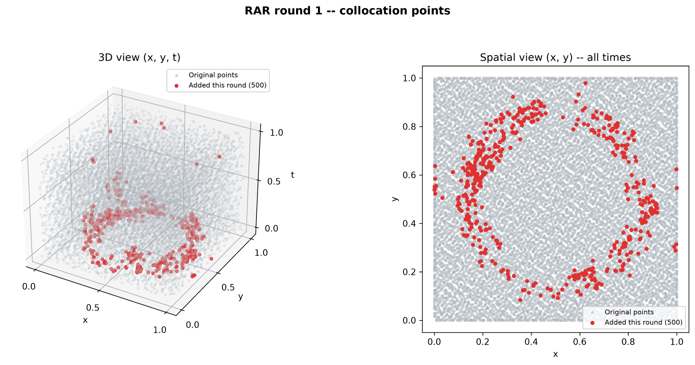
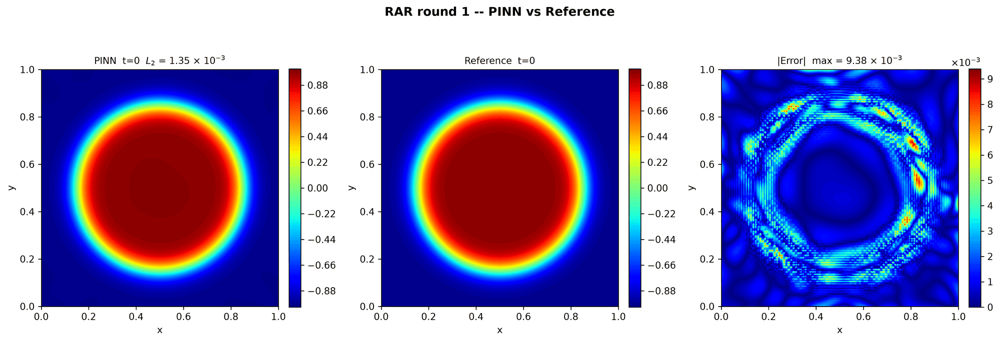

---
search:
  boost: 0.5
---

# Allen-Cahn 2D – Wight & Zhao

| Example | |
|---|---|
| **Source** | PINNStudio template |
| **Problem** | Forward and Inverse |
| **Dimension** | 2D (x, y, t) |
| **Regime** | Time-dependent |
| **Geometry** | Rectangle |
| **Outputs** | `phi` |
| **Settings** | Default, Tuned |

<figure markdown="span">
  { loading=lazy }
  <figcaption>Animation from PINNStudio's README (top of the page): the PINN solution of this example over time.</figcaption>
</figure>

<figure markdown="span">
  { loading=lazy }
  <figcaption>Figure from PINNStudio's README (section on RAR): a run of this example with RAR switched on, round 1 — the collocation points added in that round. RAR is not part of the example's Default settings.</figcaption>
</figure>

<figure markdown="span">
  { loading=lazy }
  <figcaption>Figure from PINNStudio's README (section on RAR): the same RAR run, PINN, reference and error after round 1.</figcaption>
</figure>

## Governing equations

Mathematical form (from the README):

\[\frac{\partial \phi}{\partial t} = \lambda\left(\varepsilon^2\left(\frac{\partial^2 \phi}{\partial x^2} + \frac{\partial^2 \phi}{\partial y^2}\right) - \phi^3 + \phi\right), \qquad (x, y) \in [0, 1]^2,\ t \in [0, 10]\]

Where \(\lambda = 10\) and \(\varepsilon = 0.025\), matching the paper's own values (\(\lambda\varepsilon^2 = 0.00625\) is the effective diffusion coefficient).

As typed in PINNStudio's **Equations** page (each expression is a residual, set to zero):

```text
dphi_t - 0.00625*(dphi_xx + dphi_yy) + 10*(phi**3 - phi)
```

As typed in PINNStudio's **Equations** page (Inverse mode) (each expression is a residual, set to zero):

```text
dphi_t - diff_coeff*(dphi_xx + dphi_yy) + lambda_*(phi**3 - phi)
```

Inverse-mode form (from the README):

\[\frac{\partial \phi}{\partial t} = (\lambda\varepsilon^2)\left(\frac{\partial^2 \phi}{\partial x^2} + \frac{\partial^2 \phi}{\partial y^2}\right) - \lambda(\phi^3 - \phi)\]

## Domain

- Rectangle: \(x \in [0, 1]\), \(y \in [0, 1]\)
- Time interval: \(t \in [0, 10]\)

## Initial conditions

| Output | Initial value | How it is imposed (Settings: Default) |
|---|---|---|
| `phi` | `tanh((0.35 - sqrt((x-0.5)**2 + (y-0.5)**2 + 1e-6)) / (2*0.025))` | loss term |

## Boundary conditions

| Type | Where | Output | Value | Details |
|---|---|---|---|---|
| Periodic BC | `left` | `phi` | — | axis x, derivative order 0 |
| Periodic BC | `bottom` | `phi` | — | axis y, derivative order 0 |

## Unknowns and measured data (Inverse)

| Trainable parameter | Initial value | True value |
|---|---|---|
| `lambda_` | 1 | 10 |
| `diff_coeff` | 1 | 0.00625 |

Measured data (**Inverse** page, measured-data files):

- [`reference_data/2D/allen_cahn_wight/t_2.5.txt`](https://github.com/AsfandyarKhan72/PINNStudio/blob/main/reference_data/2D/allen_cahn_wight/t_2.5.txt) → output `phi`, weight 100

From the README: same template, switched to **Inverse**, jointly recovering the two coefficients as they are written in the PDE box: the reaction-term coefficient \(\lambda\) and the lumped diffusion-term coefficient \(\lambda\varepsilon^2\) (not \(\varepsilon\) on its own).

## Settings

### Forward mode

**Settings: Default** — the paper's method (Wight & Zhao 2021)

- **Network:** FNN, hidden layers 6 × 128, inputs (x, y, t), 1 output; activation tanh, initializer Glorot uniform
- **Points:** 10,000 domain, 400 boundary, 512 initial, 1,000 test
- **Loss weights:** `1.0,1.0,1.0,1000.0` (equations, then boundary-condition rows, then initial conditions)
- **Methods:** [time windows (10 windows)](../../reference/time-windows.md)

| Phase | Optimizer | Iterations | Learning rate | Decay |
|---|---|---|---|---|
| 1 | Adam | 10,000 | 0.001 | none |
| 2 | L-BFGS | 10,000 | — | none |

??? note "Settings: Tuned"

    The Training Log reports: *Tuned settings: IC as a loss term, exact periodicity, time windows, RBA weights.* The change is applied to the template's own settings (not the paper's method that Default loads).

    - **Network:** FNN, hidden layers 4 × 128, inputs (x, y, t), 1 output; activation tanh, initializer Glorot uniform
    - **Points:** 10,000 domain, 400 boundary, 512 initial, 1,000 test
    - **Loss weights:** `1.0,1.0,1.0,100.0` (equations, then boundary-condition rows, then initial conditions)
    - **Methods:** [time windows (10 windows, transfer learning)](../../reference/time-windows.md); [RBA point weights](../../reference/point-weights.md); [exact periodicity (periodic input features)](../../reference/networks.md)

    | Phase | Optimizer | Iterations | Learning rate | Decay |
    |---|---|---|---|---|
    | 1 | Adam | 20,000 | 0.001 | none |
    | 2 | L-BFGS | 10,000 | — | none |

### Inverse mode

**Settings: Default** — the template's own settings

- **Network:** FNN, hidden layers 4 × 128, inputs (x, y, t), 1 output; activation tanh, initializer Glorot uniform
- **Points:** 10,000 domain, 400 boundary, 512 initial, 1,000 test
- **Loss weights:** `1.0,1.0,1.0,100.0,100.0` (equations, then boundary-condition rows, then initial conditions, then measured data)

| Phase | Optimizer | Iterations | Learning rate | Decay |
|---|---|---|---|---|
| 1 | Adam | 20,000 | 0.001 | none |
| 2 | L-BFGS | 10,000 | — | none |

??? note "Settings: Tuned"

    The Training Log reports: *Tuned settings: 10× the data weight, 3× the L-BFGS iterations and a larger network.* The change is applied to the example's own settings.

    - **Network:** FNN, hidden layers 5 × 256, inputs (x, y, t), 1 output; activation tanh, initializer Glorot uniform
    - **Points:** 10,000 domain, 400 boundary, 512 initial, 1,000 test
    - **Loss weights:** `1.0,1.0,1.0,100.0,100.0` (equations, then boundary-condition rows, then initial conditions, then measured data)

    | Phase | Optimizer | Iterations | Learning rate | Decay |
    |---|---|---|---|---|
    | 1 | Adam | 20,000 | 0.001 | none |
    | 2 | L-BFGS | 30,000 | — | none |

## Loading it in PINNStudio

- Forward: toolbar **Examples:** › **Forward** › under the **── 2D ──** heading, **Allen-Cahn 2D – Wight & Zhao** › **Default** or **Tuned**, then **Solve**.
- Inverse: toolbar **Examples:** › **Inverse** › under the **── 2D ──** heading, **Allen-Cahn 2D – Wight & Zhao** › **Default** or **Tuned**, then **Solve**.

Loading an example fills in every setting; anything you change before **Solve** is listed in the Training Log. Your save folder, GPU, random-seed and plot-style settings are kept.

## Reference solution

- Reference data files: [`reference_data/2D/allen_cahn_wight/`](https://github.com/AsfandyarKhan72/PINNStudio/tree/main/reference_data/2D/allen_cahn_wight)

## Source and citation

- Paper: [Wight & Zhao (2021)](https://doi.org/10.4208/cicp.OA-2020-0086)
- README: Benchmark problem after [Wight & Zhao (2021)](https://doi.org/10.4208/cicp.OA-2020-0086).

## Configuration and benchmark records

- [`benchmarks/tuning/Allen-Cahn 2D – Wight & Zhao (PINNStudio template) (best setup) (tuned).pinn.json`](https://github.com/AsfandyarKhan72/PINNStudio/blob/main/benchmarks/tuning/Allen-Cahn%202D%20%E2%80%93%20Wight%20%26%20Zhao%20%28PINNStudio%20template%29%20%28best%20setup%29%20%28tuned%29.pinn.json) — a configuration tried in the tuning study, kept as a record (it can be opened with **Problem › Open Saved Problem...**; it is not a preset of the Examples list)
- [`benchmarks/tuning/Allen-Cahn 2D – Wight & Zhao (PINNStudio template) (tuned).pinn.json`](https://github.com/AsfandyarKhan72/PINNStudio/blob/main/benchmarks/tuning/Allen-Cahn%202D%20%E2%80%93%20Wight%20%26%20Zhao%20%28PINNStudio%20template%29%20%28tuned%29.pinn.json) — a configuration tried in the tuning study, kept as a record (it can be opened with **Problem › Open Saved Problem...**; it is not a preset of the Examples list)
- [`benchmarks/tuning/Allen-Cahn 2D – Wight & Zhao (PINNStudio template), inverse mode (tuned).pinn.json`](https://github.com/AsfandyarKhan72/PINNStudio/blob/main/benchmarks/tuning/Allen-Cahn%202D%20%E2%80%93%20Wight%20%26%20Zhao%20%28PINNStudio%20template%29%2C%20inverse%20mode%20%28tuned%29.pinn.json) — a configuration tried in the tuning study, kept as a record (it can be opened with **Problem › Open Saved Problem...**; it is not a preset of the Examples list)
- [Benchmark record](https://github.com/AsfandyarKhan72/PINNStudio/blob/main/benchmarks/problems/allen-cahn-2d-wight-zhao.md) (`benchmarks/problems/allen-cahn-2d-wight-zhao.md`)
- [Entry in the benchmark collection](https://github.com/AsfandyarKhan72/PINNStudio/blob/main/benchmarks/README.md) (`benchmarks/README.md`)

Verified error values are reported in the [Reproducibility](../../reproducibility/benchmarks.md) section, not on this page.

[← Back to the example gallery](../index.md)
