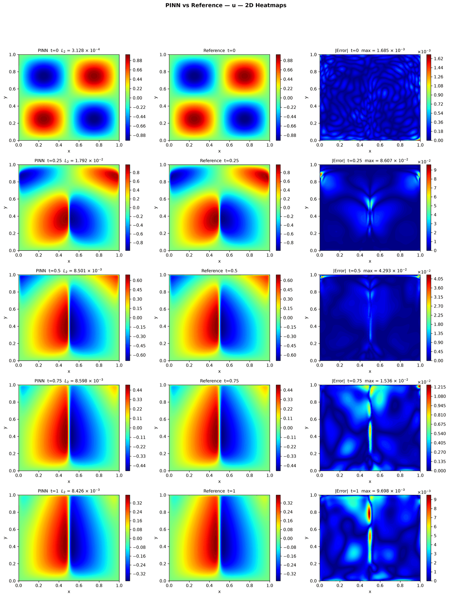
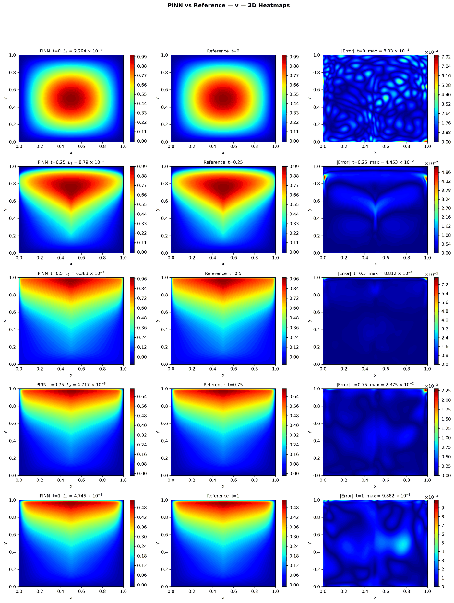
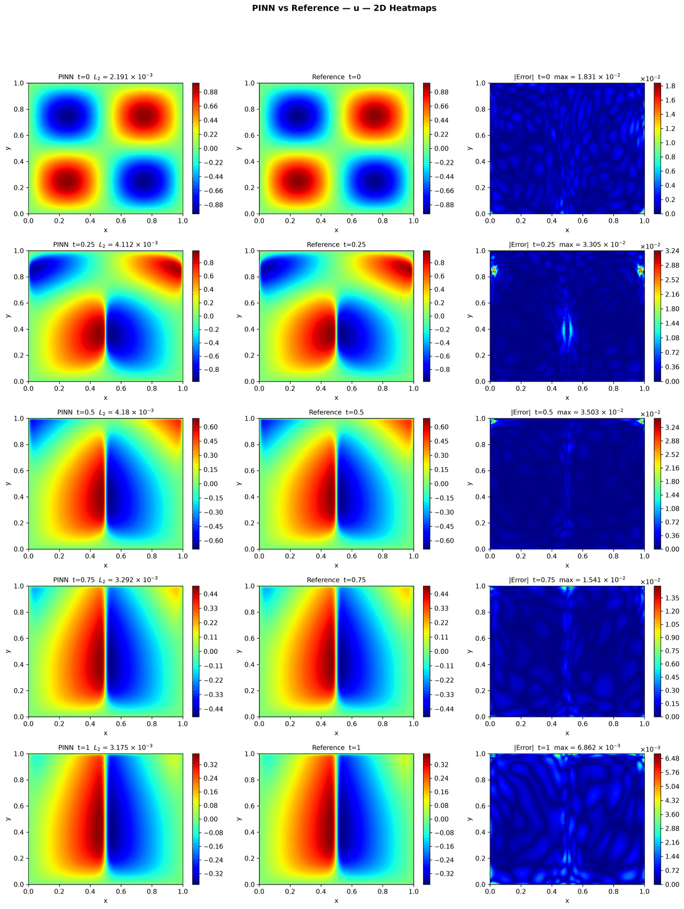
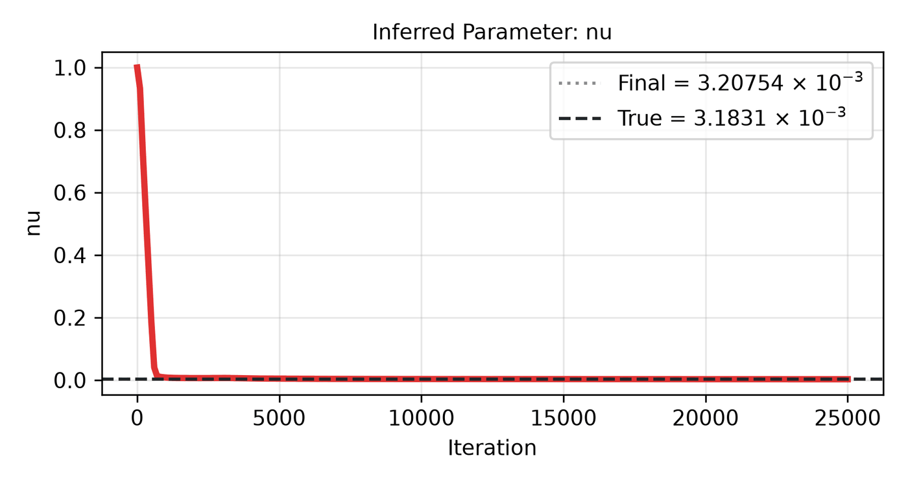
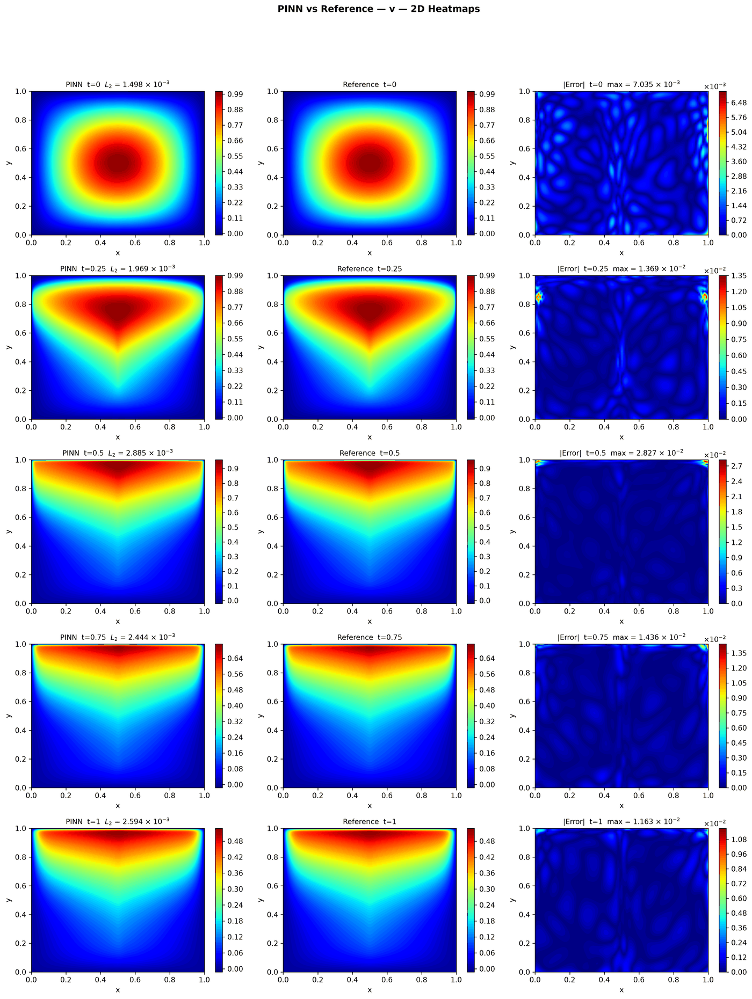

---
search:
  boost: 0.5
---

# Burgers 2D – Mathias et al.

| Example | |
|---|---|
| **Source** | PINNStudio template |
| **Problem** | Forward and Inverse |
| **Dimension** | 2D (x, y, t) |
| **Regime** | Time-dependent |
| **Geometry** | Rectangle |
| **Outputs** | `u`, `v` |
| **Settings** | Default, Tuned |

## Governing equations

Mathematical form (from the benchmark records):

\[\frac{\partial U}{\partial t} + U\frac{\partial U}{\partial x} + V\frac{\partial U}{\partial y} = \nu\left(\frac{\partial^2 U}{\partial x^2} + \frac{\partial^2 U}{\partial y^2}\right)\]

\[\frac{\partial V}{\partial t} + U\frac{\partial V}{\partial x} + V\frac{\partial V}{\partial y} = \nu\left(\frac{\partial^2 V}{\partial x^2} + \frac{\partial^2 V}{\partial y^2}\right)\]

As typed in PINNStudio's **Equations** page (each expression is a residual, set to zero):

```text
du_t + u*du_x + v*du_y - (0.01/pi)*(du_xx + du_yy)
dv_t + u*dv_x + v*dv_y - (0.01/pi)*(dv_xx + dv_yy)
```

As typed in PINNStudio's **Equations** page (Inverse mode) (each expression is a residual, set to zero):

```text
du_t + u*du_x + v*du_y - (nu)*(du_xx + du_yy)
dv_t + u*dv_x + v*dv_y - (nu)*(dv_xx + dv_yy)
```

## Domain

- Rectangle: \(x \in [0, 1]\), \(y \in [0, 1]\)
- Time interval: \(t \in [0, 1]\)

## Initial conditions

| Output | Initial value | How it is imposed (Settings: Default) |
|---|---|---|
| `u` | `sin(2*pi*x)*sin(2*pi*y)` | not used as a loss term |
| `v` | `sin(pi*x)*sin(pi*y)` | not used as a loss term |

## Boundary conditions

No boundary-condition rows: the boundary values are imposed exactly through the network's output transform (see **Methods** below), or the problem has no boundary terms.

## Unknowns and measured data (Inverse)

| Trainable parameter | Initial value | True value |
|---|---|---|
| `nu` | 1 | 0.0031831 |

Measured data (**Inverse** page, measured-data files):

- [`reference_data/2D/burgers_mathias/t_1.0_u.txt`](https://github.com/AsfandyarKhan72/PINNStudio/blob/main/reference_data/2D/burgers_mathias/t_1.0_u.txt) → output `u`, weight 100
- [`reference_data/2D/burgers_mathias/t_1.0_v.txt`](https://github.com/AsfandyarKhan72/PINNStudio/blob/main/reference_data/2D/burgers_mathias/t_1.0_v.txt) → output `v`, weight 100

From the benchmark records: same template, switched to **Inverse**, recovering the shared viscosity \(\nu\) (true value \(0.01/\pi \approx 3.18 \times 10^{-3}\), initial guess 1) from \(U\) and \(V\) measured at \(t = 1\), each against its own output. \(\nu\) converges to 3.44 × 10⁻³, and the \(L_2\) error at \(t = 1\) is 3.7 × 10⁻³ for \(U\) and 3.1 × 10⁻³ for \(V\).

## Settings

### Forward mode

**Settings: Default** — the paper's method (Mathias et al. 2022)

- **Network:** FNN, hidden layers 4 × 20, inputs (x, y, t), 2 outputs; activation tanh, initializer Glorot uniform
- **Points:** 10,000 domain, 0 boundary, 0 initial, 1,000 test
- **Loss weights:** `1.0,1.0` (equations, then boundary-condition rows, then initial conditions)
- **Methods:** output transform `u*16*x*(1 - x)*y*(1 - y)*tanh(26.4*t) + (1 - 16*x*(1 - x)*y*(1 - y)*tanh(26.4*t))*sin(2*pi*x)*sin(2*pi*y)|v*16*x*(1 - x)*y*(1 - y)*tanh(26.4*t) + (1 - 16*x*(1 - x)*y*(1 - y)*tanh(26.4*t))*sin(pi*x)*sin(pi*y)` ([reference](../../reference/networks.md))

| Phase | Optimizer | Iterations | Learning rate | Decay |
|---|---|---|---|---|
| 1 | Adam | 99,999 | 0.01 | none |

??? note "Settings: Tuned"

    The Training Log reports: *Tuned settings: 3× the iterations of every training phase.* The change is applied to the template's own settings (not the paper's method that Default loads).

    - **Network:** FNN, hidden layers 4 × 128, inputs (x, y, t), 2 outputs; activation tanh, initializer Glorot uniform
    - **Points:** 8,000 domain, 2,000 boundary, 2,000 initial, 1,000 test
    - **Loss weights:** `1.0,1.0,1.0,1.0,1.0,1.0,1.0,1.0,1.0,1.0,100.0,100.0` (equations, then boundary-condition rows, then initial conditions)
    - **Methods:** [time windows (4 windows, transfer learning)](../../reference/time-windows.md)

    | Phase | Optimizer | Iterations | Learning rate | Decay |
    |---|---|---|---|---|
    | 1 | Adam | 45,000 | 0.001 | none |
    | 2 | L-BFGS | 30,000 | — | none |

### Inverse mode

**Settings: Default** — the template's own settings

- **Network:** FNN, hidden layers 4 × 128, inputs (x, y, t), 2 outputs; activation tanh, initializer Glorot uniform
- **Points:** 8,000 domain, 2,000 boundary, 2,000 initial, 1,000 test
- **Loss weights:** `1.0,1.0,1.0,1.0,1.0,1.0,1.0,1.0,1.0,1.0,100.0,100.0,100.0,100.0` (equations, then boundary-condition rows, then initial conditions, then measured data)

| Phase | Optimizer | Iterations | Learning rate | Decay |
|---|---|---|---|---|
| 1 | Adam | 15,000 | 0.001 | none |
| 2 | L-BFGS | 10,000 | — | none |

??? note "Settings: Tuned"

    The Training Log reports: *Tuned settings: measured data at every reference time after t = 0.* The change is applied to the example's own settings.

    - **Network:** FNN, hidden layers 4 × 128, inputs (x, y, t), 2 outputs; activation tanh, initializer Glorot uniform
    - **Points:** 8,000 domain, 2,000 boundary, 2,000 initial, 1,000 test
    - **Loss weights:** `1.0,1.0,1.0,1.0,1.0,1.0,1.0,1.0,1.0,1.0,100.0,100.0,100.0,100.0` (equations, then boundary-condition rows, then initial conditions, then measured data)

    | Phase | Optimizer | Iterations | Learning rate | Decay |
    |---|---|---|---|---|
    | 1 | Adam | 15,000 | 0.001 | none |
    | 2 | L-BFGS | 10,000 | — | none |

## Results

The configuration selected in PINNStudio's benchmark study, run on one RTX 4090. Forward: relative L₂ error of each output at the last reference time. Inverse: each parameter's relative error and, per seed, the largest of them (worst parameter error).

### Forward problem

**Settings:** Tuned — 3× iterations. **Values:** median over seeds 2026, 1, 2.

| Output | Relative L₂ |
|---|---|
| u | 8.3 × 10⁻³ |
| v | 3.9 × 10⁻³ |

<figure markdown="span">
  { loading=lazy }
  <figcaption>Forward, Tuned settings: PINN, reference and error, u.</figcaption>
</figure>

??? note "Other outputs (1 figure)"

    <figure markdown="span">
      { loading=lazy }
      <figcaption>Forward, Tuned settings: PINN, reference and error, v.</figcaption>
    </figure>

### Inverse problem

**Settings:** Tuned — Measured data at every reference time. **Values:** median over seeds 2026, 1, 2.

| Parameter | True value | Recovered | Relative error |
|---|---|---|---|
| ν | 0.0031831 | 0.00318823 | 0.16 % |

Worst parameter error: **0.16 %** (the median over the seeds of each seed's largest error).

<figure markdown="span">
  { loading=lazy }
  <figcaption>Inverse, Tuned settings: PINN, reference and error, u.</figcaption>
</figure>

<figure markdown="span">
  { loading=lazy }
  <figcaption>Inverse, Tuned settings: parameter convergence.</figcaption>
</figure>

??? note "Other outputs (1 figure)"

    <figure markdown="span">
      { loading=lazy }
      <figcaption>Inverse, Tuned settings: PINN, reference and error, v.</figcaption>
    </figure>

**Full benchmark record:** every setting tried, the per-seed values and all figures are in [the benchmark records on GitHub](https://github.com/AsfandyarKhan72/PINNStudio/blob/main/benchmarks/examples.md#2d-burgers-mathias).

## Loading it in PINNStudio

- Forward: toolbar **Examples:** › **Forward** › under the **── 2D ──** heading, **Burgers 2D – Mathias et al.** › **Default** or **Tuned**, then **Solve**.
- Inverse: toolbar **Examples:** › **Inverse** › under the **── 2D ──** heading, **Burgers 2D – Mathias et al.** › **Default** or **Tuned**, then **Solve**.

Loading an example fills in every setting; anything you change before **Solve** is listed in the Training Log. Your save folder, GPU, random-seed and plot-style settings are kept.

## Reference solution

- Reference data files: [`reference_data/2D/burgers_mathias/`](https://github.com/AsfandyarKhan72/PINNStudio/tree/main/reference_data/2D/burgers_mathias)

## Definition and records

- **Definition:** template "2D Burgers (Mathias)" in `MainWindow._on_template_selected`, [`pinnstudio/ui/main_window.py`](https://github.com/AsfandyarKhan72/PINNStudio/blob/main/pinnstudio/ui/main_window.py)
    - Inverse mode: `MainWindow.INVERSE_AUTO_VARS["2D Burgers (Mathias)"]` (unknowns) and `INVERSE_AUTO_OBS["2D Burgers (Mathias)"]` (measured data), same file
    - Settings: Default (the paper's method): `_burgers2d_mathias` in [`pinnstudio/core/paper_settings.py`](https://github.com/AsfandyarKhan72/PINNStudio/blob/main/pinnstudio/core/paper_settings.py)
    - Settings: Tuned: entry "2D Burgers (Mathias)" in [`pinnstudio/resources/tuned_settings.json`](https://github.com/AsfandyarKhan72/PINNStudio/blob/main/pinnstudio/resources/tuned_settings.json)
- **Equations:** [Governing equations](#governing-equations) on this page
- **Reference data:** [`reference_data/2D/burgers_mathias/`](https://github.com/AsfandyarKhan72/PINNStudio/tree/main/reference_data/2D/burgers_mathias), written by [`tools/make_burgers2d_reference_data.py`](https://github.com/AsfandyarKhan72/PINNStudio/blob/main/tools/make_burgers2d_reference_data.py)
- **Measured data** (Inverse): [`reference_data/2D/burgers_mathias/`](https://github.com/AsfandyarKhan72/PINNStudio/tree/main/reference_data/2D/burgers_mathias), written by [`tools/make_burgers2d_reference_data.py`](https://github.com/AsfandyarKhan72/PINNStudio/blob/main/tools/make_burgers2d_reference_data.py)
- **Benchmark records:** [`benchmarks/problems/burgers-2d-mathias-et-al.md`](https://github.com/AsfandyarKhan72/PINNStudio/blob/main/benchmarks/problems/burgers-2d-mathias-et-al.md), its entry in the [examples overview](https://github.com/AsfandyarKhan72/PINNStudio/blob/main/benchmarks/examples.md#2d-burgers-mathias), the [benchmark collection](https://github.com/AsfandyarKhan72/PINNStudio/blob/main/benchmarks/README.md)
- **Tuning-study configurations** (records of the tuning study; open one with **Problem › Open Saved Problem...**; not presets of the Examples list): [`Burgers 2D – Mathias et al. (PINNStudio template) (tuned).pinn.json`](https://github.com/AsfandyarKhan72/PINNStudio/blob/main/benchmarks/tuning/Burgers%202D%20%E2%80%93%20Mathias%20et%20al.%20%28PINNStudio%20template%29%20%28tuned%29.pinn.json), [`Burgers 2D – Mathias et al. (PINNStudio template), inverse mode (tuned).pinn.json`](https://github.com/AsfandyarKhan72/PINNStudio/blob/main/benchmarks/tuning/Burgers%202D%20%E2%80%93%20Mathias%20et%20al.%20%28PINNStudio%20template%29%2C%20inverse%20mode%20%28tuned%29.pinn.json)
- **Methods** (Default and Tuned settings): [Time windows and bc-PINN](../../reference/time-windows.md), [Networks and Fourier features](../../reference/networks.md)
- **Cite:** [Mathias et al. 2022](../../about/references.md#mathias2022)

How the benchmark values were measured and checked: [Reproducibility](../../reproducibility/benchmarks.md).

[← Back to the example gallery](../index.md)
