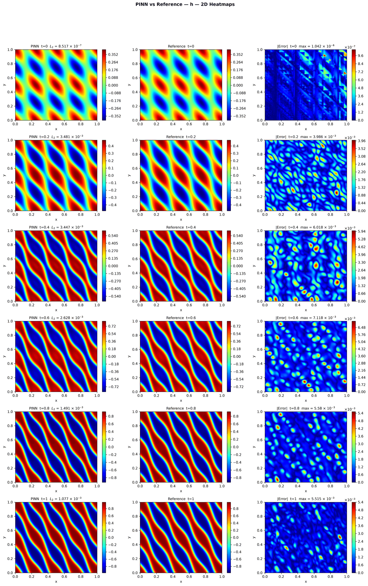
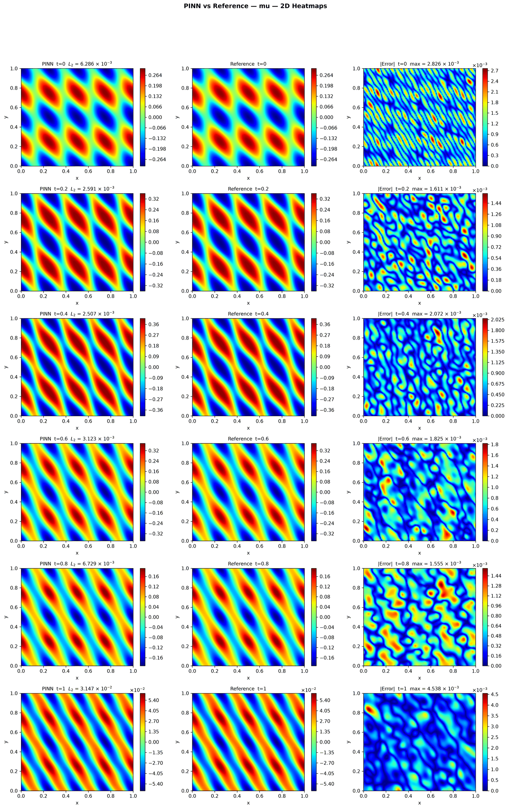
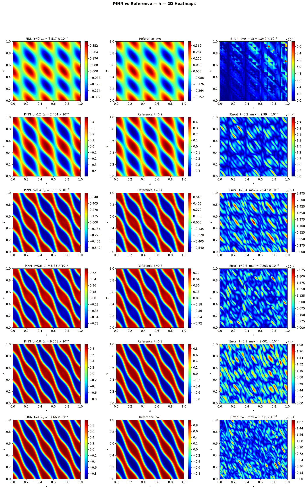
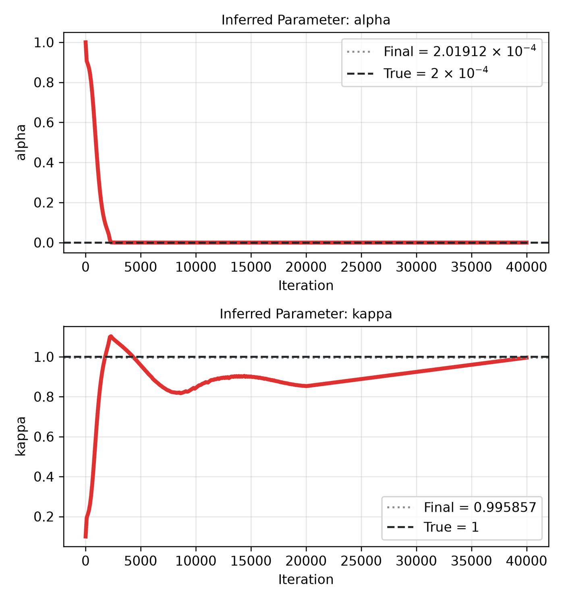
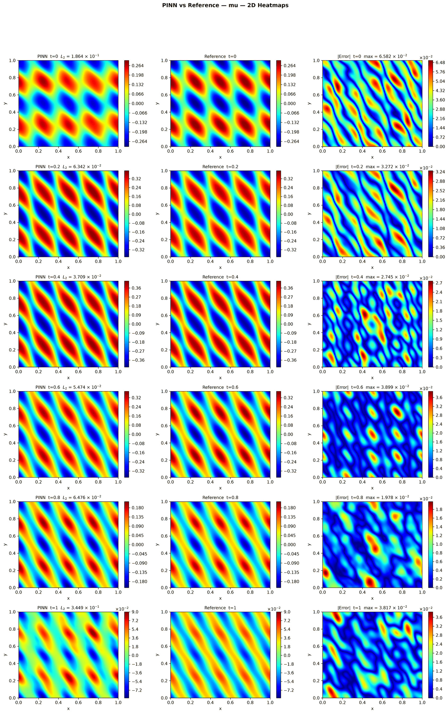

---
search:
  boost: 0.5
---

# Cahn-Hilliard 2D – Mattey & Ghosh

| Example | |
|---|---|
| **Source** | PINNStudio template |
| **Problem** | Forward and Inverse |
| **Dimension** | 2D (x, y, t) |
| **Regime** | Time-dependent |
| **Geometry** | Rectangle |
| **Outputs** | `h`, `mu` |
| **Settings** | Default, Tuned |

## Governing equations

Mathematical form (from the benchmark records):

\[\frac{\partial h}{\partial t'} = 0.005\left(\frac{\partial^2 \mu}{\partial x^2} + \frac{\partial^2 \mu}{\partial y^2}\right), \qquad \mu = h^3 - h - \alpha\left(\frac{\partial^2 h}{\partial x^2} + \frac{\partial^2 h}{\partial y^2}\right), \qquad (x, y) \in [0, 1]^2,\ t' \in [0, 1]\]

As typed in PINNStudio's **Equations** page (each expression is a residual, set to zero):

```text
dh_t - 0.005*(dmu_xx + dmu_yy)
mu - 1.0*(h**3 - h) + 0.0002*(dh_xx + dh_yy)
```

As typed in PINNStudio's **Equations** page (Inverse mode) (each expression is a residual, set to zero):

```text
dh_t - 0.005*(dmu_xx + dmu_yy)
mu - kappa*(h**3 - h) + alpha*(dh_xx + dh_yy)
```

## Domain

- Rectangle: \(x \in [0, 1]\), \(y \in [0, 1]\)
- Time interval: \(t \in [0, 1]\)

## Initial conditions

| Output | Initial value | How it is imposed (Settings: Default) |
|---|---|---|
| `h` | `0.4*cos(4*pi*x)*cos(4*pi*(x + y))` | loss term |
| `mu` | `0` | not used as a loss term |

## Boundary conditions

| Type | Where | Output | Value | Details |
|---|---|---|---|---|
| Periodic BC | `left` | `h` | — | axis x, derivative order 0 |
| Periodic BC | `bottom` | `h` | — | axis y, derivative order 0 |
| Periodic BC | `left` | `mu` | — | axis x, derivative order 0 |
| Periodic BC | `bottom` | `mu` | — | axis y, derivative order 0 |

## Unknowns and measured data (Inverse)

| Trainable parameter | Initial value | True value |
|---|---|---|
| `alpha` | 1 | 0.0002 |
| `kappa` | 0.1 | 1 |

Measured data (**Inverse** page, measured-data files):

- [`reference_data/2D/cahn_hilliard_mattey/t_1_h.txt`](https://github.com/AsfandyarKhan72/PINNStudio/blob/v1.6.0/reference_data/2D/cahn_hilliard_mattey/t_1_h.txt) → output `h`, weight 100

From the benchmark records: same template, switched to **Inverse**, recovering \(\alpha\) and \(\kappa\) (initial guesses 1 and 0.1, true values 0.0002 and 1) from \(h\) measured at \(t' = 1\).

## Settings

### Forward mode

**Settings: Default** — the paper's method (Mattey & Ghosh 2022, bc-PINN)

- **Network:** FNN, hidden layers 5 × 128, inputs (x, y, t), 2 outputs; activation tanh, initializer Glorot uniform
- **Points:** 50,000 domain, 1,600 boundary, 4,096 initial, 1,000 test
- **Loss weights:** `1.0,1.0,1.0,1.0,1.0,1.0,64.0` (equations, then boundary-condition rows, then initial conditions)
- **Methods:** [time windows (4 windows, transfer learning)](../../reference/time-windows.md); [backward-compatible PINN (bc-PINN) across the windows](../../reference/time-windows.md); [initial-condition guided learning](../../reference/pretraining.md)

| Phase | Optimizer | Iterations | Learning rate | Decay |
|---|---|---|---|---|
| 1 | Adam | 40,000 | 0.001 | none |
| 2 | L-BFGS | 75,000 | — | none |

??? note "Settings: Tuned"

    The Training Log reports: *Tuned settings: 3× the iterations of every training phase.* The change is applied to the template's own settings (not the paper's method that Default loads).

    - **Network:** FNN, hidden layers 4 × 128, inputs (x, y, t), 2 outputs; activation tanh, initializer Glorot uniform
    - **Points:** 20,000 domain, 800 boundary, 1,024 initial, 1,000 test
    - **Loss weights:** `1.0,1.0,1.0,1.0,1.0,1.0` (equations, then boundary-condition rows, then initial conditions)
    - **Methods:** [SA-PINN point weights](../../reference/point-weights.md); [exact initial condition](../../reference/exact-constraints.md); [exact periodicity (periodic input features)](../../reference/exact-constraints.md)

    | Phase | Optimizer | Iterations | Learning rate | Decay |
    |---|---|---|---|---|
    | 1 | Adam | 60,000 | 0.001 | none |
    | 2 | L-BFGS | 60,000 | — | none |

### Inverse mode

**Settings: Default** — the template's own settings

- **Network:** FNN, hidden layers 4 × 128, inputs (x, y, t), 2 outputs; activation tanh, initializer Glorot uniform
- **Points:** 20,000 domain, 800 boundary, 1,024 initial, 1,000 test
- **Loss weights:** `1.0,1.0,1.0,1.0,1.0,1.0,100.0` (equations, then boundary-condition rows, then initial conditions, then measured data)
- **Methods:** [SA-PINN point weights](../../reference/point-weights.md); [exact initial condition](../../reference/exact-constraints.md); [exact periodicity (periodic input features)](../../reference/exact-constraints.md)

| Phase | Optimizer | Iterations | Learning rate | Decay |
|---|---|---|---|---|
| 1 | Adam | 20,000 | 0.001 | none |
| 2 | L-BFGS | 20,000 | — | none |

??? note "Settings: Tuned"

    The Training Log reports: *Tuned settings: measured data at every reference time after t = 0.* The change is applied to the example's own settings.

    - **Network:** FNN, hidden layers 4 × 128, inputs (x, y, t), 2 outputs; activation tanh, initializer Glorot uniform
    - **Points:** 20,000 domain, 800 boundary, 1,024 initial, 1,000 test
    - **Loss weights:** `1.0,1.0,1.0,1.0,1.0,1.0,100.0` (equations, then boundary-condition rows, then initial conditions, then measured data)
    - **Methods:** [SA-PINN point weights](../../reference/point-weights.md); [exact initial condition](../../reference/exact-constraints.md); [exact periodicity (periodic input features)](../../reference/exact-constraints.md)

    | Phase | Optimizer | Iterations | Learning rate | Decay |
    |---|---|---|---|---|
    | 1 | Adam | 20,000 | 0.001 | none |
    | 2 | L-BFGS | 20,000 | — | none |

## Results

The configuration selected in PINNStudio's benchmark study, run on one RTX 4090. Forward: relative L₂ error of each output at the last reference time. Inverse: each parameter's relative error and, per seed, the largest of them (worst parameter error).

### Forward problem

**Settings:** Tuned — 3× iterations. **Values:** one run, seed 2026.

| Output | Relative L₂ |
|---|---|
| h | 1.1 × 10⁻³ |
| μ | 3.1 × 10⁻² |
| abs_mu | 9.0 × 10⁻⁴ |

<figure markdown="span">
  { loading=lazy }
  <figcaption>Forward, Tuned settings: PINN, reference and error, h.</figcaption>
</figure>

??? note "Other outputs (1 figure)"

    <figure markdown="span">
      { loading=lazy }
      <figcaption>Forward, Tuned settings: PINN, reference and error, μ.</figcaption>
    </figure>

### Inverse problem

**Settings:** Tuned — Measured data at every reference time. **Values:** one run, seed 2026.

| Parameter | True value | Recovered | Relative error |
|---|---|---|---|
| α | 0.0002 | 0.000201912 | 0.96 % |
| kappa | 1 | 0.995857 | 0.41 % |

Worst parameter error: **0.96 %**.

<figure markdown="span">
  { loading=lazy }
  <figcaption>Inverse, Tuned settings: PINN, reference and error, h.</figcaption>
</figure>

<figure markdown="span">
  { loading=lazy }
  <figcaption>Inverse, Tuned settings: parameter convergence.</figcaption>
</figure>

??? note "Other outputs (1 figure)"

    <figure markdown="span">
      { loading=lazy }
      <figcaption>Inverse, Tuned settings: PINN, reference and error, μ.</figcaption>
    </figure>

**Full benchmark record:** every setting tried, the per-seed values and all figures are in [the benchmark records on GitHub](https://github.com/AsfandyarKhan72/PINNStudio/blob/v1.6.0/benchmarks/examples.md#2d-cahn-hilliard-mattey--ghosh).

## Loading it in PINNStudio

- Forward: toolbar **Examples:** › **Forward** › under the **── 2D ──** heading, **Cahn-Hilliard 2D – Mattey & Ghosh** › **Default** or **Tuned**, then **Solve**.
- Inverse: toolbar **Examples:** › **Inverse** › under the **── 2D ──** heading, **Cahn-Hilliard 2D – Mattey & Ghosh** › **Default** or **Tuned**, then **Solve**.

Loading an example fills in every setting; anything you change before **Solve** is listed in the Training Log. Your save folder, GPU, random-seed and plot-style settings are kept.

## Reference solution

- Reference data files: [`reference_data/2D/cahn_hilliard_mattey/`](https://github.com/AsfandyarKhan72/PINNStudio/tree/v1.6.0/reference_data/2D/cahn_hilliard_mattey)

## Definition and records

- **Definition:** template "2D Cahn-Hilliard (Mattey & Ghosh)" in `MainWindow._on_template_selected`, [`pinnstudio/ui/main_window.py`](https://github.com/AsfandyarKhan72/PINNStudio/blob/v1.6.0/pinnstudio/ui/main_window.py)
    - Inverse mode: `MainWindow.INVERSE_AUTO_VARS["2D Cahn-Hilliard (Mattey & Ghosh)"]` (unknowns) and `INVERSE_AUTO_OBS["2D Cahn-Hilliard (Mattey & Ghosh)"]` (measured data), same file
    - Settings: Default (the paper's method): `_ch2d_mg` in [`pinnstudio/core/paper_settings.py`](https://github.com/AsfandyarKhan72/PINNStudio/blob/v1.6.0/pinnstudio/core/paper_settings.py)
    - Settings: Tuned: entry "2D Cahn-Hilliard (Mattey & Ghosh)" in [`pinnstudio/resources/tuned_settings.json`](https://github.com/AsfandyarKhan72/PINNStudio/blob/v1.6.0/pinnstudio/resources/tuned_settings.json)
- **Equations:** [Governing equations](#governing-equations) on this page
- **Reference data:** [`reference_data/2D/cahn_hilliard_mattey/`](https://github.com/AsfandyarKhan72/PINNStudio/tree/v1.6.0/reference_data/2D/cahn_hilliard_mattey), written by [`tools/make_phase_field_reference_data.py`](https://github.com/AsfandyarKhan72/PINNStudio/blob/v1.6.0/tools/make_phase_field_reference_data.py)
- **Measured data** (Inverse): [`reference_data/2D/cahn_hilliard_mattey/`](https://github.com/AsfandyarKhan72/PINNStudio/tree/v1.6.0/reference_data/2D/cahn_hilliard_mattey), written by [`tools/make_phase_field_reference_data.py`](https://github.com/AsfandyarKhan72/PINNStudio/blob/v1.6.0/tools/make_phase_field_reference_data.py)
- **Benchmark records:** [`benchmarks/problems/cahn-hilliard-2d-mattey-ghosh.md`](https://github.com/AsfandyarKhan72/PINNStudio/blob/v1.6.0/benchmarks/problems/cahn-hilliard-2d-mattey-ghosh.md), its entry in the [examples overview](https://github.com/AsfandyarKhan72/PINNStudio/blob/v1.6.0/benchmarks/examples.md#2d-cahn-hilliard-mattey--ghosh), the [benchmark collection](https://github.com/AsfandyarKhan72/PINNStudio/blob/v1.6.0/benchmarks/README.md)
- **Tuning-study configurations** (records of the tuning study; open one with **Problem › Open Saved Problem...**; not presets of the Examples list): [`Cahn-Hilliard 2D – Mattey & Ghosh (PINNStudio template) (tuned).pinn.json`](https://github.com/AsfandyarKhan72/PINNStudio/blob/v1.6.0/benchmarks/tuning/Cahn-Hilliard%202D%20%E2%80%93%20Mattey%20%26%20Ghosh%20%28PINNStudio%20template%29%20%28tuned%29.pinn.json), [`Cahn-Hilliard 2D – Mattey & Ghosh (PINNStudio template), inverse mode (tuned).pinn.json`](https://github.com/AsfandyarKhan72/PINNStudio/blob/v1.6.0/benchmarks/tuning/Cahn-Hilliard%202D%20%E2%80%93%20Mattey%20%26%20Ghosh%20%28PINNStudio%20template%29%2C%20inverse%20mode%20%28tuned%29.pinn.json)
- **Methods** (Default and Tuned settings): [Time windows and bc-PINN](../../reference/time-windows.md), [IC pre-training and guided learning](../../reference/pretraining.md), [RBA and SA-PINN](../../reference/point-weights.md), [Exact constraints](../../reference/exact-constraints.md)
- **Cite:** [Mattey & Ghosh 2022](../../about/references.md#mattey2022)

How the benchmark values were measured and checked: [Reproducibility](../../reproducibility/benchmarks.md).

[← Back to the example gallery](../index.md)
