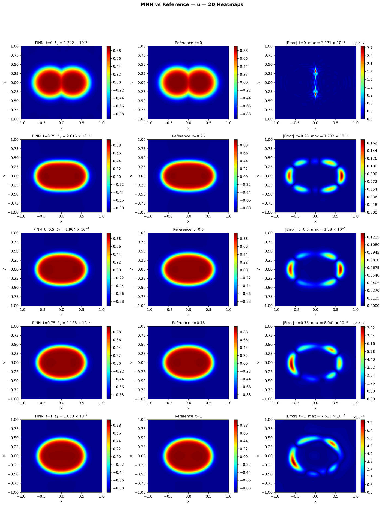
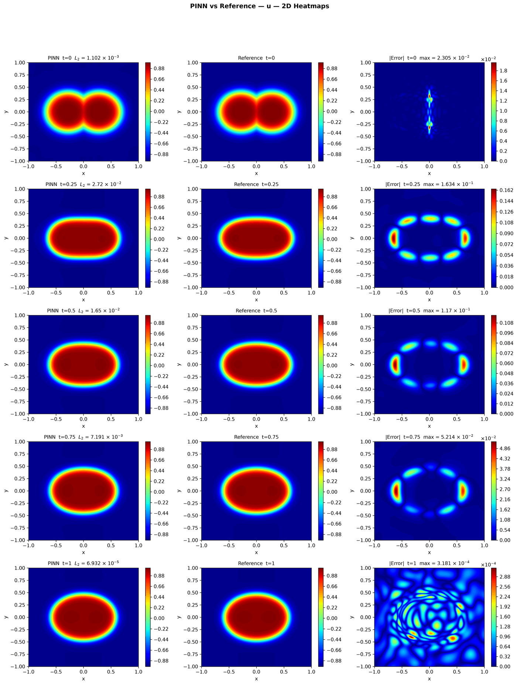

---
search:
  boost: 0.5
---

# Cahn-Hilliard 2D – Wight & Zhao

| Example | |
|---|---|
| **Source** | PINNStudio template |
| **Problem** | Forward and Inverse |
| **Dimension** | 2D (x, y, t) |
| **Regime** | Time-dependent |
| **Geometry** | Rectangle |
| **Outputs** | `phi`, `mu` |
| **Settings** | Default, Tuned |

## Governing equations

Mathematical form (from the benchmark records):

\[\frac{\partial \phi}{\partial t} = \lambda\left(\frac{\partial^2 \mu}{\partial x^2} + \frac{\partial^2 \mu}{\partial y^2}\right), \qquad \mu = \phi^3 - \phi - \varepsilon^2\left(\frac{\partial^2 \phi}{\partial x^2} + \frac{\partial^2 \phi}{\partial y^2}\right), \qquad (x, y) \in [-1, 1]^2,\ t \in [0, 1]\]

Where \(\lambda = 1\) and \(\varepsilon = 0.05\). As in the 1D example, the chemical potential \(\mu\) is a second output (the paper's network is also \((\phi, \mu)\)), so no residual needs a fourth derivative.

As typed in PINNStudio's **Equations** page (each expression is a residual, set to zero):

```text
dphi_t - (dmu_xx + dmu_yy)
mu - (phi**3 - phi) + 0.0025*(dphi_xx + dphi_yy)
```

As typed in PINNStudio's **Equations** page (Inverse mode) (each expression is a residual, set to zero):

```text
dphi_t - (dmu_xx + dmu_yy)
mu - (phi**3 - phi) + eps_sq*(dphi_xx + dphi_yy)
```

## Domain

- Rectangle: \(x \in [-1, 1]\), \(y \in [-1, 1]\)
- Time interval: \(t \in [0, 1]\)

## Initial conditions

| Output | Initial value | How it is imposed (Settings: Default) |
|---|---|---|
| `phi` | `tanh((0.4 - (sqrt((x - 0.28)**2 + y**2 + 1e-12) + sqrt((x + 0.28)**2 + y**2 + 1e-12) - sqrt((sqrt((x - 0.28)**2 + y**2 + 1e-12) - sqrt((x + 0.28)**2 + y**2 + 1e-12))**2 + 0.0004))/2)/0.1)` | loss term |
| `mu` | `0` | not used as a loss term |

## Boundary conditions

| Type | Where | Output | Value | Details |
|---|---|---|---|---|
| Periodic BC | `left` | `phi` | — | axis x, derivative order 0 |
| Periodic BC | `bottom` | `phi` | — | axis y, derivative order 0 |
| Periodic BC | `left` | `mu` | — | axis x, derivative order 0 |
| Periodic BC | `bottom` | `mu` | — | axis y, derivative order 0 |

## Unknowns and measured data (Inverse)

| Trainable parameter | Initial value | True value |
|---|---|---|
| `eps_sq` | 1 | 0.0025 |

Measured data (**Inverse** page, measured-data files):

- [`reference_data/2D/cahn_hilliard_wight/t_1_phi.txt`](https://github.com/AsfandyarKhan72/PINNStudio/blob/main/reference_data/2D/cahn_hilliard_wight/t_1_phi.txt) → output `phi`, weight 100

From the benchmark records: same template, switched to **Inverse**, recovering \(\varepsilon^2\) (initial guess 1, true value 0.0025) from \(\phi\) measured at \(t = 1\).

## Settings

### Forward mode

**Settings: Default** — the paper's method (Wight & Zhao 2021)

- **Network:** FNN, hidden layers 6 × 128, inputs (x, y, t), 2 outputs; activation tanh, initializer Glorot uniform
- **Points:** 20,000 domain, 800 boundary, 1,024 initial, 1,000 test
- **Loss weights:** `1.0,1.0,1.0,1.0,1.0,1.0,1000.0` (equations, then boundary-condition rows, then initial conditions)
- **Methods:** [time windows (5 windows)](../../reference/time-windows.md)

| Phase | Optimizer | Iterations | Learning rate | Decay |
|---|---|---|---|---|
| 1 | Adam | 10,000 | 0.001 | none |
| 2 | L-BFGS | 10,000 | — | none |

??? note "Settings: Tuned"

    The Training Log reports: *Tuned settings: the template's own settings (PINNStudio's best for it).*

    - **Network:** FNN, hidden layers 4 × 128, inputs (x, y, t), 2 outputs; activation tanh, initializer Glorot uniform
    - **Points:** 20,000 domain, 800 boundary, 1,024 initial, 1,000 test
    - **Loss weights:** `1.0,1.0,1.0,1.0,1.0,1.0,100.0` (equations, then boundary-condition rows, then initial conditions)
    - **Methods:** [exact periodicity (periodic input features)](../../reference/exact-constraints.md)

    | Phase | Optimizer | Iterations | Learning rate | Decay |
    |---|---|---|---|---|
    | 1 | Adam | 20,000 | 0.001 | none |
    | 2 | L-BFGS | 20,000 | — | none |

### Inverse mode

**Settings: Default** — the template's own settings

- **Network:** FNN, hidden layers 4 × 128, inputs (x, y, t), 2 outputs; activation tanh, initializer Glorot uniform
- **Points:** 20,000 domain, 800 boundary, 1,024 initial, 1,000 test
- **Loss weights:** `1.0,1.0,1.0,1.0,1.0,1.0,100.0,100.0` (equations, then boundary-condition rows, then initial conditions, then measured data)
- **Methods:** [exact periodicity (periodic input features)](../../reference/exact-constraints.md)

| Phase | Optimizer | Iterations | Learning rate | Decay |
|---|---|---|---|---|
| 1 | Adam | 20,000 | 0.001 | none |
| 2 | L-BFGS | 20,000 | — | none |

No separate **Tuned** preset: the **Tuned** item is greyed out for this example (its Default settings are PINNStudio's best).

## Results

From the benchmark records: one RTX 4090; relative L₂ error of the main output at the last reference time, and for an inverse problem the parameters it found (true value in brackets). *PINNStudio best* is what **Settings: Tuned** loads.

| | Default | PINNStudio best | Training time of the best (s) |
|---|---|---|---|
| Forward: relative L₂ at the last reference time | 2.3 × 10<sup>-1</sup> | **1.1 × 10<sup>-2</sup>** | 872 |
| Inverse: parameters found (true) | – | **ε² = 0.00251029 (0.0025)** (worst error 0.41%) | 3793 |

<figure markdown="span">
  { loading=lazy }
  <figcaption>PINNStudio best — the example's own settings (no change did better) — u — PINN, reference and error over space and time</figcaption>
</figure>

<figure markdown="span">
  { loading=lazy }
  <figcaption>PINNStudio best — the example's own settings (no change did better) — u — PINN, reference and error over space and time</figcaption>
</figure>

Every setting tried, the papers' reported errors and all figures: [the benchmark records](https://github.com/AsfandyarKhan72/PINNStudio/blob/main/benchmarks/examples.md#2d-cahn-hilliard-wight--zhao).

## Loading it in PINNStudio

- Forward: toolbar **Examples:** › **Forward** › under the **── 2D ──** heading, **Cahn-Hilliard 2D – Wight & Zhao** › **Default** or **Tuned**, then **Solve**.
- Inverse: toolbar **Examples:** › **Inverse** › under the **── 2D ──** heading, **Cahn-Hilliard 2D – Wight & Zhao** › **Default**, then **Solve**.

Loading an example fills in every setting; anything you change before **Solve** is listed in the Training Log. Your save folder, GPU, random-seed and plot-style settings are kept.

## Reference solution

- Reference data files: [`reference_data/2D/cahn_hilliard_wight/`](https://github.com/AsfandyarKhan72/PINNStudio/tree/main/reference_data/2D/cahn_hilliard_wight)

## Definition and records

- **Definition:** template "2D Cahn-Hilliard (Wight & Zhao)" in `MainWindow._on_template_selected`, [`pinnstudio/ui/main_window.py`](https://github.com/AsfandyarKhan72/PINNStudio/blob/main/pinnstudio/ui/main_window.py)
    - Inverse mode: `MainWindow.INVERSE_AUTO_VARS["2D Cahn-Hilliard (Wight & Zhao)"]` (unknowns) and `INVERSE_AUTO_OBS["2D Cahn-Hilliard (Wight & Zhao)"]` (measured data), same file
    - Settings: Default (the paper's method): `_ch2d_wz` in [`pinnstudio/core/paper_settings.py`](https://github.com/AsfandyarKhan72/PINNStudio/blob/main/pinnstudio/core/paper_settings.py)
    - Settings: Tuned: entry "2D Cahn-Hilliard (Wight & Zhao)" in [`pinnstudio/resources/tuned_settings.json`](https://github.com/AsfandyarKhan72/PINNStudio/blob/main/pinnstudio/resources/tuned_settings.json)
- **Equations:** [Governing equations](#governing-equations) on this page
- **Reference data:** [`reference_data/2D/cahn_hilliard_wight/`](https://github.com/AsfandyarKhan72/PINNStudio/tree/main/reference_data/2D/cahn_hilliard_wight), written by [`tools/make_phase_field_reference_data.py`](https://github.com/AsfandyarKhan72/PINNStudio/blob/main/tools/make_phase_field_reference_data.py)
- **Measured data** (Inverse): [`reference_data/2D/cahn_hilliard_wight/`](https://github.com/AsfandyarKhan72/PINNStudio/tree/main/reference_data/2D/cahn_hilliard_wight), written by [`tools/make_phase_field_reference_data.py`](https://github.com/AsfandyarKhan72/PINNStudio/blob/main/tools/make_phase_field_reference_data.py)
- **Benchmark records:** [`benchmarks/problems/cahn-hilliard-2d-wight-zhao.md`](https://github.com/AsfandyarKhan72/PINNStudio/blob/main/benchmarks/problems/cahn-hilliard-2d-wight-zhao.md), its entry in the [examples overview](https://github.com/AsfandyarKhan72/PINNStudio/blob/main/benchmarks/examples.md#2d-cahn-hilliard-wight--zhao), the [benchmark collection](https://github.com/AsfandyarKhan72/PINNStudio/blob/main/benchmarks/README.md)
- **Tuning-study configurations** (records of the tuning study; open one with **Problem › Open Saved Problem...**; not presets of the Examples list): [`Cahn-Hilliard 2D – Wight & Zhao (PINNStudio template) (tuned).pinn.json`](https://github.com/AsfandyarKhan72/PINNStudio/blob/main/benchmarks/tuning/Cahn-Hilliard%202D%20%E2%80%93%20Wight%20%26%20Zhao%20%28PINNStudio%20template%29%20%28tuned%29.pinn.json), [`Cahn-Hilliard 2D – Wight & Zhao (PINNStudio template), inverse mode (tuned).pinn.json`](https://github.com/AsfandyarKhan72/PINNStudio/blob/main/benchmarks/tuning/Cahn-Hilliard%202D%20%E2%80%93%20Wight%20%26%20Zhao%20%28PINNStudio%20template%29%2C%20inverse%20mode%20%28tuned%29.pinn.json)
- **Methods** (Default and Tuned settings): [Time windows and bc-PINN](../../reference/time-windows.md), [Exact constraints](../../reference/exact-constraints.md)
- **Cite:** [Wight & Zhao 2021](../../about/references.md#wight2021)

Verified error values are reported in the [Reproducibility](../../reproducibility/benchmarks.md) section, not on this page.

[← Back to the example gallery](../index.md)
