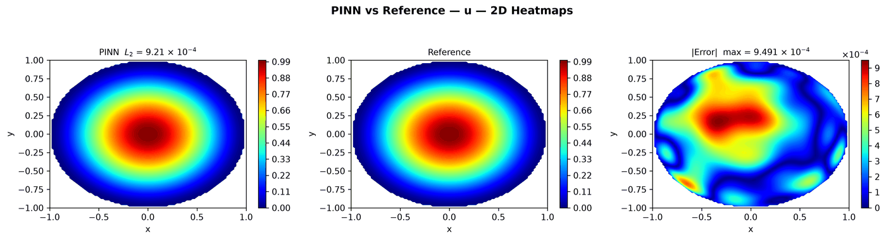

---
search:
  boost: 0.5
---

# Fractional Poisson 2D – disk

| Example | |
|---|---|
| **Source** | DeepXDE example |
| **Problem** | Forward |
| **Dimension** | 2D (x, y) |
| **Regime** | Steady |
| **Geometry** | Disk |
| **Outputs** | `u` |
| **Settings** | Default (no separate Tuned preset) |

## Governing equations

Mathematical form (from the benchmark records):

\[-(-\Delta)^{\alpha/2}u = 2^{\alpha}\Gamma(2 + \tfrac{\alpha}{2})\Gamma(1 + \tfrac{\alpha}{2})\left(1 - (1 + \tfrac{\alpha}{2})|x|^2\right), \qquad |x| < 1,\ \alpha = 1.8\]

As typed in PINNStudio's **Equations** page (each expression is a residual, set to zero):

```text
frac(u)*gamma((1 - alpha)/2)*gamma((2 + alpha)/2)/(2*pi**1.5) - 2**alpha*gamma(2 + alpha/2)*gamma(1 + alpha/2)*(1 - (1 + alpha/2)*(x**2 + y**2))
```

Constants: `alpha = 1.8`

## Domain

- Disk: centre (0, 0), radius 1

## Boundary conditions

No boundary-condition rows: the boundary values are imposed exactly through the network's output transform (see **Methods** below), or the problem has no boundary terms.

## Settings

**Settings: Default** — DeepXDE's own settings

- **Network:** FNN, hidden layers 4 × 20, inputs (x, y), 1 output; activation tanh, initializer Glorot normal
- **Points:** 100 domain, 0 boundary, 100 test
- **Loss weights:** `1` (equations, then boundary-condition rows)
- **Methods:** output transform `(1 - x**2 - y**2)*u` ([reference](../../reference/networks.md))

| Phase | Optimizer | Iterations | Learning rate | Decay |
|---|---|---|---|---|
| 1 | Adam | 20,000 | 0.001 | none |

No separate **Tuned** preset: the **Tuned** item is greyed out for this example (its Default settings are PINNStudio's best).

## Results

The configuration selected in PINNStudio's benchmark study, run on one RTX 4090. Forward: relative L₂ error of each output at the last reference time. Inverse: each parameter's relative error and, per seed, the largest of them (worst parameter error).

### Forward problem

**Settings:** Default — the example's own settings (not in the tuning sweep); the example has no separate Tuned preset for this mode. **Values:** one run, seed 2026.

| Output | Relative L₂ |
|---|---|
| u | 9.2 × 10⁻⁴ |

<figure markdown="span">
  { loading=lazy }
  <figcaption>Forward, Default settings: PINN, reference and error.</figcaption>
</figure>

**Full benchmark record:** every setting tried, the per-seed values and all figures are in [the benchmark records on GitHub](https://github.com/AsfandyarKhan72/PINNStudio/blob/v1.6.0/benchmarks/examples.md#dx-fractional-poisson-equation-2d).

## Loading it in PINNStudio

- Forward: toolbar **Examples:** › **Forward** › under the **── 2D ──** heading, **Fractional Poisson 2D – disk** › **Default**, then **Solve**.

Loading an example fills in every setting; anything you change before **Solve** is listed in the Training Log. Your save folder, GPU, random-seed and plot-style settings are kept.

## Reference solution

- Exact solution, **Error Analysis** › reference from formula: `u = abs(1 - x**2 - y**2)**(1 + alpha/2)`

## Notes

- frac(u) is the integral over directions of the directional fractional derivative (8 directions, 100 Grunwald-Letnikov points per unit length); times C(alpha, 2) it is minus the fractional Laplacian. u = 0 on the circle through the output transform.

## Definition and records

- **Definition:** `EXAMPLES` entry "Fractional Poisson equation 2D" in [`pinnstudio/core/deepxde_examples.py`](https://github.com/AsfandyarKhan72/PINNStudio/blob/v1.6.0/pinnstudio/core/deepxde_examples.py)
- **Equations:** [Governing equations](#governing-equations) on this page
- **Reference data:** the exact-solution formula under *Reference solution* (no data files)
- **Benchmark records:** [`benchmarks/problems/fractional-poisson-2d-disk.md`](https://github.com/AsfandyarKhan72/PINNStudio/blob/v1.6.0/benchmarks/problems/fractional-poisson-2d-disk.md), its entry in the [examples overview](https://github.com/AsfandyarKhan72/PINNStudio/blob/v1.6.0/benchmarks/examples.md#dx-fractional-poisson-equation-2d), the [benchmark collection](https://github.com/AsfandyarKhan72/PINNStudio/blob/v1.6.0/benchmarks/README.md)
- **Tuning-study configurations** (records of the tuning study; open one with **Problem › Open Saved Problem...**; not presets of the Examples list): [`Fractional Poisson 2D – disk (tuned).pinn.json`](https://github.com/AsfandyarKhan72/PINNStudio/blob/v1.6.0/benchmarks/tuning/Fractional%20Poisson%202D%20%E2%80%93%20disk%20%28tuned%29.pinn.json)
- **Methods** (Default and Tuned settings): [Networks and Fourier features](../../reference/networks.md)
- **DeepXDE example:** [fractional_Poisson_2d.py](https://github.com/lululxvi/deepxde/blob/master/examples/pinn_forward/fractional_Poisson_2d.py)
- **Cite:** [Lu et al. 2021](../../about/references.md#lu2021deepxde) (DeepXDE)

How the benchmark values were measured and checked: [Reproducibility](../../reproducibility/benchmarks.md).

[← Back to the example gallery](../index.md)
