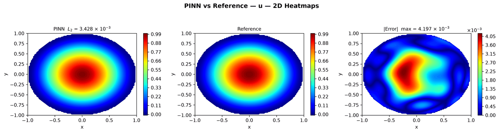
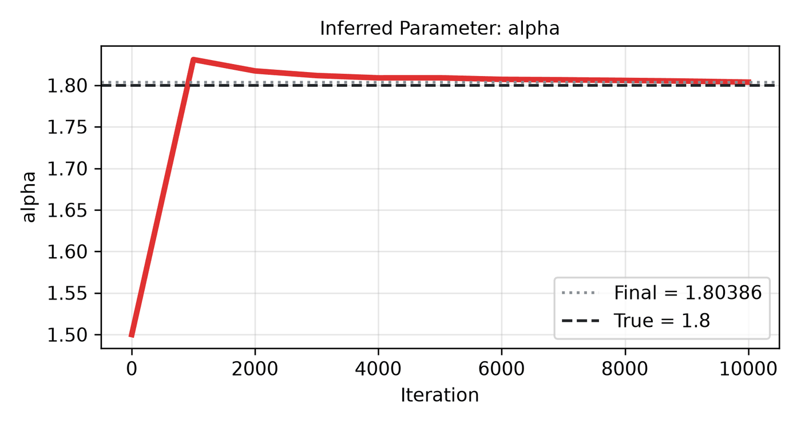

---
search:
  boost: 0.5
---

# Fractional Poisson 2D – unknown order α

| Example | |
|---|---|
| **Source** | DeepXDE example |
| **Problem** | Inverse (DeepXDE inverse example) |
| **Dimension** | 2D (x, y) |
| **Regime** | Steady |
| **Geometry** | Disk |
| **Outputs** | `u` |
| **Settings** | Default (no separate Tuned preset) |

## Governing equations

Mathematical form (from the benchmark records):

\[-(-\Delta)^{\alpha/2}u = 2^{\alpha_0}\Gamma(2 + \tfrac{\alpha_0}{2})\Gamma(1 + \tfrac{\alpha_0}{2})\left(1 - (1 + \tfrac{\alpha_0}{2})|x|^2\right), \qquad |x| < 1\]

As typed in PINNStudio's **Equations** page (each expression is a residual, set to zero):

```text
-frac(u)*exp(lgamma((1 - alpha)/2) + lgamma((2 + alpha)/2))/(2*pi**1.5) - 2**a0*gamma(2 + a0/2)*gamma(1 + a0/2)*(1 - (1 + a0/2)*(x**2 + y**2))
```

Constants: `a0 = 1.8`

## Domain

- Disk: centre (0, 0), radius 1

## Boundary conditions

No boundary-condition rows: the boundary values are imposed exactly through the network's output transform (see **Methods** below), or the problem has no boundary terms.

## Unknowns and measured data (Inverse)

| Trainable parameter | Initial value | True value |
|---|---|---|
| `alpha` | 1.5 | 1.8 |

Measured data (**Inverse** page, measured-data files):

- [`reference_data/deepxde/fractional_inverse_2d/u_obs.txt`](https://github.com/AsfandyarKhan72/PINNStudio/blob/main/reference_data/deepxde/fractional_inverse_2d/u_obs.txt) → output `u`, weight 100

## Settings

**Settings: Default** — DeepXDE's own settings

- **Network:** FNN, hidden layers 4 × 20, inputs (x, y), 1 output; activation tanh, initializer Glorot normal
- **Points:** 64 domain, 0 boundary, 100 test
- **Loss weights:** `1` (equations, then boundary-condition rows)
- **Methods:** output transform `(1 - x**2 - y**2)*u` ([reference](../../reference/networks.md))

| Phase | Optimizer | Iterations | Learning rate | Decay |
|---|---|---|---|---|
| 1 | Adam | 10,000 | 0.001 | none |

No separate **Tuned** preset: the **Tuned** item is greyed out for this example (its Default settings are PINNStudio's best).

## Results

From the benchmark records: one RTX 4090; relative L₂ error of the main output at the last reference time, and for an inverse problem the parameters it found (true value in brackets). *PINNStudio best* is what **Settings: Tuned** loads.

| | Default | PINNStudio best | Training time of the best (s) |
|---|---|---|---|
| Inverse: parameters found (true) | – | **α = 1.80386 (1.8)** (worst error 0.21%) | 1395 |

<figure markdown="span">
  { loading=lazy }
  <figcaption>PINNStudio best — the example's own settings (not in the tuning sweep) — PINN, reference and error over space and time</figcaption>
</figure>

<figure markdown="span">
  { loading=lazy }
  <figcaption>PINNStudio best — the example's own settings (not in the tuning sweep) — the learned parameters during training</figcaption>
</figure>

Every setting tried, the papers' reported errors and all figures: [the benchmark records](https://github.com/AsfandyarKhan72/PINNStudio/blob/main/benchmarks/examples.md#dx-inverse-fractional-poisson-equation-2d).

## Loading it in PINNStudio

- Inverse: toolbar **Examples:** › **Inverse** › under the **── 2D ──** heading, **Fractional Poisson 2D – unknown order α** › **Default**, then **Solve**.

Loading an example fills in every setting; anything you change before **Solve** is listed in the Training Log. Your save folder, GPU, random-seed and plot-style settings are kept.

## Reference solution

- Exact solution, **Error Analysis** › reference from formula: `u = abs(1 - x**2 - y**2)**(1 + a0/2)`

## Notes

- Unknown order alpha (true 1.8, start 1.5) of the fractional Laplacian on the unit disk, from 30 random measurements (seeded, written by tools/make_deepxde_reference_data.py). lgamma keeps the constant C(alpha, 2) differentiable in alpha, as DeepXDE's script does.

## Definition and records

- **Definition:** `EXAMPLES` entry "Inverse: fractional Poisson equation 2D" in [`pinnstudio/core/deepxde_examples.py`](https://github.com/AsfandyarKhan72/PINNStudio/blob/main/pinnstudio/core/deepxde_examples.py)
- **Equations:** [Governing equations](#governing-equations) on this page
- **Reference data:** the exact-solution formula under *Reference solution* (no data files)
- **Measured data** (Inverse): [`reference_data/deepxde/fractional_inverse_2d/`](https://github.com/AsfandyarKhan72/PINNStudio/tree/main/reference_data/deepxde/fractional_inverse_2d), written by [`tools/make_deepxde_reference_data.py`](https://github.com/AsfandyarKhan72/PINNStudio/blob/main/tools/make_deepxde_reference_data.py)
- **Benchmark records:** [`benchmarks/problems/fractional-poisson-2d-unknown-order.md`](https://github.com/AsfandyarKhan72/PINNStudio/blob/main/benchmarks/problems/fractional-poisson-2d-unknown-order.md), its entry in the [examples overview](https://github.com/AsfandyarKhan72/PINNStudio/blob/main/benchmarks/examples.md#dx-inverse-fractional-poisson-equation-2d), the [benchmark collection](https://github.com/AsfandyarKhan72/PINNStudio/blob/main/benchmarks/README.md)
- **Tuning-study configurations** (records of the tuning study; open one with **Problem › Open Saved Problem...**; not presets of the Examples list): [`Fractional Poisson 2D – unknown order α (tuned).pinn.json`](https://github.com/AsfandyarKhan72/PINNStudio/blob/main/benchmarks/tuning/Fractional%20Poisson%202D%20%E2%80%93%20unknown%20order%20%CE%B1%20%28tuned%29.pinn.json)
- **Methods** (Default and Tuned settings): [Networks and Fourier features](../../reference/networks.md)
- **DeepXDE example:** [fractional_Poisson_2d_inverse.py](https://github.com/lululxvi/deepxde/blob/master/examples/pinn_inverse/fractional_Poisson_2d_inverse.py)
- **Cite:** [Lu et al. 2021](../../about/references.md#lu2021deepxde) (DeepXDE)

Verified error values are reported in the [Reproducibility](../../reproducibility/benchmarks.md) section, not on this page.

[← Back to the example gallery](../index.md)
