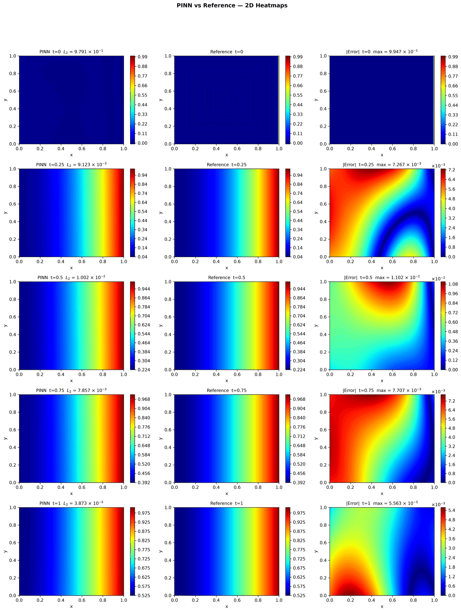
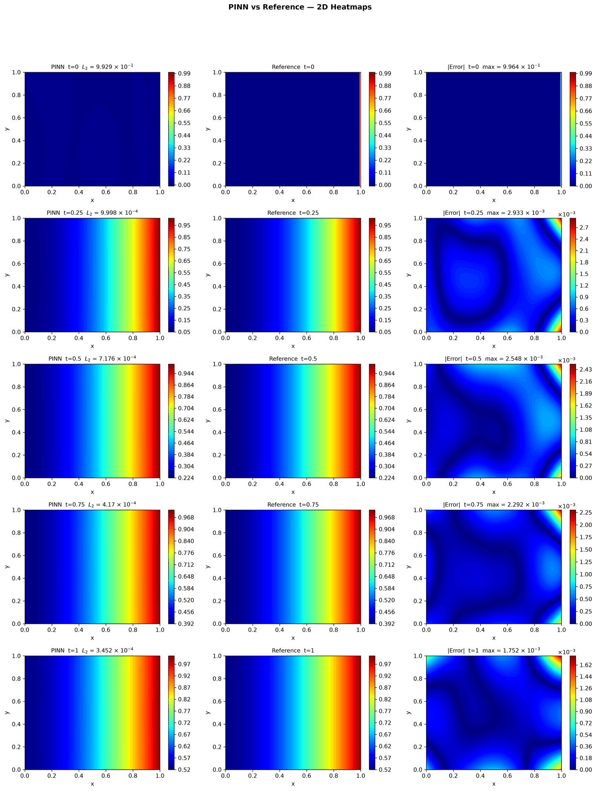
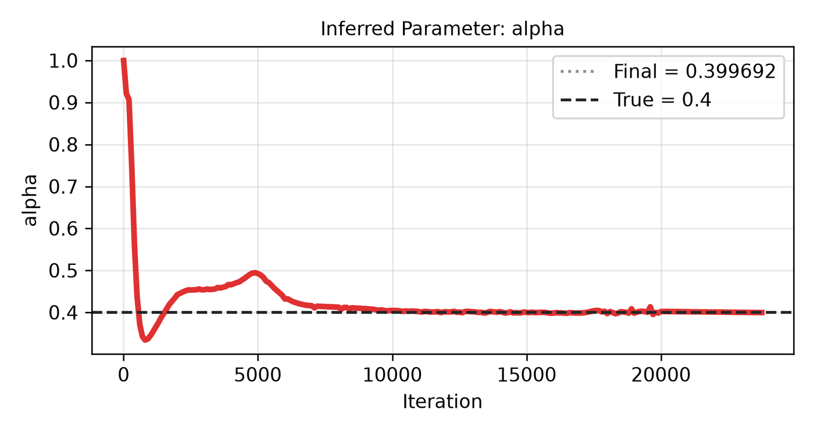

---
search:
  boost: 0.5
---

# Heat 2D

| Example | |
|---|---|
| **Source** | PINNStudio template |
| **Problem** | Forward and Inverse |
| **Dimension** | 2D (x, y, t) |
| **Regime** | Time-dependent |
| **Geometry** | Rectangle |
| **Outputs** | `u` |
| **Settings** | Default, Tuned |

## Governing equations

Mathematical form (from the benchmark records):

\[\frac{\partial u}{\partial t} = 0.4\left(\frac{\partial^2 u}{\partial x^2} + \frac{\partial^2 u}{\partial y^2}\right), \qquad (x, y) \in [0, 1]^2,\ t \in [0, 1]\]

As typed in PINNStudio's **Equations** page (each expression is a residual, set to zero):

```text
du_t - 0.4*(du_xx + du_yy)
```

As typed in PINNStudio's **Equations** page (Inverse mode) (each expression is a residual, set to zero):

```text
du_t - alpha*(du_xx + du_yy)
```

## Domain

- Rectangle: \(x \in [0, 1]\), \(y \in [0, 1]\)
- Time interval: \(t \in [0, 1]\)

## Initial conditions

| Output | Initial value | How it is imposed (Settings: Default) |
|---|---|---|
| `u` | `0.0` | loss term |

## Boundary conditions

| Type | Where | Output | Value | Details |
|---|---|---|---|---|
| Neumann BC | `left` | `u` | `0.0` | — |
| Dirichlet BC | `right` | `u` | `1.0` | — |
| Neumann BC | `bottom` | `u` | `0.0` | — |
| Neumann BC | `top` | `u` | `0.0` | — |

## Unknowns and measured data (Inverse)

| Trainable parameter | Initial value | True value |
|---|---|---|
| `alpha` | 1 | 0.4 |

Measured data (**Inverse** page, measured-data files):

- [`reference_data/2D/heat/t_1.0.txt`](https://github.com/AsfandyarKhan72/PINNStudio/blob/main/reference_data/2D/heat/t_1.0.txt) → output `u`, weight 100

From the benchmark records: same template, switched to **Inverse**, recovering the diffusivity coefficient (fixed at \(0.4\) in Forward mode) as an unknown parameter.

## Settings

### Forward mode

**Settings: Default** — the template's own settings

- **Network:** FNN, hidden layers 4 × 64, inputs (x, y, t), 1 output; activation tanh, initializer Glorot uniform
- **Points:** 10,000 domain, 400 boundary, 400 initial, 1,000 test
- **Loss weights:** `1.0,1.0,100.0,1.0,1.0,100.0` (equations, then boundary-condition rows, then initial conditions)

| Phase | Optimizer | Iterations | Learning rate | Decay |
|---|---|---|---|---|
| 1 | Adam | 20,000 | 0.001 | none |
| 2 | L-BFGS | 10,000 | — | none |

No separate **Tuned** preset: the **Tuned** item is greyed out for this example (its Default settings are PINNStudio's best).

### Inverse mode

**Settings: Default** — the template's own settings

- **Network:** FNN, hidden layers 4 × 64, inputs (x, y, t), 1 output; activation tanh, initializer Glorot uniform
- **Points:** 10,000 domain, 400 boundary, 400 initial, 1,000 test
- **Loss weights:** `1.0,1.0,100.0,1.0,1.0,100.0,100.0` (equations, then boundary-condition rows, then initial conditions, then measured data)

| Phase | Optimizer | Iterations | Learning rate | Decay |
|---|---|---|---|---|
| 1 | Adam | 20,000 | 0.001 | none |
| 2 | L-BFGS | 10,000 | — | none |

??? note "Settings: Tuned"

    The Training Log reports: *Tuned settings: measured data at every reference time after t = 0.* The change is applied to the example's own settings.

    - **Network:** FNN, hidden layers 4 × 64, inputs (x, y, t), 1 output; activation tanh, initializer Glorot uniform
    - **Points:** 10,000 domain, 400 boundary, 400 initial, 1,000 test
    - **Loss weights:** `1.0,1.0,100.0,1.0,1.0,100.0,100.0` (equations, then boundary-condition rows, then initial conditions, then measured data)

    | Phase | Optimizer | Iterations | Learning rate | Decay |
    |---|---|---|---|---|
    | 1 | Adam | 20,000 | 0.001 | none |
    | 2 | L-BFGS | 10,000 | — | none |

## Results

The configuration selected in PINNStudio's benchmark study, run on one RTX 4090. Forward: relative L₂ error of each output at the last reference time. Inverse: each parameter's relative error and, per seed, the largest of them (worst parameter error).

### Forward problem

**Settings:** Default — the example's own settings (not in the tuning sweep); the example has no separate Tuned preset for this mode. **Values:** median over seeds 2026, 1, 2.

| Output | Relative L₂ |
|---|---|
| u | 6.1 × 10⁻³ |

<figure markdown="span">
  { loading=lazy }
  <figcaption>Forward, Default settings: PINN, reference and error.</figcaption>
</figure>

### Inverse problem

**Settings:** Tuned — Measured data at every reference time. **Values:** median over seeds 2026, 1, 2.

| Parameter | True value | Recovered | Relative error |
|---|---|---|---|
| α | 0.4 | 0.399692 | 0.11 % |

Worst parameter error: **0.11 %** (the median over the seeds of each seed's largest error).

<figure markdown="span">
  { loading=lazy }
  <figcaption>Inverse, Tuned settings: PINN, reference and error.</figcaption>
</figure>

<figure markdown="span">
  { loading=lazy }
  <figcaption>Inverse, Tuned settings: parameter convergence.</figcaption>
</figure>

**Full benchmark record:** every setting tried, the per-seed values and all figures are in [the benchmark records on GitHub](https://github.com/AsfandyarKhan72/PINNStudio/blob/main/benchmarks/examples.md#2d-heat).

## Loading it in PINNStudio

- Forward: toolbar **Examples:** › **Forward** › under the **── 2D ──** heading, **Heat 2D** › **Default**, then **Solve**.
- Inverse: toolbar **Examples:** › **Inverse** › under the **── 2D ──** heading, **Heat 2D** › **Default** or **Tuned**, then **Solve**.

Loading an example fills in every setting; anything you change before **Solve** is listed in the Training Log. Your save folder, GPU, random-seed and plot-style settings are kept.

## Reference solution

- Reference data files: [`reference_data/2D/heat/`](https://github.com/AsfandyarKhan72/PINNStudio/tree/main/reference_data/2D/heat)

## Definition and records

- **Definition:** template "2D Heat" in `MainWindow._on_template_selected`, [`pinnstudio/ui/main_window.py`](https://github.com/AsfandyarKhan72/PINNStudio/blob/main/pinnstudio/ui/main_window.py)
    - Inverse mode: `MainWindow.INVERSE_AUTO_VARS["2D Heat"]` (unknowns) and `INVERSE_AUTO_OBS["2D Heat"]` (measured data), same file
    - Settings: Tuned: entry "2D Heat" in [`pinnstudio/resources/tuned_settings.json`](https://github.com/AsfandyarKhan72/PINNStudio/blob/main/pinnstudio/resources/tuned_settings.json)
- **Equations:** [Governing equations](#governing-equations) on this page
- **Reference data:** [`reference_data/2D/heat/`](https://github.com/AsfandyarKhan72/PINNStudio/tree/main/reference_data/2D/heat), no generator script in the repository (checked against an independent solution by [`benchmarks/reference_regeneration/check_other_references.py`](https://github.com/AsfandyarKhan72/PINNStudio/blob/main/benchmarks/reference_regeneration/check_other_references.py))
- **Measured data** (Inverse): [`reference_data/2D/heat/`](https://github.com/AsfandyarKhan72/PINNStudio/tree/main/reference_data/2D/heat), no generator script in the repository (checked against an independent solution by [`benchmarks/reference_regeneration/check_other_references.py`](https://github.com/AsfandyarKhan72/PINNStudio/blob/main/benchmarks/reference_regeneration/check_other_references.py))
- **Benchmark records:** [`benchmarks/problems/heat-2d.md`](https://github.com/AsfandyarKhan72/PINNStudio/blob/main/benchmarks/problems/heat-2d.md), its entry in the [examples overview](https://github.com/AsfandyarKhan72/PINNStudio/blob/main/benchmarks/examples.md#2d-heat), the [benchmark collection](https://github.com/AsfandyarKhan72/PINNStudio/blob/main/benchmarks/README.md)
- **Tuning-study configurations** (records of the tuning study; open one with **Problem › Open Saved Problem...**; not presets of the Examples list): [`Heat 2D (PINNStudio template) (tuned).pinn.json`](https://github.com/AsfandyarKhan72/PINNStudio/blob/main/benchmarks/tuning/Heat%202D%20%28PINNStudio%20template%29%20%28tuned%29.pinn.json), [`Heat 2D (PINNStudio template), inverse mode (tuned).pinn.json`](https://github.com/AsfandyarKhan72/PINNStudio/blob/main/benchmarks/tuning/Heat%202D%20%28PINNStudio%20template%29%2C%20inverse%20mode%20%28tuned%29.pinn.json)
- **Cite:** PINNStudio's own problem (no source paper)

How the benchmark values were measured and checked: [Reproducibility](../../reproducibility/benchmarks.md).

[← Back to the example gallery](../index.md)
