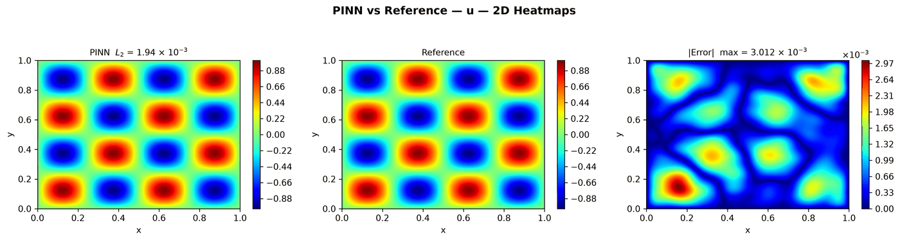
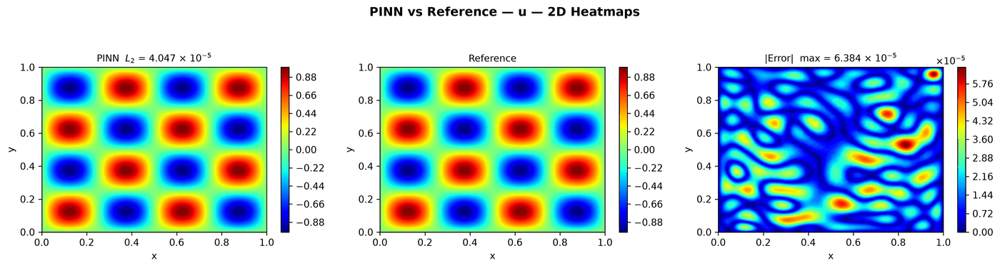
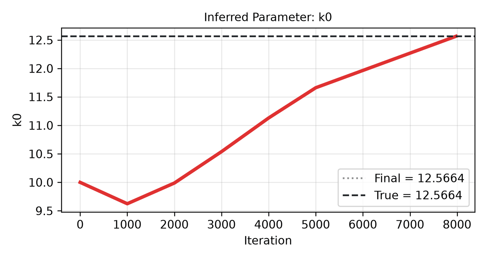

---
search:
  boost: 0.5
---

# Helmholtz 2D – Dirichlet

| Example | |
|---|---|
| **Source** | DeepXDE example |
| **Problem** | Forward and Inverse (the Inverse mode is PINNStudio's addition) |
| **Dimension** | 2D (x, y) |
| **Regime** | Steady |
| **Geometry** | Rectangle |
| **Outputs** | `u` |
| **Settings** | Default, Tuned |

## Governing equations

Mathematical form (from the benchmark records):

\[-\nabla^2 u - k_0^2 u = k_0^2\sin(k_0 x)\sin(k_0 y), \qquad k_0 = 4\pi,\ (x, y) \in [0, 1]^2\]

As typed in PINNStudio's **Equations** page (each expression is a residual, set to zero):

```text
-du_xx - du_yy - k0**2*u - k0**2*sin(k0*x)*sin(k0*y)
```

Constants: `n = 2`, `k0 = 2*pi*n`

As typed in PINNStudio's **Equations** page (Inverse mode) (each expression is a residual, set to zero):

```text
-du_xx - du_yy - k0**2*u - (4*pi)**2*sin(4*pi*x)*sin(4*pi*y)
```

## Domain

- Rectangle: \(x \in [0, 1]\), \(y \in [0, 1]\)

## Boundary conditions

No boundary-condition rows: the boundary values are imposed exactly through the network's output transform (see **Methods** below), or the problem has no boundary terms.

## Unknowns and measured data (Inverse)

| Trainable parameter | Initial value | True value |
|---|---|---|
| `k0` | 10 | 12.5664 |

Measured data (**Inverse** page, measured-data files):

- [`reference_data/deepxde/helmholtz_inverse/u_obs.txt`](https://github.com/AsfandyarKhan72/PINNStudio/blob/main/reference_data/deepxde/helmholtz_inverse/u_obs.txt) → output `u`, weight 100

## Settings

### Forward mode

**Settings: Default** — DeepXDE's own settings

- **Network:** FNN, hidden layers 3 × 150, inputs (x, y), 1 output; activation sin, initializer Glorot uniform
- **Points:** 400 domain, 80 boundary, 3,600 test
- **Loss weights:** `1` (equations, then boundary-condition rows)
- **Methods:** output transform `x*(1 - x)*y*(1 - y)*u` ([reference](../../reference/networks.md))

| Phase | Optimizer | Iterations | Learning rate | Decay |
|---|---|---|---|---|
| 1 | Adam | 5,000 | 0.001 | none |

No separate **Tuned** preset: the **Tuned** item is greyed out for this example (its Default settings are PINNStudio's best).

### Inverse mode

**Settings: Default** — DeepXDE's settings with PINNStudio's Inverse-mode changes (see *Notes*)

- **Network:** FNN, hidden layers 3 × 150, inputs (x, y), 1 output; activation sin, initializer Glorot uniform
- **Points:** 400 domain, 80 boundary, 3,600 test
- **Loss weights:** `1` (equations, then boundary-condition rows)
- **Methods:** output transform `x*(1 - x)*y*(1 - y)*u` ([reference](../../reference/networks.md))

| Phase | Optimizer | Iterations | Learning rate | Decay |
|---|---|---|---|---|
| 1 | Adam | 5,000 | 0.001 | none |
| 2 | L-BFGS | 15,000 | — | none |

??? note "Settings: Tuned"

    The Training Log reports: *Tuned settings: 10× the data weight, 3× the L-BFGS iterations and a larger network.* The change is applied to the example's own settings.

    - **Network:** FNN, hidden layers 4 × 300, inputs (x, y), 1 output; activation sin, initializer Glorot uniform
    - **Points:** 400 domain, 80 boundary, 3,600 test
    - **Loss weights:** `1` (equations, then boundary-condition rows)
    - **Methods:** output transform `x*(1 - x)*y*(1 - y)*u` ([reference](../../reference/networks.md))

    | Phase | Optimizer | Iterations | Learning rate | Decay |
    |---|---|---|---|---|
    | 1 | Adam | 5,000 | 0.001 | none |
    | 2 | L-BFGS | 45,000 | — | none |

## Results

The configuration selected in PINNStudio's benchmark study, run on one RTX 4090. Forward: relative L₂ error of each output at the last reference time. Inverse: each parameter's relative error and, per seed, the largest of them (worst parameter error).

### Forward problem

**Settings:** Default — the example's own settings (not in the tuning sweep); the example has no separate Tuned preset for this mode. **Values:** median over seeds 2026, 1, 2.

| Output | Relative L₂ |
|---|---|
| u | 1.1 × 10⁻² |

<figure markdown="span">
  { loading=lazy }
  <figcaption>Forward, Default settings: PINN, reference and error.</figcaption>
</figure>

### Inverse problem

**Settings:** Tuned — 10× data weight, 3× L-BFGS and the larger network. **Values:** median over seeds 2026, 1, 2.

| Parameter | True value | Recovered | Relative error |
|---|---|---|---|
| k₀ | 12.5664 | 12.5664 | 0.00023 % |

Worst parameter error: **0.00023 %** (the median over the seeds of each seed's largest error).

<figure markdown="span">
  { loading=lazy }
  <figcaption>Inverse, Tuned settings: PINN, reference and error.</figcaption>
</figure>

<figure markdown="span">
  { loading=lazy }
  <figcaption>Inverse, Tuned settings: parameter convergence.</figcaption>
</figure>

**Full benchmark record:** every setting tried, the per-seed values and all figures are in [the benchmark records on GitHub](https://github.com/AsfandyarKhan72/PINNStudio/blob/main/benchmarks/examples.md#dx-helmholtz-2d-dirichlet).

## Loading it in PINNStudio

- Forward: toolbar **Examples:** › **Forward** › under the **── 2D ──** heading, **Helmholtz 2D – Dirichlet** › **Default**, then **Solve**.
- Inverse: toolbar **Examples:** › **Inverse** › under the **── 2D ──** heading, **Helmholtz 2D – Dirichlet** › **Default** or **Tuned**, then **Solve**.

Loading an example fills in every setting; anything you change before **Solve** is listed in the Training Log. Your save folder, GPU, random-seed and plot-style settings are kept.

## Reference solution

- Forward mode: exact solution, **Error Analysis** › reference from formula: `u = sin(k0*x)*sin(k0*y)`
- Inverse mode: exact solution, **Error Analysis** › reference from formula: `u = sin(4*pi*x)*sin(4*pi*y)`

## Notes

- Boundary conditions imposed exactly through the output transform (DeepXDE's default hard_constraint=True).
- Inverse mode (PINNStudio's addition): the wavenumber k0 (4 pi; initial guess 10) is learned from u measured on a 31 x 31 grid (reference_data/deepxde/helmholtz_inverse). The source keeps the true wavenumber (it is the known load), so k0 is unknown only in the k0² u term. An L-BFGS phase follows Adam.

## Definition and records

- **Definition:** `EXAMPLES` entry "Helmholtz 2D (Dirichlet)" in [`pinnstudio/core/deepxde_examples.py`](https://github.com/AsfandyarKhan72/PINNStudio/blob/main/pinnstudio/core/deepxde_examples.py)
    - Inverse mode (PINNStudio's addition): `ADDED_INVERSE["Helmholtz 2D (Dirichlet)"]`, same file
    - Settings: Tuned: entry "Helmholtz 2D (Dirichlet)" in [`pinnstudio/resources/tuned_settings.json`](https://github.com/AsfandyarKhan72/PINNStudio/blob/main/pinnstudio/resources/tuned_settings.json)
- **Equations:** [Governing equations](#governing-equations) on this page
- **Reference data:** the exact-solution formula under *Reference solution* (no data files)
- **Measured data** (Inverse): [`reference_data/deepxde/helmholtz_inverse/`](https://github.com/AsfandyarKhan72/PINNStudio/tree/main/reference_data/deepxde/helmholtz_inverse), written by [`tools/make_deepxde_reference_data.py`](https://github.com/AsfandyarKhan72/PINNStudio/blob/main/tools/make_deepxde_reference_data.py)
- **Benchmark records:** [`benchmarks/problems/helmholtz-2d-dirichlet.md`](https://github.com/AsfandyarKhan72/PINNStudio/blob/main/benchmarks/problems/helmholtz-2d-dirichlet.md), its entry in the [examples overview](https://github.com/AsfandyarKhan72/PINNStudio/blob/main/benchmarks/examples.md#dx-helmholtz-2d-dirichlet), the [benchmark collection](https://github.com/AsfandyarKhan72/PINNStudio/blob/main/benchmarks/README.md)
- **Tuning-study configurations** (records of the tuning study; open one with **Problem › Open Saved Problem...**; not presets of the Examples list): [`Helmholtz 2D – Dirichlet (tuned).pinn.json`](https://github.com/AsfandyarKhan72/PINNStudio/blob/main/benchmarks/tuning/Helmholtz%202D%20%E2%80%93%20Dirichlet%20%28tuned%29.pinn.json), [`Helmholtz 2D – Dirichlet, inverse mode (tuned).pinn.json`](https://github.com/AsfandyarKhan72/PINNStudio/blob/main/benchmarks/tuning/Helmholtz%202D%20%E2%80%93%20Dirichlet%2C%20inverse%20mode%20%28tuned%29.pinn.json)
- **Methods** (Default and Tuned settings): [Networks and Fourier features](../../reference/networks.md)
- **DeepXDE example:** [Helmholtz_Dirichlet_2d.py](https://github.com/lululxvi/deepxde/blob/master/examples/pinn_forward/Helmholtz_Dirichlet_2d.py) ([documentation](https://deepxde.readthedocs.io/en/latest/demos/pinn_forward/helmholtz.2d.dirichlet.html))
- **Cite:** [Lu et al. 2021](../../about/references.md#lu2021deepxde) (DeepXDE); the problem follows [Escapil-Inchauspé & Ruz 2023](../../about/references.md#escapil2023)

How the benchmark values were measured and checked: [Reproducibility](../../reproducibility/benchmarks.md).

[← Back to the example gallery](../index.md)
