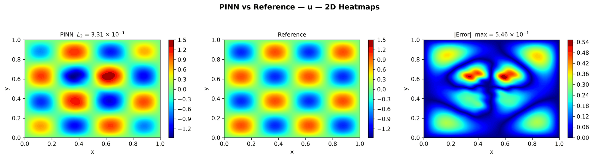

---
search:
  boost: 0.5
---

# Helmholtz 2D – hyperparameter search

| Example | |
|---|---|
| **Source** | DeepXDE example |
| **Problem** | Forward |
| **Dimension** | 2D (x, y) |
| **Regime** | Steady |
| **Geometry** | Rectangle |
| **Outputs** | `u` |
| **Settings** | Default (no separate Tuned preset) |

<figure markdown="span">
  { loading=lazy }
  <figcaption>Figure from the benchmark records (`benchmarks/examples.md`, this example's results): a run with DeepXDE's settings (Default) — PINN, reference and error.</figcaption>
</figure>

## Governing equations

Mathematical form (from the benchmark records):

\[-\nabla^2 u - k_0^2 u = k_0^2\sin(k_0 x)\sin(k_0 y), \qquad k_0 = 4\pi,\ (x, y) \in [0, 1]^2\]

As typed in PINNStudio's **Equations** page (each expression is a residual, set to zero):

```text
-du_xx - du_yy - k0**2*u - k0**2*sin(k0*x)*sin(k0*y)
```

Constants: `n = 2`, `k0 = 2*pi*n`

## Domain

- Rectangle: \(x \in [0, 1]\), \(y \in [0, 1]\)

## Boundary conditions

No boundary-condition rows: the boundary values are imposed exactly through the network's output transform (see **Methods** below), or the problem has no boundary terms.

## Settings

**Settings: Default** — DeepXDE's own settings

- **Network:** FNN, hidden layers 4 × 50, inputs (x, y), 1 output; activation sin, initializer Glorot uniform
- **Points:** 400 domain, 80 boundary, 3,600 test
- **Loss weights:** `1` (equations, then boundary-condition rows)
- **Methods:** output transform `x*(1 - x)*y*(1 - y)*u` ([reference](../../reference/networks.md))

| Phase | Optimizer | Iterations | Learning rate | Decay |
|---|---|---|---|---|
| 1 | Adam | 10,000 | 0.001 | none |

No separate **Tuned** preset: the **Tuned** item is greyed out for this example (its Default settings are PINNStudio's best).

## Results

From the benchmark records: one RTX 4090; relative L₂ error of the main output at the last reference time, and for an inverse problem the parameters it found (true value in brackets). *PINNStudio best* is what **Settings: Tuned** loads.

| | Default | PINNStudio best | Training time of the best (s) |
|---|---|---|---|
| Forward: relative L₂ at the last reference time | 1.3 × 10<sup>-3</sup> | **1.3 × 10<sup>-3</sup>** | – |

Every setting tried, the papers' reported errors and all figures: [the benchmark records](https://github.com/AsfandyarKhan72/PINNStudio/blob/main/benchmarks/examples.md#dx-helmholtz-2d-hyperparameter-optimization).

## Loading it in PINNStudio

- Forward: toolbar **Examples:** › **Forward** › under the **── 2D ──** heading, **Helmholtz 2D – hyperparameter search** › **Default**, then **Solve**.

Loading an example fills in every setting; anything you change before **Solve** is listed in the Training Log. Your save folder, GPU, random-seed and plot-style settings are kept.

## Reference solution

- Exact solution, **Error Analysis** › reference from formula: `u = sin(k0*x)*sin(k0*y)`

## Notes

- Bayesian search over learning rate (1e-4 to 5e-2, log scale), hidden layers (1 to 10), neurons per layer (5 to 500) and activation (sin, sigmoid, tanh): the baseline (1e-3, 4 x 50, sin) and 9 random runs (10 before the model, the baseline counted), then runs chosen by a Gaussian-process model, 50 in all (Parameter Sweep, mode Bayesian search). Each run minimizes the final training loss (DeepXDE's script uses the lowest test loss). Click Run Sweep.

## Definition and records

- **Definition:** `EXAMPLES` entry "Helmholtz 2D – hyperparameter optimization" in [`pinnstudio/core/deepxde_examples.py`](https://github.com/AsfandyarKhan72/PINNStudio/blob/main/pinnstudio/core/deepxde_examples.py)
- **Equations:** [Governing equations](#governing-equations) on this page
- **Reference data:** the exact-solution formula under *Reference solution* (no data files)
- **Benchmark records:** [`benchmarks/problems/helmholtz-2d-hyperparameter-search.md`](https://github.com/AsfandyarKhan72/PINNStudio/blob/main/benchmarks/problems/helmholtz-2d-hyperparameter-search.md), its entry in the [examples overview](https://github.com/AsfandyarKhan72/PINNStudio/blob/main/benchmarks/examples.md#dx-helmholtz-2d-hyperparameter-optimization), the [benchmark collection](https://github.com/AsfandyarKhan72/PINNStudio/blob/main/benchmarks/README.md)
- **Methods** (Default and Tuned settings): [Networks and Fourier features](../../reference/networks.md)
- **DeepXDE example:** [Helmholtz_Dirichlet_2d_HPO.py](https://github.com/lululxvi/deepxde/blob/master/examples/pinn_forward/Helmholtz_Dirichlet_2d_HPO.py)
- **Cite:** [Lu et al. 2021](../../about/references.md#lu2021deepxde) (DeepXDE); the problem follows [Escapil-Inchauspé & Ruz 2023](../../about/references.md#escapil2023)

Verified error values are reported in the [Reproducibility](../../reproducibility/benchmarks.md) section, not on this page.

[← Back to the example gallery](../index.md)
