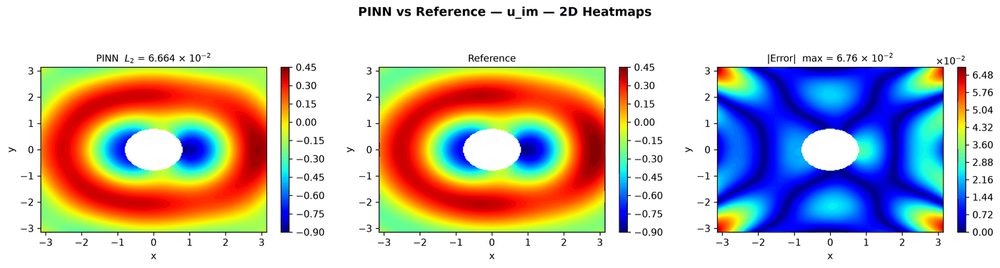

---
search:
  boost: 0.5
---

# Helmholtz 2D – sound-hard scattering

| Example | |
|---|---|
| **Source** | DeepXDE example |
| **Problem** | Forward |
| **Dimension** | 2D (x, y) |
| **Regime** | Steady |
| **Geometry** | Rectangle − Disk |
| **Outputs** | `u_re`, `u_im` |
| **Settings** | Default (no separate Tuned preset) |

## Governing equations

Mathematical form (from the benchmark records):

\[-\nabla^2 u - k_0^2 u = 0, \qquad u = u_{re} + i\ u_{im},\ k_0 = 2\]

As typed in PINNStudio's **Equations** page (each expression is a residual, set to zero):

```text
-du_re_xx - du_re_yy - k0**2*u_re
-du_im_xx - du_im_yy - k0**2*u_im
```

Constants: `k0 = 2`, `R = pi/4`

## Domain

- Custom geometry (**Geometry** › Custom): Rectangle (x_min = -3.14159, x_max = 3.14159, y_min = -3.14159, y_max = 3.14159), minus Disk (cx = 0, cy = 0, r = 0.785398)

## Boundary conditions

| Type | Where | Output | Value | Details |
|---|---|---|---|---|
| Neumann BC | `np.isclose(x**2 + y**2, R**2)` | `u_re` | `-k0*x*sin(k0*x)/R` | — |
| Neumann BC | `np.isclose(x**2 + y**2, R**2)` | `u_im` | `k0*x*cos(k0*x)/R` | — |
| Robin BC | `left or right or bottom or top` | `u_re` | `-k0*u_im` | value is the right-hand side of du/dn = f(x, u) |
| Robin BC | `left or right or bottom or top` | `u_im` | `k0*u_re` | value is the right-hand side of du/dn = f(x, u) |

## Settings

**Settings: Default** — DeepXDE's own settings

- **Network:** FNN, hidden layers 3 × 350, inputs (x, y), 2 outputs; activation tanh, initializer Glorot uniform
- **Points:** 1,600 domain, 320 boundary, 8,000 test
- **Loss weights:** `1,1,1,1,1,1` (equations, then boundary-condition rows)

| Phase | Optimizer | Iterations | Learning rate | Decay |
|---|---|---|---|---|
| 1 | Adam | 10,000 | 0.001 | none |

No separate **Tuned** preset: the **Tuned** item is greyed out for this example (its Default settings are PINNStudio's best).

## Results

From the benchmark records: one RTX 4090; relative L₂ error of the main output at the last reference time, and for an inverse problem the parameters it found (true value in brackets). *PINNStudio best* is what **Settings: Tuned** loads.

| | Default | PINNStudio best | Training time of the best (s) |
|---|---|---|---|
| Forward: relative L₂ at the last reference time | 8.0 × 10<sup>-2</sup> | **8.0 × 10<sup>-2</sup>** | 61 |

<figure markdown="span">
  { loading=lazy }
  <figcaption>DeepXDE's settings (also PINNStudio best) — im — PINN, reference and error over space and time</figcaption>
</figure>

Every setting tried, the papers' reported errors and all figures: [the benchmark records](https://github.com/AsfandyarKhan72/PINNStudio/blob/main/benchmarks/examples.md#dx-helmholtz-sound-hard-scattering-absorbing-bc).

## Loading it in PINNStudio

- Forward: toolbar **Examples:** › **Forward** › under the **── 2D ──** heading, **Helmholtz 2D – sound-hard scattering** › **Default**, then **Solve**.

Loading an example fills in every setting; anything you change before **Solve** is listed in the Training Log. Your save folder, GPU, random-seed and plot-style settings are kept.

## Reference solution

- Reference data files: [`reference_data/deepxde/helmholtz_sound_hard/`](https://github.com/AsfandyarKhan72/PINNStudio/tree/main/reference_data/deepxde/helmholtz_sound_hard)

## Notes

- Scattering of the plane wave exp(i k0 x) by a sound-hard disk: u_re, u_im are the real and imaginary parts of the scattered field. On the disk, du/dn = -d(exp(i k0 x))/dn (Neumann rows); on the outer square, the first-order absorbing condition du/dn = i k0 u (Robin rows, each using the other part). Reference: the Bessel/Hankel series of DeepXDE's script, written by tools/make_deepxde_reference_data.py.

## Definition and records

- **Definition:** `EXAMPLES` entry "Helmholtz sound-hard scattering (absorbing BC)" in [`pinnstudio/core/deepxde_examples.py`](https://github.com/AsfandyarKhan72/PINNStudio/blob/main/pinnstudio/core/deepxde_examples.py)
- **Equations:** [Governing equations](#governing-equations) on this page
- **Reference data:** [`reference_data/deepxde/helmholtz_sound_hard/`](https://github.com/AsfandyarKhan72/PINNStudio/tree/main/reference_data/deepxde/helmholtz_sound_hard), written by [`tools/make_deepxde_reference_data.py`](https://github.com/AsfandyarKhan72/PINNStudio/blob/main/tools/make_deepxde_reference_data.py)
- **Benchmark records:** [`benchmarks/problems/helmholtz-2d-sound-hard-scattering.md`](https://github.com/AsfandyarKhan72/PINNStudio/blob/main/benchmarks/problems/helmholtz-2d-sound-hard-scattering.md), its entry in the [examples overview](https://github.com/AsfandyarKhan72/PINNStudio/blob/main/benchmarks/examples.md#dx-helmholtz-sound-hard-scattering-absorbing-bc), the [benchmark collection](https://github.com/AsfandyarKhan72/PINNStudio/blob/main/benchmarks/README.md)
- **Tuning-study configurations** (records of the tuning study; open one with **Problem › Open Saved Problem...**; not presets of the Examples list): [`Helmholtz 2D – sound-hard scattering (tuned).pinn.json`](https://github.com/AsfandyarKhan72/PINNStudio/blob/main/benchmarks/tuning/Helmholtz%202D%20%E2%80%93%20sound-hard%20scattering%20%28tuned%29.pinn.json)
- **DeepXDE example:** [Helmholtz_Sound_hard_ABC_2d.py](https://github.com/lululxvi/deepxde/blob/master/examples/pinn_forward/Helmholtz_Sound_hard_ABC_2d.py)
- **Cite:** [Lu et al. 2021](../../about/references.md#lu2021deepxde) (DeepXDE)

Verified error values are reported in the [Reproducibility](../../reproducibility/benchmarks.md) section, not on this page.

[← Back to the example gallery](../index.md)
