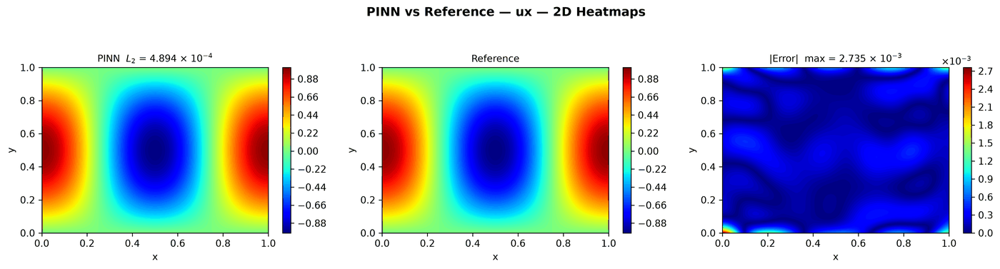
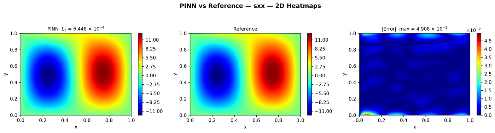
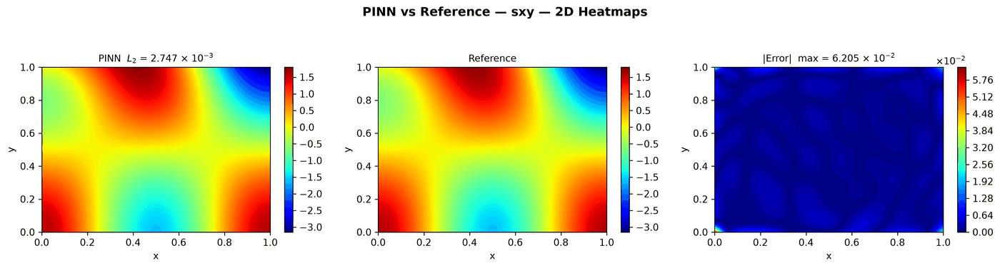
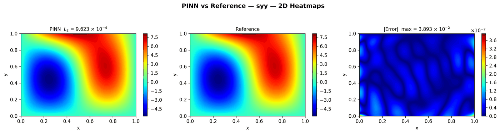
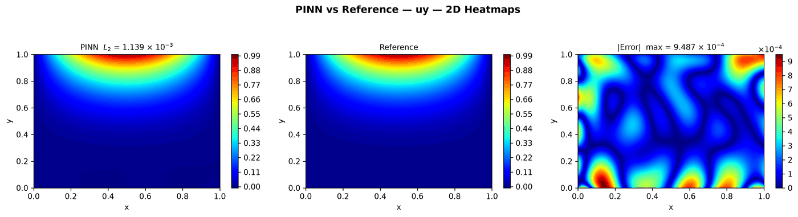

---
search:
  boost: 0.5
---

# Linear elasticity 2D – plate, soft BCs

| Example | |
|---|---|
| **Source** | DeepXDE example |
| **Problem** | Forward |
| **Dimension** | 2D (x, y) |
| **Regime** | Steady |
| **Geometry** | Rectangle |
| **Outputs** | `ux`, `uy`, `sxx`, `syy`, `sxy` |
| **Settings** | Default (no separate Tuned preset) |

## Governing equations

Mathematical form (from the benchmark records):

\[\frac{\partial \sigma_{xx}}{\partial x} + \frac{\partial \sigma_{xy}}{\partial y} = f_x, \qquad \frac{\partial \sigma_{xy}}{\partial x} + \frac{\partial \sigma_{yy}}{\partial y} = f_y\]

As typed in PINNStudio's **Equations** page (each expression is a residual, set to zero):

```text
dsxx_x + dsxy_y - (-lmbd*(4*pi**2*cos(2*pi*x)*sin(pi*y) - Q*y**3*pi*cos(pi*x)) - mu*(pi**2*cos(2*pi*x)*sin(pi*y) - Q*y**3*pi*cos(pi*x)) - 8*mu*pi**2*cos(2*pi*x)*sin(pi*y))
dsxy_x + dsyy_y - (lmbd*(3*Q*y**2*sin(pi*x) - 2*pi**2*cos(pi*y)*sin(2*pi*x)) - mu*(2*pi**2*cos(pi*y)*sin(2*pi*x) + Q*y**4*pi**2*sin(pi*x)/4) + 6*Q*mu*y**2*sin(pi*x))
(2*mu + lmbd)*dux_x + lmbd*duy_y - sxx
(2*mu + lmbd)*duy_y + lmbd*dux_x - syy
mu*(dux_y + duy_x) - sxy
```

Constants: `lmbd = 1`, `mu = 0.5`, `Q = 4`

## Domain

- Rectangle: \(x \in [0, 1]\), \(y \in [0, 1]\)

## Boundary conditions

| Type | Where | Output | Value | Details |
|---|---|---|---|---|
| Dirichlet BC | `top` | `ux` | `0` | — |
| Dirichlet BC | `bottom` | `ux` | `0` | — |
| Dirichlet BC | `left` | `uy` | `0` | — |
| Dirichlet BC | `bottom` | `uy` | `0` | — |
| Dirichlet BC | `right` | `uy` | `0` | — |
| Dirichlet BC | `left` | `sxx` | `0` | — |
| Dirichlet BC | `right` | `sxx` | `0` | — |
| Dirichlet BC | `top` | `syy` | (2*mu + lmbd)*Q*sin(pi*x) | — |

## Settings

**Settings: Default** — DeepXDE's own settings

- **Network:** parallel FNN (PFNN), hidden layers 4 × 40, inputs (x, y), 5 outputs; activation tanh, initializer Glorot uniform
- **Points:** 500 domain, 500 boundary, 100 test
- **Loss weights:** `1,1,1,1,1,1,1,1,1,1,1,1,1` (equations, then boundary-condition rows)

| Phase | Optimizer | Iterations | Learning rate | Decay |
|---|---|---|---|---|
| 1 | Adam | 20,000 | 0.001 | none |
| 2 | L-BFGS | 20,000 | — | none |

No separate **Tuned** preset: the **Tuned** item is greyed out for this example (its Default settings are PINNStudio's best).

## Results

The configuration selected in PINNStudio's benchmark study, run on one RTX 4090. Forward: relative L₂ error of each output at the last reference time. Inverse: each parameter's relative error and, per seed, the largest of them (worst parameter error).

### Forward problem

**Settings:** Default — the example's own settings (not in the tuning sweep); the example has no separate Tuned preset for this mode. **Values:** one run, seed 2026.

| Output | Relative L₂ |
|---|---|
| uₓ | 4.9 × 10⁻⁴ |
| uᵧ | 1.1 × 10⁻³ |
| σₓₓ | 6.4 × 10⁻⁴ |
| σᵧᵧ | 9.6 × 10⁻⁴ |
| σₓᵧ | 2.7 × 10⁻³ |

<figure markdown="span">
  { loading=lazy }
  <figcaption>Forward, Default settings: PINN, reference and error, uₓ.</figcaption>
</figure>

??? note "Other outputs (4 figures)"

    <figure markdown="span">
      { loading=lazy }
      <figcaption>Forward, Default settings: PINN, reference and error, σₓₓ.</figcaption>
    </figure>

    <figure markdown="span">
      { loading=lazy }
      <figcaption>Forward, Default settings: PINN, reference and error, σₓᵧ.</figcaption>
    </figure>

    <figure markdown="span">
      { loading=lazy }
      <figcaption>Forward, Default settings: PINN, reference and error, σᵧᵧ.</figcaption>
    </figure>

    <figure markdown="span">
      { loading=lazy }
      <figcaption>Forward, Default settings: PINN, reference and error, uᵧ.</figcaption>
    </figure>

**Full benchmark record:** every setting tried, the per-seed values and all figures are in [the benchmark records on GitHub](https://github.com/AsfandyarKhan72/PINNStudio/blob/v1.6.0/benchmarks/examples.md#dx-linear-elastostatic-plate-soft-bcs).

## Loading it in PINNStudio

- Forward: toolbar **Examples:** › **Forward** › under the **── 2D ──** heading, **Linear elasticity 2D – plate, soft BCs** › **Default**, then **Solve**.

Loading an example fills in every setting; anything you change before **Solve** is listed in the Training Log. Your save folder, GPU, random-seed and plot-style settings are kept.

## Reference solution

- Exact solution, **Error Analysis** › reference from formula: `ux = cos(2*pi*x)*sin(pi*y)`, `uy = sin(pi*x)*Q*y**4/4`, `sxx = (2*mu + lmbd)*(-2*pi*sin(2*pi*x)*sin(pi*y)) + lmbd*sin(pi*x)*Q*y**3`, `syy = (2*mu + lmbd)*sin(pi*x)*Q*y**3 + lmbd*(-2*pi*sin(2*pi*x)*sin(pi*y))`, `sxy = mu*(pi*cos(2*pi*x)*cos(pi*y) + pi*cos(pi*x)*Q*y**4/4)`

## Notes

- DeepXDE's script with BC_type = "soft": the eight boundary conditions are loss terms (rows in the Boundary Conditions panel) instead of being built into the output transform. Training: 20,000 Adam + 20,000 L-BFGS iterations instead of DeepXDE's 5,000 Adam, which are not enough for this problem (L2 errors of 0.2-1.6).

## Definition and records

- **Definition:** `EXAMPLES` entry "Linear elastostatic plate (soft BCs)" in [`pinnstudio/core/deepxde_examples.py`](https://github.com/AsfandyarKhan72/PINNStudio/blob/v1.6.0/pinnstudio/core/deepxde_examples.py)
- **Equations:** [Governing equations](#governing-equations) on this page
- **Reference data:** the exact-solution formula under *Reference solution* (no data files)
- **Benchmark records:** [`benchmarks/problems/linear-elasticity-2d-plate-soft-bcs.md`](https://github.com/AsfandyarKhan72/PINNStudio/blob/v1.6.0/benchmarks/problems/linear-elasticity-2d-plate-soft-bcs.md), its entry in the [examples overview](https://github.com/AsfandyarKhan72/PINNStudio/blob/v1.6.0/benchmarks/examples.md#dx-linear-elastostatic-plate-soft-bcs), the [benchmark collection](https://github.com/AsfandyarKhan72/PINNStudio/blob/v1.6.0/benchmarks/README.md)
- **Tuning-study configurations** (records of the tuning study; open one with **Problem › Open Saved Problem...**; not presets of the Examples list): [`Linear elasticity 2D – plate, soft BCs (tuned).pinn.json`](https://github.com/AsfandyarKhan72/PINNStudio/blob/v1.6.0/benchmarks/tuning/Linear%20elasticity%202D%20%E2%80%93%20plate%2C%20soft%20BCs%20%28tuned%29.pinn.json)
- **DeepXDE example:** [elasticity_plate.py](https://github.com/lululxvi/deepxde/blob/master/examples/pinn_forward/elasticity_plate.py)
- **Cite:** [Lu et al. 2021](../../about/references.md#lu2021deepxde) (DeepXDE); the problem follows [Haghighat et al. 2021](../../about/references.md#haghighat2021)

How the benchmark values were measured and checked: [Reproducibility](../../reproducibility/benchmarks.md).

[← Back to the example gallery](../index.md)
