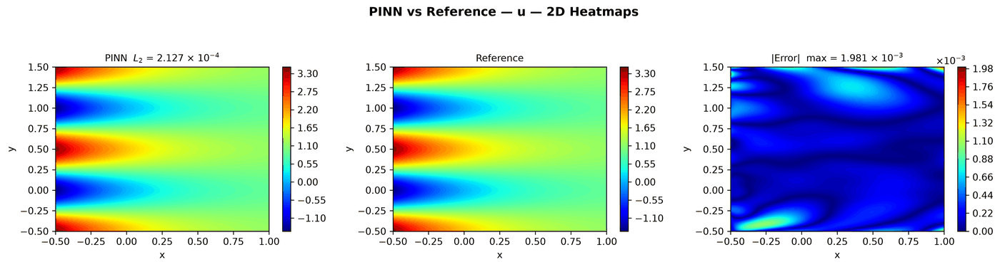
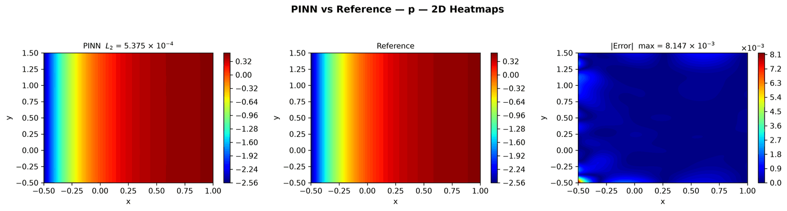
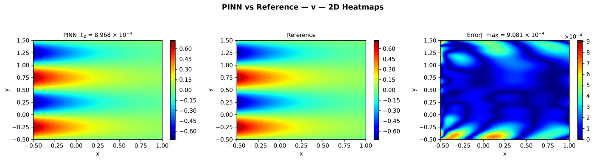
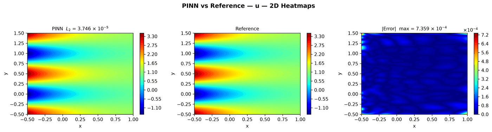
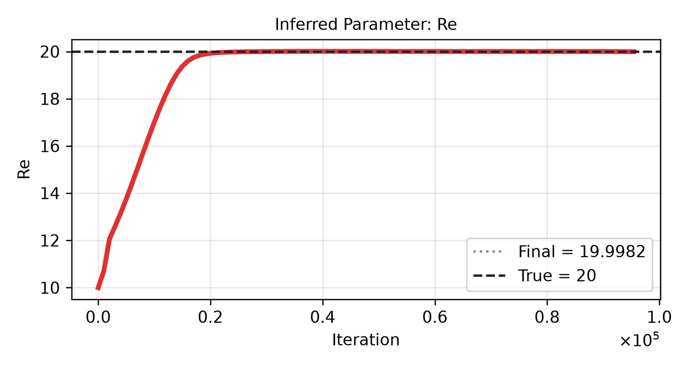
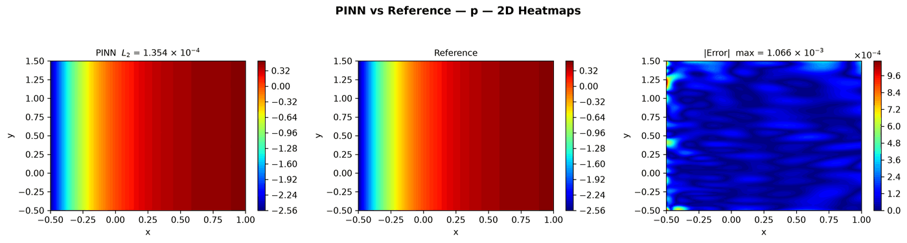
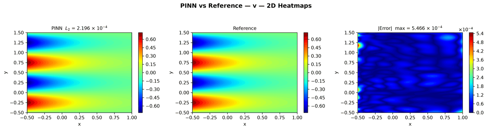

---
search:
  boost: 0.5
---

# Navier-Stokes 2D – Kovasznay flow

| Example | |
|---|---|
| **Source** | DeepXDE example |
| **Problem** | Forward and Inverse (the Inverse mode is PINNStudio's addition) |
| **Dimension** | 2D (x, y) |
| **Regime** | Steady |
| **Geometry** | Rectangle |
| **Outputs** | `u`, `v`, `p` |
| **Settings** | Default, Tuned |

## Governing equations

Mathematical form (from the benchmark records):

\[(\mathbf u\cdot\nabla)\mathbf u + \nabla p = \frac{1}{Re}\nabla^2\mathbf u, \qquad \nabla\cdot\mathbf u = 0, \qquad Re = 20\]

As typed in PINNStudio's **Equations** page (each expression is a residual, set to zero):

```text
u*du_x + v*du_y + dp_x - 1/Re*(du_xx + du_yy)
u*dv_x + v*dv_y + dp_y - 1/Re*(dv_xx + dv_yy)
du_x + dv_y
```

Constants: `Re = 20`, `nu = 1/Re`, `l = 1/(2*nu) - sqrt(1/(4*nu**2) + 4*pi**2)`

## Domain

- Rectangle: \(x \in [-0.5, 1]\), \(y \in [-0.5, 1.5]\)

## Boundary conditions

| Type | Where | Output | Value | Details |
|---|---|---|---|---|
| Dirichlet BC | `True (the whole boundary)` | `u` | `1 - exp(l*x)*cos(2*pi*y)` | — |
| Dirichlet BC | `True (the whole boundary)` | `v` | `l/(2*pi)*exp(l*x)*sin(2*pi*y)` | — |
| Dirichlet BC | `right` | `p` | `0.5*(1 - exp(2*l*x))` | — |

## Unknowns and measured data (Inverse)

| Trainable parameter | Initial value | True value |
|---|---|---|
| `Re` | 10 | 20 |

Measured data (**Inverse** page, measured-data files):

- [`reference_data/deepxde/kovasznay_inverse/u_obs.txt`](https://github.com/AsfandyarKhan72/PINNStudio/blob/v1.6.0/reference_data/deepxde/kovasznay_inverse/u_obs.txt) → output `u`, weight 100
- [`reference_data/deepxde/kovasznay_inverse/v_obs.txt`](https://github.com/AsfandyarKhan72/PINNStudio/blob/v1.6.0/reference_data/deepxde/kovasznay_inverse/v_obs.txt) → output `v`, weight 100

## Settings

### Forward mode

**Settings: Default** — DeepXDE's own settings

- **Network:** FNN, hidden layers 4 × 50, inputs (x, y), 3 outputs; activation tanh, initializer Glorot normal
- **Points:** 2,601 domain, 400 boundary, 100,000 test
- **Loss weights:** `1,1,1,1,1,1` (equations, then boundary-condition rows)

| Phase | Optimizer | Iterations | Learning rate | Decay |
|---|---|---|---|---|
| 1 | Adam | 30,000 | 0.001 | none |
| 2 | L-BFGS | 15,000 | — | none |

No separate **Tuned** preset: the **Tuned** item is greyed out for this example (its Default settings are PINNStudio's best).

### Inverse mode

**Settings: Default** — DeepXDE's settings with PINNStudio's Inverse-mode changes (see *Notes*)

- **Network:** FNN, hidden layers 4 × 50, inputs (x, y), 3 outputs; activation tanh, initializer Glorot normal
- **Points:** 2,601 domain, 400 boundary, 100,000 test
- **Loss weights:** `1,1,1,1,1,1` (equations, then boundary-condition rows)

| Phase | Optimizer | Iterations | Learning rate | Decay |
|---|---|---|---|---|
| 1 | Adam | 30,000 | 0.001 | none |
| 2 | L-BFGS | 15,000 | — | none |

??? note "Settings: Tuned"

    The Training Log reports: *Tuned settings: 3× iterations, a larger network, 3× points and an L-BFGS phase together.* The change is applied to the example's own settings.

    - **Network:** FNN, hidden layers 5 × 100, inputs (x, y), 3 outputs; activation tanh, initializer Glorot normal
    - **Points:** 7,803 domain, 1,200 boundary, 100,000 test
    - **Loss weights:** `1,1,1,1,1,1` (equations, then boundary-condition rows)

    | Phase | Optimizer | Iterations | Learning rate | Decay |
    |---|---|---|---|---|
    | 1 | Adam | 90,000 | 0.001 | none |
    | 2 | L-BFGS | 45,000 | — | none |

## Results

The configuration selected in PINNStudio's benchmark study, run on one RTX 4090. Forward: relative L₂ error of each output at the last reference time. Inverse: each parameter's relative error and, per seed, the largest of them (worst parameter error).

### Forward problem

**Settings:** Default — the example's own settings (not in the tuning sweep); the example has no separate Tuned preset for this mode. **Values:** median over seeds 2026, 1, 2.

| Output | Relative L₂ |
|---|---|
| u | 2.0 × 10⁻⁴ |
| v | 9.0 × 10⁻⁴ |
| p | 4.1 × 10⁻⁴ |

<figure markdown="span">
  { loading=lazy }
  <figcaption>Forward, Default settings: PINN, reference and error, u.</figcaption>
</figure>

??? note "Other outputs (2 figures)"

    <figure markdown="span">
      { loading=lazy }
      <figcaption>Forward, Default settings: PINN, reference and error, p.</figcaption>
    </figure>

    <figure markdown="span">
      { loading=lazy }
      <figcaption>Forward, Default settings: PINN, reference and error, v.</figcaption>
    </figure>

### Inverse problem

**Settings:** Tuned — all of the changes together. **Values:** median over seeds 2026, 1, 2.

| Parameter | True value | Recovered | Relative error |
|---|---|---|---|
| Re | 20 | 19.9995 | 0.0045 % |

Worst parameter error: **0.0045 %** (the median over the seeds of each seed's largest error).

<figure markdown="span">
  { loading=lazy }
  <figcaption>Inverse, Tuned settings: PINN, reference and error, u.</figcaption>
</figure>

<figure markdown="span">
  { loading=lazy }
  <figcaption>Inverse, Tuned settings: parameter convergence.</figcaption>
</figure>

??? note "Other outputs (2 figures)"

    <figure markdown="span">
      { loading=lazy }
      <figcaption>Inverse, Tuned settings: PINN, reference and error, p.</figcaption>
    </figure>

    <figure markdown="span">
      { loading=lazy }
      <figcaption>Inverse, Tuned settings: PINN, reference and error, v.</figcaption>
    </figure>

**Full benchmark record:** every setting tried, the per-seed values and all figures are in [the benchmark records on GitHub](https://github.com/AsfandyarKhan72/PINNStudio/blob/v1.6.0/benchmarks/examples.md#dx-kovasznay-flow).

## Loading it in PINNStudio

- Forward: toolbar **Examples:** › **Forward** › under the **── 2D ──** heading, **Navier-Stokes 2D – Kovasznay flow** › **Default**, then **Solve**.
- Inverse: toolbar **Examples:** › **Inverse** › under the **── 2D ──** heading, **Navier-Stokes 2D – Kovasznay flow** › **Default** or **Tuned**, then **Solve**.

Loading an example fills in every setting; anything you change before **Solve** is listed in the Training Log. Your save folder, GPU, random-seed and plot-style settings are kept.

## Reference solution

- Exact solution, **Error Analysis** › reference from formula: `u = 1 - exp(l*x)*cos(2*pi*y)`, `v = l/(2*pi)*exp(l*x)*sin(2*pi*y)`, `p = 0.5*(1 - exp(2*l*x))`

## Notes

- Constants Re, nu and l are defined as in DeepXDE's script.
- Inverse mode (PINNStudio's addition): the Reynolds number Re (initial guess 10, true 20) is learned from u and v measured at 500 points (reference_data/deepxde/kovasznay_inverse); the boundary values keep the true Re.

## Definition and records

- **Definition:** `EXAMPLES` entry "Kovasznay flow" in [`pinnstudio/core/deepxde_examples.py`](https://github.com/AsfandyarKhan72/PINNStudio/blob/v1.6.0/pinnstudio/core/deepxde_examples.py)
    - Inverse mode (PINNStudio's addition): `ADDED_INVERSE["Kovasznay flow"]`, same file
    - Settings: Tuned: entry "Kovasznay flow" in [`pinnstudio/resources/tuned_settings.json`](https://github.com/AsfandyarKhan72/PINNStudio/blob/v1.6.0/pinnstudio/resources/tuned_settings.json)
- **Equations:** [Governing equations](#governing-equations) on this page
- **Reference data:** the exact-solution formula under *Reference solution* (no data files)
- **Measured data** (Inverse): [`reference_data/deepxde/kovasznay_inverse/`](https://github.com/AsfandyarKhan72/PINNStudio/tree/v1.6.0/reference_data/deepxde/kovasznay_inverse), written by [`tools/make_deepxde_reference_data.py`](https://github.com/AsfandyarKhan72/PINNStudio/blob/v1.6.0/tools/make_deepxde_reference_data.py)
- **Benchmark records:** [`benchmarks/problems/navier-stokes-2d-kovasznay-flow.md`](https://github.com/AsfandyarKhan72/PINNStudio/blob/v1.6.0/benchmarks/problems/navier-stokes-2d-kovasznay-flow.md), its entry in the [examples overview](https://github.com/AsfandyarKhan72/PINNStudio/blob/v1.6.0/benchmarks/examples.md#dx-kovasznay-flow), the [benchmark collection](https://github.com/AsfandyarKhan72/PINNStudio/blob/v1.6.0/benchmarks/README.md)
- **Tuning-study configurations** (records of the tuning study; open one with **Problem › Open Saved Problem...**; not presets of the Examples list): [`Navier-Stokes 2D – Kovasznay flow (tuned).pinn.json`](https://github.com/AsfandyarKhan72/PINNStudio/blob/v1.6.0/benchmarks/tuning/Navier-Stokes%202D%20%E2%80%93%20Kovasznay%20flow%20%28tuned%29.pinn.json), [`Navier-Stokes 2D – Kovasznay flow, inverse mode (tuned).pinn.json`](https://github.com/AsfandyarKhan72/PINNStudio/blob/v1.6.0/benchmarks/tuning/Navier-Stokes%202D%20%E2%80%93%20Kovasznay%20flow%2C%20inverse%20mode%20%28tuned%29.pinn.json)
- **DeepXDE example:** [Kovasznay_flow.py](https://github.com/lululxvi/deepxde/blob/master/examples/pinn_forward/Kovasznay_flow.py) ([documentation](https://deepxde.readthedocs.io/en/latest/demos/pinn_forward/Kovasznay.flow.html))
- **Cite:** [Lu et al. 2021](../../about/references.md#lu2021deepxde) (DeepXDE); the problem follows [Jin et al. 2021](../../about/references.md#jin2021)

How the benchmark values were measured and checked: [Reproducibility](../../reproducibility/benchmarks.md).

[← Back to the example gallery](../index.md)
