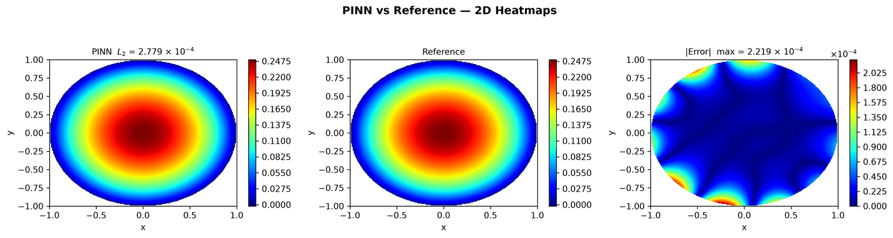
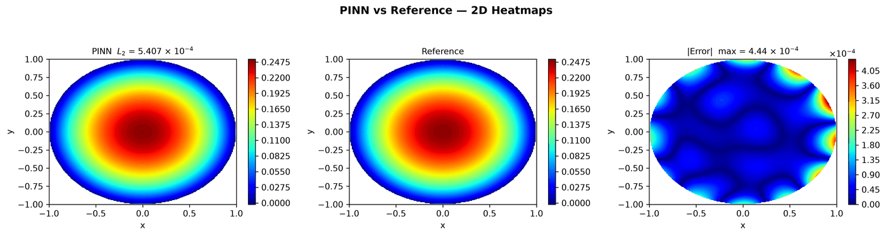
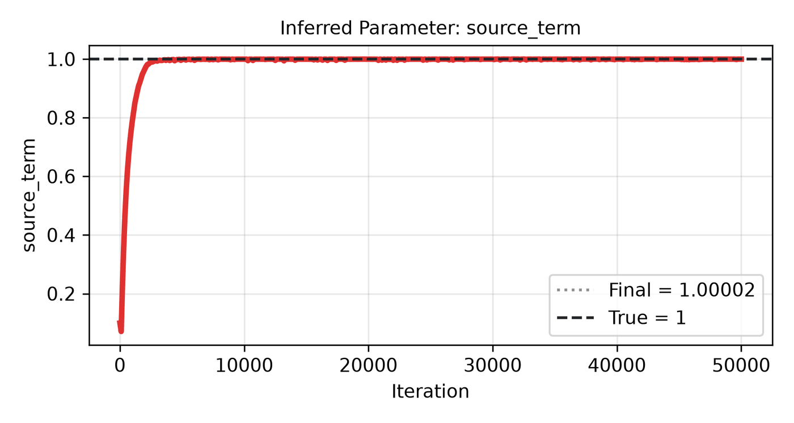

---
search:
  boost: 0.5
---

# Poisson 2D – disk

| Example | |
|---|---|
| **Source** | PINNStudio template |
| **Problem** | Forward and Inverse |
| **Dimension** | 2D (x, y) |
| **Regime** | Steady |
| **Geometry** | Disk |
| **Outputs** | `u` |
| **Settings** | Default (no separate Tuned preset) |

## Governing equations

Mathematical form (from the benchmark records):

\[-\frac{\partial^2 u}{\partial x^2} - \frac{\partial^2 u}{\partial y^2} = 1, \qquad x^2 + y^2 \le 1\]

As typed in PINNStudio's **Equations** page (each expression is a residual, set to zero):

```text
-du_xx - du_yy - 1
```

As typed in PINNStudio's **Equations** page (Inverse mode) (each expression is a residual, set to zero):

```text
-du_xx - du_yy - source_term
```

## Domain

- Disk: centre (0, 0), radius 1

## Boundary conditions

| Type | Where | Output | Value | Details |
|---|---|---|---|---|
| Dirichlet BC | `True (the whole boundary)` | `u` | `0` | — |

## Unknowns and measured data (Inverse)

| Trainable parameter | Initial value | True value |
|---|---|---|
| `source_term` | 0.1 | 1 |

Measured data (**Inverse** page, measured-data files):

- [`reference_data/2D/poisson_disk/u_obs.txt`](https://github.com/AsfandyarKhan72/PINNStudio/blob/main/reference_data/2D/poisson_disk/u_obs.txt) → output `u`, weight 100

## Settings

### Forward mode

**Settings: Default** — the template's own settings

- **Network:** FNN, hidden layers 4 × 50, inputs (x, y), 1 output; activation tanh, initializer Glorot uniform
- **Points:** 1,200 domain, 120 boundary, 1,500 test
- **Loss weights:** `1.0,1.0` (equations, then boundary-condition rows)

| Phase | Optimizer | Iterations | Learning rate | Decay |
|---|---|---|---|---|
| 1 | Adam | 50,000 | 0.001 | none |
| 2 | L-BFGS | 50,000 | — | none |

No separate **Tuned** preset: the **Tuned** item is greyed out for this example (its Default settings are PINNStudio's best).

### Inverse mode

**Settings: Default** — the template's own settings

- **Network:** FNN, hidden layers 4 × 50, inputs (x, y), 1 output; activation tanh, initializer Glorot uniform
- **Points:** 1,200 domain, 120 boundary, 1,500 test
- **Loss weights:** `1.0,1.0,100.0` (equations, then boundary-condition rows, then measured data)

| Phase | Optimizer | Iterations | Learning rate | Decay |
|---|---|---|---|---|
| 1 | Adam | 50,000 | 0.001 | none |
| 2 | L-BFGS | 50,000 | — | none |

No separate **Tuned** preset: the **Tuned** item is greyed out for this example (its Default settings are PINNStudio's best).

## Results

The configuration selected in PINNStudio's benchmark study, run on one RTX 4090. Forward: relative L₂ error of each output at the last reference time. Inverse: each parameter's relative error and, per seed, the largest of them (worst parameter error).

### Forward problem

**Settings:** Default — the example's own settings (not in the tuning sweep); the example has no separate Tuned preset for this mode. **Values:** median over seeds 2026, 1, 2.

| Output | Relative L₂ |
|---|---|
| solution | 2.8 × 10⁻⁴ |

<figure markdown="span">
  { loading=lazy }
  <figcaption>Forward, Default settings: PINN, reference and error.</figcaption>
</figure>

### Inverse problem

**Settings:** Default — the example's own settings (no change did better); the example has no separate Tuned preset for this mode. **Values:** median over seeds 2026, 1, 2.

| Parameter | True value | Recovered | Relative error |
|---|---|---|---|
| f | 1 | 1.00003 | 0.003 % |

Worst parameter error: **0.003 %** (the median over the seeds of each seed's largest error).

<figure markdown="span">
  { loading=lazy }
  <figcaption>Inverse, Default settings: PINN, reference and error.</figcaption>
</figure>

<figure markdown="span">
  { loading=lazy }
  <figcaption>Inverse, Default settings: parameter convergence.</figcaption>
</figure>

**Full benchmark record:** every setting tried, the per-seed values and all figures are in [the benchmark records on GitHub](https://github.com/AsfandyarKhan72/PINNStudio/blob/main/benchmarks/examples.md#2d-poisson-disk).

## Loading it in PINNStudio

- Forward: toolbar **Examples:** › **Forward** › under the **── 2D ──** heading, **Poisson 2D – disk** › **Default**, then **Solve**.
- Inverse: toolbar **Examples:** › **Inverse** › under the **── 2D ──** heading, **Poisson 2D – disk** › **Default**, then **Solve**.

Loading an example fills in every setting; anything you change before **Solve** is listed in the Training Log. Your save folder, GPU, random-seed and plot-style settings are kept.

## Reference solution

- Reference data files: [`reference_data/2D/poisson_disk/`](https://github.com/AsfandyarKhan72/PINNStudio/tree/main/reference_data/2D/poisson_disk)

## Definition and records

- **Definition:** template "2D Poisson (Disk)" in `MainWindow._on_template_selected`, [`pinnstudio/ui/main_window.py`](https://github.com/AsfandyarKhan72/PINNStudio/blob/main/pinnstudio/ui/main_window.py)
    - Inverse mode: `MainWindow.INVERSE_AUTO_VARS["2D Poisson (Disk)"]` (unknowns) and `INVERSE_AUTO_OBS["2D Poisson (Disk)"]` (measured data), same file
- **Equations:** [Governing equations](#governing-equations) on this page
- **Reference data:** [`reference_data/2D/poisson_disk/`](https://github.com/AsfandyarKhan72/PINNStudio/tree/main/reference_data/2D/poisson_disk), written by [`tools/make_poisson_reference_data.py`](https://github.com/AsfandyarKhan72/PINNStudio/blob/main/tools/make_poisson_reference_data.py)
- **Measured data** (Inverse): [`reference_data/2D/poisson_disk/`](https://github.com/AsfandyarKhan72/PINNStudio/tree/main/reference_data/2D/poisson_disk), written by [`tools/make_poisson_reference_data.py`](https://github.com/AsfandyarKhan72/PINNStudio/blob/main/tools/make_poisson_reference_data.py)
- **Benchmark records:** [`benchmarks/problems/poisson-2d-disk.md`](https://github.com/AsfandyarKhan72/PINNStudio/blob/main/benchmarks/problems/poisson-2d-disk.md), its entry in the [examples overview](https://github.com/AsfandyarKhan72/PINNStudio/blob/main/benchmarks/examples.md#2d-poisson-disk), the [benchmark collection](https://github.com/AsfandyarKhan72/PINNStudio/blob/main/benchmarks/README.md)
- **Tuning-study configurations** (records of the tuning study; open one with **Problem › Open Saved Problem...**; not presets of the Examples list): [`Poisson 2D – disk (PINNStudio template) (tuned).pinn.json`](https://github.com/AsfandyarKhan72/PINNStudio/blob/main/benchmarks/tuning/Poisson%202D%20%E2%80%93%20disk%20%28PINNStudio%20template%29%20%28tuned%29.pinn.json), [`Poisson 2D – disk (PINNStudio template), inverse mode (tuned).pinn.json`](https://github.com/AsfandyarKhan72/PINNStudio/blob/main/benchmarks/tuning/Poisson%202D%20%E2%80%93%20disk%20%28PINNStudio%20template%29%2C%20inverse%20mode%20%28tuned%29.pinn.json)
- **Cite:** PINNStudio's own problem (no source paper)

How the benchmark values were measured and checked: [Reproducibility](../../reproducibility/benchmarks.md).

[← Back to the example gallery](../index.md)
