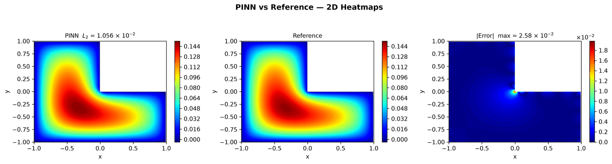

---
search:
  boost: 0.5
---

# Poisson 2D – L-shape

| Example | |
|---|---|
| **Source** | DeepXDE example |
| **Problem** | Forward and Inverse (the Inverse mode is PINNStudio's addition) |
| **Dimension** | 2D (x, y) |
| **Regime** | Steady |
| **Geometry** | Polygon (L-shape) |
| **Outputs** | `u` |
| **Settings** | Default, Tuned |

## Governing equations

Mathematical form (from the benchmark records):

\[-\nabla^2 u = f, \qquad \Omega = [-1, 1]^2 \setminus [0, 1]\times[-1, 0]\]

As typed in PINNStudio's **Equations** page (each expression is a residual, set to zero):

```text
-du_xx - du_yy - f
```

Constants: `f = 1`

## Domain

- Polygon with vertices (0,0); (1,0); (1,-1); (-1,-1); (-1,1); (0,1)

## Boundary conditions

| Type | Where | Output | Value | Details |
|---|---|---|---|---|
| Dirichlet BC | `True (the whole boundary)` | `u` | `0` | — |

## Unknowns and measured data (Inverse)

| Trainable parameter | Initial value | True value |
|---|---|---|
| `f` | 0.1 | 1 |

Measured data (**Inverse** page, measured-data files):

- [`reference_data/2D/poisson_lshape/u_obs.txt`](https://github.com/AsfandyarKhan72/PINNStudio/blob/main/reference_data/2D/poisson_lshape/u_obs.txt) → output `u`, weight 100

From the benchmark records: the source term \(f\) learned from \(u\) measured at 300 points (initial guess 0.1, true 1).

## Settings

### Forward mode

**Settings: Default** — DeepXDE's own settings

- **Network:** FNN, hidden layers 4 × 50, inputs (x, y), 1 output; activation tanh, initializer Glorot uniform
- **Points:** 1,200 domain, 120 boundary, 1,500 test
- **Loss weights:** `1,1` (equations, then boundary-condition rows)

| Phase | Optimizer | Iterations | Learning rate | Decay |
|---|---|---|---|---|
| 1 | Adam | 50,000 | 0.001 | none |
| 2 | L-BFGS | 15,000 | — | none |

??? note "Settings: Tuned"

    The Training Log reports: *Tuned settings: 3× iterations, a larger network, 3× points and an L-BFGS phase together.* The change is applied to the example's own settings.

    - **Network:** FNN, hidden layers 5 × 100, inputs (x, y), 1 output; activation tanh, initializer Glorot uniform
    - **Points:** 3,600 domain, 360 boundary, 1,500 test
    - **Loss weights:** `1,1` (equations, then boundary-condition rows)

    | Phase | Optimizer | Iterations | Learning rate | Decay |
    |---|---|---|---|---|
    | 1 | Adam | 150,000 | 0.001 | none |
    | 2 | L-BFGS | 45,000 | — | none |

### Inverse mode

**Settings: Default** — DeepXDE's settings with PINNStudio's Inverse-mode changes (see *Notes*)

- **Network:** FNN, hidden layers 4 × 50, inputs (x, y), 1 output; activation tanh, initializer Glorot uniform
- **Points:** 1,200 domain, 120 boundary, 1,500 test
- **Loss weights:** `1,1` (equations, then boundary-condition rows)

| Phase | Optimizer | Iterations | Learning rate | Decay |
|---|---|---|---|---|
| 1 | Adam | 50,000 | 0.001 | none |
| 2 | L-BFGS | 15,000 | — | none |

No separate **Tuned** preset: the **Tuned** item is greyed out for this example (its Default settings are PINNStudio's best).

## Results

The configuration selected in PINNStudio's benchmark study, run on one RTX 4090. Forward: relative L₂ error of each output at the last reference time. Inverse: each parameter's relative error and, per seed, the largest of them (worst parameter error).

### Forward problem

**Settings:** Tuned — all of the changes together. **Values:** median over seeds 2026, 1, 2.

| Output | Relative L₂ |
|---|---|
| solution | 1.2 × 10⁻² |

<figure markdown="span">
  { loading=lazy }
  <figcaption>Forward, Tuned settings: PINN, reference and error.</figcaption>
</figure>

**Full benchmark record:** every setting tried, the per-seed values and all figures are in [the benchmark records on GitHub](https://github.com/AsfandyarKhan72/PINNStudio/blob/main/benchmarks/examples.md#dx-poisson-over-an-l-shaped-domain).

## Loading it in PINNStudio

- Forward: toolbar **Examples:** › **Forward** › under the **── 2D ──** heading, **Poisson 2D – L-shape** › **Default** or **Tuned**, then **Solve**.
- Inverse: toolbar **Examples:** › **Inverse** › under the **── 2D ──** heading, **Poisson 2D – L-shape** › **Default**, then **Solve**.

Loading an example fills in every setting; anything you change before **Solve** is listed in the Training Log. Your save folder, GPU, random-seed and plot-style settings are kept.

## Reference solution

- Reference data files: [`reference_data/2D/poisson_lshape/`](https://github.com/AsfandyarKhan72/PINNStudio/tree/main/reference_data/2D/poisson_lshape)

## Notes

- Compared against PINNStudio's own reference solution for this problem. The source term is the constant f = 1 (DeepXDE's script writes 1), so that Inverse mode can learn it.
- Inverse mode (PINNStudio's addition): the source term f is unknown (initial guess 0.1, true 1) and learned from measurements of u (reference_data/2D/poisson_lshape/u_obs.txt).
- PINNStudio's own L-shape template is not listed separately: this DeepXDE example is the same problem (HIDDEN_TEMPLATES in example_catalog.py).

## Definition and records

- **Definition:** `EXAMPLES` entry "Poisson over an L-shaped domain" in [`pinnstudio/core/deepxde_examples.py`](https://github.com/AsfandyarKhan72/PINNStudio/blob/main/pinnstudio/core/deepxde_examples.py)
    - Settings: Tuned: entry "Poisson over an L-shaped domain" in [`pinnstudio/resources/tuned_settings.json`](https://github.com/AsfandyarKhan72/PINNStudio/blob/main/pinnstudio/resources/tuned_settings.json)
- **Equations:** [Governing equations](#governing-equations) on this page
- **Reference data:** [`reference_data/2D/poisson_lshape/`](https://github.com/AsfandyarKhan72/PINNStudio/tree/main/reference_data/2D/poisson_lshape), written by [`tools/make_poisson_reference_data.py`](https://github.com/AsfandyarKhan72/PINNStudio/blob/main/tools/make_poisson_reference_data.py)
- **Measured data** (Inverse): [`reference_data/2D/poisson_lshape/`](https://github.com/AsfandyarKhan72/PINNStudio/tree/main/reference_data/2D/poisson_lshape), written by [`tools/make_poisson_reference_data.py`](https://github.com/AsfandyarKhan72/PINNStudio/blob/main/tools/make_poisson_reference_data.py)
- **Benchmark records:** [`benchmarks/problems/poisson-2d-l-shape.md`](https://github.com/AsfandyarKhan72/PINNStudio/blob/main/benchmarks/problems/poisson-2d-l-shape.md), its entry in the [examples overview](https://github.com/AsfandyarKhan72/PINNStudio/blob/main/benchmarks/examples.md#dx-poisson-over-an-l-shaped-domain), the [benchmark collection](https://github.com/AsfandyarKhan72/PINNStudio/blob/main/benchmarks/README.md)
- **Tuning-study configurations** (records of the tuning study; open one with **Problem › Open Saved Problem...**; not presets of the Examples list): [`Poisson 2D – L-shape (tuned).pinn.json`](https://github.com/AsfandyarKhan72/PINNStudio/blob/main/benchmarks/tuning/Poisson%202D%20%E2%80%93%20L-shape%20%28tuned%29.pinn.json)
- **DeepXDE example:** [Poisson_Lshape.py](https://github.com/lululxvi/deepxde/blob/master/examples/pinn_forward/Poisson_Lshape.py) ([documentation](https://deepxde.readthedocs.io/en/latest/demos/pinn_forward/poisson.Lshape.html))
- **Cite:** [Lu et al. 2021](../../about/references.md#lu2021deepxde) (DeepXDE)

How the benchmark values were measured and checked: [Reproducibility](../../reproducibility/benchmarks.md).

[← Back to the example gallery](../index.md)
