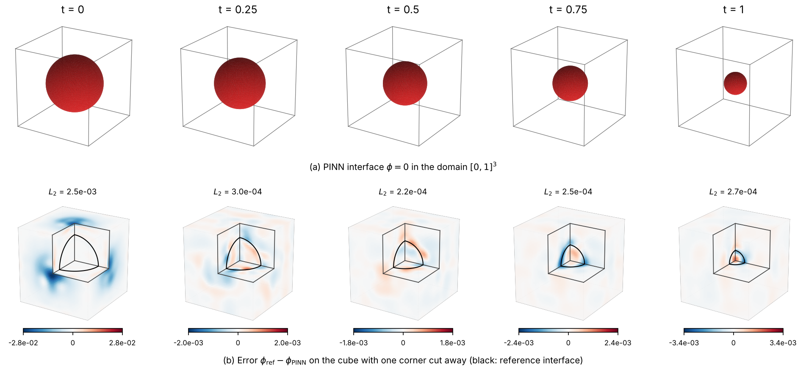
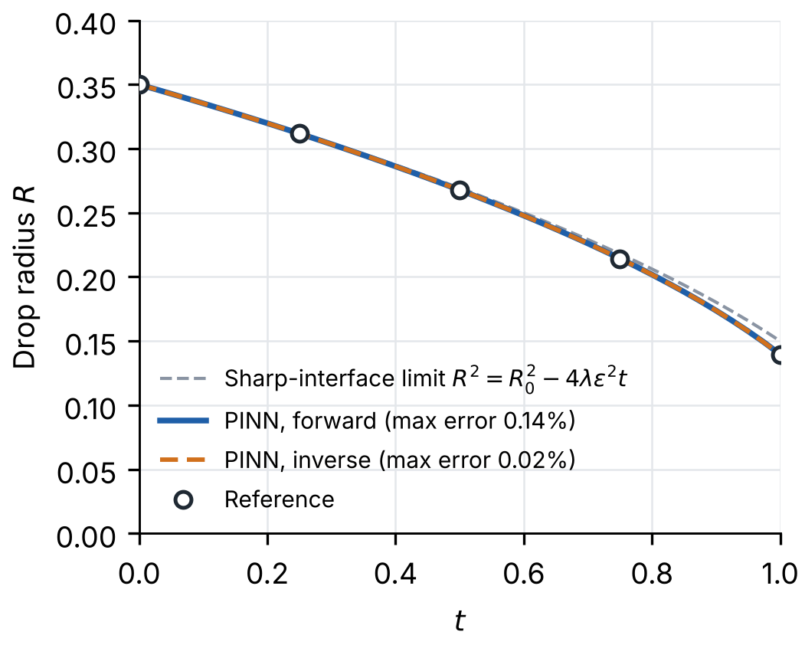

---
search:
  boost: 0.5
---

# Allen-Cahn 3D – Wight & Zhao

| Example | |
|---|---|
| **Source** | PINNStudio template |
| **Problem** | Forward and Inverse |
| **Dimension** | 3D (x, y, z, t) |
| **Regime** | Time-dependent |
| **Geometry** | Cuboid |
| **Outputs** | `phi` |
| **Settings** | Default, Tuned |

<figure markdown="span">
  { loading=lazy }
  <figcaption>Figure from the repository's benchmark notes (benchmarks/paper.md): a run of this example in Inverse mode — the PINN interface phi = 0 at five times (top) and the error on the cube with one corner cut away (bottom).</figcaption>
</figure>

<figure markdown="span">
  { loading=lazy }
  <figcaption>Figure from the repository's benchmark notes (benchmarks/paper.md): the same Inverse-mode run, the drop's radius over time — PINN, reference and the sharp-interface limit.</figcaption>
</figure>

## Governing equations

Mathematical form (from the benchmark records):

\[\frac{\partial \phi}{\partial t} = \lambda\left(\varepsilon^2\left(\frac{\partial^2 \phi}{\partial x^2} + \frac{\partial^2 \phi}{\partial y^2} + \frac{\partial^2 \phi}{\partial z^2}\right) - \phi^3 + \phi\right), \qquad (x, y, z) \in [0, 1]^3,\ t \in [0, 1]\]

Where \(\lambda = 10\) and \(\varepsilon = 0.05\) (\(\lambda\varepsilon^2 = 0.025\)). Its radius goes from 0.35 to about 0.14 at \(t = 1\).

As typed in PINNStudio's **Equations** page (each expression is a residual, set to zero):

```text
dphi_t - 0.025*(dphi_xx + dphi_yy + dphi_zz) + 10*(phi**3 - phi)
```

As typed in PINNStudio's **Equations** page (Inverse mode) (each expression is a residual, set to zero):

```text
dphi_t - diff_coeff*(dphi_xx + dphi_yy + dphi_zz) + lambda_*(phi**3 - phi)
```

## Domain

- Cuboid: \(x \in [0, 1]\), \(y \in [0, 1]\), \(z \in [0, 1]\)
- Time interval: \(t \in [0, 1]\)

## Initial conditions

| Output | Initial value | How it is imposed (Settings: Default) |
|---|---|---|
| `phi` | `tanh((0.35 - sqrt((x - 0.5)**2 + (y - 0.5)**2 + (z - 0.5)**2 + 1e-6))/0.1)` | loss term |

## Boundary conditions

| Type | Where | Output | Value | Details |
|---|---|---|---|---|
| Periodic BC | `left` | `phi` | — | axis x, derivative order 0 |
| Periodic BC | `bottom` | `phi` | — | axis y, derivative order 0 |
| Periodic BC | `front` | `phi` | — | axis z, derivative order 0 |

## Unknowns and measured data (Inverse)

| Trainable parameter | Initial value | True value |
|---|---|---|
| `lambda_` | 1 | 10 |
| `diff_coeff` | 1 | 0.025 |

Measured data (**Inverse** page, measured-data files):

- [`reference_data/3D/allen_cahn_wight/t_1.txt`](https://github.com/AsfandyarKhan72/PINNStudio/blob/main/reference_data/3D/allen_cahn_wight/t_1.txt) → output `phi`, weight 100

From the benchmark records: same template, switched to **Inverse**, recovering the two coefficients as they are written in the PDE box, the reaction coefficient \(\lambda\) and the diffusion coefficient \(\lambda\varepsilon^2\) (initial guesses 1, true values 10 and 0.025), from \(\phi\) measured at \(t = 1\) on every second point of the \(51^3\) reference grid (*Measured data → Use: Grid, 26 points per axis*, 17,576 points).

## Settings

### Forward mode

**Settings: Default** — the paper's method (Wight & Zhao 2021)

- **Network:** FNN, hidden layers 6 × 128, inputs (x, y, z, t), 1 output; activation tanh, initializer Glorot uniform
- **Points:** 30,000 domain, 1,500 boundary, 2,000 initial, 10,000 test
- **Loss weights:** `1.0,1.0,1.0,1.0,1000.0` (equations, then boundary-condition rows, then initial conditions)
- **Methods:** [time windows (2 windows)](../../reference/time-windows.md)

| Phase | Optimizer | Iterations | Learning rate | Decay |
|---|---|---|---|---|
| 1 | Adam | 10,000 | 0.001 | none |
| 2 | L-BFGS | 10,000 | — | none |

??? note "Settings: Tuned"

    The Training Log reports: *Tuned settings: a larger network (hidden layers twice as wide, one more layer).* The change is applied to the template's own settings (not the paper's method that Default loads).

    - **Network:** FNN, hidden layers 5 × 256, inputs (x, y, z, t), 1 output; activation tanh, initializer Glorot uniform
    - **Points:** 30,000 domain, 1,500 boundary, 2,000 initial, 10,000 test
    - **Loss weights:** `1.0,1.0,1.0,1.0,100.0` (equations, then boundary-condition rows, then initial conditions)
    - **Methods:** [exact periodicity (periodic input features)](../../reference/exact-constraints.md)

    | Phase | Optimizer | Iterations | Learning rate | Decay |
    |---|---|---|---|---|
    | 1 | Adam | 20,000 | 0.001 | none |
    | 2 | L-BFGS | 20,000 | — | none |

### Inverse mode

**Settings: Default** — the template's own settings

- **Network:** FNN, hidden layers 4 × 128, inputs (x, y, z, t), 1 output; activation tanh, initializer Glorot uniform
- **Points:** 30,000 domain, 1,500 boundary, 2,000 initial, 10,000 test
- **Loss weights:** `1.0,1.0,1.0,1.0,100.0,100.0` (equations, then boundary-condition rows, then initial conditions, then measured data)
- **Methods:** [exact periodicity (periodic input features)](../../reference/exact-constraints.md)

| Phase | Optimizer | Iterations | Learning rate | Decay |
|---|---|---|---|---|
| 1 | Adam | 20,000 | 0.001 | none |
| 2 | L-BFGS | 20,000 | — | none |

No separate **Tuned** preset: the **Tuned** item is greyed out for this example (its Default settings are PINNStudio's best).

## Loading it in PINNStudio

- Forward: toolbar **Examples:** › **Forward** › under the **── 3D ──** heading, **Allen-Cahn 3D – Wight & Zhao** › **Default** or **Tuned**, then **Solve**.
- Inverse: toolbar **Examples:** › **Inverse** › under the **── 3D ──** heading, **Allen-Cahn 3D – Wight & Zhao** › **Default**, then **Solve**.

Loading an example fills in every setting; anything you change before **Solve** is listed in the Training Log. Your save folder, GPU, random-seed and plot-style settings are kept.

## Reference solution

- Reference data files: [`reference_data/3D/allen_cahn_wight/`](https://github.com/AsfandyarKhan72/PINNStudio/tree/main/reference_data/3D/allen_cahn_wight)

## Definition and records

- **Definition:** template "3D Allen-Cahn (Wight & Zhao)" in `MainWindow._on_template_selected`, [`pinnstudio/ui/main_window.py`](https://github.com/AsfandyarKhan72/PINNStudio/blob/main/pinnstudio/ui/main_window.py)
    - Inverse mode: `MainWindow.INVERSE_AUTO_VARS["3D Allen-Cahn (Wight & Zhao)"]` (unknowns) and `INVERSE_AUTO_OBS["3D Allen-Cahn (Wight & Zhao)"]` (measured data), same file
    - Settings: Default (the paper's method): `_ac3d_wz` in [`pinnstudio/core/paper_settings.py`](https://github.com/AsfandyarKhan72/PINNStudio/blob/main/pinnstudio/core/paper_settings.py)
    - Settings: Tuned: entry "3D Allen-Cahn (Wight & Zhao)" in [`pinnstudio/resources/tuned_settings.json`](https://github.com/AsfandyarKhan72/PINNStudio/blob/main/pinnstudio/resources/tuned_settings.json)
- **Equations:** [Governing equations](#governing-equations) on this page
- **Reference data:** [`reference_data/3D/allen_cahn_wight/`](https://github.com/AsfandyarKhan72/PINNStudio/tree/main/reference_data/3D/allen_cahn_wight), written by [`tools/make_phase_field_reference_data.py`](https://github.com/AsfandyarKhan72/PINNStudio/blob/main/tools/make_phase_field_reference_data.py)
- **Measured data** (Inverse): [`reference_data/3D/allen_cahn_wight/`](https://github.com/AsfandyarKhan72/PINNStudio/tree/main/reference_data/3D/allen_cahn_wight), written by [`tools/make_phase_field_reference_data.py`](https://github.com/AsfandyarKhan72/PINNStudio/blob/main/tools/make_phase_field_reference_data.py)
- **Benchmark records:** [`benchmarks/problems/allen-cahn-3d-wight-zhao.md`](https://github.com/AsfandyarKhan72/PINNStudio/blob/main/benchmarks/problems/allen-cahn-3d-wight-zhao.md), its entry in the [examples overview](https://github.com/AsfandyarKhan72/PINNStudio/blob/main/benchmarks/examples.md#3d-allen-cahn-wight--zhao), the [benchmark collection](https://github.com/AsfandyarKhan72/PINNStudio/blob/main/benchmarks/README.md)
- **Tuning-study configurations** (records of the tuning study; open one with **Problem › Open Saved Problem...**; not presets of the Examples list): [`Allen-Cahn 3D – Wight & Zhao (PINNStudio template) (tuned).pinn.json`](https://github.com/AsfandyarKhan72/PINNStudio/blob/main/benchmarks/tuning/Allen-Cahn%203D%20%E2%80%93%20Wight%20%26%20Zhao%20%28PINNStudio%20template%29%20%28tuned%29.pinn.json), [`Allen-Cahn 3D – Wight & Zhao (PINNStudio template), inverse mode (tuned).pinn.json`](https://github.com/AsfandyarKhan72/PINNStudio/blob/main/benchmarks/tuning/Allen-Cahn%203D%20%E2%80%93%20Wight%20%26%20Zhao%20%28PINNStudio%20template%29%2C%20inverse%20mode%20%28tuned%29.pinn.json)
- **Methods** (Default and Tuned settings): [Time windows and bc-PINN](../../reference/time-windows.md), [Networks and Fourier features](../../reference/networks.md)
- **Cite:** [Wight & Zhao 2021](../../about/references.md#wight2021)

Verified error values are reported in the [Reproducibility](../../reproducibility/benchmarks.md) section, not on this page.

[← Back to the example gallery](../index.md)
