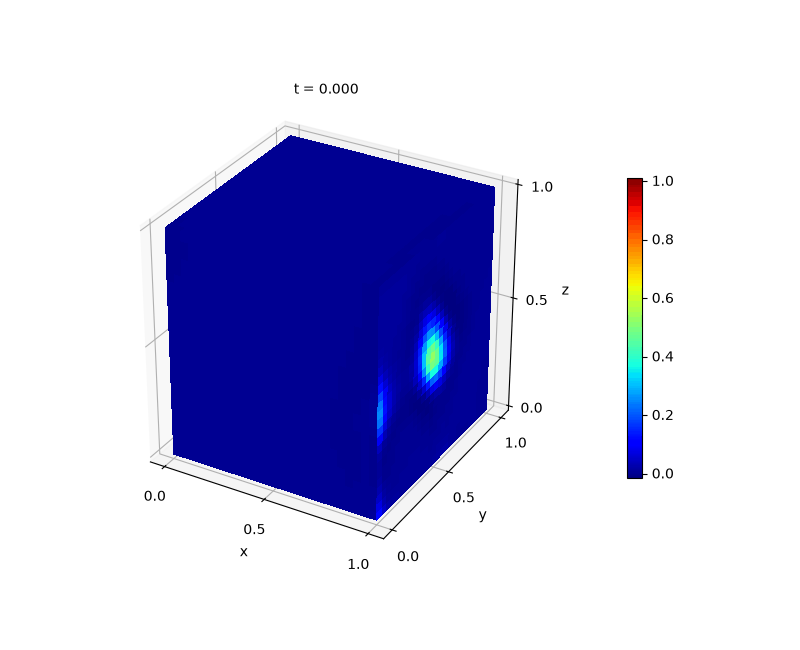

---
search:
  boost: 0.5
---

# Heat 3D

| Example | |
|---|---|
| **Source** | PINNStudio template |
| **Problem** | Forward and Inverse |
| **Dimension** | 3D (x, y, z, t) |
| **Regime** | Time-dependent |
| **Geometry** | Cuboid |
| **Outputs** | `u` |
| **Settings** | Default (no separate Tuned preset) |

<figure markdown="span">
  { loading=lazy }
  <figcaption>Animation from PINNStudio's README (top of the page): the PINN solution of this example over time.</figcaption>
</figure>

## Governing equations

Mathematical form (from the README):

\[\frac{\partial u}{\partial t} = 0.4\left(\frac{\partial^2 u}{\partial x^2} + \frac{\partial^2 u}{\partial y^2} + \frac{\partial^2 u}{\partial z^2}\right), \qquad (x, y, z) \in [0, 1]^3,\ t \in [0, 1]\]

As typed in PINNStudio's **Equations** page (each expression is a residual, set to zero):

```text
du_t - 0.4*(du_xx + du_yy + du_zz)
```

As typed in PINNStudio's **Equations** page (Inverse mode) (each expression is a residual, set to zero):

```text
du_t - alpha*(du_xx + du_yy + du_zz)
```

## Domain

- Cuboid: \(x \in [0, 1]\), \(y \in [0, 1]\), \(z \in [0, 1]\)
- Time interval: \(t \in [0, 1]\)

## Initial conditions

| Output | Initial value | How it is imposed (Settings: Default) |
|---|---|---|
| `u` | `0.0` | loss term |

## Boundary conditions

| Type | Where | Output | Value | Details |
|---|---|---|---|---|
| Neumann BC | `left` | `u` | `0` | — |
| Dirichlet BC | `right` | `u` | `1` | — |
| Neumann BC | `bottom` | `u` | `0` | — |
| Neumann BC | `top` | `u` | `0` | — |
| Neumann BC | `front` | `u` | `0` | — |
| Neumann BC | `back` | `u` | `0` | — |

## Unknowns and measured data (Inverse)

| Trainable parameter | Initial value | True value |
|---|---|---|
| `alpha` | 1 | 0.4 |

Measured data (**Inverse** page, measured-data files):

- [`reference_data/3D/heat/t_1.0_LessData.txt`](https://github.com/AsfandyarKhan72/PINNStudio/blob/main/reference_data/3D/heat/t_1.0_LessData.txt) → output `u`, weight 100

From the README: same template, switched to **Inverse**, recovering the diffusivity coefficient (fixed at \(0.4\) in Forward mode) as an unknown parameter.

## Settings

### Forward mode

**Settings: Default** — the template's own settings

- **Network:** FNN, hidden layers 4 × 128, inputs (x, y, z, t), 1 output; activation tanh, initializer Glorot uniform
- **Points:** 15,000 domain, 1,000 boundary, 1,000 initial, 10,000 test
- **Loss weights:** `1.0,1.0,100.0,1.0,1.0,1.0,1.0,100.0` (equations, then boundary-condition rows, then initial conditions)

| Phase | Optimizer | Iterations | Learning rate | Decay |
|---|---|---|---|---|
| 1 | Adam | 20,000 | 0.001 | none |
| 2 | L-BFGS | 20,000 | — | none |

No separate **Tuned** preset: the **Tuned** item is greyed out for this example (its Default settings are PINNStudio's best).

### Inverse mode

**Settings: Default** — the template's own settings

- **Network:** FNN, hidden layers 4 × 128, inputs (x, y, z, t), 1 output; activation tanh, initializer Glorot uniform
- **Points:** 15,000 domain, 1,000 boundary, 1,000 initial, 10,000 test
- **Loss weights:** `1.0,1.0,100.0,1.0,1.0,1.0,1.0,100.0,100.0` (equations, then boundary-condition rows, then initial conditions, then measured data)

| Phase | Optimizer | Iterations | Learning rate | Decay |
|---|---|---|---|---|
| 1 | Adam | 20,000 | 0.001 | none |
| 2 | L-BFGS | 20,000 | — | none |

No separate **Tuned** preset: the **Tuned** item is greyed out for this example (its Default settings are PINNStudio's best).

## Loading it in PINNStudio

- Forward: toolbar **Examples:** › **Forward** › under the **── 3D ──** heading, **Heat 3D** › **Default**, then **Solve**.
- Inverse: toolbar **Examples:** › **Inverse** › under the **── 3D ──** heading, **Heat 3D** › **Default**, then **Solve**.

Loading an example fills in every setting; anything you change before **Solve** is listed in the Training Log. Your save folder, GPU, random-seed and plot-style settings are kept.

## Reference solution

- Reference data files: [`reference_data/3D/heat/`](https://github.com/AsfandyarKhan72/PINNStudio/tree/main/reference_data/3D/heat)

## Source and citation

- PINNStudio's own problem (no source paper).

## Configuration and benchmark records

- [`benchmarks/tuning/Heat 3D (PINNStudio template) (tuned).pinn.json`](https://github.com/AsfandyarKhan72/PINNStudio/blob/main/benchmarks/tuning/Heat%203D%20%28PINNStudio%20template%29%20%28tuned%29.pinn.json) — a configuration tried in the tuning study, kept as a record (it can be opened with **Problem › Open Saved Problem...**; it is not a preset of the Examples list)
- [`benchmarks/tuning/Heat 3D (PINNStudio template), inverse mode (tuned).pinn.json`](https://github.com/AsfandyarKhan72/PINNStudio/blob/main/benchmarks/tuning/Heat%203D%20%28PINNStudio%20template%29%2C%20inverse%20mode%20%28tuned%29.pinn.json) — a configuration tried in the tuning study, kept as a record (it can be opened with **Problem › Open Saved Problem...**; it is not a preset of the Examples list)
- [Benchmark record](https://github.com/AsfandyarKhan72/PINNStudio/blob/main/benchmarks/problems/heat-3d.md) (`benchmarks/problems/heat-3d.md`)
- [Entry in the benchmark collection](https://github.com/AsfandyarKhan72/PINNStudio/blob/main/benchmarks/README.md) (`benchmarks/README.md`)

Verified error values are reported in the [Reproducibility](../../reproducibility/benchmarks.md) section, not on this page.

[← Back to the example gallery](../index.md)
