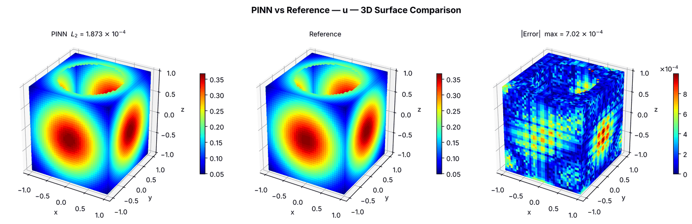

---
search:
  boost: 0.5
---

# Poisson 3D – cube with spherical cut-out

| Example | |
|---|---|
| **Source** | PINNStudio template |
| **Problem** | Forward |
| **Dimension** | 3D (x, y, z) |
| **Regime** | Steady |
| **Geometry** | Cuboid − Sphere |
| **Outputs** | `u` |
| **Settings** | Default, Tuned |

## Governing equations

Mathematical form (from the benchmark records):

\[-\frac{\partial^2 u}{\partial x^2} - \frac{\partial^2 u}{\partial y^2} - \frac{\partial^2 u}{\partial z^2} = \left(6 - 4(x^2 + y^2 + z^2)\right) e^{-(x^2 + y^2 + z^2)}\]

As typed in PINNStudio's **Equations** page (each expression is a residual, set to zero):

```text
-du_xx - du_yy - du_zz - (6 - 4*(x**2 + y**2 + z**2))*exp(-(x**2 + y**2 + z**2))
```

Constants: `R = 0.7`

## Domain

- Custom geometry (**Geometry** › Custom): Cuboid (x_min = -1, x_max = 1, y_min = -1, y_max = 1, z_min = -1, z_max = 1), minus Sphere (cx = 0, cy = 0, cz = 1, r = 0.7)

## Boundary conditions

| Type | Where | Output | Value | Details |
|---|---|---|---|---|
| Dirichlet BC | `left or right or bottom or top or front or back` | `u` | `exp(-(x**2 + y**2 + z**2))` | — |
| Neumann BC | `np.isclose(x**2 + y**2 + (z - 1)**2, R**2)` | `u` | `2*exp(-(x**2 + y**2 + z**2))*(x**2 + y**2 + z*(z - 1))/R` | — |

## Settings

**Settings: Default** — the template's own settings

- **Network:** FNN, hidden layers 4 × 64, inputs (x, y, z), 1 output; activation tanh, initializer Glorot uniform
- **Points:** 8,000 domain, 2,000 boundary, 5,000 test
- **Loss weights:** `1,1,1` (equations, then boundary-condition rows)

| Phase | Optimizer | Iterations | Learning rate | Decay |
|---|---|---|---|---|
| 1 | Adam | 15,000 | 0.001 | none |
| 2 | L-BFGS | 15,000 | — | none |

??? note "Settings: Tuned"

    The Training Log reports: *Tuned settings: 3× iterations, a larger network, 3× points and an L-BFGS phase together.* The change is applied to the example's own settings.

    - **Network:** FNN, hidden layers 5 × 128, inputs (x, y, z), 1 output; activation tanh, initializer Glorot uniform
    - **Points:** 24,000 domain, 6,000 boundary, 5,000 test
    - **Loss weights:** `1,1,1` (equations, then boundary-condition rows)

    | Phase | Optimizer | Iterations | Learning rate | Decay |
    |---|---|---|---|---|
    | 1 | Adam | 45,000 | 0.001 | none |
    | 2 | L-BFGS | 45,000 | — | none |

## Results

The configuration selected in PINNStudio's benchmark study, run on one RTX 4090. Forward: relative L₂ error of each output at the last reference time. Inverse: each parameter's relative error and, per seed, the largest of them (worst parameter error).

### Forward problem

**Settings:** Tuned — all of the changes together. **Values:** one run, seed 2026.

| Output | Relative L₂ |
|---|---|
| u | 1.9 × 10⁻⁴ |

<figure markdown="span">
  { loading=lazy }
  <figcaption>Forward, Tuned settings: PINN, reference and error.</figcaption>
</figure>

**Full benchmark record:** every setting tried, the per-seed values and all figures are in [the benchmark records on GitHub](https://github.com/AsfandyarKhan72/PINNStudio/blob/v1.6.0/benchmarks/examples.md#3d-poisson-cube-with-spherical-cut-out).

## Loading it in PINNStudio

- Forward: toolbar **Examples:** › **Forward** › under the **── 3D ──** heading, **Poisson 3D – cube with spherical cut-out** › **Default** or **Tuned**, then **Solve**.

Loading an example fills in every setting; anything you change before **Solve** is listed in the Training Log. Your save folder, GPU, random-seed and plot-style settings are kept.

## Reference solution

- Exact solution, **Error Analysis** › reference from formula: `u = exp(-(x**2 + y**2 + z**2))`

## Notes

- A cube [-1, 1]^3 with a sphere of radius R = 0.7 centred on its top face subtracted (Geometry -> Custom); u = exp(-(x^2 + y^2 + z^2)) on the cube's faces (Dirichlet, the named sides) and its normal derivative on the spherical surface (Neumann, a coordinate expression); compared with the exact solution.

## Definition and records

- **Definition:** `EXAMPLES` entry "3D Poisson (Cube with spherical cut-out)" in [`pinnstudio/core/pinnstudio_examples.py`](https://github.com/AsfandyarKhan72/PINNStudio/blob/v1.6.0/pinnstudio/core/pinnstudio_examples.py)
    - Settings: Tuned: entry "3D Poisson (Cube with spherical cut-out)" in [`pinnstudio/resources/tuned_settings.json`](https://github.com/AsfandyarKhan72/PINNStudio/blob/v1.6.0/pinnstudio/resources/tuned_settings.json)
- **Equations:** [Governing equations](#governing-equations) on this page
- **Reference data:** the exact-solution formula under *Reference solution* (no data files)
- **Benchmark records:** [`benchmarks/problems/poisson-3d-cube-with-spherical-cut-out.md`](https://github.com/AsfandyarKhan72/PINNStudio/blob/v1.6.0/benchmarks/problems/poisson-3d-cube-with-spherical-cut-out.md), its entry in the [examples overview](https://github.com/AsfandyarKhan72/PINNStudio/blob/v1.6.0/benchmarks/examples.md#3d-poisson-cube-with-spherical-cut-out), the [benchmark collection](https://github.com/AsfandyarKhan72/PINNStudio/blob/v1.6.0/benchmarks/README.md)
- **Tuning-study configurations** (records of the tuning study; open one with **Problem › Open Saved Problem...**; not presets of the Examples list): [`Poisson 3D – cube with spherical cut-out (PINNStudio template) (tuned).pinn.json`](https://github.com/AsfandyarKhan72/PINNStudio/blob/v1.6.0/benchmarks/tuning/Poisson%203D%20%E2%80%93%20cube%20with%20spherical%20cut-out%20%28PINNStudio%20template%29%20%28tuned%29.pinn.json)
- **Cite:** PINNStudio's own problem (no source paper)

How the benchmark values were measured and checked: [Reproducibility](../../reproducibility/benchmarks.md).

[← Back to the example gallery](../index.md)
