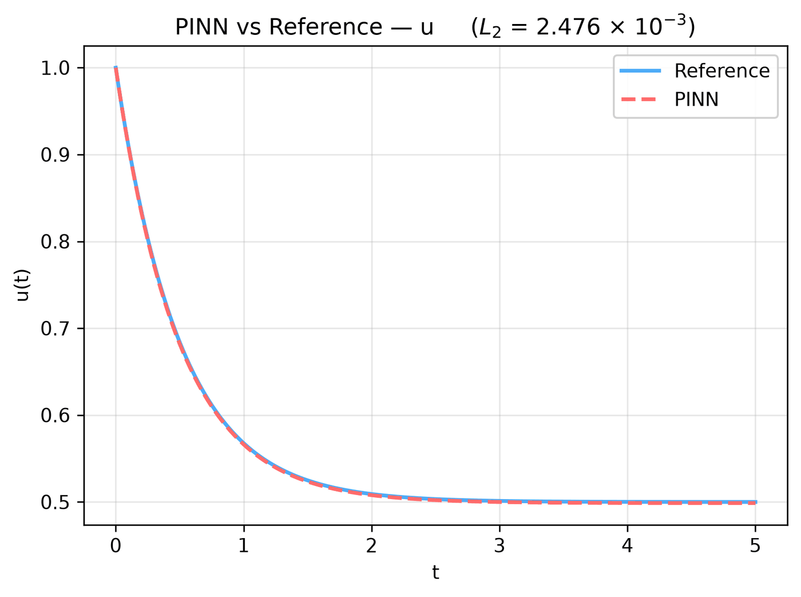

---
search:
  boost: 0.5
---

# Integro-differential ODE – Volterra kernel

| Example | |
|---|---|
| **Source** | DeepXDE example |
| **Problem** | Forward |
| **Dimension** | ODE (t) |
| **Regime** | Time-dependent |
| **Geometry** | — (t only) |
| **Outputs** | `u` |
| **Settings** | Default (no separate Tuned preset) |

## Governing equations

Mathematical form (from the benchmark records):

\[\frac{du}{dt} + u(t) = \int_0^t e^{s - t}\ u(s)\ ds, \qquad t \in [0, 5]\]

As typed in PINNStudio's **Equations** page (each expression is a residual, set to zero):

```text
du_t + u - integral(exp(s - t)*u)
```

## Domain

- Time interval: \(t \in [0, 5]\)

## Initial conditions

| Output | Initial value | How it is imposed (Settings: Default) |
|---|---|---|
| `u` | `1` | loss term |

## Boundary conditions

No boundary-condition rows: the boundary values are imposed exactly through the network's output transform (see **Methods** below), or the problem has no boundary terms.

## Settings

**Settings: Default** — DeepXDE's own settings

- **Network:** FNN, hidden layers 3 × 20, inputs (t), 1 output; activation tanh, initializer Glorot uniform
- **Points:** 10 domain, 2 boundary, 100 test
- **Loss weights:** `1,1` (equations, then boundary-condition rows, then initial conditions)

| Phase | Optimizer | Iterations | Learning rate | Decay |
|---|---|---|---|---|
| 1 | L-BFGS | 15,000 | — | none |

No separate **Tuned** preset: the **Tuned** item is greyed out for this example (its Default settings are PINNStudio's best).

## Results

The configuration selected in PINNStudio's benchmark study, run on one RTX 4090. Forward: relative L₂ error of each output at the last reference time. Inverse: each parameter's relative error and, per seed, the largest of them (worst parameter error).

### Forward problem

**Settings:** Default — the example's own settings (not in the tuning sweep); the example has no separate Tuned preset for this mode. **Values:** one run, seed 2026.

| Output | Relative L₂ |
|---|---|
| u | 2.5 × 10⁻³ |

<figure markdown="span">
  { loading=lazy }
  <figcaption>Forward, Default settings: PINN and reference along lines.</figcaption>
</figure>

**Full benchmark record:** every setting tried, the per-seed values and all figures are in [the benchmark records on GitHub](https://github.com/AsfandyarKhan72/PINNStudio/blob/main/benchmarks/examples.md#dx-volterra-integro-differential-equation).

## Loading it in PINNStudio

- Forward: toolbar **Examples:** › **Forward** › under the **── ODE ──** heading, **Integro-differential ODE – Volterra kernel** › **Default**, then **Solve**.

Loading an example fills in every setting; anything you change before **Solve** is listed in the Training Log. Your save folder, GPU, random-seed and plot-style settings are kept.

## Reference solution

- Exact solution, **Error Analysis** › reference from formula: `u = exp(-t)*cosh(t)`

## Notes

- integral(exp(s - t)*u) is the integral of the kernel e^(s - t) times u(s) from 0 to t, by 20-point Gauss-Legendre quadrature of the network (DeepXDE's dde.data.IDE, quad_deg = 20). Trained with L-BFGS only, as in DeepXDE's script.

## Definition and records

- **Definition:** `EXAMPLES` entry "Volterra integro-differential equation" in [`pinnstudio/core/deepxde_examples.py`](https://github.com/AsfandyarKhan72/PINNStudio/blob/main/pinnstudio/core/deepxde_examples.py)
- **Equations:** [Governing equations](#governing-equations) on this page
- **Reference data:** the exact-solution formula under *Reference solution* (no data files)
- **Benchmark records:** [`benchmarks/problems/integro-differential-ode-volterra-kernel.md`](https://github.com/AsfandyarKhan72/PINNStudio/blob/main/benchmarks/problems/integro-differential-ode-volterra-kernel.md), its entry in the [examples overview](https://github.com/AsfandyarKhan72/PINNStudio/blob/main/benchmarks/examples.md#dx-volterra-integro-differential-equation), the [benchmark collection](https://github.com/AsfandyarKhan72/PINNStudio/blob/main/benchmarks/README.md)
- **Tuning-study configurations** (records of the tuning study; open one with **Problem › Open Saved Problem...**; not presets of the Examples list): [`Integro-differential ODE – Volterra kernel (tuned).pinn.json`](https://github.com/AsfandyarKhan72/PINNStudio/blob/main/benchmarks/tuning/Integro-differential%20ODE%20%E2%80%93%20Volterra%20kernel%20%28tuned%29.pinn.json)
- **DeepXDE example:** [Volterra_IDE.py](https://github.com/lululxvi/deepxde/blob/master/examples/pinn_forward/Volterra_IDE.py)
- **Cite:** [Lu et al. 2021](../../about/references.md#lu2021deepxde) (DeepXDE)

How the benchmark values were measured and checked: [Reproducibility](../../reproducibility/benchmarks.md).

[← Back to the example gallery](../index.md)
